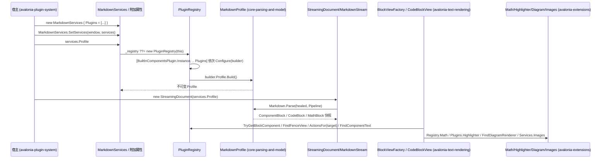

# 注册一个插件：从 `MarkdownServices.Plugins` 到真正参与解析与渲染

**Trigger:** 宿主构造 `MarkdownServices { Plugins = [...] }`（可选兼容写法 `Math` / `Highlighter` / `Diagrams`）、`MarkdownServices.SetServices(window, services)`，然后用 `services.Profile` 创建文档  **Outcome:** 插件的块组件标签、围栏视图、行内组件、公式 / 高亮 / 图表渲染器都进入一份不可变注册表（`PluginRegistry`）与不可变方言（`MarkdownProfile`）；同一份 `Profile` 被文档解析使用，同一份注册表被视图创建与查找使用。

## Steps
1. `src/TKCode.Arc.StreamMark/Avalonia/Extensions/MarkdownServices.cs:MarkdownServices`（:13）— 宿主先构造服务集合：`Plugins`（:20）、兼容写法 `Math`（:23）/`Highlighter`（:26）/`Diagrams`（:29）、`Images`（:49）、`CodeBlocks`（:43）全部是 `init` 属性，对象建好后再赋值编译不过；`Default`（:15）是静态单例，会作为附加属性的默认值 (`avalonia-plugin-system`)
2. `src/TKCode.Arc.StreamMark/Avalonia/Extensions/MarkdownServices.cs:MarkdownServices.SetServices`（:99）— 写入可继承附加属性 `ServicesProperty`（:94，`inherits: true`，默认值 `Default`）；`MarkdownView`（`OnServicesChanged`：必要时按新方言重建自建文档，再作废上下文）与 `TranscriptPanel`（只作废上下文）的 `Changed` 处理器都**不会重建注册表**，`MarkdownServices` 实例只是被引用、没有注册表字段可改，所以这里不产生任何注册动作 (`avalonia-plugin-system`)
3. `src/TKCode.Arc.StreamMark/Avalonia/Extensions/MarkdownServices.cs:MarkdownServices.Profile`（:90）— 首次有人读 `Profile`（或 `Registry` :87 / `FindDiagramRenderer` :92）时执行 `_registry ??= new PluginRegistry(this)`：**注册表在此刻于锁内一次性构建并缓存**（失败时缓存 `PluginConfigurationException`），谁先访问就定了这份服务集合对应的方言 (`avalonia-plugin-system`)
4. `src/TKCode.Arc.StreamMark/Avalonia/Plugins/PluginRegistry.cs:PluginRegistry`（构造 :17）— `new MarkdownPluginBuilder(new MarkdownProfileBuilder())`（:19）；插件序列是硬编码拼接 `[BuiltInComponentsPlugin.Instance, .. services.Plugins]`（:20）；按顺序同步 `plugin.Configure(builder)`（:23-24），**没有 try/catch**：插件抛异常会直接冒给首次访问 `Registry` 的调用方，且 `_registry ??=` 的赋值不发生、下次访问会再构一次 (`avalonia-plugin-system`)
5. `src/TKCode.Arc.StreamMark/Avalonia/Plugins/BuiltInComponentsPlugin.cs:BuiltInComponentsPlugin.Configure`（:24）— 总是第一个被 Configure 的内置插件（单例 `Instance`，:20）：`AddBlockComponent("details"/"think", _, registerTag: false)`（:26-27）、`AddInlineComponent("citation"/"cite", …, registerTag: false)`（:28-29）、`AddFenceView("diff"/"patch", _, whileStreaming: true)`（:31-32）；它不登记白名单标签，标签来自 `src/TKCode.Arc.StreamMark/Core/Parsing/ComponentSpec.cs:ComponentSpec.BuiltIn`（:20，`details/summary/think/kbd/sub/sup/mark/u/cite/citation/img`），所以内置组件「总是存在、无法关闭」(`avalonia-plugin-system`, `core-parsing-and-model`)
6. `src/TKCode.Arc.StreamMark/Avalonia/Plugins/IMarkdownPlugin.cs:MarkdownPluginBuilder.Profile`（:33）— 语法层入口：插件在自己的 `Configure` 里通过它写 Core 的 `MarkdownProfileBuilder`，可用 `AddComponent` / `AddMarkdigExtension` / `MapBlock<T>` / `MapInline<T>` / `AddRemendHandler`（Core 侧定义 `src/TKCode.Arc.StreamMark/Core/Parsing/MarkdownProfile.cs:70-103`）(`core-parsing-and-model`)
7. `src/TKCode.Arc.StreamMark/Avalonia/Plugins/IMarkdownPlugin.cs:MarkdownPluginBuilder.AddBlockComponent`（:66）— 三个重载都落到 `AddBlockComponent(name, factory, BlockComponentOptions)`：`BlockComponents[name] = new BlockComponentRegistration(factory, options.Text, options.WhileStreaming)`（字典是 `StringComparer.OrdinalIgnoreCase`），并在 `options.RegisterTag`（默认 `true`）时 `Profile.AddComponent(new ComponentSpec(name, ComponentKind.Block) { Content = options.Content })`——`Content = Raw` 的组件内容原样保留，见 `core-parsing-and-model`；`AddInlineComponent`（:77）同理，默认 `ComponentKind.SelfClosing`（:77），`InlinePair` 走 `GetStyle` + 点击；两者都**不检查重名、直接覆盖** (`avalonia-plugin-system`)
8. `src/TKCode.Arc.StreamMark/Core/Parsing/MarkdownProfile.cs:MarkdownProfileBuilder.AddComponent`（:77）— 先 `RemoveAll` 同名（`OrdinalIgnoreCase` 比较，:79）再 `Add`（:80）；`_components` 初始值就是 `[.. ComponentSpec.BuiltIn]`（:64），所以内置标签与插件标签合并在同一张表，同名时后登记（= 排在后面的插件）覆盖先登记（= 内置）(`core-parsing-and-model`)
9. `src/TKCode.Arc.StreamMark/Avalonia/Plugins/IMarkdownPlugin.cs:MarkdownPluginBuilder.AddFenceView`（:88）— `FenceViews[language] = new FenceViewRegistration(factory, whileStreaming)`（:90，记录类型 `FenceViewRegistration` :102）；围栏视图只按语言登记，**不参与白名单**，与组件标签是两套表 (`avalonia-plugin-system`)
10. `src/TKCode.Arc.StreamMark/Avalonia/Plugins/IMarkdownPlugin.cs:MarkdownPluginBuilder.UseMath`（:43）/`UseHighlighter`（:49）/`AddDiagramRenderer`（:56）/`AddBlockAction`（:95）— 前两个是单值覆盖（`Math = renderer`，:45），`Diagrams` 与 `BlockActions` 是 `List` 追加（:58、:97），操作描述符 `BlockActionDescriptor`（:127）无去重、无校验 (`avalonia-plugin-system`)
11. `src/TKCode.Arc.StreamMark/Avalonia/Plugins/PluginRegistry.cs:PluginRegistry`（:25-32）— 合并兼容属性并把 builder 的容器**引用**接过来：`Math = builder.Math ?? services.Math`（:25，插件赢）、`Highlighter = builder.Highlighter ?? services.Highlighter`（:26）、`Diagrams = [.. builder.Diagrams, .. services.Diagrams]`（插件排在兼容写法前面，`FindDiagramRenderer` 返回第一个命中者）、三张查找表转成 `FrozenDictionary`、块操作按 `Targets` 分组、`_blockComponents`/`_inlineComponents`/`_fenceViews`（:28-30）、`BlockActions = [.. builder.BlockActions]`（:31），最后 `Profile = builder.Profile.Build()`（:32）并丢弃 builder (`avalonia-plugin-system`)
12. `src/TKCode.Arc.StreamMark/Core/Parsing/MarkdownProfile.cs:MarkdownProfileBuilder.Build`（:105）— 组件表转 `ImmutableArray`（:107）、固定 Markdig 管线（`UsePipeTables` … `UseMathematics` … `Use<BackslashMathExtension>`，:108-121），先 `builder.Extensions.Add(new HtmlComponentExtension(new ComponentTable(components)))`（:122）再追加插件登记的扩展（:123-126），构造不可变 `MarkdownProfile`（:128）；`Profile.Table`（:26）与 `MarkdownProfile.Default`（:33，`new MarkdownProfileBuilder().Build()`）同时定型 (`core-parsing-and-model`)
13. `src/TKCode.Arc.StreamMark/Core/Streaming/StreamingDocument.cs:StreamingDocument`（:37）— 主机必须用 `services.Profile` 建文档：`Profile = profile ?? MarkdownProfile.Default`（:39）并交给 `DocumentComposer`（:40）；**传 null 就是静默回落默认方言**，插件注册的白名单标签随后只会按普通 HTML / 文本落地 (`core-parsing-and-model`)
14. `src/TKCode.Arc.StreamMark/Avalonia/MarkdownStream.cs:MarkdownStream`（:20）/`src/TKCode.Arc.StreamMark/Avalonia/Transcript/TranscriptEntry.cs:MarkdownEntry.FromText`（:25）— 另两条入口同样接收 `MarkdownProfile? profile` 并原样传给 `new StreamingDocument(profile)`（`MarkdownStream.cs:24`、`TranscriptEntry.cs:27`，按需解析版 :37）；`MarkdownView` 自建文档时用 `MarkdownServices.GetServices(this).Profile`（`MarkdownView.cs:105`），但 `_ownDocument ??=` 只在 `Markdown`/`Document`/`Stream` 变化且文档为 null 时新建；服务变化时 `MarkdownView.OnServicesChanged` 发现自建文档的方言不是新服务的 `Profile` 就重建并重新解析，所以设置顺序无关(`avalonia-text-rendering`, `avalonia-plugin-system`)
15. `src/TKCode.Arc.StreamMark/Core/Parsing/HtmlComponentExtension.cs:HtmlComponentExtension.Setup`（:18）— 白名单表被注入 Markdig 管线：`HtmlComponentBlockParser` 插在 `HtmlBlockParser` 之前（:22），`HtmlComponentInlineParser` 插在 `AutolinkInlineParser` 之前（:26）；块解析器只接管 `spec.Kind == ComponentKind.Block` 的开始标签（:94），而以行内组件开头的整行被转交段落解析器（:98）；行内解析器只接管非 Block 类型（:195），成对组件在结束标签处闭合（:204-211）(`core-parsing-and-model`)
16. `src/TKCode.Arc.StreamMark/Core/Parsing/MarkdigMapper.cs:MarkdigMapper`（:188）— 命中的 `HtmlComponentBlock` 映射为模型 `ComponentBlock(component.Name.ToLowerInvariant(), component.Attributes, …) { IsOpen }`，原样组件的 `HtmlRawComponentBlock` 映射为 `ComponentBlock { Raw, IsOpen }`；查找表 `ComponentTable` 也是 `OrdinalIgnoreCase` 且 `BlockNames` 取小写（`src/TKCode.Arc.StreamMark/Core/Parsing/ComponentSpec.cs:50`、:58），所以注册 `"Callout"` 与 `"callout"` 等价，视图工厂字典同为 `OrdinalIgnoreCase`（`IMarkdownPlugin.cs:38`）；插件标签同时进 `MarkdownProfile.SegmenterContainers`（`MarkdownProfile.cs:52`），流式切分把它当容器、内部不冻结 (`core-parsing-and-model`)
17. `src/TKCode.Arc.StreamMark/Core/Streaming/DocumentComposer.cs:DocumentComposer.Parse`（:111）— 解析走的就是注册结果：`Markdown.Parse(healed, _profile.Pipeline)`（:114）用的是含 `HtmlComponentExtension` 的管线；插件追加的 remend 处理器在构造时并入尾部选项（`_tailOptions = … with { Handlers = [.. options.Handlers ?? [], .. _profile.RemendHandlers] }`，:46），冻结片段仍用不带末尾补全的 `SettledOptions`（:21）；因此**有没有插件决定快照里有没有 `ComponentBlock`** (`core-parsing-and-model`)
18. `src/TKCode.Arc.StreamMark/Avalonia/Rendering/DocumentPresenter.cs:DocumentPresenter.Apply`（:30）— 视图期入口：`Insert` 走 `BlockViewFactory.Create(op.Block!, context)` + `view.Update`（:41-45），`Update` 先 `BlockViewFactory.CanReuse`（:51），`contextChanged` 时 `Restyle`（:83）按原模型全量重新分派（:89-98）(`avalonia-text-rendering`)
19. `src/TKCode.Arc.StreamMark/Avalonia/Rendering/BlockViewFactory.cs:BlockViewFactory.Create`（:8）— 插件优先分派：`ComponentBlock` 查 `context.Plugins.FindBlockComponent(component)`（:13，未注册、或登记为 `WhileStreaming = false` 而组件仍 `IsOpen` 时用 `new Plugins.ComponentContainerView()`，`BuiltInComponentsPlugin.cs:37`）；`CodeBlock` 查 `context.Plugins.FindFenceView(code)`（:15 → `PluginRegistry.cs:62`，要求 `code.Language` 命中且 `!code.IsOpen || registration.WhileStreaming`，:63）；其余走 `CreateBuiltIn`（:22），其中 `CodeBlock { IsOpen: false }` 且 `context.Services.FindDiagramRenderer(code.Language) is not null` 才映射为 `DiagramBlockView`（:95）(`avalonia-text-rendering`)
20. `src/TKCode.Arc.StreamMark/Avalonia/Plugins/PluginRegistry.cs:PluginRegistry.FindDiagramRenderer`（:46）— 遍历 `Diagrams`、返回第一个 `CanRender(language)` 为真的渲染器；`DiagramBlockView.StartRender`（:92）用它，`Renderer.RenderAsync` 在 `Task.Run` 里执行（`DiagramBlockView.cs:108-114`，契约允许后台线程：`src/TKCode.Arc.StreamMark/Avalonia/Extensions/IDiagramRenderer.cs:18`）(`avalonia-extensions`)
21. ⇢ crosses thread boundary (后台 → 界面) — 图表渲染回投：`DiagramBlockView.StartRender` 的 `Dispatcher.UIThread.InvokeAsync`（`DiagramBlockView.cs:128`），用 `token.IsCancellationRequested || key != _renderKey`（:134）丢弃过期结果，成功结果进 32 项 `DiagramCache`（`BlockResultCache<string, DiagramResult>`，LRU）；插件视图用 `BlockView.RunInBackground` 得到同样的保证；高亮同理走 `Task.Run` + `Dispatcher.UIThread.Post` 并校验 `ReferenceEquals(session, _session)`（`CodeBlockState.cs:115`、:142-147）
22. `src/TKCode.Arc.StreamMark/Avalonia/Rendering/BlockActionBar.cs:BlockActionBar.Rebuild` — 块操作按注册表出现：`context.Plugins.ActionsFor(target)`（构建时按 `BlockActionDescriptor.Targets` 分好的组）为空就直接返回；否则对每个 `AppliesTo(block)` 为真的操作建 `IconButton`，点击时用所属视图的当前 `Block` 执行 `Execute(new BlockActionContext(block, view, fence))`（`fence` 只有代码块与图表才有）。`CodeBlockView` / `DiagramBlockView` 在 `contextChanged` 或 `Info` 变化时重建，`TableBlockView` 在 `contextChanged` 或首次更新时重建 (`avalonia-text-rendering`)
23. `src/TKCode.Arc.StreamMark/Avalonia/Rendering/TextSegmentView.cs:InlineTextSource.CreateObjectRun`（:1089）— 行内组件按注册表渲染：`FindInlineComponent(obj.Value)?.CreateRun(obj, new Plugins.InlineComponentContext(…))`，`null` 表示显示为空（:1090-1091）；成对组件的 `GetStyle` 在 `PropertiesFor` 里叠加（:1173），`IsClickable` 决定手型与 `ComponentClickedEvent`（:578、:588、:853）(`avalonia-text-rendering`)
24. `src/TKCode.Arc.StreamMark/Avalonia/Rendering/CodeBlockState.cs:CodeBlockState.For`（:48）— 服务在渲染上下文里生效：高亮器取自 `context.Plugins.Highlighter`（:50），主题取自 `context.Style.HighlightTheme`（:51），语言 / 高亮器 / 主题任一变化就重建共享状态（:53-60），`RequestHighlight` 在 `Highlighter is null` 时直接返回（:100）；公式取 `context.Services.Registry.Math?.Layout(...)`（`MathBlockView.cs:40`，行内同：`TextSegmentView.cs:1066`），图表颜色 / 明暗由 `DiagramRenderContext` 从 `MarkdownStyle` 组出（`DiagramBlockView.cs:103`）(`avalonia-extensions`, `theme-and-styles`)
25. `src/TKCode.Arc.StreamMark/Avalonia/Rendering/RenderContext.cs:RenderContext`（:14）— 所有视图拿到的都是同一份注册表：`Plugins => Services.Registry`（:30）；`MarkdownServices` 引用变化时 `MarkdownView.InvalidateContext`（:172，由 :44 的 Changed 触发）置空 `_context`，下一帧新建（:165、`CreateContext` :169-170，样式快照同时经 `MarkdownStyle.Resolve` 重建），新上下文触发 `DocumentPresenter.Restyle`（:83）——**只有换新的 `MarkdownServices` 实例才可能改变插件效果**，换的是同一实例则注册表与 `Profile` 都不变 (`theme-and-styles`, `avalonia-text-rendering`)

## Sequence

## Errors and cancellation
- **注册失败带插件名、只失败一次**：`PluginRegistry` 构造把每个 `plugin.Configure(builder)` 的异常包成 `PluginConfigurationException`（`PluginName` 是 `IMarkdownPlugin.Name`），`MarkdownServices.Registry` 在锁内构建并缓存这个异常，之后每次访问重新抛出同一个异常、不再重跑插件。`Configure` 仍然只应登记委托与工厂，不要做 IO / 反射（NativeAOT，`docs/streammark/architecture.md:57-60`）。
- **未注册视图的组件静默回落**：`ComponentBlock` 在 `_blockComponents` 里查不到时返回 `ComponentContainerView`（`BlockViewFactory.cs:13`），只按普通容器显示子块，没有日志、没有占位提示。同名视图被覆盖同理——两个层次必须同时覆盖：视图工厂 `BlockComponents[name] = factory`（`IMarkdownPlugin.cs:68`）与白名单 `Profile.AddComponent`（`MarkdownProfile.cs:79`）；只覆盖一处会出现「解析成组件但视图还是内置的」或反之。
- **没有围栏视图就是普通代码块**：`FindFenceView` 返回 null（语言不匹配、或代码块未闭合且注册时 `whileStreaming: false`，`PluginRegistry.cs:63`）时走 `CodeBlockView`（`BlockViewFactory.cs:19`）。流式中途先是 `CodeBlockView`，闭合后才由 `DocumentPresenter.Restyle`（:83）换成插件视图；`CanReuse` 用 `ReferenceEquals(fence, oldFence)` 判断（`BlockViewFactory.cs:51`），换注册表后旧视图会被替换。
- **服务缺失是静默的**：`Math` 为空 → `MathBlockView.cs:40` 的 `?.Layout` 得到 null，显示源码（:46-51）；`Highlighter` 为空 → `CodeBlockState.RequestHighlight` 直接返回、不着色（`CodeBlockState.cs:100`）；`Diagrams` 里没有 `CanRender` 命中者 → 既不进 `ViewType.Diagram`（`BlockViewFactory.cs:95`）也不渲染（`DiagramBlockView.cs:92-96`）；`Images` 为空不会发生（`MarkdownServices.cs:49` 有进程共享默认实例）。
- **运行期失败有区分**：高亮异常被吞（`catch (Exception) { continue; }`，`CodeBlockState.cs:138-141`），界面停在旧着色；图表异常进 `_statusText` 画在块内（`DiagramBlockView.cs:124-141`），`OperationCanceledException` 直接返回不报错（:120-123）；唯一的取消令牌是图表的 `_cts`（:83）。
- **惰性构建的时机决定一切**：注册表只在首次访问时构建一次（`MarkdownServices.cs:87`），`Plugins` / `Math` / `Highlighter` / `Diagrams` 又都是 `init`（:20-29）。因此「注册阶段之后修改」在两种意义上都无效：属性改不了（编译期），替换列表元素改不了（注册表与 `Profile` 已固化）。
- **文档不传 `Profile`**：显式传 `null` 或漏传时回落 `MarkdownProfile.Default`（`StreamingDocument.cs:39`），插件标签不被解析。推荐用 `services.CreateDocument()` / `CreateStream()` / `CreateEntry()`。宿主的文档方言不同时，视图新建渲染上下文时经 `MarkdownServices.CheckProfile` 报告一次 `ProfileMismatch`（`Diagnostic` 事件 + `Trace`）。插件都不改语法时 `Profile` 就是 `MarkdownProfile.Default`，不会误报。

## Where to hook in
受支持的位置：
- **加一个插件**：实现 `IMarkdownPlugin`（只有 `Name` + `Configure`，`IMarkdownPlugin.cs:17`），在 `Configure` 里一次性登记；参考实现 `src/TKCode.Arc.StreamMark.RaTeX/RaTeXPlugin.cs:10`（`UseMath`）、`src/TKCode.Arc.StreamMark.TextMate/TextMatePlugin.cs:12`（`UseHighlighter`）、`src/TKCode.Arc.StreamMark.Mermaid/MermaidPlugin.cs:10`（`AddDiagramRenderer`）。宿主侧：`new MarkdownServices { Plugins = [...] }` + `MarkdownServices.SetServices(ancestor, services)` + 用 `services.Profile` 建文档（`tools/streammark/Gallery/Program.cs:33-44`、:84、:89（`MarkdownEntry.FromText(text, services.Profile)`）、:118（`new MarkdownStream(profile: Profile)`）；测试模板 `tests/TKCode.Arc.StreamMark.Tests/Avalonia/Plugins/PluginSystemTests.cs:22`（自带 `TestPlugin`）+ :130-133（`SetServices` 先于设 `Markdown`））。
- **加块级视图 / 行内组件 / 围栏视图 / 块操作**：`builder.AddBlockComponent`（`IMarkdownPlugin.cs:66`）、`AddInlineComponent`（:77）、`AddFenceView`（:88）、`AddBlockAction`（:95）；视图继承 `BlockView` / `StackBlockView`（`src/TKCode.Arc.StreamMark/Avalonia/Rendering/BlockView.cs:13`、:61），`OnUpdate` 里按阅读顺序消耗片段号（`BlockView.cs:43`），要跨回收保留状态就写 `context.State`（`BlockStateStore.cs:8`，范例 `BuiltInComponentsPlugin.cs:84` 的 `collapsible.open:` + 组件名）。
- **加新语法 / 白名单 / 尾部补全**：`builder.Profile.AddComponent` / `AddMarkdigExtension` / `MapBlock<T>` / `MapInline<T>` / `AddRemendHandler`（`MarkdownProfile.cs:70-103`）；`MapBlock` 的 `MapContext` 提供 `MapChildren` / `MapInlines` / `RangeOf`（:145-149）。不经 `MarkdownServices` 的 Core 侧模板见 `tests/TKCode.Arc.StreamMark.Tests/Core/Parsing/ComponentTests.cs:118`。
- **覆盖内置组件 / 围栏视图**：同名 `AddBlockComponent` / `AddFenceView` 即可——内置插件硬编码在最前（`PluginRegistry.cs:20`），后登记者覆盖是设计内行为（`IMarkdownPlugin.cs:68`），`BuiltInComponentsPlugin.cs:16` 的注释也承诺了这一点。

看起来诱人但会破坏东西的位置：
- **运行期改插件**：改 `Plugins` 属性编译不过（`init`，`MarkdownServices.cs:20`）；就地改传入的列表内容对已构建的注册表无效（`PluginRegistry.cs:28-31` 接的是构造那一刻的字典引用，`Profile` 更是 :32 已 `Build()`）。换效果只能换一个新的 `MarkdownServices` 实例再 `SetServices`。
- **指望 `SetServices` 给宿主自己的文档换方言**：`MarkdownView` 只为 `Markdown` 自建的文档按新方言重建（`MarkdownView.OnServicesChanged`，设置顺序无关）；`Document` / `Stream` / 会话条目归宿主，只报告不匹配，不重建。
- **直接改 `BuiltInComponentsPlugin`**：它是硬编码首项（`PluginRegistry.cs:20`）、进程内单例（`BuiltInComponentsPlugin.cs:20`），改动影响所有宿主；并且内置登记用 `registerTag: false`（:26-29），新标签必须同时进 `ComponentSpec.BuiltIn`（`ComponentSpec.cs:20`）或显式 `AddComponent`，否则解析阶段根本不会产生 `ComponentBlock`。
- **在 `Configure` 里做重活**：注册发生在首次访问 `Registry` 的调用线程上（可能在界面线程），且插件注册只能用委托与工厂（`MarkdownPluginBuilder` 字段全是 `Func<…>` / 接口 / 记录，`IMarkdownPlugin.cs:35-41`），Core 侧 `MapBlock<T>` 也只做 `is TNode` 判定（`MarkdownProfile.cs:87`）；NativeAOT 下不要引入反射式注册或类型扫描。
- **期待插件之间的图表也是后登记者覆盖**：兼容写法与插件已同向（插件优先，`PluginRegistry` 构造里 `Diagrams = [.. builder.Diagrams, .. services.Diagrams]`），但插件之间的图表仍是登记顺序上先命中者生效，因为 `CanRender` 是谓词、注册表无法判断两个渲染器是否重叠。

## Related
- Modules: [avalonia-plugin-system](../modules/avalonia-plugin-system.md)
- Modules: [core-parsing-and-model](../modules/core-parsing-and-model.md)
- Modules: [avalonia-text-rendering](../modules/avalonia-text-rendering.md)
- Modules: [avalonia-extensions](../modules/avalonia-extensions.md)
- Modules: [theme-and-styles](../modules/theme-and-styles.md)
- Modules: [native-ratex](../modules/native-ratex.md)（仅公式插件在第 15 步跨到的原生库）
