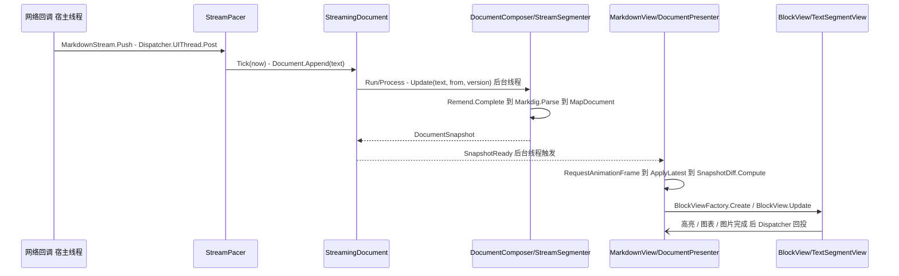

# 一个 token 从网络回调到屏幕上的块视图

**Trigger:** 宿主在任意线程调用 `StreamingDocument.Append`（生产路径是 `MarkdownStream.Push` → `StreamPacer.Tick`）  **Outcome:** 稳定块被冻结且只解析一次，尾部每个快照重做补全 + 解析；界面线程每帧最多应用一次差异；块视图按 key 复用；未闭合语法已补全；末尾片段带渐显与光标。

> 本次记录的树 = HEAD `349b77f`（目标里的 `e01b99a` 之后还有一次提交 `349b77f`）。写作期间有并发改动落到工作树（`git status`：`Extensions/CodeBlockOptions.cs`、`Plugins/BuiltInComponentsPlugin.cs`、`Rendering/CodeBlockView.cs` 为 Modified，`Rendering/DiffBlockView.cs` 为新增）。下文按**工作树**（= 349b77f + 这批未提交改动）写：第 21 步与第 25 步的行号按工作树给出；这次改动只动了 diff 的呈现职责（`CodeTextView.Diff` 与三支 `DiffBrush` 被删除，改由 `DiffBlockView` 承担），没有动本流程的结构。

## Steps
1. `src/TKCode.Arc.StreamMark/Avalonia/MarkdownStream.cs:MarkdownStream.Push` — 任意线程的分片先 `Dispatcher.UIThread.Post`（:42）切到界面线程，置 `State.IsActive = true`，`_smooth` 为真时 `_pacer.Push(text, StreamClock.Now)` 并启动 16ms `DispatcherTimer`（:26）后立即 `Tick()`；`_smooth` 为假时直接 `Document.Append(text)` + `State.RecordReveal`（:51-52）(`avalonia-text-rendering`)
2. `src/TKCode.Arc.StreamMark/Core/Pacing/StreamPacer.cs:StreamPacer.Tick` — 本帧放出量 = `max(滑动到达速率, 积压 / TargetLag)`（:156），`MaxLag`（默认 400ms）用到达队列兜底强制放出（:164），`BypassThreshold`（4096）整段放出（:151）；`StreamPacer.Release` 只在字素簇边界切（`StringInfo.GetNextTextElementLength`，:226），未结束时末尾的高代理字符留到下一帧（:233）(`core-streaming`)
3. `src/TKCode.Arc.StreamMark/Avalonia/MarkdownStream.cs:MarkdownStream.Tick` — `Document.Append(text)`，紧接着 `State.RecordReveal(text.Length, now)`（:98-99）把这一批的显示时间写进渐显队列（`StreamingState.cs:29`）
4. `src/TKCode.Arc.StreamMark/Core/Streaming/StreamingDocument.cs:StreamingDocument.Append` — 在 `_sourceLock` 下追加进 `_source`、`_version++`（:77-78），再 `Schedule()`（:199）：置 `_dirty`，若已有工作者在跑就直接返回，否则 `ThreadPool.UnsafeQueueUserWorkItem(Run)`（:210）(`core-streaming`)
5. `src/TKCode.Arc.StreamMark/Core/Streaming/StreamingDocument.cs:StreamingDocument.Run`/`TakeWork` — 后台单线程合并：`TakeWork`（:237）在一轮解析结束后才取下一个脏标记，所以解析期间到达的追加只置脏、中间版本被整体跳过；`_source` 与工作线程之间只交换"从 `FrozenEnd` 起的剩余文本"（:276-277）
6. ⇢ crosses thread boundary via `Volatile.Write(ref _latest)` + `SnapshotReady`（在**后台线程**触发，`StreamingDocument.cs:230-231`）
7. `src/TKCode.Arc.StreamMark/Core/Streaming/StreamingDocument.cs:StreamingDocument.Process` — 源码代变化（`Reset`）→ `_composer.Reset()`；`version == _processedVersion` 或 `_finished` → 返回 null；否则 `complete ? 0 : _composer.FrozenEnd` 取起点并把 `[from, 末尾)` 切片（:263-277），交给 `DocumentComposer.Update` 或 `Finish`（:286）
8. `src/TKCode.Arc.StreamMark/Core/Streaming/StreamSegmenter.cs:StreamSegmenter.Advance` — 逐**完整行**扫描推进冻结边界（:69）；未结束的最后一行只在 `IsDecisive`（:310）判定明确时提前提交边界，不改扫描状态。`TryCommit`/`CanCut`（:260/:273）是守卫：`SawDefinition`、下一行有缩进、`:` 开头、列表后跟新列表项、setext 下划线一律不切；`boundary <= FrozenEnd` 直接返回，边界只前进（:262）(`core-streaming`)
9. `src/TKCode.Arc.StreamMark/Core/Streaming/DocumentComposer.cs:DocumentComposer.Update` — 只把新冻结区间 `[oldFrozen, newFrozen)` 解析一次（:68-72），之后所有快照直接复用这些块对象（同代内不会重解析）
10. `src/TKCode.Arc.StreamMark/Core/Streaming/DocumentComposer.cs:DocumentComposer.SettledOptions` + `DocumentComposer.Parse` — 冻结片段与整篇解析用的是"只保留位置无关转义修正"的选项（`SingleTilde` / `ComparisonOperators` 为真，粗体 / 链接 / Katex / setext 等全部 false，:21-34），不补全尾部；随后 `RemendHealer.Complete` → `Markdown.Parse` → `MarkdigMapper.MapDocument`（:111-116）(`remend-and-offsetmap`, `core-parsing-and-model`)
11. `src/TKCode.Arc.StreamMark/Core/Streaming/DocumentComposer.cs:DocumentComposer.Update` — 尾部先走未闭合围栏快速路径：`StreamSegmenter.TryGetOpenFence`（:81，探针在 `StreamSegmenter.cs:111`，要求 `_fenceStartsRun` 且未结束的最后一行不构成闭合围栏）命中时由 `OpenCodeBlock`（:118）手工按行构造 `CodeBlock{ IsFenced = true, IsOpen = true }`，并复刻 remend 的"去末尾单空格"规则（:122）；否则 `Parse(text[tailStart..], newFrozen, _tailOptions)`（:88），`_tailOptions` 已合并 `MarkdownProfile.RemendHandlers`（:46）
12. `src/TKCode.Arc.StreamMark/Core/Remend/Remend.cs:Remend.Complete` — 按优先级执行启用的内置 handler（末尾单空格 / 比较运算符 / HTML 标签 / setext / 链接图片 / 粗斜体 / 粗体 / 斜体 / 行内代码 / 删除线 / Katex，:154-171）；输出以 `streammark:incomplete-link` / `incomplete-image` 结尾时提前返回（`EndsWithIncompleteMarker`，:198）；`RemendOptions.InlineKatex` 默认关闭（:50）(`remend-and-offsetmap`)
13. `src/TKCode.Arc.StreamMark/Core/Parsing/OffsetMap.cs:OffsetMap.Create` — 双指针贪心对齐 raw / healed，把 remend 插入的反斜杠与零宽空格记成插入点；第一次无法对齐的位置之后（末尾被改写部分）统一映射到原文末尾（:52、:69）。`MarkdigMapper.RangeOf`（`MarkdigMapper.cs:198`）据此写 `SourceRange`，未闭合围栏 / 公式块直接拉到被解析文本末尾（:201-205）
14. `src/TKCode.Arc.StreamMark/Core/Model/Blocks.cs:MarkdownBlock.Key` — `Key => Range.Start`（:18）：块在源码中的起点即它在差异与界面状态里的身份；源码只追加，所以同一块跨快照 key 稳定(`core-parsing-and-model`)
15. `src/TKCode.Arc.StreamMark/Core/Streaming/DocumentSnapshot.cs:DocumentSnapshot` — 快照 = 不可变 `AppendOnlyList<MarkdownBlock> _frozen` 的引用 + `FrozenCount` + 尾部 `ImmutableArray`（:13-26）；同代内后一快照的前 `FrozenCount` 个块与前一快照是**同一对象**（`SharesFrozenWith`，:55），冻结前缀零拷贝共享（底层 `AppendOnlyList` 的分块永不移动，`AppendOnlyList.cs:3`）(`core-streaming`)
16. `src/TKCode.Arc.StreamMark/Avalonia/MarkdownView.cs:MarkdownView.OnSnapshotReady` — 只做 `Dispatcher.UIThread.Post(RequestFrame, DispatcherPriority.Render)`（:138）；`RequestFrame` 用 `_frameRequested` 合帧 + `TopLevel.RequestAnimationFrame`（:151）→ 界面线程每帧最多一次 `ApplyLatest`
17. `src/TKCode.Arc.StreamMark/Avalonia/MarkdownView.cs:MarkdownView.ApplyLatest` — 取 `document.Latest`，懒建 `RenderContext`（:165），交给 `DocumentPresenter.Apply`（:166）；会话场景走同一形状但一次覆盖所有条目：`TranscriptPanel.ApplyAll`（`TranscriptPanel.cs:250`，订阅 `SnapshotReady` 在 :168，合帧在 :205）(`avalonia-transcript`)
18. `src/TKCode.Arc.StreamMark/Core/Streaming/SnapshotDiff.cs:SnapshotDiff.Compute` — 同代且共享冻结列表时起点 `start = min(previous.FrozenCount, next.FrozenCount)`（:28），其后按 `Key` 归并：同 key 且类型 / `Range` / `ComputeFingerprint()` 有变化才发 `Update`（:38，指纹故意不含 `Range`）；`DiffOp.Index` 是"正在变换的列表"中的位置（:12-15）；跨代（`Reset` / `Complete`）退化为从 0 的全量比较
19. `src/TKCode.Arc.StreamMark/Avalonia/Rendering/DocumentPresenter.cs:DocumentPresenter.Apply` — `Insert`：`BlockViewFactory.Create` + `view.Update` + `_views.Insert` + `_insert(index, view)`（:39-47）；`Update`：`CanReuse` 为真就原地 `Update`（保住控件状态与输入焦点），否则移除并新建替换（:48-66）；`Remove`：`_remove` + `_views.RemoveAt`（:67-70）；`Context` 引用变了则 `Restyle` 按原模型全量重应用（:83）
20. `src/TKCode.Arc.StreamMark/Avalonia/MarkdownView.cs:MarkdownView`（构造函数 :50）— presenter 的 insert / remove 回调把块视图同步进 `LogicalChildren` / `VisualChildren` 并 `InvalidateMeasure`；随后 `MeasureOverride` / `ArrangeOverride`（:198/:211）按 `Context.Style.BlockSpacing` 纵向排布
21. `src/TKCode.Arc.StreamMark/Avalonia/Rendering/BlockViewFactory.cs:BlockViewFactory.Create` — 插件优先：`ComponentBlock` 查 `context.Plugins.TryGetBlockComponent`（无注册回落 `Plugins.ComponentContainerView`，:13），`CodeBlock` 查 `FindFenceView`（:15 → `PluginRegistry.cs:62`，`!code.IsOpen || registration.WhileStreaming` 才命中）；其余 `CreateBuiltIn` / `ViewTypeFor`（:22/:91）：内置 `diff` / `patch` 围栏视图按 `whileStreaming: true` 注册（`Plugins/BuiltInComponentsPlugin.cs:31-32`，注释即"流式中也用，边写边显示"），所以未闭合的 diff 围栏从一开始就由 `DiffBlockView` 渲染而不是先显示为代码；`CodeBlock` 仅当 `IsOpen == false` 且 `context.Services.FindDiagramRenderer(language) is not null` 才映射成图表视图（:95，代码注释即"流式中仍按代码显示"），未闭合围栏落进 `CodeBlockView`(`avalonia-plugin-system`)
22. `src/TKCode.Arc.StreamMark/Avalonia/Rendering/BlockView.cs:BlockView.Update` — `contextChanged = !ReferenceEquals(Context, context)`（:27）后进 `OnUpdate`；文本片段编号由 `KeyFor` 在构建期按阅读顺序分配（:43），必须与 `Selection/BlockText.Segments` 的遍历顺序一致；容器视图 `StackBlockView.UpdateChildren` 按位置复用子视图（:75）；`DocumentPresenter.UpdateTail`（:102）给最后一个顶层视图的 `LastSegment()` 打 `IsDocumentTail` 并 `InvalidateVisual`，`context.Streaming is null` 时整体不设尾部
23. `src/TKCode.Arc.StreamMark/Avalonia/Rendering/TextSegmentView.cs:TextSegmentView.Set` — 内容与上下文都没变直接返回（:141）；只追加且样式不变时用 `FirstDifference`（:191）求差异点，并从**差异点所在段落的起点** `_runCache.InvalidateFrom(paragraphStart)`（:174-175，回归提交 c2c3d5c），随后 `TextLayout` 用 `TextRunCache`（:313）复用差异点之前的整形结果(`avalonia-text-rendering`)
24. `src/TKCode.Arc.StreamMark/Avalonia/Rendering/TextSegmentView.cs:TextSegmentView.Render` — 选区矩形（:450）→ `StreamingState.GetFadingTail(StreamClock.Now)`（`StreamingState.cs:58`）→ `DrawWithFade`（:501，正常部分与渐显部分各画一遍）并 `RequestNextFrame`（:534）→ 删除线（:481）→ `IsActive && ShowCaret` 时在末尾字符位置画光标（:472-478）(`avalonia-text-rendering`, `theme-and-styles`)
25. ⇢ crosses thread boundary (后台 → 界面) — 代码高亮：`CodeBlockState.Update`（`CodeBlockState.cs:63`）→ `RequestHighlight`（:98，同一时刻最多一个任务）→ `Task.Run(RunHighlight)`（:115）→ `Dispatcher.UIThread.Post` 回投时先校验 `ReferenceEquals(session, _session)`（:142-150）→ `HighlightUpdated` → `CodeTextView.OnHighlightUpdated` → `ApplyWindow`（工作树 `CodeBlockView.cs:543` / `:506`）只替换文本或着色有变化的行(`avalonia-extensions`)
26. ⇢ crosses thread boundary (后台 → 界面) — 图表：`DiagramBlockView.StartRender`（`DiagramBlockView.cs:81`）在 `Task.Run` 里 `IDiagramRenderer.RenderAsync`（`Extensions/IDiagramRenderer.cs:18`，契约声明可在后台线程执行），完成后 `Dispatcher.UIThread.InvokeAsync`（:128），并用 `token.IsCancellationRequested || key != _renderKey` 丢弃过期结果（:134）；结果进 32 项 LRU `DiagramCache`（:250）(`avalonia-extensions`, `avalonia-plugin-system`)
27. ⇢ crosses thread boundary (I/O → 界面) — 图片：`TextSegmentView.SlotFor`（:393）→ `ImageSlot.Ensure`（`ImageSlot.cs:41`）→ `ImagePipeline.LoadAsync`（`Images/ImagePipeline.cs:190`，实际工作在 `Task.Run` + `ConfigureAwait(false)`，:247）→ `Dispatcher.UIThread.InvokeAsync`（`ImageSlot.cs:80`）→ 回调 `TextSegmentView.OnResourceLoaded`（:371，整体 `Invalidate` 整形缓存并重新排版）(`avalonia-images`)
28. `src/TKCode.Arc.StreamMark/Avalonia/Rendering/MarkdownStyle.cs:MarkdownStyle.Resolve` — 样式是不可变快照，只在 `ResourcesChanged` / 主题变体 / `MarkdownServices` / `ImageBaseUri` 变化时由 `MarkdownView.InvalidateContext`（`MarkdownView.cs:172`）置空 `_context`，下一次 `ApplyLatest` 新建 `RenderContext`（`MarkdownView.cs:169`）；`ReferenceEquals(Context, context)` 就是这一整条链上"变了没"的唯一信号（`BlockView.cs:27`、`TextSegmentView.cs:139`、`DocumentPresenter.cs:32`）(`theme-and-styles`)

## Sequence

## Errors and cancellation
- 解析失败不打断流：`StreamingDocument.Run` 吞掉 `Process` 的异常、`Debug.WriteLine`、保留上一个快照（`StreamingDocument.cs:222-227`）。表现是"界面停在旧内容、不再变化"，但 `Append` 仍会继续调度；下一轮解析成功才恢复。
- 高亮失败静默：`CodeBlockState.RunHighlight` 的 `catch (Exception) { continue; }`（`CodeBlockState.cs:138-141`）——着色永远停留在旧结果，界面上没有任何提示。
- 图表失败有提示：失败信息进 `_statusText` 画在块内（`DiagramBlockView.cs:124-141`），`OperationCanceledException` 直接 `return` 不报错（:120）；`OnDetachedFromVisualTree` 取消 `_cts` 并在 `_diagram is null` 时清 `_renderKey`（:239-248）。
- 图片失败落状态：`ImageSlot.Load` 用 `try/catch` 转成 `ImageLoadResult.Failed`，状态经 `slot.Status` 暴露（`ImageSlot.cs:71-79`）；恢复路径是 `Retry`（:101）与 `Approve`（:114），并校验 `generation` 丢弃过期结果（:82）。
- 取消：只有图表有真正的取消令牌（`DiagramBlockView._cts`，:83/:241）；高亮与图片没有取消，靠"同一时刻最多一个任务 + 回投时校验身份"避免过期写入。
- 完成：`StreamingDocument.Complete` 置 `_completeRequested`（之后 `Append` 抛 `InvalidOperationException`，:75，唯一恢复路径是 `Reset`，:99）→ `Process` 里 `from = 0` → `DocumentComposer.Finish`（`DocumentComposer.cs:94`）整篇重解析一次、`Generation++`、冻结列表重置、`IsComplete = true`。上层顺序是 `MarkdownStream.Complete` 先 `_pacer.Finish`，等积压排空才 `Finish()` → `Document.Complete()` + `Completed`（`MarkdownStream.cs:64-80`、`:114-120`）。
- 其它抛点：`StreamPacer.Push` 在 `Finish` 之后抛（`StreamPacer.cs:110`）；`LoadNow` 在有待处理工作时抛（`StreamingDocument.cs:132`）；`StreamSegmenter.Advance` 要求 `textStart <= _scanPos`，否则 `ArgumentOutOfRangeException`（`StreamSegmenter.cs:71`）。

## Where to hook in
受支持的位置：
- 新渲染能力走插件：`IMarkdownPlugin.Configure` → `MarkdownPluginBuilder` 的 `UseMath` / `UseHighlighter` / `AddDiagramRenderer` / `AddBlockComponent` / `AddInlineComponent` / `AddFenceView` / `AddBlockAction`（`Plugins/IMarkdownPlugin.cs:43-99`），参考 `StreamMark.RaTeX/RaTeXPlugin.cs:10`、`StreamMark.Highlighting.TextMate/TextMatePlugin.cs:12`、`StreamMark.Mermaid/MermaidPlugin.cs:10`。
- 新语法 / 白名单 / 尾部补全：`MarkdownProfileBuilder.AddComponent` / `AddMarkdigExtension` / `MapBlock` / `MapInline` / `AddRemendHandler`（`Parsing/MarkdownProfile.cs:70-103`）。宿主必须把 `MarkdownServices.Profile` 传给 `new StreamingDocument(profile)`，否则插件注册的标签不会被解析（`Extensions/MarkdownServices.cs:90`、`MarkdownStream.cs:24`）。
- 让某个标签"内部含空行也不冻结"：进 `MarkdownProfile.SegmenterContainers`（`MarkdownProfile.cs:52`，会自动并入 `Html.HtmlElements.Containers`）。
- 改冻结规则：`StreamSegmenter` 的 `ProcessLine` / `AnalyzeLine` / `CanCut`（`StreamSegmenter.cs:130`/`:192`/`:273`）并在 `docs/streammark/streaming-rules.md` 记规则、在 `SegmenterTests` 加"不能过早冻结"用例。
- 新块视图：`BlockViewFactory.CreateBuiltIn`（:22）与 `CanReuseBuiltIn`（:56）必须成对改，再实现 `BlockView.OnUpdate`（`BlockView.cs:35`）。
- 新差异操作：`DiffKind`（`SnapshotDiff.cs:5`）之外要同步 `DocumentPresenter.Apply` 的 switch（`DocumentPresenter.cs:35`）与 `TranscriptPanel.ApplyAll` 的 switch（`TranscriptPanel.cs:284`）**两处**。

诱人但会破坏东西的位置：
- 在 `SnapshotReady` 的处理函数里直接碰控件或做重活——它在后台线程触发，契约要求只请求下一帧（`StreamingDocument.cs:49`、`MarkdownView.cs:138`）。
- 按 `VisualRoot` 判断 `MarkdownView` 该不该订阅 `SnapshotReady`：Avalonia 12 在 `OnDetachedFromVisualTree` 之后才清空 `VisualRoot`，离开的视图会继续挂在文档上，比视图活得久的文档或 `MarkdownStream`（聊天消息）就一直留住它。订阅只看 `_attached`（`MarkdownView.cs:Subscribe`），`ViewLifetimeTests` 守着这一条。
- 把带末尾补全的 remend 选项用在冻结片段上（`DocumentComposer.SettledOptions`，:21）：已完整的文本会被"补全"，且与整篇解析不一致。
- 把 `_runCache.InvalidateFrom` 传差异点本身而不是差异点所在段落起点：每次追加都变成硬换行（`TextSegmentView.cs:174`）。
- 在别处调用 `StreamPacer.Push` / `Tick`（必须同一线程，`StreamPacer.cs:58`），或在 `Finish` 之后继续 `Push`；界面线程之外读 `BlockStateStore` / `CodeBlockState`（约定只在界面线程访问，`BlockStateStore.cs:6`、`CodeBlockState.cs:9`）。
- 直接改 `BlockView.Block` 或绕过 `DocumentPresenter` 增删 `_views`：`_views` 是 `MarkdownView` 视觉子级的权威副本（`DocumentPresenter.cs:12`、`MarkdownView.cs:50`）。

## Related
- Modules: [core-streaming](../modules/core-streaming.md)
- Modules: [remend-and-offsetmap](../modules/remend-and-offsetmap.md)
- Modules: [core-parsing-and-model](../modules/core-parsing-and-model.md)
- Modules: [avalonia-text-rendering](../modules/avalonia-text-rendering.md)
- Modules: [avalonia-transcript](../modules/avalonia-transcript.md)
- Modules: [avalonia-plugin-system](../modules/avalonia-plugin-system.md)
- Modules: [avalonia-extensions](../modules/avalonia-extensions.md)
- Modules: [avalonia-images](../modules/avalonia-images.md)
- Modules: [theme-and-styles](../modules/theme-and-styles.md)
