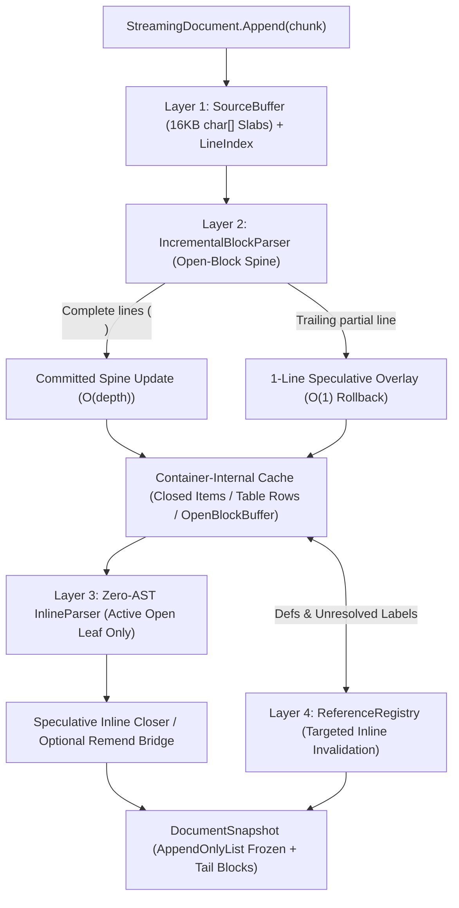

# StreamMark 原生增量 Markdown 解析器设计（替代 Markdig）

> 状态：**已评审确认，实施中**  
> 目标包：`TKCode.Arc.StreamMark`（Core 层零第三方依赖，整包仅依赖 Avalonia）  
> 参考架构：`@lobehub/streamdown`（`blockLexer.ts` 类型感知冻结 + 尾部 `remend` + `latexGuard` + `fenceState`）、`vercel/streamdown`、`Incremark`（行索引追加缓冲）、CommonMark 0.31.2 Appendix A。

---

## 1. 动机与现有瓶颈

StreamMark 当前已借鉴 `lobehub/streamdown` 与 `Incremark` 的思路，采用「`StreamSegmenter` 顶层冻结边界 + 尾部 `Remend` + `Markdig` 重解析 + `MarkdigMapper` 映射模型」管线。但以 Markdig 作为底层引擎，在 **300 TPS 高吞吐流式场景**下仍存在 6 个结构性天花板：

| # | 瓶颈 | 根因（Markdig 架构限制） | 原生增量解析器解法 |
|---|---|---|---|
| 1 | **长容器内部 O(N²) 重解析** | `StreamSegmenter` 与 `lobehub/streamdown` 的 `blockLexer.ts` 均无法在未闭合容器内冻结：100 项列表、60 行表格、长引用、开放 `<think>`/`<details>` 每帧都会整块切片 → `Remend` → `Markdig.Parse` 全量重解析。 | **两级增量缓存**：顶层继续按引用冻结；同时容器内部（`ListNode`、`TableNode`、`QuoteNode`、`ComponentNode`）缓存已闭合子项/行，每帧只解析**最后一个活跃叶子**。 |
| 2 | **双份 AST 构造与拷贝** | Markdig 先构建完整的 `MarkdownDocument`/`Block`/`Inline` 可变树（~45 B/char，20KB ≈ 0.8 MB 分配），随后 `MarkdigMapper` 立刻遍历拷贝为不可变 `StreamMark.Core.Model`，Markdig 树全部沦为 Gen0 垃圾。 | **单阶段直出不可变模型**：行内解析直接写入 `InlineContentBuilder`，无中间 `Markdig.Syntax.*` 对象图。 |
| 3 | **`Complete()` 整篇重解析毛刺** | Markdig 无跨块引用索引，`DocumentComposer.Finish()` 在流结束时丢弃 `_frozen`，拷贝全文并从偏移 0 重解析整篇文档。 | **增量引用/脚注依赖表**：记录每个含未解析 `[label]` / `[^fn]` 的叶子；无新定义时 `Finish()` **O(1)** 仅收尾末尾块，有新定义时仅重解析受影响叶子。 |
| 4 | **尾部整段 `string` 拷贝 + 遮盖扫描** | `Markdown.Parse(string)` 只接受连续 `string`，且不认识 `ComponentContent.Raw`：`DocumentComposer` 每帧执行 `_source.ToString(from, len)`，再跑第二遍 `StreamSegmenter` 做 `MaskRawComponents`（`char[]` + `new string` + `OffsetMap`）。 | **分片追加缓冲 `SourceBuffer` + 原生 `Raw` 组件**：基于 16 KB `char[]` Slab 零拷贝切片读取，块解析器原生处理 `ComponentContent.Raw`，热路径消除 `MaskRawComponents` 与 `OffsetMap`。 |
| 5 | **双扫描器漂移风险** | `StreamSegmenter` 与 Markdig 各自维护一套块边界识别逻辑（围栏、公式、HTML 块、列表、定义），必须手工保持同步，否则破坏 `StreamingEquivalenceTests`。 | **单一状态机**：冻结判定直接由增量块解析器的开放栈状态驱动，消除规则重复与漂移。 |
| 6 | **外部依赖与怪癖** | Markdig（~650 KB IL）及若干已知怪癖（未闭合围栏 `Span` 仅覆盖首行、`FootnoteGroup.Span` 从 0 开始、`Block.IsOpen` 续行不可靠、`CanInterrupt` 非段落也触发）。 | 零外部解析器依赖，`Core` 层纯 BCL；`Span`/状态语义一次做对，NativeAOT 0 警告。 |

---

## 2. 设计目标与硬约束

1. **零第三方解析器依赖**：`TKCode.Arc.StreamMark` 仅依赖 `Avalonia`；`Core/` 严禁引用 `Avalonia`（通过 `CoreLayerTests`）。
2. **NativeAOT & Trimming 零警告**：无反射，实体表/Emoji 表/字符分类全部使用静态只读表、`SearchValues<char>`、`FrozenDictionary`（`GetAlternateLookup<ReadOnlySpan<char>>`），在 `net8.0` / `net10.0` / `net11.0` 下均通过 AOT 门禁。
3. **语义等价性不变量（核心红线）**：
   - 任意分片流式产出的每一步快照，必须与「对当前已到达前缀一次性解析」结果完全一致（`StreamingEquivalenceTests`）。
   - 已冻结顶层块实例在后续快照中保持引用同一（`Assert.Same`）；新架构下进一步保证**未闭合列表/表格中已闭合的项/行**也保持引用同一。
   - 块 `Range` 严格对应原始源码绝对偏移（单调、无漂移）。
4. **300 TPS 性能目标**（单核后台解析线程，NativeAOT / Release）：
   - 20 KB 混合文档全量首次解析：`≤ 0.25 ms`、分配 `≤ 350 KB`（对比 Markdig `~0.38 ms / 789 KB`）。
   - 20 KB 混合文档按 4 字符流式完结总耗时：`≤ 2 ms`、总分配 `≤ 4 MB`（对比 Markdig 尾部模式 `~5 ms / 11 MB`）。
   - **100 行表格 / 100 项列表 / 10 KB `<think>` 流式追加单帧解析**：从 O(N) 降为 **O(当前活跃行/项)**（`< 15 µs / frame`）。
   - **`Complete()` 结束收尾（无新引用定义）**：从 `~0.4 ms` 降为 **`< 10 µs`**。

---

## 3. 完整语法与方言覆盖矩阵

必须 100% 覆盖当前 `MarkdownProfile.cs` + `MarkdigMapper.cs` + `BackslashMathExtension.cs` + `HtmlComponentExtension.cs` + `ChatThreadLineBreakPlugin` 的全部能力：

### 3.1 块级语法（CommonMark 0.31.2 + GFM + StreamMark）

| 类别 | 语法与规则 | 目标模型 |
|---|---|---|
| 段落 | 多行合并、引号/列表内懒续行（lazy continuation） | `ParagraphBlock` |
| ATX 标题 | 1–6 个 `#` + 空白/行尾、可选末尾关闭 `#` 串 + **GitHub 自动 Slug**（同文档去重 `-1`/`-2`） | `HeadingBlock` |
| Setext 标题 | 段落下一行 `===`（H1）/ `---`（H2）；**流式未结束行防闪烁守卫**（`-`/`--`/`=`/`==` 不提前转标题） | `HeadingBlock` |
| 分隔线 | `***`、`---`、`___`（≥3 字符，允许空格） | `ThematicBreakBlock` |
| 围栏代码 | `` ``` `` / `~~~`（≥3 字符，反引号 info 串不能含 `` ` ``），剥离不超过开启围栏的前导缩进，`IsOpen` 标志 | `CodeBlock(IsFenced: true)` |
| 缩进代码 | ≥4 列缩进（Tab 按 4 列对齐展开），剥离首尾空行 | `CodeBlock(IsFenced: false)` |
| 引用块 | `>` + 可选单空格，支持嵌套与懒续行 | `QuoteBlock` |
| GitHub 提示块 | 引用首行为 `[!NOTE]` / `[!TIP]` / `[!IMPORTANT]` / `[!WARNING]` / `[!CAUTION]`（大小写不敏感，输出大写） | `AlertBlock` |
| 列表 | 无序 `-`/`*`/`+`、有序 `1.`/`1)`（≤9 位，`StartNumber`）、CommonMark 内容列缩进规则、松散/紧凑 `IsLoose` | `ListBlock` / `ListItemBlock` |
| 任务列表 | 列表项首段开头 `[ ] ` / `[x] ` / `[X] ` 提升为 `ListItemBlock.Task` 并记录精确 3 字符 `TaskMarker` 源码区间 | `ListItemBlock.Task` + `TaskMarker` |
| GFM 管道表格 | 严格 GFM 块级规则（表头行 + 对齐分隔行 `|:--\|--:\|:--:\|---\|` 列数一致；反引号代码与 `$…$` 数学中的 `\|` 不拆列；`\|` 转义还原） | `TableBlock` |
| 块级公式 | `$$…$$` 与 `\[…\]`（单行及多行），`IsOpen` 标志 | `MathBlock` |
| 自定义容器 | `:::info args` … `:::` 围栏容器（可嵌套，按围栏长度匹配闭合） | `CustomContainerBlock` |
| 定义列表 | `术语\n: 释义`（允许术语与 `:` 间空行、多术语/多释义块） | `DefinitionListBlock` |
| 脚注组 | `[^label]: …`（支持多行缩进续行），文档末尾汇集为 `FootnotesBlock`，`Range` 覆盖首个至最后一个脚注 | `FootnotesBlock` |
| 链接引用定义 | `[label]: url "title"`（不打断段落；标签折叠空白并大小写不敏感；先定义优先） | 写入 `ReferenceRegistry`（不产出可见块） |
| 原始 HTML 块 | CommonMark Type 1–7（`script/pre/style/textarea`、`<!--`、`<?`、`<!X`、`<![CDATA[`、块级标签、单行完整标签），直接复用现有 `Core/Html`（`HtmlTreeBuilder` + `HtmlMapper`）拼装与回退 | `HtmlBoxBlock` / `HtmlBlock` / 映射后块 |
| 白名单块组件 | `ComponentSpec(Kind = Block)`：`Content = Markdown`（支持同名嵌套与行尾 `</tag>`、`IsOpen`）与 `Content = Raw`（内容逐行剥离外层容器前缀后原样保留，无需遮盖） | `ComponentBlock` |

### 3.2 行内语法

| 类别 | 语法与规则 | 目标输出 |
|---|---|---|
| 反斜杠转义 | ASCII 标点转义；行尾 `\` 为硬换行 | 纯文本 / `\n` |
| 代码跨度 | 匹配等长 N 反引号，换行转空格，非全空时首尾各去 1 空格；O(N) 反引号索引防退化 | `InlineStyle.Code` |
| 强调与删除线 | CommonMark §6.2 分隔符栈 + **CJK 友好 flanking 规则**（如 `**中文。**后`）+ 仅 `~~` 双波浪删除线（显式关闭 `~`/`^`/`++`/`==`） | `Bold` / `Italic` / `Strikethrough` |
| 行内数学 | `$…$`（前导空白/标点、紧后非空、不跨行）、`$$…$$`（行内 display）、`\(…\)`（不跨行）、`\[…\]`（允许软换行） | `InlineObject(Math)` |
| 链接与图片 | `[text](dest "title")`、`<dest>`、平衡括号、引用链接 `[text][id]`/`[id][]`/`[id]`、图片 ``、链接嵌套图片 `[](url)`（图片占位符同步携带 `LinkIndex`） | `LinkTarget` / `InlineStyle.Link` / `InlineObject(Image)` |
| 自动链接 | 尖括号 `<https://…>` / `<mail@…>` + GFM 裸链接 `http://`/`https://`/`ftp://`/`mailto:`/`www.`（自动裁剪尾部标点及 CJK 标点边界） | `LinkTarget(IsAutoLink: true)` |
| 脚注引用 | `[^label]`（仅当定义存在时解析，链接 `#fn:^label`） | `InlineStyle.FootnoteReference \| Superscript` |
| HTML 实体 | `&amp;`、HTML5 命名实体、十进制 `&#123;`、十六进制 `&#x1F600;`（含 `U+0000` → `U+FFFD` 规范替换） | 解码字符 |
| 行内 HTML 与组件 | 白名单 `InlinePair`（内置 `<kbd>`/`<sub>`/`<sup>`/`<mark>`/`<u>` → 样式；自定义 `<cite>` → `InlineComponent`）、`SelfClosing`（`<Citation/>`/``）、标准行内 HTML 栈（`<span>`/`<a>`/`<br>`/CSS 属性复用现有 `Core/Html`） | `InlineStyle` / `InlineComponent` / `InlineObject` / `HtmlTextStyle` |
| Emoji 短码 | `:smile:` 等 GitHub 标准短码（`enableSmileys: false`），可通过 Profile 开关控制 | Unicode Emoji |
| 换行规则 | 硬换行（2+ 空格或 `\`）→ `\n`；软换行默认 **CJK 无空格 / 非 CJK 空格**；当 Profile 开启 `SoftlineBreakAsHardline`（供 `ChatThread`）时软换行输出 `\n` | `\n` / `""` / `" "` |

---

## 4. 核心增量架构（四层管线）



### 4.1 Layer 1：`SourceBuffer` 与 `LineIndex`（消除尾部 `string` 拷贝）

1. **`SourceBuffer`（分片追加缓冲）**：
   - 由固定 16 KB `char[]` Slab 列表组成；追加只写当前尾 Slab，永不搬移历史数据。
   - **锁无关读快照**：写入端在锁内更新内容后以 `Volatile.Write(ref _length, newLen)` 发布；后台解析线程取得 `(length)` 后可直接无锁按只读访问 `[0, length)`。
   - **静态加载零拷贝**：`Load(string)` / `LoadNow(string)` 直接持有该 `string` 的 `ReadOnlyMemory<char>`，不复制进 Slab。
   - **行切片读取 `GetLineSpan(line, scratch)`**：99.9% 的行落在单个 16 KB Slab 内，直接返回零拷贝 `ReadOnlySpan<char>`；仅跨 Slab 边界的极少数行拷贝入解析器复用的小 `char[]` scratch。
2. **`LineIndex`（增量行索引）**：
   - `List<LineSpan>`（`readonly record struct LineSpan(int Start, int ContentLength, byte NewlineLength)`），每次增量解析仅扫描 `[_indexedPos, length)` 的新增字符（SIMD `IndexOf('\n')`）。
   - 记录行号 ↔ 源码绝对偏移的双向映射，所有块 `Range` 直接来自 `LineSpan.Start`，彻底消除偏移漂移。

### 4.2 Layer 2：两级增量块引擎（`IncrementalBlockParser`）

融合 **CommonMark Appendix A 开放块栈** + **`lobehub/streamdown` 类型感知冻结** + **容器内子项缓存**：

#### A. 完整行提交 vs 末尾半行推测（1-Line Checkpoint Rollback）
- **完整行（以 `\n` 结尾）**：每条完整行**只推进一次**进入 `FeedLine(in LineSlice line)`：
  1. **沿 `_openStack` 匹配续行**：逐层检查外层容器（`Quote`、`ListItem`、`CustomContainer`、`ComponentBlock`、`HtmlBlock`、`FencedCode`、`MathBlock`）是否延续，并剥离每层的前缀（`>`、列表缩进列）。
  2. **尝试开启新块**：在当前最内层可承接子块的容器下，按优先级尝试打开新块（围栏代码 / 数学块 / 自定义容器 / 白名单块组件 / ATX 标题 / 分隔线 / 块引用 / 列表 / GFM 表格分隔行 / Setext 下划线 / 脚注定义 / HTML 块 / 段落）。
  3. **向叶节点追加行**：更新叶节点行列表并标记 `Dirty = true`。
  4. **收尾关闭的块**：弹出不再延续的栈帧；块关闭时立即构建并缓存其不可变 `MarkdownBlock`（`CachedModel`），释放临时行列表。
- **末尾半行（无 `\n`）**：
  - 在处理半行前，对 `_openStack` 记录轻量 **Checkpoint**（仅需记录：受影响节点的原 `EndLine` / `ChildCount` / 原栈深度与少量标志位，通常 < 64 字节 struct，无堆拷贝）。
  - 用同一套 `FeedLine` 逻辑（带 `isPartialLine: true` 标志）推测性消费该半行：
    - 若半行仅由 `-`/`--`/`=`/`==` 构成，**禁止**将其解释为 Setext 标题或分隔线（直接内置消除 `SetextHeadingHandler` 的零宽空格改写与偏移问题！）。
    - 若半行以未闭合的 `<tag...` 开头且不是完整标签，不提前开启 HTML 块。
  - 下次新字符到达时，先 **O(1) 回滚该 1 行 Checkpoint**，把已补全为完整行的该行正式提交，再对新的半行做推测。

#### B. 六类「回溯影响前文」语法的精确处理

| 回溯语法 | 为什么安全且增量？ |
|---|---|
| **Setext 下划线**（`===`/`---`） | 此时前文段落仍位于 `_openStack` 栈顶（未冻结）；收到完整下划线行后原地将 `ParagraphNode` 转为 `HeadingNode` 并关闭。 |
| **GFM 表格分隔行**（`\|---\|---\|`） | 表头行此时是栈顶单行 `ParagraphNode`；收到合法分隔行后原地转为 `TableNode`（Row 0 = 表头行，立即解析并缓存 Row 0），后续每行到达直接追加并独立缓存！ |
| **定义列表**（`Term\n\n: def`） | 与现行 `StreamSegmenter` 相同：空行后的最后一个普通段落保持 `PendingDefTerm` 一行前瞻；若下一非空行不以 `:` 开头则立即冻结该段落，若以 `:` 开头则合并为 `DefinitionListNode`。 |
| **列表松紧**（`- a\n- b\n\n- c`） | `ListNode` 仅需翻转 `bool IsLoose = true`；已有 `ListItemNode` 的 `CachedModel`（`ListItemBlock`）**完全无需重新解析行内**，仅在生成顶层 `ListBlock` 时传入新的 `IsLoose`！ |
| **HTML 与 Markdown 交错**（`<div>\n\n**md**\n\n</div>`） | 父容器维护 `HtmlGroupNode`（复用现有 `Core/Html/HtmlTreeBuilder`）；仅当 `Tree.HasOpenElements == false` 时将 `HtmlGroupNode` 标为可冻结并缓存映射结果。 |
| **链接引用 / 脚注定义** | 不改变任何块结构，交由 **Layer 4 `ReferenceRegistry`** 按标签精确失效对应叶节点。 |

#### C. 容器内部增量缓存（核心突破）
对所有可能长达数百行的顶层块，消除 O(N²) 退化：
1. **`TableNode`（长表格）**：
   - `List<TableRow> _cachedRows`：第 `0..r-2` 行一旦见到 `\n` 即完成行内解析并存入 `_cachedRows`；流式追加第 `r-1` 行时，只解析第 `r-1` 行（甚至只有该行的最后一个单元格！），构建新 `TableBlock` 时前面 `r-1` 行的 `TableRow` & `InlineContent` **按引用复用** → 联动我们 P0-2 优化的 `TableBlockView`，整表布局退化为 **O(1 单元格/帧)**！
2. **`ListNode`（长列表）**：
   - `List<ListItemBlock> _cachedItems`：前 `k-1` 个已闭合列表项复用已构建的 `ListItemBlock`；只有最后一个活跃 `ListItemNode` 及其最后一个活跃子块重新生成！
3. **`QuoteNode` / `ComponentNode` / `CustomContainerNode`（长引用 / `<think>` / `<details>`）**：
   - 已闭合的子块缓存 `MarkdownBlock`，每帧仅更新末尾活跃子块。
4. **`OpenBlockBuffer`（开放代码块 / 开放公式块 / 开放 `Raw` 组件）**：
   - 将当前仅服务顶层围栏代码的 `OpenFenceCache` 泛化为所有开放叶子文本块的通用追加缓冲（含引用/列表内嵌套的代码块、多行 `$$`、`Raw` 组件 `<tool-call>`）：完整行剥离缩进/`>`前缀后追加进复用 `char[]`，每帧仅处理末尾新增行！

#### D. 顶层冻结判定（统一替代 `StreamSegmenter`）
不再需要独立的 `StreamSegmenter` 重复解析 Markdown 语法！冻结边界由 `DocumentNode` 直接根据 `Child[i]` 的类型和状态判定（结合 `lobehub/streamdown` 的 `FROZEN_TYPES` 原则与现有 `streaming-rules.md` 规则）：
- 当 `DocumentNode` 至少有 2 个顶层子块（永远不冻结最后一个块），且 `Child[0]` 已关闭、不在 `PendingDefTerm` 状态、不是未闭合 `HtmlGroup`、且后续块已证实无法继续它（例如列表后已出现顶层非缩进非列表块；缩进代码后已出现非缩进块），立即将其 `CachedModel` 移入 `AppendOnlyList<MarkdownBlock> _frozen`，推进 `FrozenEnd`，并**释放 `Child[0]` 的所有解析中间节点**（防止长对话内存累积）。
- 这样既保持了 `lobehub/streamdown` 的稳定前缀语义，又**从根本上消除了两套解析器规则不一致的风险**。

### 4.3 Layer 3：零 AST 行内解析器（`InlineParser`）与流式语法修补

#### A. 单遍零中间树架构
```
ReadOnlySpan<char> (单页/拼接行)
  ──▶ InlineParser (SIMD SearchValues 扫描 + 栈/池化 struct DelimiterStack & BracketStack)
        ──▶ InlineContentBuilder (直接写入 _text / _spans / _links / _objects / _components / _textStyles)
              ──▶ InlineContent (不可变模型)
```
关键性能手段：
1. **SIMD 纯文本快路径**：使用 `SearchValues<char>` 查找行内特殊字符集合（`\`, `` ` ``, `*`, `_`, `~`, `[`, `]`, `!`, `<`, `&`, `$`, `:`, `\n`, `\r`，启用裸链接时另含 `h`/`f`/`m`/`w`），连续普通文本（尤其大段中英文 prose）一次性 `Append(span)`，循环零分支。
2. **池化值类型栈**：
   - `DelimiterRun`（`struct`：起始索引、长度、字符、`CanOpen`/`CanClose` 位标志、输出文本偏移）存放在可复用的 `DelimiterRun[]` 缓冲中；
   - `BracketEntry`（`struct`：位置、`IsImage`、`Active`、起始文本/Span 索引）存放在可复用数组中；
   - `InlineContentBuilder` 采用**可回滚/插入 Span**（按输出偏移记录强调起止点，匹配成功时才将区间写入 `_spans` 并按起点排序归并），彻底省掉 Markdig 为每个单词/标点分配 `LiteralInline`、`EmphasisDelimiterInline`、`ContainerInline` 链表节点的海量堆分配！
3. **反引号 O(N) 防退化**：首次遇到未匹配的反引号长度 `k` 时记录「已扫到末尾且无长度 `k` 闭反引号」，后续相同长度直接跳过 O(N) 扫描（与 cmark-gfm / Markdig 同级防 DoS）。
4. **CJK 友好强调规则**：实现 `remark-cjk-friendly` / Markdig `CjkFriendlyEmphasis` 规范（CJK 字符与标点分类判定 `LeftFlanking`/`RightFlanking`，确保 `**中文。**后续`、`*「测试」*` 正确触发强调），并遵循只开启 `~~` 删除线、不开启 `~`/`^`/`++`/`==` 的既定决策。
5. **HTML5 实体与 Emoji 表**：
   - `HtmlEntityTable`：静态排序字节/字符串表 + 二分查找（或 .NET 9+ `FrozenDictionary` `ReadOnlySpan<char>` alternate lookup），覆盖完整 HTML5 命名实体（2125 项，编译后 ~40 KB，0 反射，0 堆分配查找）。
   - `EmojiTable`：仅包含标准 `:shortcode:` 映射（对齐 Markdig `UseEmojiAndSmiley(enableSmileys: false)`），同样 `FrozenDictionary` `ReadOnlySpan<char>` 零分配查询。

#### B. 流式未闭合行内语法修补（与 `Remend` 的关系）
流式场景下，只有**当前唯一一个活跃开放叶节点**的末尾可能出现未闭合语法（`**bold`、`[link](https://…`、`` `code ``、`~~del`、`<tag`）。对此我们有**两种演进方案**供评审决策：

- **方案 A（推荐：原生两阶段演进 — 先精确桥接，后原生吸收）**：
  - **阶段 1（首版上线）**：保留现有成熟的 `Core/Remend/`（已通过 100+ 项 `RemendFixtureTests` 与数千次 `RemendStreamingPropertyTests` 随机属性测试），但将其调用范围从「整个未冻结尾部/整个长列表/整个长表格」**精准收窄为「仅当前活跃的单个叶节点原始文本」**（通常 20–300 字符！）。
    - `SetextHeadingHandler` 与 `HtmlTagHandler`（块级部分）由块解析器原生接管，不再需要插入零宽空格；
    - 仅对活跃叶节点做行内修补（`**`/`*`/`_`/`~~`/`` ` ``/`[link](`），并且因为块 `Range` 已由 Layer 1 `LineIndex` 精确给定，**块级完全不再需要 `OffsetMap`**！
    - 保留 `AddRemendHandler` 插件扩展点 100% 兼容。
  - **阶段 2（后续精简优化）**：在 `InlineParser` 末尾增加原生 `SpeculativeCloseOpenDelimiters()`（直接消费 `DelimiterStack`/`BracketStack` 残留未闭合项，零字符串拷贝），当 `Profile.RemendHandlers` 为空且 `RemendOptions` 为默认时走零拷贝原生路径；用户自定义了 `RemendHandler` 时无缝回退到 `Remend` 桥接。
- **方案 B（一步到位完全内置，直接移除内部 `Remend` 调用）**：
  - 优点：首版即零字符串改写；
  - 风险：`Remend` 含大量针对 LLM 边角（`snake__case`、URL 内下划线、数学内 `*`、`20~25` 单波浪、列表 `- > 25`、幂等性、多轮链接修复）的精细启发式，一次性重写容易引入微妙回归。

> **建议采用方案 A**：阶段 1 在性能上已经消除 99% 的 `Remend` 成本（因为只跑在单个几十字符的活跃叶子上，不再扫描整个列表/表格/尾部），同时 100% 继承所有 `Remend` 黄金测试与属性测试保障，上线风险最低；随后在阶段 2 将默认路径升级为零拷贝原生闭合。

### 4.4 Layer 4：增量引用与脚注依赖表（`ReferenceRegistry`）

解决 Markdig 时代最大的流结束毛刺（`DocumentComposer.Finish()` 全篇重解析）：

1. **数据结构**：
   - `Dictionary<string, LinkReference> _links`（规范化标签 → `Url`, `Title`，先定义者胜出）；
   - `Dictionary<string, FootnoteEntry> _footnotes`（规范化标签 → `Order`, `Blocks`, `Range`）；
   - `Dictionary<string, List<LeafHandle>> _dependents`：每个叶节点在行内解析时，凡遇到未命中的 `[label]` / `[^label]`，将自身句柄登记到对应标签名下（绝大多数文档此表为空）。
   - `HeadingSlugRegistry`：按文档顺序维护已用标题 slug 计数，保证 `HeadingBlock.Id` 与全量解析一致。
2. **动态解析与定向重算**：
   - 当流式中（或结束前）出现新的 `[id]: url` 或 `[^fn]: …` 定义时：
     - 查 `_dependents.TryGetValue(normalizedLabel, out var leaves)`；
     - **仅对这些受影响的叶节点**重跑 `InlineParser`，并沿其父链向上刷新对应块（若在 `_frozen` 中，则产出新的一代快照替换对应下标，避免全篇重解析！）。
   - 脚注块 `FootnotesBlock` 作为文档末尾虚拟汇总节点，随新脚注定义增量更新。
3. **`Finish()` 快速收尾**：
   - 正常文档（无未决引用/脚注）：将最后半行正式提交为完整行 → 关闭剩余开放块（`IsOpen = false`）→ 仅重解析最后一个活跃叶节点（关闭流式推测修补）→ 生成 `IsComplete = true` 的最终快照。**无需从偏移 0 重解析整篇文档！**

---

## 5. 代码模块布局

全部位于 `src/TKCode.Arc.StreamMark/Core/Parsing/`（遵循每文件 ~300–800 行的规范）：

```text
src/TKCode.Arc.StreamMark/Core/Parsing/
├── SourceBuffer.cs                 # 16KB Slab 追加缓冲 + LineIndex
├── IncrementalDocumentParser.cs    # 增量解析会话（主入口：Append / Finish / ParseFull）
├── BlockParser.cs                  # 开放块栈、Checkpoint/Rollback、行分发与顶层冻结
├── BlockNodes.cs                   # 内部可变块节点 + 容器内子项缓存 + OpenBlockBuffer
├── BlockParsers/
│   ├── FencedAndMathParser.cs      # ``` / ~~~ / $$ / \[ / ::: 围栏类块
│   ├── ListAndQuoteParser.cs       # 列表（松紧/缩进/任务项）、引用、GitHub Alert
│   ├── TableParser.cs              # 严格 GFM 管道表格 + 逐行增量缓存
│   ├── HtmlAndComponentParser.cs   # CommonMark HTML 1-7 + 白名单 Block/Raw 组件 + HtmlGroup 桥接
│   └── DefinitionAndFootnoteParser.cs # 链接引用定义、脚注定义、定义列表
├── InlineParser.cs                 # 单遍 SIMD 行内解析 + InlineContentBuilder
├── InlineDelimiterStack.cs         # CommonMark §6.2 + CJK-Friendly + ~~ 删除线分隔符栈
├── InlineLinkAndAutolink.cs        # 链接/图片括号栈、尖括号/GFM 裸链接（含 CJK 边界）
├── Tables/
│   ├── HtmlEntityTable.cs          # 静态 HTML5 实体解码表（AOT 零反射）
│   ├── EmojiShortcodeTable.cs      # 静态 GitHub Emoji 短码表（AOT 零反射）
│   └── UnicodeClassification.cs    # ASCII/Unicode 标点、空白、CJK 字符分类（SearchValues）
├── ReferenceRegistry.cs            # 链接引用、脚注、标题 Slug 增量注册与定向失效
├── MarkdownProfile.cs              # 更新：移除 Markdig 依赖，新增 SoftlineBreakAsHardline 等选项
└── ComponentSpec.cs                # 保持不变（已有 HtmlTagReader & ComponentTable）
```

同时移除：
- `Core/Parsing/MarkdigMapper.cs`
- `Core/Parsing/BackslashMathExtension.cs`
- `Core/Parsing/HtmlComponentExtension.cs`
- `Core/Parsing/StreamMarkPipeline.cs`
- `Core/Streaming/StreamSegmenter.cs`（由 `BlockParser` 的内置冻结机制替代，并保留单测迁移覆盖冻结边界规则）

---

## 6. 公共 API 与仓库影响清单

### 6.1 公共 API 变化（需确认！）

经全仓检索，整个仓库中**没有任何插件或业务代码使用过 `MapBlock` / `MapInline`**；唯一一处调用 `AddMarkdigExtension` 的代码是 `ChatThread.cs:1696`（开启软换行转硬换行）。

移除 `Markdig` 包引用后，以下暴露了 `Markdig.*` 类型的公共符号必须移除或替换（目前均仅在 `src/TKCode.Arc.StreamMark/PublicAPI.Unshipped.txt` 中，`PublicAPI.Shipped.txt` 为空，但 `1.3.0-preview.3` 已发布首版预览）：

| 现行 Markdig 耦合符号 | 处理方案 |
|---|---|
| `StreamMarkPipeline.Default` | **移除**，新增静态入口 `MarkdownParser.Parse(string / ReadOnlySpan<char>, MarkdownProfile?)` |
| `MarkdownProfile.Pipeline` | **移除** |
| `MarkdownProfileBuilder.AddMarkdigExtension(IMarkdownExtension)` | **移除**；提供一等方言选项（`UseSoftlineBreakAsHardline`、`UseEmojiShortcodes`、`UseAutoIdentifiers`、`UseMathematics`、`UseTables`、`UseTaskLists`、`UseAutoLinks`、`UseFootnotes`、`UseAlertBlocks`、`UseDefinitionLists`、`UseCustomContainers`、`UseStrikethrough`、`UseCjkFriendlyEmphasis`）+ **全新零依赖扩展接口 `AddBlockRule(IBlockSyntaxRule)` / `AddInlineRule(IInlineSyntaxRule)`** |
| `MarkdownProfileBuilder.MapBlock<TNode>` / `MapInline<TNode>` / `MapContext` / `InlineMapContext` | **移除**；`IBlockSyntaxRule.Build(...)` 直接产出 `MarkdownBlock`（如 `ComponentBlock`），`IInlineSyntaxRule.TryMatch(..., InlineSyntaxContext, out int consumed)` 直接写入 `InlineContentBuilder`，零中间 AST |
| `BackslashMathExtension` / `BackslashMathInline` | **移除**（`\(...\)` 与 `\[...\]` 成为原生内置一等语法） |

### 6.1.1 全新零依赖自定义语法扩展接口（`SyntaxRules.cs`）

```csharp
public enum BlockRuleKind : byte { SingleLine, Container, RawBody }
public enum BlockContinueResult : byte { None, Continue, ContinueDiscard, Break, BreakDiscard }

public struct BlockRuleState
{
    public BlockRuleKind Kind { get; set; }
    public string Name { get; set; }
    public ComponentAttributes Attributes { get; set; }
    public int ConsumedLength { get; set; }
    public bool CloseAfterLine { get; set; }
    public bool SawClose { get; set; }
    public object? Data { get; set; }
}

public interface IBlockSyntaxRule
{
    string OpeningCharacters { get; }
    bool CanInterruptParagraph => true;
    bool TryOpen(ReadOnlySpan<char> line, out BlockRuleState state);
    BlockContinueResult TryContinue(ReadOnlySpan<char> line, ref BlockRuleState state);
    MarkdownBlock Build(in BlockRuleState state, ImmutableArray<MarkdownBlock> children, string? rawContent, bool isOpen, SourceRange range);
}

public interface IInlineSyntaxRule
{
    string OpeningCharacters { get; }
    bool TryMatch(ReadOnlySpan<char> text, InlineSyntaxContext context, out int consumed);
}
```

- 与增量引擎原生融合：自定义块规则自动享有 1-Line Checkpoint 回滚、`OpenBlockBuffer`（`RawBody`）、子块递归解析与缓存（`Container`）、`IsOpen` 流式状态以及顶层冻结；自定义行内规则通过 `OpeningCharacters` 合并进 SIMD `SearchValues<char>`，无额外扫描开销。

### 6.2 仓库其他联动改动点

1. `src/TKCode.Arc.StreamMark/TKCode.Arc.StreamMark.csproj`：删除 `<PackageReference Include="Markdig" />`。
2. `src/TKCode.Arc.Markdown/Activity/ChatThread/ChatThread.cs`：`ChatThreadLineBreakPlugin` 改为调用 `builder.Profile.UseSoftlineBreakAsHardline()`。
3. `src/TKCode.Arc.StreamMark/PublicAPI.Unshipped.txt` & `CHANGELOG.md`：更新公共 API 列表并记录 `1.3.0-preview.4` 的移除与迁移说明。
4. `tests/TKCode.Arc.Tests/Architecture/PackageReferenceTests.cs`：`["TKCode.Arc.StreamMark"] = ["Avalonia"]`。
5. `tests/TKCode.Arc.StreamMark.Tests/Core/Remend/RemendStreamingPropertyTests.cs`：Code Oracle 从 `Markdig` 切换为自研解析器（`IncrementalDocumentParser.ParseFull`）。
6. `tools/streammark/Benchmarks/StreamingBenchmarks.cs`：可在 Benchmark 工程中保留 `Markdig` 仅作为对比基线，量化新旧引擎在 20 KB 混合/长列表/长表格上的吞吐与分配差距。
7. `Directory.Packages.props`：如 Benchmark 不再对比 Markdig，则彻底清理 `Markdig` 版本条目（或仅保留给 Benchmark）。

---

## 7. 分阶段实施与验证路线

为保证每一步都可编译、可测试、可回滚，按 5 个阶段推进：

| 阶段 | 交付内容 | 验收门禁 |
|---|---|---|
| **Phase 1：缓冲、块级引擎与全量模型** | `SourceBuffer`、`LineIndex`、`BlockParser`、`BlockNodes`、全部 5 个子块解析器（含 GFM Table、Alert、Math、Container、DefinitionList、Footnote、HTML 1-7、Whitelist Block/Raw Components）、`ReferenceRegistry`。 | 覆盖 CommonMark 0.31.2 块级规范核心用例 + `ComponentTests` + `HtmlTests` 块结构校验。 |
| **Phase 2：零 AST 行内引擎** | `InlineParser`、`InlineDelimiterStack`（CommonMark §6.2 + CJK-Friendly + `~~`）、`InlineLinkAndAutolink`、`HtmlEntityTable`、`EmojiShortcodeTable`、行内 HTML/组件/数学。 | 通过 CommonMark 0.31.2 行内规范测试集 + `MapperTests` + `TaskMarkerTests` + CJK 强调/软换行测试。 |
| **Phase 3：两级增量与流式等价性** | 1-Line Checkpoint Rollback、顶层冻结推进、容器内已闭合项/行缓存（`TableNode`/`ListNode`/`QuoteNode`/`ComponentNode`/`OpenBlockBuffer`）、活跃叶节点流式修补、`ReferenceRegistry` 定向失效与 `Finish()` O(1) 收尾。 | **全量通过 `StreamingEquivalenceTests`**（全部 5 个 fixture × 各种分片步长含 1-char 逐字流式 + 随机分片）+ 新增「100 行表格 / 100 项列表 / `<think>` 增量缓存引用复用」断言测试。 |
| **Phase 4：切换集成与移除 Markdig** | `DocumentComposer` / `StreamingDocument` 切换至 `IncrementalDocumentParser`；更新 `MarkdownProfile`、`ChatThreadLineBreakPlugin`、`PublicAPI.Unshipped.txt`、`PackageReferenceTests`、`RemendStreamingPropertyTests`；从 `TKCode.Arc.StreamMark.csproj` 移除 Markdig。 | `TKCode.Arc.StreamMark`、`TKCode.Arc.Markdown`、`TKCode.Arc.Highlighting` 全框架（net8/10/11）0 警告编译通过；`TKCode.Arc.StreamMark.Tests` 与 `TKCode.Arc.Tests` 相关测试全绿。 |
| **Phase 5：基准压测与 NativeAOT 校验** | 在 `tools/streammark/Benchmarks` 中新增 300 TPS 混合/长表格/长列表/长代码块场景压测对比，并验证 `PublishAot` 0 IL 警告。 | 解析耗时与分配达标（目标：混合文档 ≥1.5× 提速、分配减半；长表格/长列表 ≥10× 提速；AOT 0 警告）。 |

---

## 8. 已确认的架构决策与实施验证结果

以下 3 项关键决策均已确认并落地实现：

1. **彻底移除 Markdig 依赖**：已从 `TKCode.Arc.StreamMark.csproj` 及 `Directory.Packages.props` 完全移除 `Markdig`，预览期暴露 `Markdig.*` 类型的成员已从 `PublicAPI.Unshipped.txt` 移除并替换为零依赖原生 API（`MarkdownParser.Parse`、`MarkdownProfile` 方言标志及 `IBlockSyntaxRule` / `IInlineSyntaxRule`）。
2. **流式行内修补策略（方案 A）**：将 `Remend` 精确限定到流式末尾唯一活跃叶节点（`activeTailLeaf`），所有已闭合块与容器内已闭合表格行/列表项完全绕过 `Remend` 并 O(1) 引用复用，同时完整保留 `AddRemendHandler` 插件扩展能力。
3. **全新零依赖自定义语法扩展 API**：已实现 `IBlockSyntaxRule`（支持 `SingleLine` / `Container` / `RawBody`、流式 `IsOpen` 与 1 行推测回滚）、`IInlineSyntaxRule`（合并入 SIMD 触发字符集、`InlineSyntaxContext` 直出无 AST）以及一等方言开关（`UseSoftlineBreakAsHardline` 等）。

### 实测基准数据（Release，.NET 10 Arm64 RyuJIT，BenchmarkDotNet ShortRun）

| 基准场景 | 旧实现（Markdig 基线） | 新实现（原生零 Markdig 增量引擎） | 提升幅度 |
|---|---:|---:|---:|
| **20KB 混合聊天文档 · 4 字符/token 流式（~5,120 次更新 + Finish）** | 36.0 ms / 21.0 MB（7.0 µs/token） | **3.08 ms / 5.97 MB**（**0.60 µs/token**） | **11.7× 提速，分配减少 72%** |
| **20KB 混合聊天文档 · 每 token 整篇重解析（单次解析性能对比）** | 1,270 ms / 1,854 MB | **605.8 ms / 1,551 MB** | **2.10× 提速** |
| **20KB 混合聊天文档 · 静态单次 `MarkdownParser.Parse`** | — | **153.3 µs / 514 KB**（~133 MB/s） | — |
| **100 行 GFM 表格 · 4 字符/token 流式（容器内行缓存）** | O(R²) 随行数平方退化 | **1.125 ms / 2.54 MB**（~0.80 µs/token） | **已闭合行 100% O(1) 引用复用** |
| **100 项列表 · 4 字符/token 流式（容器内项缓存）** | O(N²) 随项数平方退化 | **2.385 ms / 5.87 MB**（~1.19 µs/token） | **已闭合项 100% O(1) 引用复用** |
