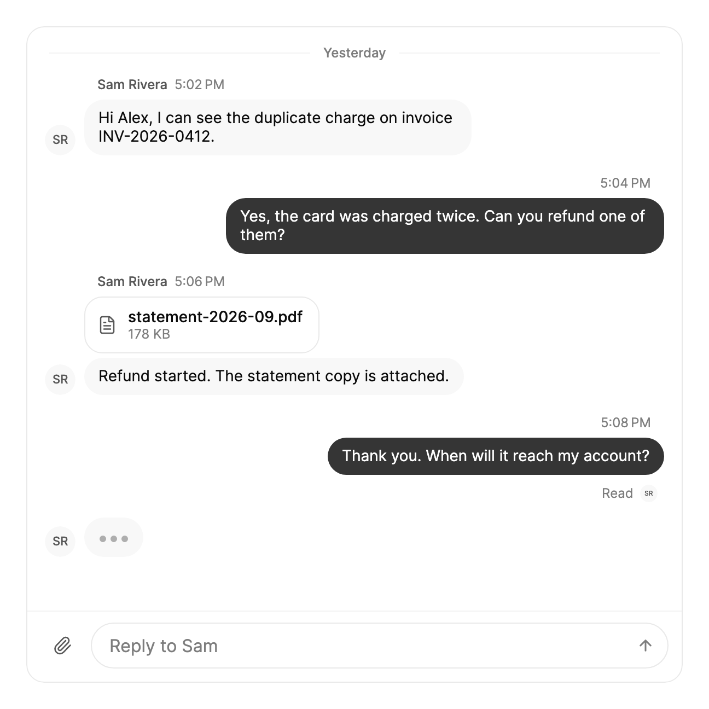

<Demo name="SupportConversation" />

## 何时使用

`ChatThread` 是人们轮流对话的应用中的会话界面：账单或订单页面上的客服组件、CRM 中的私信面板，或内部工具中的团队房间。它负责消息列表、日期分隔线、滚动行为和输入区。周围的页面提供消息，并处理用户发送的内容。

- **账单或订单页面上的客户支持**：客服人员回答发票问题。消息按人员和时间分组，客户的消息位于右侧，并带有送达状态。
- **CRM 中的客户对话**：销售负责人与客户就续约交换消息。已读回执显示对方看过哪些消息。
- **内部工具中的团队房间**：事故处理房间里，工程师发布文字、图片和日志文件。附件以图片库或可打开文件的文件行显示。
- **分段到达的助手回复**：机器人把回答逐段流式输出到气泡中。会话把每个片段追加到 Markdown 正文，而不会从头重新解析整条回复。
- **可能失败的消息**：结账或客服流程中，服务器未接受的消息。它会变暗、显示“未送达”，并在你最后一条消息上提供重试。

## 何时不用

- **围绕一个对象的线程式讨论**，例如对合同条款的评审意见：用 `CommentThread`，回复嵌套在评论之下，并可标记为已解决。
- **跨多个对象的事件历史**，例如部署或审计记录：用 `Timeline`，它没有输入区，也没有已读回执。
- **只有多行输入、没有对话**，例如记录上的一条备注：用 `Textarea`。如需在单个输入框中 @提及，用 `MentionInput`。
- **需要放在自己消息列表旁边的输入区**：单独使用 `ChatComposer`。它具有相同的文本框、附件托盘和发送行为，但没有列表。
- **需要按日期从服务器分页加载的历史**：会话只显示给它的消息，不负责加载历史。在视图模型中加载分页，再加入集合。

## 用法

`Participants` 列出对话中的人员，`CurrentUserId` 标明其中哪一位是你。你的消息以强调色显示在右侧，其他人的消息显示在左侧并附带姓名。消息按从旧到新排列，列表始终停留在最新一条上。

```xml
<UserControl xmlns="https://github.com/avaloniaui"
             xmlns:arc="https://github.com/AtomUICommunity/TKCode.Arc">
    <arc:ChatThread Label="支持会话"
                    Participants="{Binding Participants}"
                    CurrentUserId="me"
                    ItemsSource="{Binding Messages}"
                    Height="560" />
</UserControl>
```

```csharp
var me = new ChatParticipant("me", "Alex Kim");
var sam = new ChatParticipant("sam", "Sam Rivera");

var messages = new ObservableCollection<ChatMessage>
{
    new("m1", "sam", "你好 Alex！感谢你的联系。", DateTimeOffset.Now)
};

var thread = new ChatThread
{
    Participants = [me, sam],
    CurrentUserId = me.Id,
    ItemsSource = messages,
    Label = "支持会话",
    Height = 560
};
```

`ChatThread` 派生自 Avalonia 的 `ItemsControl`，因此 `ItemsSource` 和 `Items` 接受列表所用的集合。控件自行构建每一行，所以你提供的是数据，而不是项模板。会话需要父容器给它一个有限的高度。

没有 `ItemsSource` 时，会话自己维护列表：从输入区发送的消息会被追加，表情回应则原地切换。当消息来自服务器时，把 `ItemsSource` 绑定到你自己的集合。

### 结构

1. **消息列表**（`Label` 为其命名）：可滚动区域。读者位于末尾 48 px 以内时，它会跟随最新消息。
2. **日期分隔线**：12 px 的标签（“昨天”、“今天”或具体日期），两侧是颜色较淡的 1 px 线条。
3. **作者头像**：28 px，位于他人消息旁的侧边栏中。没有 `Avatar` 时显示姓名缩写。
4. **元信息行**：作者姓名为 12 px 中等字重，时间为 12 px 弱化文字。
5. **气泡**：18 px 圆角，内边距为上 8 px、左右 13 px、下 9 px。他人的气泡使用弱化表面色（深色模式下会提亮）；你的气泡使用强调色。气泡最多占行宽的 78%（宽度小于 420 px 时为 84%），且最宽不超过 544 px。
6. **附件**：图片组成宽 240 px 的图库，间距 3 px，最多显示四个图块，第四个图块上有“+N”遮罩。其他文件以一行显示名称和大小。
7. **回应行**：每个表情一个标签，带有计数，另有一个 28 px 的添加回应按钮，点击后打开选择器。
8. **回执行**：状态文字，以及 16 px 的已读者头像，相邻头像重叠 4 px。
9. **输入中行**：36 px 高的气泡，内含循环动画的圆点，在 `TypingParticipantIds` 非空时显示。
10. **输入区**（`IsComposerVisible`）：可增长至六行的文本框、附件按钮和发送按钮。
11. **跳转胶囊**：高 32 px，位于底边上方 12 px。视野外有新消息时显示“3 条新消息”；读者停留在较上方且没有新消息时显示“跳到最新”。

### 绑定到视图模型

视图模型负责消息、它们的状态和回执，会话只负责显示。本例使用 CommunityToolkit.Mvvm。

```csharp
public interface ISupportApi
{
    Task<SendResult> SendMessageAsync(string text, int fileCount);
}

public sealed record SendResult(bool IsSuccess);

public partial class SupportChatViewModel : ObservableObject
{
    private readonly ISupportApi _api;

    public SupportChatViewModel(ISupportApi api)
    {
        _api = api;
        Participants =
        [
            new ChatParticipant("me", "Alex Kim"),
            new ChatParticipant("sam", "Sam Rivera")
        ];
    }

    public IReadOnlyList<ChatParticipant> Participants { get; }

    public ObservableCollection<ChatMessage> Messages { get; } = [];

    [ObservableProperty]
    private IReadOnlyDictionary<string, string> _readBy = new Dictionary<string, string>();

    [ObservableProperty]
    private IReadOnlyList<string> _typingParticipantIds = [];

    public async Task SendAsync(ChatDraft draft)
    {
        var message = new ChatMessage(Guid.NewGuid().ToString("N"), "me", draft.Text, DateTimeOffset.Now)
        {
            Attachments = draft.Attachments.Count > 0 ? draft.Attachments : null,
            Status = ChatMessageStatus.Sending
        };
        Messages.Add(message);

        var result = await _api.SendMessageAsync(draft.Text, draft.Files.Count);
        message.Status = result.IsSuccess ? ChatMessageStatus.Sent : ChatMessageStatus.Failed;
    }

    [RelayCommand]
    private async Task RetryAsync(ChatMessage message)
    {
        message.Status = ChatMessageStatus.Sending;
        var result = await _api.SendMessageAsync(message.Text ?? string.Empty, 0);
        message.Status = result.IsSuccess ? ChatMessageStatus.Sent : ChatMessageStatus.Failed;
    }
}
```

```xml
<arc:ChatThread Label="支持会话"
                Participants="{Binding Participants}"
                CurrentUserId="me"
                ItemsSource="{Binding Messages}"
                ReadBy="{Binding ReadBy}"
                TypingParticipantIds="{Binding TypingParticipantIds}"
                RetryCommand="{Binding RetryCommand}" />
```

- 输入属性（`Participants`、`ItemsSource`、`ReadBy`、`TypingParticipantIds`、`RetryCommand`）都是单向的：会话从不把它们写回。`IsPinned` 和 `UnreadCount` 是只读输出。
- `SendRequested` 是事件，不是命令。代码后置订阅它，并把草稿传给 `SendAsync`。消息本身由视图模型添加，因此会话不会再追加一次。
- 修改消息的 `Status` 或 `Text` 会原地更新它的气泡。只有在添加或移除消息时才需要替换集合。

### 分组、时间与区域

同一人发出、间隔短于 `GroupWindow` 的消息属于同一组，因此只有第一条显示姓名。默认间隔为 5 分钟。来自其他人的消息，或间隔更长之后的消息，会开始新的一组。

`Culture` 设置时间和日期分隔线的格式（默认 en-US），`TimeZone` 设置它们所显示的时区（默认为机器的本地时区）。请为产品所在的市场同时设置两者。

```csharp
thread.Culture = CultureInfo.GetCultureInfo("en-GB");
thread.TimeZone = TimeZoneInfo.FindSystemTimeZoneById("Europe/London");
thread.GroupWindow = TimeSpan.FromMinutes(10);
```

### 发送与附件

当用户在输入区按下 Enter 或点击发送按钮时，`SendRequested` 会触发。`ChatDraft` 携带去除首尾空白的 `Text`、所选的 `Files`（本地 `IStorageFile` 项）以及对应的 `Attachments`。没有文字也没有文件的草稿不会发送。没有 `ItemsSource` 时，会话会自行追加消息；有 `ItemsSource` 时，由处理程序添加消息并决定其状态，正如上面的视图模型所做的那样。

`IsAttachmentEnabled`（默认为 true）显示附件按钮，并接收粘贴和拖放的文件。`AcceptedFileTypes` 限制选择器，托盘每次添加最多接受 10 个文件。带有 `Url` 或 `File` 的 `Image` 附件会加入图片库；其他附件以文件行显示，并附带大小。

用户点击图片或文件时，`AttachmentClicked` 会触发。除非处理程序将事件标记为已处理，否则会话会打开 `Url` 或本地文件。因此，当应用有自己的查看器时，请将事件标记为已处理。

### 状态、已读回执与输入中

`ChatMessage.Status` 设置你自己最后一条消息下方的文字。各状态如下：

| 状态 | 显示的文字 | 何时设置 |
|---|---|---|
| `Sending` | “发送中” | 消息正在发送，尚未被接受 |
| `Sent` | “已发送” | 服务器已接受（你自己消息的默认值） |
| `Delivered` | “已送达” | 消息已到达对方 |
| `Read` | “已读” | 消息已被阅读；在它或之后的回执也会显示此状态 |
| `Failed` | “未送达” | 发送失败。气泡会降至 60% 不透明度 |

`ReadBy` 将每个参与者的 id 映射到该人读过的最后一条消息；当映射变化时，其头像会平滑滑动到更新的消息上。每次都请分配一个新的字典。`TypingParticipantIds` 列出正在输入的人。只有在订阅 `RetryRequested` 或设置 `RetryCommand` 时，重试才会出现，并且只出现在你的最后一条消息上。命令接收失败的 `ChatMessage`。

### 表情回应与选择器

添加回应按钮打开一个选择器，其中列出 `Reactions` 中的表情。默认集合是 Arc 选择器的六个表情，`DefaultReactions` 在代码中返回同一列表。选择一个表情，或点击标签，都会触发 `ReactionToggled`。没有 `ItemsSource` 时，会话自行切换回应；有 `ItemsSource` 时，由应用设置消息的 `Reactions`：

```csharp
thread.ReactionToggled += (_, e) =>
{
    var reactions = new List<ChatReaction>(e.Message.Reactions ?? []);
    var at = reactions.FindIndex(r => r.Emoji == e.Emoji);
    if (at < 0)
    {
        reactions.Add(new ChatReaction(e.Emoji, 1, true));
    }
    else
    {
        var reaction = reactions[at];
        reactions[at] = reaction with { Count = reaction.Count + (reaction.Mine ? -1 : 1), Mine = !reaction.Mine };
    }
    e.Message.Reactions = reactions.Where(r => r.Count > 0).ToArray();
};
```

### 流式输出回复

分段到达的回复先以空文本添加，随着片段到达由 `AppendToMessage` 填充，并由 `CompleteMessage` 关闭。每次调用在没有消息拥有该 id 时返回 `false`，因此已被移除的消息所迟到的片段不会产生任何作用。`IsMessageStreaming` 表示某条回复是否仍处于打开状态。

<Demo name="StreamingMarkdownReply" />

```csharp
messages.Add(new ChatMessage("r1", "arc", null, DateTimeOffset.Now));
thread.AppendToMessage("r1", "这里有一个用于重试请求的小型辅助方法。");
thread.CompleteMessage("r1");
```

Markdown 正文只接收新增的文字，因此每个片段到达时，较长的回复都不会从头重新解析。

### 数据结构与性能

每个 `ChatMessage` 都会触发 `PropertyChanged`，因此更新其属性会更新它的气泡。为每条消息提供稳定的 `Id`，因为 `ReadBy`、流式输出和表情回应的回调都通过它查找消息。

行是虚拟化的。一千条消息的列表实际生成的容器不到 60 个，并且会话最多保留 64 个已渲染的消息正文，因此 Markdown 缓存不会随历史记录增长。

<Demo name="ThousandMessages" />

读者向上滚动时到达的消息会计入 `UnreadCount`，并由跳转胶囊显示。在本版本中，新增到顶部的较早消息不会为你保持位置，因此上线前请先测试这一路径。

### 单独使用输入区

`ChatComposer` 是会话的输入部分，它是公开的，因此可以单独使用。它最多增长到六行，按 Enter 发送。`Text` 是双向的。`Placeholder`（默认为 "Message"）同时是文本框的无障碍名称。`Sent` 携带 `ChatDraft`。`Send()` 从代码发送，`FocusInput()` 把焦点移到文本框，`BrowseAsync()` 打开文件选择器。

<Demo name="ComposerOnItsOwn" />

### 示例：账单页面上的客户支持会话

SaaS 产品账单页面上的一个支持面板。面板有固定高度，因此会话在其中滚动，输入区始终可见。客服的回复以文件行附上对账单，并显示其大小。客户最后一条消息下方的回执表示客服已读，输入中行表示客服仍在编写。占位文字点明了客服的名字，比默认的“Message”更清楚。



```xml
<UserControl xmlns="https://github.com/avaloniaui"
             xmlns:x="http://schemas.microsoft.com/winfx/2006/xaml"
             xmlns:arc="https://github.com/AtomUICommunity/TKCode.Arc"
             xmlns:generic="using:System.Collections.Generic"
             Width="600">
    <Border Height="600"
            CornerRadius="16"
            BorderThickness="1"
            ClipToBounds="True"
            Background="{arc:ArcDesignTokenResource Surface}"
            BorderBrush="{arc:ArcDesignTokenResource Border}">
        <arc:ChatThread Label="Support conversation"
                        CurrentUserId="me"
                        Placeholder="Reply to Sam">
            <arc:ChatThread.Participants>
                <generic:List x:TypeArguments="arc:ChatParticipant">
                    <arc:ChatParticipant Id="me" Name="Alex Kim" />
                    <arc:ChatParticipant Id="sam" Name="Sam Rivera" />
                </generic:List>
            </arc:ChatThread.Participants>
            <arc:ChatThread.ReadBy>
                <generic:Dictionary x:TypeArguments="x:String, x:String">
                    <x:String x:Key="sam">m4</x:String>
                </generic:Dictionary>
            </arc:ChatThread.ReadBy>
            <arc:ChatThread.TypingParticipantIds>
                <generic:List x:TypeArguments="x:String">
                    <x:String>sam</x:String>
                </generic:List>
            </arc:ChatThread.TypingParticipantIds>
            <arc:ChatMessage Id="m1" AuthorId="sam"
                             Text="Hi Alex, I can see the duplicate charge on invoice INV-2026-0412."
                             CreatedAt="2026-10-20T09:02:00+00:00" />
            <arc:ChatMessage Id="m2" AuthorId="me"
                             Text="Yes, the card was charged twice. Can you refund one of them?"
                             CreatedAt="2026-10-20T09:04:00+00:00"
                             Status="Read" />
            <arc:ChatMessage Id="m3" AuthorId="sam"
                             Text="Refund started. The statement copy is attached."
                             CreatedAt="2026-10-20T09:06:00+00:00">
                <arc:ChatMessage.Attachments>
                    <generic:List x:TypeArguments="arc:ChatAttachment">
                        <arc:ChatAttachment Id="f1" Name="statement-2026-09.pdf"
                                            Kind="File" Size="182400" />
                    </generic:List>
                </arc:ChatMessage.Attachments>
            </arc:ChatMessage>
            <arc:ChatMessage Id="m4" AuthorId="me"
                             Text="Thank you. When will it reach my account?"
                             CreatedAt="2026-10-20T09:08:00+00:00"
                             Status="Read" />
        </arc:ChatThread>
    </Border>
</UserControl>
```

场景中的消息直接写在内联中，这是静态图片所必需的。在应用中，它们来自 `ItemsSource`。

### 文案规范

- **Label**：简短的名词短语，用来说明这段对话，例如“支持会话”“Atlas 项目”。它是列表的无障碍名称，因此描述的是会话本身，而不是产品。
- **Placeholder**：点明收件人或用途，例如“回复 Sam”。默认的“消息”在客服组件中看起来像表单标签。
- **错误**：使用会话显示的状态文字和重试操作。不要在气泡下方再添加第二段错误文字。
- **其他语言**：设置 `Labels`；复数规则和名称应放在其函数中。

| 不要写 | 改为 |
|---|---|
| 消息 | 回复 Sam |
| 对话 | 支持会话 |
| 未送达，请稍后再试。 | 未送达。重试 |
| Sam 正在输入… | Sam 正在输入 |
| 有 1 条新消息们 | 1 条新消息 |

### 最佳实践

**建议**

- 把会话放在高度固定的容器中，让列表有空间滚动，输入区则保持在底部。
- 请求开始时把 `Status` 设为 `Sending`，服务器响应后设为 `Sent` 或 `Failed`。
- 消息变化时更新已有的 `ChatMessage`，其气泡就会原地更新。
- 为产品所在的市场设置 `Culture` 和 `TimeZone`，让时间与客服人员的时钟一致。

**避免**

- 为了修改一条消息而替换整个 `ItemsSource`。替换集合会重建每一行。
- 回复到达后仍让“Sam 正在输入”显示在屏幕上。事件结束时清除 `TypingParticipantIds`，否则读者会一直等待一条不会到来的消息。
- 期望较早失败的消息上出现重试。重试只显示在你的最后一条消息上。
- 对于有自己用语的产品仍保留默认的 `Reactions`。请设置团队实际使用的表情。

### 常见问题

**列表不再跟随新消息。为什么？** 读者距离末尾超过 48 px。新消息会计入 `UnreadCount`；点击跳转胶囊或调用 `ScrollToBottom()` 可以让列表重新贴底。

**为什么失败的消息上没有重试？** 重试需要 `RetryRequested` 处理程序或 `RetryCommand`，并且只显示在你的最后一条消息上。请重新发送该消息，或在你自己的界面中显示错误。

**为什么我的消息显示为纯文本？** `MessageFormat` 默认为 `Markdown`。在会话上将其设为 `PlainText`，或在单条消息上设置 `Format`。

## API 参考

<!-- api: ChatThread -->

<!-- api: ChatMessage -->

## 无障碍

- 消息列表是一个有名称的列表（`Label`，默认为“对话”），并设为礼貌的实时区域，因此每条新消息都会被朗读，而焦点不会移动。
- 输入状态在独立的状态区域中播报（“Sam 正在输入”“Sam 和 Lee 正在输入”）。圆点动画不会被播报。
- 表情回应标签是切换按钮。已读回执会说明读过消息的人。头像仅作装饰。
- 附件、发送和添加回应按钮的名称取自 `Labels`（“附加文件”“发送”“添加回应”）。文本框由 `Placeholder` 命名，托盘由 `Labels.Attachments` 命名。
- 选择器打开时，其第一个表情获得焦点。Escape 关闭选择器，并把焦点返回到添加回应按钮。

### 键盘

| 按键 | 操作 |
|---|---|
| `Enter`（在输入区中） | 草稿有文字或文件时发送；输入法组字期间忽略 |
| `Shift` + `Enter`（在输入区中） | 添加新行 |
| `Tab` / `Shift+Tab` | 在输入区、附件以及每条消息的添加回应和重试按钮之间移动 |
| `Enter` 或 `Space`（在按钮上） | 打开选择器、选择表情、切换标签或点击重试 |
| `Left` / `Right`（在选择器中） | 在表情之间移动，并在两端回绕 |
| `Escape`（在选择器中） | 关闭选择器，并把焦点返回到添加回应按钮 |

指针悬停在消息上，或其中的控件获得焦点时，添加回应按钮可见，因此 `Tab` 可以到达它。

## 动效

`ScrollToBottom()` 会平滑滑动到末尾，除非你传入 `smooth: false`。下表列出各项变化：

| 变化 | 完整 | 减弱 | 关闭 |
|---|---|---|---|
| 新消息到达 | 从所在一侧带着轻微缩放升起；列表向上移动 | 短暂淡入 | 立即完成 |
| 贴底时内容增长 | 列表以弹簧跟随最新消息 | 立即完成 | 立即完成 |
| 已读回执移动 | 头像滑向较新的消息 | 短暂淡入 | 立即完成 |
| 添加或移除表情回应 | 标签弹出，计数滚动变化 | 短暂淡入 | 立即完成 |

| 输入状态指示 | 可见时圆点循环 | 圆点停止 | 圆点停止 |
| 跳转胶囊出现 | 从下方升起 | 短暂淡入 | 立即完成 |

## 相关组件

- `ChatComposer`：需要单独使用带附件的输入区时。
- `CommentThread`：围绕一个对象的嵌套回复，可解决。
- `Timeline`：没有输入区的事件历史。

| 组件 | 适用场景 |
|---|---|
| `ChatComposer` | 需要不带消息列表的文本框和附件托盘 |
| `CommentThread` | 回复嵌套在一个对象之下，例如评审意见，并且可以解决 |
| `Timeline` | 历史是跨多个对象的事件列表，而不是对话 |
| `Textarea` | 备注或描述以多行书写，没有回复 |
| `MentionInput` | 用户输入单条消息时需要补全 @提及 |
