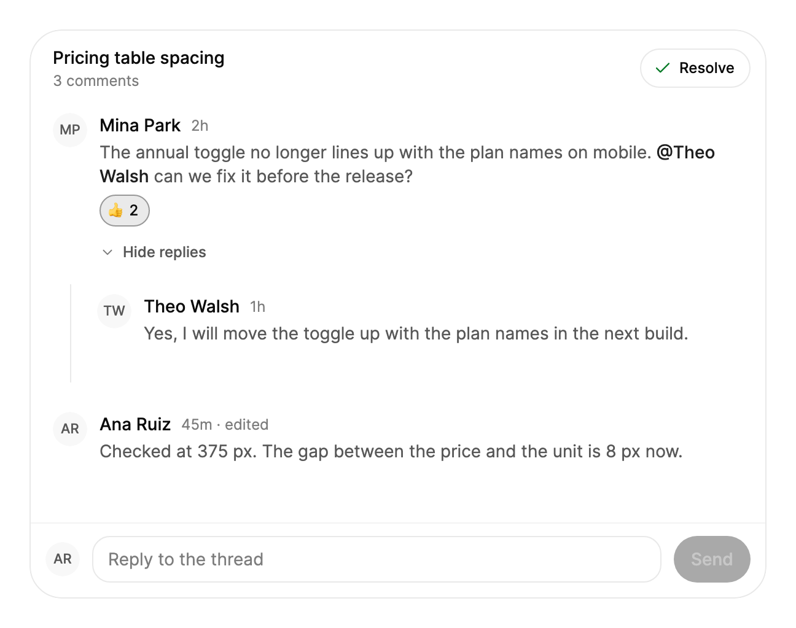

<Demo name="DesignReview" />

## 何时使用

`CommentThread` 是附着在一个对象上的讨论：设计稿中的一个画框、文档中的一条条款、工单，或一个拉取请求。每条评论带有自己的回复，人们可以用表情回应，作者可以原地编辑和删除自己的评论，问题确定之后讨论串可以被标记为已解决。讨论串与对象绑定在一起，因此决策的理由就在决策旁边。

- **结账页面的设计评审**：产品设计师与工程师讨论订单摘要的间距。回复嵌套在它所回应的评论之下，间距达成一致后讨论串被标记为已解决。
- **对法律条款的反馈**：审阅人对合同中的某一条款发表评论，并用“@”提及负责人，使其收到通知。已解决的讨论串作为决策记录保留在该条款上。
- **支持工单上的讨论**：工程师与支持负责人讨论工单 INC-2026-0931 中事故的原因。将讨论串标记为已解决，表示问题已关闭，但不会删除讨论内容。
- **对指标的疑问**：财务负责人询问年度经常性收入数字为何变化，分析师在附着于该数字的讨论串中作答。

## 何时不用

- **在线的人之间的实时对话**：用 `ChatThread`，它有消息列表、输入状态和已读回执。
- **跨多个对象的事件历史**，例如部署或状态变更：用 `Timeline`。
- **只需要带提及建议的输入框，没有讨论**：用 `MentionInput`。
- **一条没有人回复的备注**：用 `Textarea`。只有一条评论且没有回复的讨论串，相当于附带额外控件的备注。

## 用法

将 `CurrentUser` 设为阅读该讨论串的人。他们只能编辑和删除自己的评论。`Comments` 是评论树，按从旧到新排列，每条评论的回复位于其 `Replies` 列表之下。

```csharp
var ana = new CommentAuthor("ana", "Ana Ruiz");
var mina = new CommentAuthor("mina", "Mina Park");

var thread = new CommentThread
{
    Title = "首屏标题",
    CurrentUser = ana,
    Comments =
    [
        new ThreadComment("c1", mina, "新标题读起来很顺。@Theo Walsh 能把副标题再精简一下吗？", "2 小时前")
        {
            Replies =
            [
                new ThreadComment("c2", new CommentAuthor("theo", "Theo Walsh"), "好的，把它精简成一行。", "1 小时前")
            ]
        }
    ]
};
```

```xml
<arc:CommentThread Title="价格表间距"
                   Placeholder="回复此线程"
                   CurrentUser="{Binding CurrentUser}"
                   Comments="{Binding Comments}"
                   IsResolved="{Binding IsResolved}" />
```

`CommentThread` 派生自 `TemplatedControl`，并根据内容调整自身尺寸，因此请把它放在一个能提供所需宽度的容器中。讨论串会立即显示每次变更：它构建一棵新的不可变评论树并显示，然后报告这次变更。它不会等待应用保存任何内容。

### 结构

1. **页眉**：`Title`（字符串，或仅在页眉中使用的控件）、副标题“3 条评论”以及“解决”按钮。页眉左侧内边距为 18 px，顶部内边距为 12 px。
2. **评论**：16 px 圆角表面，内边距 10 px，评论之间相距 10 px。包含头像（28 px，没有 `Avatar` 时显示姓名缩写）、作者姓名、时间，以及已编辑评论的“已编辑”标记。
3. **正文**：14 px 文字，行高 1.4。以“@全名”书写的已知人员会以中等字重显示。
4. **操作**：每条评论都有“回复”；“编辑”和“删除”只出现在当前用户自己的评论上。操作按钮高 28 px。指针悬停在评论上、键盘焦点位于评论内、提示框打开时，以及触摸屏上，它们始终可见。
5. **表情回应**：每个表情一个标签，附带计数。添加回应按钮打开一个选择器，其中是 28 px 的表情按钮，表情为 16 px。
6. **回复切换**：“展开 2 条回复”或“收起回复”。回复位于一条导轨线之下，缩进 24 px（窄屏时为 12 px）。
7. **已删除占位**：已删除且带有回复的评论会保留为“此评论已删除”，使讨论串保持结构。
8. **输入区**：当前用户的头像（宽度低于 420 px 时隐藏）、一个从 38 px 增长到 160 px、圆角为 14 px 的输入框，以及高 38 px 的发送按钮（编辑时为 32 px）。
9. **回复状态行**：输入区上方的“正在回复 Theo Walsh”，并带有 22 px 的关闭按钮。
10. **提及建议**：输入框下方的列表，每行高 32 px，最多显示五人。
11. **已解决标签**：讨论串被解决后，页眉会折叠为一个 24 px 的图标、标题、参与人数，以及高 32 px 的“重新打开”按钮。标签的圆角为 22 px。

线条与间距由组件主题设定。若要改变整个讨论串的外观，请使用主题资源，而不要使用逐实例的属性。

### 绑定到视图模型

视图模型拥有评论和已解决状态。它加载这些内容，应用讨论串报告的每一项变更，并返回保存后的树。`Comments` 与 `IsResolved` 是双向的，因此讨论串在它们变化时会写回新值。本例使用 CommunityToolkit.Mvvm。

```csharp
public interface IReviewStore
{
    Task<ThreadComment[]> LoadCommentsAsync(string reviewId);

    Task<bool> IsResolvedAsync(string reviewId);

    Task ApplyChangeAsync(string reviewId, CommentThreadChange change);
}

public partial class DesignReviewViewModel : ObservableObject
{
    private readonly IReviewStore _store;

    public DesignReviewViewModel(IReviewStore store)
    {
        _store = store;
        CurrentUser = new CommentAuthor("ana", "Ana Ruiz", "avares://Acme.Review/Assets/ana.png");
    }

    public CommentAuthor CurrentUser { get; }

    [ObservableProperty]
    private IReadOnlyList<ThreadComment> _comments = [];

    [ObservableProperty]
    private bool _isResolved;

    public async Task LoadAsync(string reviewId)
    {
        Comments = await _store.LoadCommentsAsync(reviewId);
        IsResolved = await _store.IsResolvedAsync(reviewId);
    }

    public Task RecordAsync(string reviewId, CommentThreadChange change) =>
        _store.ApplyChangeAsync(reviewId, change);
}
```

```xml
<arc:CommentThread Title="价格表间距"
                   CurrentUser="{Binding CurrentUser}"
                   Comments="{Binding Comments, Mode=TwoWay}"
                   IsResolved="{Binding IsResolved, Mode=TwoWay}"
                   People="{Binding People}" />
```

- `CommentsChanged` 是承载每次变更的事件。代码后置把它转发给 `RecordAsync`，因此由存储层保存变更本身，视图模型无需比较树。
- `People` 列出可被提及的人员。将其保留为 null，则会提供讨论串中的所有人以及当前用户。
- 若要拒绝某次变更，请在处理程序中把 `Comments` 设回之前的树。讨论串随后会显示旧的树。

### 提及与人员

在输入区中输入 `@` 可以提示人员。`People` 设置该列表。若未设置，则提供讨论串中的人员和当前用户。建议会匹配姓名中任一单词的开头，因此输入“w”可以找到“Theo Walsh”。

<Demo name="EmptyThread" />

### 表情回应与层级

`Reactions` 设置选择器为每条评论提供的表情。默认为六个表情：点赞、红心、礼炮、眼睛、火箭和对勾。`MaxDepth` 限制嵌套层级（默认 2）：超过该深度的回复会附加到允许的最深父级上。

### 解决与重新打开

`Resolve()` 把讨论串折叠为已解决标签，且只有在讨论串有评论时才生效。`Reopen()` 重新打开已解决的讨论串。`IsResolved` 是双向的，`ResolvedChanged` 会随每次变化报告新的状态。

<Demo name="Resolved" />

```csharp
thread.ResolvedChanged += (_, e) => Status.Text = e.IsResolved ? "已解决" : "已重新打开";

thread.Resolve();
thread.Reopen();
```

### 变更与持久化

`CommentsChanged` 以 `CommentThreadChange` 的形式报告每一次变更。应在服务器上保存该变更，而不是比较整棵树。服务器还必须检查人们是否只编辑和删除自己的评论，因为它接收到的只是客户端报告的内容。

| 类型 | 已设置的字段 | 含义 |
|---|---|---|
| `Reply` | `Comment`、`ParentId`（顶层评论为 null） | 写入了一条新评论或回复 |
| `Edit` | `Id`、`Body` | 评论的正文被修改 |
| `Delete` | `Id` | 评论被删除 |
| `React` | `Id`、`Emoji`、`Added` | 添加了表情回应（`Added` 为 true）或移除了它（为 false） |

```csharp
thread.CommentsChanged += (_, e) =>
{
    if (e.Change.Kind == CommentThreadChangeKind.Edit)
    {
        // 为 e.Change.Id 保存 e.Change.Body。
    }
};
```

### 窄屏

宽度小于 420 px 时，输入区不再显示头像，回复的缩进从 24 px 改为 12 px。

<Demo name="Narrow" />

### 示例：定价页面的设计评审

SaaS 营销页面中定价表的一次评审。第一条评论获得了当前用户的一个表情回应，并在正文中高亮了对 Theo Walsh 的提及。回复用一行回答了问题，最后一条评论已被编辑，因此显示“已编辑”标记。页眉带有所评审元素的标题，以及带有数量的副标题。讨论串尚未解决，因此页眉中仍有“解决”按钮。



```xml
<UserControl xmlns="https://github.com/avaloniaui"
             xmlns:x="http://schemas.microsoft.com/winfx/2006/xaml"
             xmlns:arc="https://github.com/AtomUICommunity/TKCode.Arc"
             xmlns:generic="using:System.Collections.Generic"
             Width="600">
    <arc:CommentThread Title="Pricing table spacing"
                       Placeholder="Reply to the thread">
        <arc:CommentThread.CurrentUser>
            <arc:CommentAuthor Id="ana" Name="Ana Ruiz" />
        </arc:CommentThread.CurrentUser>
        <arc:CommentThread.Comments>
            <generic:List x:TypeArguments="arc:ThreadComment">
                <arc:ThreadComment Id="c1"
                                   Body="The annual toggle no longer lines up with the plan names on mobile. @Theo Walsh can we fix it before the release?"
                                   CreatedAt="2h">
                    <arc:ThreadComment.Author>
                        <arc:CommentAuthor Id="mina" Name="Mina Park" />
                    </arc:ThreadComment.Author>
                    <arc:ThreadComment.Reactions>
                        <generic:List x:TypeArguments="arc:CommentReaction">
                            <arc:CommentReaction Emoji="👍">
                                <arc:CommentReaction.UserIds>
                                    <generic:List x:TypeArguments="x:String">
                                        <x:String>ana</x:String>
                                        <x:String>theo</x:String>
                                    </generic:List>
                                </arc:CommentReaction.UserIds>
                            </arc:CommentReaction>
                        </generic:List>
                    </arc:ThreadComment.Reactions>
                    <arc:ThreadComment.Replies>
                        <generic:List x:TypeArguments="arc:ThreadComment">
                            <arc:ThreadComment Id="c2"
                                               Body="Yes, I will move the toggle up with the plan names in the next build."
                                               CreatedAt="1h">
                                <arc:ThreadComment.Author>
                                    <arc:CommentAuthor Id="theo" Name="Theo Walsh" />
                                </arc:ThreadComment.Author>
                            </arc:ThreadComment>
                        </generic:List>
                    </arc:ThreadComment.Replies>
                </arc:ThreadComment>
                <arc:ThreadComment Id="c3"
                                   Body="Checked at 375 px. The gap between the price and the unit is 8 px now."
                                   CreatedAt="45m"
                                   IsEdited="True">
                    <arc:ThreadComment.Author>
                        <arc:CommentAuthor Id="ana" Name="Ana Ruiz" />
                    </arc:ThreadComment.Author>
                </arc:ThreadComment>
            </generic:List>
        </arc:CommentThread.Comments>
    </arc:CommentThread>
</UserControl>
```

场景中的评论以内嵌方式保留，这是静态图片所必需的。在应用中，它们来自视图模型，讨论串通过 `CommentsChanged` 报告每次变更。

### 文案规范

- **Title**：点明所评审的对象（“价格表间距”“第 4.2 条终止条款”），而不是讨论本身。
- **Placeholder**：邀请人们回复此线程（“回复此线程”）。默认的“回复，或 @提及某人”适合每天都使用提及的团队。
- **评论**：用完整的句子写清观点和问题。只有当某人必须采取行动时，才用“@”提及他。
- **空状态**：默认的“还没有评论。在下方开始讨论。”适合审阅工具。若产品不是审阅工具，请让文字简短些。
- **其他语言**：为操作、计数和播报设置 `Labels`。计数与名称是函数，因此复数规则应放在其中。

| 不要写 | 改为 |
|---|---|
| 评论线程 1 | 价格表间距 |
| 在这里回复… | 回复此线程 |
| 1 条评论们 | 1 条评论 |
| 删除？ | 删除此评论？ |
| 线程已关闭 | 已解决 |

### 最佳实践

**建议**

- 在显示讨论串之前，把 `CurrentUser` 设为已登录的人。“编辑”和“删除”跟随这一身份，用户错误会显示错误的操作。
- 在服务器上保存每一个 `CommentThreadChange`，并在服务器上检查人们是否只修改了自己的评论。
- 为每条评论提供稳定的 `Id`。讨论串在评论树变化时，按 id 复用每条评论的视图。
- 问题得到解答后解决讨论串，使已解决标签显示结果，并把讨论折叠起来。
- 把 `People` 设为该对象的审阅人，使建议优先显示正确的人。

**避免**

- 通过比较两棵树来找出变化。`CommentsChanged` 中的变更已经说明了发生了什么。
- 人们输入时把草稿写入 `Comments`。只有已发送的评论才应进入树中。
- 用同一个讨论串承载多个对象。每个讨论串只属于一个对象，第二个对象需要第二个讨论串。
- 从存储中删除带有回复的评论。改为将其标记为已删除，使讨论串保留占位，回复也保持原位。
- 对于使用自有表情的产品，仍保留 `Reactions` 的默认值，例如只用对勾做审阅的团队。

### 常见问题

**为什么别人的评论上没有“编辑”或“删除”？** 只有作者的 `Id` 与 `CurrentUser` 相同的评论才会显示“编辑”和“删除”。服务器必须再次检查。

**为什么在新讨论串上“解决”没有作用？** `Resolve()` 只有在讨论串有评论时才会折叠它，因此空的讨论串保持打开状态。

**如何从代码开始回复？** 以评论的 id 调用 `ReplyTo(id)`。它会把焦点移到输入区，并且回复状态行会显示该评论的作者。`CancelReply()` 取消正在进行的回复，`ReplyingToId` 返回正在回复的 id，若没有则为 null。

**能否在服务器接受之前保留一次变更？** 讨论串会立即显示变更。若要拒绝某次变更，请如上文所述，在处理程序中把 `Comments` 设回之前的树。

## API 参考

<!-- api: CommentThread -->

<!-- api: ThreadComment -->

## 无障碍

- 讨论串是一个具名区域（“评论线程”，即 `Labels.Thread` 上的 `Label`）。每条评论是一个具名分组，包含作者与时间，例如“Mina Park，2 小时前”。已删除的评论会播报为“已删除的评论”。
- 打开提及建议时，输入区是一个组合框，其展开状态会暴露给辅助技术。
- 表情回应标签是切换按钮，其名称包含计数以及你是否已回应，例如“点赞，2，包括你”。
- 用于折叠回复的按钮会暴露其展开状态。仅有图标的操作，例如编辑、删除和回复，都有名称。
- 编辑表单名为“编辑评论”，其保存按钮名为“保存”。

### 键盘

| 按键 | 操作 |
|---|---|
| `Enter`（在输入区中） | 添加一个新行 |
| `Ctrl` + `Enter` 或 `Cmd` + `Enter` | 发送新评论，或保存编辑 |
| `@` | 打开提及建议 |
| `Up` / `Down`（在建议中） | 移动当前建议；在两端循环 |
| `Enter` 或 `Tab`（在建议中） | 插入当前人员，格式为“@全名 ” |
| `Escape` | 先关闭建议；然后取消编辑、回复、删除确认或表情选择器 |

评论中的操作与其他按钮一样可通过 `Tab` 获得焦点，因此键盘用户无需指针即可到达“回复”“编辑”和“删除”。

## 动效

- 展开回复、添加评论以及折叠已解决的讨论串，都会以弹簧效果改变讨论串的高度。
- 表情回应计数滚动到新值，别人添加或移除表情时，标签会随之移动。
- 编辑表单、删除确认和表情选择器会平移滑入一小段距离。

| 变化 | 完整 | 减弱 | 关闭 |
|---|---|---|---|
| 回复展开或收起 | 讨论串高度以弹簧过渡到新尺寸 | 内容原位变化 | 立即完成 |
| 添加评论 | 讨论串高度以弹簧变化，评论随之出现 | 内容原位变化 | 立即完成 |
| 讨论串被解决或重新打开 | 讨论串以弹簧折叠为标签，或展开 | 内容原位变化 | 立即完成 |
| 表情回应计数变化 | 计数滚动到新值 | 计数原位变化 | 立即完成 |
| 编辑表单、删除提示或选择器打开 | 滑入 8 px | 内容原位变化 | 立即完成 |

减弱动效会用原位变化取代移动，并关闭过渡。关闭动效则直接跳到最终状态。

## 相关组件

- `ChatThread`：在线的人之间的实时对话。
- `Timeline`：跨多个对象的活动动态。
- `MentionInput`：带提及建议的单一输入框，没有讨论串。

| 组件 | 适用场景 |
|---|---|
| `ChatThread` | 人们轮流对话，并带有输入状态和已读回执 |
| `Timeline` | 历史是跨多个对象的事件列表 |
| `MentionInput` | 你需要一个带提及的输入框，而不是讨论 |
| `Textarea` | 书写单条备注，且没有人回复 |
| `Avatar` | 你需要讨论串之外某人的头像或姓名缩写 |
