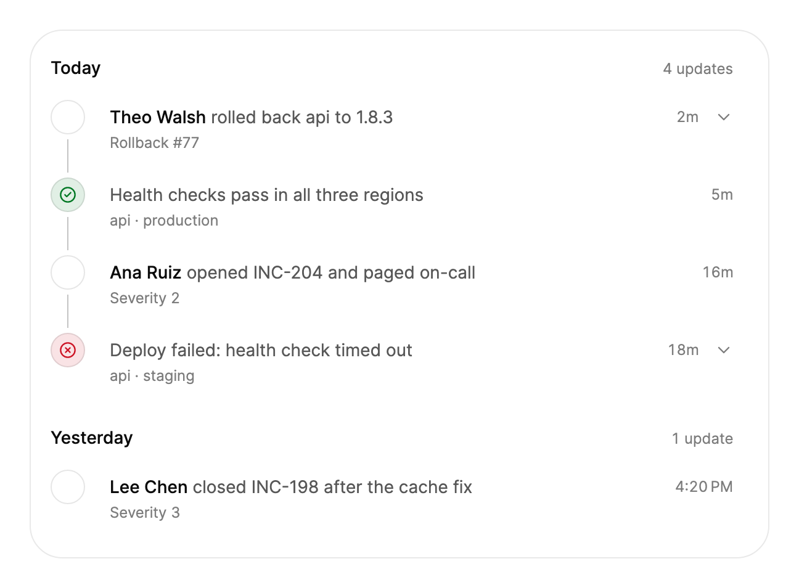

<Demo name="LiveStream" />

## When to use

`Timeline` is the activity feed of an application where the order and the recency of events matter more than their
comparison. It shows who did what and when, grouped by day with the newest first, and it accepts updates while it is on
screen. Each row is one update: a person's action or a system event with a short title, optional context and, when the
reader needs it, a detail that expands in place.

- **Project history on a release page**: "merged Checkout redesign into main" by Theo Walsh, with the pull request as the
  context. Readers scan the day groups to see how a release came together.
- **Deployment stream in a DevOps console**: builds, rollouts and rollbacks, with a success or danger tone on system events.
  The title states the outcome, so the tone is never the only signal.
- **Audit log in an admin console**: who changed a billing plan or a user role, and when. Each row expands to show the
  before and after values, so the list stays short.
- **Account activity in a CRM**: calls, emails and contract changes for one customer, each with a portrait of the person
  who made it.
- **Incident progress on a status page**: a live feed where each update slides in at the top as responders post it.

## When not to use

- **Records the reader sorts or compares**, such as invoices by amount or users by last login: use `Table`.
- **Fixed steps with a current position**, such as checkout or onboarding: use `Stepper`.
- **A threaded discussion on one object**: use `CommentThread`. For a live two-way conversation, use `ChatThread`.
- **One current status of one item**, such as "Payment failed" on an invoice: use `Alert` next to the item. A timeline of
  one event is a message, not a feed.

## Usage

`Timeline` derives from Avalonia's `ItemsControl`. Its items are `TimelineEvent` objects, bound with `ItemsSource` or written
inline. Events can arrive in any order, and the newest shows first. Set `Now` to the reference time: relative times such as
"9m" and "2h" and the day groups "Today" and "Yesterday" are computed from it.

```xml
<UserControl xmlns="https://github.com/avaloniaui"
             xmlns:arc="https://github.com/AIDotNet/TKCode.Arc">
    <arc:Timeline Label="Release history"
                  Now="2026-10-20T12:00:00+00:00">
        <arc:TimelineEvent Id="build-418"
                           At="2026-10-20T11:48:00+00:00"
                           Actor="Ana Ruiz"
                           Title="deployed web to production"
                           Meta="Build #418"
                           Detail="All 312 checks passed in 4m 12s." />
        <arc:TimelineEvent Id="pr-212"
                           At="2026-10-20T11:02:00+00:00"
                           Actor="Theo Walsh"
                           Title="merged Checkout redesign into main"
                           Meta="PR #212" />
    </arc:Timeline>
</UserControl>
```

`Timeline` derives from `ItemsControl` and lays out its own rows, so supply `TimelineEvent` items, not item templates. The
feed grows with its page unless you set `MaxHeight`, so place it in a page that scrolls, or give it a height and let it scroll
inside.

### Anatomy

1. **Day label** (`HeadingLevel`, 3 by default): "Today", "Yesterday", or the weekday and date for older days, with the
   number of updates in that day. It is a 19.6 px line with 8 px above and below.
2. **Marker**: a 28 px circle with a 14 px glyph, 8 px below the top of the row. It shows the `Avatar` of a person, or the
   `Icon` of a system event; a person without an avatar gets an empty marker.
3. **Connector**: a line that runs from the bottom of the marker to the next row. It draws itself as the row comes into view.
4. **Trigger**: the title on a 20 px line and the `Meta` on a 16.8 px line, with the `Actor` first in the foreground color.
   The trigger has 12 px of padding and sits 36 px from the left edge.
5. **Time**: at least 44 px wide, after the title. Today's updates show relative times ("9m", "2h"); earlier days show the
   clock time ("1:00 PM").
6. **Chevron**: a 16 px arrow after the time on rows with a `Detail`. Rows without a detail show no chevron and do not
   expand.
7. **Detail**: the `Detail` revealed under the trigger, with 12 px of side padding and 16 px at the bottom.
8. **Sticky day label**: in a scrolling feed (with `MaxHeight`), the current day label stays pinned at the top while its rows
   scroll under it.
9. **Feather**: when a scrolling feed has more rows below, its bottom edge fades over 36 px.

The timeline uses the Arc surface for its day labels, which cover the rows scrolling under them. Set `HeaderBackground` to
the surface the feed sits on, or the labels show a different color from the page.

Under 420 px the trigger padding drops to 8 px and the time and chevron move closer to the title.

### Binding to a view model

The view model owns the events, the reference time and the expanded rows. The timeline shows them, and the view model
adds events as they arrive. This example uses CommunityToolkit.Mvvm.

```csharp
public partial class DeploymentFeedViewModel : ObservableObject
{
    public ObservableCollection<TimelineEvent> Events { get; } = [];

    [ObservableProperty]
    private DateTimeOffset _now = DateTimeOffset.UtcNow;

    [ObservableProperty]
    private IReadOnlyList<string> _expandedIds = [];

    public void Add(TimelineEvent item) => Events.Add(item);

    public void Tick() => Now = DateTimeOffset.UtcNow;
}
```

```xml
<arc:Timeline Label="Deployments"
              ItemsSource="{Binding Events}"
              Now="{Binding Now}"
              ExpandedIds="{Binding ExpandedIds}"
              MaxHeight="420" />
```

- `ItemsSource` takes the events. Adding to the collection slides the new row in at the top, and the view model does not
  need to rebuild the list.
- `Now` is one-way. Set it from a timer, as the next section shows; only the time labels change when it moves.
- `ExpandedIds` is two-way. It holds the ids of the open rows, so the view model can restore them when the page reloads.

### Live feed

Advance `Now` on a timer, about once a minute, so the relative times stay current. Stop the timer when the feed leaves the
screen, so an unused page does no work. `IsScrollToNewEnabled` (default true) scrolls the feed back to the top when a new
newest update arrives while the reader is scrolled down.

```csharp
var events = new ObservableCollection<TimelineEvent>();
var timeline = new Timeline { Label = "Deployments", Now = DateTimeOffset.UtcNow, ItemsSource = events };

events.Add(new TimelineEvent("post-1", DateTimeOffset.UtcNow, "merged Checkout redesign into main", "Theo Walsh")
{
    Meta = "PR #212"
});

var clock = new DispatcherTimer { Interval = TimeSpan.FromMinutes(1) };
clock.Tick += (_, _) => timeline.Now = DateTimeOffset.UtcNow;
timeline.AttachedToVisualTree += (_, _) => clock.Start();
timeline.DetachedFromVisualTree += (_, _) => clock.Stop();
```

### Expandable rows and tones

A row with a `Detail` expands when it is activated. The `Detail` can be text or any control, and it is revealed in place.
A `Detail` that is an empty string does not make the row expandable. `Tone` colors a system event:

| Tone | Use it for | How it shows |
|---|---|---|
| `Neutral` (default) | Ordinary updates | A quiet marker |
| `Success` | A completed step: a deploy, a migration, a payment | The marker is tinted and the icon takes the success color |
| `Danger` | A failure or a rollback | The marker is tinted and the icon takes the danger color |

Put the outcome in the title as well as the tone, so the meaning is not carried by color alone.

<Demo name="ExpandableDetails" />

<Demo name="TonesAndPortraits" />

```xml
<arc:Timeline Label="Pipeline" Now="2026-10-20T12:00:00+00:00">
    <arc:TimelineEvent Id="t1"
                       At="2026-10-20T11:55:00+00:00"
                       Title="Deploy succeeded"
                       Meta="web · production"
                       Tone="Success" />
    <arc:TimelineEvent Id="t2"
                       At="2026-10-20T11:42:00+00:00"
                       Title="Deploy failed: health check timed out"
                       Meta="api · staging"
                       Detail="Retried twice. The failing check is tracked in INC-204."
                       Tone="Danger" />
</arc:Timeline>
```

```csharp
timeline.ExpandedChanged += (_, e) => Status.Text = $"{e.Item.Title}, expanded: {e.IsExpanded}";
timeline.Expand("t2");
```

`ExpandedChanged` reports each row that opened or closed, whether the user did it or the code called `Expand`, `Collapse` or
`Toggle`. A person's event shows `Avatar`. A system event shows an `Icon`, such as `ArcIcons.Check`, when it has no avatar.

### Long history

Set `MaxHeight` to scroll inside the feed. The current day label stays pinned while its rows scroll, and the list is
virtualized: only the rows in view and a small buffer exist, so a long history stays responsive.

<Demo name="ScrollingFeed" />

<Demo name="ThousandUpdates" />

```xml
<arc:Timeline Label="Audit log"
              Now="2026-10-20T12:00:00+00:00"
              ItemsSource="{Binding AuditEvents}"
              MaxHeight="380" />
```

Use `ScrollIntoView(id)` to bring an event into view, for example from a link in a notification. `ScrollToTop(smooth)` returns
the feed to its newest update, smoothly under full motion.

### Example: incident progress feed

An incident page for INC-204 in a status console. The feed shows the responders' actions and the system events in
order. The failed deploy is a danger event whose title already says the outcome, and its detail explains the retry. The
rollback is a person's action with the responder's name, and the health check is a success event. The yesterday group
shows that the page keeps earlier history. The title of each row is a full sentence, so the feed reads like a log.



```xml
<UserControl xmlns="https://github.com/avaloniaui"
             xmlns:x="http://schemas.microsoft.com/winfx/2006/xaml"
             xmlns:arc="https://github.com/AIDotNet/TKCode.Arc"
             Width="600">
    <Border Padding="16,12,16,4"
            CornerRadius="26"
            BorderThickness="1"
            Background="{arc:ArcDesignTokenResource Surface}"
            BorderBrush="{arc:ArcDesignTokenResource Border}">
        <arc:Timeline Label="Incident INC-204"
                      Now="2026-10-20T12:00:00+00:00">
            <arc:TimelineEvent Id="rollback"
                               At="2026-10-20T11:58:00+00:00"
                               Actor="Theo Walsh"
                               Title="rolled back api to 1.8.3"
                               Meta="Rollback #77"
                               Detail="Error rate returned to 0.2% within six minutes of the rollback." />
            <arc:TimelineEvent Id="healthy"
                               At="2026-10-20T11:55:00+00:00"
                               Title="Health checks pass in all three regions"
                               Meta="api · production"
                               Icon="{x:Static arc:ArcIcons.CircleCheck}"
                               Tone="Success" />
            <arc:TimelineEvent Id="failed"
                               At="2026-10-20T11:42:00+00:00"
                               Title="Deploy failed: health check timed out"
                               Meta="api · staging"
                               Detail="Retried twice. The failing check is tracked in INC-204."
                               Icon="{x:Static arc:ArcIcons.CircleX}"
                               Tone="Danger" />
            <arc:TimelineEvent Id="opened"
                               At="2026-10-20T11:44:00+00:00"
                               Actor="Ana Ruiz"
                               Title="opened INC-204 and paged on-call"
                               Meta="Severity 2" />
            <arc:TimelineEvent Id="closed"
                               At="2026-10-19T16:20:00+00:00"
                               Actor="Lee Chen"
                               Title="closed INC-198 after the cache fix"
                               Meta="Severity 3" />
        </arc:Timeline>
    </Border>
</UserControl>
```

The scene keeps its events inline, as a static picture must. In the application they come from `ItemsSource`, and the
time labels move with `Now`.

### Content guidelines

- **Title**: a full sentence in the past tense, with the actor first in the feed: "merged Checkout redesign into main". The
  actor is a name, never "System" when a person caused the event.
- **Outcome**: say the result in the title of every success or danger event, so a reader who cannot see the color still
  knows what happened.
- **Meta**: a short reference such as a pull request, a build or a severity: "PR #212", "Build #418".
- **Detail**: one or two sentences with the facts a reader needs when they expand the row. Put the numbers in the detail, not
  in the title, when they are long.
- **Other languages**: set `Culture` for day headings and clock times. The default is en-US.

| Instead of | Write |
|---|---|
| Update | Ana Ruiz deployed web to production |
| Error! | Deploy failed: health check timed out |
| System: done | Database migration completed |
| Click for more | Retried twice. The failing check is tracked in INC-204. |

### Best practices

**Do**

- Set `Now` from a timer and stop the timer when the feed leaves the screen. Relative times are only as current as `Now`.
- Set `TimeZone` when the audience shares one zone, such as an operations team in one region. The default is UTC, so every
  viewer sees the same clock.
- Give every event a stable `Id`. Expansion, freshness and the announcement of new updates follow it.
- Use `MaxHeight` on a long feed, so the day labels stay pinned and the reader keeps the place.
- Put the outcome in the title of every success or danger event.

**Avoid**

- Replacing the whole collection to add one event. Add to the collection, so the new row slides in.
- Setting `Tone` on ordinary person events. A tone marks a system outcome, and a person's row already has the avatar.
- Using `Detail` for the main content of an event. The row shows the title first, and a detail that holds the whole story
  is hidden until the reader expands it.
- Leaving `HeaderBackground` at its default on a feed placed on a colored panel. The day labels then cover the rows with the
  wrong color.
- Using a timeline for records a reader compares. Sorting and filtering belong in `Table`.

### Common questions

**Why do the relative times not change?** Only the time labels change when `Now` moves. Advance `Now` about once a minute, from
a timer that runs while the feed is on screen.

**Why does my row not expand?** A row expands only when its `Detail` has content. An empty string does not count, so the row
is plain text and it is not in the Tab order.

**Can I show the oldest event first?** No. The feed shows the newest update first and groups the rows by day. Sort the
events yourself if you need another order in a different view.

**How do I open a row from code?** Call `Expand(id)`, `Collapse(id)` or `Toggle(id)`. Each call raises `ExpandedChanged`, and
`IsExpanded(id)` tells you whether a row is open.

## API reference

<!-- api: Timeline -->

<!-- api: TimelineEvent -->

## Accessibility

- The feed is a named region. `Label` is its accessible name, such as "Incident INC-204".
- Each day label is a heading at `HeadingLevel` (3 by default, from 2 to 6). Its accessible name carries the count of updates,
  such as "Friday, October 16, 1 update". Each time has its full date as hidden text.
- Expandable rows expose their expanded state. Rows without a detail are plain text and are not in the Tab order.
- New events are announced in a live region as "New update: ..." without moving focus.
- Tone is color. The title must say the outcome, as the content guidelines require.

### Keyboard

| Keys | Action |
|---|---|
| `Down` / `Up` | Moves to the next or previous row that has a detail |
| `Home` / `End` | Moves to the first or last row that has a detail |
| `Enter` or `Space` | Expands or collapses the current row |

Rows with a detail take focus in the Tab order; rows without one do not. Arrow keys skip the rows that cannot expand.

## Motion

- Rows draw their connector line as they enter the viewport, and their markers pop in.
- A new event slides in from the top while the rows below move down. Expanded details open on a spring.
- Reduced motion replaces movement with a short fade and changes heights at once. Off jumps to the final state.

| Change | Full | Reduced | Off |
|---|---|---|---|
| Row enters the viewport | The connector draws and the marker pops in | Short fade | Immediate |
| New event arrives | Slides in from the top; rows below move down | Short fade | Immediate |
| Detail opens or closes | The detail opens on a spring | Height changes at once | Immediate |
| Day label while scrolling | Stays pinned at the top of the feed | Stays pinned | Stays pinned |

## Related

- `CommentThread` for replies on one object, and `ChatThread` for a live two-way conversation.
- `Table` when the reader needs to sort or compare records.
- `Stepper` for fixed steps with a current position.

| Component | Choose it when |
|---|---|
| `CommentThread` | Replies hang off one object and can be resolved |
| `ChatThread` | People talk in turns, with typing and read receipts |
| `Table` | The reader sorts or compares the records |
| `Stepper` | The steps are fixed and one of them is current |
| `Alert` | A single current status belongs next to one item |
