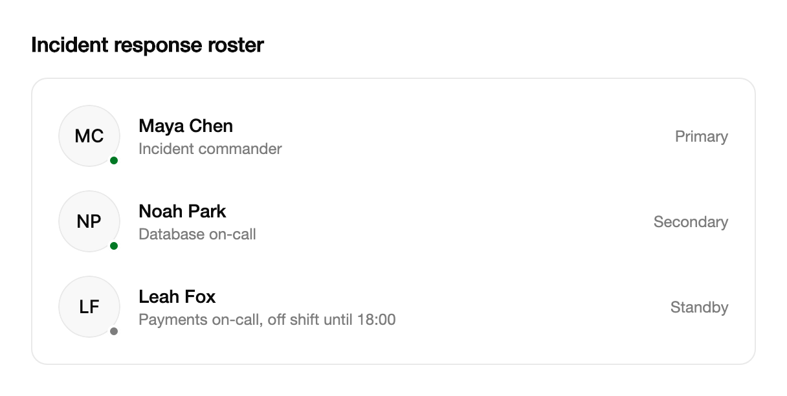

<Demo name="Initials" />

## 何时使用

`Avatar` 用照片或首字母标识一个人，并可显示此人是否在线。它放在页头、记录、评论或表格行中的名字旁边，让人在读完文字之前就能认出对方。它只用于展示：从不获得焦点，不打开任何内容，也不会把值写回去。

- **工单、交易或发票中的负责人与经办人字段**：在“指派给”旁边放一个头像，操作员无需逐个读名字就能在密集的队列中找到负责人。
- **团队通讯录或支持控制台中的在线状态**：照片旁的状态圆点表示某位客服或同事在线，`AvatarStatus.Offline` 则表示谁已下线。只在产品确实掌握在线状态的地方使用。
- **管理后台顶栏中的当前登录用户**：在 SaaS 控制台顶栏使用 `Medium` 或 `Large` 尺寸的头像，并显示用户的首字母，即使还没有个人照片。
- **缺少照片的联系人列表**：CRM 列表中很多记录没有图片。当 `Source` 为空或加载失败时由首字母接替显示，因此每一行都有稳定的标识。
- **每条记录都有操作人的活动日志与审计日志**：`Small` 尺寸的头像让数百行中的操作人一目了然，又不占用表格列的空间。

## 何时不用

- **小空间内显示多人并带有剩余人数**：用 `AvatarGroup`，它会把溢出的人折叠成 "+N" 标签。
- **点击后打开账号操作（如退出登录或切换工作区）的头像**：用 `UserMenu`，由它负责菜单、焦点与键盘操作。
- **需要比较姓名、角色和日期的列表**：用 `SortableDataTable`。单靠头像无法承载读者需要的文字信息。
- **每条消息都有作者和时间的对话**：用 `ChatThread` 或 `CommentThread`，它们会把作者与消息文字排在一起。
- **不是人员的状态或类别**，例如进行中、草稿或失败：用 `Badge`。
- **编辑人员的姓名或邮箱**：用 `Input`。头像只显示值，没有可编辑的文字。

## 用法

```xml
<UserControl xmlns="https://github.com/avaloniaui"
             xmlns:arc="https://github.com/AtomUICommunity/TKCode.Arc">
    <arc:Avatar DisplayName="Ada Lovelace" />
</UserControl>
```

`Avatar` 派生自 Avalonia 的 `TemplatedControl`。它的外框使用标准的 `Background`、`BorderBrush`、`BorderThickness` 和 `CornerRadius` 属性，因此可以像其他模板控件一样在局部覆盖主题的值。尺寸由 `Size` 决定：在实例上设置 `Width` 或 `Height` 会替换主题中的直径，此时状态圆点和首字母将不再与 Arc 的尺寸比例匹配。请优先使用 `Size`。

### 结构

1. **外框**（控件本身）：一个圆形，带 1 px 的 `Border` 描边，填充为 `SurfaceMuted`。圆角为胶囊圆角，因此在任何尺寸下都保持圆形，内容也会被裁剪到这个形状内。
2. **首字母**（`Initials`，只读）：居中的文字，使用常规前景色与中等字重。在 `Small` 尺寸下文字为 10 px；在 `Medium`、`Large` 和 `XLarge` 下，它跟随 Arc 字号阶梯中的 XS、SM 和 XL。
3. **照片**（`Source`）：填满圆形的异步图像。只有在设置了 `Source` 且尚未加载失败时才显示；加载期间外框保持为空。
4. **状态圆点**（`Status`）：位于右下角的实心圆，带有与表面色相同的环（`Small` 为 1.5 px，其他尺寸为 2 px），外围还有一层边框色的淡色光晕（1 px）。`Online` 使用成功色，`Offline` 使用弱化的文字颜色，`None` 则完全移除圆点。

### 照片与回退

`Source` 用于加载照片。照片会裁剪以填满圆形。已缓存的照片会立即出现；如果头像已显示后照片仍在下载，照片会从 4 px 的模糊中淡入，因此外框不会闪烁。

<Demo name="Photos" />

照片加载失败时，头像会回退到 `Initials` 并保留首字母。失败的地址会针对该 `Source` 值被记住，因此每次头像重绘时不会重复请求同一个失效链接。若要重试，请为 `Source` 赋一个新值。照片并非布局所必需：无论有没有照片，每个尺寸都会预留相同的外框。

### 尺寸

`Size` 决定直径：`Small` 为 28 px，`Medium`（默认）为 36 px，`Large` 为 48 px，`XLarge` 为 88 px。尺寸不随窗口变化，在任何宽度下都保持一致。

| 尺寸 | 直径 | 首字母文字 | 状态圆点 | 适用场景 |
|---|---|---|---|---|
| `Small` | 28 px | 10 px | 8 px | 表格行、活动日志、密集列表 |
| `Medium` | 36 px | Arc XS | 10 px | 页头、卡片与表单摘要的默认值 |
| `Large` | 48 px | Arc SM | 12 px | 人员名册面板、个人资料卡 |
| `XLarge` | 88 px | Arc XL | 14 px | 账号与个人资料页的页头 |

```xml
<arc:Avatar DisplayName="Ada Lovelace" Size="Small" />
<arc:Avatar DisplayName="Grace Hopper" Size="Medium" />
<arc:Avatar DisplayName="Alan Turing" Size="Large" />
<arc:Avatar DisplayName="Katherine Johnson" Size="XLarge" />
```

同一列表或同一组相关头像使用同一个尺寸，这样行高一致，圆点也能对齐。在密集的表格中，`Small` 配合 8 px 的圆点仍然清晰可读，因为圆点带有一圈将其与照片分隔开的环。

### 状态

`Status` 在右下角显示在线或离线圆点。默认值 `AvatarStatus.None` 会隐藏圆点。

<Demo name="Status" />

只有在产品确实掌握在线状态时才显示它，例如当前房间里的人、值班工程师，或正在接待会话的客服。对于在线状态未知的人，不要臆造 `Offline`，应保持 `None`。`Offline` 是一种中性状态，不是错误，因此使用弱化的文字颜色，而从不使用危险色。状态还会改变无障碍名称（见“无障碍”一节），因此圆点从来不是唯一的信号。

### 首字母

首字母取自 `DisplayName` 前两个单词的首字母，并转为大写。多余的空格会被忽略；只有一个单词的名称只得到一个字母。

| `DisplayName` | `Initials` |
|---|---|
| `Ada Lovelace` | `AL` |
| `  grace   brewster hopper ` | `GB` |
| Plato | `P` |
| 空或仅含空白 | 空 |

`Initials` 是只读的，每当 `DisplayName` 变化时都会更新。`Avatar.ComputeInitials` 对任意字符串应用同样的规则，例如用于在代码中生成标签。

### 绑定到视图模型

`Avatar` 的值是单向流动的。从视图模型绑定 `DisplayName`、`Source`、`Status` 和 `Size`；头像从不把值写回，也不引发视图模型需要处理的事件。

```csharp
public partial class OnCallMemberViewModel : ObservableObject
{
    [ObservableProperty]
    private string _displayName = string.Empty;

    [ObservableProperty]
    private ImageSource? _photo;

    [ObservableProperty]
    private AvatarStatus _status = AvatarStatus.None;
}
```

```xml
<arc:Avatar DisplayName="{Binding DisplayName}"
            Source="{Binding Photo}"
            Status="{Binding Status}"
            Size="Large" />
```

这些属性必须在 UI 线程上设置，因为 Avalonia 属性只能在该线程上更改。当在线状态服务在后台线程上报告变化时，请通过 `Dispatcher.UIThread.Post` 投递更新。`ImageSource` 由视图模型创建，例如由你自己的服务加载的位图；没有图片时将 `Photo` 保持为 null，此时显示首字母。

### 列表与表格中的照片

每个在屏幕上的行都要为照片消耗内存和解码时间。`Source` 异步加载，照片会按头像的显示尺寸解码，因此很大的原图也不会比圆形区域所需的开销更多。尽管如此，包含数百行的列表仍应遵循三条规则：

- 在长列表中使用 `Small`，只在页面焦点的一两个头像上使用 `Large` 和 `XLarge`。
- 保持列表虚拟化，正如 Avalonia 的 `ListBox` 和 `DataGrid` 默认的那样，这样只有可见的行会创建头像。
- 对没有照片的记录完全不设置 `Source`，而不是使用空白或占位图像，这样直接使用首字母，也不会产生失败的请求。

### 示例：事件控制台中的值班名单

事件控制台列出了正在处理一次实时故障的响应人员。每一行都有一个 `Large` 头像、姓名、角色与状态圆点。其中两位在线的响应人员由在线状态服务标为绿色圆点；第三位是 `Offline`，但保留了相同的外框，使姓名保持对齐。由于事件工具里还没有这些人员的照片，名单只使用首字母；缺少照片不产生任何开销，日后添加照片时布局也不会改变。



```xml
<StackPanel Width="560" Spacing="16">
    <TextBlock Text="Incident response roster"
               FontSize="16"
               FontWeight="SemiBold"
               Foreground="{arc:ArcDesignTokenResource Foreground}" />
    <Border Padding="20"
            Background="{arc:ArcDesignTokenResource Surface}"
            BorderBrush="{arc:ArcDesignTokenResource Border}"
            BorderThickness="1"
            CornerRadius="12">
        <StackPanel Spacing="18">
            <Grid ColumnDefinitions="Auto,*,Auto">
                <arc:Avatar Grid.Column="0"
                            DisplayName="Maya Chen"
                            Size="Large"
                            Status="Online" />
                <StackPanel Grid.Column="1" Margin="14,0,0,0" Spacing="2" VerticalAlignment="Center">
                    <TextBlock Text="Maya Chen" FontWeight="Medium"
                               Foreground="{arc:ArcDesignTokenResource Foreground}" />
                    <TextBlock Text="Incident commander" FontSize="12"
                               Foreground="{arc:ArcDesignTokenResource TextMuted}" />
                </StackPanel>
                <TextBlock Grid.Column="2" Text="Primary" FontSize="12"
                           VerticalAlignment="Center"
                           Foreground="{arc:ArcDesignTokenResource TextMuted}" />
            </Grid>
            <Grid ColumnDefinitions="Auto,*,Auto">
                <arc:Avatar Grid.Column="0"
                            DisplayName="Noah Park"
                            Size="Large"
                            Status="Online" />
                <StackPanel Grid.Column="1" Margin="14,0,0,0" Spacing="2" VerticalAlignment="Center">
                    <TextBlock Text="Noah Park" FontWeight="Medium"
                               Foreground="{arc:ArcDesignTokenResource Foreground}" />
                    <TextBlock Text="Database on-call" FontSize="12"
                               Foreground="{arc:ArcDesignTokenResource TextMuted}" />
                </StackPanel>
                <TextBlock Grid.Column="2" Text="Secondary" FontSize="12"
                           VerticalAlignment="Center"
                           Foreground="{arc:ArcDesignTokenResource TextMuted}" />
            </Grid>
            <Grid ColumnDefinitions="Auto,*,Auto">
                <arc:Avatar Grid.Column="0"
                            DisplayName="Leah Fox"
                            Size="Large"
                            Status="Offline" />
                <StackPanel Grid.Column="1" Margin="14,0,0,0" Spacing="2" VerticalAlignment="Center">
                    <TextBlock Text="Leah Fox" FontWeight="Medium"
                               Foreground="{arc:ArcDesignTokenResource Foreground}" />
                    <TextBlock Text="Payments on-call, off shift until 18:00" FontSize="12"
                               Foreground="{arc:ArcDesignTokenResource TextMuted}" />
                </StackPanel>
                <TextBlock Grid.Column="2" Text="Standby" FontSize="12"
                           VerticalAlignment="Center"
                           Foreground="{arc:ArcDesignTokenResource TextMuted}" />
            </Grid>
        </StackPanel>
    </Border>
</StackPanel>
```

### 文案规范

- **显示名称**：产品中人们使用的完整姓名，例如 "Maya Chen"。首字母和无障碍名称都来自它，因此简短的昵称会得到糟糕的结果。
- **名称文字**：不要把头衔、角色和缩写放进 `DisplayName`。像 "Dr." 这样的前缀会改变首字母，而角色应放在头像旁边的文字中。
- **状态**：控件中只存在 "online" 和 "offline" 两个词。更具体的内容，例如 "18:00 前离开"，请放在头像旁边的文字里。

| 不要写 | 改为 |
|---|---|
| `DisplayName="mchen"` | `DisplayName="Maya Chen"`，首字母为 "MC" |
| `DisplayName="Dr. Maya Chen"` | `DisplayName="Maya Chen"`，首字母为 "MC" 而非 "DM" |
| `DisplayName="Maya Chen (away)"` | `DisplayName="Maya Chen"`，并在行文字中写 "18:00 前离开" |
| `DisplayName="Maya"` | `DisplayName="Maya Chen"`，两个单词得到两个字母 |

### 最佳实践

**推荐**

- 传入完整的显示名称，使首字母和无障碍名称都能正确读出。只有一个单词只会得到一个字母，读者无法将其与同名的人区分开。
- 每个列表使用同一尺寸，表格和日志中使用 `Small`。等高的行更易于扫读，圆点也能保持在一条直线上。
- 只根据产品掌握的在线状态设置 `Status`。一个总是灰色的圆点毫无意义，还会让人习惯于忽略这个控件。
- 只对产品确实拥有的照片使用 `Source`。没有照片的记录保留首字母，外框中不会出现破损的图像。

**避免**

- 把头像用作按钮或菜单触发器。该控件不可获得焦点，也没有键盘处理；应把账号菜单包裹在 `UserMenu` 中，由它负责焦点与按键。
- 为了选择尺寸而在局部设置 `Width` 或 `Height`。这会覆盖 `Size` 提供的直径，导致状态圆点和首字母不再与 Arc 的尺寸比例匹配。
- 在长列表中加载全尺寸照片。数百张 88 px 的照片会占用大量内存；`Small` 配合首字母几乎没有开销。
- 把离线圆点染成错误色。离线是中性状态，危险色只用于失败。
- 在纯文本导出或屏幕阅读器中只依赖圆点来表示在线状态。状态通过名称传递给辅助技术，因此当在线状态关乎判断时，也要把它写在文字里。

### 常见问题

**为什么某一行没有状态圆点？** 默认的 `Status` 为 `AvatarStatus.None`，会隐藏圆点。设置 `Online` 或 `Offline` 即可显示。

**为什么照片不出现，首字母却还在？** 要么照片仍在下载（到达之前外框为空），要么加载失败，于是保留了首字母。失败的地址会针对该 `Source` 值被记住；为 `Source` 赋一个新值即可重试。

**为什么两个中文名只显示一个字？** 首字母取自以空格分隔的每个单词的第一个字符，因此没有空格的名字只会得到一个字，例如 "张三" 得到 "张"。本版本的 `Avatar` 没有首字母的覆盖选项。若此类名字需要两个字，请用你自己的标签替代头像。

**屏幕阅读器如何朗读头像？** 无障碍名称是 `DisplayName`，有状态时后面跟上状态："Maya Chen, online"。没有状态时只读出名称。务必设置 `DisplayName`，因为空名称会使头像没有标签。

**如何为同一个人加载新照片？** 将新的 `ImageSource` 赋给 `Source`。赋值会清除旧地址的失败记录，因此即使之前的地址失败过，新照片也会被加载。

## API 参考

<!-- api: Avatar -->

## 无障碍

- 头像是一个以 `DisplayName` 为名称的图像。有状态时，状态会加入名称，例如 "Maya Chen, online"。
- 照片和首字母仅作装饰，对辅助技术隐藏，因此名称只会被朗读一次。
- 状态圆点已隐藏；状态通过名称传递给辅助技术。
- 头像不可获得焦点，也没有键盘行为：`Tab` 会跳过它，键盘操作由拥有该动作的控件负责，例如 `UserMenu` 或头像所在的列表。
- 没有状态的名称只读出名称本身。空的 `DisplayName` 会让头像没有名称，因此务必设置它。
- 当在线状态关乎判断时，请把它保留在周围的文字中，例如 "离线，18:00 起值班"。

## 动效

- 仍在加载的照片会从 4 px 的模糊中淡入。已缓存的照片会立即显示。
- 当照片失败或被移除、首字母重新出现时，首字母会在 0.24 秒内淡入。
- 状态圆点会以 0.6 倍缩放开始、通过轻快的弹簧弹出；离开时则缩小消失。
- 状态变化时，圆点颜色会交叉淡化。
- 减弱动效时，状态圆点立即切换，照片不经淡入直接显示。关闭动效时，所有变化立即完成。

| 变化 | 完整 | 减弱 | 关闭 |
|---|---|---|---|
| 仍在加载的照片到达 | 从 4 px 模糊中淡入 | 立即显示，无模糊或淡入 | 立即 |
| 已缓存的照片显示 | 立即显示 | 立即显示 | 立即 |
| 照片失败后首字母回归 | 0.24 s 内淡入 | 立即 | 立即 |
| 状态圆点出现 | 以 0.6 倍缩放通过轻快弹簧弹出 | 立即 | 立即 |
| 状态圆点离开 | 在 160 ms 内缩小消失 | 立即 | 立即 |
| 在线与离线切换颜色 | 圆点颜色交叉淡化 | 立即 | 立即 |

## 相关组件

- `AvatarGroup`：用于带溢出计数的人员堆叠。
- `UserMenu`：头像需要打开账号操作时使用。
- `Badge`：用于非人员的状态或类别标签。
- 下表列出了其他展示人员的组件。

| 组件 | 适用场景 |
|---|---|
| `AvatarGroup` | 一小组团队成员或编辑者需要放进页头、卡片或表格单元格 |
| `UserMenu` | 头像需要打开退出登录、个人资料或工作区操作 |
| `SortableDataTable` | 姓名、角色和日期需要以列的形式阅读和比较 |
| `ChatThread` / `CommentThread` | 每条消息都需要作者和时间与文字并列显示 |
| `Badge` | 标签是状态或类别，而非人员 |
| `Input` | 人员的姓名或邮箱需要输入或编辑 |
