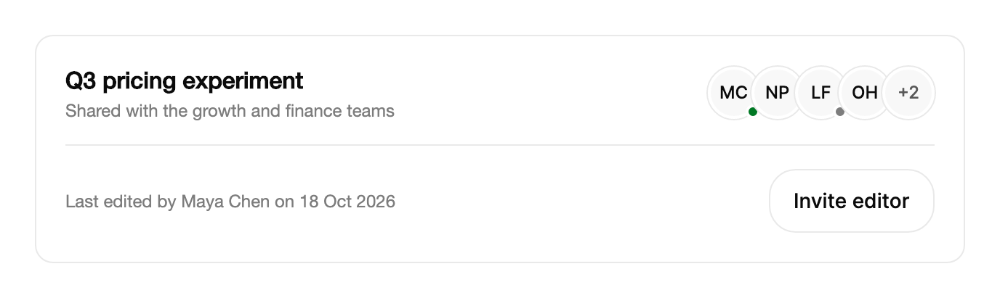

<Demo name="Team" />

## 何時使用

`AvatarGroup` 展示一小組擁有、編輯或審閱同一項內容的人員：頁首、卡片或表格儲存格中。大頭貼會部分重疊，前面幾位完整顯示，其餘的人摺疊進一個 "+N" 標籤，因此無論團隊有四人還是四十人，群組佔用的空間都相同。它只用於顯示；人員姓名透過無障礙名稱或群組所摘要的清單來閱讀。

- **共用文件或定價實驗的編輯者**：頁面標頭顯示目前正在處理該項目的人，人員加入或離開工作階段時，大頭貼堆疊隨之變化。
- **拉取要求、發票或合約卡片中的審閱者**：前幾位審閱者可見，「+3」標示其餘的人，而不會讓一份清單佔滿整張卡片。
- **支援工單或交易表格欄位中的經辦人**：`Size="Small"` 讓欄位保持窄窄的，同時每一列的負責人依然可見。
- **管理員編輯時保持開啟的專案團隊面板**：成員被加入或移除時，堆疊會滑動而不是跳動，無需重新整理即可看到變化。
- **即時紀錄的關注者**，例如正在檢視事件時間軸的人：前幾位關注者會顯示，數量涵蓋其餘的人。

## 何時不用

- **只有一個人**：用 `Avatar`，它承載單一人員的姓名與狀態。
- **需要閱讀或比較每個人姓名與角色的清單**：用 `SortableDataTable` 或一般清單。
- **某位人員的帳號操作**，例如登出或切換工作區：用 `UserMenu`。
- **從目錄中選取多位人員**：用 `MultiSelect`，它支援搜尋與選取。群組只顯示人員。
- **每位人員都需要自己的操作**，例如移除或傳送訊息：用 `SortableDataTable`，其中每一列都可以放置自己的控制項。群組不可取得焦點，也沒有針對個別人員的操作。

## 用法

```xml
<UserControl xmlns="https://github.com/avaloniaui"
             xmlns:arc="https://github.com/AIDotNet/TKCode.Arc">
    <arc:AvatarGroup Label="編輯者">
        <arc:AvatarGroupMember DisplayName="Maya Chen" Status="Online" />
        <arc:AvatarGroupMember DisplayName="Noah Park" />
        <arc:AvatarGroupMember DisplayName="Leah Fox" Status="Offline" />
    </arc:AvatarGroup>
</UserControl>
```

`AvatarGroup` 衍生自 Avalonia 的 `TemplatedControl`。它的樣板是一個負責排列人員並繪製溢出標籤的面板，因此除了懸停時的展開效果外，群組沒有自己的焦點或指標行為。它的成員是 `AvatarGroupMember` 物件；`Avatar` 實例與一般字串也可以接受。在設定 `ItemsSource` 之前，會使用 `Items` 內容中的內嵌成員；設定之後，`ItemsSource` 將完全接管。

### 結構

1. **堆疊**（群組本身）：人員從左到右排列，相鄰大頭貼重疊 6 px。後面的人繪製在前面的人之上，因此每個大頭貼的左邊緣始終可見。
2. **人員位置**：每個大頭貼周圍有一圈 1 px 的 `Border` 顏色環。大頭貼本身有 2 px 的 `Surface` 邊緣，將它與相鄰的大頭貼分隔開。懸停時，環會加深為強邊框顏色。
3. **大頭貼**（`AvatarGroupMember`）：成員的照片或首字母，以及可選的狀態圓點，尺寸與群組一致。圓點及其含義在 `Avatar` 中說明。
4. **溢出標籤**：一個圓形，填色為 `SurfaceMuted`，文字為 `TextSecondary`，顯示 "+N"。在 `Small` 尺寸下文字為 10 px，在 `Medium` 下為 Arc 的 XS 級，在 `Large` 下為 Arc 的 SM 級。
5. **名稱膠囊**：懸停人員上方的膠囊，填色為前景色，文字為背景色，內距水平 8 px、垂直 4 px。

群組的 `Label` 不會被繪製。它為輔助技術命名群組，並產生溢出標籤的文字；當人們需要讀懂群組是什麼時，請在群組旁邊放一個可見的標題。

### 繫結成員

將 `ItemsSource` 繫結到 `AvatarGroupMember`、`Avatar` 或一般名稱的集合。該集合優先於內嵌的 `Items`。

```xml
<arc:AvatarGroup ItemsSource="{Binding Team}"
                 Label="團隊成員" />
```

### 繫結到檢視模型

使用 CommunityToolkit.Mvvm 時，集合以及改變它的命令歸檢視模型所有，群組只負責顯示。`ItemsSource` 是單向的：群組從不編輯集合。`OverflowCount` 為唯讀，由集合與 `MaxVisibleCount` 計算得出。群組沒有可供繫結的命令或點擊事件；操作屬於檢視模型，或群組旁邊的清單。

```csharp
public partial class ProjectViewModel : ObservableObject
{
    public ObservableCollection<AvatarGroupMember> Editors { get; } = new()
    {
        new("Maya Chen", status: AvatarStatus.Online),
        new("Noah Park"),
        new("Leah Fox", status: AvatarStatus.Offline),
    };

    [ObservableProperty]
    private int _maxVisibleCount = 4;

    [RelayCommand]
    private void AddEditor(string name) => Editors.Add(new AvatarGroupMember(name));

    [RelayCommand]
    private void RemoveEditor(AvatarGroupMember member) => Editors.Remove(member);
}
```

```xml
<arc:AvatarGroup ItemsSource="{Binding Editors}"
                 MaxVisibleCount="{Binding MaxVisibleCount}"
                 Label="編輯者" />
```

加入與離開會為位置加入動畫，清單是就地更新的，因此應對集合使用 `Add`、`Insert` 與 `Remove`。整個替換集合會讓每個人都離開再重新加入。若要改變某人的顯示方式，請設定既有 `AvatarGroupMember` 的 `Status`、`DisplayName` 或 `Source`；大頭貼會隨之變化，不會產生位置動畫。

```csharp
var team = new AvaloniaList<AvatarGroupMember>
{
    new("Maya Chen", status: AvatarStatus.Online),
    new("Noah Park"),
    new("Leah Fox", status: AvatarStatus.Offline),
};
group.ItemsSource = team;

// Joining and leaving animate the slot; the list is updated in place.
team.Insert(1, new AvatarGroupMember("Omar Haddad"));
team.RemoveAt(1);
```

### 溢出

`MaxVisibleCount`（預設為 4）決定在 "+N" 標籤之前顯示多少人。`OverflowCount` 會回報摺疊進標籤的人數。清單中靠前的人會被顯示，其餘的人則計入數量，因此請把最相關的人放在前面。只有可見的人員會取得控制項，因此長清單仍然輕量。

```xml
<arc:AvatarGroup ItemsSource="{Binding Team}"
                 MaxVisibleCount="3" />
```

標籤的無障礙名稱由溢出數量加上小寫的 `Label` 組成，例如 "另外 2 位團隊成員"。

### 尺寸

`Size` 套用於每個大頭貼與溢出標籤：`Small` 為 28 px，`Medium`（預設）為 36 px，`Large` 為 48 px。`XLarge` 會以 `Large` 繪製，即主題所定義的最大群組尺寸。

<Demo name="SizesAndLimits" />

```xml
<arc:AvatarGroup ItemsSource="{Binding Team}" Size="Small" MaxVisibleCount="3" />
<arc:AvatarGroup ItemsSource="{Binding Team}" Size="Large" MaxVisibleCount="5" />
```

群組的寬度由成員與尺寸決定：6 px 的內距加上每個可見位置的寬度，再減去重疊的部分。在 `Medium` 尺寸下，四位可見人員加上一個標籤時，群組寬 156 px；因此在選擇 `Large` 之前，請先量測它將放入的儲存格。

### 內嵌成員

成員可以直接撰寫，代替繫結的清單。這適用於固定的人員集合，例如靜態卡片上的人員。

<Demo name="InlineMembers" />

### 資料結構與效能

- **項目**：每一項都是 `AvatarGroupMember`、`Avatar` 或一般字串。空的項目會被略過，因此中間有空缺的清單計數依然正確。
- **可見的工作量**：只有前 `MaxVisibleCount` 個項目會取得大頭貼，外加一個標籤。一個有 500 位成員的群組與只有 5 位成員的群組，建立的控制項數量相同。
- **識別**：項目是透過物件及其出現位置來追蹤的，而不是透過名稱。兩位同名的人是兩個位置，因此重名不會破壞動畫。每位人員保持一個物件。
- **更新**：即時更新需要一個會發出變更通知的集合，例如 `AvaloniaList` 或 `ObservableCollection`。群組只在掛載到視覺樹時才監聽來源，因此已分離的群組不會讓清單繼續存活。若使用一般清單，請為 `ItemsSource` 指派一個新集合來重新整理。
- **動畫**：加入與離開只在群組已載入且動態效果等級為完整時才會有動畫。尚未載入的群組，或處於減少動態效果的頁面，會立即套用變化。

### 範例：帶團隊堆疊的專案卡片

SaaS 規劃工具中的一張定價專案卡片列出了參與該實驗的人員。標題與描述位於左側，群組位於右側，視線會在讀完名稱之後才落到團隊上。共指派了六位編輯者，因此顯示四位，標籤為 "+2"。第一位編輯者在線上，第五位離線，這讓審閱者知道誰在線上、可以回答問題。群組的 `Label` 為 "Editors"，因此溢出標籤對輔助技術而言的名稱為 "2 more editors"。



```xml
<Border Width="640"
        Padding="20"
        Background="{arc:ArcDesignTokenResource Surface}"
        BorderBrush="{arc:ArcDesignTokenResource Border}"
        BorderThickness="1"
        CornerRadius="12">
    <StackPanel Spacing="16">
        <Grid ColumnDefinitions="*,Auto">
            <StackPanel Spacing="4" VerticalAlignment="Center">
                <TextBlock Text="Q3 pricing experiment"
                           FontSize="16"
                           FontWeight="SemiBold"
                           Foreground="{arc:ArcDesignTokenResource Foreground}" />
                <TextBlock Text="Shared with the growth and finance teams"
                           FontSize="12"
                           Foreground="{arc:ArcDesignTokenResource TextMuted}" />
            </StackPanel>
            <arc:AvatarGroup Grid.Column="1" Label="Editors" VerticalAlignment="Center">
                <arc:AvatarGroupMember DisplayName="Maya Chen" Status="Online" />
                <arc:AvatarGroupMember DisplayName="Noah Park" />
                <arc:AvatarGroupMember DisplayName="Leah Fox" Status="Offline" />
                <arc:AvatarGroupMember DisplayName="Omar Haddad" />
                <arc:AvatarGroupMember DisplayName="Ines Duarte" />
                <arc:AvatarGroupMember DisplayName="Kenji Sato" />
            </arc:AvatarGroup>
        </Grid>
        <Border Height="1" Background="{arc:ArcDesignTokenResource Border}" />
        <Grid ColumnDefinitions="*,Auto">
            <TextBlock Text="Last edited by Maya Chen on 18 Oct 2026"
                       FontSize="12"
                       VerticalAlignment="Center"
                       Foreground="{arc:ArcDesignTokenResource TextMuted}" />
            <arc:Button Grid.Column="1" Content="Invite editor" Variant="Secondary" />
        </Grid>
    </StackPanel>
</Border>
```

### 文案規範

- **Label**：表示角色的複數名詞，採句首大寫且不加冒號："Editors"、"Reviewers"、"Assignees"。Label 不會被繪製，但會被朗讀，因此冒號會被唸出來。
- **溢出短語**：標籤依序唸出數量、"more" 與小寫的 Label。請選擇在 "more" 之後唸起來通順的 Label："2 more reviewers" 很好；當群組只涉及一種角色時，"2 more people" 則含糊不清。
- **標題**：在群組旁邊放一個可見的句首大寫標題或一行短文字，例如 "Editing now"，因為群組本身不顯示任何文字。

| 不要寫 | 改為 |
|---|---|
| `Label="People"` | `Label="Reviewers"`，標籤唸作 "2 more reviewers" |
| `Label="Editors:"` | `Label="Editors"`，不加冒號 |
| `Label="Users"` | 項目有負責人時用 `Label="Assignees"` |
| `Label="team"` | `Label="Team members"`，完整的名詞片語在 "more" 之後唸起來通順 |

### 最佳做法

**建議**

- 依相關程度排列成員，把最相關的人放在前面。溢出會摺疊清單的尾端，因此排在最後的人是讀者最不可能看到的。
- 把 `Label` 設為表示角色的複數名詞。Label 既是群組的無障礙名稱，也是溢出短語的來源，一個詞可以同時滿足兩者。
- 在群組旁邊放一個可見的標題。Label 不會被繪製，因此看得見的讀者需要在某處看到這些文字。
- 當上線狀態變化時，修改既有 `AvatarGroupMember` 的 `Status`。大頭貼會就地更新，人員保留其位置，而不是離開並重新加入堆疊。

**避免**

- 每次重新整理都整個替換集合。每次替換都會讓每位人員離開再加入，因此堆疊會讓所有位置同時做動畫。
- 在觸控版面中依賴懸停名稱。觸控不會展開堆疊，也不會顯示名稱，因此旁邊的清單必須承載姓名。
- 在狹窄的儲存格中放置 `Large` 尺寸的大頭貼。在 `Large` 尺寸下每位人員約增加 42 px，而群組既不換行也不收縮，因此儲存格會溢出。
- 為了在狹小區域顯示所有人而把 `MaxVisibleCount` 設得很高。堆疊每顯示一人就增加一個位置，因此寬度由人數決定，而不是由可用空間決定。

### 常見問題

**為什麼觸控螢幕上不顯示懸停名稱？** 展開、突出的人員與名稱膠囊只回應滑鼠與觸控筆指標。觸控輸入依設計會被忽略，因此當觸控很重要時，請在包含群組的清單或卡片中顯示名稱。

**如何顯示所有人而不出現 "+N" 標籤？** 把 `MaxVisibleCount` 設為成員數或更大的值。此時溢出數量為 0，不會建立標籤。

**為什麼清單的變化沒有出現在群組中？** 群組只監聽會發出變更通知的集合，例如 `AvaloniaList` 與 `ObservableCollection`，並且只在掛載到視覺樹時才監聽。一般的 `List` 從不回報變化。請為 `ItemsSource` 指派一個新集合，或改用可觀察集合。

**兩位成員能否同名？** 可以。每個成員物件都是獨立的位置，群組追蹤的是物件而非名稱。兩人都會被繪製，並且都計入溢出數量。請為每位人員分配各自的 `AvatarGroupMember`。

**如何讓某位人員可以點擊？** 群組沒有點擊事件，也不取得焦點。請在它旁邊放置作用於同一集合的清單、表格或按鈕，群組只用於顯示該項目上有哪些人。

## API 參考

<!-- api: AvatarGroup -->

<!-- api: AvatarGroupMember -->

## 無障礙

- 群組由 `Label` 命名。每個大頭貼為輔助技術保留其自身的名稱與狀態。
- 溢出標籤是一個由 `Label` 命名的影像，例如 "另外 2 位團隊成員"。
- 堆疊沒有鍵盤操作，也無法取得焦點。鍵盤作業請使用群組所摘要的清單或表格。
- 游標懸停時顯示的名稱僅為視覺效果：每位人員的名稱也包含在大頭貼的無障礙名稱中。
- 觸控輸入不會展開堆疊或顯示名稱，因此當觸控是受支援的輸入方式時，包含群組的版面中也必須顯示名稱。

### 鍵盤

群組不取得焦點，也沒有鍵盤命令，因此 `Tab` 會略過它。人員可透過群組所摘要的清單、表格或表單存取，在那裡每位人員都可以取得焦點並被操作。

## 動態效果

- 有人加入或離開時，其位置會以變形彈簧伸縮，同時輕微淡入淡出並縮放，因此堆疊是滑動而非跳動。
- 溢出數量增加時向上滾動，減少時向下滾動。
- 游標停在堆疊上時，人員會從中心向外散開；游標下的人員會略為升起，顯示光環與名稱，相鄰的人員則向兩側讓開。
- 減少動態效果時，移除懸停時的散開效果，保留光環與名稱；數量以淡入淡出變化。關閉動態效果時，所有變化立即完成。

| 變化 | 完整 | 減少 | 關閉 |
|---|---|---|---|
| 有人加入 | 其位置在變形彈簧上展開，堆疊滑動 | 立即顯示 | 立即 |
| 有人離開 | 其位置在變形彈簧上收合，同時淡出並縮放 | 立即移除 | 立即 |
| 溢出數量變化 | 隨變化向上或向下滾動 | 淡入淡出 | 立即 |
| 游標在堆疊上移動 | 人員每步散開 4 px，懸停者上升 2 px，相鄰者移動 3 px | 不展開；保留光環與名稱 | 立即 |
| 懸停人員上方的名稱 | 延遲 60 ms 後顯示 | 立即顯示 | 立即 |

## 相關元件

- `Avatar`：單一人員。
- `UserMenu`：群組成員的大頭貼需要開啟帳號操作時使用。
- `SortableDataTable`：需要比較姓名、角色及其他欄位時使用。

| 元件 | 適用情境 |
|---|---|
| `Avatar` | 需要在姓名、留言或紀錄旁顯示一位人員 |
| `UserMenu` | 大頭貼需要開啟登出、個人資料或工作區操作 |
| `SortableDataTable` | 姓名、角色及其他欄位需要被閱讀與比較 |
| `MultiSelect` | 需要從目錄中搜尋並選取人員 |
| `Badge` | 標籤是狀態或類別，而非一組人員 |
| `ChatThread` | 這些人員是對話的作者 |
