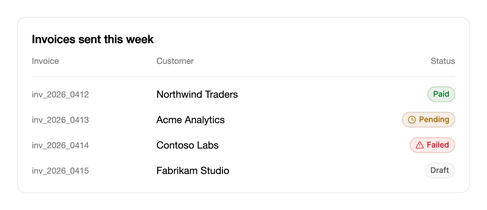

<Demo name="Tones" />

## 何時使用

`Badge` 是一個小型藥丸形標籤，用來標明一種狀態、一個類別或一筆中繼資料。它放在標題旁邊或表格儲存格內，一眼就能讀懂，並能與周圍各列的徽章相互比較。它是帶有色調的行內文字：不接收焦點，不開啟任何內容，也不主動通知，因此標籤本身必須能說明狀態。

- **帳單表格中的訂單與發票狀態**：每一列用 `Small` 徽章顯示「已付款」「待處理」或「失敗」，操作人員不必開啟任何一張發票，就能瀏覽整頁發票。
- **發佈頁上的部署與環境標籤**：正式版本旁邊用成功色調顯示「已上線」，預覽建置旁邊用強調色調顯示「測試版」，尚未發佈的內容則顯示「草稿」。
- **卡片或詳細資料頁首的中繼資料**：客戶名稱旁邊的方案名稱、地區或「新」標記，標籤描述的是項目的事實而不是操作。
- **頁面開啟期間會變動的計數**：選單項目旁邊的未讀數或未關閉工單數。徽章保持掛載，新數字會原地上升，藥丸寬度隨之擴展。
- **帶前導圖示的列標記**：活動或事件時間軸中，圖示說明事件類型，色調說明它是正常、待處理還是失敗。

## 何時不用

- **一整句回饋**，例如「您的信用卡已被拒絕」：需要留在頁面上的訊息用 `Alert`，會自動消失的訊息用 `Toast`。
- **使用者會開啟或關閉的值**，例如使用者選取的篩選條件或標籤：用 `ChipGroup`，它負責選取與鍵盤焦點。
- **帶有上下文的大型數字**，例如本季營收：用 `MetricCard`，它能為數字留出空間並搭配說明文字。
- **人員的在線狀態**，例如上線或離線：用 `Avatar` 上的狀態點。徽章標明的是狀態，不應覆蓋在人的大頭照上。
- **使用者需要透過徽章執行操作的計數或狀態**：用 `Button` 或 `Tabs` 項目，因為徽章不接收焦點，也沒有點按行為。

## 用法

```xml
<UserControl xmlns="https://github.com/avaloniaui"
             xmlns:arc="https://github.com/AIDotNet/TKCode.Arc">
    <arc:Badge Content="草稿" />
</UserControl>
```

`Badge` 衍生自 Avalonia 的 `ContentControl`，因此 `Content` 可以是任何物件。字串與數字會獲得下文描述的原地動畫；其他內容則照原樣顯示，不做替換動畫。藥丸的填滿、邊框與文字顏色由色調與主題決定，因此請設定 `Tone` 和 `Size`，而不是直接設定筆刷。

### 結構

1. **藥丸**（控制項本身）：1 px 邊框，圓角為藥丸形。`Medium` 時最小高度為 26 px，`Small` 時為 22 px；藥丸會隨標籤變寬。
2. **色調環**（僅 `Info`）：覆蓋在邊框上的強調色環，不透明度為 24%。
3. **懸停光暈**（僅 `Info`）：指標停在徽章上時，表面疊加 10% 的強調色光暈，色環的不透明度提高到 32%。
4. **圖示**（`Icon`，前導）：選用的字形，使用色調顏色。對輔助技術隱藏。
5. **標籤**（`Content`）：中等字重的文字。請控制在一到兩個詞，因為藥丸會隨之變寬，過長的標籤會把表格中相鄰的內容擠開。

`Medium` 時每側內距為 10 px，`Small` 時為 8 px。圖示與標籤之間的間距在 `Medium` 時為 5 px，在 `Small` 時為 4 px。

### 色調

`Tone` 決定顏色樣式，預設為 `Neutral`。標籤本身必須說明狀態，因為色調並不是唯一的訊號，而且列印件或灰階報表會失去顏色。

| 色調 | 文字 | 填滿 | 邊框 | 適用情境 |
|---|---|---|---|---|
| `Neutral` | 次要文字顏色 | 淡化表面 | 邊框顏色 | 草稿、已封存、中繼資料 |
| `Success` | 成功色 | 成功色淡染，佔表面 10% | 成功色淡染，佔邊框 25% | 已上線、已付款、通過、健康 |
| `Info` | 加深的強調色 | 淡強調色 | 帶 24% 強調色環的邊框 | 測試版、同步中、強調 |
| `Warning` | 警告色 | 警告色淡染，佔表面 11% | 警告色淡染，佔邊框 27% | 待處理、效能下降、即將到期 |
| `Danger` | 危險色 | 危險色淡染，佔表面 10% | 危險色淡染，佔邊框 26% | 失敗、逾期、已阻擋 |

成功、警告與危險的填滿是狀態顏色與中性表面的固定混合，因此強調色變動時它們的意義保持不變。`Info` 跟隨強調色，所以它適合用於強調，而不適合用於必須永遠維持同一外觀的狀態。

### 尺寸

`Size` 決定高度：`Medium`（預設）為 26 px，`Small` 為 22 px。密集的表格中用 `Small`，標題旁邊和卡片中用 `Medium`。

<Demo name="Small" />

| 尺寸 | 最小高度 | 左右內距 | 標籤 | 圖示間距 |
|---|---|---|---|---|
| `Medium` | 26 px | 10 px | Arc XS | 5 px |
| `Small` | 22 px | 8 px | 11 px | 4 px |

每個表格欄或每組內使用同一尺寸，讓各列高度維持一致。寬度固定的表格儲存格能容納一個詞的標籤加一個圖示的 `Small` 徽章。

### 圖示

`Icon` 接受一個前導圖示。圖示使用色調顏色，並對輔助技術隱藏。範例使用 `ArcIcons`（Arc 圖示集）中的 `ArcGlyph`，尺寸為 12 px。

<Demo name="Icons" />

```csharp
badge.Tone = BadgeTone.Success;
badge.Content = "通過";
badge.Icon = new ArcGlyph { Data = ArcIcons.Check, Size = 12 };
```

只有當圖示能增加資訊時才加上，例如為失敗的檢查加上警告三角形。如果每個徽章都帶裝飾性圖示，表格會顯得雜亂，而色調本身已經承載了顏色資訊。

### 原地變化

保持徽章掛載，只修改 `Content`。新的字串或數字會從柔和的模糊中升起，舊內容向上淡出，藥丸寬度彈性地調整到合適的大小。重新建立徽章會失去這種動態效果，並且每次變化都要新建一個控制項。

<Demo name="ChangingInPlace" />

新圖示會從略小的尺寸彈出。由字型或主題變動引起的尺寸改變（而不是由新內容引起的）會立即生效，因此狀態沒有變化時，版面不會播放彈簧動態效果。

### 繫結到檢視模型

`Badge` 只負責顯示值。從檢視模型繫結 `Content`、`Tone`、`Size` 和 `Icon`；徽章從不回寫值，也不會引發事件或命令供檢視模型處理。

```csharp
public partial class DeploymentViewModel : ObservableObject
{
    [ObservableProperty]
    private string _statusText = "排隊中";

    [ObservableProperty]
    private BadgeTone _statusTone = BadgeTone.Info;

    [ObservableProperty]
    private int _commentCount;
}
```

```xml
<StackPanel Orientation="Horizontal" Spacing="8">
    <arc:Badge Tone="{Binding StatusTone}" Content="{Binding StatusText}" />
    <arc:Badge Tone="Neutral" Content="{Binding CommentCount}" />
</StackPanel>
```

這些屬性必須在 UI 執行緒上設定，因為 Avalonia 屬性只能在該執行緒上修改。狀態變動時，請同時更新文字與色調，讓標籤與顏色在同一個畫面影格中變化。

### 資料結構與效能

徽章數量少時開銷很小，在長表格中開銷會增加。每個徽章都要量測自身寬度，以便彈性地適應標籤，因此畫面上有數千個徽章的表格，比一般文字表格做更多的版面運算。在長表格中：

- 使用 `Small` 與一個詞的標籤，讓值變動時寬度的改變盡可能小。
- 保持列虛擬化（Avalonia 的 `ListBox` 與 `DataGrid` 預設如此），這樣只有可見的列才會建立徽章。
- 在擁有資料的程式碼中依地區設定格式化數字，使用 `ToString("N0", culture)` 或格式化字串，讓分隔符號與地區一致：英文中為 "1,204"，德文中為 "1.204"。

### 範例：發票狀態表格

一個帳務營運頁面列出本週寄出的發票。每一列顯示客戶名稱，並以 `Small` 徽章顯示狀態。已付款的發票使用成功色調，不需要圖示。待處理的發票帶一個時鐘圖示，失敗的發票帶一個警告三角形，因為失敗的付款需要有人處理，圖示提供了第二重訊號。草稿列使用中性色調，讓人讀作「尚未寄出」，而不是「有問題」。



```xml
<Border Width="640"
        Padding="20"
        Background="{arc:ArcDesignTokenResource Surface}"
        BorderBrush="{arc:ArcDesignTokenResource Border}"
        BorderThickness="1"
        CornerRadius="12">
    <StackPanel Spacing="14">
        <TextBlock Text="Invoices sent this week"
                   FontSize="16"
                   FontWeight="SemiBold"
                   Foreground="{arc:ArcDesignTokenResource Foreground}" />
        <Grid ColumnDefinitions="176,*,Auto">
            <TextBlock Text="Invoice" FontSize="12"
                       Foreground="{arc:ArcDesignTokenResource TextMuted}" />
            <TextBlock Grid.Column="1" Text="Customer" FontSize="12"
                       Foreground="{arc:ArcDesignTokenResource TextMuted}" />
            <TextBlock Grid.Column="2" Text="Status" FontSize="12"
                       Foreground="{arc:ArcDesignTokenResource TextMuted}" />
        </Grid>
        <Border Height="1" Background="{arc:ArcDesignTokenResource Border}" />
        <Grid ColumnDefinitions="176,*,Auto">
            <TextBlock Text="inv_2026_0412" FontSize="12" VerticalAlignment="Center"
                       Foreground="{arc:ArcDesignTokenResource TextMuted}" />
            <TextBlock Grid.Column="1" Text="Northwind Traders" VerticalAlignment="Center"
                       Foreground="{arc:ArcDesignTokenResource Foreground}" />
            <arc:Badge Grid.Column="2" Size="Small" Tone="Success" Content="Paid" />
        </Grid>
        <Grid ColumnDefinitions="176,*,Auto">
            <TextBlock Text="inv_2026_0413" FontSize="12" VerticalAlignment="Center"
                       Foreground="{arc:ArcDesignTokenResource TextMuted}" />
            <TextBlock Grid.Column="1" Text="Acme Analytics" VerticalAlignment="Center"
                       Foreground="{arc:ArcDesignTokenResource Foreground}" />
            <arc:Badge Grid.Column="2" Size="Small" Tone="Warning" Content="Pending">
                <arc:Badge.Icon>
                    <arc:ArcGlyph Data="{x:Static arc:ArcIcons.Clock}" Size="12" />
                </arc:Badge.Icon>
            </arc:Badge>
        </Grid>
        <Grid ColumnDefinitions="176,*,Auto">
            <TextBlock Text="inv_2026_0414" FontSize="12" VerticalAlignment="Center"
                       Foreground="{arc:ArcDesignTokenResource TextMuted}" />
            <TextBlock Grid.Column="1" Text="Contoso Labs" VerticalAlignment="Center"
                       Foreground="{arc:ArcDesignTokenResource Foreground}" />
            <arc:Badge Grid.Column="2" Size="Small" Tone="Danger" Content="Failed">
                <arc:Badge.Icon>
                    <arc:ArcGlyph Data="{x:Static arc:ArcIcons.TriangleAlert}" Size="12" />
                </arc:Badge.Icon>
            </arc:Badge>
        </Grid>
        <Grid ColumnDefinitions="176,*,Auto">
            <TextBlock Text="inv_2026_0415" FontSize="12" VerticalAlignment="Center"
                       Foreground="{arc:ArcDesignTokenResource TextMuted}" />
            <TextBlock Grid.Column="1" Text="Fabrikam Studio" VerticalAlignment="Center"
                       Foreground="{arc:ArcDesignTokenResource Foreground}" />
            <arc:Badge Grid.Column="2" Size="Small" Content="Draft" />
        </Grid>
    </StackPanel>
</Border>
```

### 文案規範

- **標籤**：一到兩個詞，說明狀態或類別，使用句首大寫且不加標點，例如「已付款」「待處理」「已上線」。徽章會被讀作它自身的名稱，因此即使沒有顏色也必須說得通。
- **數字**：計數用阿拉伯數字書寫，並依地區格式化（"1,204"），且保持夠短，讓藥丸不會比相鄰的徽章更寬。
- **色調**：根據狀態的意義選擇色調，而不是根據想要的外觀。危險色表示使用者必須採取行動；警告色表示狀態很快需要關注；成功色表示狀態良好。

| 不要寫 | 改為 |
|---|---|
| `Content="LIVE NOW!!"` | `Content="Live"` |
| `Content="Status: failed"` | `Content="Failed"`，上下文由所在列提供 |
| `Content="Your card was declined"` | 改用 `Alert`；徽章只放一個詞或短語 |
| `Content="1204"` | `Content="1,204"`，依地區格式化 |
| `Tone="Danger"` 用於中性計數 | `Tone="Neutral"`，因為紅色意味著需要使用者採取行動 |

### 最佳做法

**建議**

- 在標籤中說明狀態。色調只是顏色，如果標籤含糊，色盲的讀者和灰階列印件就無從得知狀態。
- 保持徽章掛載，狀態變動時修改 `Content` 和 `Tone`。標籤會原地升起，藥丸會彈性地過渡到新寬度，讓讀者感知到發生了變化。
- 每個欄或每組使用同一尺寸。列高一致，表格才便於掃讀。
- `Danger` 只用於失敗以及需要使用者採取行動的情況，`Info` 只用於強調。同一套顏色在不同畫面表示不同意義，會讓人不再信任顏色。

**避免**

- 用徽章承載一整句話。句子需要換行空間，還需要可關閉的操作，這正是 `Alert` 和 `Toast` 提供的。
- 為每個狀態重新建立徽章。新控制項會失去原地動態效果，而且每次變化都要重新建構版面。
- 在狹窄的表格儲存格中加入很長的標籤或很大的圖示。藥丸會隨標籤變寬，並把周圍的儲存格擠開。
- 期望它可以點按。徽章不接收焦點，因此使用者必須開啟查看的狀態需要在旁邊放一個 `Button` 或列操作。
- 從徽章上通知每一次變化。徽章不會通知自身的變化；如果變化必須被朗讀，請把徽章放在外圍內容的即時區域中。

### 常見問題

**為什麼我的計數不做動畫？** 很可能是徽章被重新建立了，或者它的 `Content` 不是字串或數字。只有字串和數字型別才會進行原地替換。請保持同一個徽章在畫面上，並把 `Content` 設為字串或數字。

**徽章能作為計數或圓點放在大頭照上嗎？** 不能。徽章是獨立的藥丸，不是覆蓋在其他元素上的疊加層。要表示人員的在線狀態，請使用 `Avatar` 上的狀態點。

**為什麼 Info 色調會隨強調色變化，而 Success 不會？** `Info` 由強調色推導而來，因此跟隨產品的強調色。成功、警告與危險是狀態顏色與中性表面的固定淡染，因此強調色變動時它們的意義保持不變。

**如何在程式碼中修改色調？** 在執行個體上設定 `Tone`，例如 `badge.Tone = BadgeTone.Warning;`。開啟完整動態效果時顏色交叉淡化；減少動態效果時變化立即完成。

**能讓徽章可點按嗎？** 不能直接實現。徽章不可取得焦點，也沒有點按事件。請把它放進處理操作的 `Button` 或列中，並把徽章保留為視覺標籤。

## API 參考

<!-- api: Badge -->

## 無障礙

- 徽章是行內文字：它的標籤會與周圍的文字一起被朗讀。
- 圖示對輔助技術隱藏。標籤必須說明狀態，而不是說明顏色。
- 字串或數字標籤就是徽章的無障礙名稱；數字會依目前的文化區域命名。
- 標籤變化時，舊文字對輔助技術隱藏，只朗讀目前的文字。
- 徽章不會通知自身的變化。如果變化必須被播報，請把徽章放在外圍內容的即時區域中。
- 徽章不可取得焦點，也沒有鍵盤行為：`Tab` 會略過它，承載徽章的列或控制項負責所有鍵盤操作。

## 動態效果

- 新標籤從柔和的模糊中升起，舊標籤帶著輕微模糊向上淡出。藥丸寬度隨即在變形彈簧上調整。
- 新圖示從略小的尺寸彈出。由字型變化引起的尺寸改變立即完成。
- 減少動態效果時標籤快速淡入，寬度直接跳到新值；關閉動態效果時所有變化立即完成。

| 變化 | 完整 | 減少 | 關閉 |
|---|---|---|---|
| 標籤變化 | 舊文字帶著輕微模糊向上淡出，新文字從柔和的模糊中升起 | 快速淡入 | 立即完成 |
| 標籤變化後的藥丸寬度 | 彈性調整到符合新標籤 | 直接跳到新寬度 | 立即完成 |
| 色調變化 | 背景、邊框與文字依標準曲線交叉淡化 | 瞬間完成 | 立即完成 |
| 指標進入或離開（精準指標） | 背景與邊框交叉淡化；`Info` 淡出其強調光暈 | 瞬間完成 | 立即完成 |
| 字型或主題變動導致徽章尺寸改變 | 立即完成 | 立即完成 | 立即完成 |

## 相關元件

- `Alert` 或 `Toast` 用於一句話的回饋。
- `ChipGroup` 用於使用者可以選取的值。
- `MetricCard` 用於帶上下文的大型數值。

| 元件 | 適用情境 |
|---|---|
| `Alert` | 訊息需要一句話，並留在頁面上 |
| `Toast` | 短暫的確認或錯誤提示應出現後自動消失 |
| `ChipGroup` | 使用者選取或清除值 |
| `MetricCard` | 大型數字需要搭配標籤、趨勢與上下文 |
| `Avatar` | 狀態屬於某個人，以大頭照上的圓點顯示 |
| `Table` | 徽章位於使用者會排序與比較的欄中 |
