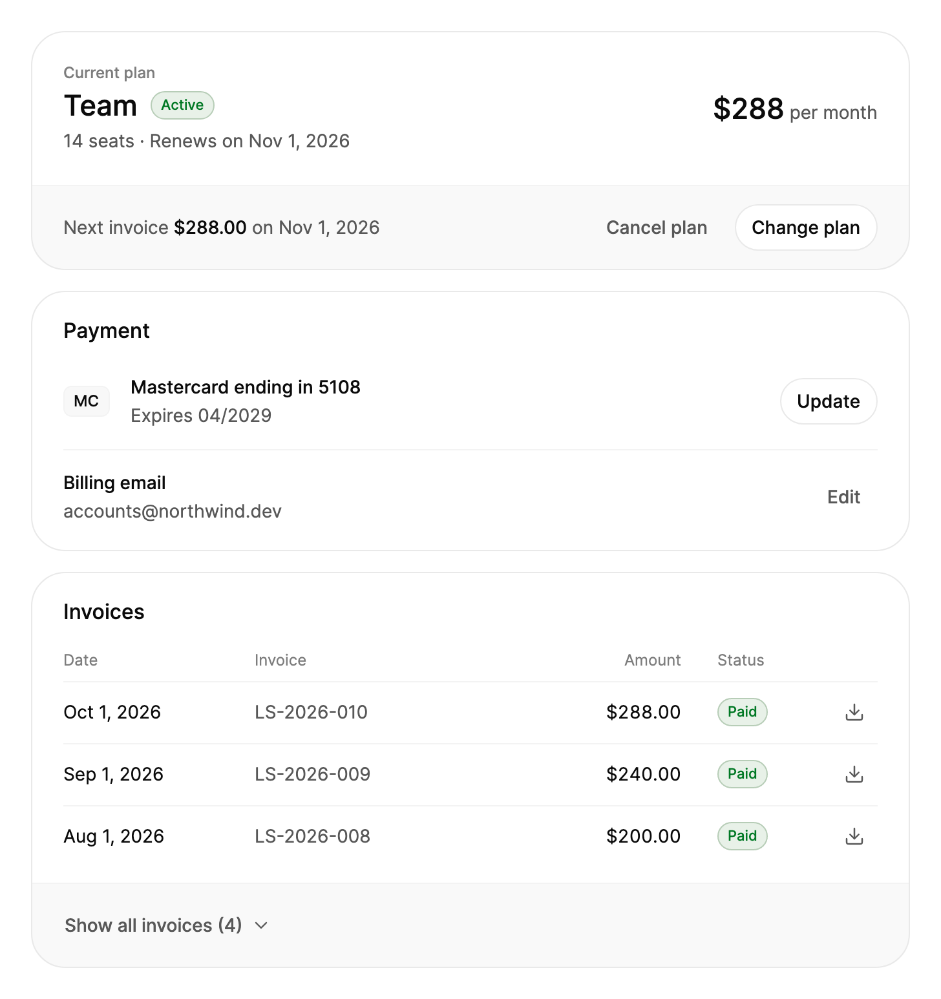

<Demo name="Overview" />

## 何时使用

`BillingOverview` 是账户或工作区设置中的账单页面。它回答用户查看账单时最关心的三个问题：要付多少钱、下次何时扣款、之前付过什么；同时把会改变这些答案的操作，放在对应事实的旁边：更改套餐、更新银行卡、编辑计费邮箱和下载发票。

- **SaaS 管理后台中的工作区账单**：所有者打开设置、进入账单，就能看到团队套餐在 11 月 1 日按 12 个席位续订、将由哪张银行卡扣款，以及下一张发票何时到期。该区块无需单独的报表即可给出这些答案。
- **把发票交给财务**：财务负责人需要上一季度的发票用于报销。发票表格按从新到旧排列，每行都有下载按钮，无需再向供应商索要 PDF。
- **价格固定的按席位套餐**：按月或按年计费的团队套餐，下次扣款金额就是当前席位数对应的套餐价格。套餐卡片显示每个周期的价格、席位数以及下次扣款金额。
- **试用与付款失败**：试用会显示结束时间和首次扣款金额；最近一次扣款失败的套餐会显示危险色徽标，让所有者在权限受影响之前修正银行卡。
- **会打开你自己流程的账单操作**：更改套餐、更新银行卡和取消通常需要确认、按比例计费或支付服务商的表单。该区块只触发事件，每个流程仍留在你的代码中。

## 何时不用

- **本期总额取决于计量用量的按量计费**：使用 `UsageBilling`，它显示当前已产生的费用、预计总额、每个计量项的用量以及消费上限。
- **在定价页选择或比较套餐**：使用 `BillingToggle` 和 `BillingPrice`。`BillingOverview` 显示客户已有的套餐，而不是可供选择的选项。
- **收集银行卡信息**：该区块只显示已存档的银行卡，从不接收卡号。请在 `UpdatePaymentMethodRequested` 中打开 `Dialog`，再放入支付服务商的表单。
- **很长且可搜索的付款记录**：使用 `SortableDataTable`，它可以排序、筛选和分页。此处的发票表格只显示简短的、从新到旧的列表，其余发票通过“显示全部发票”查看。
- **需要询问原因或提供挽留优惠的取消**：使用 `CancelFlow`，它是可以从 `CancelPlanRequested` 启动的多步骤流程。`BillingOverview` 只发出请求。

## 用法

```xml
<arc:BillingOverview Plan="{Binding Plan}"
                     PaymentMethod="{Binding Card}"
                     BillingEmail="{Binding BillingEmail}"
                     Invoices="{Binding Invoices}"
                     VisibleInvoiceCount="6" />
```

`BillingOverview` 派生自 Avalonia 的 `TemplatedControl`，由 `SettingsGroup`、`SettingsRow`、`Badge` 和 `Button` 组成。它继承了这些控件的间距、焦点环、悬停状态和动效，因此由它构建的账单页面无需额外样式，就能与其他设置区块保持一致。需要设置四个数据属性：`Plan`、`PaymentMethod`、`BillingEmail` 和 `Invoices`。三个模型类（`BillingPlan`、`BillingPaymentMethod` 和 `BillingInvoice`）都是普通对象，既可以像预览中那样用 XAML 编写，也可以在代码中创建。它们会引发 `PropertyChanged`，因此显示之后对套餐、银行卡或发票的修改会直接更新视图，无需替换对象。

`Invoices` 初始为一个可以添加项目的空列表。你可以替换它，也可以绑定到自己的集合；可观察集合的变化会更新表格。发票始终按 `Date` 从新到旧显示。

### 结构

页面由三张卡片组成，之间以 16 px 的 `GroupGap` 分隔。自上而下依次为：

1. **套餐卡片**（`Plan`）：眉题“当前套餐”、套餐名称（`PlanNamePart`，`TypeXL`）和状态徽标（`PlanStatusPart`）。名称下方是详情行，显示席位数和续订日期。右侧是 `TypeXL` 字号的价格（`PricePart`），后面以次要文字颜色显示“每月”或“每年”。页脚（`NextInvoicePart`）显示下次扣款，金额加以强调，之后是“取消套餐”和“更改套餐”按钮。
2. **付款卡片**（`PaymentMethod`、`BillingEmail`）：品牌标识（`CardBrandPart`）是一个 36 × 24 px 的圆角方框，内含 `TypeXS` 字号的品牌文字，之后是“{Brand} 尾号 {Last4}”（`CardTitlePart`）和到期行（`CardExpiryPart`）。“更新”按钮（`UpdateCardPart`）位于右侧。分隔线下方是“计费邮箱”行（`EmailRowPart`），显示邮箱地址和“编辑”按钮（`EditEmailPart`）。
3. **发票卡片**（`Invoices`）：标题“发票”，以及一行 32 px 高的列标题，包含日期、发票、金额和状态（`InvoiceHeaderPart`）。每一行（`InvoiceRowsPart`）高 48 px，上方有一条细线，依次为日期、发票编号、以等宽数字右对齐的金额、状态徽标，以及 36 px 的下载图标按钮。
4. **收起的行与“显示全部发票”**（`MoreInvoicesPart`、`ShowAllPart`）：超出 `VisibleInvoiceCount` 的发票放在可折叠的部分中，页脚按钮负责切换它。
5. **空状态**（`InvoicesEmptyPart`）：没有发票时，一个 40 px 的图块、“暂无发票”和一行提示文字代替表格。

宽度小于 560 px（`NarrowWidth`）时，价格移到套餐名称下方，页脚上下堆叠，发票列隐藏。卡片中的行宽度小于 440 px 时，按钮会移到文字下方。状态列与前一列之间保持 14 px 间距，而不是 28 px。

### 套餐状态

套餐的 `Status` 决定徽标、详情行和页脚，因此每种状态的呈现方式都一致。

| `Status` | 徽标 | 详情行 | 页脚 |
|---|---|---|---|
| `Active` | 成功色 | “6 个席位 · 2026 年 11 月 1 日续订” | 下次扣款、“取消套餐”、“更改套餐” |
| `Trialing` | 强调色 | “试用结束于 2026 年 11 月 1 日” | 下次扣款、“取消套餐”、“更改套餐” |
| `PastDue` | 危险色 | “付款自 2026 年 10 月 1 日起逾期” | 下次扣款、“取消套餐”、“更改套餐” |
| `Canceled` | 中性色 | “结束于 2026 年 11 月 1 日” | 仅“更改套餐”，没有“取消套餐” |

没有套餐（`Plan` 为 null）时，卡片显示“暂无套餐”、“选择一个套餐开始使用。”以及“选择套餐”按钮，该按钮会引发 `ChangePlanRequested`。已取消的套餐会保留其对象，因此所有者仍能看到服务何时结束。付款卡片遵循同样的规则：没有 `PaymentMethod` 时，“添加银行卡”会引发 `UpdatePaymentMethodRequested`。

### 发票状态

| `Status` | 徽标 | 行的处理方式 |
|---|---|---|
| `Paid` | 成功色 | 正常 |
| `Open` | 中性色 | 正常；已开具但尚未付款 |
| `PastDue` | 危险色 | 正常；已到期且未付款 |
| `Refunded` | 中性色 | 弱化：徽标和金额的不透明度为 70% |
| `Void` | 中性色 | 弱化：徽标和金额的不透明度为 70% |

弱化的行仍保留在表格中，下载按钮也保留，因为客户仍然需要这份文件。不要为了隐藏已退款的发票而把它从 `Invoices` 中移除，否则历史记录会与银行对账单不一致。

### 试用与即将到期的银行卡

试用中的套餐会显示试用结束的时间以及首次扣款的金额：将 `Status` 设为 `Trialing`，并把 `RenewsOn` 设为试用结束日期。

银行卡的到期情况会依据 `Clock` 检查。到期月份在 60 天内开始时，到期行变为警告色，并显示“即将到期”和日期；已超过到期月份的银行卡则以危险色显示“已过期”。`IsPaymentMethodExpiringSoon` 和 `IsPaymentMethodExpired` 报告相同的两种状态，因此你可以在自己的页面中显示横幅，或发送提醒邮件。品牌以简短文字（VISA、MC、AMEX）显示在小边框中，从不使用标志。没有发票时，表格会被“暂无发票”替代。

<Demo name="Trial" />

“今天”的日期来自 CLR 属性 `Clock`，它是一个 `TimeProvider`（默认为系统时钟）。在测试中可以将它设为固定时钟：

```csharp
billing.Clock = TimeProvider.System; // 也可以是测试提供的任何 TimeProvider
```

### 处理操作

每个按钮都会引发路由事件，但本身不做任何修改。这些事件包括 `ChangePlanRequested`、`CancelPlanRequested`、`UpdatePaymentMethodRequested` 和 `EditBillingEmailRequested`，以及 `InvoiceDownloadRequested`，其 `BillingInvoiceEventArgs.Invoice` 是该行对应的发票。在事件中打开你自己的对话框或流程，调用你的 API，然后更新 `Plan`、`PaymentMethod`、`BillingEmail` 或 `Invoices`，区块就会显示结果。该区块不做确认、不做按比例计算，也不调用支付服务。

<Demo name="Events" />

Events 示例会把每个事件写入日志。下载处理程序是异步的，因此视图模型可以在后台保存文件：

```csharp
billing.InvoiceDownloadRequested += async (_, e) =>
{
    var pdf = await invoices.DownloadAsync(e.Invoice.Number);
    await SaveAsync(pdf, $"{e.Invoice.Number}.pdf");
};

billing.CancelPlanRequested += (_, _) => cancelDialog.Open(); // 例如在 Dialog 中使用 CancelFlow
```

`VisibleInvoiceCount`（默认为 4）设置在“显示全部发票（n）”之前显示的发票数量。按钮会展开其余发票，并变为“收起”。`IsInvoiceListExpanded` 表示同一状态；将它双向绑定，即可在视图模型中保持该状态。

### 数据结构与性能

该区块不做分页、排序或搜索。请只传入页面应当显示的发票：概览中显示最新的几张，并链接到完整历史。集合变化时，表格会复用已有的行，因此添加一张发票不会重建整个表格。为每张发票设置唯一的 `Number`，因为它用来命名下载按钮。

金额和日期使用 `Labels.Culture`（默认为 en-US）。每个金额使用其发票的 `Currency`，发票未设置时则使用套餐的货币。金额只在该区块中格式化一次。

### 绑定到视图模型

在 MVVM 应用中，视图模型拥有账单数据与流程，区块负责显示。下面的示例使用 CommunityToolkit.Mvvm。应用自己的服务（`IBillingService`）及其方法是你 API 的占位符。

```csharp
public partial class BillingViewModel : ObservableObject
{
    private readonly IBillingService _billing;

    public BillingViewModel(IBillingService billing)
    {
        _billing = billing;
    }

    [ObservableProperty]
    private BillingPlan? _plan;

    [ObservableProperty]
    private BillingPaymentMethod? _paymentMethod;

    [ObservableProperty]
    private string? _billingEmail;

    [ObservableProperty]
    private decimal? _nextInvoiceAmount;

    [ObservableProperty]
    private bool _isInvoiceListExpanded;

    public ObservableCollection<BillingInvoice> Invoices { get; } = new();

    [RelayCommand]
    private async Task CancelPlanAsync()
    {
        await _billing.CancelAtPeriodEndAsync();
        Plan!.Status = BillingPlanStatus.Canceled;
    }

    [RelayCommand]
    private async Task DownloadInvoiceAsync(BillingInvoice invoice)
    {
        var pdf = await _billing.DownloadAsync(invoice.Number);
        await _files.SaveAsync(pdf, $"{invoice.Number}.pdf");
    }
}
```

```xml
<arc:BillingOverview Plan="{Binding Plan}"
                     PaymentMethod="{Binding PaymentMethod}"
                     BillingEmail="{Binding BillingEmail}"
                     NextInvoiceAmount="{Binding NextInvoiceAmount}"
                     Invoices="{Binding Invoices}"
                     IsInvoiceListExpanded="{Binding IsInvoiceListExpanded, Mode=TwoWay}"
                     VisibleInvoiceCount="6" />
```

该区块不公开命令，因此需要在代码后置中把它的事件连接到视图模型，调用工具包生成的 `CancelPlanCommand` 和 `DownloadInvoiceCommand`。

双向绑定：`IsInvoiceListExpanded` 是唯一需要设置 `Mode=TwoWay` 的属性，因为“显示全部发票”会写入它。其他输入都是单向的：修改模型对象（例如 `Plan.Status`）或替换属性，视图就会随之更新。

### 文字与语言

所有内置文字都位于 `BillingOverviewLabels` 中。替换整个对象即可改写文字或本地化该区块；包含数值的文字是函数，接收的数值已按 `Culture` 格式化。默认文字为英文，例如 “Renews on Nov 1, 2026”、“Show all invoices (6)” 和 “Download LS-2026-010”。

```csharp
billing.Labels = new BillingOverviewLabels
{
    Culture = CultureInfo.GetCultureInfo("nl-NL"),
    CurrentPlan = "Huidig abonnement",
    ChangePlan = "Abonnement wijzigen",
    RenewsOn = date => $"Wordt verlengd op {date}",
    ShowAll = count => $"Alle facturen tonen ({count})",
};
```

请整体替换该对象，而不是只替换其中一个字段，因为它的属性只能在初始化时设置。保留接收数值的函数，因为它们决定了词序。一个对象即可覆盖整个区块，从套餐卡片到空状态。

### 示例：团队套餐账单页面

工作区所有者打开团队套餐的账单页面。十月新增了两个席位，因此套餐现在为每月 $288、共 14 个席位，页脚显示 11 月 1 日的下一张发票，金额相同。该卡片是一张有效期至 2029 年的万事达卡，因此不显示警告。发票表格显示三行，以及一个“显示全部发票（4）”按钮；其中一张更早的发票已退款，并以弱化样式显示。所有者可以在此下载任何发票、更改套餐或更新银行卡。

页脚的下次扣款金额默认跟随 `Price`，除非设置了 `NextInvoiceAmount`，因此本例将其保持为 null。只有当下次扣款与套餐价格不同时才需要设置它。发票描述不可见，它们会成为每个下载按钮无障碍名称的一部分。



```xml
<StackPanel Width="680" Spacing="16">
    <arc:BillingOverview BillingEmail="accounts@northwind.dev"
                         VisibleInvoiceCount="3">
        <arc:BillingOverview.Plan>
            <arc:BillingPlan Name="Team" Price="288" Currency="USD" Seats="14"
                             Interval="Month" Status="Active" RenewsOn="2026-11-01" />
        </arc:BillingOverview.Plan>
        <arc:BillingOverview.PaymentMethod>
            <arc:BillingPaymentMethod Brand="Mastercard" Last4="5108"
                                      ExpiryMonth="4" ExpiryYear="2029" />
        </arc:BillingOverview.PaymentMethod>
        <arc:BillingOverview.Invoices>
            <arc:BillingInvoice Number="LS-2026-010" Date="2026-10-01" Amount="288"
                                Status="Paid" Description="Team plan, 14 seats" />
            <arc:BillingInvoice Number="LS-2026-009" Date="2026-09-01" Amount="240"
                                Status="Paid" Description="Team plan, 12 seats" />
            <arc:BillingInvoice Number="LS-2026-008" Date="2026-08-01" Amount="200"
                                Status="Paid" Description="Team plan, 10 seats" />
            <arc:BillingInvoice Number="LS-2026-007" Date="2026-07-01" Amount="200"
                                Status="Refunded" Description="Team plan, 10 seats" />
        </arc:BillingOverview.Invoices>
    </arc:BillingOverview>
</StackPanel>
```

### 内容规范

金额要带上货币，日期要写出月份名称，如 “$240.00” 和 “Nov 1, 2026”。套餐名称应使用客户购买时的叫法，并与产品其余部分的用词保持一致：如果应用中统一称为“套餐”，就写“套餐”，而不要写“订阅”。

- 按钮文字是句式大小写的动词加宾语：“更改套餐”“取消套餐”“更新付款方式”。
- 状态词要简短。一到两个字即可放进徽标：“生效中”“试用中”“逾期”“已取消”。
- 说明访问权限会怎样变化，而不只是套餐本身：“结束于 2026 年 11 月 1 日”让所有者知道服务何时停止。

| 不要写 | 改为 |
|---|---|
| 订阅等级 | 套餐 |
| 取消订阅 | 取消套餐 |
| 付款失败 | 逾期 |
| 12 Seats | 12 seats |
| 点这里 | 下载 LS-2026-010（该行的下载按钮） |
| 银行卡即将过期，请更新 | 即将到期 · 2029 年 4 月（默认文案） |

### 最佳实践

**推荐**

- 每次变化时都从计费服务商同步 `Status` 和 `RenewsOn`，因为页脚、徽标和详情行都读取它们。过时的状态会让所有者对自己的访问权限产生错误判断。
- 当下次扣款与套餐价格不同时（例如新增席位或适用折扣后），设置 `NextInvoiceAmount`，避免页脚显示所有者实际不会支付的价格。
- 在 `CancelPlanRequested` 中打开确认对话框或 `CancelFlow`，并且只有在服务器确认变更后才更新 `Plan`。区块无法撤销服务器拒绝的变更。
- 在 `Invoices` 中只保留最新的发票，并链接到完整历史。概览中的长列表会让最近的发票更难找到。

**避免**

- 隐藏已退款或已作废的发票。所有者和财务团队会将此列表与对账单比对，缺少的行看起来就像缺少的付款。
- 在视图模型中格式化金额后再传入文本。该区块使用 `Labels.Culture` 和发票货币来格式化金额；二次格式化会导致同一页面出现两种不同的数值。
- 为已取消的订阅将 `Plan` 设为 null。所有者会看到“选择套餐”，并失去服务结束日期。
- 在已存档银行卡旁边的字段中收集卡号。卡片数据应放在支付服务商托管的表单中，这样它就不会进入你的应用程序。

### 常见问题

**为什么卡片显示“选择套餐”而不是“取消套餐”？** 当 `Plan` 为 null 时，该区块显示“暂无套餐”，此时唯一的操作是“选择套餐”，它会引发 `ChangePlanRequested`。已取消的套餐会保留其对象并设置 `Status="Canceled"`，因此对它隐藏“取消套餐”，并显示其结束日期。

**为什么没有出现“显示全部发票”？** 只有当 `Invoices` 的数量超过 `VisibleInvoiceCount` 时才会出现该按钮。将 `VisibleInvoiceCount` 设置得更小，或增加发票数量，即可看到它。

**区块会取消订阅或下载文件吗？** 不会。它会引发 `CancelPlanRequested` 和 `InvoiceDownloadRequested`，由你的代码调用账单 API、显示确认并保存文件。

**为什么同一个页面在一个环境中显示“即将到期”，而在另一个环境中不显示？** 该检查使用 `Clock`，默认为系统时钟。在测试中将 `Clock` 设为固定的 `TimeProvider`，并确保每个环境中银行卡的到期月份设置方式一致。

**如何为某一张发票显示不同的货币？** 在该发票上设置 `BillingInvoice.Currency`；其他发票仍使用套餐的 `Currency`。

## API 参考

<!-- api: BillingOverview -->

`Clock`（`TimeProvider`，默认为 `TimeProvider.System`）是一个 CLR 属性，作为到期警告中“今天”的来源。

### BillingPlan

| 属性 | 类型 | 说明 |
|---|---|---|
| `Name` | `string` | 套餐名称，例如 “Studio”。 |
| `Price` | `decimal` | 每个周期收取的总额，包含所有席位。 |
| `Currency` | `string` | 价格的 ISO 4217 代码（默认为 "USD"）。 |
| `Interval` | `BillingInterval` | `Month` 或 `Year`：价格的收取频率。 |
| `Seats` | `int?` | 付费席位数；不按席位计价的套餐为 null。 |
| `Status` | `BillingPlanStatus` | `Active`、`Trialing`、`PastDue` 或 `Canceled`。 |
| `RenewsOn` | `DateTime?` | 下次续订日期；试用期间为试用结束日期，取消后为服务结束日期。 |

### BillingPaymentMethod

| 属性 | 类型 | 说明 |
|---|---|---|
| `Brand` | `string` | 卡组织的文字名称，例如 "Visa" 或 "Mastercard"。 |
| `Last4` | `string` | 卡号的后四位。 |
| `ExpiryMonth` | `int` | 到期月份，范围为 1 至 12。 |
| `ExpiryYear` | `int` | 四位数的到期年份。 |

### BillingInvoice

| 属性 | 类型 | 说明 |
|---|---|---|
| `Number` | `string` | 发票编号，例如 "LS-2026-010"。 |
| `Date` | `DateTime` | 开具发票的日期；表格按此排序，最新的在前。 |
| `Amount` | `decimal` | 发票总额。 |
| `Currency` | `string?` | 金额的 ISO 4217 代码；为 null 时使用套餐的货币。 |
| `Status` | `BillingInvoiceStatus` | `Paid`、`Open`、`PastDue`、`Refunded` 或 `Void`。 |
| `Description` | `string?` | 发票的用途说明；会加入该行的无障碍名称中。 |

### BillingInvoiceEventArgs

| 属性 | 类型 | 说明 |
|---|---|---|
| `Invoice` | `BillingInvoice` | 下载按钮被按下的发票。 |

### 枚举

| 类型 | 成员 |
|---|---|
| `BillingInterval` | `Month`、`Year` |
| `BillingPlanStatus` | `Active`（成功色徽标）、`Trialing`（强调色徽标）、`PastDue`（危险色徽标）、`Canceled`（中性色徽标） |
| `BillingInvoiceStatus` | `Paid`（成功色徽标）、`Open`、`PastDue`（危险色徽标）、`Refunded` 和 `Void`（弱化的中性色徽标） |

## 无障碍

- 每个按钮都有名称。下载按钮只有图标，名称为“下载 LS-2026-010”，同时也是其工具提示；“更新”按钮的名称为“更新付款方式”，“编辑”按钮的名称为“编辑计费邮箱”。
- 每条发票行会被朗读为一行，例如“2026 年 10 月 1 日，LS-2026-010，$90.00，已付款”。列标题对辅助技术隐藏。
- 状态徽标会朗读其文字。到期警告同时以文字和图标表示，而不只依靠颜色。
- “显示全部发票”按钮的名称跟随其文字。收起的发票会移出 Tab 停靠点，因此 Tab 键不会停在隐藏的下载按钮上。
- 该区块自身不接收焦点；Tab 按阅读顺序依次经过各按钮。

### 键盘

| 按键 | 操作 |
|---|---|
| `Tab` / `Shift+Tab` | 按阅读顺序移到下一个或上一个按钮 |
| `Enter` / `Space` | 按下当前聚焦的按钮，例如“更改套餐”或某个下载按钮 |

## 动效

- 较早的发票以无回弹的高度弹簧展开和收起；“显示全部发票”的箭头以灵敏的弹簧转动，同时其文字以短暂的模糊切换。
- 原位变化的徽标和按钮文字会以模糊切换，与 `Badge` 和 `Button` 的做法相同。到期信息行会平滑过渡到警告色。
- 减少动效时保留淡入淡出，但高度和箭头改为直接跳变。关闭动效时，所有内容立即到位。

| 变化 | 完整 | 减弱 | 关闭 |
|---|---|---|---|
| 较早的发票收起或展开 | 高度以无回弹的平滑弹簧展开 | 高度直接跳到终态 | 立即完成 |
| “显示全部发票”切换 | 箭头以灵敏的弹簧转动；文字以模糊切换 | 箭头直接跳变；文字淡入淡出 | 立即完成 |
| 徽标或按钮文字变化 | 文字以短暂模糊切换 | 淡入淡出 | 立即完成 |
| 到期信息行变为警告 | 文字平滑过渡到警告色 | 颜色淡入淡出 | 立即完成 |

## 相关组件

- 其他设置区块：`SettingsPage`、`SettingsCommand`、`SecuritySettings`、`UsageBilling`，以及 `CancelFlow`（处理 `CancelPlanRequested` 的自然选择）。
- `SettingsGroup` 和 `SettingsRow`，即组成该区块的卡片与行。
- `Badge` 用于套餐和发票状态，`Button` 用于操作。
- `BillingToggle` 和 `BillingPrice` 用于选择套餐，`Dialog` 用于确认变更。

| 组件 | 适用场景 |
|---|---|
| `UsageBilling` | 本期费用取决于计量用量，并设有消费上限 |
| `CancelFlow` | 取消需要多个步骤、原因选择或挽留优惠 |
| `SortableDataTable` | 付款记录较长，必须排序、筛选或分页 |
| `SettingsGroup` / `SettingsRow` | 你要构建的设置卡片不是账单摘要 |
| `BillingToggle` / `BillingPrice` | 客户要在多个套餐或计费周期之间选择 |
| `Dialog` | 更改套餐、更新银行卡或下载需要确认或表单 |
