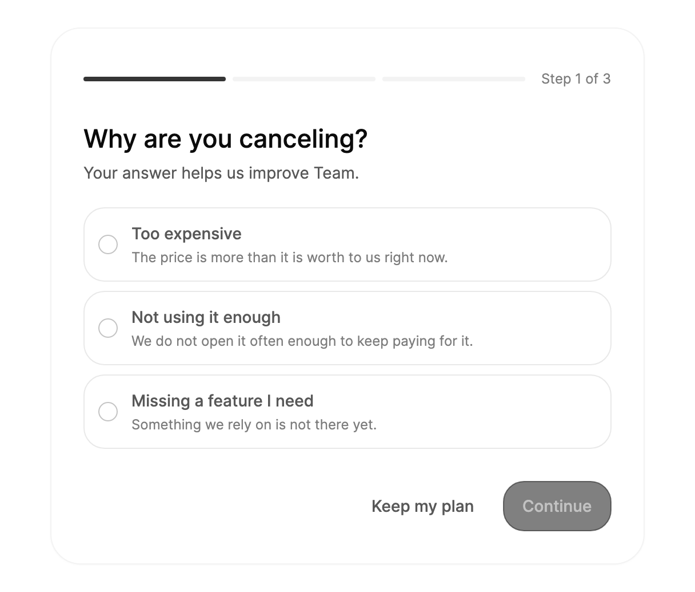

<Demo name="Flow" />

## 何时使用

`CancelFlow` 是人点击“取消方案”时打开的卡片。它位于账单或方案页面上，或位于由该页面打开的对话框中，将一次取消拆分为四个简短的步骤：原因、与该原因相符的挽留方案、哪些内容在何时结束，以及用户必须按住才能完成的确认。每一步具体做什么由宿主决定；流程本身只负责收集答案并报告结果。

- **团队方案页面上的取消操作**：管理员在 Team 方案上点击“取消方案”，流程会询问原因，团队由此得知是价格、使用量还是缺少某项功能促成了这一决定。
- **挽留方案往往比离开更合适的订阅**：针对价格抱怨的折扣，或针对使用量低的暂停服务。挽留方案只会在它所回应的原因之后出现，因此不会打扰已经拿定主意的人。
- **需要清楚摘要的不可逆方案变更**：在用户确认之前，确认步骤会列出将停止运作的内容（只读项目、已删除的历史记录、失效的自定义域名）以及访问权限结束的日期。
- **必须提供回头路的账号设置**：取消确认之后，已取消步骤会提供“重新启用方案”，无需联系支持人员即可轻松撤销。
- **需要记录的流程**：事件会携带所选原因与自由文本反馈，因此答案可以送到你的分析系统或支持队列。

## 何时不用

- **原地删除一个项目或一个席位**：在该项目旁使用 `ConfirmMorph` 或 `HoldToConfirm`。对于一个用户可以撤销的小改动而言，完整流程太重了。
- **改为另一个付费方案**：用 `RadioCards` 或价格表并排展示选项。该流程用于离开，降级不应被当作取消来呈现。
- **法律或服务条款要求一键取消的场景**：将 `DefaultOffer` 保持为 null，且不要为原因设置 `Offer`，让挽留方案不出现；或者直接链接到条款中描述的确认页面。
- **对小型破坏性操作的轻量确认**：用 `ConfirmMorph`，它会在原处询问一次，不需要原因或挽留方案。
- **收集冗长的自由文本问卷**：在你自己的表单中使用 `Textarea`。该流程在原因之后只提出一个可选问题，不会将问卷分页。

## 用法

```csharp
flow.AccessEndsOn = new DateTime(2026, 11, 1);

flow.CancellationConfirmed += (_, e) => billing.Cancel(e.Reason.Title, e.Feedback);
flow.OfferAccepted += (_, e) => billing.Apply(e.Offer.Title);
flow.KeepPlanRequested += (_, _) => page.CloseCancelFlow();
```

`CancelFlow` 派生自 Avalonia 的 `TemplatedControl`。它是一张卡片，包含步骤栏、步骤内容与按钮，并在各步骤之间切换内容。每个步骤的控件只构建一次并重复使用。该流程由 `RadioGroup`、`Textarea`、`HoldToConfirm` 与 `Button` 构成，因此继承了它们的焦点规则与键盘行为。预览中有两个原因带有各自的挽留方案（"Take 40% off for 3 months" 与 "Pause instead"），其余原因则回退到默认挽留方案。`PlanName` 与 `AccessEndsOn` 用于填充句子。

### 结构

卡片的内边距为 28 px（宽度小于 440 px，即 `NarrowWidth` 时为 20 px 与 22 px），首选宽度为 520 px。从上到下依次为：

1. **步骤栏**（`StepStorePart`）：路径 Reason、Offer、Confirm 的三段；如果路径没有挽留方案，则只有两段。各段高 4 px，间距 6 px。当前段使用强调色，已完成的段使用前景色的 30% 透明度，其余段使用浅色边框颜色。步骤计数“第 {n} 步，共 {total} 步”位于返回按钮的右侧。
2. **返回按钮**（`BackButtonPart`）：32 px 的圆形按钮，名称为“返回”。它出现在挽留方案与确认步骤。Alt+Left 的效果相同。
3. **步骤标题与说明**：标题行高 28 px，说明位于标题下方 6 px 处。每次步骤切换后标题会获得焦点，但它不是 Tab 停靠点。
4. **原因列表**：一个 `RadioGroup`，每一行包含标题与可选的说明。其下方，选择原因之后，反馈 `Textarea` 会通过高度弹簧动画展开。该字段是可选的，收起时不在 Tab 顺序中。
5. **挽留方案卡片**：52 px 的圆角卡片（圆角半径 16 px），包含 24 px 图标、挽留方案标题及其说明。接受按钮与“继续取消”紧随其后。
6. **损失框**：内边距为 16 px（左右）与 14 px（上下）、圆角 16 px 的面板，列出每一项损失，行与行之间间距 10 px。`Losses` 为空时隐藏。
7. **长按按钮**：危险色的 `HoldToConfirm`，标签为“按住以取消方案”，旁边是“保留我的方案”。
8. **结果标记**：56 px 的标记，内含 28 px 的勾选图形，以及结果标题与其句子，在已取消与已保留步骤中显示。文字宽度限制为 380 px。

操作行位于内容下方 28 px 处。宽度小于 440 px 时，按钮纵向堆叠，次要按钮移到主要按钮的下方。

### 选择原因与挽留方案

以人们自己的说法来编写原因，并且只有在存在具体替代方案时，才为原因提供挽留方案。没有挽留方案的原因会直接进入确认步骤，因此与原因不匹配的挽留方案会让流程看起来像是在推销。`DefaultOffer` 用于通用的替代方案，例如与你的团队通话，请将它保留给那些没有具体对应答案的原因。

当后续问题能让反馈更有价值时，在原因上设置 `AsksForDetails`，例如针对缺少某项功能，问“你缺少什么？”。该回答仍然是可选的，并且只有在选择该原因之后，这个问题才会取代通用提示。

### 没有挽留方案

当所选原因与 `DefaultOffer` 都没有挽留方案时，流程会从原因直接进入确认步骤，步骤栏只有两段而不是三段。`Reasons` 留空时，流程使用 `Labels.DefaultReasons` 中的五个原因。下面的演示从一个会追问的原因开始，因此字段会显示“你缺少什么？”。

<Demo name="NoOffer" />

### 在对话框中

当流程位于 `Dialog` 中时，将 `Appearance` 设为 `Plain`，即可去掉卡片的边框、阴影与内边距。对话框会在 `KeepPlanRequested` 时关闭，“保留我的方案”与“完成”都会触发该事件。“重新启用方案”会触发 `ReactivateRequested`，然后让流程重新开始；将该事件标记为已处理，即可让已取消的步骤保持在屏幕上。没有 `Icon` 的挽留方案会显示一个礼物图标。

<Demo name="InDialog" />

### 绑定到视图模型

流程保存答案，业务规则则由视图模型保存。在使用 CommunityToolkit.Mvvm 的 MVVM 应用中，绑定原因、损失与方案信息，并在视图模型中处理结果。账单服务是应用自己的占位实现。

```csharp
public partial class CancelPlanViewModel : ObservableObject
{
    private readonly IBillingService _billing;

    public CancelPlanViewModel(IBillingService billing)
    {
        _billing = billing;
    }

    [ObservableProperty]
    private string? _planName = "Team";

    [ObservableProperty]
    private DateTime? _accessEndsOn = new DateTime(2026, 11, 1);

    [ObservableProperty]
    private CancelFlowReason? _selectedReason;

    [ObservableProperty]
    private string? _feedback;

    public ObservableCollection<CancelFlowReason> Reasons { get; } = new();

    public ObservableCollection<string> Losses { get; } = new();

    [RelayCommand]
    private async Task CancelConfirmedAsync(CancelFlowCancelEventArgs e)
    {
        await _billing.CancelAtPeriodEndAsync(e.Reason.Title, e.Feedback);
    }
}
```

```xml
<arc:CancelFlow PlanName="{Binding PlanName}"
                AccessEndsOn="{Binding AccessEndsOn}"
                Reasons="{Binding Reasons}"
                Losses="{Binding Losses}"
                SelectedReason="{Binding SelectedReason, Mode=TwoWay}"
                Feedback="{Binding Feedback, Mode=TwoWay}" />
```

`SelectedReason` 与 `Feedback` 是双向绑定的，因此视图模型能在人给出答案时看到它们。`PlanName`、`AccessEndsOn`、`Reasons`、`Losses`、`DefaultOffer` 与 `Labels` 在变化时被读取。该流程没有命令：在代码后置中连接 `CancellationConfirmed`、`OfferAccepted` 与 `KeepPlanRequested`，并将它们转发给视图模型。需要知道人当前位于哪一步时，读取 `Step`（只读）。

### 焦点与关闭

每次步骤切换之后，焦点移到新步骤的标题，标题会以礼貌方式朗读。在人离开之前，请将流程保留在它所在的对话框或卡片中。只在 `KeepPlanRequested` 时关闭对话框；`OfferAccepted` 会将流程切换到已保留步骤，人仍需点击“完成”才能离开。调用 `Reset()` 可从第一步重新开始，它会清除原因与反馈。`GoBack()` 在原因步骤与已保留步骤上返回 `false`，因为这两个步骤之前没有任何步骤。

### 文字与其他语言

流程中所有内置字符串都位于 `CancelFlowLabels` 中。替换整个对象即可改写或翻译流程；日期遵循 `Labels.Culture`。默认值为英文，例如“Why are you canceling?”和“Hold to cancel plan”。API 参考中的表格列出了所有默认值。

```csharp
flow.Labels = new CancelFlowLabels
{
    Culture = CultureInfo.GetCultureInfo("nl-NL"),
    ReasonTitle = "Waarom zeg je op?",
    Continue = "Doorgaan",
    KeepPlan = "Abonnement houden",
    HoldToCancel = "Houd vast om op te zeggen",
};
```

包含方案名称或日期的句子，由标签根据方案名称与格式化后的日期生成，因此请翻译整句，而不是其中的片段。挽留方案的标题与原因属于你的内容，请在你自己的数据中翻译它们。

### 示例：Team 方案取消

管理员从账号设置中取消 Team 方案。流程显示三个原因；前两个原因尚无对应的挽留方案，因此默认挽留方案是“先和我们聊聊”。方案名称与访问结束日期来自方案数据，步骤栏显示三段，因为该路径可能包含挽留方案。第一步显示时“继续”处于禁用状态，这是人在选择原因之前看到的状态。

这里的设计决定是先询问、再提供挽留。带有挽留方案的原因只会在被选中之后出现，因此挽留方案是在回应原因，而不是打断它。在选择原因之前，“继续”按钮保持禁用，因此流程绝不会记录一个空的答案。



```xml
<StackPanel Width="560">
    <arc:CancelFlow PlanName="Team" AccessEndsOn="2026-11-01">
    <arc:CancelFlow.Reasons>
        <arc:CancelFlowReason Title="Too expensive"
                              Description="The price is more than it is worth to us right now." />
        <arc:CancelFlowReason Title="Not using it enough"
                              Description="We do not open it often enough to keep paying for it." />
        <arc:CancelFlowReason Title="Missing a feature I need"
                              Description="Something we rely on is not there yet."
                              AsksForDetails="True" />
    </arc:CancelFlow.Reasons>
    <arc:CancelFlow.DefaultOffer>
        <arc:CancelFlowOffer Title="Talk to us first"
                             Description="Fifteen minutes with our team is often enough to fix what is not working."
                             AcceptLabel="Book a 15-minute call" />
    </arc:CancelFlow.DefaultOffer>
</arc:CancelFlow>
</StackPanel>
```

### 文案规范

请把这个流程写成与即将离开的人之间的一次对话。直接说明将会结束什么，不要让人内疚或施压。默认文案已经遵循了这些规则。

- 在每一句提到方案的话中都使用方案名称，例如“要取消你的 Team 方案吗？”，让人知道受影响的是哪一个订阅。
- 访问结束日期要写出月份名称，例如“你可以使用到 2026 年 11 月 1 日。”日期已知时，不要写“月底”。
- 原因要用人自己的话来写，并且短到一行能放下：“太贵了”，而不是“价格敏感”。
- 挽留方案的标题写成带有大小的收益，例如“三个月五折”；接受按钮写成动作，例如“领取五折优惠”。
- 按住按钮要写成带宾语的动词短语：“按住以取消方案”。不要只写“确认”，因为人必须按住这个控件，标签应说明将会发生什么。
- 损失要用平实的语言说明后果，例如“共享项目将对全部 6 位成员变为只读”。

| 不要写 | 改为 |
|---|---|
| 你确定吗？ | 要取消你的 Team 方案吗？ |
| 点击以确认取消 | 按住以取消方案 |
| 很遗憾您要离开 | 你的方案已取消 |
| 原因：其他 | 其他情况 |
| 优惠即将到期 | 三个月五折 |

### 最佳实践

**建议**

- 从账单周期中设置 `AccessEndsOn`，让确认与结果显示真实的结束日期。日期为空会让流程承诺服务器可能并不提供的访问权限。
- 只在挽留方案真实且可以应用时才显示它。人一接受，流程就会切换到已保留步骤，而不会等待你的代码，因此请在 `OfferAccepted` 中可靠地应用该方案。
- 即使之后取消失败，也要通过 `CancellationConfirmed` 记录原因与反馈，让支持团队看到用户的意见。
- `Losses` 只列出适用于此账号的后果；没有任何损失时保持为空，而不要列出泛泛的警告。
- 在 `Dialog` 中使用 `Appearance="Plain"`，让对话框不会在流程外再画一层边框。

**避免**

- 隐藏退出途径。在原因与确认步骤上保持“保留我的方案”可见；一个困住人的流程会导致拒付与投诉。
- 为与原因不匹配的情况提供挽留。在“缺少我需要的功能”之后出现折扣，会让人觉得是在推销，并降低对流程其余部分的信任。
- 在服务器确认之前，于 `CancellationConfirmed` 中更改方案。只有在服务器接受请求之后，才将方案标记为已取消。
- 去掉长按。长按的作用是区分有意的取消与误点，将它替换为单个按钮会使这一步失去意义。
- 翻译了标签，却把原因标题与挽留方案留在英文。那样卡片上会混杂两种语言，因此请用标签的同时翻译你的内容。

### 常见问题

**为什么第一步的“继续”是禁用的？** 流程需要先选定原因才能前进，因此必须设置 `SelectedReason`。用方向键选择一行，或在代码中设置 `SelectedReason`。

**为什么步骤栏只显示两段？** 该路径没有挽留方案：所选原因没有挽留方案，且 `DefaultOffer` 为 null。设置 `DefaultOffer`，或为原因设置 `Offer`，即可添加第三段。在选择原因之前，只要任一原因带有挽留方案，步骤栏就会将该路径计为有挽留方案。

**为什么我的“重新启用方案”按钮会让流程重新开始？** 除非处理程序将事件标记为已处理，否则流程会在 `ReactivateRequested` 之后调用 `Reset()`。在处理程序中设置 `e.Handled = true`，即可在你恢复方案的同时，让已取消的步骤保持在屏幕上。

**如何从第一步重新开始流程？** 调用 `Reset()`。它会清除原因与反馈，并返回第一步。`GoBack()` 会从挽留方案或确认步骤后退一步，在其他步骤上返回 `false`。

**流程会取消订阅吗？** 不会。它会以原因与反馈报告 `CancellationConfirmed`，由你的代码调用账单 API。服务器响应之后，更新 `Losses`、`AccessEndsOn` 或页面的方案状态。

## API 参考

<!-- api: CancelFlow -->

`CancelFlowReason`

| 属性 | 类型 | 说明 |
|---|---|---|
| `Title` | `string` | 人会说出的原因，例如“太贵了”。 |
| `Description` | `string?` | 标题下方的一行简短说明。 |
| `Offer` | `CancelFlowOffer?` | 选择该原因后显示的挽留方案；为 null 时回退到 `DefaultOffer`。 |
| `AsksForDetails` | `bool` | 为 true 时，反馈字段会询问 `DetailsPrompt`，而不是通用问题。回答仍然是可选的。 |
| `DetailsPrompt` | `string?` | 后续问题，例如“你缺少什么？”；为 null 时使用 `Labels.DetailsPrompt`。 |

`CancelFlowOffer`

| 属性 | 类型 | 说明 |
|---|---|---|
| `Title` | `string` | 提供的内容，例如“三个月五折”。 |
| `Description` | `string?` | 该挽留方案对方案和账单意味着什么。 |
| `AcceptLabel` | `string?` | 接受按钮，例如“领取五折优惠”；为 null 时使用 `Labels.AcceptOffer`。 |
| `Icon` | `Geometry?` | 标题上方卡片的 24×24 描边图标；为 null 时显示礼物。 |
| `AcceptedTitle` | `string?` | 已保留步骤的标题，例如“五折优惠已生效”；为 null 时使用 `Labels.RetainedTitle`。 |
| `AcceptedDescription` | `string?` | 其下的句子；为 null 时使用 `Labels.RetainedDescription`。 |

`CancelFlowLabels`（均为 `init`；函数根据方案名称与格式化后的日期生成句子）

| 属性 | 默认值 |
|---|---|
| `Culture` | en-US |
| `StepCounter` | "Step {n} of {total}" |
| `Back` | "Back" |
| `ReasonTitle` / `ReasonDescription` | "Why are you canceling?" / "Your answer helps us improve {plan}." |
| `FeedbackLabel` / `DetailsPrompt` / `FeedbackPlaceholder` | "Anything else we should know?" / "Tell us a little more" / "Optional" |
| `KeepPlan` / `Continue` | "Keep my plan" / "Continue" |
| `AcceptOffer` / `ContinueCanceling` | "Accept offer" / "Continue canceling" |
| `ConfirmTitle` / `AccessUntil` / `AfterThat` | "Cancel your {plan} plan?" / "You keep access until {date}." / "After that:" |
| `LossesName` / `HoldToCancel` / `HoldConfirmed` | "What ends" / "Hold to cancel plan" / "Canceled" |
| `CanceledTitle` / `CanceledDescription` | "Your plan is canceled" / "You can keep using {plan} until {date}. We sent a confirmation to your email." |
| `Reactivate` | "Reactivate plan" |
| `RetainedTitle` / `RetainedDescription` / `Done` | "{offer} is on" / "Thanks for staying. You'll see the change on your next invoice." / "Done" |
| `DefaultReasons` | Too expensive; Not using it enough; Missing a feature I need; Switching to another tool; Something else |

`CancelFlowStep`

| 成员 | 显示时机 |
|---|---|
| `Reason` | 第一步：原因与可选的反馈 |
| `Offer` | 所选原因或 `DefaultOffer` 对应的挽留方案 |
| `Confirm` | 将结束的内容，以及长按按钮 |
| `Canceled` | 确认取消后的结束页，带有“重新启用方案” |
| `Retained` | 接受挽留方案、方案得以保留的流程结束页 |

## 无障碍

- 每次步骤切换之后，焦点移到新步骤的标题，标题会以礼貌方式朗读。标题可以获得焦点，但不是 Tab 停靠点，因此 Tab 会继续移到该步骤的第一个控件。
- 原因是以步骤标题命名的单选组（“Why are you canceling?”）。方向键在原因之间移动，整个组是单个 Tab 停靠点。
- 取消需要一次有意的长按：按住按钮，或将焦点放在按钮上并按住 Space 或 Enter。其帮助文字会说明这一点。
- 圆形返回按钮以“Back”命名，并带有工具提示。选择原因之前，收起的反馈字段不在 Tab 顺序中。

### 键盘

| 按键 | 操作 |
|---|---|
| `Tab` / `Shift+Tab` | 按顺序在该步骤的控件之间移动 |
| `Up` / `Down` | 在原因单选组中的各原因之间移动 |
| `Enter` | 按下该步骤的主操作：继续、挽留方案的接受按钮或完成。在未选择的原因上，Enter 会先选择它 |
| 在反馈字段中按 `Enter` | 换行 |
| 在反馈字段中按 `Ctrl+Enter` / `Cmd+Enter` | 继续 |
| `Alt+Left` | 从挽留方案或确认步骤后退 |
| 在长按按钮上按住 `Space` 或 `Enter` | 确认取消（`HoldToConfirm` 的行为） |

上一步仍按住的 Enter 键不会按下下一步的按钮。

## 动效

- 步骤沿行进方向滑动 12 px（前进时从右侧，后退时从左侧），并伴随短暂的淡入淡出，卡片的高度则以弹簧动画跟随新步骤。
- 反馈字段通过高度弹簧展开与收起。步骤栏的段在切换到新颜色时交叉淡变，返回按钮随着其占用空间收缩而淡入淡出。
- 在最后一步，勾选图形会在约半秒内自行绘制出来。
- 减弱动效时只保留淡变：步骤在原位交叉淡变，段的颜色快速变化，勾选图形立即绘制。关闭动效时，所有变化都在原位立即发生。

| 变化 | 完整 | 减弱 | 关闭 |
|---|---|---|---|
| 步骤切换 | 滑动 12 px 并伴随淡变；卡片高度以弹簧过渡到新步骤 | 步骤在原位交叉淡变 | 立即 |
| 反馈字段展开或收起 | 高度以弹簧展开 | 显示或隐藏，没有高度弹簧 | 立即 |
| 步骤栏段的变化 | 颜色交叉淡变 | 颜色快速变化 | 立即 |
| 返回按钮出现或消失 | 淡入淡出，同时其占用空间收缩 | 原位淡入淡出 | 立即 |
| 最后一步的结果勾选 | 约半秒内绘制出来 | 立即绘制 | 立即绘制 |

## 相关组件

- 其他设置类块：`SettingsPage`、`SettingsCommand`、`SecuritySettings`、`BillingOverview`（其“取消方案”按钮是进入流程的自然入口）以及 `UsageBilling`。
- `RadioGroup`、`Textarea`、`HoldToConfirm`、`Button` 与 `Dialog`，本流程由它们构成。
- `ConfirmMorph`：用于对较小的破坏性操作进行更轻量的原地确认。

| 组件 | 适用场景 |
|---|---|
| `BillingOverview` | 取消按钮位于账单页面，流程从 `CancelPlanRequested` 打开 |
| `ConfirmMorph` | 小型破坏性操作需要在原处进行一次确认 |
| `HoldToConfirm` | 单个不可逆操作需要有意的长按，且不需要原因或挽留方案 |
| `RadioCards` | 人在方案或选项之间选择，而不是离开 |
| `Dialog` | 流程在模态窗口中运行，并使用 `Appearance="Plain"` |
| `Textarea` | 在取消流程之外需要自由文本回答 |
