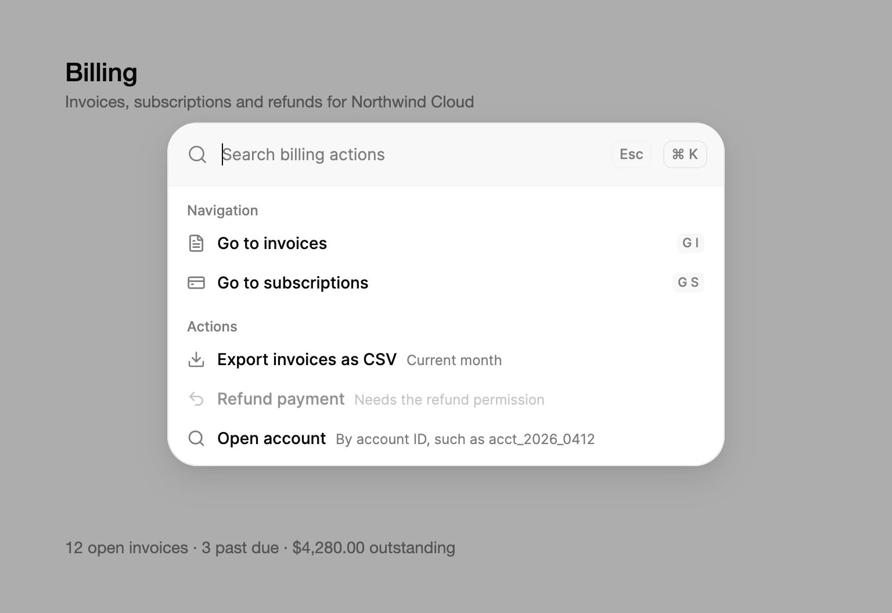

<Demo name="Preview" />

## 何时使用

命令面板是通过键盘访问应用操作与页面的入口。它属于应用外壳：用户在窗口的任何位置按下 Cmd+K 或 Ctrl+K 打开它，输入几个字母，就能执行命令，无需在侧边栏或菜单中逐层查找。`CommandPaletteDialog` 把它作为弹出层显示在页面上方，并在用完后关闭。它用一个搜索框加上按意图分组的命令列表，取代了冗长的菜单树。

- **大型管理控制台中的导航**：一个有四十个页面的 CRM，销售经理输入 “pipe” 即可进入销售管道报表。当侧边栏的条目多到无法一眼扫完时，输入比浏览更快。
- **分散在多个菜单中的操作**：“将发票导出为 CSV” 在账单页、报表页和发票列表工具栏中都有用。用一个带有自己分组的命令把它集中在一处，菜单就可以保持简短。
- **分析或开发者工具中的进阶操作**：“打开已保存的报表”“运行查询”或“切换环境”。`Shortcut` 键帽会在命令旁边显示按键，常用的用户由此学会快捷键，不必再频繁伸手去拿鼠标。
- **偏好设置与开关**：“切换到深色模式”或“更改时区”。`Keywords` 让人能按想要的结果找到命令（“外观”“发票”），而不必记住团队选定的菜单名称。
- **客服或履约控制台中的操作工具**：客服人员在通话期间用键盘执行“重新发送收据”“打开账号”或“退款”，菜单中每一秒的浏览都会被察觉。

## 何时不用

- **搜索带摘录和筛选条件的记录或文档**，例如按状态与日期筛选的支持工单：使用 `SearchResults`，它显示带筛选条件和匹配文字的完整结果页。
- **页头中的搜索框，只显示当前页面的少量匹配项**：使用 `ExpandingSearch`，它保持紧凑，且不列出命令。
- **为表单选择一个值**，例如套餐、国家或成本中心：使用 `Combobox`。命令面板用于执行命令，不会设置随表单提交的字段。
- **针对单个对象的操作**，例如对某一条发票执行下载、作废和归档：使用 `DropdownMenu`，并锚定在该行上，让用户选择时对象始终可见。
- **从一个很短的固定列表中选一个值**：使用 `Select`。只有三个条目的面板比下拉选择更费事。
- **请用户做出决定或填写简短的表单**，例如确认删除某个工作区：使用 `Dialog`。命令面板在用户选定命令的那一刻就会关闭，因此无法承载一个问题。

## 用法

`CommandPaletteDialog` 是以弹出层呈现的命令面板。在视图中的任意位置声明一次即可。它在原位不渲染任何内容，打开时在页面上方显示一个 `CommandPalette`：用户在窗口的任何位置按下 Cmd+K（其他平台为 Ctrl+K），或点击一个指向它的按钮。添加 `CommandPaletteItem` 子元素，或设置 `ItemsSource`。

```xml
<UserControl xmlns="https://github.com/avaloniaui"
             xmlns:x="http://schemas.microsoft.com/winfx/2006/xaml"
             xmlns:arc="https://github.com/AtomUICommunity/TKCode.Arc">
    <Panel>
        <arc:Button Content="搜索命令"
                    arc:CommandPaletteDialog.Opens="{Binding #Commands}" />

        <arc:CommandPaletteDialog x:Name="Commands"
                                  PlaceholderText="搜索项目命令">
            <arc:CommandPaletteItem Id="rename" Label="重命名看板" Description="换一个新标题" Group="看板" Shortcut="R" />
            <arc:CommandPaletteItem Id="invite" Label="邀请团队成员" Group="看板" />
            <arc:CommandPaletteItem Id="export" Label="导出任务" Group="工作区" />
        </arc:CommandPaletteDialog>
    </Panel>
</UserControl>
```

```csharp
Commands.ItemSelected += (_, e) => Run(e.Item.Id);
```

上方的预览展示了应用中弹出层的样子，不过它被限制在演示舞台内（`IsModal="False"`）：页面加载时它就是打开的，按 Esc 关闭，点击按钮或按 Cmd+K 可以再次打开。在窗口中，对话框会用淡淡的遮罩盖住整个窗口，“打开手势”一节的演示即是如此。

对话框显示的面板是 `CommandPalette`，一个 `TemplatedControl`。它的模板包含搜索行、按标题分组的结果列表和空状态。搜索框是面板自己的文本框，派生自 Avalonia 的 `TextBox`，因此光标、选择、输入法组字和剪贴板快捷键的行为与 `Input` 相同。面板在此之上加入筛选、高亮和键盘操作模型。它的外观来自面板的主题，因此应通过主题修改外观，而不是在代码中修改。`CommandPalette` 也可以单独内联在页面中使用，见“单独使用面板”。

在 XAML 中写入的子元素会进入 `Items`，它是对话框和面板上的一个内联列表。设置 `ItemsSource` 后，它会替换 `Items`。固定的菜单用 `Items`，由应用在运行时构建或修改的列表用 `ItemsSource`。

### 结构

1. **搜索行**：包含搜索图标、搜索框与末尾的控件。高度至少 54 px，左右内边距为 14 px（窗口宽度为 480 px 或更小时为 11 px）。18 px 的搜索图标位于 22 px 的方框中，距搜索框 10 px。
2. **搜索框**（`PlaceholderText`、`Label`）：14 px 文字，行高 20 px。在用户输入之前，占位文字显示为 “Search commands”。
3. **清除按钮**（`ClearButtonLabel`）：24 px 见方，内含 15 px 的叉号。查询有内容后才出现。
4. **快捷键键帽**（`ShortcutHint`）：位于搜索行末尾的按键键帽，高 24 px，圆角 7 px。在对话框中它显示打开手势。窗口宽度为 480 px 或更小时，以及 `ShortcutHint` 为空字符串时，它会隐藏。
5. **关闭按钮**（“Esc”，`ShowCloseButton`、`CloseButtonLabel`）：高 24 px，宽至少 27 px，左右内边距 6 px。它有自己的焦点环，位于圆角外侧 3 px。对话框默认显示它；内联的面板在 `ShowCloseButton` 为 true 时才显示。
6. **结果列表**（`ResultsLabel`）：最高 342 px，超出后滚动。左右内边距 8 px，上下内边距 6 px（窗口宽度为 480 px 或更小时四周均为 6 px）。
7. **分组标题**（`Group`；没有分组的命令使用 `DefaultGroup`）：12 px 的弱化文字，上方 6 px，下方 3 px。各分组之间相距 6 px。
8. **命令行**（`Label`、`Description`、`Icon`、`Shortcut`）：高度至少 34 px，左右内边距 8 px，圆角 8 px。16 px 的图标后接 10 px 的间距。标题为 14 px 中等字重；描述为 12 px 的弱化文字，与标题位于同一行，距标题 8 px。快捷键键帽高 18 px，文字 11 px，圆角 5 px。
9. **高亮**：一个与行圆角相同的圆角矩形，在各行之间移动。它标示 Enter 将执行的命令。
10. **空状态**（`EmptyTitle`、`EmptyDescription`）：32 px 的图标框内放置 20 px 的图形，标题与描述之间相距 4 px，上方 26 px，下方 28 px。
11. **面板表面**：浮动面板，带有表面色、细边框、面板圆角与浮动阴影。对话框把它的宽度设为 `PanelWidth`，默认 560 px；内联的面板则由宿主决定宽度。本文示例使用 400 px、480 px 与 560 px。
12. **遮罩**（仅对话框，`ScrimBrush`、`BackdropBlur`）：盖在页面上的近黑色层，两种外观下都是 32% 的不透明度，并可选择加上背景模糊。`IsModal` 为 false 时没有遮罩。

### 命令

每个 `CommandPaletteItem` 都有 `Label`，并可选择设置 `Description`、`Group`、`Icon`、`Shortcut`、`Keywords` 与 `IsEnabled`。命令列在其分组之下，分组按其第一个命令出现的顺序排列。没有分组的命令归入 `DefaultGroup`，默认为 “Actions”。如果应用的通用命令使用其他标题，例如导航面板中的 “Pages”，请把 `DefaultGroup` 设为该标题。

`Icon` 接受 24 × 24 的 Lucide 图形，例如 `ArcIcons` 中的图标，也可以是任意控件。面板以 16 px 绘制它。默认图标是 Lucide 的 Command 图形。

演示使用内联的面板，这样每个命令都留在屏幕上。对话框接受同样的命令。

<Demo name="InlineItems" />

```xml
<UserControl xmlns="https://github.com/avaloniaui"
             xmlns:x="http://schemas.microsoft.com/winfx/2006/xaml"
             xmlns:generic="using:System.Collections.Generic"
             xmlns:arc="https://github.com/AtomUICommunity/TKCode.Arc">
    <arc:CommandPalette>
        <arc:CommandPaletteItem Id="theme" Label="切换主题" Group="设置" Shortcut="T">
            <arc:CommandPaletteItem.Keywords>
                <generic:List x:TypeArguments="x:String">
                    <x:String>dark mode</x:String>
                    <x:String>appearance</x:String>
                </generic:List>
            </arc:CommandPaletteItem.Keywords>
        </arc:CommandPaletteItem>
    </arc:CommandPalette>
</UserControl>
```

`IsEnabled="False"` 会显示一个当前无法执行的命令，并将其变暗。禁用的命令会被高亮跳过，也无法通过点击或 Enter 选中。请为它配上说明原因的 `Description`，如演示中的 “Needs the Analytics plan”：用户同时看到命令和原因，而不会疑惑它为什么不见了。

搜索会匹配标题、描述、分组和 `Keywords`，它们以空格连接，比较时不区分大小写。查询会被去除首尾空白，只要连接后的文本中包含该子串即为匹配，因此一个查询可以横跨两个字段。请为每个命令设置稳定的 `Id`。列表被筛选或刷新时，行会按 `Id` 保持原位，因此高亮会留在原来的命令上。

窄窗口会得到更紧凑的面板。窗口宽度为 480 像素或更小时，面板会隐藏快捷键键帽并收紧内边距；宽度为 340 像素或更小时，各行的左右边距也会收紧。这条规则跟随窗口，而不是面板自身的宽度：在普通窗口中，上面 400 像素宽的面板仍然显示键帽，440 像素宽的弹出层同样如此。

### 执行命令

按 Enter 执行高亮的命令。输入后若没有高亮的命令，按 Enter 会执行排在最前的匹配项。点击会执行指针下方的命令。两种方式都会先清空查询，然后依次进行：

1. 对话框开始关闭（除非关闭了 `CloseOnSelect`），焦点回到页面。
2. 引发 `ItemSelected`。它会向上冒泡，因此页面可以监听。
3. 以所选项为参数执行 `SelectCommand`。
4. 以该项的 `CommandParameter` 为参数执行该项自身的 `Command`。

下次打开对话框时，搜索框是空的。内联的面板不会关闭，所以它让焦点留在搜索框中，并执行第 2 到 4 步。

```csharp
dialog.ItemSelected += (_, e) => Navigate(e.Item.Id);
```

导航很简单时，在代码后置中使用 `ItemSelected`；在 MVVM 应用中，使用 `SelectCommand`，让视图模型决定每个命令做什么。当一个命令只属于一个项时，例如打开特定对话框的命令，使用该项自身的 `Command`。用 `Tag` 在项上携带应用对象，这样处理程序就无需解析 `Id`。由于对话框在处理程序运行之前就已关闭，打开 `Dialog` 的命令会发现焦点已经回到页面，而那个 `Dialog` 关闭时也会把焦点还到那里。

### 绑定到视图模型

将 `ItemsSource` 绑定到 `CommandPaletteItem` 对象的集合，并将 `SelectCommand` 绑定到一个接收所选项的命令。将 `IsOpen` 绑定后，视图模型就可以打开和关闭对话框；它默认是双向绑定，因此由按键或点击引起的关闭，视图模型也能看到。面板会跟随集合及其中各项的变化。保留的行移动到新位置，新增的行淡入，面板外框随之改变高度。请在 `ObservableCollection` 中修改项，而不是替换整个列表，这样保留的行能维持原位。

演示使用内联的面板，它还有双向的 `Query`；`ActiveItem` 为只读，报告当前高亮的命令。对话框没有 `Query`：每次打开时搜索框都是空的。

<Demo name="DataBinding" />

```csharp
using System.Collections.ObjectModel;
using CommunityToolkit.Mvvm.ComponentModel;
using CommunityToolkit.Mvvm.Input;
using TKCode.Arc;

public partial class CommandCenterViewModel : ObservableObject
{
    private readonly IWorkspaceNavigator _navigator;

    public CommandCenterViewModel(IWorkspaceNavigator navigator)
    {
        _navigator = navigator;
        Commands = new ObservableCollection<CommandPaletteItem>
        {
            new() { Id = "billing", Label = "前往账单", Group = "导航", Icon = ArcIcons.CreditCard, Shortcut = "G B" },
            new() { Id = "reports", Label = "打开报表", Group = "导航", Icon = ArcIcons.ChartBar },
            new() { Id = "export", Label = "将发票导出为 CSV", Description = "本月", Group = "操作", Icon = ArcIcons.FileText },
            new() { Id = "invite", Label = "邀请团队成员", Group = "操作", Icon = ArcIcons.Users, Keywords = ["add user", "seat"] }
        };
    }

    public ObservableCollection<CommandPaletteItem> Commands { get; }

    [ObservableProperty]
    private bool _isPaletteOpen;

    [RelayCommand]
    private void OpenPalette() => IsPaletteOpen = true;

    [RelayCommand]
    private async Task RunCommandAsync(CommandPaletteItem? item)
    {
        if (item is null)
        {
            return;
        }
        await _navigator.RunAsync(item.Id);
    }
}
```

```xml
<arc:CommandPaletteDialog ItemsSource="{Binding Commands}"
                          SelectCommand="{Binding RunCommandCommand}"
                          IsOpen="{Binding IsPaletteOpen}"
                          PlaceholderText="搜索页面与操作" />
```

```xml
<arc:CommandPalette ItemsSource="{Binding Commands}"
                    Query="{Binding Query, Mode=TwoWay}"
                    SelectCommand="{Binding RunCommandCommand}"
                    PlaceholderText="搜索页面与操作" />
```

- `IsOpen` 为双向绑定，因此视图模型能读到每一次关闭。把它设为 true 即可打开对话框，例如通过 `OpenPaletteCommand` 这样的工具栏命令。
- 内联面板上的 `Query` 为双向绑定，因此视图模型可以读取文本（例如记录搜索内容），或将其重置。将它设为空字符串即可清空搜索；`Clear()` 是供代码后置使用的面板方法，它还会重置高亮。
- `ItemsSource` 与 `SelectCommand` 为单向绑定。面板从不写入集合或命令。
- 编译绑定需要在视图上设置 `x:DataType`。为简洁起见，这里的示例省略了它。

### 打开与关闭

对话框可以通过 `IsOpen`、`Open()`、`Toggle()`、打开手势或指向它的按钮打开，通过 `IsOpen`、`Close()` 或下表中的某个操作关闭。`IsOpen` 默认是双向绑定，因此视图模型能看到每一次关闭，包括用户用按键或点击发起的关闭。

| 用户的操作 | `DismissReason` | 用哪个属性关闭 |
|---|---|---|
| 在空的搜索框中按 Esc | `Escape` | `CloseOnEscape` |
| 按下遮罩；`IsModal` 为 false 时，按下面板之外的任何位置 | `PressOutside` | `CloseOnOutsidePress` |
| 点击 “Esc” 键帽 | `CloseButton` | `ShowCloseButton` 会隐藏键帽 |
| 选择一个命令 | `Action` | `CloseOnSelect` |
| 对话框打开时按下打开手势 | `Programmatic` | `IsShortcutEnabled` |

搜索框中有查询时，按 Esc 只会清空查询，再按一次 Esc 才会关闭对话框。键帽是一个可见按钮，点击它是明确的操作，因此即使关闭了 `CloseOnEscape`，它也总是会关闭。`Close()`、`CloseCommand` 以及把 `IsOpen` 设为 false，都是来自代码的关闭，报告的原因是 `Programmatic`。

若要让对话框在某一次关闭请求时保持打开，请取消 `Closing`。表中的每一种关闭以及 `Close()` 之前都会引发它，原因在 `e.Reason` 中；把 `IsOpen` 设为 false 则直接关闭，不会询问。对话框关闭时会随后引发 `Closed`，此时退出动画可能仍在播放，之后 `LastCloseReason` 会保留这个原因。选中的命令在 `Closing` 被取消时仍会执行，被跳过的只是关闭。

```csharp
dialog.Closing += (_, e) => e.Cancel = hasUnsavedInput && e.Reason == DismissReason.PressOutside;
dialog.Closed += (_, e) => lastCloseReason = e.Reason;
```

### 从按钮或代码打开

任何按钮都可以通过附加属性 `CommandPaletteDialog.Opens` 打开对话框，如用法示例所示。在代码中，调用 `Open()`、`Toggle()` 或 `Close()`。若要从菜单项或工具栏命令打开，请绑定到 `OpenCommand`、`ToggleCommand` 或 `CloseCommand`，它们是对话框上现成的 `ICommand` 属性。

```xml
<MenuItem Header="命令面板" Command="{Binding #Commands.OpenCommand}" />
```

除了按键之外，也请在用户习惯寻找搜索的地方放一个按钮，这样不知道 Cmd+K 的用户同样能找到命令面板。关闭时焦点会回到原先拥有它的元素，所以打开对话框的按钮会重新获得焦点。

### 打开手势

`OpenGesture` 在你设置之前是 Cmd+K 或 Ctrl+K，所有平台都一样。对话框在窗口层级处理它，先于窗口及其控件，无论焦点在哪里，包括文本框中，并且它是切换：同一个按键会关闭已打开的对话框。默认手势只匹配单独按下 Cmd 或 Ctrl 的 K 键，因此 Ctrl+Shift+K 不是打开手势。

`IsShortcutEnabled` 关闭了手势、对话框不在窗口中、已禁用或位于被隐藏的页面或标签页上时，以及有另一个模态层位于最上层时（例如 `Dialog` 或另一个已打开的命令面板对话框），手势都会被忽略。搜索行中的键帽显示这个手势：`ShortcutHint` 会替换它的文字，空字符串则隐藏它。`IsShortcutEnabled` 为 false 且没有设置 `ShortcutHint` 时，键帽同样隐藏，因为这个按键什么也不做。

演示响应的是 Cmd+Shift+P（其他平台为 Ctrl+Shift+P），因为本页顶部的预览已经在响应 Cmd+K。它盖住整个窗口，并在遮罩之下模糊页面（`BackdropBlur`）。

<Demo name="OnDemand" />

```csharp
dialog.OpenGesture = new KeyGesture(Key.P, KeyModifiers.Control | KeyModifiers.Shift);
```

```xml
<arc:CommandPaletteDialog BackdropBlur="4" PanelWidth="640" />
```

一个按键只有一个响应者。当两个对话框，或一个对话框与一个内联面板匹配同一个按键时，只有其中一个会响应，而且是哪一个并没有定义；请让页面上的每个对话框使用各自的手势。你自己的 Cmd/Ctrl+K 处理程序，例如侧边栏搜索，同样如此：对话框在窗口层级响应这个按键，先于你的处理程序，因此请为对话框设置另一个 `OpenGesture`，或将 `IsShortcutEnabled` 设为 false，再在你的处理程序中调用 `Open()`。

键帽和每个命令的 `Shortcut` 文字都只是标签。面板不会绑定命令的 `Shortcut`：请在应用中绑定真正的按键，并放在执行该命令的窗口级处理程序中，这样键帽就不会显示一个无效的快捷键。

### 位置

面板宽 `PanelWidth`（默认 560），顶部距窗口顶端 `PanelTopRatio` 倍窗口高度（0.13，且至少 16 像素）。在窄窗口中，它与两侧各保持 16 像素的距离，并且永远不会延伸到窗口下方：列表改为滚动。筛选会改变面板的高度，但不会改变它顶边的位置。

`IsModal` 决定对话框如何对待页面：

| | `IsModal` 为 true（默认） | `IsModal` 为 false |
|---|---|---|
| 遮罩 | 遮罩盖住页面（`ScrimBrush`、`BackdropBlur`） | 无 |
| 页面 | 在遮罩之后，无法操作 | 保持可交互 |
| 焦点 | 留在面板内 | 不受限制 |
| 在外部按下 | 按下遮罩会关闭（`CloseOnOutsidePress`） | 按下面板之外的任何位置都会关闭 |

`ScrimBrush` 默认是主题提供的淡淡的暗化。`BackdropBlur` 是以像素为单位的半径，默认值为 0：不模糊。在“减少透明度”设置下，模糊会关闭，遮罩保留。

### 焦点

- 打开时，焦点移到搜索框，并记住它原先的位置。关闭时焦点会回到那里，无论对话框是通过按键、点击还是命令关闭，只要那个元素仍在屏幕上，且没有其他元素抢走焦点。
- 当对话框通过 Esc 关闭，或该元素在对话框打开时显示着焦点环，归还的焦点会再次显示焦点环。
- 对话框为模态时，焦点停留在其中：Tab 从搜索框移到清除按钮（有查询时）和 “Esc” 键帽，然后回到搜索框。
- 选择命令时，对话框在 `ItemSelected` 与各个命令运行之前就已关闭，因此打开另一个对话框的命令会发现焦点已经回到页面。
- `IsModal` 为 false 时，页面保持可交互，焦点不受限制。在面板之外的任何位置按下都会关闭它。
- 文本框拥有焦点时也可以打开，因为对话框先于文本框处理手势。关闭时，文本框会重新获得焦点。

### 单独使用面板

`CommandPalette` 是对话框里的那个控件。当列表需要始终显示时，把它内联在页面或侧面板中使用。它有相同的命令、文本和按键；打开与关闭由你负责。设置 `ShowCloseButton` 以显示 “Esc” 键帽，处理 `CloseRequested`，并设置 `AutoFocus`，使面板出现时搜索框获得焦点。

```xml
<arc:CommandPalette x:Name="Palette" MaxWidth="560" ShowCloseButton="True" AutoFocus="True">
    <arc:CommandPaletteItem Id="dashboard" Label="前往仪表板" Group="导航" Shortcut="G D" />
    <arc:CommandPaletteItem Id="theme" Label="切换主题" Group="设置" />
</arc:CommandPalette>
```

```csharp
Palette.CloseRequested += (_, e) => Hide(e.Reason);
```

在空的搜索框中按 Escape 或点击 “Esc” 键帽都会引发 `CloseRequested`，它的 `Reason` 是 `CommandPaletteCloseReason.Escape` 或 `CommandPaletteCloseReason.CloseButton`。有查询时按 Escape 会清空查询，并被处理。在空的搜索框中，Escape 不会被标记为已处理，因此包裹面板的浮层也可以在 Escape 时关闭，对话框就是这样做的。让面板隐藏的方式由你决定：在这里关闭它，并在 `ItemSelected` 之后同样关闭。

在 macOS 上为 Cmd+K，其他平台为 Ctrl+K，可从窗口中的任何位置把焦点移到内联面板的搜索框；它不会切换。当另一个不包含它的模态层位于最上层时，以及另一个面板拥有焦点时，面板会退让。当一个页面显示多个面板时，请在除其中一个之外的所有面板上将 `IsShortcutEnabled` 设为 false。`ShortcutHint` 修改键帽的文字，空字符串则隐藏它；`IsShortcutEnabled` 为 false 时键帽仍然可见，因此也要把它隐藏。

```xml
<arc:CommandPalette IsShortcutEnabled="False" ShortcutHint="" />
<arc:CommandPalette ShortcutHint="Ctrl K" />
```

之后要把焦点移入搜索框时调用 `FocusInput()`，例如宿主第二次被要求打开时；再次显示面板之前请先调用 `Clear()`，这样上一次的查询和高亮不会带过来。

### 长列表

列表是虚拟化的：只有可见部分附近的行真实存在，并且在滚动或筛选时被复用。一千个命令的打开、筛选和滚动与十个一样快。各行共用同一个高度：面板测量已经绘制的行，并用这个高度估计其余各行，因此请让每一行保持一行高，标题加描述本来就是如此。

对话框在第一次打开时构建它的面板，并保留给下一次使用。对话框关闭期间，它不为列表做任何工作，只监听打开手势。第一次打开之前 `Palette` 为 null。

### 文本

所有文字都有英文默认值。`PlaceholderText` 是空搜索框中的提示，`Label` 为搜索框命名，同时也为整个对话框命名。`EmptyTitle` 与 `EmptyDescription` 用于填充空状态。`ClearButtonLabel`、`CloseButtonLabel` 与 `ResultsLabel` 分别为清除按钮、关闭按钮和结果列表命名，供辅助技术使用。应用不使用英文时请设置这些属性，因为辅助技术会朗读这些字符串。

| 属性 | 默认值 |
|---|---|
| `PlaceholderText` | Search commands |
| `Label` | Command palette |
| `EmptyTitle` | No matching actions |
| `EmptyDescription` | Try a different word or clear the search. |
| `DefaultGroup` | Actions |
| `ClearButtonLabel` | Clear search |
| `CloseButtonLabel` | Close command palette |
| `ResultsLabel` | Command results |
| `ShortcutHint` | macOS 与 iOS 上为 “⌘ K”，其他平台为 “Ctrl K”；对话框上则是打开手势 |

```xml
<arc:CommandPaletteDialog PlaceholderText="跳转到页面"
                          Label="快速切换"
                          EmptyTitle="没有找到页面"
                          EmptyDescription="请检查拼写，或换一个词试试。" />
```

### 示例：账单运营控制台

一个账单团队在同一个控制台中工作，其中有发票、订阅与退款三个页面。控制台声明了一个 `CommandPaletteDialog`，并用团队已经习惯的同一个按键打开它。这些命令是运营人员每天要做很多次的操作：在三个页面之间切换、导出一个月的发票、查找某个账号。分组是简短的名词，标签以动词开头；对于没有退款权限的运营人员，退款命令处于禁用状态，并附有说明原因的描述。导出命令的标签已包含 “invoices”，因此输入它的运营人员能立刻找到该命令。示例中的 `IsOpen` 让对话框在视图出现时就打开，截图就是这样拍的；在控制台中，它由按键打开。



```xml
<Panel Width="720" Height="480">
    <StackPanel Margin="32,24" Spacing="4">
        <TextBlock Text="Billing"
                   FontSize="{arc:ArcDesignTokenResource TypeXL}"
                   FontWeight="{arc:ArcDesignTokenResource WeightMedium}"
                   Foreground="{arc:ArcDesignTokenResource Foreground}" />
        <TextBlock Text="Invoices, subscriptions and refunds for Northwind Cloud"
                   FontSize="{arc:ArcDesignTokenResource TypeSM}"
                   Foreground="{arc:ArcDesignTokenResource TextMuted}" />
    </StackPanel>
    <TextBlock Margin="32,0,32,24"
               VerticalAlignment="Bottom"
               Text="12 open invoices · 3 past due · $4,280.00 outstanding"
               FontSize="{arc:ArcDesignTokenResource TypeSM}"
               Foreground="{arc:ArcDesignTokenResource TextMuted}" />
    <arc:CommandPaletteDialog IsOpen="True"
                              PanelWidth="480"
                              PanelTopRatio="0.2"
                              Label="Billing commands"
                              PlaceholderText="Search billing actions"
                              ResultsLabel="Billing command results"
                              EmptyTitle="No billing actions found"
                              EmptyDescription="Try refund, invoice or plan.">
        <arc:CommandPaletteItem Id="go-invoices"
                                Label="Go to invoices"
                                Group="Navigation"
                                Icon="{x:Static arc:ArcIcons.FileText}"
                                Shortcut="G I" />
        <arc:CommandPaletteItem Id="go-subscriptions"
                                Label="Go to subscriptions"
                                Group="Navigation"
                                Icon="{x:Static arc:ArcIcons.CreditCard}"
                                Shortcut="G S" />
        <arc:CommandPaletteItem Id="export-invoices"
                                Label="Export invoices as CSV"
                                Description="Current month"
                                Group="Actions"
                                Icon="{x:Static arc:ArcIcons.Download}" />
        <arc:CommandPaletteItem Id="refund"
                                Label="Refund payment"
                                Description="Needs the refund permission"
                                Group="Actions"
                                Icon="{x:Static arc:ArcIcons.Undo2}"
                                IsEnabled="False" />
        <arc:CommandPaletteItem Id="lookup-account"
                                Label="Open account"
                                Description="By account ID, such as acct_2026_0412"
                                Group="Actions"
                                Icon="{x:Static arc:ArcIcons.Search}" />
    </arc:CommandPaletteDialog>
</Panel>
```

### 文案规范

- **命令标签**：句子式大小写的动词加对象，例如“将发票导出为 CSV”“前往账单”“退款”。保持在两到四个词之内，因为该行还会显示描述和快捷键键帽。
- **导航标签**：以“前往”或“打开”开头，让用户知道该命令会带他们去某处。
- **分组**：表示工作类型的简短名词，例如“导航”“操作”“设置”“账号”。分组的数量应保持较少，避免标题比命令还多。
- **描述**：同一行上的简短说明：范围、后果，或命令被禁用的原因。数字用阿拉伯数字书写。
- **关键词**：用户会输入、但标签中没有的同义词，例如账单场景下的“发票”，或退出登录的“注销”。不要在关键词中重复标签或分组。
- **占位文字**：写明搜索的范围：“搜索账单操作”比单纯的“搜索”更能告诉用户面板涵盖什么。

| 不要写 | 改为 |
|---|---|
| 点击这里查看账单 | 前往账单 |
| 导出 | 将发票导出为 CSV |
| 设置 > 通知 > 邮件 | 邮件通知设置 |
| 深色模式开关 | 切换到深色模式 |
| 发票列表页面 | 打开发票 |

### 最佳实践

**推荐**

- 为每个命令设置稳定的 `Id`。数据刷新时各行保持原位，高亮也留在同一个命令上，列表就不会在用户手下跳动。
- 为展示的每个 `Shortcut` 绑定真正的按键，并放在窗口级处理程序中，让键帽教的是一个有效的按键。
- 用 `Keywords` 放用户会搜索的词，标签则作为命令的名称。用户会通过标签确认自己的选择。
- 用 `IsEnabled="False"` 禁用命令，并配上说明原因的 `Description`。隐藏的命令什么也教不了用户；带有原因的禁用命令则告诉用户他们需要什么。
- 每个窗口只保留一个命令面板对话框。第二个对话框需要自己的 `OpenGesture`，与它并存的内联面板需要设置 `IsShortcutEnabled="False"`，否则这个按键会有两个争用者，却只有一个响应。
- 在按键之外，再提供一个打开对话框的按钮。这样不知道 Cmd+K 的用户也能找到命令面板。
- 在 `ItemSelected` 或 `SelectCommand` 中处理所选命令，并预期对话框此时已在关闭。打开 `Dialog` 的命令就无需自己处理焦点。

**避免**

- 把每个菜单项都复制进列表。命令面板用于用户会搜索的命令；把整个侧边栏列出来，只会让搜索比它所取代的侧边栏还慢。
- 对短查询也能匹配的破坏性命令。输入后 Enter 会执行排在最前的匹配项，因此 “del” 可能在用户看清之前删除了工作区。请在命令中为破坏性操作设置确认，或将其排除在面板之外。
- 为应用不处理的按键显示快捷键键帽。用户复制了键帽却找不到任何效果，这比没有键帽更糟。
- 每次变化都替换整个列表。面板会跟随集合及其中各项的变化，因此应更新现有的 `ObservableCollection`，让保留的行维持原位。
- 为保护未保存的输入而关闭 `CloseOnEscape` 或 `CloseOnOutsidePress`。用户期望这两种操作都能关闭弹出层；必须保持打开的那一刻，请改为取消 `Closing`。

### 常见问题

**为什么 Enter 会执行我没有高亮的命令？** 输入后若没有高亮的命令，按 Enter 会执行排在最前的匹配项。输入会清除高亮。要执行其他命令，请先按方向键，或点击该行。

**为什么禁用的命令不会执行？** `IsEnabled="False"` 的命令会被高亮跳过，无法通过点击或 Enter 选中。输入后按 Enter 会执行第一个启用的匹配项。

**为什么按 Cmd+K 或 Ctrl+K 没有反应？** 请检查：`IsShortcutEnabled` 是否为 false，对话框上是否设置了不同的 `OpenGesture`，对话框外层的页面或标签页是否被隐藏，窗口上是否有另一个模态层（`Dialog` 或另一个已打开的命令面板对话框），页面上是否有另一个对话框或面板先响应了同一个按键。只要其中一项成立，对话框就会忽略这个按键。

**为什么我自己的 Cmd+K 处理程序不再起作用？** 页面上的对话框在窗口层级响应这个按键，先于它下方的控件。请为对话框设置另一个 `OpenGesture`，或关闭它的快捷键，再在你的处理程序中调用 `Open()`。

**能修改打开命令面板的按键吗？** 可以。在对话框上设置 `OpenGesture`。内联面板的聚焦按键固定为 Cmd/Ctrl+K：若要用其他按键打开或聚焦它，请在窗口中处理该按键，并在面板上调用 `FocusInput()`，或在对话框上调用 `Open()`。

**如何通过代码关闭对话框？** 调用 `Close()`，执行 `CloseCommand`，或将 `IsOpen` 设为 false。`Close()` 与 `CloseCommand` 会引发 `Closing`，它可以取消这次关闭；设置 `IsOpen` 则不会。

**打开期间如何更新列表？** 修改项的 `IsEnabled`，或在 `ObservableCollection` 中添加和删除项；面板会跟随这两种变化。

## API 参考

<!-- api: CommandPaletteDialog -->

<!-- api: CommandPalette -->

<!-- api: CommandPaletteItem -->

### 事件参数

| 类型 | 属性 | 说明 |
|---|---|---|
| `CommandPaletteItemSelectedEventArgs` | `Item` | 被选中的命令。 |
| `CommandPaletteCloseRequestedEventArgs` | `Reason` | 一个 `CommandPaletteCloseReason`：`Escape` 表示在空搜索框中按下 Escape，`CloseButton` 表示点击了 “Esc” 键帽。 |
| `OverlayClosingEventArgs` | `Reason` | 一个 `DismissReason`：对话框为什么要关闭。 |
| `OverlayClosingEventArgs` | `Cancel` | 设为 true 可让对话框保持打开。 |
| `OverlayClosedEventArgs` | `Reason` | 一个 `DismissReason`：对话框为什么关闭了。 |

## 无障碍

- 对话框向辅助技术呈现为一个窗口，由 `Label` 命名。它的搜索框使用同一个名称，搜索框的帮助文本是当前高亮命令的标题。内联的面板则由 `Label` 为搜索框命名，没有自己的窗口。
- 结果列表由 `ResultsLabel` 命名。每一行是一个列表项，以其标题和描述命名，并带有它在集合中的位置；高亮的行会向辅助技术报告自己已被选中。分组标题是以分组名称命名的分组。
- ArrowDown 与 ArrowUp 移动高亮，并在第一个和最后一个命令处停止。Home 与 End 直接跳到它们。禁用的命令会被跳过。
- Enter 执行高亮的命令；输入后则执行排在最前的匹配项。Escape 清空查询，在空的搜索框中则关闭对话框。一切操作都不需要鼠标。
- Cmd/Ctrl+K 可从窗口中的任何位置打开对话框，焦点随即移到搜索框。关闭时焦点回到原先的位置。
- 清除按钮与 “Esc” 键帽可通过 Tab 键到达，并显示焦点环。键帽是一个按钮，由 `CloseButtonLabel` 命名；清除按钮由 `ClearButtonLabel` 命名。
- 模态的对话框会让其后的页面无法通过键盘到达。`IsModal` 为 false 时，页面仍然可以到达。
- 空状态为纯文字，因此屏幕阅读器可以读出。
- 在“减少透明度”设置下，背景模糊会关闭；遮罩保留。
- 请用应用的语言设置 `Label`、`ResultsLabel`、`ClearButtonLabel` 与 `CloseButtonLabel`。它们是辅助技术播报的名称；可见的提示文字不能替代它们。

### 键盘

除了打开手势之外，以下按键在搜索框获得焦点时生效。Home 与 End 移动的是高亮，而不是光标，因此要在搜索框内移动光标，请使用 Left 与 Right。

| 按键 | 操作 |
|---|---|
| `Cmd+K`（macOS）、`Ctrl+K`（其他平台） | 从窗口中的任何位置打开对话框；再按一次则关闭。在内联面板上，则把焦点移到搜索框。当 `IsShortcutEnabled` 为 true 时生效；对话框的 `OpenGesture` 会替换这个按键。 |
| `Down` / `Up` | 将高亮移到下一个或上一个启用的命令。没有高亮时，Down 移到第一个命令，Up 移到最后一个。高亮停在两端。 |
| `Home` / `End` | 将高亮移到第一个或最后一个启用的命令。 |
| `Enter` | 执行高亮的命令；输入后若没有高亮项，则执行排在最前的匹配项。随后对话框关闭。 |
| `Escape` | 有查询时清空查询。在空的搜索框中，关闭对话框（内联的面板则引发 `CloseRequested`）。 |
| `Tab` / `Shift+Tab` | 在搜索框、清除按钮（有查询时）与 “Esc” 键帽之间移动。在模态的对话框中，焦点在面板内循环。 |

## 动效

- 遮罩淡入。面板随之淡入，并从稍小的缩放比例以平滑弹簧上移 6 像素。关闭时二者短促淡出。在退出动画中再次打开，会从当前位置反向进行。
- 高亮只有一个，在各行之间移动：方向键使用短促的滑动，指针则使用快速弹簧动画。高亮首次出现的位置会淡入，没有任何行被高亮时则淡出。
- 输入时，保留的行平滑滑动到新位置，离开的行淡出，新增的行淡入。面板外框的高度通过平滑的弹簧动画跟随列表变化。若某行需要移动超过六个位置，则直接一步到位。
- 结果先淡出，空状态再升起出现，因此外框只改变一次高度。
- 清除按钮从较小的缩放比例和柔和的模糊中弹入。
- 动效等级为 Reduced 时，只保留淡入淡出。为 Off 时，所有变化立即生效。

| 变化 | 完整 | 减弱 | 关闭 |
|---|---|---|---|
| 对话框打开 | 遮罩淡入；面板淡入，并以平滑弹簧从 0.98 的缩放比例上移 6 px | 仅淡入 | 立即完成 |
| 对话框关闭 | 遮罩与面板短促淡出 | 仅淡入淡出 | 立即完成 |
| 内联面板出现 | 淡入，并以平滑弹簧从 0.98 的缩放比例上移 6 px | 仅淡入 | 立即完成 |
| 方向键移动高亮 | 短促滑动 | 不滑动；高亮立即切换 | 立即完成 |
| 指针移动高亮 | 快速弹簧 | 无弹簧；高亮立即切换 | 立即完成 |
| 输入时行发生变化 | 保留的行滑动，离开的行淡出，新增的行淡入 | 仅淡入 | 立即完成 |
| 结果外框改变高度 | 平滑弹簧 | 立即完成 | 立即完成 |
| 结果与空状态切换 | 结果淡出，然后空状态升起出现 | 仅淡入 | 立即完成 |
| 清除按钮出现 | 从较小的缩放比例和柔和的模糊中弹入 | 仅淡入 | 立即完成 |

## 相关组件

- `SearchResults`：用于带筛选条件和摘录的完整搜索页面。
- `ExpandingSearch`：用于页头中的紧凑搜索框。
- `DropdownMenu`：用于针对单个对象的操作。
- `Combobox`：用于在表单中选择一个值。
- `Dialog`：用于需要用户做出决定的专注界面。

| 组件 | 适用场景 |
|---|---|
| `SearchResults` | 用户搜索记录或文档，并需要摘录、筛选条件和结果页 |
| `ExpandingSearch` | 页头中的紧凑搜索用于筛选当前页面或一个较短的列表 |
| `SearchField` | 搜索框位于页面内部，其结果显示在旁边 |
| `DropdownMenu` | 少量操作作用于单个对象，例如某一行发票 |
| `Combobox` | 用户选择一个将被表单保存的值 |
| `Select` | 用户在表单中从一个很短的固定列表中选择一个值 |
| `Dialog` | 用户必须先回答一个问题或填写简短的表单，才能回到页面 |
