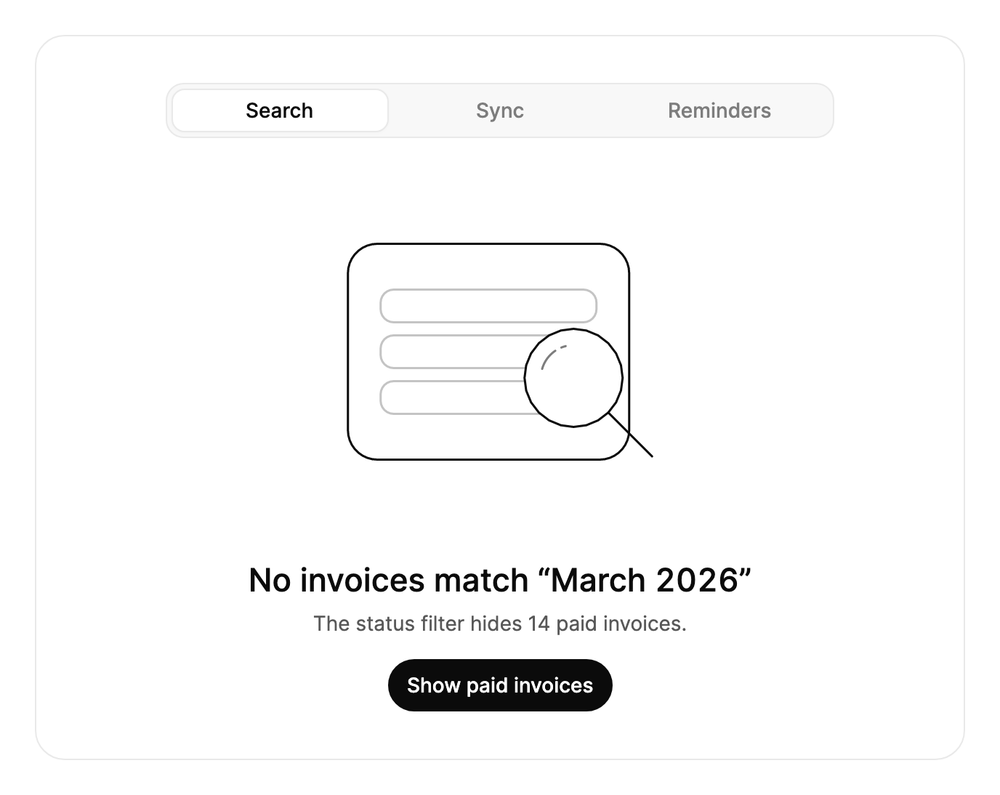

<Demo name="Preview" />

## 何時使用

空狀態會告訴使用者檢視為何沒有內容，以及接下來可以做什麼。`EmptyStates` 用一個區塊涵蓋應用程式中最常遇到的四種情況（沒有符合的搜尋、連線中斷、已清空的佇列與不存在的頁面），每種都附有圖形與文案。把它放在空檢視佔滿整個頁面或面板、且下一步可能需要一點時間的位置，因為區塊會在同一處呈現進行中的工作與最終結果。

- **沒有符合項的篩選發票清單**：帳單主控台中，狀態與月份篩選把所有發票都過濾掉了。`NoResults` 場景在標題中說明原因，並提供一個操作，例如顯示已付款的發票。
- **支援離線的編輯器中連線中斷**：現場應用程式會把編輯內容保存在裝置上。`Offline` 場景告訴使用者編輯內容是安全的，並提供重試；重試時會先顯示連線嘗試的過程，再給出結果。
- **已清空的工單或審核佇列**：支援收件匣或審核佇列中已沒有待讀內容。`CaughtUp` 場景確認這一狀態，其操作會再次檢查是否有新項目。
- **指向已搬移頁面的連結**：說明中心或 CRM 中保存了已封存專案的連結。`NotFound` 場景說明頁面已搬移，並提供搜尋新位置的入口。
- **設計評審或新手引導**：一個並排展示四種狀態的頁面，方便團隊在同一處檢查文案與圖形。

## 何時不用

- **只有一個帶圖示和按鈕的空清單**：使用 `EmptyState`。它只有單一狀態，沒有標籤頁與階段，在資訊密集的頁面上較為輕量。
- **內容仍在載入**：使用 `Skeleton`。它會呈現即將到來內容的形狀；空狀態則會告訴使用者什麼都沒有，而實際上有內容正在路上。
- **頁面已顯示內容時出現錯誤**：使用 `Alert`。它位於內容旁邊，並讓內容保持可讀。
- **儲存或寄出之後的確認**：使用 `Toast`。它會說明發生了什麼，並會自行消失。

## 用法

```xml
<UserControl xmlns="https://github.com/avaloniaui"
             xmlns:arc="https://github.com/AIDotNet/TKCode.Arc">
    <arc:EmptyStates Label="工作區" />
</UserControl>
```

`EmptyStates` 衍生自 `TemplatedControl`。它的標籤頁是 `EmptyStatesItem` 物件，圖形是會在場景之間做動畫的控制項，操作則是一個按鈕。區塊本身不做任何工作。應用程式處理 `ActionInvoked`（或執行 `ActionCommand`），完成工作，並把 `Phase` 切換為 `Loading`，之後再切換為 `Done`，或回到 `Idle`。圖形與文案會隨 `Phase` 和所選標籤頁變化。

### 結構

1. **標籤列**（`Items`）：每個 `EmptyStatesItem` 對應一個標籤，顯示其 `Header`。標籤位於 30 px 高的軌道中，內縮 3 px，圓角 12 px。在 460 px 以內，標籤平分整列，且標籤的寬度不會小於其文字。只有一項時隱藏標籤列。選取的標籤使用表面色、1 px 邊框與靜止時的陰影。
2. **圖形**（`Scene`）：320 × 216 的邏輯畫布，依比例縮放至最寬 360 px。十個形狀與 1.5 px 的描邊不隨圖形縮放。顏色來自佈景主題權杖：主體形狀使用表面色與前景色，輪廓使用淡化文字顏色，輔助形狀使用較強的邊框色。
3. **標題**（`Title`、`DoneTitle`）：大號文字，中等字重。區塊寬度達到 560 px 或以上時，使用特大字號。
4. **描述**（`Description`、`DoneDescription`、`LoadingDescription`）：小號的次要文字，寬度約 350 px，長句會換成更多行。
5. **操作按鈕**（`ActionLabel`、`DoneActionLabel`）：小號主要按鈕。`Phase` 為 `Loading` 時，它會顯示載入指示器並忽略按下。
6. **卡片**：1 px 邊框、20 px 圓角與表面色。內距隨區塊寬度增加：左右為 16 到 40 px，上下為 16 到 48 px。各部分之間的間距為 20 到 32 px。

### 場景與文案

每個 `EmptyStatesItem` 是一個標籤頁。`Scene` 決定圖形，文案屬性則為每個階段設定文字。未設定的文字會使用 Arc 為該場景提供的文案，因此標籤頁只需設定其 `Header` 與操作文字即可。

| 場景 | 圖形 | 預設標籤文字 | 預設標題 |
|---|---|---|---|
| `NoResults` | 放大鏡覆蓋在空列上方 | No results | No results for “Q3 roadmap” |
| `Offline` | 一朵雲透過斷開的線連接到一台裝置 | Offline | You are offline |
| `CaughtUp` | 一疊收件匣，上面有一個勾號 | Caught up | All caught up |
| `NotFound` | 一張摺疊的地圖，路線終止於一個叉號 | Not found | Page not found |

有多個標籤時，請為每個標籤頁都設定 `Header`。標題是標籤列中唯一的文字，使用者據此判斷自己正在看哪種狀態。應依原因選擇場景，而不是依喜歡的外觀：篩選之後用 `NoResults`，連線中斷時用 `Offline`，連結失效時用 `NotFound`，沒有任何待辦時用 `CaughtUp`。

<Demo name="CustomItems" />

```xml
<arc:EmptyStates>
    <arc:EmptyStatesItem Scene="Offline"
                         Title="同步已暫停"
                         ActionLabel="恢復同步" />
    <arc:EmptyStatesItem Scene="NotFound" />
</arc:EmptyStates>
```

`Items` 是一個 `AvaloniaList<EmptyStatesItem>`，而不是 `ItemsSource`。請在 XAML 中加入標籤頁，或在程式碼中使用 `Items.Add` 與 `Items.Remove`。區塊會把選取保持在清單中的某個項目上：被選取的項目移除時，選取會移到一個有效的索引；在項目到達之前做出的選擇會被保留。

### 操作與階段

按下操作按鈕會引發 `ActionInvoked`，參數為所選項目，以及按下時所處的階段；隨後以相同的事件參數執行 `ActionCommand`。階段為 `Loading` 時會忽略按下，因此應用程式永遠不會為同一項工作收到第二次按下。

| 階段 | 顯示的標題 | 顯示的描述 | 按鈕 |
|---|---|---|---|
| `Idle` | `Title`（或場景的文案） | `Description` | `ActionLabel` |
| `Loading` | 開始時所處階段的標題 | 若設定了 `LoadingDescription` 則顯示它，否則顯示目前的描述 | 載入指示器，忽略按下 |
| `Done` | `DoneTitle` | `DoneDescription` | `DoneActionLabel` |

工作進行期間，將 `Phase` 設為 `Loading`。從 `Done` 開始的 `Loading` 會保留完成狀態的標題，因此在操作進行中，文案不會突然跳回空狀態。工作成功時設為 `Done`，失敗時設為 `Idle`。當結果本身有下一步操作時（例如「隱藏已付款的發票」），使用 `Done` 呈現該結果；需要再次提供操作時使用 `Idle`。

<Demo name="AsyncRetry" />

```csharp
states.ActionInvoked += async (_, e) =>
{
    if (e.Phase == EmptyStatesPhase.Done)
    {
        states.Phase = EmptyStatesPhase.Idle;
        return;
    }
    states.Phase = EmptyStatesPhase.Loading;
    var ok = await sync.RetryAsync();
    states.Phase = ok ? EmptyStatesPhase.Done : EmptyStatesPhase.Idle;
};
```

要在一次失敗的嘗試之後更改文案，請在階段仍為 `Loading` 時設定該項目的 `Description`。新文字會隨著回到 `Idle` 一同出現。示範即是如此：第一次嘗試失敗，描述隨之變為一行提示使用者應檢查什麼的文字。

每個場景都有自己的預設 `LoadingDescription`，例如 `Offline` 的 “Reaching sync.northwind.example…”。`NoResults` 場景沒有預設值，因此搜尋進行期間描述會保留在畫面上。若要在任何場景中保留描述，請將 `LoadingDescription` 設為空字串。

### 繫結到檢視模型

`EmptyStates` 沒有項目的繫結，因此它的標籤頁在 XAML 或程式碼中固定。它的狀態可以繫結：`SelectedIndex`、`SelectedItem` 與 `Phase` 為雙向，`ActionCommand` 為單向。由檢視模型持有階段與工作，區塊負責呈現。

```csharp
using CommunityToolkit.Mvvm.ComponentModel;
using CommunityToolkit.Mvvm.Input;
using TKCode.Arc;

public partial class InvoiceEmptyStateViewModel : ObservableObject
{
    private readonly IInvoiceService _invoices;

    public InvoiceEmptyStateViewModel(IInvoiceService invoices)
    {
        _invoices = invoices;
    }

    [ObservableProperty]
    private EmptyStatesPhase _phase = EmptyStatesPhase.Idle;

    [ObservableProperty]
    private int _selectedIndex;

    [RelayCommand]
    private async Task RunActionAsync(EmptyStatesActionEventArgs? args)
    {
        if (args is null)
        {
            return;
        }
        if (args.Phase == EmptyStatesPhase.Done)
        {
            Phase = EmptyStatesPhase.Idle;
            return;
        }
        Phase = EmptyStatesPhase.Loading;
        var result = await _invoices.RefreshAsync();
        Phase = result.IsSuccess ? EmptyStatesPhase.Done : EmptyStatesPhase.Idle;
    }
}
```

```xml
<arc:EmptyStates SelectedIndex="{Binding SelectedIndex, Mode=TwoWay}"
                 Phase="{Binding Phase, Mode=TwoWay}"
                 ActionCommand="{Binding RunActionCommand}"
                 Label="發票" />
```

- `Phase` 為雙向繫結，因此區塊會把它寫回。切換到另一個標籤頁會將 `Phase` 設為 `Idle`，檢視模型透過自己的 `Phase` 屬性就能看到這一變化，並可以捨棄它原本持有的結果。
- 編譯繫結需要在檢視上設定 `x:DataType`。為求簡潔，這裡的範例省略了它。

### 窄版配置

區塊跟隨自身的寬度，而不是視窗的寬度。寬度在 420 px 及以下時，標籤頁使用較小的文字與較緊湊的內距。從 560 px 起，標題使用較大的字級。放不下的標籤會保持其寬度，標籤列會捲動，以保持選取的標籤頁可見。

<Demo name="Narrow" />

### 節制地使用動態效果

場景之間的變形是此區塊的標誌性效果，最適合用在狀態變化本身就是新聞的時候：篩選已被清除、連線已恢復、結果已到達。讓圖形承載這一變化，並保持文案簡短。

- 為使用者自己引起的狀態變化（標籤頁、篩選或重試）使用場景切換。如果背景每隔幾秒重新整理一次，圖形就會變形，這會把視線從它所屬的清單上移開。
- 保持 `Loading` 階段簡短。每次階段變化時圖形都會移動，持續數分鐘的載入指示器只給使用者一幅動態畫面，卻沒有任何資訊；長時間的工作應在周圍的頁面中顯示進度指示器。
- 在減少動態效果下，圖形會交叉淡化而不是變形，因此變化依然可見，卻沒有位移。滑鼠傾斜在減少動態效果下關閉；動態效果關閉時則完全停用。

### 範例：三種空狀態的發票頁面

帳單主控台的發票頁面有三個標籤頁，對應團隊最常遇到的三種狀態。第一個標籤頁處於選取狀態：月份篩選隱藏了所有發票，因此標題中寫明月份，操作則清除已付款發票的篩選。第二個標籤頁顯示同步狀態，第三個顯示所有提醒都已排定。每個標籤頁都設定了自己的標籤文字，因此標籤列讀起來就是三個簡短的標籤。文案使用真實的物件（月份、客戶），因為使用者會先在標題中尋找原因。



```xml
<arc:EmptyStates Width="640"
                 Label="Invoices"
                 TabListLabel="Invoice empty states">
    <arc:EmptyStatesItem Scene="NoResults"
                         Header="Search"
                         Title="No invoices match “March 2026”"
                         Description="The status filter hides 14 paid invoices."
                         ActionLabel="Show paid invoices"
                         DoneTitle="26 invoices from March 2026"
                         DoneDescription="Paid and unpaid invoices are shown."
                         DoneActionLabel="Hide paid invoices" />
    <arc:EmptyStatesItem Scene="Offline"
                         Header="Sync"
                         Title="Invoices may be out of date"
                         Description="Edits are saved here and sync when you reconnect."
                         ActionLabel="Try again" />
    <arc:EmptyStatesItem Scene="CaughtUp"
                         Header="Reminders"
                         Title="No reminders due"
                         Description="Every overdue invoice has a reminder this week."
                         ActionLabel="Check again" />
</arc:EmptyStates>
```

### 文案規範

- **標題**：說明事實，並點明物件或篩選條件：「沒有符合“2026 年 3 月”的發票」，而不是「沒有資料」。句首大寫，不用驚嘆號。
- **描述**：一到兩句話，說明原因與後果，例如「這裡的編輯會被保存，重新連線後同步。」讓它維持在區塊約 350 px 的描述寬度之內。
- **操作標籤**：動詞加物件，與應用程式其他地方的按鈕一致，例如「顯示已付款的發票」「重試」。只有同一操作下次可能成功時，才使用「重試」。
- **完成文案**：說明發生了什麼變化，給出新的數量或新的狀態，例如「2026 年 3 月的 26 張發票」。只寫「成功」的結果，沒有告訴使用者該檢查什麼。
- **載入文案**：說明目前正在發生什麼，使用現在式並加省略號，例如「正在連線到 api.example.com…」。

| 不要寫 | 改為 |
|---|---|
| 沒有資料 | 沒有符合“2026 年 3 月”的發票 |
| 錯誤 | 你已離線 |
| 這裡沒有內容 | 已全部處理完 |
| 點這裡 | 顯示已付款的發票 |
| 成功 | 2026 年 3 月的 26 張發票 |

### 最佳做法

**建議**

- 讓場景與原因相符。使用者先看圖形再看標題；如果篩選隱藏了結果，卻使用 `NotFound` 圖形，就會把使用者引向錯誤的解決方法。
- 為每個標籤頁都設定 `Header`。標題是標籤列中唯一的文字，名為「標籤 2」的標籤對使用者毫無意義。
- 讓每個 `Loading` 都能回到 `Done` 或 `Idle`。`Loading` 期間會忽略按下，因此一個永不結束的階段會讓按鈕對使用者來說卡住。
- 把 `Done` 的文案寫成結果，讓使用者無需開啟清單就能讀出發生了什麼變化。
- 對於有自己下一步的結果（「隱藏已付款的發票」）使用 `Done`；操作可以再次執行時使用 `Idle`。

**避免**

- 單純的空清單。請使用 `EmptyState`：一個狀態、一個按鈕，沒有階段，也不需要解釋標籤列。
- 把破壞性操作作為空狀態的按鈕。`ActionInvoked` 在按下時就會觸發，不做確認，因此這裡的「刪除所有草稿」按鈕會立即執行。破壞性操作應放在對話方塊之後。
- 把標籤頁當作資料。區塊只呈現場景與文案，它不會篩選、取得或計數，因此應用程式必須根據自己的結果設定 `Phase`。
- 過長的描述。文案限制在約 350 px 之內，一段長文字會換成很高的區塊，把下方的頁面推走。每段描述保持在一到兩句話。
- 為裝飾而更改圖形。場景應與使用者所處的狀態相符；在錯誤狀態下使用 `CaughtUp` 圖形，會暗示錯誤已經解決。

### 常見問題

**為什麼按鈕會忽略我的按下？** `Phase` 為 `Loading` 時，區塊會忽略對操作按鈕的按下，不會引發 `ActionInvoked`，也不會執行 `ActionCommand`。工作完成後，請將 `Phase` 設為 `Done` 或 `Idle`。

**為什麼載入期間描述保持不變？** `LoadingDescription` 只有在有文字時才會取代描述。`Offline`、`CaughtUp` 與 `NotFound` 場景有預設的載入文字；`NoResults` 沒有，因此描述會保持不變。若要選擇載入文字，請在該項目上設定 `LoadingDescription`。

**切換標籤頁會保留操作狀態嗎？** 不會。切換到另一個標籤頁會把 `Phase` 恢復為 `Idle`，新的標籤頁顯示它自己的 `Idle` 文案。若要讓標籤頁直接顯示某個結果，請同時設定 `SelectedIndex` 與 `Phase`，如窄版範例中那樣：`<arc:EmptyStates SelectedIndex="1" Phase="Done" />`。

**如何在執行時新增或移除標籤頁？** 修改 `Items`（使用 `Items.Add` 或 `Items.Remove`）。標籤頁會跟隨清單變化；被選取的項目移除時，選取會保留在同一項目上，或移到一個有效的索引。

## API 參考

<!-- api: EmptyStates -->

<!-- api: EmptyStatesItem -->

## 無障礙

- 區塊是一個由 `Label` 命名的區域。標籤列是一個由 `TabListLabel` 命名的標籤頁清單，每個標籤頁都會回報自己是否被選取。
- 只有選取的標籤頁可透過 Tab 鍵取得焦點。ArrowLeft 與 ArrowRight 在標籤頁之間移動，並首尾循環。Home 與 End 跳到第一個與最後一個標籤頁。移動即選取該標籤頁。
- 每個標籤頁以其 header 命名，並回報其在所有標籤頁中的位置，因此螢幕閱讀器會讀作「同步，第 2 個，共 3 個」。
- 圖形是一幅以其所示內容命名的影像，例如「一朵雲透過一條斷開的線連接到一台裝置」。設定 `IllustrationLabel`、`LoadingIllustrationLabel` 與 `DoneIllustrationLabel`，即可以其他語言為它命名。
- 每次階段變化後，新的標題與描述，或載入文字，都會以禮貌式播報。切換標籤頁會清除上一次的播報，因此舊的結果不會被再次朗讀。

### 鍵盤

| 按鍵 | 操作 |
|---|---|
| `Tab` / `Shift+Tab` | 進入或離開標籤列（選取的標籤頁），並移到其後的操作按鈕 |
| `Left` / `Right` | 選取並聚焦上一個或下一個標籤頁；在兩端循環 |
| `Home` / `End` | 選取並聚焦第一個或最後一個標籤頁 |
| `Enter` / `Space` | 選取已聚焦的標籤頁，與任何按鈕相同 |

## 動態效果

- 切換標籤頁時，圖形的每個形狀都會以彈簧動畫過渡到下一個場景。輪廓逐點變形，線條稍後再逐步繪出。顏色在 480 毫秒內交叉過渡。
- 階段變化時，以較短的延遲輕推同一批形狀。
- 舊文案帶著模糊向上移開，新的標題與描述隨之升起。文案高度以彈簧方式調整以符合內容，因此按鈕不會跳動。標籤頁的醒目提示會滑動到選取的標籤頁。
- 使用滑鼠時，圖形的各層會略微朝指標方向傾斜。
- 動態效果等級為 Reduced 時，舊圖形交叉淡化為新圖形，文案淡入淡出。等級為 Off 時，立即切換。

| 變化 | 完整 | 減少 | 關閉 |
|---|---|---|---|
| 場景變化（切換到另一個標籤頁） | 形狀以彈簧移動到新的位置、大小與顏色；輪廓變形；線條稍後繪出 | 舊圖形交叉淡化為新圖形 | 立即完成 |
| 階段變化 | 形狀以較短的延遲移動 | 圖形交叉淡化 | 立即完成 |
| 文案變化 | 舊文案向上並模糊淡出；新文案穿過模糊從下方升起；高度以彈簧調整 | 文案淡入淡出 | 立即完成 |
| 指標在圖形上移動 | 各層向指標方向略微傾斜 | 無傾斜 | 無傾斜 |

## 相關元件

- `EmptyState`：用於帶圖示、文字說明與操作的單一空清單。
- `Skeleton`：內容載入期間使用。
- `Alert`：已顯示內容的頁面中出現錯誤時使用。

| 元件 | 適用情境 |
|---|---|
| `EmptyState` | 一個清單或面板為空，一則訊息與一個操作即可說明 |
| `Skeleton` | 內容正在載入，且其形狀已知 |
| `Alert` | 錯誤或警告涉及仍在頁面上的內容 |
| `Toast` | 儲存或寄出之後出現簡短確認，無需操作 |
| `Tabs` | 使用者在頁面的各個分區之間切換，且每個分區都有內容 |
| `SearchResults` | 搜尋傳回帶摘錄與篩選條件的結果，而空結果是其中一種狀態 |
