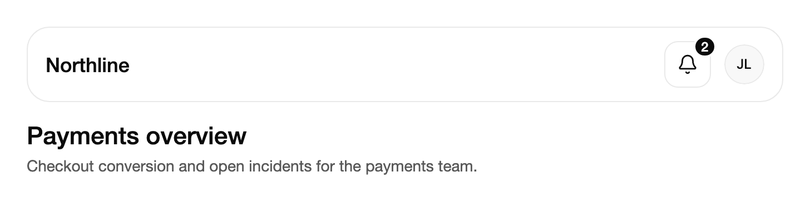

<Demo name="Preview" />

## When to use

The notification center is the place where updates wait until people get to them. It is a bell in the application
header with an unread count, and a panel that lists the updates with their read state, their details and bulk
actions. It sits beside the user menu and search in the header of a shell, and it keeps an update after the moment
has passed: a toast disappears, while the notification stays until the person reads it or dismisses it.

- **Mentions and comments in a collaboration tool**: a teammate mentions you in the "Checkout redesign" thread while
  you are in another project. The update waits in the bell, and the badge tells you it is still open.
- **Finished background jobs in an analytics product**: a report export or a data refresh completes while the person
  is on a dashboard. "Your export is ready to download" stays in the panel with its time, so they can find it later.
- **Approvals and assignments in an operations console**: a purchase order or a deploy is waiting for a decision.
  People mark the update read when they have looked, and dismiss it once the decision is made.
- **Account and billing warnings in a SaaS admin console**: a plan at 85% of its storage or a card that expires next
  month. The `Warning` tone draws the icon in the warning color, so it stands out from routine updates.
- **Incident and status changes for on-call staff**: "Incident resolved" with its time, shown with the `Success` tone,
  for engineers who were away from the status page while the incident ran.

## When not to use

- **A confirmation that needs no follow-up**, such as "Invoice saved": use `Toast`, which goes away by itself.
- **A problem on the current page that people must fix now**, such as a failed payment on a checkout form: use
  `Alert` where the problem is, so it stays visible until the page is corrected.
- **A searchable, filterable history of events**, such as an audit log: use `Table` on a page. Use
  `Timeline` for the ordered events of one record.
- **A conversation with replies**: use `ChatThread`, which has a composer and a reply flow. The panel offers only
  "Mark read", "Mark unread" and "Dismiss" on an update.
- **A count of work to do**, such as 14 open tasks on a navigation item: use `Badge`. The panel lists updates, not
  counters.

## Usage

`NotificationCenter` derives from Avalonia's `TemplatedControl`. Its template holds the bell button, the unread badge
and the panel, which opens in a popup. The `NotificationItem` objects are data: each is an `AvaloniaObject` with the
properties the panel reads. Add them as children, or bind `ItemsSource` to your own collection. Each item has a `Title`,
an optional `Description`, a `Time` label and an `IsRead` state. An update from a person sets `ActorName` and
`ActorSource` and shows their avatar. A system update shows the icon of its `Tone`: `Info`, `Success` or `Warning`.

```xml
<UserControl xmlns="https://github.com/avaloniaui"
             xmlns:arc="https://github.com/AIDotNet/TKCode.Arc">
    <arc:NotificationCenter>
        <arc:NotificationItem Id="deploy" Title="Deploy finished" Description="Version 2.4.1 is live." Time="18m" Tone="Success" />
        <arc:NotificationItem Id="mention" Title="Mia Chen mentioned you" Time="2m" ActorName="Mia Chen" />
        <arc:NotificationItem Id="digest" Title="Your weekly digest is ready" Time="Yesterday" IsRead="True" />
    </arc:NotificationCenter>
</UserControl>
```

The bell shows the unread count, up to "9+", and disappears when nothing is unread. Click it to open the panel. Click
a row to show its details with "Mark read" (or "Mark unread") and "Dismiss". Only one row is open at a time.

### Anatomy

1. **Bell**: a 42 px square button with a 12 px corner radius and a 1 px border on the surface color.
   The bell glyph is 19 px. Hover, press and open use the strong border and the muted surface; nothing scales.
2. **Unread badge**: a 20 px pill with 5 px of horizontal padding and a 2 px ring in the surface color. It sits 5 px
   past the bell's top right corner and shows `UnreadCount`, or "9+" from ten on. It is absent when every item is
   read.
3. **Panel**: 424 px wide, or the window width less 24 px, and at most 590 px high. It uses the raised surface, a 1 px
   border, the panel radius and the floating shadow. It is anchored below the bell with a 12 px gap.
4. **Heading** (`Label`): the extra-large type size at medium weight, with a 21 px count chip beside it that shows the
   unread count.
5. **Summary**: one line under the heading, from `Labels.Summary`, in the secondary text color.
6. **Close button**: a 30 px square with an 8 px radius, named by `Labels.Close`.
7. **Toolbar**: the All and Unread view buttons, 31 px high, at least 61 px wide and 3 px apart, with a highlight that
   glides between them. "Mark all read" sits at the end and appears only while an item is unread.
8. **Rows**: the list has 9 px, 11 px and 10 px paddings. A row shows the actor's avatar or a 36 px tone icon, the
   title in medium weight (secondary when read), an unread dot of 6 px, one line of preview text and the time label
   in the muted text color.
9. **Details**: an expanded row shows its full description and the actions "Mark read" or "Mark unread" and
   "Dismiss". The actions are 30 px high with a 10 px radius, indented to the text column.
10. **Empty state**: at least 190 px high, with a check icon and the title and description from the labels.
11. **Footer**: appears when at least one item is read. It shows the read count ("3 read") and "Clear read".

### Read state and your data

The control changes `IsRead` on the item and raises `ReadChanged`, whose arguments carry the `Item` and the new
`IsRead`. "Mark all read" raises it once for each item it marks. "Dismiss" removes the item from `Items`, or from
`ItemsSource` when that is a list you can change, and raises `Dismissed` with the `Item`. "Clear read" raises it once
for each read item. The item has already changed when the event runs, so save the change to your store in the
handler. When your store changes, the bell and the panel follow the items and the collection.

<Demo name="ReadState" />

```csharp
center.ItemsSource = store;   // an ObservableCollection<NotificationItem>
center.ReadChanged += (_, e) => _vm.SaveReadStateAsync(e.Item);
center.Dismissed += (_, e) => _vm.DismissAsync(e.Item);
```

A read-only source keeps its items, and the control hides the dismissed ones until `ItemsSource` is set again.

### Binding to a view model

The view model owns the updates and their persistence. The control only shows them and reports the person's changes.
The view model holds an `ObservableCollection<NotificationItem>` and the panel's open state.

```csharp
public abstract class ActivityStore
{
    public abstract IEnumerable<NotificationItem> LoadRecent();
    public abstract Task SetReadAsync(string id, bool isRead);
    public abstract Task DismissAsync(string id);
}

public partial class ActivityViewModel : ObservableObject
{
    private readonly ActivityStore _store;

    public ActivityViewModel(ActivityStore store)
    {
        _store = store;
        foreach (var update in store.LoadRecent())
        {
            Updates.Add(update);
        }
    }

    // Dismiss removes an item from this collection; the control does this for a writable source.
    public ObservableCollection<NotificationItem> Updates { get; } = new();

    [ObservableProperty]
    private bool _isActivityOpen;

    public Task SaveReadStateAsync(NotificationItem item) => _store.SetReadAsync(item.Id, item.IsRead);

    public Task DismissAsync(NotificationItem item) => _store.DismissAsync(item.Id);
}
```

```xml
<arc:NotificationCenter x:Name="Activity"
                        Label="Activity"
                        ItemsSource="{Binding Updates}"
                        IsOpen="{Binding IsActivityOpen, Mode=TwoWay}" />
```

```csharp
// In the code-behind, where the control is named Activity: the control has no commands, so use its events.
Activity.ReadChanged += (_, e) => _ = _vm.SaveReadStateAsync(e.Item);
Activity.Dismissed += (_, e) => _ = _vm.DismissAsync(e.Item);
```

- `IsOpen` and `View` are two-way. Bind `IsOpen` when other UI, such as a header shortcut, opens the panel.
- `NotificationItem.IsRead` is two-way too. When the view model updates it, the bell follows; when the person marks
  an item, the control sets it.
- The control has no commands. Persist the change in `ReadChanged` and `Dismissed`, as above, and keep the handlers
  short.

### Data shape and updates

- **Stable `Id`**: rows are matched by `Id`. When you refresh the list with new `NotificationItem` objects that carry
  the same ids, the rows stay in place, and an expanded row stays expanded. An item without an id is matched by its
  object reference.
- **`Tag` for your record**: `Tag` holds any value, such as the record key in your store. The events give you the
  `Item`, so read `e.Item.Tag` instead of searching by title.
- **`Time` is display text**: the control shows the string as given, such as "2m". It does not age the value, so
  format it in your view model and refresh it when you reload.
- **Live updates**: the control follows the collection and each item's `Title`, `Description`, `IsRead` and other
  properties, except `Tag`. A new update or a changed read state refreshes the bell and the panel at once.
- **Bulk actions run as one batch**: "Mark all read" and "Clear read" refresh the counts and the list once, then raise
  one event for each item.
- **Keep the list short**: the panel is at most 590 px high, and the Arc design has no list scrollbar. Keep the store
  to recent updates, and send people to a history page for the rest.
- **Number formatting**: the badge uses the current culture. Format counts and dates in the item text with the app's
  culture, such as `CultureInfo.CurrentCulture`.

### Unread view and empty state

The panel lists every update, or only the unread ones. `View` is two-way. When the list is empty the panel says so:
"All clear" in the All view, or "Nothing unread" in the Unread view. When there are read updates, a link goes back to
the All view.

<Demo name="UnreadView" />

### In an app header

The panel opens 12 pixels below the bell and stays 12 pixels inside the window, so the bell can sit at the edge of
a header. The unread badge reaches 5 pixels past the bell's top right corner, so leave that much room around the bell
in a container that clips. In a window 380 pixels wide or less the panel switches to its narrow layout: tighter
header and row paddings, a smaller heading, and "Mark all read" shows its icon only.

<Demo name="AppHeader" />

### Focus and dismissal

- **Opening** moves focus to the close button, so the first Tab from the panel reaches All and the list follows.
- **Escape or the close button** closes the panel and returns focus to the bell.
- **Pressing outside** the panel closes it. Focus returns to the bell only when focus was inside the panel.
- **The bell** toggles the panel: a second click closes it.
- **Leaving the window**: when the bell leaves the window while the panel is open, the panel closes without its exit
  animation and reopens when the bell returns, if `IsOpen` is still true.
- **Dismissing or marking read** in the Unread view moves focus to the next row, then the previous one, then the
  Unread button.

### Wording

`Label` names the panel and the bell. `Labels` holds every other word, with English defaults, in a
`NotificationCenterLabels` object (listed in the API reference). Assign a new instance to change them. In `ReadCount`,
`{0}` is the rolling number. Words with a count, such as the summary under the heading, are functions you can set in
code, so an app can apply its own plural rules.

<Demo name="CustomWording" />

```csharp
center.Labels = new NotificationCenterLabels
{
    Summary = unread => unread > 0 ? $"{unread} new" : "Nothing new",
    Trigger = (label, unread) => $"{label}, {unread} new"
};
```

### Opening from code

`IsOpen` is two-way. `Open()` and `Close()` do the same. `MarkAllRead()` and `ClearRead()` run the bulk actions and
raise the same events as the buttons. Setting `IsOpen` before the bell is in a window opens the panel once it is shown.
`Open()` moves focus into the panel, so call it when the person expects it, not on every background update.

```csharp
center.Open();
center.MarkAllRead();
```

### Example: activity bell in an admin header

An admin console for a payments team. The header carries the product name, the activity bell and the user's avatar.
The bell shows two unread updates. The first has an actor, so it shows the person's avatar and the title names them.
The second is a system update with the `Success` tone. The third is read, so the panel would show it without an
unread dot. The page below the header uses the same surface and type tokens, so the header looks like part of the
product.



```xml
<StackPanel Width="680" Spacing="16">
    <Border CornerRadius="20"
            Padding="16,12"
            BorderThickness="1"
            BorderBrush="{arc:ArcDesignTokenResource Border}"
            Background="{arc:ArcDesignTokenResource Surface}">
        <DockPanel>
            <StackPanel DockPanel.Dock="Right" Orientation="Horizontal" Spacing="12">
                <arc:NotificationCenter Label="Activity">
                    <arc:NotificationItem Id="assigned"
                                          Title="Priya Shah assigned you Fix checkout totals"
                                          Time="9m"
                                          ActorName="Priya Shah" />
                    <arc:NotificationItem Id="incident"
                                          Title="Incident resolved"
                                          Description="Payments API latency is back to normal."
                                          Time="40m"
                                          Tone="Success" />
                    <arc:NotificationItem Id="sso"
                                          Title="SSO certificate expires in 7 days"
                                          Description="Upload a new certificate in Security settings."
                                          Time="2h"
                                          Tone="Warning"
                                          IsRead="True" />
                </arc:NotificationCenter>
                <arc:Avatar DisplayName="Jordan Lee" VerticalAlignment="Center" />
            </StackPanel>
            <TextBlock Text="Northline"
                       VerticalAlignment="Center"
                       FontSize="{arc:ArcDesignTokenResource TypeLG}"
                       FontWeight="{arc:ArcDesignTokenResource WeightMedium}"
                       Foreground="{arc:ArcDesignTokenResource Foreground}" />
        </DockPanel>
    </Border>
    <StackPanel Spacing="6">
        <TextBlock Text="Payments overview"
                   FontSize="{arc:ArcDesignTokenResource TypeXL}"
                   FontWeight="{arc:ArcDesignTokenResource WeightMedium}"
                   Foreground="{arc:ArcDesignTokenResource Foreground}" />
        <TextBlock Text="Checkout conversion and open incidents for the payments team."
                   FontSize="{arc:ArcDesignTokenResource TypeSM}"
                   Foreground="{arc:ArcDesignTokenResource TextSecondary}" />
    </StackPanel>
</StackPanel>
```

### Content guidelines

- **Title**: one line that names the object and the outcome, such as "Invoice inv_2026_0412 was paid". The title is cut
  with an ellipsis, so put the decisive words first. Write the actor's name in an update from a person.
- **Description**: one sentence with the detail a person needs to decide: an amount, a version, a count. It previews
  under the title and shows in full when the row opens.
- **Time**: a short label such as "2m", "40m", "Yesterday" or "Mon". Use the same unit for every item.
- **Labels**: sentence case, with action labels as verb and object ("Mark read", "Clear read").
- **Dismiss** removes the update from this list only. Say so in the product copy when a delete also removes data.

| Instead of | Write |
|---|---|
| New notification! | Priya Shah assigned you Fix checkout totals |
| Error | Payment failed for invoice inv_2026_0412 |
| Click here | View update details |
| Delete | Dismiss |
| Something happened | Deploy to production finished |

### Best practices

**Do**

- Give every item a stable `Id` and keep the same item objects while the list refreshes. Rows are matched by id, so
  the expanded row and the keyboard position survive the refresh.
- Save `ReadChanged` and `Dismissed` to your store. The control changes its in-memory state only, so a reload would
  show the old read state without the handlers.
- Store the record key in `Tag`, so the events give you the record without a lookup by title.
- Use `Warning` for updates that need a decision and `Success` for finished work. The tone icons carry the meaning, so
  keeping each tone for one kind of update keeps the list readable.
- Set `Label` to the product's word for the list ("Activity", "Inbox"); it names the bell and the panel.

**Avoid**

- Action buttons for work that changes data, such as approving a request. The panel offers only "Mark read",
  "Mark unread" and "Dismiss"; link to the record from your own page instead.
- Calling `Open()` on every update. It moves focus into the panel and can interrupt typing in another field.
- Dismissing unread updates on the person's behalf. Dismiss removes the update from the list, so the person loses the
  pending item.
- Using the badge as the only signal for an outage or a failed payment. Show those on the page with `Alert`, where
  people act on them.
- Long titles with several sentences. They are cut to one line, and the rest is only visible in the details.

### Common questions

**Why does Dismiss remove the item from my list?** The control removes the item from `Items`, or from `ItemsSource`
when that is a writable `IList` or `ICollection`, before it raises `Dismissed`. A read-only source keeps the item, and
the control hides it. Delete the record in the `Dismissed` handler when you want the removal to be permanent.

**Why does the badge count differ from my store?** `UnreadCount` counts the items the control shows: the items in
`ItemsSource` (or `Items`) minus any item it hides from a read-only source. Read the count from the control, not from
your own list, so the bell and the panel agree.

**Does clicking a row open the related page?** No. A row only shows or hides its details, and the panel has no link
action. Route people to the record from your own page, using the item's `Tag` value.

**How do I make an actor's photo show?** Set `ActorSource` to an `ImageSource`; in XAML a URL works. Initials show while
the image loads or when it fails.

**Can I change the panel size or position?** No public property sets them. The panel is 424 px wide (or the window
width less 24 px), at most 590 px high, and sits 12 px below the bell. Place the bell where the panel can open downward.

## API reference

<!-- api: NotificationCenter -->

<!-- api: NotificationItem -->

### NotificationCenterLabels

`NotificationCenterLabels` holds every word the control shows or announces except `Label`, each with Arc's English
default. Assign a new instance to `NotificationCenter.Labels`.

| Property | Default | Where it shows |
|---|---|---|
| `Trigger` (function of label and unread count) | "Notifications, 3 unread" | Accessible name of the bell |
| `Summary` (function of unread count) | "3 updates waiting for you", "You’re all caught up" | Line under the heading |
| `Close` | "Close notifications" | Accessible name of the close button |
| `ViewSwitch` | "Show notifications" | Accessible name of the All / Unread switch |
| `All` / `Unread` | "All" / "Unread" | View buttons |
| `AllList` / `UnreadList` | "All notifications" / "Unread notifications" | Accessible names of the lists |
| `MarkAllRead` | "Mark all read" | Bulk action in the toolbar |
| `UnreadState` | "unread" | Added to an unread row's accessible name |
| `ShowDetails` / `HideDetails` | "Show details" / "Hide details" | Ends a row's accessible name |
| `FromActor` (function of name) | "From Mia Chen" | Preview of an update from a person without a description |
| `ViewDetails` | "View update details" | Preview of a system update without a description |
| `SharedUpdate` (function of name) | "Mia Chen shared an update with you." | Details of an update from a person without a description |
| `ReadyToReview` | "This update is ready to review." | Details of a system update without a description |
| `MarkRead` / `MarkUnread` | "Mark read" / "Mark unread" | Row action for the read state |
| `Dismiss` | "Dismiss" | Row action that removes the update |
| `EmptyTitle` / `EmptyDescription` | "All clear" / "New updates will appear here." | Empty All view |
| `UnreadEmptyTitle` / `UnreadEmptyDescription` | "Nothing unread" / "You’ve seen every update." | Empty Unread view |
| `ViewAll` | "View all updates" | Link from an empty Unread view to the All view |
| `ReadCount` | "{0} read" | Footer count; `{0}` is the rolling number |
| `ClearRead` | "Clear read" | Footer action that dismisses the read updates |

## Accessibility

- The bell is a button named by `Label` and the unread count, such as "Notifications, 3 unread". It reports whether the
  panel is expanded.
- Opening the panel moves focus to its close button. Tab moves through close, All and Unread, "Mark all read", the
  rows, the open row's buttons and "Clear read", and wraps around inside the panel.
- Escape and the close button close the panel and return focus to the bell.
- All and Unread are toggle buttons. Each row is a button named by its title and state, such as "Deploy finished,
  unread. Show details", and reports whether it is expanded.
- After you mark a row read in the Unread view, or dismiss a row, focus moves to the next row, then the previous one,
  then the Unread button. After "Mark all read" focus returns to the current view button.
- The summary under the heading is a polite live region, so the new count is read out.
- `Label` names both the bell and the panel heading, so choose a word that makes sense on its own, such as "Activity"
  or "Inbox".

### Keyboard

| Keys | Action |
|---|---|
| `Enter` or `Space` on the bell | Opens the panel and moves focus to its close button |
| `Enter` or `Space` on the bell while open | Closes the panel and returns focus to the bell |
| `Escape` | Closes the panel and returns focus to the bell |
| `Tab` / `Shift+Tab` | Moves through close, All, Unread, "Mark all read", the rows, the open row's buttons and "Clear read" |
| `Enter` or `Space` on All or Unread | Switches the view; the expanded row closes |
| `Enter` or `Space` on a row title | Shows or hides the row's details; only one row stays open |
| `Enter` or `Space` on "Mark read", "Mark unread" or "Dismiss" | Changes the row, then moves focus as described under Accessibility |
| `Enter` or `Space` on "Mark all read" | Marks every unread update read; focus returns to the current view button |
| `Enter` or `Space` on "Clear read" | Dismisses every read update; focus moves to the All button |

## Motion

- The panel grows out of the bell: it starts 6 pixels toward the bell at scale 0.97 and fades in over 240 ms. It
  leaves in 120 ms at half the distance and scale 0.98.
- The bell tips while the panel is open. The badge pops in and out, and its number rolls up or down.
- Rows settle in 4 pixels from below, 35 ms apart, when the panel opens or a view adds them. Leaving rows fade and
  close their height on a smooth spring. After a bulk action they leave one after another, at most 200 ms apart from
  the first.
- The counts roll, the summary rises into its new wording, and the All and Unread highlight glides between the
  buttons. Details, the footer and the empty state open and close their height on the same spring.
- Reduced motion keeps only short fades of 120 ms, with no movement, scaling or blur. The panel shows and hides at
  once. Off applies every change at once.

| Change | Full | Reduced | Off |
|---|---|---|---|
| Panel opens | Grows out of the bell, 6 px and scale 0.97, over 240 ms | Shown at once | Immediate |
| Panel closes | Leaves in 120 ms at half the distance | Hidden at once | Immediate |
| Rows enter | Rise 4 px and fade in, 35 ms apart | Short fade, no movement | Immediate |
| Rows leave after a bulk action | Height collapses on the smooth spring, cascading up to 200 ms | Short fade, no collapse | Immediate |
| Bell while open | Tips, then returns when the panel closes | Stays upright | Immediate |
| Unread badge | Pops in and out; the number rolls | Short fade | Immediate |
| View highlight | Glides between All and Unread | Short fade | Immediate |

## Related

- `Toast` for a short message that goes away by itself.
- `Popover` for other content anchored to a button.
- `Badge` for a count or a status on another control.

| Component | Choose it when |
|---|---|
| `Toast` / `ToastStack` | A short result must appear once and go away without action |
| `Alert` | A problem on the current page must stay visible until it is fixed |
| `Popover` | Other content must be anchored to a button, such as a filter form |
| `Badge` | A count or a status sits on another control, and no list of updates is needed |
| `Timeline` | The events of one record must read in order |
| `ChatThread` | People reply to each other in a conversation |
