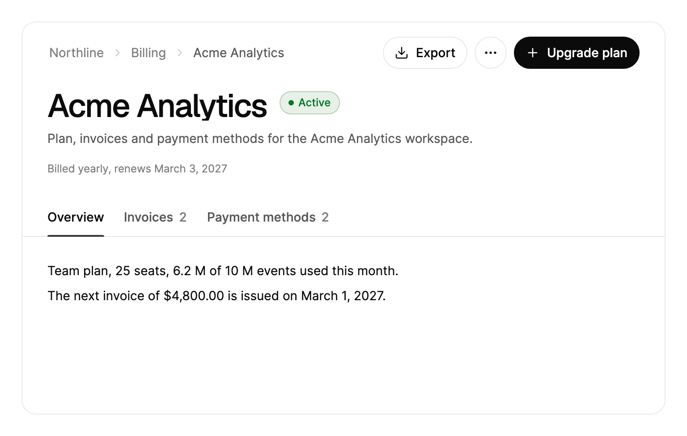

<Demo name="Preview" />

## When to use

`PageHeader` is the frame of a record or project page: a header with the path to the page, its title, status,
description, a meta row, actions and tabs, above the scrolling body of the selected tab. It belongs at the top of a
page, where it tells people which record they are in and what they can do to it, and it stays in reach while the body
scrolls.

- **A project or repository page in a developer tool**: "Checkout service" with its status, the Share and Follow
  actions, and tabs for Overview, Issues (with a count of open items) and Deployments.
- **An account record in a CRM or an internal admin console**: "Acme Analytics" with its status and owner in the meta
  row, and tabs for Contacts, Opportunities and Activity.
- **A billing or subscription page in a SaaS admin console**: "Acme Analytics" with a status badge, an Upgrade primary
  action, Export as a secondary action, and tabs for Invoices (with a count) and Payment methods.
- **An order detail page in e-commerce**: "Order 10482" with a "Shipped" status, a Print action and tabs for Items,
  Shipments and Payments.
- **A long record page whose body scrolls**: when the body scrolls past 16 pixels, the header folds into a compact bar
  that keeps the title and the status in view.

## When not to use

- **Moving between the sections of the app**: use `Sidebar`. The page header navigates only within one record.
- **Switching views inside a card or a panel**: use `Tabs`, which needs no page frame.
- **A dialog or a settings form with its own title**: use the title of `Dialog`, or a plain heading.
- **A single path with no tabs or actions**: use `Breadcrumb` alone, which does not reserve the height of a header.
- **A list or a table with its own toolbar**: use `FilterToolbar` above a `SortableDataTable`. A page header takes its
  height from the body, so a table inside it gets less room than the page needs.

## Usage

`PageHeader` derives from `SelectingItemsControl`. Each tab is a `PageHeaderTab` item, so selection works like a list:
`SelectedIndex`, `SelectedItem` and `SelectionChanged` behave as they do on a list, and disabled tabs are skipped. Each
`PageHeaderTab` derives from `HeaderedContentControl`: `Header` is its label, `Count` an optional number, and `Content`
its body. Give the header a fixed height, or put it in a row with a height, so the body can scroll.

```xml
<arc:PageHeader Title="Checkout redesign"
                Status="On track"
                Description="Rebuilding mobile checkout around saved payment methods."
                Height="480">
    <arc:PageHeaderTab Header="Overview">
        <TextBlock Text="Progress, milestones and recent activity." />
    </arc:PageHeaderTab>
    <arc:PageHeaderTab Header="Issues" Count="9">
        <TextBlock Text="Open issues." />
    </arc:PageHeaderTab>
</arc:PageHeader>
```

### Anatomy

1. **Frame**: a 1 px border on the surface color with a 16 px corner radius. The header has 16 px at the top and 28 px at
   the sides (18 px at the sides below 560 px wide). The body has 28 px at the top and sides and 84 px at the bottom.
2. **Lead cell**: the breadcrumbs (`Breadcrumbs`) or, once the header condenses, the compact title (`Title`). They take
   the same place and replace each other.
3. **Action row**: the secondary `Actions` as small buttons 8 px apart, the "More actions" button (36 px square, with
   a 17 px ellipsis glyph) and the `PrimaryAction`. The row keeps 16 px from the lead cell.
4. **Title** (`Title`): the largest display size, or the next size down below 560 px wide, with 14 px between it and
   the status.
5. **Status** (`Status`, `StatusTone`): a badge with a 6 px dot, in the tone color. It also appears in the compact bar.
6. **Description** (`Description`): body text in the secondary text color, wrapped at about 60 characters.
7. **Meta** (`Meta`): any content under the description, in the extra-small muted type.
8. **Tab row**: tabs 44 px high with 10 px side padding and medium weight. `Count` sits 6 px after the label and its
   digits roll. The row runs to the frame edges, so the first label lines up with the title.
9. **Indicator**: a 2 px bar under the selected tab, inset 10 px from each side of the tab.
10. **Body**: the content of the selected tab, in the scroller under the tab row.

### Title and tabs

A header needs only a title and tabs. Without breadcrumbs, status or actions the header row stays empty until the
header condenses and shows the compact title. `Count` is an `int?`: `null` hides the number, and each change rolls the
digits to the new value.

<Demo name="Minimal" />

### Breadcrumbs, status and meta

`Breadcrumbs` takes the path to the page, root first, as strings, data items or `BreadcrumbItem`s. The last item is the
current page and is never a link. Choosing another crumb raises `BreadcrumbClick`, whose arguments carry the `Item` and
its `Index` (0 is the root). `Status` adds a badge with a dot beside the title, in the `StatusTone` color (success by
default). `Meta` takes any content for the row under the description, such as members, an owner and a date.

```xml
<arc:PageHeader Title="Checkout redesign" Status="At risk" StatusTone="Warning">
    <arc:PageHeader.Meta>
        <TextBlock Text="Led by Emma Collins" />
    </arc:PageHeader.Meta>
</arc:PageHeader>
```

```csharp
header.Breadcrumbs = new[] { "Northline", "Projects", "Checkout redesign" };
header.BreadcrumbClick += (_, e) => router.Open(e.Index);
```

### Actions

`Actions` are small secondary buttons in the header row. `MoreActions` always live in the "More actions" menu, after
the folded secondary actions and a separator. `PrimaryAction` is one small primary button at the end of the row, and it
shows only its icon below 460 pixels. Each `PageHeaderAction` has a `Label`, an `Icon` (a Lucide geometry such as
`ArcIcons.Bell`), and a `Command` or a `Click` event. `PageHeader.ActionInvoked` reports every action in one place,
with `IsFromMenu` set when the action came from the menu.

Use `IsDestructive="True"` on a menu action that removes data, such as a delete or a cancellation. It draws the menu
row in the danger color. `IsEnabled="False"` disables the button and dims its menu row. `IsLoading="True"` shows a
spinner and ignores clicks. `Invoke()` runs the action from code and respects those states.

When the breadcrumbs would get less than 240 pixels, the secondary actions fold into the top of the "More actions"
menu. They come back once there are 272 pixels again, so the header does not flicker at the threshold. Only the width
of the header is watched, so a label that grows (Follow to Following) never folds the button you just pressed.

<Demo name="FoldingActions" />

Change `Label` and `Icon` to update a button in place. Set `MenuLabel` and `MenuIcon` when the menu row should read
differently.

```csharp
follow.Click += (_, _) =>
{
    following = !following;
    follow.Label = following ? "Following" : "Follow";
    follow.MenuLabel = following ? "Unfollow" : "Follow";
};
share.IsLoading = true;
```

### Condensing

When the body scrolls past 16 pixels, the header folds into a compact bar with the title and the status. It opens
again only when the body is back within 4 pixels of the top, so the header does not flicker near the threshold.
`IsCondensed` tells you the state. Choosing the compact title calls `ScrollToTop()`, which scrolls back and moves focus
to the title. The header condenses only when the body is long enough to stay scrolled once the header is smaller.

Switching tabs while the header is condensed shows the top of the new tab and keeps the compact bar. `RevealTab(index)`
does the same from code, for example after creating an item in another tab. It returns `false` for a missing or
disabled tab.

### Data items

Bind `ItemsSource` to your own items. `ItemTemplate` renders the tab label and `ContentTemplate` the body. `SelectedIndex`
and `SelectedItem` can be bound in both directions.

<Demo name="DataItems" />

### Narrow widths

The layout follows the width of the control, not the window. Below 560 pixels the padding gets smaller, the root crumb
and the compact badge hide, the title steps down a size, and the far edge of the tab row fades. Below 460 pixels the
primary action shows only its icon. Until the header has been measured once, a header narrower than 720 pixels starts
with its secondary actions folded, so nothing flashes on load.

### Binding to a view model

The view model owns the selected tab, the counts and the commands. The header shows them and reports the person's
choices. With CommunityToolkit.Mvvm:

```csharp
public abstract class BillingApi
{
    public abstract Task ExportInvoicesAsync();
}

public partial class BillingPageViewModel : ObservableObject
{
    private readonly BillingApi _api;

    public BillingPageViewModel(BillingApi api)
    {
        _api = api;
        ExportAction = new PageHeaderAction { Label = "Export", Icon = ArcIcons.Download, Command = ExportCommand };
    }

    public PageHeaderAction ExportAction { get; }

    [ObservableProperty]
    private int _selectedTabIndex;

    public ObservableCollection<string> Invoices { get; } = new();

    [ObservableProperty]
    private int _openInvoiceCount;

    [ObservableProperty]
    private bool _isExporting;

    [RelayCommand]
    private async Task ExportAsync()
    {
        IsExporting = true;
        try
        {
            await _api.ExportInvoicesAsync();
        }
        finally
        {
            IsExporting = false;
        }
    }
}
```

```xml
<arc:PageHeader Title="Acme Analytics"
                Status="Active"
                StatusTone="Success"
                SelectedIndex="{Binding SelectedTabIndex, Mode=TwoWay}">
    <arc:PageHeaderTab Header="Invoices" Count="{Binding OpenInvoiceCount}">
        <ItemsControl ItemsSource="{Binding Invoices}" />
    </arc:PageHeaderTab>
</arc:PageHeader>
```

- `SelectedIndex` is two-way, so the view model can move the header to a tab, and a tab change from the person updates
  the property.
- `Count` takes a binding, and its digits roll when the view model changes the value.
- A `PageHeaderAction` is not a visual, so it takes its `Command` in code, as above. Its `IsLoading` is set from the view
  model in the same way (`ExportAction.IsLoading = vm.IsExporting`, updated in a `PropertyChanged` handler), and the
  button then shows its spinner and ignores clicks.
- Use `CanExecute` on the command for actions that can be unavailable, such as an upgrade that is already applied. The
  menu row and the button follow the command's state.

### Choosing what goes in the header

The header has room for a few things, so each slot takes one kind of content:

| Slot | Put in it | Keep out of it |
|---|---|---|
| `Title` and `Status` | The record name, and one state word such as "Active" or "At risk" | Sentences, counts, dates |
| `Description` | One or two sentences about the record | Instructions for the page |
| `Meta` | Owner, members, dates and a few facts | Actions and form controls |
| `Actions` | Two or three frequent actions | Destructive actions |
| `MoreActions` | Occasional and destructive actions, such as cancel or delete | The most frequent action |
| `PrimaryAction` | The one action that moves the record forward | More than one action |

### Example: billing account page

A billing page for a SaaS workspace, with the account name and status in the title, the plan details in the meta row,
and two secondary actions. The primary action is "Upgrade plan", and the destructive cancellation sits in the menu
where it cannot be pressed by mistake. Tabs cover the account's Overview, its invoices, with a count of open invoices,
and its payment methods. The status uses the success tone for a healthy state.



```xml
<UserControl xmlns="https://github.com/avaloniaui"
             xmlns:x="http://schemas.microsoft.com/winfx/2006/xaml"
             xmlns:arc="https://github.com/AIDotNet/TKCode.Arc"
             xmlns:generic="using:System.Collections.Generic"
             Width="720">
    <arc:PageHeader Height="440"
                    Title="Acme Analytics"
                    Status="Active"
                    StatusTone="Success"
                    Description="Plan, invoices and payment methods for the Acme Analytics workspace."
                    TabsLabel="Billing sections">
        <arc:PageHeader.Breadcrumbs>
            <generic:List x:TypeArguments="x:String">
                <x:String>Northline</x:String>
                <x:String>Billing</x:String>
                <x:String>Acme Analytics</x:String>
            </generic:List>
        </arc:PageHeader.Breadcrumbs>
        <arc:PageHeader.Meta>
            <TextBlock Text="Billed yearly, renews March 3, 2027" />
        </arc:PageHeader.Meta>
        <arc:PageHeader.Actions>
            <arc:PageHeaderAction Label="Export" Icon="{x:Static arc:ArcIcons.Download}" />
        </arc:PageHeader.Actions>
        <arc:PageHeader.MoreActions>
            <arc:PageHeaderAction Label="Copy workspace ID" Icon="{x:Static arc:ArcIcons.Link2}" />
            <arc:PageHeaderAction Label="Cancel subscription"
                                  Icon="{x:Static arc:ArcIcons.Trash2}"
                                  IsDestructive="True" />
        </arc:PageHeader.MoreActions>
        <arc:PageHeader.PrimaryAction>
            <arc:PageHeaderAction Label="Upgrade plan" Icon="{x:Static arc:ArcIcons.Plus}" />
        </arc:PageHeader.PrimaryAction>
        <arc:PageHeaderTab Header="Overview">
            <StackPanel Spacing="8">
                <TextBlock Text="Team plan, 25 seats, 6.2 M of 10 M events used this month." TextWrapping="Wrap" />
                <TextBlock Text="The next invoice of $4,800.00 is issued on March 1, 2027." TextWrapping="Wrap" />
            </StackPanel>
        </arc:PageHeaderTab>
        <arc:PageHeaderTab Header="Invoices" Count="2">
            <StackPanel Spacing="8">
                <TextBlock Text="inv_2026_0412   Open   $4,800.00   Oct 1, 2026" />
                <TextBlock Text="inv_2026_0311   Paid   $4,800.00   Sep 1, 2026" />
            </StackPanel>
        </arc:PageHeaderTab>
        <arc:PageHeaderTab Header="Payment methods" Count="2">
            <TextBlock Text="Visa ending in 4242 is the default card." TextWrapping="Wrap" />
        </arc:PageHeaderTab>
    </arc:PageHeader>
</UserControl>
```

### Content guidelines

- **Title**: the record's name, as people search for it: "Acme Analytics", "Order 10482". Avoid prefixes such as "Page:".
- **Status**: one word or two, a state rather than a sentence: "Active", "At risk", "Shipped". Pick the tone that
  matches the state, and keep Warning and Danger for states that need attention.
- **Description**: one or two sentences that say what the record is for. Write it in sentence case with a full stop.
- **Tab labels**: a noun in sentence case, such as "Invoices" or "Payment methods". Counts are numbers only.
- **Actions**: verb and object in sentence case: "Export invoices", "Upgrade plan". Use the menu for actions that
  are rare or destructive, and say what they remove.

| Instead of | Write |
|---|---|
| Page: Billing settings | Acme Analytics |
| Status: this record is currently in good standing | Active |
| EXPORT | Export |
| Delete everything | Cancel subscription |
| Invoices (2 unpaid!) | Invoices, with the count of open invoices |

### Best practices

**Do**

- Keep the header height fixed, or give it a row with a height. The body scrolls inside it, and the condensing logic
  depends on that height to decide whether the header can fold.
- Put the destructive actions in `MoreActions`. The menu asks for one more step, so a cancellation is not one click
  away from a frequent action.
- Bind `SelectedIndex` two-way when the view model needs to know or change the tab, so a deep link can open a tab.
- Use `RevealTab(index)` after creating an item in another tab. The new item is then visible without the header
  leaving its compact state.
- Give each action a short `Label`. The label is the button text on wide headers and the accessible name below 460
  pixels, where the primary action shows only its icon.

**Avoid**

- Putting form controls in `Meta`. The meta row is extra-small muted text, so an input there is hard to read and to
  use with a keyboard.
- Calling `ScrollToTop()` on every tab change. It moves focus to the title, which takes focus away from the content the
  person is using.
- Setting `IsLoading` on several actions at once. One spinner says what is loading; several spinners suggest the page
  is stuck.
- Using a count on every tab. A count tells people how many items are waiting; on a tab that only shows a document,
  it is noise.
- Making the header so tall that the body cannot scroll past the condensed viewport. A short body keeps the full
  header, so the page never folds and the title stays large.

### Common questions

**Why did my secondary actions move into the "More actions" menu?** The header folds them when the breadcrumbs would get
less than 240 pixels, and it brings them back at 272 pixels. Shorten the breadcrumb labels, move the least used actions
to `MoreActions`, or widen the header. `AreActionsFolded` tells you the current state.

**Why does the header not condense when I scroll?** The header condenses only when the body is tall enough to stay
scrolled past the expand line once the header is smaller. A short body keeps the full header, so the page does not
jump. Give the body content that is taller than the condensed viewport, or leave the header expanded.

**How do I open a specific tab from a link?** Set `SelectedIndex` to the tab's index, or call `RevealTab(index)` when the
header is already condensed and the body should start at the top of the new tab. `RevealTab` returns `false` when the
index is missing or the tab is disabled.

**Can a disabled tab be selected with the arrow keys?** No. Disabled tabs are skipped by the arrow keys and by Home and
End, so the selection moves to the next enabled tab.

**Does the header keep the compact title when I switch tabs?** Yes. Switching tabs while condensed shows the top of the
new tab and keeps the compact bar. Choosing a tab does not expand the header.

## API reference

<!-- api: PageHeader -->

<!-- api: PageHeaderTab -->

<!-- api: PageHeaderAction -->

## Accessibility

- The control is a region named by `Title`. The title is a level 2 heading.
- The breadcrumbs are a navigation landmark. The current page is marked and is not a link.
- The tab row is named by `TabsLabel`. Left and Right move between tabs and select them, looping at the ends. Home and
  End go to the first and last tab. Only the selected tab is in the Tab order.
- The overflow button is named by `MoreActionsLabel`. The menu supports the arrow keys, Home, End, typing to jump,
  Enter, and Escape to close and return focus.
- The compact title is named "Title, back to top" (`BackToTopLabel`). Hidden parts of the header leave the Tab order
  and ignore the pointer.
- Below 460 pixels the primary button keeps its label as its accessible name.

### Keyboard

| Keys | Action |
|---|---|
| `Left` / `Right` on a tab | Selects the previous or next enabled tab; the selection loops at the ends |
| `Home` / `End` on a tab | Selects the first or last enabled tab |
| `Tab` / `Shift+Tab` | Enters or leaves the tab row; only the selected tab is a stop |
| `Enter` on "More actions" | Opens the menu; the arrow keys move between its rows |
| `Escape` in the menu | Closes the menu and returns focus to its button |
| `Enter` on a breadcrumb | Raises `BreadcrumbClick` with the item and its index |
| `Enter` on the compact title | Scrolls to the top and moves focus to the title |

## Motion

- Condensing: the intro closes its height on a smooth spring. The title shrinks to 62% toward its top left corner and
  fades with a slight blur. The breadcrumbs lift away and the compact title rises in from a soft blur.
- Folding actions: the secondary actions close their width on a smooth spring and fade. Only the right edge is clipped,
  so they fold under the overflow button.
- Tabs: the indicator glides between tabs on a morph spring. Counts roll digit by digit. The new body slides in 12
  pixels from the side of travel while the old one fades out.
- Reduced motion keeps only the fades. Heights and widths change at once and the body crossfades. Off applies every
  change at once.

| Change | Full | Reduced | Off |
|---|---|---|---|
| Header condenses or expands | Intro closes on a smooth spring; the title shrinks and fades | Heights change at once; the title and breadcrumbs fade | Immediate |
| Compact title appears | Rises from a soft blur | Fades | Immediate |
| Secondary actions fold | Width closes on a smooth spring, clipped at the right edge | Width changes at once | Immediate |
| Tab changes | Body slides 12 px from the side of travel; the old body fades out | Body crossfades | Immediate |

## Related

- `Breadcrumb` for a path on its own.
- `Tabs` for views inside a card or a panel.
- `Badge` for status labels.
- `DropdownMenu` for menus of actions.

| Component | Choose it when |
|---|---|
| `Sidebar` | People move between the sections of the whole app |
| `Tabs` | The views sit inside a card or a panel, without a page frame |
| `Breadcrumb` | Only the path is needed, with no tabs or actions |
| `Dialog` | The title and actions belong to a task that interrupts the page |
| `FilterToolbar` | A table or list needs its own filters above the rows |
| `DropdownMenu` | A menu of actions appears from a button elsewhere on the page |
