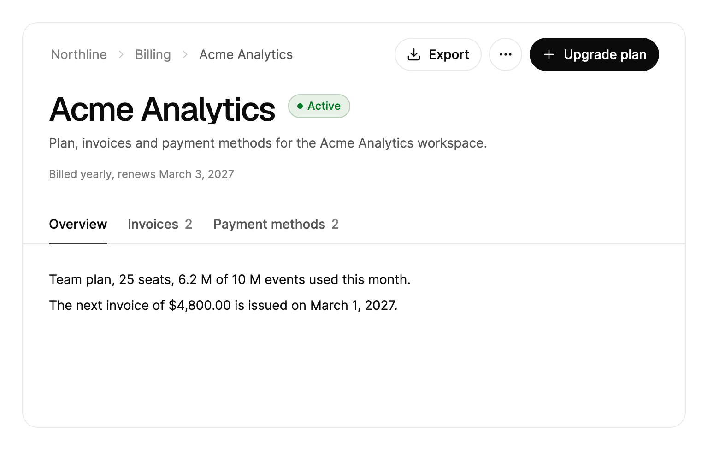

<Demo name="Preview" />

## 何時使用

`PageHeader` 是紀錄或專案頁面的框架：頁首包含頁面路徑、標題、狀態、描述、中繼資料列、操作與標籤頁，位於所選標籤頁可捲動內容的上方。它位於頁面頂部，告訴使用者目前身處哪一筆紀錄、可以對它做什麼，並在內容捲動時保持伸手可及。

- **開發者工具中的專案或儲存庫頁面**：「Checkout service」及其狀態、Share 與 Follow 操作，以及 Overview、Issues（附未關閉項目的數量）和 Deployments 標籤頁。
- **CRM 或內部管理主控台中的客戶紀錄**：「Acme Analytics」以及中繼資料列中的狀態與負責人，並有 Contacts、Opportunities 和 Activity 標籤頁。
- **SaaS 管理後台中的帳單或訂閱頁面**：「Acme Analytics」帶狀態徽章，主要操作為 Upgrade，次要操作為 Export，並有 Invoices（附數量）和 Payment methods 標籤頁。
- **電子商務中的訂單明細頁**：「Order 10482」帶有「Shipped」狀態，Print 操作，以及 Items、Shipments 和 Payments 標籤頁。
- **主體會捲動的長紀錄頁面**：當主體捲動超過 16 像素時，頁首會收合為精簡列，保留標題與狀態在視線範圍內。

## 何時不用

- **在應用程式的各區段之間移動**：用 `Sidebar`。頁首只在一筆紀錄內導覽。
- **在卡片或面板內切換檢視**：用 `Tabs`，它不需要頁面框架。
- **帶有自身標題的對話方塊或設定表單**：使用 `Dialog` 的標題，或一般的標題。
- **只有單一路徑，沒有標籤頁或操作**：只用 `Breadcrumb`，它不會占用頁首的高度。
- **帶有自身工具列的清單或表格**：在 `Table` 上方使用 `FilterToolbar`。頁首的高度由主體決定，因此放在其中的表格可用的空間會比頁面所需的少。

## 用法

`PageHeader` 衍生自 `SelectingItemsControl`。每個標籤頁都是一個 `PageHeaderTab` 項目，因此選取的行為與清單一致：`SelectedIndex`、`SelectedItem` 和 `SelectionChanged` 的表現與清單相同，停用的標籤頁會被略過。每個 `PageHeaderTab` 衍生自 `HeaderedContentControl`：`Header` 是它的標籤文字，`Count` 是選用的數字，`Content` 是它的主體。為頁首設定固定高度，或把它放在一個有高度的列中，使主體可以捲動。

```xml
<arc:PageHeader Title="結帳改版"
                Status="進展正常"
                Description="圍繞已儲存的付款方式重建行動版結帳。"
                Height="480">
    <arc:PageHeaderTab Header="總覽">
        <TextBlock Text="進度、里程碑與近期活動。" />
    </arc:PageHeaderTab>
    <arc:PageHeaderTab Header="問題" Count="9">
        <TextBlock Text="未關閉的問題。" />
    </arc:PageHeaderTab>
</arc:PageHeader>
```

### 結構

1. **框架**：1 px 邊框，表面色背景，圓角 16 px。頁首頂部內距為 16 px，兩側為 28 px（寬度小於 560 px 時兩側為 18 px）。主體頂部與兩側內距為 28 px，底部為 84 px。
2. **首部儲存格**：麵包屑（`Breadcrumbs`），或在頁首收合後顯示的精簡標題（`Title`）。兩者占據相同的位置，並互相取代。
3. **操作列**：次要的 `Actions` 為小按鈕，彼此相距 8 px；「More actions」按鈕（36 px 的方形，帶 17 px 的省略號圖形）；以及 `PrimaryAction`。操作列與首部儲存格保持 16 px 的距離。
4. **標題**（`Title`）：最大的展示字級；寬度小於 560 px 時使用再小一級的字級，與狀態之間相距 14 px。
5. **狀態**（`Status`、`StatusTone`）：帶 6 px 圓點的徽章，顏色取自語氣。精簡列中同樣會顯示它。
6. **描述**（`Description`）：次要文字顏色的內文，約 60 個字元處換行。
7. **中繼資料**（`Meta`）：描述下方的任意內容，使用極小字級的弱化文字。
8. **標籤列**：標籤頁高 44 px，兩側內距 10 px，字重為中等。`Count` 位於標籤文字之後 6 px，其數字會滾動。此列延伸到框架邊緣，因此第一個標籤文字與標題對齊。
9. **指示條**：所選標籤頁下方 2 px 的條，兩側各內縮 10 px。
10. **主體**：所選標籤頁的內容，位於標籤列下方的捲動區域中。

### 標題與標籤頁

頁首只需要標題與標籤頁。沒有麵包屑、狀態或操作時，頁首列會保持空白，直到頁首收合並顯示精簡標題。`Count` 是 `int?`：`null` 會隱藏數字，每次變動時數字都會滾動到新值。

<Demo name="Minimal" />

### 麵包屑、狀態與中繼資料

`Breadcrumbs` 接收通往頁面的路徑，根在前，可以是字串、資料項目或 `BreadcrumbItem`。最後一項是目前頁面，永遠不是連結。選取另一個麵包屑會觸發 `BreadcrumbClick`，其引數包含 `Item` 與 `Index`（0 為根）。`Status` 會在標題旁加入一個帶圓點的徽章，顏色取自 `StatusTone`（預設為 success）。`Meta` 可以接收任意內容，用於描述下方的那一列，例如成員、負責人與日期。

```xml
<arc:PageHeader Title="結帳改版" Status="有風險" StatusTone="Warning">
    <arc:PageHeader.Meta>
        <TextBlock Text="由 Emma Collins 負責" />
    </arc:PageHeader.Meta>
</arc:PageHeader>
```

```csharp
header.Breadcrumbs = new[] { "Northline", "專案", "結帳改版" };
header.BreadcrumbClick += (_, e) => router.Open(e.Index);
```

### 操作

`Actions` 是頁首列中的小型次要按鈕。`MoreActions` 一律位於「More actions」選單中，排在收合的次要操作之後，並以分隔線隔開。`PrimaryAction` 是列尾的一個小型主要按鈕，在 460 像素以下時只顯示圖示。每個 `PageHeaderAction` 都有 `Label`、`Icon`（Lucide 圖形，例如 `ArcIcons.Bell`），以及 `Command` 或 `Click` 事件。`PageHeader.ActionInvoked` 在一處回報所有操作，操作來自選單時 `IsFromMenu` 會設為 true。

對會刪除資料的選單操作（例如刪除或取消）使用 `IsDestructive="True"`。它會以危險色繪製選單列。`IsEnabled="False"` 會停用按鈕並讓其選單列變淡。`IsLoading="True"` 會顯示載入指示器並忽略點擊。`IsVisible="False"` 會隱藏操作：既沒有按鈕也沒有選單列，頁首判斷是否收合時也不計算它的寬度。目前不適用的操作用它隱藏；適用但暫時不能執行的操作用 `IsEnabled`。`Invoke()` 從程式碼執行操作，並遵守這些狀態。

當麵包屑的可用寬度將小於 240 像素時，次要操作會收合到「More actions」選單的頂部。寬度再次達到 272 像素時它們會恢復顯示，因此頁首不會在門檻處閃爍。只監看頁首的寬度，因此變長的標籤（Follow 變為 Following）不會讓你剛按下的按鈕被收合。

<Demo name="FoldingActions" />

修改 `Label` 與 `Icon` 即可原地更新按鈕。當選單列需要不同的文字時，設定 `MenuLabel` 與 `MenuIcon`。

```csharp
follow.Click += (_, _) =>
{
    following = !following;
    follow.Label = following ? "已追蹤" : "追蹤";
    follow.MenuLabel = following ? "取消追蹤" : "追蹤";
};
share.IsLoading = true;
```

### 收合

當主體捲動超過 16 像素時，頁首會收合為包含標題與狀態的精簡列。只有當主體回到距頂部 4 像素以內時，它才會再次展開，因此頁首不會在門檻附近閃爍。`IsCondensed` 表示目前的狀態。選取精簡標題會呼叫 `ScrollToTop()`，它會捲回頂部，並把焦點移到標題上。只有當主體夠長，在頁首變小後仍能保持捲動狀態時，頁首才會收合。

在頁首收合時切換標籤頁，會顯示新標籤頁的頂部，並保持精簡列。`RevealTab(index)` 可以在程式碼中做同樣的事，例如在另一個標籤頁中建立項目之後。對於缺少或被停用的標籤頁，它會回傳 `false`。

### 資料項目

將 `ItemsSource` 繫結到你自己的資料項目。`ItemTemplate` 轉譯標籤文字，`ContentTemplate` 轉譯主體。`SelectedIndex` 與 `SelectedItem` 可以雙向繫結。

<Demo name="DataItems" />

### 窄寬度

版面配置跟隨控制項的寬度，而不是視窗的寬度。寬度低於 560 像素時，內距變小，根麵包屑與精簡徽章隱藏，標題降一級字級，標籤列的遠端邊緣會漸隱。寬度低於 460 像素時，主要操作只顯示圖示。在頁首第一次測量之前，寬度小於 720 像素的頁首會以收合的次要操作開始，因此載入時不會閃爍。

### 僅頁首與精簡尺寸

設定 `IsHeaderOnly="True"` 後，頁首只作為頁面頂端的標題與操作列，頁面內容由你自己配置。標籤頁、頁首下方的分隔線與捲動區都不顯示，控制項只有頁首那麼高，也不會收合。

`Size="Small"` 是用於設定頁與側欄的精簡頁首：標題使用 `TypeXL` 字級而不是 `Type3XL`，上下留白也更小，在任何寬度下都生效。`Medium`（預設）與 `Large` 是完整頁首。

```xml
<arc:PageHeader IsHeaderOnly="True" Size="Small" Title="Notifications"
                Description="Choose what reaches you and where." />
```

### 視窗標題列

在內容延伸到頂端的視窗中（`IsTitleBarVisible="False"` 的 `ArcWindow`），設定 `IsTitleBar="True"` 後頁首就是視窗的標題列。按住並拖曳它的空白部分、標題或說明可以移動視窗，按兩下最大化或還原。麵包屑、精簡標題、操作、中繼資料列與標籤頁仍自己處理點擊，捲動區永遠不屬於標題列。在 Windows 上頁首就是系統標題列，因此按右鍵會開啟系統選單，把視窗拖到螢幕邊緣會貼齊。在頁首末端放置 `WindowCaptionButtons` 提供最小化、最大化與關閉按鈕。`False`（預設）時不做任何改變。

<Demo name="WindowTitleBar" />

預覽中的頁首就是目前視窗的標題列：拖曳它會移動 Gallery 視窗。標題列按鈕是預覽（`IsPreview="True"`），不會影響視窗；在你的應用程式中不要設定 `IsPreview`。

### 繫結到檢視模型

檢視模型擁有所選標籤頁、計數與命令。頁首顯示它們，並回報使用者的選擇。使用 CommunityToolkit.Mvvm 時：

```csharp
public abstract class BillingApi
{
    public abstract Task ExportInvoicesAsync();
}

public partial class BillingPageViewModel : ObservableObject
{
    private readonly BillingApi _api;

    public BillingPageViewModel(BillingApi api)
    {
        _api = api;
        ExportAction = new PageHeaderAction { Label = "匯出", Icon = ArcIcons.Download, Command = ExportCommand };
    }

    public PageHeaderAction ExportAction { get; }

    [ObservableProperty]
    private int _selectedTabIndex;

    public ObservableCollection<string> Invoices { get; } = new();

    [ObservableProperty]
    private int _openInvoiceCount;

    [ObservableProperty]
    private bool _isExporting;

    [RelayCommand]
    private async Task ExportAsync()
    {
        IsExporting = true;
        try
        {
            await _api.ExportInvoicesAsync();
        }
        finally
        {
            IsExporting = false;
        }
    }
}
```

```xml
<arc:PageHeader Title="Acme Analytics"
                Status="使用中"
                StatusTone="Success"
                SelectedIndex="{Binding SelectedTabIndex, Mode=TwoWay}">
    <arc:PageHeaderTab Header="發票" Count="{Binding OpenInvoiceCount}">
        <ItemsControl ItemsSource="{Binding Invoices}" />
    </arc:PageHeaderTab>
</arc:PageHeader>
```

- `SelectedIndex` 是雙向的，因此檢視模型可以把頁首切換到某個標籤頁，使用者切換標籤頁時也會更新該屬性。
- `Count` 接收繫結，檢視模型變更其值時，數字會滾動。
- `PageHeaderAction` 不是視覺元素，因此它的 `Command` 需要在程式碼中設定，如上所示。它的 `IsLoading` 同樣由檢視模型設定（在 `PropertyChanged` 處理常式中執行 `ExportAction.IsLoading = vm.IsExporting`），之後按鈕會顯示載入指示器並忽略點擊。
- 對於可能無法使用的操作，例如已經套用的升級，請在命令上使用 `CanExecute`。選單列與按鈕會跟隨命令的狀態。

### 決定頁首放什麼

頁首的空間有限，因此每個位置只放一類內容：

| 位置 | 放入 | 避免放入 |
|---|---|---|
| `Title` 與 `Status` | 紀錄名稱，以及一個狀態詞，例如「使用中」或「有風險」 | 句子、計數、日期 |
| `Description` | 關於紀錄的一兩句話 | 頁面的操作說明 |
| `Meta` | 負責人、成員、日期與少量事實 | 操作與表單控制項 |
| `Actions` | 兩到三個常用操作 | 破壞性操作 |
| `MoreActions` | 偶爾使用的操作與破壞性操作，例如取消或刪除 | 最常用的操作 |
| `PrimaryAction` | 推動紀錄前進的那一個操作 | 多於一個操作 |

### 範例：帳單帳戶頁面

一個 SaaS 工作區的帳單頁面，標題中包含帳戶名稱與狀態，中繼資料列中是方案詳細資訊，並有兩個次要操作。主要操作是「升級方案」，而具破壞性的取消操作放在選單中，以免被誤按。標籤頁涵蓋帳戶的總覽、附未關閉發票數量的發票，以及付款方式。健康狀態的徽章使用 success 語氣。



```xml
<UserControl xmlns="https://github.com/avaloniaui"
             xmlns:x="http://schemas.microsoft.com/winfx/2006/xaml"
             xmlns:arc="https://github.com/AIDotNet/TKCode.Arc"
             xmlns:generic="using:System.Collections.Generic"
             Width="720">
    <arc:PageHeader Height="440"
                    Title="Acme Analytics"
                    Status="Active"
                    StatusTone="Success"
                    Description="Plan, invoices and payment methods for the Acme Analytics workspace."
                    TabsLabel="Billing sections">
        <arc:PageHeader.Breadcrumbs>
            <generic:List x:TypeArguments="x:String">
                <x:String>Northline</x:String>
                <x:String>Billing</x:String>
                <x:String>Acme Analytics</x:String>
            </generic:List>
        </arc:PageHeader.Breadcrumbs>
        <arc:PageHeader.Meta>
            <TextBlock Text="Billed yearly, renews March 3, 2027" />
        </arc:PageHeader.Meta>
        <arc:PageHeader.Actions>
            <arc:PageHeaderAction Label="Export" Icon="{x:Static arc:ArcIcons.Download}" />
        </arc:PageHeader.Actions>
        <arc:PageHeader.MoreActions>
            <arc:PageHeaderAction Label="Copy workspace ID" Icon="{x:Static arc:ArcIcons.Link2}" />
            <arc:PageHeaderAction Label="Cancel subscription"
                                  Icon="{x:Static arc:ArcIcons.Trash2}"
                                  IsDestructive="True" />
        </arc:PageHeader.MoreActions>
        <arc:PageHeader.PrimaryAction>
            <arc:PageHeaderAction Label="Upgrade plan" Icon="{x:Static arc:ArcIcons.Plus}" />
        </arc:PageHeader.PrimaryAction>
        <arc:PageHeaderTab Header="Overview">
            <StackPanel Spacing="8">
                <TextBlock Text="Team plan, 25 seats, 6.2 M of 10 M events used this month." TextWrapping="Wrap" />
                <TextBlock Text="The next invoice of $4,800.00 is issued on March 1, 2027." TextWrapping="Wrap" />
            </StackPanel>
        </arc:PageHeaderTab>
        <arc:PageHeaderTab Header="Invoices" Count="2">
            <StackPanel Spacing="8">
                <TextBlock Text="inv_2026_0412   Open   $4,800.00   Oct 1, 2026" />
                <TextBlock Text="inv_2026_0311   Paid   $4,800.00   Sep 1, 2026" />
            </StackPanel>
        </arc:PageHeaderTab>
        <arc:PageHeaderTab Header="Payment methods" Count="2">
            <TextBlock Text="Visa ending in 4242 is the default card." TextWrapping="Wrap" />
        </arc:PageHeaderTab>
    </arc:PageHeader>
</UserControl>
```

### 文案規範

- **標題**：紀錄的名稱，即使用者搜尋時使用的名字：「Acme Analytics」「Order 10482」。避免使用「Page:」之類的前綴。
- **狀態**：一到兩個詞，描述狀態而不是整句：「使用中」「有風險」「已出貨」。選擇與狀態相符的語氣，並且只為需要注意的狀態使用 Warning 和 Danger。
- **描述**：一到兩句話，說明這筆紀錄的用途。使用句首大寫的句子式寫法，並以句號結尾。
- **標籤頁名稱**：句首大寫的名詞，例如「發票」或「付款方式」。計數只能是數字。
- **操作**：句首大寫的動詞加對象，例如「匯出發票」「升級方案」。把罕用或具破壞性的操作放入選單，並說明它們會刪除什麼。

| 不要寫 | 改為 |
|---|---|
| 頁面：帳單設定 | Acme Analytics |
| 狀態：此紀錄目前狀況良好 | 使用中 |
| 匯出 | 匯出發票 |
| 全部刪除 | 取消訂閱 |
| 發票（2 張未付！） | 發票，並顯示未關閉發票的數量 |

### 最佳做法

**建議**

- 頁首高度保持固定，或為它設定一個有高度的列。主體在其中捲動，收合邏輯依賴這個高度來判斷頁首能否收合。
- 把破壞性操作放入 `MoreActions`。選單多一步操作，因此取消操作不會與常用操作只隔一次點擊。
- 當檢視模型需要了解或變更標籤頁時，把 `SelectedIndex` 設為雙向繫結，使深層連結可以開啟某個標籤頁。
- 在另一個標籤頁中建立項目後，使用 `RevealTab(index)`。這樣新項目可見，而頁首不會離開精簡狀態。
- 為每個操作設定簡短的 `Label`。在寬頁首中它是按鈕文字；在 460 像素以下、主要操作只顯示圖示時，它是無障礙名稱。

**避免**

- 在 `Meta` 中放置表單控制項。中繼資料列是極小字級的弱化文字，在那裡的輸入框既不易閱讀，也不便於用鍵盤操作。
- 每次切換標籤頁都呼叫 `ScrollToTop()`。它會把焦點移到標題上，使使用者正在使用的內容失去焦點。
- 同時為多個操作設定 `IsLoading`。一個載入指示器說明正在載入什麼；多個指示器則會讓人以為頁面卡住了。
- 為每個標籤頁都顯示計數。計數告訴使用者有多少項目在等待處理；在只顯示文件的標籤頁上，它只是雜訊。
- 把頁首做得太高，以致主體無法捲過收合後的可視區域。主體較短時會保留完整頁首，因此頁面不會收合，標題也保持較大。

### 常見問題

**為什麼我的次要操作被移入「More actions」選單？** 當麵包屑的可用寬度將小於 240 像素時，頁首會收合它們；寬度達到 272 像素時再恢復。縮短麵包屑的標籤，把最少使用的操作移入 `MoreActions`，或加寬頁首。`AreActionsFolded` 表示目前的狀態。

**為什麼捲動時頁首不收合？** 只有當主體夠高，在頁首變小後仍能保持捲過展開線時，頁首才會收合。主體較短時會保留完整頁首，因此頁面不會跳動。請為主體放入比收合後可視區域更高的內容，或保持頁首展開。

**如何從連結開啟特定的標籤頁？** 將 `SelectedIndex` 設為標籤頁的索引；如果頁首已經收合，並且主體應從新標籤頁的頂部開始，則呼叫 `RevealTab(index)`。當索引缺少或標籤頁被停用時，`RevealTab` 會回傳 `false`。

**可以用方向鍵選取停用的標籤頁嗎？** 不可以。方向鍵以及 Home、End 都會略過停用的標籤頁，因此選取會移到下一個啟用的標籤頁。

**切換標籤頁時頁首會保留精簡標題嗎？** 會。頁首收合時切換標籤頁，會顯示新標籤頁的頂部並保持精簡列。選擇標籤頁不會展開頁首。

## API 參考

<!-- api: PageHeader -->

<!-- api: PageHeaderTab -->

<!-- api: PageHeaderAction -->

## 無障礙

- 該控制項是一個以 `Title` 命名的區域。標題是二級標題。
- 麵包屑是導覽地標。目前頁面會被標示，且不是連結。
- 標籤列以 `TabsLabel` 命名。左右方向鍵在標籤頁之間移動並選取它們，並在兩端循環。Home 與 End 分別移到第一個與最後一個標籤頁。只有所選標籤頁在 Tab 順序中。
- 溢位按鈕以 `MoreActionsLabel` 命名。選單支援方向鍵、Home、End、輸入字元跳轉、Enter，以及 Escape 關閉選單並把焦點返回按鈕。
- 精簡標題的名稱為「Title, back to top」（`BackToTopLabel`）。頁首中被隱藏的部分會離開 Tab 順序，並忽略指標。
- 在 460 像素以下，主要按鈕保留其文字作為無障礙名稱。

### 鍵盤

| 按鍵 | 操作 |
|---|---|
| 標籤頁上的 `Left` / `Right` | 選取上一個或下一個啟用的標籤頁；在兩端循環 |
| 標籤頁上的 `Home` / `End` | 選取第一個或最後一個啟用的標籤頁 |
| `Tab` / `Shift+Tab` | 進入或離開標籤列；只有所選標籤頁是停留點 |
| 「More actions」上的 `Enter` | 開啟選單；方向鍵在各列之間移動 |
| 選單中的 `Escape` | 關閉選單，並把焦點返回其按鈕 |
| 麵包屑上的 `Enter` | 以該項目及其索引觸發 `BreadcrumbClick` |
| 精簡標題上的 `Enter` | 捲動到頂部，並把焦點移到標題 |

## 動態效果

- 收合：開場部分在平滑彈簧上收起高度。標題向左上角縮小至 62%，並伴隨輕微模糊淡出。麵包屑向上移開，精簡標題從柔和的模糊中升起。
- 操作收合：次要操作在平滑彈簧上收起寬度並淡出。只在右邊緣裁切，因此它們收合到溢位按鈕之下。
- 標籤頁：指示條在變形彈簧上於標籤頁之間滑動。計數逐位滾動。新的主體從移動方向一側滑入 12 像素，舊的主體淡出。
- 減少動態效果只保留淡入淡出。高度與寬度立即變化，主體交叉淡化。關閉動態效果時，所有變化立即完成。

| 變化 | 完整 | 減少 | 關閉 |
|---|---|---|---|
| 頁首收合或展開 | 開場部分在平滑彈簧上收起；標題縮小並淡出 | 高度立即變化；標題與麵包屑淡出 | 立即完成 |
| 精簡標題出現 | 從柔和的模糊中升起 | 淡入 | 立即完成 |
| 次要操作收合 | 寬度在平滑彈簧上收起，在右邊緣裁切 | 寬度立即變化 | 立即完成 |
| 標籤頁切換 | 主體從移動方向一側滑入 12 px；舊主體淡出 | 主體交叉淡化 | 立即完成 |

## 響應式

- `PageHeader` 依自身寬度變化，不隨視窗寬度。寬度低於 560 px（`:narrow`）時內距變小，根層麵包屑與緊湊徽章隱藏，標題字級降一級，標籤列的遠端邊緣漸隱。寬度低於 460 px（`:tight`）時主要操作只顯示圖示。
- 麵包屑只剩不足 240 px 時，次要操作收入「更多操作」選單（`:actions-folded`），寬度回到 272 px 時再展開。測量前，寬度小於 PreMeasureFoldWidth（720 px）的標頭會以收合的操作開始顯示。
- 標籤列水平捲動，捲軸隱藏，因此較長的標籤列也能透過觸控到達。
- 收合的操作仍在「更多操作」選單中，輕觸一次即可找到，窄寬度下不會遺失任何操作。
- 讓標頭橫跨頁面寬度（`HorizontalAlignment="Stretch"`），高度保持固定，或放在高度確定的一列中。內文捲動超過 16 px 後標頭會收縮（`:condensed`），為內文保留捲動空間。

## 相關元件

- `Breadcrumb` 用於單獨的路徑。
- `Tabs` 用於卡片或面板內的檢視。
- `Badge` 用於狀態標籤。
- `DropdownMenu` 用於操作選單。

| 元件 | 適用情境 |
|---|---|
| `Sidebar` | 使用者在整個應用程式的各區段之間移動 |
| `Tabs` | 檢視位於卡片或面板內，沒有頁面框架 |
| `Breadcrumb` | 只需要路徑，沒有標籤頁或操作 |
| `Dialog` | 標題與操作屬於打斷頁面的工作 |
| `FilterToolbar` | 表格或清單需要在列上方設定自己的篩選器 |
| `DropdownMenu` | 操作選單從頁面其他位置的按鈕中彈出 |
