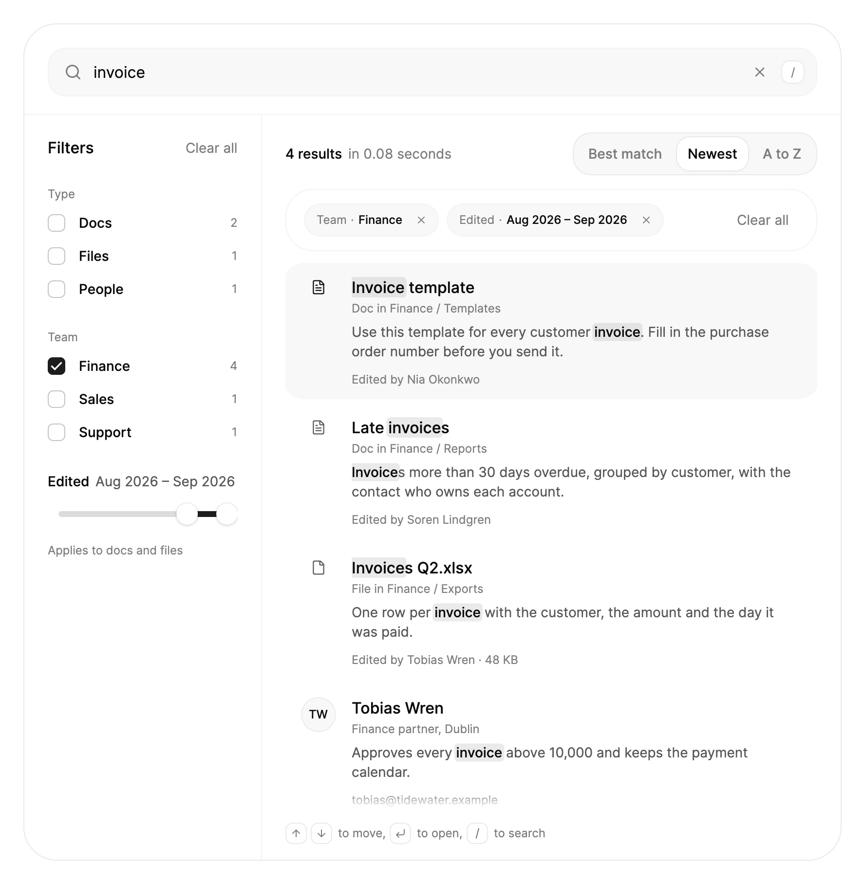

<Demo name="Preview" />

## 何时使用

`SearchResults` 是工作区的搜索页面：一个大型搜索框，带有最近搜索与建议搜索的弹层；一列数量随查询变化的筛选器；一个显示结果数量并带有排序开关的标题；以及一个把人员和文档放在一起、并标出匹配词语的结果列表。它占满应用的主内容区，针对可能跨越多种数据类型的查询回答一个问题：哪些内容匹配、属于哪一类、位于何处。选中某条结果会打开详情，无需离开页面。

- **帮助中心或知识库**，文章、操作指南与发布说明并列放置。客户输入“退款”时，可以勾选符合问题的类型，每个值旁边的数量会在点击之前就显示答案位于何处。
- **索引了文档、文件和人员的项目工作区。** “团队”筛选器可以把“onboarding”缩小到某一个小组，日期范围会隐藏今年没人动过的内容，每条结果都会说明自己所在的位置（“Doc in Support / Onboarding”），便于选中正确的条目。
- **在服务端搜索工单和宏的支持控制台。** 将 `IsFilteringEnabled` 设为 false，显示服务端给出的顺序与数量，同时保留控件已经绘制的高亮、筛选标签与详情。
- **搜索事件、运行手册和仪表板的运维工具。** 值班工程师按下 `/`，输入服务名称，按 ArrowDown，再按 Enter 打开运行手册，全程不必离开键盘。
- **搜索发票、客户和导出文件的财务后台。** 结果会附带匹配处前后的一段文字、最后编辑日期，在详情中还有负责人和大小，让人能够分辨两张相似的发票。

## 何时不用

- **在应用任意位置跳转到页面或执行操作。** 用 `CommandPalette`，它覆盖整个窗口，把命令与页面并列列出。
- **页头或工具栏中的紧凑搜索。** 用 `ExpandingSearch`，它平时只是一个图标，打开之前不占用页面空间。
- **筛选页面上已有的列表。** 在列表上方使用 `SearchField`，并在代码中筛选列表。几十行的列表不需要筛选器、数量或详情。
- **从短小的已知列表中选择一个值**，例如状态或国家。用 `Select` 或 `Combobox`；只有五个选项时，带筛选器的搜索页面就太重了。
- **按列排序和筛选地浏览记录。** 用 `SortableDataTable` 配合 `FilterToolbar`。`SearchResults` 中的结果是用来阅读和打开的，而不是跨列比较的。

## 用法

为控件设置项目，并在左侧栏放入需要的筛选器。查询中的每个词都必须与某个项目的标题、副标题、摘录、注脚、位置、正文或某个关键字相符。匹配、筛选、计数和排序都由控件自己完成，除非你关闭这些功能，交由服务端处理。

```xml
<UserControl xmlns="https://github.com/avaloniaui"
             xmlns:x="http://schemas.microsoft.com/winfx/2006/xaml"
             xmlns:arc="https://github.com/AtomUICommunity/TKCode.Arc">
    <arc:SearchResults Height="640" Query="发票" Label="搜索财务资料">
        <arc:SearchResults.Filters>
            <arc:SearchValueFilter Key="kind" Title="类型" />
            <arc:SearchValueFilter Key="team" Title="团队" />
            <arc:SearchDateFilter Key="edited" Title="编辑时间" AppliesTo="Docs, Files" />
        </arc:SearchResults.Filters>
        <arc:SearchResultItem Title="发票模板"
                              Kind="Docs"
                              KindLabel="文档"
                              Location="财务 / 模板"
                              Snippet="每一份客户发票都使用此模板。"
                              Icon="{x:Static arc:ArcIcons.FileText}" />
    </arc:SearchResults>
</UserControl>
```

`SearchResults` 派生自 Avalonia 的 `TemplatedControl`，因此可以使用常规的样式与主题资源。它由 Arc 的各个部件组成：自己的搜索框（经过样式化的 `TextBox`）、`Checkbox` 行、用于日期范围的双滑块手柄 `Slider`、用于排序方式的 `SegmentedControl`、用于人员的 `Avatar`、无结果时的 `EmptyState`、加载时的 `Skeleton`，以及列表的 `ScrollArea`。每条结果都是一个 `SearchResultItem`，它是 `AvaloniaObject`，其属性可以像其他对象一样绑定。控件会设置 `:narrow`、`:loading`、`:empty`、`:no-filters` 和 `:filtered` 这几个伪类，供样式使用。

### 结构

1. **搜索框**（`Label`、`PlaceholderText`、`ShortcutText`）：高 50 px，圆角 18 px，包含放大镜、文字、输入第一个字符后出现的 24 px 清除按钮，以及一个 24 px 的键帽，显示用于聚焦搜索框的按键（默认为“/”，搜索框获得焦点时隐藏）。填充为弱化色并带淡边框；悬停和聚焦时使用强调边框。
2. **建议弹层**（`Recent`、`Suggestions`、`RecentLabel`、`SuggestedLabel`）：在获得焦点的搜索框下方打开，宽度与搜索框相同，与搜索框相距 8 px。分为两组：带时钟图标的“Recent”和带放大镜图标的“Suggested”，行高 40 px，圆角 14 px。与查询相同的那一行会显示回车键图标。
3. **筛选器栏**（`Filters`、`FiltersTitle`、`ClearAllText`）：宽 244 px，带分隔线。顶部是标题和一个“Clear all”链接，有筛选器起作用时才淡入；其后每个筛选器一组：34 px 高的复选框行，数量右对齐，以及带两个滑块手柄和说明文字的日期范围。没有筛选器时这一栏不存在，结果占满整个宽度。
4. **结果标题**（`ResultsFormat`、`OneResultFormat`、`ElapsedFormat`、`SortOrder`）：中等字重的数量（滚动数字）、弱化颜色的耗时，以及右侧的排序开关（“Best match”“Newest”“A to Z”）。
5. **已启用筛选栏**（`RemoveFilterText`、`ClearAllText`）：位于标题下方的圆角栏，以高度动画展开和收起。每个勾选的值和收窄的范围都是一个 34 px 高的胶囊形标签，例如带叉号的“Type · People”，末尾是“Clear all”。
6. **结果行**（`SearchResultItem`）：36 px 的前导列（人员为圆形 `Avatar`，其他为 20 px 的描边图标）、中等字重的标题、极小号弱化颜色的副标题、最多两行的次要文字颜色摘录，以及弱化颜色的注脚。行的左右内边距为 20 px，圆角 24 px，行与行之间相距 4 px。
7. **光标**：位于当前结果行之后的一块高亮区域，可由键盘或指针移动。建议弹层中有自己的同类光标。
8. **按键提示**（`IsHintsVisible`、`HintMoveText`、`HintOpenText`、`HintSearchText`）：结果下方的小型键帽，“↑ ↓ to move, ↵ to open, / to search”，有结果列出时才显示。
9. **详情**（`OpenedItem`、`DetailTemplate`）：宽屏上是对话框，窄屏上是底部面板，包含类型、圆形关闭按钮、标题、副标题、正文、事实表格和两个按钮。
10. **空状态与骨架行**：居中的 `EmptyState`，带搜索图标；加载时则是三行骨架行。

外框带有 1 px 边框和表面圆角。搜索框所在的行内边距为 24 px（窄屏时为 16 px），其下有一条 1 px 的分隔线。宽度小于 560 px 时应用窄屏布局。

### 项目

直接内联添加 `SearchResultItem` 对象，或将 `ItemsSource` 设为一个列表。`ItemsSource` 为 null 时使用内联的 `Items` 集合。列表为可观察集合时，结果会随其变化而更新。一条结果由下列属性组成：

- `Id` 是项目的稳定键，例如记录自身的标识符。为空时改用标题。
- `Title` 是结果的名称。匹配处会被标出，它还决定排序。
- `Subtitle` 是标题下方的一行，例如人员的职位和城市。没有它时，行会写成“`KindLabel` in `Location`”（格式为 `KindLocationFormat`），或者只写位置。
- `Snippet` 是内容中的一段文字。过长的文字会被裁剪为围绕第一个匹配处的一个窗口。
- `Caption` 是摘录下方的最后一行弱化文字，例如邮箱地址。
- `Kind` 是结果的类型（“Docs”“People”“Files”）：键为 `kind` 的筛选器读取的值。`KindLabel` 是它的单数名称（“Doc”），用于副标题和详情；为空时回退到 `Kind`。
- `Location` 是路径或面包屑，例如“Engineering / Handbook”，同样会被搜索。
- `Icon` 接受 24 × 24 的 Lucide 图形或任意控件。未设置图标时，结果使用 FileText 图标。设置了 `AvatarName`（首字母）或 `Avatar`（照片）的人员会改为显示圆形头像。
- `Keywords` 是额外的词语，同样能找到该项目，例如同义词、工单编号和标签。关键字参与搜索，但不显示。
- `Date` 是项目最后一次编辑的时间。它决定“Newest”的排序，并为日期范围提供数据。
- `Attributes` 保存其他筛选器读取的值，以筛选器的键为索引（`["team"] = "Design"`）。
- `Body`、`Url` 和 `Details` 用来填充详情：正文段落、“Copy link”所复制的地址，以及事实表格中的各行。
- `IsEnabled` 设为 false 时，项目以淡化样式列出。键盘光标会跳过它，且无法打开。
- `Tag` 是打开项目时希望取回的任意值。

```csharp
search.ItemsSource = new ObservableCollection<SearchResultItem>
{
    new()
    {
        Id = "q3",
        Title = "Q3 规划笔记",
        Kind = "Docs",
        KindLabel = "文档",
        Location = "产品 / 规划",
        Snippet = excerpt,
        Body = fullText,
        Date = new DateTimeOffset(2026, 9, 14, 9, 0, 0, TimeSpan.Zero),
        Url = "https://example.com/docs/q3",
        Attributes = { ["team"] = "产品" },
        Details = { new SearchResultDetail { Label = "作者", Value = "Maya Lindqvist", AvatarName = "Maya Lindqvist" } }
    },
    new()
    {
        Id = "maya",
        Title = "Maya Lindqvist",
        Kind = "People",
        KindLabel = "成员",
        Subtitle = "产品负责人，斯德哥尔摩",
        Caption = "maya@example.com",
        AvatarName = "Maya Lindqvist",
        Attributes = { ["team"] = "产品" }
    }
};
```

如果你原地修改了某个项目，请调用 `Refresh()`，让搜索和数量重新计算。从可观察集合中添加或删除项目则无需调用，对 `Filters` 列表、筛选器的值，以及筛选器的 `Key` 和日期范围所做的修改也无需调用。

### 匹配、排序与高亮

查询会按空白字符拆分为互不相同的词语。只要每个词都出现在项目的标题、副标题、摘录、注脚、位置、正文或某个关键字中，该项目即为匹配。同一个词可以出现在不同字段中。比较时忽略大小写，但不会折叠重音符号：“resume”找不到“résumé”。空查询会列出全部项目。`Details` 的各行只用于显示，`Attributes` 只为筛选器提供数据，二者都不参与搜索。

排序只使用查询的第一个词，并且只作用于“Best match”。在同一排名内，结果保持其原始顺序。

| 排名 | 第一个词出现在 | 以 "release" 为例 |
|---|---|---|
| 1 | 标题的开头 | "Release checklist" |
| 2 | 标题中某个词的开头 | "Q3 release notes" |
| 3 | 标题某个词的内部 | "Prerelease audit" |
| 4 | 仅出现在副标题、摘录、注脚、位置、正文或关键字中 | "Sync design: the release queue" |

标题、副标题、注脚和摘录中每个词的每一次出现都会被标出：强调色淡底、主要文字颜色和中等字重。重叠的标记会合并。

长摘录会围绕第一个匹配处裁剪：若匹配处位于前几行之内，则从开头开始；否则从匹配处之前约 36 个字符处开始，并对齐到词的起点。摘录最多 220 个字符、两行，被裁切的一端会显示省略号。只有 `Body` 包含这些词时，行内会用正文中的一段代替摘录，因此每条结果都能显示它匹配的原因。

### 筛选器

`Filters` 是左侧栏的筛选器集合，`SearchFilter` 是它们的基类。`SearchValueFilter` 是针对某个属性的一组复选框。它的 `Key` 为 `kind` 时读取 `SearchResultItem.Kind`，否则读取 `SearchResultItem.Attributes` 中同名的条目。`Values` 留空时，筛选器会按首次出现的顺序列出它在各项目中找到的值（之后的新项目带来的新值会继续追加）；也可以自己把它们列成 `SearchFilterValue` 对象，以固定顺序和标签。同一个筛选器中勾选的多个值按“或”组合，不同筛选器之间按“与”组合。

每个值都会显示在当前查询下它会带来多少条结果。该数量不计入该筛选器自身的勾选（与分面搜索一致），因此勾选“Docs”不会让“Files”变成 0。数量会在输入时跟随查询和其他筛选器变化。没有结果的值保留在原位、颜色变淡，且不能勾选（已经勾选的值除外，这样它还能被取消）。

`SearchDateFilter` 是针对 `SearchResultItem.Date` 的双滑块手柄范围滑块。范围从它所适用的项目中最早的日期延伸到最晚的日期；设置了 `Minimum` 和 `Maximum` 时则以它们为准。`Start` 和 `End` 是选定的两端（null 表示范围的那一端，把滑块手柄移回端点会再次置为 null）。`AppliesTo` 以逗号分隔的列表指明它适用的类型；其他类型的项目直接通过，因此针对文档的范围不会隐藏人员，滑块下方的说明文字也会这样写（“Applies to docs and files”）。范围被收窄时，适用类型中没有日期的项目会被隐藏。日期筛选器始终读取 `Date`，它的 `Key` 只是用来命名。

<Demo name="Filters" />

勾选的值和收窄的范围会作为筛选标签出现在结果标题下方的栏里。标签上的叉号移除对应的筛选，栏中和左侧栏中的“Clear all”则移除全部。在代码中可以读写值的 `IsSelected` 和日期筛选器的 `Start`、`End`，调用 `ClearFilters()`，并读取 `HasActiveFilters` 和 `ActiveFilterCount`。控件最多读取 64 个筛选器。

### 排序与结果标题

标题行显示结果数量、搜索耗时和排序开关。`SortOrder` 为双向：最佳匹配、最新（`SearchResultItem.Date`，没有日期的排在最后）或 A 到 Z（按标题，使用当前区域设置）。控件无法测量耗时，请在搜索完成时设置 `Elapsed`；保持为 null 则只显示数量。两个数字都会滚动到新的值。没有任何匹配时，标题改为显示 `NoResultsText`。

### 建议与最近搜索

聚焦搜索框会在其下方弹出一个弹层，列出最近搜索和你提供的 `Suggestions`（最多六条，且不重复已在“Recent”中的条目）。每当提交一个查询（按 Enter、选择一条建议或点击“Try”标签），或带着该查询打开一条结果，控件都会把它加入 `Recent`，新的在前，并去除重复。`MaxRecent` 限制该列表的长度。请在页面显示前预置 `Recent`，并通过它的 `CollectionChanged` 事件保存；它是一个 `AvaloniaList<string>`，不是可绑定的属性。

方向键在各行之间移动，Enter 运行高亮的一行或按原样输入的文字，Escape 关闭弹层，点击一行会填入搜索框并提交。一旦编辑了文字，弹层只列出包含该文字的条目，没有条目时会自行关闭。`QuerySubmitted` 会通知你每一个提交的查询。若希望搜索框永远不打开弹层，请将 `IsSuggestionsEnabled` 设为 false。

<Demo name="Suggestions" />

### 绑定到视图模型

视图模型持有查询、排序方式、项目和打开命令。控件则持有光标、筛选器的勾选状态与布局。

```csharp
public partial class WorkspaceSearchViewModel : ObservableObject
{
    private readonly INavigationService _navigation;

    public WorkspaceSearchViewModel(INavigationService navigation)
    {
        _navigation = navigation;
    }

    [ObservableProperty]
    private string _query = string.Empty;

    [ObservableProperty]
    private SearchSortOrder _sort = SearchSortOrder.BestMatch;

    [ObservableProperty]
    private TimeSpan? _elapsed;

    public ObservableCollection<SearchResultItem> Results { get; } = [];

    [RelayCommand]
    private void Open(SearchResultItem? item) => _navigation.Navigate(item?.Tag);
}
```

```xml
<arc:SearchResults Label="搜索工作区"
                   ItemsSource="{Binding Results}"
                   Query="{Binding Query}"
                   SortOrder="{Binding Sort}"
                   Elapsed="{Binding Elapsed}"
                   IsDetailEnabled="False"
                   InvokeCommand="{Binding OpenCommand}" />
```

- `Query` 与 `SortOrder` 是双向的，因此输入会更新视图模型，链接也可以在打开页面时就填好查询。
- `ItemsSource` 与 `Elapsed` 是单向的。请将 `Results` 保持为 `ObservableCollection`，并原地修改它。
- `InvokeCommand` 以被打开的项目作为参数执行，控件会先检查 `CanExecute`。这个视图模型自己负责导航，所以示例关闭了内置详情；如果希望视图模型知道哪个详情处于打开状态，请保留内置详情并绑定双向的 `OpenedItem`。
- `Filters` 与 `Recent` 是由你填充和读取的集合，不是用来绑定的属性。

### 打开结果

在结果上按 Enter 或点击会以该项目触发 `ItemInvoked`，以同一项目执行 `InvokeCommand`，然后打开内置详情。`ActiveItem` 是键盘光标所在的结果，在你移动它之前就是第一条可用的结果，因此状态行可以说明按 Enter 会打开什么。`IsEnabled` 为 false 的结果会变淡，光标会跳过它，也无法打开。如果你的应用自己负责导航而不是显示详情，请将 `IsDetailEnabled` 设为 false，或在事件上设置 `Handled`。

```csharp
search.ItemInvoked += (_, e) =>
{
    Navigate(e.Item.Id);
    e.Handled = true; // 跳过内置详情
};
```

详情在宽屏上是对话框，在窄屏上是带拖柄的底部面板。它依次显示结果的类型和圆形关闭按钮、带高亮的标题、副标题、`Body` 的各段（以空行分隔；没有正文时显示摘录）、由第一行“Matches”（查询在标题和正文中被标出的次数）与该项目 `Details` 组成的表格，以及两个按钮。“Open”（`OpenFormat`，其中的类型名称为小写）和“Copy link”会触发 `DetailActionInvoked`；“Copy link”还会把 `Url` 放到剪贴板。按 Escape、点击关闭按钮或点击变暗的页面都会关闭它，焦点随后回到原处。

`OpenedItem` 为双向：设置它或调用 `ShowDetail(item)` 即可在代码中打开详情，`CloseDetail()` 则关闭详情。`DetailTemplate` 可替换标题与按钮之间的内容，其数据是该 `SearchResultItem`。

<Demo name="Detail" />

```csharp
search.DetailActionInvoked += (_, e) =>
{
    if (e.Action == SearchResultAction.Open)
    {
        Navigate(e.Item.Id);
        search.CloseDetail();
    }
};
```

### 服务端搜索

由服务端搜索时，请将 `IsFilteringEnabled` 设为 false。此时各项按你给出的顺序显示，筛选值上的数量由你设置，查询中的词仍会被标出。查询、某个筛选器或排序方式发生变化、需要重新请求时，会触发 `SearchChanged`，其 `Reason` 为 `Query`、`Filters` 或 `Sort`。请求进行期间设置 `IsLoading`：骨架行会取代结果的位置并保持之前结果的高度，因此页面不会跳动，数量行显示“Searching…”，光标和按键提示则会消失。在调用服务端之前对查询做防抖处理，并取消被更新的击键所取代的请求。没有防抖时，每次击键都会发起一个请求，结果会闪烁。

<Demo name="ServerSearch" />

### 无结果

没有任何匹配时，空状态会在标题中显示查询（`EmptyTitleFormat`，其中 `{0}` 为查询词），并在描述中显示 `EmptyDescription`。数量行显示 `NoResultsText`。查询为空且没有任何项目时，标题同样使用 `NoResultsText`。

如果有筛选器处于启用状态，描述会变为 `EmptyFilteredDescription`，即“The filters leave nothing. Remove one to see more.”，并提供一个“Clear filters”按钮（`ClearFiltersText`）来移除它们。`Suggestions` 会以按钮的形式列在 `TryText`（默认为“Try”）之后，供用户尝试。选择其中一个会填入搜索框并执行搜索。

<Demo name="NoResults" />

### 窄屏布局

宽度小于 560 像素时，搜索框所在行的内边距从 24 像素收紧为 16 像素，筛选器栏折叠为一个带有已启用筛选数量的“Filters”按钮，点击后在底部面板中打开同样的筛选器（在代码中调用 `OpenFiltersSheet()` 效果相同）。排序开关移到数量下方，详情变为底部面板，高度不超过窗口的 92%。完全没有筛选器时，窄屏布局会让排序开关保持在右侧。控件重新变宽时，筛选器面板会自动关闭。

<Demo name="Narrow" />

### 长列表

只会构建前 `PageSize` 条结果（默认 15 条）。滚动到距列表末尾 240 像素以内、按“Show more”（`ShowMoreText`），或在最后一条已列出的结果上按 ArrowDown 或 PageDown 时，再加载后面的结果。新的查询、筛选或排序方式会从顶部重新开始。

有上千条数据时输入依然流畅。只增长的查询只在上一次的匹配结果中搜索，而不是遍历每个项目；勾选筛选器不会再次搜索文字；数量与筛选在同一次遍历中完成；保留下来的行是同一批控件，因此每次击键只重新排版变化的部分。在开发用笔记本电脑上，搜索并筛选 5000 个项目只需一两毫秒，每次击键的大部分开销在于重新排版发生变化的行。

### 文案

每段文字都有英文默认值和可修改它的属性。格式中用 `{0}` 表示数量、秒数、查询词或类型，需要第二个值时用 `{1}`。

| 属性 | 默认值 | 用途 |
|---|---|---|
| `Label` | "Search" | 地标与搜索框的名称 |
| `PlaceholderText` | "Search" | 空搜索框中的提示 |
| `ShortcutText` | "/" | 搜索框键帽和按键提示中的按键 |
| `FiltersTitle` | "Filters" | 筛选器栏和面板的标题 |
| `ClearAllText` | "Clear all" | 移除全部筛选的链接 |
| `ClearFiltersText` | "Clear filters" | 空状态中移除筛选的按钮 |
| `ResultsFormat` | "{0} results" | 多条结果时的数量 |
| `OneResultFormat` | "{0} result" | 一条结果时的数量 |
| `NoResultsText` | "No results" | 没有匹配时的数量，以及没有查询时的空状态标题 |
| `LoadingText` | "Searching…" | `IsLoading` 为 true 时的数量行 |
| `ElapsedFormat` | "in {0} seconds" | 数量之后的耗时；`{0}` 为秒数 |
| `BestMatchText` | "Best match" | 第一个排序选项 |
| `NewestText` | "Newest" | 第二个排序选项 |
| `TitleSortText` | "A to Z" | 第三个排序选项 |
| `RecentLabel` | "Recent" | 弹层中最近搜索的分组 |
| `SuggestedLabel` | "Suggested" | 弹层中建议的分组 |
| `TryText` | "Try" | 空状态中建议词之前的文字 |
| `EmptyTitleFormat` | "No results for “{0}”" | 空状态标题 |
| `EmptyDescription` | "Check the spelling or try fewer words." | 空状态文字 |
| `EmptyFilteredDescription` | "The filters leave nothing. Remove one to see more." | 有筛选器处于启用状态时的空状态文字 |
| `ShowMoreText` | "Show more" | 还有更多结果时，已列出结果下方的按钮 |
| `KindLocationFormat` | "{0} in {1}" | 由类型名称和位置组成的副标题 |
| `HintMoveText` | "to move," | 方向键之后的提示 |
| `HintOpenText` | "to open," | 回车键之后的提示 |
| `HintSearchText` | "to search" | 快捷键之后的提示 |
| `MatchesLabel` | "Matches" | 详情表格的第一行 |
| `OpenFormat` | "Open {0}" | 详情的主按钮；`{0}` 为小写的类型名称 |
| `CopyLinkText` | "Copy link" | 详情的次按钮 |
| `CloseText` | "Close" | 关闭按钮的无障碍名称 |
| `ClearSearchText` | "Clear search" | 搜索框清除按钮的无障碍名称 |
| `FiltersButtonText` | "Filters" | 窄屏布局中的按钮 |
| `AppliesToFormat` | "Applies to {0}" | 没有自带说明的日期筛选器的说明文字；`{0}` 列出它适用的类型 |
| `AndText` | "and" | 该说明文字中最后两个类型之间的连接词 |
| `RemoveFilterText` | "Remove filter" | 筛选标签叉号的无障碍名称 |
| `DateFormat` | "MMM yyyy" | 日期范围两端的写法，按当前区域设置格式化 |

```xml
<UserControl xmlns="https://github.com/avaloniaui"
             xmlns:arc="https://github.com/AtomUICommunity/TKCode.Arc">
    <arc:SearchResults Label="搜索帮助中心"
                       PlaceholderText="搜索文章"
                       ResultsFormat="{}{0} 篇文章"
                       OneResultFormat="{}{0} 篇文章"
                       NoResultsText="没有文章"
                       ElapsedFormat="{}用时 {0} 秒"
                       FiltersTitle="缩小范围"
                       EmptyTitleFormat="未找到与“{0}”相关的内容" />
</UserControl>
```

### 数据结构与性能

控件会读取每个项目的标题、副标题、摘录、注脚、类型、位置、正文、关键字、日期、属性和 id，以及详情的各行；其他内容请放在 `Tag` 中。

- 新的查询会让本地匹配检查每个项目，查询只增长时则只检查上一次的匹配结果，因此几千个项目的本地索引依然灵敏。超过这个规模，请改为在服务端搜索，并将 `IsFilteringEnabled` 设为 false。
- 在设置 `Details` 之前，先按阅读者的文化设置格式化日期与大小；控件会原样显示你给出的字符串。日期范围和排序使用当前区域设置，一个进程中第一次按 A 到 Z 排序所需的数据，会在创建第一个搜索页面时预先加载，不会让窗口卡顿。
- 让 `PageSize` 保持较小。每个已列出的行都会被构建和排版，下一页则在用户滚动时加载。

### 示例：发票的财务搜索

财务后台在发票列表中点击链接后打开搜索页，查询词“invoice”已经填好。“Team”筛选器勾选了 Finance，“Edited”范围从 8 月 1 日开始，因此标题下方有两个筛选标签，较早的一份发票 PDF 被排除在外。Sales 和 Support 旁边的数量显示了其他团队会带来多少条结果。最新优先的排序把没有日期的人员排在最后。



```xml
<arc:SearchResults Width="840"
                   Height="860"
                   Label="Search finance"
                   PlaceholderText="Search invoices, customers and exports"
                   Query="invoice"
                   SortOrder="Newest"
                   Elapsed="0:0:0.08">
    <arc:SearchResults.Filters>
        <arc:SearchValueFilter Key="kind" Title="Type">
            <arc:SearchFilterValue Value="Docs" />
            <arc:SearchFilterValue Value="Files" />
            <arc:SearchFilterValue Value="People" />
        </arc:SearchValueFilter>
        <arc:SearchValueFilter Key="team" Title="Team">
            <arc:SearchFilterValue Value="Finance" IsSelected="True" />
            <arc:SearchFilterValue Value="Sales" />
            <arc:SearchFilterValue Value="Support" />
        </arc:SearchValueFilter>
        <arc:SearchDateFilter Key="edited" Title="Edited" AppliesTo="Docs, Files" Start="2026-08-01" />
    </arc:SearchResults.Filters>
    <arc:SearchResultItem Title="Invoice template"
                          Kind="Docs"
                          KindLabel="Doc"
                          Location="Finance / Templates"
                          Date="2026-09-14"
                          Snippet="Use this template for every customer invoice. Fill in the purchase order number before you send it."
                          Caption="Edited by Nia Okonkwo"
                          Icon="{x:Static arc:ArcIcons.FileText}">
        <arc:SearchResultItem.Attributes>
            <x:String x:Key="team">Finance</x:String>
        </arc:SearchResultItem.Attributes>
    </arc:SearchResultItem>
    <arc:SearchResultItem Title="Late invoices"
                          Kind="Docs"
                          KindLabel="Doc"
                          Location="Finance / Reports"
                          Date="2026-09-02"
                          Snippet="Invoices more than 30 days overdue, grouped by customer, with the contact who owns each account."
                          Caption="Edited by Soren Lindgren"
                          Icon="{x:Static arc:ArcIcons.FileText}">
        <arc:SearchResultItem.Attributes>
            <x:String x:Key="team">Finance</x:String>
        </arc:SearchResultItem.Attributes>
    </arc:SearchResultItem>
    <arc:SearchResultItem Title="Invoices Q2.xlsx"
                          Kind="Files"
                          KindLabel="File"
                          Location="Finance / Exports"
                          Date="2026-08-19"
                          Snippet="One row per invoice with the customer, the amount and the day it was paid."
                          Caption="Edited by Tobias Wren · 48 KB"
                          Icon="{x:Static arc:ArcIcons.File}">
        <arc:SearchResultItem.Attributes>
            <x:String x:Key="team">Finance</x:String>
        </arc:SearchResultItem.Attributes>
    </arc:SearchResultItem>
    <arc:SearchResultItem Title="Tobias Wren"
                          Kind="People"
                          KindLabel="Person"
                          Subtitle="Finance partner, Dublin"
                          Snippet="Approves every invoice above 10,000 and keeps the payment calendar."
                          Caption="tobias@tidewater.example"
                          AvatarName="Tobias Wren">
        <arc:SearchResultItem.Attributes>
            <x:String x:Key="team">Finance</x:String>
        </arc:SearchResultItem.Attributes>
    </arc:SearchResultItem>
    <arc:SearchResultItem Title="Invoice questions macro"
                          Kind="Docs"
                          KindLabel="Doc"
                          Location="Support / Macros"
                          Date="2026-08-22"
                          Snippet="A reply for customers who ask why an invoice shows two charges.">
        <arc:SearchResultItem.Attributes>
            <x:String x:Key="team">Support</x:String>
        </arc:SearchResultItem.Attributes>
    </arc:SearchResultItem>
    <arc:SearchResultItem Title="Invoice discount rules"
                          Kind="Files"
                          KindLabel="File"
                          Location="Sales / Pricing"
                          Date="2026-08-27"
                          Snippet="Which discounts may appear on an invoice, and who has to approve them.">
        <arc:SearchResultItem.Attributes>
            <x:String x:Key="team">Sales</x:String>
        </arc:SearchResultItem.Attributes>
    </arc:SearchResultItem>
    <arc:SearchResultItem Title="INV-1042.pdf"
                          Kind="Files"
                          KindLabel="File"
                          Location="Customers / Brightline"
                          Date="2026-03-12"
                          Snippet="The signed invoice for the annual plan.">
        <arc:SearchResultItem.Attributes>
            <x:String x:Key="team">Finance</x:String>
        </arc:SearchResultItem.Attributes>
    </arc:SearchResultItem>
</arc:SearchResults>
```

### 文案规范

请让标签和结果本身就能让人在不打开的情况下做出选择。类型是首字母大写的复数名词（“Docs”“People”“Files”），因为它们是筛选器的值；再为每个类型设置一个单数的 `KindLabel`（“Doc”“Person”“File”），用于副标题和“Open doc”按钮。标题应说明事物本身，而不是一句关于它的话。位置是用 " / " 连接的面包屑。人员的副标题是职位和城市，注脚则是联系他们的唯一方式。`Details` 中的行是简短的事实：名称、大小、相对时间。

| 不要写 | 改为 |
|---|---|
| 结果：4 | 4 个结果（`ResultsFormat`，传入数量） |
| 没有与你的查询匹配的结果 | 没有 “季度预测” 的结果（`EmptyTitleFormat`） |
| 重置 | 清除筛选（`ClearFiltersText`） |
| 打开 | 打开文档（`OpenFormat`，传入类型名称） |

### 最佳实践

**推荐**

- 为每条结果设置人们熟悉的 `Kind` 和 `KindLabel`；“Type”筛选器和每条副标题都会读取它们。
- 把人们会搜索的词优先放在标题中。标题会被搜索并参与排序；位置、副标题和关键字会被搜索；摘录会被搜索并被标出。较长的文字请放在 `Body` 中，它会被搜索，并在详情中显示。
- 提供两到四个筛选器，按它们缩小搜索范围的频率排序；顺序有意义时，请自己列出它们的值（“Support”“Design”“Engineering”比首次出现的顺序更好）。
- 对于耗时超过一瞬间的请求设置 `IsLoading`，使页面保持高度，并表明工作正在进行。
- 自己测量耗时，只为真实的搜索设置 `Elapsed`；编造的数字读起来像一个承诺。

**避免**

- 为每个属性都做一个筛选器。过长的筛选器栏需要滚动，用户得先读选项才能看到结果；筛选器只有在能快速缩小一个很长的列表时才有价值。
- 在 `Snippet` 中放入整篇文档。控件会围绕匹配处裁剪长文字；过长的段落会掩盖结果为何匹配。完整的文字请放在 `Body` 中。
- 原地修改项目的 `Kind`、`Title` 或 `Attributes` 却不调用 `Refresh()`。数量和排序是在搜索执行时计算的。
- 用 `IsEnabled` 隐藏结果。被禁用的结果仍会列出、变淡并计入数量；如果根本不应出现，请从项目中移除。
- 在 `ItemInvoked` 中导航，却让 `IsDetailEnabled` 保持开启。这样一次 Enter 会同时做两件事；请关闭详情，或设置 `Handled`。

### 常见问题

**能改变筛选值的顺序吗？** 可以。把它们作为 `SearchFilterValue` 对象列在筛选器里。只有没有任何值的筛选器才会按首次出现的顺序列出它找到的值。

**如何在代码中清空搜索？** 将 `Query` 设为空字符串，并调用 `ClearFilters()`。空查询会再次列出全部项目。在搜索框中按 Escape 也能通过键盘清空查询，前提是先关闭建议弹层。

**能隐藏筛选器吗？** 让 `Filters` 保持为空（或者不给任何值筛选器提供值）：这一栏会消失，结果占满整个宽度。

**为什么某个值显示 0，并且不能勾选？** 在当前查询和其他筛选器下，它不会显示任何结果，所以它变淡并被禁用，同时保留在原位，使用户输入时这一栏不会跳动。已经勾选的值始终可用，因此可以取消勾选。

**如何在多次会话之间保留最近搜索？** 处理 `Recent.CollectionChanged` 并保存这个列表；在页面显示前，把保存的条目添加到 `Recent` 中。

## API 参考

<!-- api: SearchResults -->

<!-- api: SearchResultItem -->

<!-- api: SearchResultDetail -->

<!-- api: SearchFilter -->

<!-- api: SearchValueFilter -->

<!-- api: SearchFilterValue -->

<!-- api: SearchDateFilter -->

## 无障碍

- 该控件是一个搜索地标，由 `Label` 命名，它同时也为搜索框命名。清除按钮、筛选器按钮和关闭按钮都有自己的名称。
- 结果是一个以结果数量命名的列表，数量行是礼貌式实时区域，因此结果数量变化时会被播报。光标所在的结果是列表的选中项，每条结果以标题、类型和副标题命名。
- 每个筛选器是一个以标题命名的分组。每个值是一个复选框，名称包含标签和数量；没有结果的值被禁用，但保留在原位。日期范围的滑块手柄以筛选器命名（“Edited start”“Edited end”），方向键移动一天，PageUp 和 PageDown 移动 30 天。筛选标签以其筛选器和值命名，它的叉号读作“Remove filter”加上这个名称。
- 排序开关是分段列表：方向键选中上一个或下一个选项，只有选中的一项是 Tab 停靠点。
- 在搜索框中，建议弹层打开时 ArrowDown 在建议中移动，否则进入结果。Enter 运行高亮的建议或输入的文字，弹层关闭时则打开光标所在的结果。Escape 先关闭弹层，再清空查询。焦点在控件内时，“/”或 Ctrl+F（macOS 上为 Cmd+F）会把焦点移到搜索框，在结果中输入的字符会继续写入搜索框。
- 在结果中，ArrowUp、ArrowDown、Home、End、PageUp、PageDown 移动光标，在第一条结果上按 ArrowUp 回到搜索框，Enter 或 Space 打开结果，Escape 回到搜索框。
- 详情和筛选器面板是模态的：焦点移入并保持在其中，Escape、关闭按钮或点击变暗的页面会将其关闭，焦点随后回到原处。关闭模态不会让建议弹层自行重新打开。
- 被禁用的结果保留在列表中并变淡，但光标会跳过它们，因此键盘用户永远不会停在无法打开的项目上。

### 键盘

| 按键 | 位置 | 操作 |
|---|---|---|
| `/`、`Ctrl+F`（`Cmd+F`） | 控件内任意位置 | 将焦点移到搜索框并选中其中的文字 |
| 获得焦点 | 搜索框 | 打开建议弹层 |
| `ArrowDown` / `ArrowUp` | 搜索框，弹层已打开 | 在建议中移动高亮；在第一条上按 ArrowUp 会取消高亮 |
| `Enter` | 搜索框，弹层已打开 | 运行高亮的建议，或按原样输入的文字 |
| `Escape` | 搜索框 | 关闭弹层；弹层已关闭时清空查询 |
| `ArrowDown` | 搜索框，弹层已关闭 | 移入结果；光标位于第一条结果 |
| `Enter` | 搜索框，弹层已关闭 | 打开光标所在的结果 |
| `ArrowUp` / `ArrowDown` | 结果 | 光标移动一条结果 |
| `Home` / `End`、`PageUp` / `PageDown` | 结果 | 将光标移到已列出的第一条或最后一条结果，或按页移动 |
| 在最后一条已列出的结果上按 `ArrowDown`、`PageDown` | 结果 | 列出下一页，然后移动 |
| `ArrowUp`（在第一条结果上） | 结果 | 返回搜索框并清除光标 |
| `Enter` 或 `Space` | 结果 | 打开光标所在的结果 |
| `Escape` | 结果 | 返回搜索框 |
| 任意字符 | 结果 | 回到搜索框并把它加入查询 |
| `ArrowLeft` / `ArrowRight` | 日期范围的滑块手柄 | 移动一天 |
| `PageUp` / `PageDown` | 日期范围的滑块手柄 | 移动 30 天 |
| `Space` | 筛选值 | 勾选或取消勾选该值 |
| `ArrowLeft` / `ArrowRight` | 排序开关 | 选中上一个或下一个选项，到头后循环 |
| `Escape` | 详情或筛选器面板 | 关闭它；焦点回到原处 |
| 指针悬停 | 结果 | 将光标移到指针下方的行（触摸不会触发） |
| 点击 | 结果 | 打开结果 |

## 动效

- 光标在结果之间滑动：指针移动时使用弹簧，方向键移动时使用 70 ms 的补间动画。光标首次出现时淡入，清除时淡出。建议弹层中有同样的光标。
- 之前没有显示过的结果会淡入并上移 4 像素，彼此相隔 35 ms，最多四行。保持不变的结果不会移动，因此只让列表变短的输入不会产生任何动画。
- 数量和耗时会滚动到新的值。排序的选中块以形变弹簧在选项之间滑动。
- 已启用筛选栏以高度弹簧展开和收起，其中的标签随筛选一同出现。筛选器栏中的“Clear all”链接淡入淡出，搜索框的清除按钮则以弹入、弹出的方式出现和消失。
- 建议弹层以轻微的缩放和短距离的上移进入，退出更快，与其他浮动表面一致。
- 详情在宽屏上升起到位，在窄屏上从底部滑入；筛选器面板同样从底部滑入。
- 减弱动效模式保留淡入淡出，去掉所有位移：光标和排序选中块直接跳转，数量立即变化，结果只做淡入。关闭动效时所有变化立即生效。

| 变化 | 完整 | 减弱 | 关闭 |
|---|---|---|---|
| 光标跟随指针 | 灵敏的弹簧 | 直接跳到该行 | 立即完成 |
| 光标跟随方向键 | 70 ms 补间 | 直接跳到该行 | 立即完成 |
| 光标出现或被清除 | 80 ms 内淡入，100 ms 内淡出 | 淡入淡出 | 立即完成 |
| 新结果出现 | 淡入并上升 4 px，错开 35 ms，最多四行 | 淡入 | 立即完成 |
| 数量或耗时变化 | 数字滚动到新值 | 立即变化 | 立即完成 |
| 排序选项变化 | 选中块在形变弹簧上滑动 | 直接跳转 | 立即完成 |
| 已启用筛选栏展开或收起 | 高度弹簧 | 淡入淡出 | 立即完成 |
| 建议弹层打开或关闭 | 缩放与上移，并伴随淡入淡出 | 淡入淡出 | 立即完成 |
| 详情打开 | 升起到位（窄屏时从底部滑入） | 淡入淡出 | 立即完成 |
| 筛选器面板打开 | 从底部滑入 | 淡入淡出 | 立即完成 |
| 数量行、空状态、加载行 | 交叉淡化 | 淡入淡出 | 立即完成 |

## 相关组件

- `CommandPalette` 用于在应用任意位置执行操作和导航。
- `ExpandingSearch` 用于页头中的紧凑搜索。
- `SearchField` 用于筛选页面上的列表。
- `Checkbox`、`Slider` 和 `SegmentedControl`，本区块的筛选器和排序开关由它们构建。
- `EmptyState` 和 `Skeleton`，本区块在无结果和加载时使用它们。

| 组件 | 适用场景 |
|---|---|
| `CommandPalette` | 人们需要在应用任意位置执行命令或跳转到页面 |
| `ExpandingSearch` | 搜索位于页头或工具栏中，按需打开 |
| `SearchField` | 文字用于筛选页面上已有的列表 |
| `FilterToolbar` | 筛选器位于表格或列表上方，以标签形式呈现，不需要搜索页面 |
| `Tabs` | 这些类型是同一页面的不同视图，而不是查询的筛选器 |
| `SortableDataTable` | 结果是需要按列比较的记录 |
