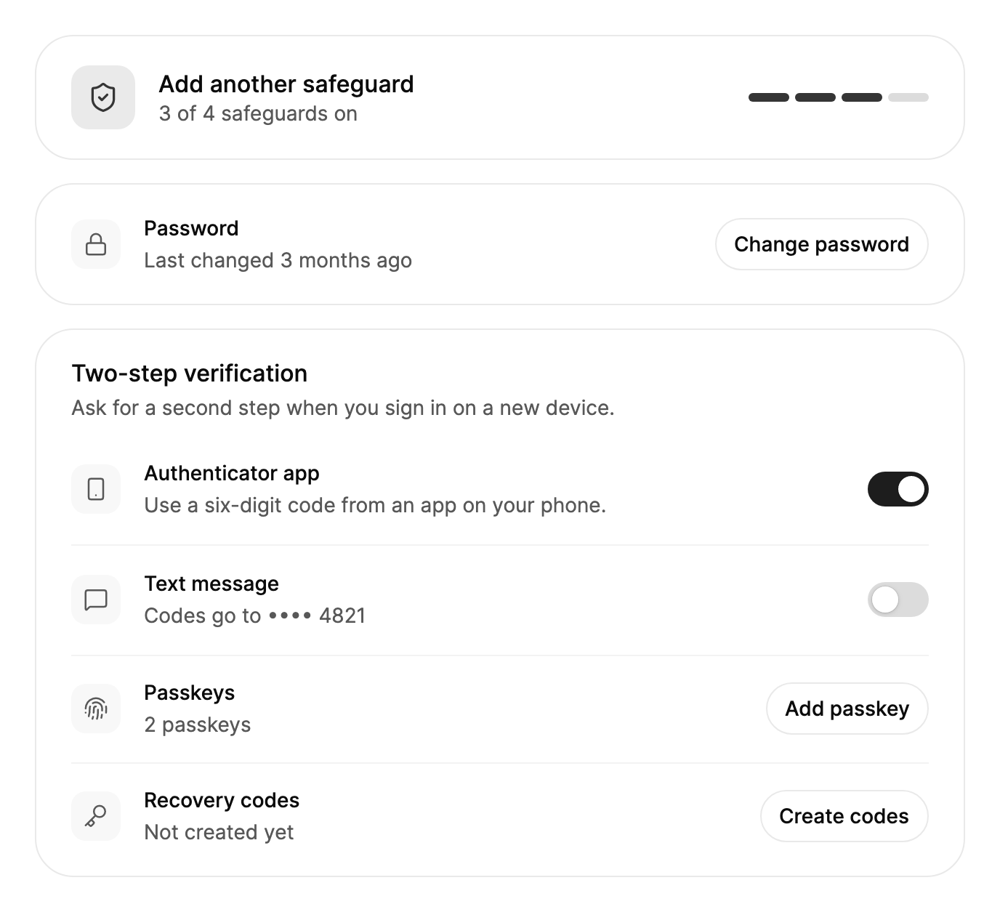

<Demo name="Overview" />

## 何时使用

`SecuritySettings` 是账号的安全页面。它位于产品的设置区域，汇集了用户会检查的四项内容：账号的保护程度、密码、两步验证方式，以及已登录的设备。每项操作（修改密码、开启某种验证方式、退出某台设备）都在页面上完成，因此用户无需在多个界面之间切换，就能修复安全检查指出的问题。

- **SaaS 产品或银行门户中的客户账号页面。** 安全检查会告诉用户四项防护中开启了几项，以及接下来该添加什么；密码行则显示密码上次修改的时间。
- **内部工具中管理员自己的安全设置**，管理员在管理他人账号之前，先管理自己账号的通行密钥和恢复代码。
- **开发者平台的账号页面**，列出持有 API 会话的设备，开发者可以退出一台已经不再使用的笔记本电脑。
- **要求第二步验证的金融应用**，可通过身份验证器应用或短信完成验证。开关和隐藏了部分数字的电话号码，清楚地显示了哪种方式用于登录。
- **丢失手机后的恢复流程**，用户只需一次确认的操作，即可退出其他所有会话。

## 何时不用

- **登录或创建账号。** 使用由 `Input` 和 `PasswordField` 组成的登录表单；本区块假定用户已经登录。
- **全工作区的安全策略**，例如强制两步验证或允许的登录方式。这些属于管理员设置：请在设置页面中以 `SettingsGroup` 和 `SettingsRow` 行的形式编写。
- **其他表单中的单个密码字段**，例如结账流程中的修改请求。直接使用 `PasswordField` 搭配 `PasswordStrength`。
- **审阅事件的审计记录**（谁在何时、从何处登录，以及改动了什么）。历史记录请用 `Timeline`，本区块只保留当前状态及对其的操作。
- **从列表中选择一项安全设置**，例如会话超时时间。在设置表单中使用 `Select`。

## 用法

设置账号的状态后，本区块会以四张卡片呈现：安全检查、密码、两步验证和已登录的会话。所有操作都在原位进行。两个开关会回写 `IsAuthenticatorEnabled` 和 `IsTextMessageEnabled`（双向），密码表单成功时会回写 `PasswordChangedAt` 和 `HasPassword`。"Add passkey"、"View codes" 或 "Create codes" 以及退出登录，都会作为路由事件抛给宿主处理。

```xml
<UserControl xmlns="https://github.com/avaloniaui"
             xmlns:arc="https://github.com/AtomUICommunity/TKCode.Arc">
    <arc:SecuritySettings IsAuthenticatorEnabled="True"
                          PhoneNumber="+31 6 2045 4821"
                          PasskeyCount="2">
        <arc:SecuritySettings.Sessions>
            <arc:SecuritySession Device="MacBook Air" Client="Firefox" Location="Rotterdam, NL"
                                 Kind="Laptop" IsCurrent="True" />
            <arc:SecuritySession Device="Pixel 9" Client="Larkspur app" Location="Rotterdam, NL"
                                 Kind="Phone" LastActive="2026-10-20T08:00:00+02:00" />
        </arc:SecuritySettings.Sessions>
    </arc:SecuritySettings>
</UserControl>
```

`SecuritySettings` 派生自 Avalonia 的 `TemplatedControl`。其卡片是设置区块中的 `SettingsGroup` 与 `SettingsRow`，开关是 Arc 的 `Switch`，密码字段是搭配 `PasswordStrength` 的 `PasswordField`，退出登录的确认则是 `ConfirmMorph`。

时间相对于 `Clock` 显示，`Clock` 是一个默认使用系统时钟的 `TimeProvider`。本区块在显示期间每 30 秒重新读取一次，因此 "2 hours ago" 之类的文字会保持最新。测试中可以传入固定的时钟：

```csharp
sealed class FixedClock(DateTimeOffset now) : TimeProvider
{
    public override DateTimeOffset GetUtcNow() => now.ToUniversalTime();
}

security.Clock = new FixedClock(new DateTimeOffset(2026, 10, 20, 12, 0, 0, TimeSpan.FromHours(2)));
```

### 结构

1. **安全检查卡片**（`IsSummaryVisible`）：一个 44 px 的盾牌图块（22 px 图标）、标题、数量行，以及右侧的四段式进度条。每段 28 × 6 px，段间距 4 px，每项防护对应一段。
2. **密码行**（`HasPassword`、`PasswordChangedAt`）：标题 "Password"、描述（"Last changed 3 months ago"、"Never changed" 或 "Updated just now"），以及一个按钮："Change password"；没有密码时则为 "Set password"。
3. **密码表单**：在该行下方展开的内联表单，宽度不超过 400 px，并与行内文字对齐。包含当前密码、新密码（带强度指示条和要求列表）、Cancel 以及 "Update password"。
4. **两步验证行**（`IsAuthenticatorEnabled`、`IsTextMessageEnabled`、`PhoneNumber`、`PasskeyCount`、`RecoveryCodesCreatedAt`）：身份验证器应用开关、带隐藏号码的短信开关、带 "Add passkey" 的通行密钥行，以及带 "View codes" 或 "Create codes" 的恢复代码行。
5. **会话卡片**（`Sessions`）：标题栏包含 "Sign out other sessions" 的确认操作；每个会话一行，包括设备图标、"Device · Client"、"Location · 相对时间"，以及 "This device" 徽标或 "Sign out" 按钮之一。

### 安全检查

安全检查统计四项防护：密码（`HasPassword`）、任一方式的两步验证、至少一个通行密钥（`PasskeyCount`），以及恢复代码（`RecoveryCodesCreatedAt`）。`ProtectionScore` 即为这个计数，取值 0 到 4，且为只读。每项防护填充各自的进度条段。盾牌采用分数对应的色调：4 分时为成功色，2 或 3 分时为强调色，0 或 1 分时为警告色。4 分时标题变为 "Your account is well protected"，否则显示 "Add another safeguard"。

使用安全检查是为了展示还缺少什么，而不是向用户施压。开启某种验证方式或添加通行密钥会填充进度条，因此页面会随用户的操作解释自身的结果。

<Demo name="Checkup" />

`Sections` 用于选择要显示的卡片，可以组合 `Password, Sessions` 这样的标志。`IsSummaryVisible` 只隐藏安全检查；当页面已有自己的摘要时使用它，如下方的演示所示。

### 修改密码

点击 "Change password" 会在该行下方打开表单。表单要求输入当前密码和新密码。"Update password" 需要两者同时满足：当前密码不为空，且新密码至少达到 fair 强度（即 `MinimumPasswordLevel` 常量，级别 2）。按钮启用时按 Enter 会提交表单，按 Escape 则取消。

提交时会引发 `PasswordChangeRequested`，并附带 `CurrentPassword` 和 `NewPassword`。宿主核对密码后再作出决定：

- **接受**：保持 `ErrorMessage` 为空。表单关闭，`PasswordChangedAt` 变为时钟的当前时间，该行显示 "Updated just now"。
- **拒绝**：设置 `ErrorMessage`。提示显示在当前密码输入框下方，表单保持打开，焦点回到该输入框。没有密码时，提示显示在新密码输入框下方。

没有密码时（`HasPassword="False"`），该行提供 "Set password"，表单只要求输入新密码。修改成功后 `HasPassword` 会变为 true。`OpenPasswordForm()`、`ClosePasswordForm()` 和 `SubmitPasswordChange()` 可以在代码中完成同样的操作。

<Demo name="ChangePassword" />

### 登录会话

会话按当前设备优先排列，其后按最近活动排序。当前设备带有 "This device" 徽标，且不能在此处退出。其他每个会话都有一个 "Sign out" 按钮。点击后，该行会淡出并收起，在列表可修改时将该会话从 `Sessions` 中移除，并引发 `SessionSignedOut`。

"Sign out other sessions" 是一个 `ConfirmMorph`。仅当存在其他会话时才启用，并且会先询问：问题中包含数量（"Sign out 3 sessions?"），按 Escape 或 Cancel 则保留所有会话。用户确认后，各行会依次离开，彼此相隔 35 ms，`OtherSessionsSignedOut` 携带被移除的会话。若列表为只读（例如数组），则各行会被隐藏而不是移除。

`SignOut(session)` 和 `SignOutOtherSessions()` 可以在代码中完成同样的操作。

<Demo name="Sessions" />

在窄屏页面上，进度条会移到安全检查文字下方，"Sign out other sessions" 则移到列表下方。带有小控件（如徽标或 "Sign out"）的行会将其保留在文字旁边；带有较宽按钮的行则将按钮堆叠在文字下方。

### 绑定到视图模型

视图模型持有安全状态及其规则。本区块负责显示状态、引发请求，并应用视图模型设置的结果。

```csharp
public partial class AccountSecurityViewModel : ObservableObject
{
    private readonly IAccountSecurity _security;

    public AccountSecurityViewModel(IAccountSecurity security)
    {
        _security = security;
    }

    [ObservableProperty]
    private bool _isAuthenticatorEnabled;

    [ObservableProperty]
    private DateTimeOffset? _passwordChangedAt;

    [ObservableProperty]
    private int _passkeyCount;

    [ObservableProperty]
    private DateTimeOffset? _recoveryCodesCreatedAt;

    public ObservableCollection<SecuritySession> Sessions { get; } = [];

    public async Task<string?> ChangePasswordAsync(string current, string next)
    {
        var result = await _security.ChangePasswordAsync(current, next);
        return result.IsSuccess ? null : result.Error;
    }
}
```

```xml
<arc:SecuritySettings IsAuthenticatorEnabled="{Binding IsAuthenticatorEnabled, Mode=TwoWay}"
                      PasswordChangedAt="{Binding PasswordChangedAt, Mode=TwoWay}"
                      Sessions="{Binding Sessions}"
                      PasskeyCount="{Binding PasskeyCount}"
                      RecoveryCodesCreatedAt="{Binding RecoveryCodesCreatedAt}" />
```

- `IsAuthenticatorEnabled`、`IsTextMessageEnabled`、`HasPassword` 和 `PasswordChangedAt` 是双向的，因此视图模型能收到开关或表单的变化。
- 修改密码没有命令。请处理 `PasswordChangeRequested`，调用 `ChangePasswordAsync`，并将返回的消息设为事件参数的 `ErrorMessage`。
- `Sessions` 是一个 `IList<SecuritySession>`，退出会话时本区块会更新它。请将其绑定到 `ObservableCollection<SecuritySession>`，使列表与服务端保持同步。
- `PasskeyCount` 和 `RecoveryCodesCreatedAt` 是单向的。在宿主完成 "Add passkey" 或 "Create codes" 之后再更新它们。

### 示例：银行客户的账户安全

银行门户向客户展示其账户安全，但不包含会话卡片（会话的演示已涵盖该卡片）。客户已设置身份验证器应用和两个通行密钥，但尚未生成恢复代码，因此安全检查显示 4 项中的 3 项，恢复代码行提供 "Create codes"。该场景没有展开的表单，所以截图展示的是静止状态。



```xml
<arc:SecuritySettings Width="640"
                      Sections="Summary, Password, TwoStep"
                      PasswordChangedAt="2026-07-14T09:00:00+02:00"
                      IsAuthenticatorEnabled="True"
                      IsTextMessageEnabled="False"
                      PhoneNumber="+31 6 2045 4821"
                      PasskeyCount="2" />
```

### 文案规范

本区块的标签简短，是为账户所有者编写的。请使用句首大写和默认文案所用的动词，并在行内描述状态，而不是使用提醒框。描述一种验证方式时，应说明它为用户做什么（"验证码发送至 •••• 4821"），而不是说明它的协议名称。

| 不要写 | 改为 |
|---|---|
| 双因素认证 | 两步验证 |
| 密码已在 3 个月前更改 | 上次更改于 3 个月前 |
| 移除会话 | 每行的退出按钮，以及列表的“退出其他会话” |
| 你确定吗？ | 退出 3 个会话？（数量写在问题中） |
| 2FA：关闭 | 文本短信开关及其行说明 |
| 错误：密码错误 | 这不是你当前的密码。（原因，显示在输入框下方） |

本地化时请通过 `SecuritySettingsLabels` 提供标签。日期使用 `Culture` 属性，因为相对时间和日期都依它而变化。

### 最佳实践

**推荐**

- 为每个账号页面开启安全检查，使进度条和下一步始终可见。只有当页面已有自己的摘要时才隐藏它。
- 在显示页面之前，先从服务端设置 `RecoveryCodesCreatedAt` 和 `PasskeyCount`。卡片的行和分数都依赖它们，陈旧的值会给出错误的安全检查结果。
- 对服务端拒绝的任何密码设置 `ErrorMessage`，并用用户能理解并据以行动的文字说明服务端的原因。表单保持打开，因此用户无需重新输入全部内容即可修正。
- 将 `Sessions` 绑定到服务端的列表。只有当列表可写时，本区块退出会话才会将其从列表中移除，因此服务端调用应放在 `SessionSignedOut` 处理程序中。

**避免**

- 完整显示电话号码。本区块只显示最后四位数字，应用在页面其他地方也不应显示更多。
- 把会话卡片用于登录历史。它列出的是当前打开的会话，而不是过去的事件。
- 为修改单个词而替换整个 `Labels` 对象。请新建一个 `SecuritySettingsLabels`，只设置需要修改的属性，使其他文案保持默认值。

### 常见问题

**新密码看起来没问题，为什么 "Update password" 仍是禁用的？** 按钮需要同时满足两个条件：当前密码不为空，且新密码至少达到 fair 强度（级别 2）。

**如何处理服务端拒绝的退出登录？** 该行会在 `SessionSignedOut` 引发之前离开，因此宿主无法阻止它。服务端拒绝时，请把该会话重新加回 `Sessions`，并显示你自己的提示。

**为什么文本短信开关保持关闭？** 在 `PhoneNumber` 有值之前它都是禁用的，其行会显示 "Add a phone number first"。设置号码即可启用。

**能否只在自己的页面上显示会话？** 可以。设置 `Sections="Sessions"`，或组合 `Password, Sessions` 这样的标志。未选中的卡片根本不会显示。

## API 参考

<!-- api: SecuritySettings -->

**SecuritySession**（普通对象，可以在 XAML 中编写）

| 属性 | 类型 | 说明 |
|---|---|---|
| `Device` | `string` | 设备名称，例如 "MacBook Air"。 |
| `Client` | `string?` | 浏览器或应用，显示在设备名称之后。 |
| `Location` | `string?` | 设备登录的位置，例如 "Rotterdam, NL"。 |
| `LastActive` | `DateTimeOffset` | 会话最后一次使用的时间；相对于 `Clock` 显示。 |
| `Kind` | `SecurityDeviceKind` | `Desktop`、`Laptop`、`Phone`、`Tablet` 或 `Other`；决定使用的图标。 |
| `IsCurrent` | `bool` | 正在使用的设备：排在最前，标有 "This device"，且不能在此处退出。 |

**事件参数**

| 类型 | 属性 | 说明 |
|---|---|---|
| `SecurityPasswordChangeEventArgs` | `CurrentPassword` | 输入的当前密码（没有密码时为空）。 |
| | `NewPassword` | 新密码。 |
| | `ErrorMessage` | 设置后拒绝修改；表单保持打开并显示该消息。 |
| `SecuritySessionEventArgs` | `Session` | 被退出登录的会话。 |
| `SecuritySessionsEventArgs` | `Sessions` | 通过 "Sign out other sessions" 退出的会话，按列表顺序排列。 |

**SecuritySettingsSections**（标志）：`Summary`、`Password`、`TwoStep`、`Sessions`、`All`（默认）、`None`。

**SecuritySettingsLabels**：`Culture` 以及每个内置文字对应的一个属性，例如 `SummaryProtected`、`SummaryCount`、`PasswordChanged`、`ChangePassword`、`UpdatePassword`、`TextMessageDescription`、`PasskeyCount`、`SessionsHeader`、`SignOut`、`SignOutSession`、`SignOutOthers` 和 `SignOutOthersPrompt`。

## 无障碍

- 每个开关和按钮都有名称。开关以其行的标题（"Authenticator app"）和描述命名。会话的按钮以其设备命名，例如 "Sign out ThinkPad X1"，徽标读作 "This device"。
- 安全检查进度条命名为 "{n} of 4 safeguards on"。安全检查标题和密码行的描述是礼貌式实时区域，因此 "Your account is well protected" 和 "Updated just now" 在变化时会被播报。
- 打开表单时焦点移到第一个字段。"Update password" 启用时按 Enter 提交，按 Escape 取消。关闭后焦点返回 "Change password"。被拒绝的修改会让焦点移到带有错误的字段。
- 获得焦点的 "Sign out" 行离开时，焦点移到下一个会话的按钮，若没有则移到上一个。
- "Sign out other sessions" 遵循 `ConfirmMorph`：它会先询问，按 Escape 或 Cancel 则保留会话。没有其他会话时，该按钮被禁用。
- Tab 顺序从上到下依次经过各卡片。没有电话号码时，文本短信开关被禁用，且其行会说明原因。

### 键盘

| 按键 | 位置 | 操作 |
|---|---|---|
| `Tab` / `Shift+Tab` | 任意位置 | 从上到下依次经过各卡片和行 |
| `Enter` | "Change password" 或 "Set password" | 打开密码表单；焦点移到当前密码字段 |
| `Enter` | 密码表单 | "Update password" 启用时提交 |
| `Escape` | 密码表单 | 取消：不保存并关闭表单，焦点返回 "Change password" |
| `Escape` 或 Cancel | "Sign out other sessions" 的询问 | 保留所有会话 |

## 动效

- 会话行以平滑弹簧淡出并收起高度，之后才移除该会话。"Sign out other sessions" 让每行比上一行晚 35 ms 开始离开。
- 密码表单在其行下方以弹簧展开和收起。密码行的描述以模糊切换变化。"Sign out other sessions" 在原位变形为其询问和结果。
- 安全检查标题以模糊过渡到新文字。数量随分数向上或向下滚动。进度条段和盾牌淡入其新颜色。
- 减弱动效时保留短促的淡入淡出，去掉弹簧、模糊和滚动。关闭动效时所有变化立即完成，已退出的行也立即离开列表。

| 变化 | 完整 | 减弱 | 关闭 |
|---|---|---|---|
| 会话行离开 | 以平滑弹簧淡出并收起 | 淡出 | 立即离开 |
| 密码表单展开或收起 | 以弹簧展开或收起 | 以短促淡入淡出显示或隐藏 | 立即完成 |
| 密码描述变化 | 模糊切换到新文字 | 短促淡入淡出 | 立即完成 |
| 安全检查数量与进度条 | 数字滚动；段落淡入其颜色 | 颜色淡入 | 立即完成 |

## 相关组件

- `SettingsGroup` 和 `SettingsRow` 用于构建卡片和行。其他设置区块也使用它们：设置页面、设置命令、账单概览、用量账单和取消流程。
- `PasswordField` 和 `PasswordStrength` 用于密码表单，`Switch` 用于两步验证方式，`Badge` 用于标示当前设备，`Button` 用于行内操作，`ConfirmMorph` 用于退出其他所有会话。

| 组件 | 适用场景 |
|---|---|
| `SettingsPage` | 安全卡片位于带导航列表的设置页面中 |
| `PasswordField` / `PasswordStrength` | 你只需要一个密码字段，或带规则的密码，且不在本页面中 |
| `Switch` | 带标签和描述的单个开或关设置 |
| `ConfirmMorph` | 单个破坏性操作需要就地确认 |
| `Timeline` | 人们需要账户事件的历史，而不是当前状态 |
