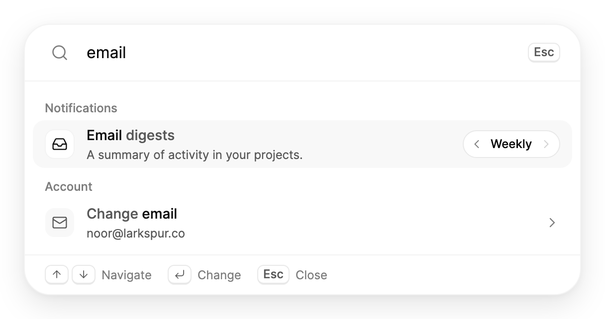

<Demo name="Inline" />

## 何時使用

`SettingsCommand` 把應用程式的設定放在一個搜尋欄之後。使用者輸入幾個字母，例如「郵件」或「深色」，就能當場修改設定：無需開啟設定頁面，無需找到分區，也無需捲動到某一列。它可以與完整的設定頁面並列，作為存取同一組值的快速路徑，也可以單獨放在透過快速鍵開啟的對話方塊中。面板保存這些值，並在其中一個值變動時呼叫應用程式，因此適合立即生效的設定。

- **分析或專案工具中以 Ctrl+,（Mac 上為 ⌘,）開啟的設定面板**：使用者每天多次修改「主題」「緊湊表格」或「預設圖表範圍」。對話方塊中的面板省去了進入設定導覽的過程。
- **團隊收件匣中的通知偏好**：「提及」「產品更新」與「郵件摘要」是開關或三個具名的值。每項變更立即生效，底部列會確認（「提及已關閉」），因此沒有需要記得儲存的步驟。
- **協作工具中的隱私與線上狀態開關**：「顯示線上狀態」與「已讀回條」對整個工作區生效。底部的提示會確認每次變更，使用者無需開啟對話方塊即可看到結果。
- **與相關設定放在一起的帳號操作**：「變更電子郵件」與「兩步驟驗證」會開啟其他頁面，「在所有裝置上登出」則執行一項命令。每個操作都可以以鍵帽形式顯示快速鍵，因此一次搜尋即可找到全部操作。
- **包含許多小開關的管理主控台**：在租戶主控台中搜尋「單一登入」，即可在「安全性」「使用者」與「帳單」群組下的列中找到強制執行開關。讓清單保持夠短、便於瀏覽（參見「尺寸與效能」）。

## 何時不用

- **需要表單、驗證或儲存步驟的設定**：使用 `SettingsPage` 搭配 `SettingsGroup` 與 `SettingsRow`，或由 `Input` 與 `Select` 組成的表單。面板會立即套用每個值，沒有地方放置驗證訊息或儲存按鈕。
- **選項很多或需要自由輸入的設定**，例如時區、國家或顯示名稱：長清單使用 `Combobox` 或 `Select`，自由文字使用 `Input`。面板中的列以短膠囊顯示其選項，因此只適合少數幾個值。
- **日期與時間**，例如免打擾時段或報表開始日期：使用 `TimePicker` 或 `DatePicker`。面板的列無法顯示日曆或時鐘。
- **不屬於設定的應用程式命令**，例如「新增專案」或「匯出此檢視」：使用 `CommandPalette`。它搜尋的是命令，而這個面板搜尋的是使用者設定的值。
- **搜尋紀錄**，例如客戶、發票或訊息：使用 `SearchField` 或 `ExpandingSearch`，結果來自資料。此面板只搜尋交給它的設定。

## 用法

在面板內撰寫設定。`SettingsCommandToggle` 表示開或關，`SettingsCommandChoice` 依序切換其 `Options`，`SettingsCommandAction` 執行一項命令。`Group` 將設定列在某個標題之下，`Keywords` 則加入其他可用來找到該設定的字詞。焦點會留在搜尋欄中：上、下鍵移動反白，Enter 執行反白的列，左、右鍵逐一切換選項。底部列會確認每一次變更。

```xml
<UserControl xmlns="https://github.com/avaloniaui"
             xmlns:arc="https://github.com/AIDotNet/TKCode.Arc">
    <arc:SettingsCommand MaxWidth="560">
        <arc:SettingsCommandChoice Group="外觀" Header="主題" Options="淺色, 深色, 跟隨系統" Keywords="深色 淺色" />
        <arc:SettingsCommandToggle Group="外觀" Header="精簡模式" Description="列距更緊密，間距更小。" />
        <arc:SettingsCommandAction Group="帳號" Header="變更電子郵件" IsNavigation="True" />
    </arc:SettingsCommand>
</UserControl>
```

`SettingsCommand` 衍生自 Avalonia 的 `TemplatedControl`，因此可以使用常見的版面屬性（`Width`、`MaxWidth`、`Margin`）與樣式設定。它的設定是一個一般集合：`SettingsCommandItem` 是三種設定的基底類別，這些項目就是面板的內容，因此既可以在 XAML 中撰寫，也可以在程式碼中加入。面板預設帶有外框，擁有自己的表面、邊框、圓角與浮動陰影。當外層表面已經提供這些效果時，將 `IsFramed` 設為 `False`。

### 結構

1. **搜尋列**（`Query`）：56 px 高，左側是 18 px 的搜尋圖示（使用淡化文字顏色），中間是無邊框文字方塊，右側是 Esc 鍵帽。列下方有分隔線。
2. **結果清單**（`ResultsMaxHeight`）：預設 360 px，內距 8 px。超過該高度時清單捲動，其上下邊緣會以 20 px 的漸隱提示還有更多內容。
3. **群組標題**（`Group`）：使用淡化文字顏色的超小文字，內距為 12、10、12 與 4 px。未設群組的設定會顯示在 `Labels.Ungrouped` 之下，且只有在其他設定有群組時才會顯示。
4. **列**（`Header`、`Description`）：48 px 高，圓角 12 px。標題為中等字重的小號內文；說明為一行次要文字顏色的超小文字，超出部分以省略號截斷。
5. **圖示方塊**（`Icon`）：30 px 的方塊，圓角 9 px，圖示 16 px。圖示使用 `ArcIcons` 中的成員。
6. **列控制項**：`SettingsCommandToggle` 為開關；`SettingsCommandChoice` 為 28 px 的膠囊，兩側各有 24 px 箭頭，中間顯示目前的值；`SettingsCommandAction` 為鍵帽或右箭頭。
7. **作用中列反白**：一個淡化表面，圓角 12 px，在各列之間滑動。
8. **底部列**：40 px 高，上方有分隔線。左側為按鍵提示（上下鍵用於「導覽」，Enter 用於「切換」「變更」或「開啟」，視作用中的列而定；Esc 用於「關閉」）。變更提示位於右側。

### 搜尋

查詢以空格拆分。每個字詞都必須出現在標題、說明、群組或關鍵字中，不區分大小寫，且可以比對字詞的一部分。結果依標題的比對方式排序：

1. 標題以整個查詢開頭。
2. 標題中某個字詞以查詢開頭。
3. 標題包含查詢。
4. 只有說明、群組或關鍵字相符。

同一層級的設定保持宣告順序，群組則依其最佳的一列排序。標題中相符的部分保持前景色，標題的其餘部分改為次要色，讓使用者看得出某列為何相符。沒有相符結果時，面板會顯示 `Labels.NoResults` 與 `Labels.NoResultsHint`，建議換一個字詞。空白查詢會依宣告順序列出所有設定，因此請依使用者預期看到的順序撰寫設定。

`Query` 為雙向繫結，因此應用程式可以預先填入搜尋字詞（例如來自深層連結），或保留上一次的查詢。`Clear()` 會清空查詢並重新列出所有設定，`FocusSearch()` 會把鍵盤焦點移到搜尋欄。

### 開關、選項與動作

依設定變更時的行為選擇類型：

- **`SettingsCommandToggle`** 用於立即生效、只有開和關兩種狀態的設定，例如「精簡模式」或「提及」。按 Enter 或點擊會翻轉它，提示會顯示「精簡模式已開啟」或「精簡模式已關閉」。需要第二步才能確認的開關不應放在這裡。
- **`SettingsCommandChoice`** 用於三到五個具名的值，例如「淺色、深色、跟隨系統」或「關閉、每日、每週」。Enter 移到下一個選項，並從最後一個回到第一個；而值旁的箭頭則逐一切換且不循環。請排列選項順序，使常見的下一個選擇緊接在預設值之後，因為 Enter 每次只移動一步。
- **`SettingsCommandAction`** 用於命令或連結：「變更電子郵件」「下載您的資料」「在所有裝置上登出」。按 Enter 或點擊會執行 `Command`，然後引發 `ItemInvoked`。對於會開啟其他頁面的動作，請將 `IsNavigation` 設為 `True`，使該列顯示箭頭，讓使用者預期會進入新畫面。

對於目前無法變更的設定，例如管理員已鎖定的設定，請將 `IsEnabled` 設為 `False`。該列會變暗，鍵盤會略過它，但該列仍保留在清單中，使使用者知道該設定存在以及為何無法使用。請用 `Description` 說明原因（「已由管理員關閉。」）。

### 繫結到檢視模型

面板的值是樣式屬性。`IsChecked` 與 `SelectedOption` 為雙向繫結：在面板中的變更會更新檢視模型，應用程式其他位置的變更則會移動該列。下例使用 CommunityToolkit.Mvvm（`ObservableObject` 基底類別、`[ObservableProperty]` 與 `[RelayCommand]` 產生器）。狀態由應用程式持有，面板只負責編輯它。

```csharp
public partial class WorkspaceSettingsViewModel : ObservableObject
{
    private readonly Action<string> _openPage;

    [ObservableProperty]
    private string? _theme = "跟隨系統";

    [ObservableProperty]
    private bool _compactMode;

    [ObservableProperty]
    private bool _reduceMotion = true;

    [ObservableProperty]
    private string? _emailDigests = "每週";

    public WorkspaceSettingsViewModel(Action<string> openPage) => _openPage = openPage;

    [RelayCommand]
    private void ChangeEmail() => _openPage("account/email");
}
```

```xml
<arc:SettingsCommand>
    <arc:SettingsCommandChoice Group="外觀" Header="主題"
                               Options="淺色, 深色, 跟隨系統"
                               SelectedOption="{Binding Theme}" />
    <arc:SettingsCommandToggle Group="外觀" Header="精簡模式"
                               IsChecked="{Binding CompactMode}" />
    <arc:SettingsCommandToggle Group="外觀" Header="減少動態效果"
                               IsChecked="{Binding ReduceMotion}" />
    <arc:SettingsCommandChoice Group="通知" Header="郵件摘要"
                               Options="關閉, 每日, 每週"
                               SelectedOption="{Binding EmailDigests}" />
    <arc:SettingsCommandAction Group="帳號" Header="變更電子郵件" IsNavigation="True"
                               Command="{Binding ChangeEmailCommand}" />
</arc:SettingsCommand>
```

雙向的有 `IsChecked`、`SelectedOption` 與 `Query`。單向的有 `Items`、`Labels` 與 `ResultsMaxHeight`，由應用程式設定，面板讀取。唯讀的是 `ActiveItem`，即反白的設定；若沒有顯示任何設定則為 `null`。對於繫結無法表達的副作用（例如儲存到伺服器或記錄稽核日誌），請使用事件。`SettingChanged` 只會在面板中的變更發生時執行，因此當應用程式自行變更值時，處理常式中的儲存不會再執行一次。`ItemInvoked` 在動作的 `Command` 執行後引發。兩個事件都是路由事件，因此處理常式既可以掛在面板上，也可以掛在其父元素上。

<Demo name="Bound" />

```csharp
palette.SettingChanged += (_, e) => _settings.SaveAsync(e.Item.Header, e.Value);
palette.ItemInvoked += (_, e) => _telemetry.Track("settings.action", e.Item.Header);
```

### 焦點與關閉

放在 `Dialog` 中的面板需要三個條件：將 `IsFramed` 設為 `False`，使面板不再繪製第二層外框；設定一個與對話方塊內距相同大小的負邊界，使搜尋列與底部列延伸到對話方塊的邊緣；以及一條關閉規則。範例為面板設定 -24 的邊界，以抵消對話方塊 24 px 的本文內距。下面的程式碼會關閉承載面板的 `Dialog`。

查詢為空時按 Escape 會引發 `CloseRequested`，查詢非空時按 Escape 會先清空查詢。在 `CloseRequested` 處理常式中關閉對話方塊，並將 `Handled` 設為 `True`，使對話方塊不會再次處理同一次按鍵。

對話方塊開啟時會把焦點移到其第一個控制項，這會使鍵盤離開搜尋欄。對話方塊開啟後，在 UI 執行緒上投遞 `FocusSearch()`，並在對話方塊開啟時清空查詢，使每次工作階段都從完整清單開始。

<Demo name="InDialog" />

```csharp
private Dialog SettingsDialog = null!; // 範例中帶有 x:Name="SettingsDialog" 的 Dialog

private void OnCloseRequested(object? sender, RoutedEventArgs e)
{
    e.Handled = true;
    SettingsDialog.Close();
}
```

範例還以 Ctrl+,（Mac 上為 ⌘,）開啟對話方塊，這是設定的常用快速鍵。面板只顯示快速鍵，因此應用程式需要自行註冊按鍵手勢；見下一小節。

### 快速鍵與動作

`Shortcut` 會以鍵帽的形式顯示動作的組合鍵。以 `mod` 代表命令鍵（Mac 上為 ⌘，其他平台為 Ctrl），並可與 `shift` 組合，例如 `mod+shift+e`。面板只負責顯示快速鍵，實際的按鍵由應用程式處理，例如在視窗層級的按鍵處理常式中，因此即使面板關閉，快速鍵仍然有效。`IsNavigation` 會為開啟其他頁面的動作加上箭頭。

```xml
<arc:SettingsCommand>
    <arc:SettingsCommandAction Header="下載您的資料" Shortcut="mod+shift+e" />
    <arc:SettingsCommandAction Header="兩步驟驗證" IsNavigation="True" />
    <arc:SettingsCommandToggle Header="已讀回條" Description="已由管理員關閉。" IsEnabled="False" />
</arc:SettingsCommand>
```

### 文字

內建文字來自 `Labels`：固定文字使用字串，帶有值的文字（例如無結果訊息）使用函式。替換整個物件即可翻譯，並保持每個函式的參數順序不變。

```csharp
palette.Labels = new SettingsCommandLabels
{
    Placeholder = "Instellingen zoeken",
    NoResults = query => $"Geen instellingen voor “{query}”",
    TurnedOn = header => $"{header} aan",
    TurnedOff = header => $"{header} uit",
};
```

### 尺寸與效能

面板會為每個設定建立一列，並在該項目的整個生命週期中保留。篩選只改變顯示哪些列以及它們的順序。數百個以內的設定無需虛擬化；較長的目錄請移到設定頁面。

透過 `Items` 集合在程式碼中加入或移除項目，清單會立即更新。

### 範例：團隊收件匣中的通知設定

團隊收件匣把通知偏好與其他設定放在同一個面板中。此處的查詢是 "email"，用來說明排序方式：「Email digests」以查詢開頭，因此排名第一；「Change email」的標題中有一個字詞以它開頭；「Product updates」只透過關鍵字相符，因此排在最後。每個群組依其最佳的一列排序，這使 Notifications 排在 Account 之前。標題中相符的文字保持前景色，底部列顯示適用於反白選項的按鍵。面板寬 560 px，適合放在對話方塊或設定欄中，而不會拉伸各列。



```xml
<StackPanel Width="560">
    <arc:SettingsCommand Query="email"
                         ResultsMaxHeight="320">
        <arc:SettingsCommandChoice Group="Notifications"
                                   Header="Email digests"
                                   Icon="{x:Static arc:ArcIcons.Inbox}"
                                   Description="A summary of activity in your projects."
                                   Keywords="summary newsletter"
                                   Options="Off, Daily, Weekly"
                                   SelectedOption="Weekly" />
        <arc:SettingsCommandToggle Group="Notifications"
                                   Header="Mentions"
                                   Icon="{x:Static arc:ArcIcons.AtSign}"
                                   Description="When someone @mentions you in a comment."
                                   IsChecked="True" />
        <arc:SettingsCommandToggle Group="Notifications"
                                   Header="Product updates"
                                   Icon="{x:Static arc:ArcIcons.Bell}"
                                   Description="Occasional news about new features."
                                   Keywords="news announcements" />
        <arc:SettingsCommandAction Group="Account"
                                   Header="Change email"
                                   Icon="{x:Static arc:ArcIcons.Mail}"
                                   Description="noor@larkspur.co"
                                   Keywords="address login"
                                   IsNavigation="True" />
        <arc:SettingsCommandAction Group="Account"
                                   Header="Download your data"
                                   Icon="{x:Static arc:ArcIcons.Download}"
                                   Description="A copy of your files, comments and settings."
                                   Keywords="export archive backup"
                                   Shortcut="mod+shift+e" />
    </arc:SettingsCommand>
</StackPanel>
```

### 文案規範

為每個標題使用設定的名稱，句首大寫，使它在列中、搜尋中與提示中讀起來一致。說明保持一行簡短文字，因為列會以省略號截斷。用設定頁面上使用者會使用的字詞命名選項，並在變更後的提示中沿用相同的名稱。

| 不要寫 | 改為 |
|---|---|
| 為提及開啟通知 | 提及 |
| 每天寄送一封摘要郵件 | 郵件摘要（選項：每日） |
| 切換精簡檢視模式 | 精簡模式 |
| 更改您的電子郵件地址 | 變更電子郵件 |
| 登出所有裝置 | 在所有裝置上登出 |
| 管理員已停用此設定 | 已由管理員關閉。 |

用關鍵字加入同義詞，以及使用者會搜尋的字詞，例如為「主題」加入 "深色 淺色"，為「兩步驟驗證」加入 "2fa security"。不要在關鍵字中重複標題，也不要加入指向其他設定的關鍵字。

### 最佳做法

**建議**

- 立即套用變更，並在底部列中確認。提示是面板中唯一的回饋，因此它必須說明設定名稱及其新值。
- 把值繫結到應用程式的狀態，並在事件處理常式中儲存，使面板與應用程式其餘部分始終顯示相同的值。
- 選項保持為少數具名的值；較長的選項清單移到帶有適當控制項的頁面中。
- 為每個平台註冊開啟面板的快速鍵（範例中為 `mod+,`），並在開啟面板的按鈕旁顯示該快速鍵，使使用者在已經使用的畫面上學會它。
- 對於鎖定的設定，使用 `IsEnabled="False"` 並在說明中給出原因，使使用者知道它並非遺失。

**避免**

- 需要儲存步驟或驗證的設定。面板的變更會立即生效，被拒絕的值已經生效了；應把這類設定交給 `SettingsPage`。
- 刪除資料或讓使用者登出的動作卻沒有確認。應從動作的命令開啟 `Dialog`，使搜尋不會繞過這項保護。
- 說明相同的長清單設定。搜尋無法區分它們，各列看起來也很相似。
- 為每種狀態更改設定的標題，例如「開啟精簡模式」和「關閉精簡模式」。列中已經表示了值，標題應保持不變。
- 只把值保存在面板中。`SettingChanged` 只為使用者的變更引發，因此應用程式必須自行保存狀態。

### 常見問題

**為什麼第一次按 Escape 不是關閉，而是清空查詢？** 查詢非空時，Escape 會先清空查詢，因此使用者可以在不失去面板的情況下取消搜尋。查詢為空時，Escape 才會引發 `CloseRequested`。承載面板的對話方塊應只在該處理常式中關閉。

**為什麼在最後一列按下方向鍵時反白會停止？** 反白不會循環：它停在第一個與最後一個可用的列上。已停用的列在兩個方向都會被略過，因此反白總是落在可以變更的設定上。

**如何回應應用程式自行變更的值？** 繫結該屬性（例如 `IsChecked`），該列會跟著變化。`SettingChanged` 不會為此引發，因此對於必須觸發副作用的變更，請在檢視模型上使用 `PropertyChanged` 處理常式。

## API 參考

<!-- api: SettingsCommand -->
<!-- api: SettingsCommandToggle -->
<!-- api: SettingsCommandChoice -->
<!-- api: SettingsCommandAction -->

### SettingsCommandItem

三種設定的基底類別。每個屬性都是樣式屬性，因此面板會跟隨變化。

| 屬性 | 型別 | 說明 |
|---|---|---|
| `Header` | `string?` | 設定的名稱，顯示在列中，並優先搜尋。 |
| `Description` | `string?` | 標題下方的一行文字，並截斷為單行；同樣可搜尋。 |
| `Icon` | `Geometry?` | 24 × 24 的描邊圖示，例如 `ArcIcons` 的成員，顯示在標題前的圖示方塊中。 |
| `Group` | `string?` | 該列所屬的群組，例如「外觀」；同樣可搜尋。 |
| `Keywords` | `string?` | 其他可用來找到該設定的字詞，以空格或逗號分隔。 |
| `IsEnabled` | `bool` | 設定是否可以變更。停用的列會變暗，並被鍵盤略過。 |

### SettingsCommandLabels

| 屬性 | 型別 | 說明 |
|---|---|---|
| `Placeholder` | `string` | 搜尋欄的預留文字：「搜尋設定」。 |
| `SearchName` | `string` | 搜尋欄的無障礙名稱：「搜尋設定」。 |
| `ResultsName` | `string` | 結果清單的無障礙名稱：「設定」。 |
| `NoResults` | `Func<string, string>` | 沒有相符結果時的訊息：「沒有符合“theme”的設定」。 |
| `NoResultsHint` | `string` | 其下方的提示：「換個字詞再試，例如 theme 或 email。」 |
| `Navigate`, `Toggle`, `Change`, `Open`, `Close` | `string` | 底部列中按鍵旁的操作提示。 |
| `EscapeKey` | `string` | Escape 鍵帽的文字：「Esc」。 |
| `TurnedOn`, `TurnedOff` | `Func<string, string>` | 開關變更後的提示：「精簡模式已開啟」。 |
| `ChangedTo` | `Func<string, string, string>` | 選項變更後的提示：「主題：深色」。 |
| `Ungrouped` | `string` | 未設群組之設定的群組標題，在其他設定有群組時顯示：「設定」。 |
| `On`, `Off` | `string` | 輔助技術朗讀開關狀態時使用的文字。 |
| `RowState` | `Func<string, string, string>` | 列的標題與狀態：「深色模式，開啟」。 |
| `PreviousOption`, `NextOption` | `string` | 選項值兩側箭頭的名稱。 |

### 事件參數

| 型別 | 屬性 | 說明 |
|---|---|---|
| `SettingsCommandChangedEventArgs` | `Item` | 發生變更的設定。 |
| `SettingsCommandChangedEventArgs` | `Value` | 新值：開關為 `bool`，選項為所選的選項。 |
| `SettingsCommandItemEventArgs` | `Item` | 被叫用的動作。 |

## 無障礙

- 搜尋欄名為「搜尋設定」。其說明文字會跟著反白的列變化，例如「精簡模式，關閉」或「主題，深色」。
- 結果是名為「設定」的清單，每一列都是以其標題命名的清單項目。
- 焦點始終留在搜尋欄中。上、下鍵移動反白並略過已停用的列，Page Up 與 Page Down 各移動五列。清單不會循環。
- Enter 會切換開關、把選項移到下一個值，或執行動作。左、右鍵逐一切換選項且不循環；其他情況下，左、右鍵只移動插入點。
- Escape 會清空查詢。查詢為空時按下 Escape 會引發 `CloseRequested`。
- 變更提示是禮貌的即時區域，因此螢幕閱讀器會朗讀「精簡模式已開啟」。
- 開關、選項旁的箭頭與鍵帽都無法取得焦點。點擊任一列的效果與按 Enter 相同，焦點仍留在搜尋欄中。

### 鍵盤

| 按鍵 | 操作 |
|---|---|
| `Down` / `Up` | 將反白移到下一個或上一個可用的設定；不循環 |
| `PageDown` / `PageUp` | 反白移動五個設定 |
| `Enter` | 切換開關、把選項移到下一個值（最後一個之後是第一個），或執行動作 |
| `Right` / `Left` | 把選項切換到下一個或上一個值，不循環；在其他列上則移動插入點 |
| `Escape` | 查詢非空時清空查詢；查詢為空時引發 `CloseRequested` |
| 輸入文字 | 變更查詢，清單隨輸入即時篩選 |

點擊一列與按 Enter 效果相同。點擊開關或選項箭頭會直接變更該設定。

## 動態效果

- 反白會以反應靈敏的彈簧在各列之間滑動。結果變動時，反白會立即移動。
- 清單會平滑捲動，讓反白的列及其群組標題保持可見。
- 選項的值會依變化方向向上或向下捲動，開關的滑塊也會滑動。
- 變更提示會伴隨柔和的模糊上移出現，並在 2.5 秒後淡出。
- 減少動態效果時，提示與值淡入淡出，反白立即移動。關閉動態效果時，每項變更都立即顯示。

| 變化 | 完整 | 減少 | 關閉 |
|---|---|---|---|
| 反白在列之間移動 | 以反應靈敏的彈簧滑動 | 立即移動 | 立即移動 |
| 選項的值變化 | 依變化方向向上或向下捲動 | 淡入淡出 | 立即顯示 |
| 變更提示出現 | 伴隨柔和模糊上移，2.5 秒後淡出 | 淡入淡出 | 立即顯示 |

## 相關元件

- `SettingsPage`：包含區段導覽與儲存列的完整設定頁面。
- `SecuritySettings`、`BillingOverview`、`UsageBilling` 與 `CancelFlow`，即其他設定區塊。
- `Switch`：開關列中的控制項；`Dialog`：透過快速鍵承載面板的對話方塊。
- `SearchField` 與 `Select`：用於表單中單一的搜尋或選擇。

| 元件 | 適用情境 |
|---|---|
| `SettingsPage` | 設定分為多個區段，並透過儲存列一起儲存 |
| `CommandPalette` | 使用者執行應用程式命令，而非變更已設定的值 |
| `SearchField` | 文字用於搜尋紀錄或內容，而非設定 |
| `Switch` | 單一設定位於表單或不需搜尋的列中 |
| `Select` / `Combobox` | 表單需要從長清單中選擇一個值 |
