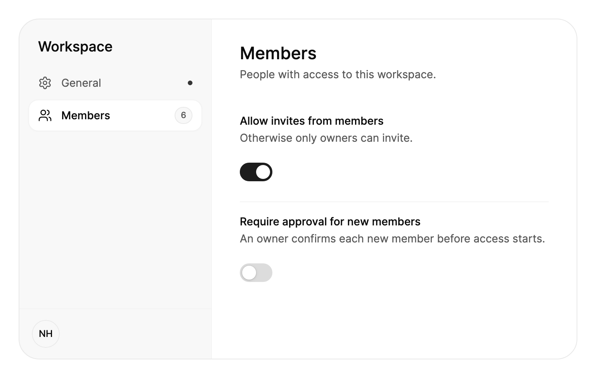

<Demo name="Overview" />

## 何时使用

`SettingsPage` 是应用或工作区的设置区域。左侧一列在页面标题之下、账户卡片之上列出各个分区，例如个人资料、通知、安全和账单。所选分区占据页面其余的部分。由于页面知道哪个分区有未保存的修改，它可以为该分区显示一个保存条，因此人总能看到自己的修改是否待保存。

- **管理后台中的工作区设置**：一个 Larkspur 工作区，包含常规、成员和账单分区。所有者在它们之间切换时不会丢失页面状态，每个分区都承载自己职责的表单。
- **SaaS 产品中的账户设置**：为一个已登录的人提供个人资料、通知、安全和账单。分区与人们寻找设置的方式一致，因此无需搜索就能在安全下找到"两步验证"。
- **带保存步骤的账单区域**：公司名称、账单邮箱和增值税号一起编辑，并通过一个操作保存。放弃会恢复已保存的值，这是普通的设置行列表无法提供的。
- **窄窗口或侧边面板中的设置**：低于 720 px 时，页面变为单列，分区变为一排可横向滚动的胶囊。同一个页面可以在分屏视图或手机宽度的窗口中使用。
- **分区多到单个表单装不下的设置**：导航让每个分区都只需一次点击，并且在长分区滚动时保持不动，因为滚动的只有内容列。

## 何时不用

- **一个简短的选项列表**：单独在卡片或对话框中使用 `SettingsGroup` 搭配 `SettingsRow`。
- **在应用任意位置按名称查找并修改设置**：使用 `SettingsCommand`，即就地修改值的搜索面板。
- **应用各区域之间的导航**：使用 `Sidebar`。设置页面是一个拥有自己分区的区域，而不是应用的外壳。
- **同一记录的不同视图，例如概览、活动和文件**：使用 `Tabs`。标签页切换视图，无需保存步骤。
- **必须按顺序完成的步骤**，例如新手引导或套餐变更：使用 `Stepper`，它会显示人当前所处的流程位置。

## 用法

每个分区写一个 `SettingsSection`。`Header`、`Icon` 和 `Badge` 显示在导航中，所选分区则在右侧显示其 `Header`、`Description` 和内容。第一个已启用的分区会被选中；设置 `SelectedIndex` 或调用 `Select(section)` 可显示其他分区。`Title` 位于导航上方，`Footer` 位于导航下方，例如账户卡片。

```xml
<UserControl xmlns="https://github.com/avaloniaui"
             xmlns:x="http://schemas.microsoft.com/winfx/2006/xaml"
             xmlns:arc="https://github.com/AtomUICommunity/TKCode.Arc">
    <arc:SettingsPage Height="480">
        <arc:SettingsSection Header="个人资料" Icon="{x:Static arc:ArcIcons.User}" Description="他人如何看到你。">
            <arc:Input Label="全名" Text="Noor Haddad" />
        </arc:SettingsSection>
        <arc:SettingsSection Header="通知" Icon="{x:Static arc:ArcIcons.Bell}" Badge="2">
            <arc:SettingsGroup Appearance="Plain">
                <arc:SettingsRow Header="提及" Description="有人提及你时。">
                    <arc:Switch IsChecked="True" />
                </arc:SettingsRow>
            </arc:SettingsGroup>
        </arc:SettingsSection>
    </arc:SettingsPage>
</UserControl>
```

`SettingsPage` 派生自 Avalonia 的 `SelectingItemsControl`，它的项就是各个分区。因此选择的工作方式与任何选择器一样：`SelectedIndex`、`SelectedItem` 和 `SelectionChanged` 的行为与平常相同，`SelectedSection` 则以 `SettingsSection` 的形式返回当前显示的分区。页面会为每个分区生成一个导航项，并管理选中的胶囊、内容区域和保存条，因此分区只需描述自己的内容。

### 结构

1. **标题**（`Title`，默认为 "Settings"）：导航列顶部的中等字重大字，两侧留出 24 px 的间距。
2. **导航列**：宽 248 px，背景是表面色与 2.5% 前景色的混合，右边缘有一条 1 px 的分隔线。
3. **导航项**（每个分区的 `Header`、`Icon`、`Badge`）：高 40 px，项之间间隔 2 px。图标为 18 px，标题为小号文字。未选中的项使用次要文字颜色；选中的项使用前景色和中等字重。
4. **徽标**（`Badge`）：位于导航项末尾的小型 `Badge`，例如新消息的数量。
5. **未保存圆点**：当分区设置了 `IsDirty` 时，导航项中出现一个 6 px 的强调色圆点。
6. **选中胶囊**：一个抬起的表面，带 1 px 的淡边框和静止阴影，圆角 12 px。它会在各导航项之间滑动。
7. **页脚**（`Footer`）：位于列底部的分隔线之下，内边距为 16 px 和 14 px。紧凑布局中隐藏。
8. **内容区域**：独立滚动，两侧留出 36 px 的间距，上方 30 px。分区标题为特大号中等字重文字，其 `Description` 位于下方 4 px 处，为小号次要文字，内容再向下 24 px 开始。
9. **保存条**：一个抬起的胶囊，居中位于内容区域底部，带浮动阴影，内边距为 18、5、5、5 px。它包含提示"未保存的修改"、一个幽灵式的"放弃"按钮和一个主要的"保存更改"按钮。内容底部保留 72 px 的空间，因此最后一行永远不会被保存条遮住。

### 未保存的修改

分区有未保存的修改时，将其 `IsDirty` 设为 `true`。它的导航项会显示一个圆点；选中该分区时，页面底部会升起保存条，其中有放弃和保存。保存（或按 Ctrl+S，macOS 上为 ⌘S）会引发 `SaveRequested`，放弃会引发 `DiscardRequested`。两者都携带 `Section`。保存或还原修改后，将 `IsDirty` 设回 `false`。

根据表单设置 `IsDirty`，而不是根据打开分区的动作：比较当前值与已保存的值，这样人把某个值改回原样时，圆点就会消失。页面不会阻止人切换分区。仍有未保存修改的分区会在导航中保留圆点，并在再次被选中时重新显示保存条。

<Demo name="UnsavedChanges" />

```csharp
page.SaveRequested += async (_, e) =>
{
    await SaveProfileAsync();
    e.Section.IsDirty = false;
};
```

### 布局与宽度

页面宽度不小于 `CompactWidth`（默认 720 px）时为两列。低于该宽度时变为单列：标题位于一排可横向滚动的分区胶囊之上，页脚隐藏，内容的内边距变小（两侧 20 px，上方 22 px，下方 24 px）。`IsCompact` 反映当前布局，页面还带有 `:compact` 伪类，因此样式可以据此调整页面。应根据页面可用的空间而不是屏幕来选择宽度：400 px 侧边面板中的设置页即使在宽显示器上也是紧凑布局。

<Demo name="Compact" />

### 绑定到视图模型

页面是一个选择器，因此应读取 `SelectedSection`，并调用 `Select(section)` 方法。脏状态和保存步骤属于视图模型。按照 CommunityToolkit.Mvvm 的风格，视图模型将工作区名称与已保存的值比较，把结果公开为 `HasChanges`，并以命令的形式运行保存和放弃：

```csharp
public partial class WorkspaceSettingsViewModel : ObservableObject
{
    private readonly Func<string, Task> _saveName;
    private string _savedName = "Larkspur Studio";

    [ObservableProperty]
    [NotifyPropertyChangedFor(nameof(HasChanges))]
    private string _workspaceName = "Larkspur Studio";

    public bool HasChanges => WorkspaceName != _savedName;

    [RelayCommand]
    private async Task SaveAsync()
    {
        await _saveName(WorkspaceName);
        _savedName = WorkspaceName;
        OnPropertyChanged(nameof(HasChanges));
    }

    public WorkspaceSettingsViewModel(Func<string, Task> saveName) => _saveName = saveName;

    [RelayCommand]
    private void Discard() => WorkspaceName = _savedName;
}
```

```xml
<arc:SettingsPage Title="Workspace">
    <arc:SettingsSection Header="常规" Icon="{x:Static arc:ArcIcons.Settings}"
                         Description="工作区的名称和地址。"
                         IsDirty="{Binding HasChanges}">
        <arc:Input Label="工作区名称" Text="{Binding WorkspaceName, Mode=TwoWay}" />
    </arc:SettingsSection>
</arc:SettingsPage>
```

事件把页面的保存条连接到代码后置中的命令：

```csharp
Page.SaveRequested += (_, _) => ViewModel.SaveCommand.Execute(null);
Page.DiscardRequested += (_, _) => ViewModel.DiscardCommand.Execute(null);
```

分区编辑的值使用双向绑定，而应用设置的 `IsDirty`、`Title` 和 `Footer` 使用单向绑定。当应用需要知道当前显示的分区时（例如为了选择保存操作）读取 `SelectedSection`。

### 设置分组与设置行

`SettingsGroup` 和 `SettingsRow` 用于构建分区的内容，也可以单独用在任何地方。设置行显示可选的 `Icon`、`Header` 和 `Description`，并把用于修改设置的控件作为其内容。低于 `StackWidth`（默认 440）时，控件会移到文字下方。当控件是 `Switch` 或 `Checkbox` 时，点击文字即可切换它，控件会把标题和描述作为其无障碍名称和帮助文字。

分组默认绘制为卡片，可选的 `Header`、`Description`、`HeaderActions` 以及带淡色底的 `Footer` 条。`Appearance="Plain"` 会去掉框架，适用于页面内用细线分隔的分组。分区本身已有标题，因此在分区内优先使用 `Plain`，避免页面中出现卡片套卡片。

<Demo name="Rows" />

### 文本

`Labels` 包含保存条的文字和无障碍名称。若要翻译，请整体替换这个对象。

```csharp
page.Labels = new SettingsPageLabels
{
    UnsavedChanges = "Nicht gespeicherte Änderungen",
    Save = "Speichern",
    Discard = "Verwerfen",
};
```

### 示例：管理后台中的工作区设置

Larkspur Studio 的管理后台打开时停留在成员分区，而常规分区中有一个未保存的工作区名称。常规上的圆点告诉所有者有修改待处理；保存条在选中常规之前一直隐藏，因此成员分区绝不会提示保存别人的修改。页面宽 720 px，因此使用两列，页脚显示当前登录者的头像。成员的徽标显示导航中工作区的规模。



```xml
<arc:SettingsPage Width="720" Height="440" Title="Workspace" SelectedIndex="1">
    <arc:SettingsPage.Footer>
        <arc:Avatar DisplayName="Noor Haddad" />
    </arc:SettingsPage.Footer>
    <arc:SettingsSection Header="General" Icon="{x:Static arc:ArcIcons.Settings}"
                         Description="Name and address of the workspace." IsDirty="True">
        <StackPanel Spacing="16">
            <arc:Input Label="Workspace name" Text="Larkspur Studio Labs" />
            <arc:Input Label="Workspace URL" Text="larkspur" Prefix="arc.app/" IsReadOnly="True"
                       Description="Contact support to change the address." />
        </StackPanel>
    </arc:SettingsSection>
    <arc:SettingsSection Header="Members" Icon="{x:Static arc:ArcIcons.Users}" Badge="6"
                         Description="People with access to this workspace.">
        <arc:SettingsGroup Appearance="Plain">
            <arc:SettingsRow Header="Allow invites from members"
                             Description="Otherwise only owners can invite.">
                <arc:Switch IsChecked="True" />
            </arc:SettingsRow>
            <arc:SettingsRow Header="Require approval for new members"
                             Description="An owner confirms each new member before access starts.">
                <arc:Switch />
            </arc:SettingsRow>
        </arc:SettingsGroup>
    </arc:SettingsSection>
</arc:SettingsPage>
```

### 文案规范

用分区所承担的职责为其命名，使用句子式大小写，标题要足够短，以适应 248 px 的导航列。每个分区的 `Description` 写成一句话，说明该分区会改变什么。保存条上使用"保存更改"和"放弃"，让操作名称直接表达它所执行的动作。

| 不要写 | 改为 |
|---|---|
| 杂项 | 高级 |
| 你的账户设置 | 个人资料 |
| 你有未保存的修改！！！ | 未保存的修改 |
| 提交 | 保存更改 |
| 还原 | 放弃 |
| 修改你的账单信息 | 账单 |

徽标要简短：使用"2"这样的数量，或"新"这样的词。不要在徽标中放一句话；导航项没有这个空间。

### 最佳实践

**推荐**

- 按人所承担的职责对分区分组，例如个人资料、通知、安全和账单，让人在阅读导航之前就知道该去哪里找。
- 只要某个值与已保存的值不同就设置 `IsDirty`，并在保存或放弃时清除，让圆点和保存条始终与表单一致。
- 分区内的分组使用 `Appearance="Plain"`，因为分区和页面本身已经绘制了标题。
- 显示一个 `Footer`，标明设置所属的账户，让人看清自己正在修改的是谁的工作区或个人资料。
- 每个页面只保留一种保存模型。要么用保存条逐个分区保存，要么一次保存全部，让人能分辨哪些修改待处理。

**避免**

- 对一些分区自动保存，对另一些分区使用保存条。人将无法分辨哪些修改会被保留。
- 在没有可编辑字段的分区上设置 `IsDirty`。保存条会出现，却没有任何可保存的内容。
- 把删除工作区之类的破坏性操作放在保存条之后。应从该操作打开 `Dialog`，让保存流程只用于编辑。
- 长分区却没有 `Description`。说明让人在阅读表单之前就知道该分区会改变什么。
- 用页面来展示单个选项列表。卡片中的 `SettingsGroup` 更轻量，也不需要导航。

### 常见问题

**为什么我在另一个分区编辑字段时，保存条没有出现？** 保存条属于当前选中的分区。有未保存修改的分区会在导航中保留圆点，并在该分区被选中时显示保存条。

**Ctrl+S 会保存所有内容吗？** 它只为当前选中的分区引发 `SaveRequested`，并且只在该分区为脏状态时生效。为每个要保存的分区处理该事件，或检查 `e.Section` 以选择保存操作。

**首先显示哪个分区？** 第一个已启用的分区，除非 `SelectedIndex` 或 `Select(section)` 选择了其他分区。已禁用的分区在初始选择和键盘移动中都会被跳过。

**如何更改保存按钮的文字？** 用一个 `SettingsPageLabels` 替换 `Labels` 对象，并在其 `Save` 属性中写入所需文字。其他文字保持默认值，除非你也设置它们。

## API 参考

<!-- api: SettingsPage -->
<!-- api: SettingsSection -->
<!-- api: SettingsGroup -->
<!-- api: SettingsRow -->

### SettingsPageLabels

| 属性 | 类型 | 说明 |
|---|---|---|
| `UnsavedChanges` | `string` | 保存条中的提示："Unsaved changes"。 |
| `Save` | `string` | 保存条的主按钮："Save changes"。 |
| `Discard` | `string` | 保存条的次按钮："Discard"。 |
| `NavigationName` | `string` | 分区导航的无障碍名称："Settings sections"。 |
| `UnsavedSection` | `string` | 有未保存修改的分区上圆点的无障碍文字："has unsaved changes"。 |

### 事件参数

| 类型 | 属性 | 说明 |
|---|---|---|
| `SettingsSectionEventArgs` | `Section` | 要保存或放弃修改的分区。 |

## 无障碍

- 每个导航项都是一个标签页项，名称为分区名，其后是徽标；若分区有未保存的修改，还会加上"has unsaved changes"。导航的名称为"Settings sections"。
- 导航只占一个 Tab 停靠点。上、下方向键（紧凑页面中为左、右方向键）移到上一个或下一个已启用的分区并将其显示；Home 和 End 分别移到第一个和最后一个。它们不会循环。
- 所显示的分区有未保存的修改时，Ctrl+S（⌘S）会保存。
- 键盘焦点会在导航项周围绘制 2px 的焦点环。指针聚焦时不显示。
- 保存条中的提示文字位于礼貌的实时区域中。
- 选中的项会被播报为已选中，因此屏幕阅读器用户在每次移动后都能听到当前显示的是哪个分区。

### 键盘

| 按键 | 操作 |
|---|---|
| `Up` / `Down`（紧凑时为 `Left` / `Right`） | 将焦点移到上一个或下一个已启用的分区并将其显示；不循环 |
| `Home` / `End` | 移到第一个或最后一个分区 |
| `Enter` / `Space` | 选择获得焦点的分区 |
| `Tab` | 离开导航，导航只是一个停靠点，停在获得焦点或选中的项上，然后移入内容 |
| `Ctrl+S`（macOS 上为 `⌘S`） | 当选中的分区为脏状态时引发 `SaveRequested` |

## 动效

- 选中胶囊以轻快的弹簧在导航项之间滑动。
- 新进入的分区上移 6px 并淡入（标准时长、进入缓动），离开的分区则原地淡出。
- 保存条上升进入视野，并向下消失。
- 减弱动效时保留淡入淡出，取消位移。关闭动效时，所有内容一次性切换。

| 变化 | 完整 | 减弱 | 关闭 |
|---|---|---|---|
| 选中移到另一个分区 | 胶囊以轻快的弹簧滑动 | 胶囊立即移动 | 胶囊立即移动 |
| 显示的分区改变 | 新分区上移 6px 并淡入；旧分区原地淡出 | 分区在原位交叉淡变 | 新分区立即显示 |
| 保存条出现或消失 | 上升进入视野，并向下消失 | 淡入和淡出 | 立即显示或隐藏 |

## 相关组件

- `SettingsCommand`、`SecuritySettings`、`BillingOverview`、`UsageBilling` 和 `CancelFlow`：其他设置区块，可嵌入分区之中。
- `Tabs`：在同一对象的不同视图之间切换。
- `Switch`、`Input`、`Select`、`BillingToggle`：示例中分区所用的控件。

| 组件 | 适用场景 |
|---|---|
| `SettingsGroup` / `SettingsRow` | 一个选项列表就够用，或分区需要承载内容 |
| `SettingsCommand` | 人通过名称搜索设置并就地修改 |
| `Sidebar` | 导航在应用的各个区域之间移动 |
| `Tabs` | 同一对象的视图切换，无需保存步骤 |
| `Stepper` | 有序步骤必须按顺序完成 |
| `SecuritySettings` / `BillingOverview` | 分区需要完整的安全或账单布局 |
