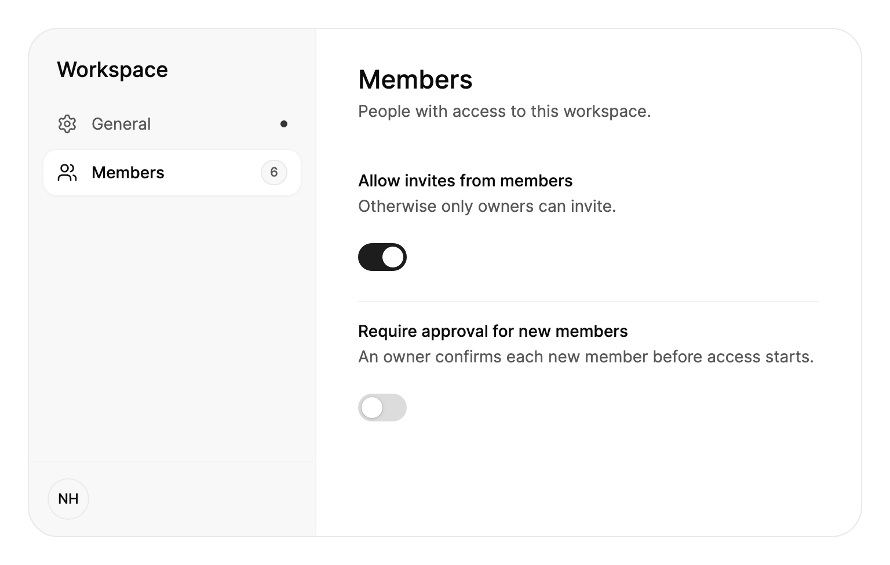

<Demo name="Overview" />

## 何時使用

`SettingsPage` 是應用程式或工作區的設定區域。左側一欄在頁面標題之下、帳號卡片之上列出各個區段，例如個人資料、通知、安全性和帳單。所選區段佔據頁面其餘的部分。由於頁面知道哪個區段有未儲存的變更，它可以為該區段顯示一個儲存列，因此使用者總能看到自己的變更是否待儲存。

- **管理後台中的工作區設定**：一個 Larkspur 工作區，包含一般、成員和帳單區段。擁有者在它們之間切換時不會失去頁面狀態，每個區段承載自己職責的表單。
- **SaaS 產品中的帳號設定**：為一位已登入的使用者提供個人資料、通知、安全性和帳單。區段與使用者尋找設定的方式一致，因此無需搜尋就能在安全性下找到「兩步驟驗證」。
- **帶儲存步驟的帳單區域**：公司名稱、帳單電子郵件和統一編號一起編輯，並以一個動作儲存。捨棄會還原已儲存的值，這是一般的設定列列表無法提供的。
- **窄視窗或側邊面板中的設定**：低於 720 px 時，頁面變為單欄，區段變為一排可橫向捲動的膠囊。同一個頁面可以在分割檢視或手機寬度的視窗中使用。
- **區段多到單一表單放不下的設定**：導覽讓每個區段都只需一次點擊，並且在長區段捲動時保持不動，因為捲動的只有內容欄。

## 何時不用

- **一個簡短的選項清單**：單獨在卡片或對話方塊中使用 `SettingsGroup` 搭配 `SettingsRow`。
- **在應用程式任意位置依名稱尋找並修改設定**：使用 `SettingsCommand`，即就地修改值的搜尋面板。
- **應用程式各區域之間的導覽**：使用 `Sidebar`。設定頁面是一個擁有自己區段的區域，而不是應用程式的外殼。
- **同一筆記錄的不同檢視，例如概覽、活動和檔案**：使用 `Tabs`。標籤頁切換檢視，無需儲存步驟。
- **必須依序完成的步驟**，例如新手導覽或方案變更：使用 `Stepper`，它會顯示使用者目前所處的流程位置。

## 用法

每個區段寫一個 `SettingsSection`。`Header`、`Icon` 和 `Badge` 顯示在導覽中，所選區段則在右側顯示其 `Header`、`Description` 和內容。第一個已啟用的區段會被選取；設定 `SelectedIndex`、呼叫 `Select(section)`，或把 `SelectedValue` 設為某個區段的 `Value`，可顯示其他區段。`Title` 位於導覽上方，`Footer` 位於導覽下方，例如帳號卡片。

```xml
<UserControl xmlns="https://github.com/avaloniaui"
             xmlns:x="http://schemas.microsoft.com/winfx/2006/xaml"
             xmlns:arc="https://github.com/AIDotNet/TKCode.Arc">
    <arc:SettingsPage Height="480">
        <arc:SettingsSection Header="個人資料" Icon="{x:Static arc:ArcIcons.User}" Description="他人如何看到你。">
            <arc:Input Label="全名" Text="Noor Haddad" />
        </arc:SettingsSection>
        <arc:SettingsSection Header="通知" Icon="{x:Static arc:ArcIcons.Bell}" Badge="2">
            <arc:SettingsGroup Appearance="Plain">
                <arc:SettingsRow Header="提及" Description="有人提及你時。">
                    <arc:Switch IsChecked="True" />
                </arc:SettingsRow>
            </arc:SettingsGroup>
        </arc:SettingsSection>
    </arc:SettingsPage>
</UserControl>
```

`SettingsPage` 衍生自 Avalonia 的 `SelectingItemsControl`，它的項目就是各個區段。因此選取的運作方式與任何選擇器一樣：`SelectedIndex`、`SelectedItem` 和 `SelectionChanged` 的行為與平常相同，`SelectedSection` 則以 `SettingsSection` 的形式傳回目前顯示的區段。頁面會為每個區段產生一個導覽項目，並管理選取的膠囊、內容區域和儲存列，因此區段只需描述自己的內容。

### 結構

1. **標題**（`Title`，預設為 "Settings"）：導覽欄頂部的中等字重大字，兩側留出 24 px 的間距。
2. **導覽欄**：寬 248 px，背景是表面色與 2.5% 前景色的混合，右邊緣有一條 1 px 的分隔線。
3. **導覽項目**（每個區段的 `Header`、`Icon`、`Badge`）：高 40 px，項目之間間距 2 px。圖示為 18 px，標題為小號文字。未選取的項目使用次要文字顏色；選取的項目使用前景色和中等字重。
4. **徽章**（`Badge`、`BadgeTone`）：位於導覽項目末端的小型 `Badge`，例如新訊息的數量；預設為中性色調，`BadgeTone` 可設為其他色調。
5. **未儲存圓點**：當區段設定了 `IsDirty` 時，導覽項目中出現一個 6 px 的強調色圓點。
6. **選取膠囊**：一個抬起的表面，帶 1 px 的淡邊框和靜止陰影，圓角 12 px。它會在各導覽項目之間滑動。
7. **頁尾**（`Footer`）：位於欄底部的分隔線之下，內距為 16 px 和 14 px。緊湊版面中隱藏。
8. **內容區域**：獨立捲動，兩側留出 36 px 的間距，上方 30 px。區段標題為特大號中等字重文字，其 `Description` 位於下方 4 px 處，為小號次要文字，內容再向下 24 px 開始。
9. **儲存列**：一個抬起的膠囊，置中位於內容區域底部，帶浮動陰影，內距為 18、5、5、5 px。它包含提示「未儲存的變更」、一個幽靈式的「捨棄」按鈕和一個主要的「儲存變更」按鈕。內容底部保留 72 px 的空間，因此最後一列永遠不會被儲存列遮住。

### 未儲存的變更

區段有未儲存的變更時，將其 `IsDirty` 設為 `true`。它的導覽項目會顯示一個圓點；選取該區段時，頁面底部會升起儲存列，其中有捨棄和儲存。儲存（或按 Ctrl+S，macOS 上為 ⌘S）會引發 `SaveRequested`，捨棄會引發 `DiscardRequested`。兩者都攜帶 `Section`。儲存或還原變更後，將 `IsDirty` 設回 `false`。

根據表單設定 `IsDirty`，而不是根據打開區段的動作：比較目前的值與已儲存的值，這樣使用者把某個值改回原樣時，圓點就會消失。頁面不會阻止使用者切換區段。仍有未儲存變更的區段會在導覽中保留圓點，並在再次被選取時重新顯示儲存列。

<Demo name="UnsavedChanges" />

```csharp
page.SaveRequested += async (_, e) =>
{
    await SaveProfileAsync();
    e.Section.IsDirty = false;
};
```

### 徽章色調

`BadgeTone` 使用 `Badge` 的色調為區段的徽章著色：`Neutral`（預設）、`Success`、`Info`（強調色）、`Warning` 和 `Danger`。需要使用者處理的區段（例如付款方式已過期）用 `Warning` 或 `Danger`，計數保留中性色調。

```xml
<arc:SettingsPage Height="320">
    <arc:SettingsSection Header="Profile" Icon="{x:Static arc:ArcIcons.User}" />
    <arc:SettingsSection Header="Security" Icon="{x:Static arc:ArcIcons.Shield}" Badge="Review" BadgeTone="Warning" />
    <arc:SettingsSection Header="Billing" Icon="{x:Static arc:ArcIcons.CreditCard}" Badge="Failed" BadgeTone="Danger" />
</arc:SettingsPage>
```

### 版面與寬度

頁面寬度不小於 `CompactWidth`（預設 720 px）時為兩欄。低於該寬度時變為單欄：標題位於一排可橫向捲動的區段膠囊之上，頁尾隱藏，內容的內距變小（兩側 20 px，上方 22 px，下方 24 px）。`IsCompact` 反映目前的版面，頁面還帶有 `:compact` 虛擬類別，因此樣式可以據此調整頁面。應依頁面可用的空間而不是螢幕來選擇寬度：400 px 側邊面板中的設定頁面即使在寬螢幕上也是緊湊版面。

<Demo name="Compact" />

### 選取值

為每個區段設定一個識別它的 `Value`，例如路由鍵或列舉成員，然後繫結頁面的 `SelectedValue`。它是雙向的：頁面回報所選區段的 `Value`，設定 `SelectedValue` 則顯示具有該值的區段，因此檢視模型可以讓頁面開啟在某個區段上，也能跟隨使用者的選擇。沒有 `Value` 的區段回報它自己。若要以其他方式讀取值，像在任何 Avalonia 選取器上一樣設定 `SelectedValueBinding`。

```xml
<arc:SettingsPage SelectedValue="{Binding Route}">
    <arc:SettingsSection Header="Profile" Value="profile" Icon="{x:Static arc:ArcIcons.User}" />
    <arc:SettingsSection Header="Notifications" Value="notifications" Icon="{x:Static arc:ArcIcons.Bell}" />
    <arc:SettingsSection Header="Billing" Value="billing" Icon="{x:Static arc:ArcIcons.CreditCard}" />
</arc:SettingsPage>
```

對於列舉，每個值要寫成列舉成員 `Value="{x:Static local:SettingsTab.Billing}"`，而不是它的名稱：頁面用 `Equals` 比較值，字串 `"Billing"` 不等於 `SettingsTab.Billing`。

```csharp
public enum SettingsTab { Profile, Notifications, Billing }

public partial class SettingsViewModel : ObservableObject
{
    // 頁面開啟時顯示 Notifications；使用者的選擇會寫回這裡。
    [ObservableProperty]
    private SettingsTab _tab = SettingsTab.Notifications;
}
```

### 繫結到檢視模型

頁面是一個選擇器，因此應讀取 `SelectedSection`，並呼叫 `Select(section)` 方法。髒狀態和儲存步驟屬於檢視模型。依照 CommunityToolkit.Mvvm 的風格，檢視模型將工作區名稱與已儲存的值比較，把結果公開為 `HasChanges`，並以命令的形式執行儲存和捨棄：

```csharp
public partial class WorkspaceSettingsViewModel : ObservableObject
{
    private readonly Func<string, Task> _saveName;
    private string _savedName = "Larkspur Studio";

    [ObservableProperty]
    [NotifyPropertyChangedFor(nameof(HasChanges))]
    private string _workspaceName = "Larkspur Studio";

    public bool HasChanges => WorkspaceName != _savedName;

    [RelayCommand]
    private async Task SaveAsync()
    {
        await _saveName(WorkspaceName);
        _savedName = WorkspaceName;
        OnPropertyChanged(nameof(HasChanges));
    }

    public WorkspaceSettingsViewModel(Func<string, Task> saveName) => _saveName = saveName;

    [RelayCommand]
    private void Discard() => WorkspaceName = _savedName;
}
```

```xml
<arc:SettingsPage Title="Workspace">
    <arc:SettingsSection Header="一般" Icon="{x:Static arc:ArcIcons.Settings}"
                         Description="工作區的名稱和地址。"
                         IsDirty="{Binding HasChanges}">
        <arc:Input Label="工作區名稱" Text="{Binding WorkspaceName, Mode=TwoWay}" />
    </arc:SettingsSection>
</arc:SettingsPage>
```

事件把頁面的儲存列連接到程式碼後置中的命令：

```csharp
Page.SaveRequested += (_, _) => ViewModel.SaveCommand.Execute(null);
Page.DiscardRequested += (_, _) => ViewModel.DiscardCommand.Execute(null);
```

區段編輯的值使用雙向繫結，而應用程式設定的 `IsDirty`、`Title` 和 `Footer` 使用單向繫結。當應用程式需要知道目前顯示的區段時（例如為了選擇儲存動作）讀取 `SelectedSection`。

### 設定群組與設定列

`SettingsGroup` 和 `SettingsRow` 用於建構區段的內容，也可以單獨用在任何地方。設定列顯示選用的 `Icon`、`Header` 和 `Description`，並把用於修改設定的控制項作為其內容。低於 `StackWidth`（預設 440）時，控制項會移到文字下方。當控制項是 `Switch` 或 `Checkbox` 時，點擊文字即可切換它，控制項會把標題和說明作為其無障礙名稱和說明文字。

群組預設繪製為卡片，可選的 `Header`、`Description`、`HeaderActions` 以及帶淡色底的 `Footer` 條。`Appearance="Plain"` 會去掉外框，適用於頁面內用細線分隔的群組。區段本身已有標題，因此在區段內優先使用 `Plain`，避免頁面中出現卡片套卡片。

<Demo name="Rows" />

### 設定列的詳細資訊與前置內容

`Details` 在設定列的標題和說明下方放入任意內容：例如「Last synced 2 minutes ago」這樣的狀態列、錯誤訊息或一排標籤。文字以超小字級和弱化顏色顯示，位於說明下方 4 px；其他內容保持自身外觀，因此錯誤訊息可以使用危險色。`Leading` 用任意內容取代圖示區塊，例如 `Avatar` 或服務的標誌。它保持自身尺寸，後面留出與圖示區塊相同的 16 px 間距，並且 `LabelWidth` 會把它計算在內，因此各列的控制項仍然對齊。設定列有 `Leading` 內容時，不顯示其 `Icon`。

<Demo name="RowSlots" />

### 多欄

群組預設把設定列排成一欄。設定 `Columns` 可以讓設定列並排：設定列由左到右依序填滿每一列中等寬的欄，同一列裡的設定列與其中最高的一項等高，只有第一列以下的設定列繪製細線。`ColumnSpacing`（預設 32）是欄間距，`RowSpacing`（預設 0）是列間距。附加屬性 `SettingsGroup.ColumnSpan` 讓設定列跨越多欄；`0` 跨越整列，適合需要更多空間的設定，例如選項較長的下拉選單。目前這一列剩餘的空間放不下的設定列會從下一列開始。

窄欄中的設定列在寬度低於其 `StackWidth` 時仍會把控制項移到文字下方。對於只有標題和開關這類較短的設定列，可以調低 `StackWidth`，讓控制項在欄中仍留在文字旁邊。

<Demo name="Columns" />

### 響應式欄數

設定 `MinColumnWidth` 後，群組會依自身寬度決定欄數：在不小於該寬度的前提下盡可能多分欄，最多 `Columns` 欄；連兩欄都放不下時為一欄。`Columns="0"` 取消上限，群組會依能放下的數量分欄，但欄數不會超過設定列的數量。`ActualColumns` 反映目前使用的欄數。

<Demo name="ResponsiveColumns" />

```xml
<!-- 寬視窗中為兩欄，寬度低於 2 × 320 px 加欄間距時為一欄。 -->
<arc:SettingsGroup Columns="2" MinColumnWidth="320">
    <arc:SettingsRow Header="Notifications">
        <arc:Switch IsChecked="True" />
    </arc:SettingsRow>
    <arc:SettingsRow Header="Start at login">
        <arc:Switch />
    </arc:SettingsRow>
</arc:SettingsGroup>
```

如果要用其他方式排列設定列，可以把 `ItemsPanel` 換成任意 Avalonia 面板，例如 `WrapPanel` 或 `UniformGrid`。此時與欄相關的屬性不再生效。

### 標籤寬度與對齊

`LabelWidth`、`ContentAlignment` 和 `ContentSpacing` 決定控制項在設定列中的位置。在群組上設定後，群組內的每一列都會繼承；在某一列上設定則只覆寫該列。

- `LabelWidth` 固定從設定列左邊緣到控制項的距離（包含圖示），因此無論設定列是否帶圖示，群組內的控制項都會對齊。不設定時，文字依需要佔用寬度，控制項位於右側。
- `ContentAlignment` 決定控制項在固定 `LabelWidth` 旁邊空間中的位置：`Right`（預設）、`Left`、`Center`，或用 `Stretch` 填滿該空間，適合輸入框和下拉選單。不設定 `LabelWidth` 時，控制項保持自身寬度並位於右側。
- `ContentSpacing` 是文字與控制項之間的間距：控制項在文字旁邊時預設為 16 px，在文字下方時預設為上方 12 px。

當設定列窄於其 `StackWidth` 時，控制項移到文字下方，標籤寬度不再生效。此時控制項位於左側，使用 `Stretch` 時填滿整列。

<Demo name="LabelWidth" />

### 文字

`Labels` 包含儲存列的文字和無障礙名稱。若要翻譯，請整體替換這個物件。

```csharp
page.Labels = new SettingsPageLabels
{
    UnsavedChanges = "Nicht gespeicherte Änderungen",
    Save = "Speichern",
    Discard = "Verwerfen",
};
```

### 範例：管理後台中的工作區設定

Larkspur Studio 的管理後台打開時停留在成員區段，而一般區段中有一個未儲存的工作區名稱。一般上的圓點告訴擁有者有變更待處理；儲存列在選取一般之前一直隱藏，因此成員區段絕不會提示儲存別人的變更。頁面寬 720 px，因此使用兩欄，頁尾顯示目前登入者的頭像。成員的徽章顯示導覽中工作區的規模。



```xml
<arc:SettingsPage Width="720" Height="440" Title="Workspace" SelectedIndex="1">
    <arc:SettingsPage.Footer>
        <arc:Avatar DisplayName="Noor Haddad" />
    </arc:SettingsPage.Footer>
    <arc:SettingsSection Header="General" Icon="{x:Static arc:ArcIcons.Settings}"
                         Description="Name and address of the workspace." IsDirty="True">
        <StackPanel Spacing="16">
            <arc:Input Label="Workspace name" Text="Larkspur Studio Labs" />
            <arc:Input Label="Workspace URL" Text="larkspur" Prefix="arc.app/" IsReadOnly="True"
                       Description="Contact support to change the address." />
        </StackPanel>
    </arc:SettingsSection>
    <arc:SettingsSection Header="Members" Icon="{x:Static arc:ArcIcons.Users}" Badge="6"
                         Description="People with access to this workspace.">
        <arc:SettingsGroup Appearance="Plain">
            <arc:SettingsRow Header="Allow invites from members"
                             Description="Otherwise only owners can invite.">
                <arc:Switch IsChecked="True" />
            </arc:SettingsRow>
            <arc:SettingsRow Header="Require approval for new members"
                             Description="An owner confirms each new member before access starts.">
                <arc:Switch />
            </arc:SettingsRow>
        </arc:SettingsGroup>
    </arc:SettingsSection>
</arc:SettingsPage>
```

### 文案規範

用區段所承擔的職責為其命名，使用句首大寫，標題要足夠短，以適應 248 px 的導覽欄。每個區段的 `Description` 寫成一句話，說明該區段會改變什麼。儲存列上使用「儲存變更」和「捨棄」，讓動作名稱直接表達它所執行的操作。

| 不要寫 | 改為 |
|---|---|
| 其他 | 進階 |
| 你的帳號設定 | 個人資料 |
| 你有未儲存的變更！！！ | 未儲存的變更 |
| 提交 | 儲存變更 |
| 還原 | 捨棄 |
| 變更你的帳單資訊 | 帳單 |

徽章要簡短：使用「2」這樣的數量，或「新」這樣的詞。不要在徽章中放一句話；導覽項目沒有這個空間。

### 最佳做法

**建議**

- 依使用者所承擔的職責對區段分組，例如個人資料、通知、安全性和帳單，讓使用者在閱讀導覽之前就知道該去哪裡找。
- 只要某個值與已儲存的值不同就設定 `IsDirty`，並在儲存或捨棄時清除，讓圓點和儲存列始終與表單一致。
- 區段內的群組使用 `Appearance="Plain"`，因為區段和頁面本身已經繪製了標題。
- 顯示一個 `Footer`，標明設定所屬的帳號，讓使用者看清自己正在修改的是誰的工作區或個人資料。
- 每個頁面只保留一種儲存模型。要麼用儲存列逐個區段儲存，要麼一次儲存全部，讓使用者能分辨哪些變更待處理。

**避免**

- 對一些區段自動儲存，對另一些區段使用儲存列。使用者將無法分辨哪些變更會被保留。
- 在沒有可編輯欄位的區段上設定 `IsDirty`。儲存列會出現，卻沒有任何可儲存的內容。
- 把刪除工作區之類的破壞性動作放在儲存列之後。應從該動作打開 `Dialog`，讓儲存流程只用於編輯。
- 長區段卻沒有 `Description`。說明讓使用者在閱讀表單之前就知道該區段會改變什麼。
- 用頁面來展示單一選項清單。卡片中的 `SettingsGroup` 更輕量，也不需要導覽。

### 常見問題

**為什麼我在另一個區段編輯欄位時，儲存列沒有出現？** 儲存列屬於目前選取的區段。有未儲存變更的區段會在導覽中保留圓點，並在該區段被選取時顯示儲存列。

**Ctrl+S 會儲存所有內容嗎？** 它只為目前選取的區段引發 `SaveRequested`，而且只在該區段為髒狀態時生效。為每個要儲存的區段處理該事件，或檢查 `e.Section` 以選擇儲存動作。

**首先顯示哪個區段？** 第一個已啟用的區段，除非 `SelectedIndex` 或 `Select(section)` 選擇了其他區段。已停用的區段在初始選取和鍵盤移動中都會被跳過。

**如何把目前顯示的區段繫結到檢視模型？** 為每個區段設定 `Value`，並繫結雙向的 `SelectedValue`。這樣檢視模型儲存的是路由鍵或列舉成員而不是索引，設定新值即顯示對應的區段。

**如何更改儲存按鈕的文字？** 用一個 `SettingsPageLabels` 取代 `Labels` 物件，並在其 `Save` 屬性中寫入所需文字。其他文字保持預設值，除非你也設定它們。

## API 參考

<!-- api: SettingsPage -->
<!-- api: SettingsSection -->
<!-- api: SettingsGroup -->
<!-- api: SettingsRow -->

### SettingsPageLabels

| 屬性 | 類型 | 說明 |
|---|---|---|
| `UnsavedChanges` | `string` | 儲存列中的提示："Unsaved changes"。 |
| `Save` | `string` | 儲存列的主要按鈕："Save changes"。 |
| `Discard` | `string` | 儲存列的次要按鈕："Discard"。 |
| `NavigationName` | `string` | 區段導覽的無障礙名稱："Settings sections"。 |
| `UnsavedSection` | `string` | 有未儲存變更的區段上圓點的無障礙文字："has unsaved changes"。 |

### 事件引數

| 類型 | 屬性 | 說明 |
|---|---|---|
| `SettingsSectionEventArgs` | `Section` | 要儲存或捨棄變更的區段。 |

## 無障礙

- 每個導覽項目都是一個索引標籤項目，名稱為區段名，其後是徽章；若區段有未儲存的變更，還會加上「has unsaved changes」。導覽的名稱為「Settings sections」。
- 導覽只佔一個 Tab 停駐點。上、下方向鍵（緊湊頁面中為左、右方向鍵）移到上一個或下一個已啟用的區段並將其顯示；Home 和 End 分別移到第一個和最後一個。它們不會循環。
- 所顯示的區段有未儲存的變更時，Ctrl+S（⌘S）會儲存。
- 鍵盤焦點會在導覽項目周圍繪製 2px 的焦點環。指標聚焦時不顯示。
- 儲存列中的提示文字位於禮貌的即時區域中。
- 選取的項目會被朗讀為已選取，因此螢幕閱讀器使用者在每次移動後都能聽到目前顯示的是哪個區段。
- 徽章以文字朗讀，因此色調不是唯一的提示：請把文字（「Review」、「Failed」）寫在徽章中。
- 設定列的 `Leading` 和 `Details` 中的內容保留各自的無障礙名稱和角色；設定列的控制項仍以標題命名。

### 鍵盤

| 按鍵 | 操作 |
|---|---|
| `Up` / `Down`（緊湊時為 `Left` / `Right`） | 將焦點移到上一個或下一個已啟用的區段並將其顯示；不循環 |
| `Home` / `End` | 移到第一個或最後一個區段 |
| `Enter` / `Space` | 選取獲得焦點的區段 |
| `Tab` | 離開導覽，導覽只是一個停駐點，停在獲得焦點或選取的項目上，然後移入內容 |
| `Ctrl+S`（macOS 上為 `⌘S`） | 當選取的區段為髒狀態時引發 `SaveRequested` |

## 動態效果

- 選取的膠囊以輕快的彈簧在導覽項目之間滑動。
- 新進入的區段上移 6px 並淡入（標準時長、進入緩動），離開的區段則原地淡出。
- 儲存列上升進入視野，並向下消失。
- 減少動態效果時保留淡入淡出，取消位移。關閉動態效果時，所有內容一次性切換。

| 變化 | 完整 | 減少 | 關閉 |
|---|---|---|---|
| 選取移到另一個區段 | 膠囊以輕快的彈簧滑動 | 膠囊立即移動 | 膠囊立即移動 |
| 顯示的區段改變 | 新區段上移 6px 並淡入；舊區段原地淡出 | 區段在原位交叉淡變 | 新區段立即顯示 |
| 儲存列出現或消失 | 上升進入視野，並向下消失 | 淡入和淡出 | 立即顯示或隱藏 |

## 響應式

- 寬度低於 `CompactWidth`（預設 720 px）時頁面變為一欄：分區清單變成內容上方的一排可水平捲動的標籤，選取的標籤會捲動到可見位置。`IsCompact` 與 `:compact` 虛擬類別反映這一狀態。
- 頁面依自身寬度而不是視窗寬度判斷，所以放在側邊面板、對話方塊或手機預覽裡也會以同樣的方式切換。
- 只有導覽會變化：各分區保持自己的版面，並排的欄位在緊湊頁面上仍然並排。請在手機寬度下檢查這些分區，太擠時為它們改用一欄。
- 頁面旁邊還有其他內容時調大 `CompactWidth`，避免分區清單擠壓欄位。
- 設定了 `MinColumnWidth` 的 `SettingsGroup` 會隨寬度變窄而減少欄數，因此兩欄的群組在手機寬度下變為一欄。

## 相關元件

- `SettingsCommand`、`SecuritySettings`、`BillingOverview`、`UsageBilling` 和 `CancelFlow`：其他設定區塊，可嵌入區段之中。
- `Tabs`：在同一物件的不同檢視之間切換。
- `Switch`、`Input`、`Select`、`BillingToggle`：範例中區段所用的控制項。

| 元件 | 適用情境 |
|---|---|
| `SettingsGroup` / `SettingsRow` | 一個選項清單就夠用，或區段需要承載內容 |
| `SettingsCommand` | 使用者依名稱搜尋設定並就地修改 |
| `Sidebar` | 導覽在應用程式的各個區域之間移動 |
| `Tabs` | 同一物件的檢視切換，無需儲存步驟 |
| `Stepper` | 有序步驟必須依序完成 |
| `SecuritySettings` / `BillingOverview` | 區段需要完整的安全性或帳單版面 |
