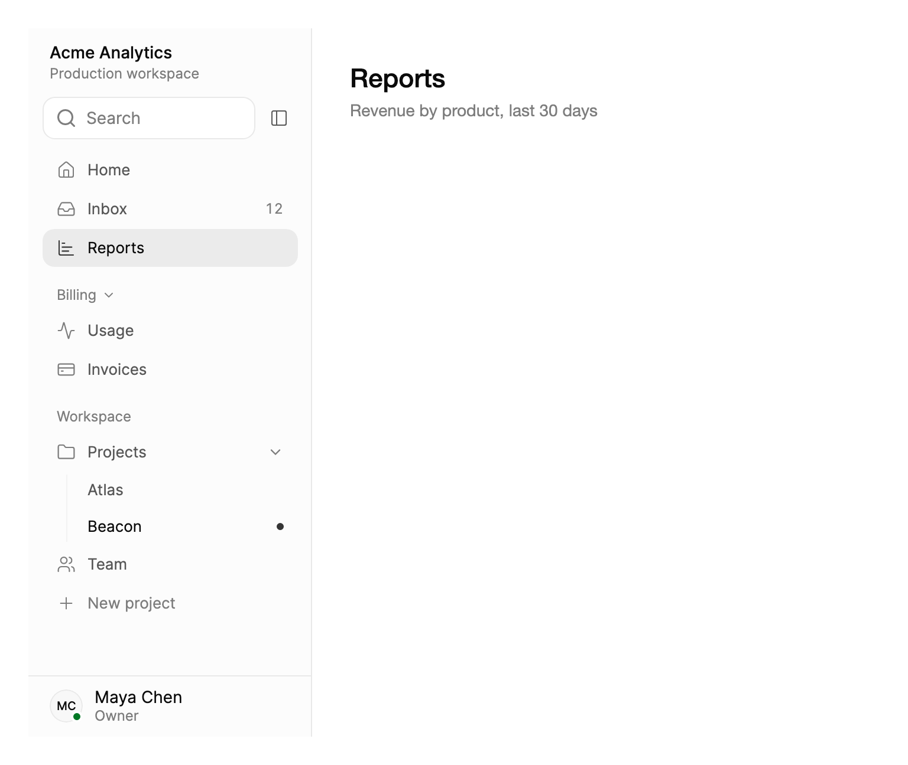

<Demo name="Preview" />

## 何時使用

側邊欄是頁面多到頂部導覽列放不下的應用程式的主導覽。它在整個工作階段中都位於視窗左側邊緣，因此使用者能記住每個頁面的位置，無需搜尋即可返回。

- **SaaS 管理後台的主選單**：工作區的首頁、收件匣、報表、帳單與設定。頂層入口放在第一組中且不帶標題，擁有各自頁面的區域則放在下方帶標題的群組中。
- **工作工具中的專案與區域**：專案清單，每個專案下有一層頁面（Atlas、Beacon）。父列會開啟或收合其頁面，而不是顯示自己的檢視。
- **信箱與文件網站**：帶有數量與彩色標籤的資料夾，或是一棵可隨輸入由篩選欄位即時縮小的指南樹。
- **帳戶與帳單區域**：帳單群組中包含發票與方案，旁邊是帶有新事件數量的用量頁面。使用者在其他區域工作時，該數量仍保持可見。
- **頁面很多的高密度內部工具**：營運主控台中，篩選框可依頁面名稱的開頭字母找到頁面；視窗較窄時，圖示窄欄仍能讓頁面可達。
- **需要留在畫面上、但按需佔用較少空間的導覽**：側邊欄可收合為 64 px 的圖示窄欄，每個頁面都保留提示與選單，因此內容區域維持寬度不變。

## 何時不用

- **同一物件的兩到五個檢視**，例如某筆訂單的概覽、活動與設定：使用 `Tabs`，它位於內容上方，讓物件始終可見。
- **序列中的步驟，或階層結構中的路徑**：精靈使用 `Stepper`，深層結構中頁面所在的位置使用 `Breadcrumb`。
- **深層的資料夾與檔案樹**：使用 `TreeView`。側邊欄只顯示一層巢狀頁面；檔案樹需要在每一層都能展開與收合。
- **動作而非位置**：指令選單使用 `DropdownMenu`，跨頁面與動作的鍵盤搜尋使用 `CommandPalette`。屬於清單本身的少數幾個動作（「New project」「More」）可以作為動作列放在其中，但側邊欄的列大多應當開啟頁面。
- **已登入的使用者與工作區切換**：帳戶選單請在側邊欄的頭部或底部使用 `UserMenu`，側邊欄本身只用於頁面導覽。

## 用法

在側邊欄中放入 `SidebarSection` 元素，並在群組中放入 `SidebarItem` 元素。沒有 `Header` 的群組不顯示標題，適合作為第一組（首頁、收件匣）。為每個頁面設定 `Key`，並將 `SelectedKey` 繫結到你的路由。側邊欄的寬度由主題決定（展開時為 240，窄欄時為 64），因此請將它放在 `DockPanel` 或 `Auto` 格線欄中，不要設定 `Width`。

```xml
<DockPanel xmlns="https://github.com/avaloniaui"
           xmlns:x="http://schemas.microsoft.com/winfx/2006/xaml"
           xmlns:arc="https://github.com/AIDotNet/TKCode.Arc"
           Height="420">
    <arc:Sidebar DockPanel.Dock="Left" SelectedKey="home" IsFilterVisible="True">
        <arc:SidebarSection>
            <arc:SidebarItem Key="home" Label="首頁" Icon="{x:Static arc:ArcIcons.House}" />
            <arc:SidebarItem Key="inbox" Label="收件匣" Icon="{x:Static arc:ArcIcons.Inbox}" Badge="4" />
        </arc:SidebarSection>
        <arc:SidebarSection Header="工作區">
            <arc:SidebarItem Key="projects" Label="專案" Icon="{x:Static arc:ArcIcons.Folder}" IsExpanded="True">
                <arc:SidebarItem Key="projects/atlas" Label="Atlas" />
                <arc:SidebarItem Key="projects/beacon" Label="Beacon" />
            </arc:SidebarItem>
        </arc:SidebarSection>
    </arc:Sidebar>
    <TextBlock Margin="24" Text="頁面內容" />
</DockPanel>
```

`Sidebar` 衍生自 Avalonia 的 `TemplatedControl`。它本身不可取得焦點：其中的列清單接收焦點，因此整個導覽只佔一個 Tab 停駐點。它的內容是 `Sections` 集合（XAML 內容）；每個 `SidebarSection` 在 `Items` 中保存其頁面，而 `SidebarItem` 在自己的 `Items` 中保存子頁面。模型刻意保持精簡：兩層頁面、一個選取的頁面，其餘一切都是數量、圖示或旗標。

選取的頁面背後是一塊柔和的區塊，圖示變為強調色，區塊在各列之間滑動。頁面頂部的預覽是應用窄欄配置：頭部是標誌與兩行標題，頁面自己的頂端列負責切換側邊欄，底部是已登入的使用者。下面的配置再給出三種。

### 結構

1. **頭部**（`Header`）：側邊欄頂部的內容，通常是標誌加標題或工作區切換器。兩側各有 12 px 邊界，並與收合按鈕共用一列。在窄欄上，頭部會讓位給收合按鈕；沒有收合按鈕時，頭部保留，並裁切至窄欄寬度。
2. **收合按鈕**（`IsCollapseButtonVisible`、`CollapseButtonPlacement`、`CollapseButtonText`）：一個 40 px 寬的幽靈圖示按鈕，顯示 PanelLeft 圖形。它位於頭部列末端，或在篩選欄位旁邊。預設顯示。
3. **篩選**（`IsFilterVisible`、`FilterText`、`FilterPlaceholder`）：頭部下方 32 px 高的搜尋欄位，兩側各有 12 px 邊界。在窄欄上它會變成一個 40 px 的搜尋按鈕。
4. **群組標題**（`SidebarSection.Header`）：28 px 高的一列，使用淡化文字顏色的小號文字，第一個群組之後，它的上方留 10 px。可收合的標題末端有一個 12 px 的箭頭。沒有 `Header` 的群組不顯示標題；在第一個群組之後，它會留出一個 16 px 的間距。
5. **頁面列**（`SidebarItem`）：32 px 高，圓角 10 px，兩側內距 12 px。包含淡化色的 16 px 圖示（`Icon`）、標籤（`Label`，13 px，次要文字顏色）前 10 px 的間距，以及末端可選的數量（`Badge`）。列與列之間相距 1 px。
6. **選取區塊**：選取列背後一塊前景色的柔和淡色，標籤使用完整對比，圖示使用強調色。沒有強調色條。它是共用元素，在各列之間滑動。
7. **未讀點與動作列**：`IsUnread` 會在列尾加上一個 6 px 的強調色圓點，並讓標籤更醒目。`IsAction` 列顏色柔和，永遠不會被選取。
8. **巢狀頁面**：子列 30 px 高，縮排在父列下方 26 px，垂掛在一條 1 px 的引導線上，引導線使用細框線顏色。子項的子項不會顯示。
9. **父層級箭頭**：父列末端一個 14 px 的箭頭。父層級收合時朝右，展開時朝下。
10. **頁尾**（`Footer`）：底部的內容，通常是已登入的使用者，上方有一條 1 px 的分隔線。兩側各有 12 px 邊界，在窄欄上保持展開時的配置，並裁切至窄欄寬度。

窗格比旁邊的頁面略深一點（表面色與淡化表面色的混合），右側有一條 1 px 的框線。展開時側邊欄寬 240 px，窄欄寬 64 px；兩者皆由主題提供。`Background`、`BorderThickness` 與 `CornerRadius` 都是一般屬性，因此側邊欄也可以作為圓角卡片浮動。

### 配置

側邊欄只是一個控制項；它周圍的配置來自放進頭部、篩選欄位與底部的內容、你給它的外框，以及它旁邊的頁面。下面四種配置展示了它的適用範圍，每一種都可以收合為窄欄。頁面頂部的預覽是第一種，**應用窄欄**：頭部是標誌與兩行標題，側邊欄自己不顯示收合按鈕（`IsCollapseButtonVisible="False"`），因為頁面的頂端列上有一個呼叫 `ToggleCollapsed()` 的切換按鈕，底部是使用者區。

**工作區。** 側邊欄以內嵌卡片的形式浮動：用 `CornerRadius` 與 `BorderThickness` 給它自己的圓角框線。頭部是工作區切換器，收合按鈕位於篩選欄位旁邊（`CollapseButtonPlacement="Filter"`）。頁面用彩色圓點作為圖示，`IsUnread` 標出有新動態的專案，清單以一個動作列結尾。底部有儲存空間用量條（`Progress`）與已登入的使用者（帶狀態點的 `Avatar`）。

<Demo name="Workspace" />

**收件匣。** 頭部是佔滿整列的「Compose」按鈕（在窄欄上只保留它的圖示），下面是帶數量的資料夾、帶彩色圓點且可收合的「Labels」群組，以及一個柔和的「More」列（帶 `TrailingIcon` 的 `IsAction`）。頁面自己的頂端列負責切換側邊欄。

<Demo name="Inbox" />

**文件。** 頭部是標題與版本按鈕，篩選欄位旁邊是收合按鈕。頁面是帶圖示與箭頭的群組樹；在篩選欄位中輸入會即時縮小這棵樹，並展開相符的群組。旁邊的頁面是一篇文章，帶有「On this page」大綱：範例的 code-behind 監看捲動位置，用 `GlidingIndicator` 讓 2 px 的強調色條滑到目前的標題。

<Demo name="Docs" />

四種配置都使用 `ResizeMode="Overlay"`（見「側邊欄旁邊的頁面」）。文件配置中側邊欄自己的設定很簡短：

```xml
<arc:Sidebar x:Name="Nav"
             IsFilterVisible="True"
             CollapseButtonPlacement="Filter"
             FilterPlaceholder="搜尋文件"
             ResizeMode="Overlay">
    <arc:Sidebar.Header>
        <TextBlock Text="Tidewater 文件" />
    </arc:Sidebar.Header>
    <arc:SidebarSection>
        <arc:SidebarItem Key="start" Label="入門" Icon="{x:Static arc:ArcIcons.Sparkles}" IsExpanded="True">
            <arc:SidebarItem Key="start/introduction" Label="簡介" />
            <arc:SidebarItem Key="start/quickstart" Label="快速開始" />
        </arc:SidebarItem>
    </arc:SidebarSection>
</arc:Sidebar>
```

### 群組與巢狀頁面

帶有子項目的 `SidebarItem` 是父層級。父層級永遠不會被選取：選取它會展開或收合其頁面，這些頁面垂掛在一條細引導線下。需要著陸頁的父層級應為該頁面加入一個子項目（例如「報表」下的「概覽」）。父層級的 `IsExpanded` 是雙向的。在帶有 `Header` 的 `SidebarSection` 上設定 `IsCollapsible`，即可讓使用者把整個群組收合；此時標題末端會出現一個小箭頭，該群組自身的 `IsExpanded` 同樣是雙向的。不可收合的群組始終顯示其頁面。只顯示一層巢狀。

`IsEnabled="False"` 會讓頁面變淡，方向鍵會略過它；被停用的父層級也無法展開。每個項目還可以帶有 `Tag` 與 `Command`（以及 `CommandParameter`）。

### 數量、未讀點、動作列與圖示

`Badge` 會在列尾顯示一個簡短的數量，例如未讀訊息的「12」；`Badge` 為 `null` 時不顯示任何內容。`IsUnread="True"` 則在列尾顯示一個小的強調色圓點，讓標籤更醒目，並在該列的無障礙名稱中加上「未讀」。數字有意義時用數量，只需要表示「有新內容」時用圓點。在窄欄上，兩者都會變成圖示上的圓點。

`Icon` 接受 24 × 24 的 Lucide 圖形（例如 `ArcIcons` 中的字形），也可以是任何能放入 16 px 圖示槽的控制項。用一個小的 `Ellipse` 就能做出彩色圓點圖示，並與其他列的圖示對齊。作為圖示的控制項只能放在一列中，因此請為每個項目各建立一個。`TrailingIcon` 會在標籤之後緊接一個圖示，顏色與標籤的淡化色相同；適合用作提示，例如「More」列的箭頭。

`IsAction="True"` 會把一列變成動作：顏色柔和，永遠不會被選取。選取它會引發 `ItemInvoked` 並執行其命令，但 `SelectedItem` 保持不變。適用於「New project」或「More」。

```xml
<arc:Sidebar xmlns="https://github.com/avaloniaui"
             xmlns:x="http://schemas.microsoft.com/winfx/2006/xaml"
             xmlns:arc="https://github.com/AIDotNet/TKCode.Arc">
    <arc:SidebarSection Header="專案">
        <arc:SidebarItem Key="projects/spring" Label="春季發表">
            <arc:SidebarItem.Icon>
                <Ellipse Width="8" Height="8" Fill="{arc:ArcDesignTokenResource Series1}" />
            </arc:SidebarItem.Icon>
        </arc:SidebarItem>
        <arc:SidebarItem Key="projects/partner" Label="合作夥伴套件" IsUnread="True" />
        <arc:SidebarItem Key="projects/new" Label="新增專案" IsAction="True" Icon="{x:Static arc:ArcIcons.Plus}" />
        <arc:SidebarItem Key="projects/more" Label="更多" IsAction="True" TrailingIcon="{x:Static arc:ArcIcons.ChevronRight}" />
    </arc:SidebarSection>
</arc:Sidebar>
```

### 頭部、篩選與底部

`Header` 接受任意內容：標誌加兩行標題、工作區切換器、版本標籤、佔滿整列的按鈕。`Footer` 位於一條細分隔線下，可放已登入的使用者、儲存空間用量條，或兩者都放。兩者都會保持側邊欄展開時的配置，並裁切至窄欄寬度，因此位於起始邊緣的標誌或大頭貼仍然可見。像上面的各種配置那樣，用 `:collapsed` 偽類淡出其餘內容。

`IsFilterVisible` 會在頭部下方顯示篩選欄位（見「篩選」）。收合按鈕通常位於頭部列的末端；`CollapseButtonPlacement="Filter"` 則把它放到篩選欄位旁邊，如工作區與文件配置所示。沒有可見的篩選欄位時，按鈕仍留在頭部列。在窄欄上它總是移到頂部。當頁面有自己的切換按鈕時（如應用窄欄與收件匣），用 `IsCollapseButtonVisible="False"` 去掉它。

### 選取與路由

`SelectedItem` 與 `SelectedKey` 是雙向的，並保持同步。`SelectedKey` 與頁面的 `Key` 相符，是繫結到路由的合適屬性，因為路由本身就是字串。在頁面存在之前設定 `SelectedKey` 也沒有問題：頁面出現後，側邊欄會選取它，因此檢視模型可以先設定路由。與任何頁面都不相符的鍵，以及父層級或動作列的鍵，不會選取任何東西，並保留其值。

`ItemInvoked` 是一個路由事件，每次選取頁面或動作時都會引發：無論是點選、按 Enter 或 Space，還是窄欄上的選單。即使該頁面已經被選取，它也會引發，而繫結到 `SelectedKey` 無法告訴你這一點。對於每次選擇都必須發生的導覽（例如把頁面捲回頂端），請使用它。事件之後，該項自己的 `Command` 會執行，然後以該項為參數執行 `SelectCommand`，兩者都只在可以執行時才執行。

<Demo name="DataBinding" />

```csharp
sidebar.ItemInvoked += (_, e) => router.Navigate(e.Item.Key!);
```

### 繫結到檢視模型

側邊欄沒有 `ItemsSource`：它的群組是 XAML 內容，因此列要嘛在 XAML 中撰寫，要嘛在程式碼中加入與移除（用於會變動的資料）。檢視模型保存路由與收合狀態；側邊欄透過雙向繫結與之關聯，並為每次選取執行一個命令。

```csharp
public partial class WorkspaceShellViewModel : ObservableObject
{
    private readonly INavigationService _navigation;

    public WorkspaceShellViewModel(INavigationService navigation) => _navigation = navigation;

    [ObservableProperty]
    private string? _selectedKey = "home";

    [ObservableProperty]
    private bool _isNavigationCollapsed;

    [RelayCommand]
    private void OpenPage(SidebarItem item)
    {
        // 每次選取都會執行，包括已經選取的頁面。
        _navigation.Navigate(item.Key!);
    }
}
```

```xml
<arc:Sidebar SelectedKey="{Binding SelectedKey, Mode=TwoWay}"
             IsCollapsed="{Binding IsNavigationCollapsed, Mode=TwoWay}"
             SelectCommand="{Binding OpenPageCommand}"
             Label="Main navigation"
             IsFilterVisible="True" />
```

- `SelectedKey` 與 `IsCollapsed` 是雙向的，因此應用程式其他地方的路由變動（頁面中的連結、返回按鈕）會選取對應的列，而窄欄按鈕的狀態會寫回檢視模型。
- 把導覽的副作用放在 `SelectCommand` 或 `ItemInvoked` 中執行，不要放在 `SelectedKey` 的處理常式中。路由由程式碼設定時選取項也會改變，而這並不總是使用者的選擇。
- 視窗變窄時，依你自己的視窗寬度檢查來設定 `IsNavigationCollapsed`；側邊欄不會替你監看視窗。
- 當資料驅動選單時，請在程式碼中建構群組，並保留對數量會變動的項目的參照：

```csharp
var inbox = new SidebarItem { Key = "inbox", Label = "收件匣", Icon = ArcIcons.Inbox };
sidebar.Sections.Add(new SidebarSection
{
    Items = { new SidebarItem { Key = "home", Label = "首頁", Icon = ArcIcons.House }, inbox }
});

// 數量變動時該列會原地更新：無需重建，也不會遺失焦點。
inbox.Badge = unreadCount > 0 ? unreadCount.ToString(CultureInfo.InvariantCulture) : null;
```

### 圖示窄欄

`IsCollapsed` 會把側邊欄收合為 64 px 的窄欄，它是雙向的，因此頁面中任何位置的按鈕都可以透過繫結或呼叫 `ToggleCollapsed()` 來驅動它。側邊欄裡的收合按鈕，以及焦點位於側邊欄內時的 Cmd+B（在 Windows 與 Linux 上為 Ctrl+B），都會執行相同的操作，即使篩選欄位有焦點也是如此。

在窄欄上，每個頁面右側都會顯示帶有其標籤的工具提示。數量或未讀標記會變成圖示上一個 6 px 的圓點，群組標題變為細分隔線，篩選欄位變為搜尋按鈕，點選後會展開側邊欄並把游標放入篩選欄位；父層級則會在右側的選單中開啟其頁面。選單先列出父層級的標籤，然後將其頁面列為單選項：目前選取的頁面顯示為已勾選，被停用的頁面顯示為停用，數量則作為快速鍵文字顯示。沒有圖示的頁面顯示其第一個字母。

頭部與頁尾保持展開時的配置，並裁切至窄欄寬度，因此位於起始邊緣的標誌或大頭貼仍然可見。與各種配置一樣，使用 `:collapsed` 偽類淡出其餘內容。收合按鈕可見時，窄欄上的頭部會讓位給它。

<Demo name="Rail" />

```xml
<UserControl xmlns="https://github.com/avaloniaui"
             xmlns:arc="https://github.com/AIDotNet/TKCode.Arc">
    <UserControl.Styles>
        <Style Selector="arc|Sidebar:collapsed TextBlock.rail-fade">
            <Setter Property="Opacity" Value="0" />
        </Style>
    </UserControl.Styles>
    <arc:Sidebar IsCollapsed="True" Height="320" />
</UserControl>
```

### 側邊欄旁邊的頁面

預設情況下（`ResizeMode="Overlay"`），側邊欄的配置寬度會立即改變，頁面只配置一次，只有窗格做彈簧動畫，並繪製在頁面上方。把頁面的 `RenderTransform` 繫結到 `PageShift`，頁面就會隨窗格邊緣一起滑動，而不是跳動；不繫結時頁面仍然配置正確，只是會跳到新位置。設定 `ResizeMode="Push"` 則讓配置寬度做彈簧動畫，因此它旁邊的頁面每一個影格都會重新配置。這在任何主機中都不需要繫結就能運作，對輕量頁面也沒有問題。

```xml
<DockPanel xmlns="https://github.com/avaloniaui"
           xmlns:x="http://schemas.microsoft.com/winfx/2006/xaml"
           xmlns:arc="https://github.com/AIDotNet/TKCode.Arc"
           ClipToBounds="True">
    <arc:Sidebar x:Name="Nav" DockPanel.Dock="Left" ResizeMode="Overlay" />
    <Grid RenderTransform="{Binding #Nav.PageShift}">
        <TextBlock Text="頁面內容" />
    </Grid>
</DockPanel>
```

`PageShift` 是唯讀的轉換，在 `Push` 模式下始終為零。頁面滑動的距離最多等於展開寬度與窄欄寬度之差，所以請替它外面的框加上裁切（`ClipToBounds="True"`），如上面的各種配置所示。如果省略這個轉換，頁面仍然會正確配置，只是會跳到新位置，而不是滑過去。

### 篩選

`IsFilterVisible` 會在頭部下方顯示篩選欄位。篩選會將每個頁面的 `Label` 以不分大小寫的子字串比對，並忽略前後空白；動作列也會參與比對。相符的頁面會保留；含有相符子頁面的父層級會展開；沒有相符頁面的群組會隱藏。沒有任何相符項目時，側邊欄會以 `NoMatchesText` 取代列顯示。`FilterText` 是雙向的，`FilterPlaceholder` 為篩選欄位命名。

篩選欄位就是一個搜尋框：按 Escape 清除，按 Down 把焦點移到剩下的第一個頁面，按 Enter 選取剩下的第一個頁面。篩選只決定哪些列可見，因此即使被篩掉，選取的頁面仍維持選取。在窄欄上不套用篩選。

### 資料結構與效能

讓模型只包含導覽所需的內容：`Key` 在整個側邊欄中必須唯一（`SelectedKey` 會找到第一個相符的頁面，而父層級的鍵永遠不會被比對）、簡短的 `Label`、一個圖示以及可選的數量。層級超過一層的頁面應放在 `TreeView` 中。

- **合併且增量。** 對 `Sections` 與各項目集合的變更會被合併處理：各列會在目前批次之後統一更新一次，因此一次加入多個頁面只需一次更新。只有發生變化的部分會被處理：新頁面取得新的列，被移除的頁面失去它的列，仍然存在的頁面的列保留其控制項、焦點與選取狀態。
- **屬性變更的成本很低。** 變更 `Badge`、`IsUnread`、`IsAction`、`Icon` 或 `TrailingIcon` 只會更新該列；變更 `Label` 或 `IsEnabled` 還會重新整理篩選與停用的頁面。
- **收合的父層級不參與配置。** 已經收合並靜止的父層級或可收合群組會完全退出配置與轉譯，因此有許多收合父層級的樹，配置與轉譯都很輕。
- **不在畫面上時不持有任何東西。** 側邊欄不在畫面上時，它不持有任何列，也不訂閱你的項目，因此共用的或靜態的項目不會讓它一直存活；回到畫面上時會重新建構各列。
- **寬度彈簧。** 在 `Push` 模式下，收合過程的每一個影格都會讓頁面重新配置；在 `Overlay` 模式下，頁面只配置一次，只有窗格的排列會變化（見「側邊欄旁邊的頁面」）。

這些列都是真正的控制項，因此側邊欄適合幾十個頁面；更大的目錄應分組，或使用 `CommandPalette` 搜尋。

### 即時資料

側邊欄會跟隨其資料變化：變更項目上的 `Badge`、`IsUnread`、`Label`、`Icon` 或 `IsEnabled`，或增減、移動項目與群組，只有相關的列會變化。新增頁面會讓所在群組以與展開相同的彈簧增高。

<Demo name="LiveUpdates" />

```csharp
// 每一行程式碼只會觸及相關的列：其他列保持原來的控制項、焦點與選取狀態。
inbox.Badge = "3";
inbox.IsUnread = true;
pinned.Items.Add(new SidebarItem { Key = "pinned/roadmap", Label = "Roadmap", Icon = ArcIcons.Flag });
pinned.Items.RemoveAt(0);
```

### 範例：管理後台導覽

這是一個 SaaS 分析工作區的導覽。收件匣上顯示未讀數量，財務使用者可以把帳單收合起來，有新動態的專案帶有未讀點，專案清單以一個動作列結尾。頭部標明工作區，頁尾標明已登入的使用者，因此使用者隨時知道自己位於哪個帳戶中。



```xml
<DockPanel Width="720" Height="600">
    <arc:Sidebar DockPanel.Dock="Left"
                 SelectedKey="reports"
                 IsFilterVisible="True"
                 CollapseButtonPlacement="Filter"
                 FilterPlaceholder="Search">
        <arc:Sidebar.Header>
            <StackPanel Spacing="2" Margin="6,0,0,0">
                <TextBlock Text="Acme Analytics"
                           FontSize="{arc:ArcDesignTokenResource TypeSM}"
                           FontWeight="{arc:ArcDesignTokenResource WeightMedium}"
                           Foreground="{arc:ArcDesignTokenResource Foreground}" />
                <TextBlock Text="Production workspace"
                           FontSize="{arc:ArcDesignTokenResource TypeXS}"
                           Foreground="{arc:ArcDesignTokenResource TextMuted}" />
            </StackPanel>
        </arc:Sidebar.Header>
        <arc:SidebarSection>
            <arc:SidebarItem Key="home"
                             Label="Home"
                             Icon="{x:Static arc:ArcIcons.House}" />
            <arc:SidebarItem Key="inbox"
                             Label="Inbox"
                             Icon="{x:Static arc:ArcIcons.Inbox}"
                             Badge="12" />
            <arc:SidebarItem Key="reports"
                             Label="Reports"
                             Icon="{x:Static arc:ArcIcons.ChartBar}" />
        </arc:SidebarSection>
        <arc:SidebarSection Header="Billing" IsCollapsible="True">
            <arc:SidebarItem Key="usage"
                             Label="Usage"
                             Icon="{x:Static arc:ArcIcons.Activity}" />
            <arc:SidebarItem Key="invoices"
                             Label="Invoices"
                             Icon="{x:Static arc:ArcIcons.CreditCard}" />
        </arc:SidebarSection>
        <arc:SidebarSection Header="Workspace">
            <arc:SidebarItem Key="projects"
                             Label="Projects"
                             Icon="{x:Static arc:ArcIcons.Folder}"
                             IsExpanded="True">
                <arc:SidebarItem Key="projects/atlas" Label="Atlas" />
                <arc:SidebarItem Key="projects/beacon" Label="Beacon" IsUnread="True" />
            </arc:SidebarItem>
            <arc:SidebarItem Key="team"
                             Label="Team"
                             Icon="{x:Static arc:ArcIcons.Users}" />
            <arc:SidebarItem Key="new-project"
                             Label="New project"
                             IsAction="True"
                             Icon="{x:Static arc:ArcIcons.Plus}" />
        </arc:SidebarSection>
        <arc:Sidebar.Footer>
            <StackPanel Orientation="Horizontal" Spacing="10" Margin="6,0,0,0">
                <arc:Avatar DisplayName="Maya Chen" Size="Small" Status="Online" />
                <StackPanel VerticalAlignment="Center">
                    <TextBlock Text="Maya Chen"
                               FontSize="{arc:ArcDesignTokenResource TypeSM}"
                               Foreground="{arc:ArcDesignTokenResource Foreground}" />
                    <TextBlock Text="Owner"
                               FontSize="{arc:ArcDesignTokenResource TypeXS}"
                               Foreground="{arc:ArcDesignTokenResource TextMuted}" />
                </StackPanel>
            </StackPanel>
        </arc:Sidebar.Footer>
    </arc:Sidebar>
    <StackPanel Margin="32,28" Spacing="6">
        <TextBlock Text="Reports"
                   FontSize="{arc:ArcDesignTokenResource TypeXL}"
                   FontWeight="{arc:ArcDesignTokenResource WeightMedium}"
                   Foreground="{arc:ArcDesignTokenResource Foreground}" />
        <TextBlock Text="Revenue by product, last 30 days"
                   FontSize="{arc:ArcDesignTokenResource TypeSM}"
                   Foreground="{arc:ArcDesignTokenResource TextMuted}" />
    </StackPanel>
</DockPanel>
```

保持鍵穩定：`projects/atlas` 這樣的鍵是書籤或深層連結所保存的內容，因此修改標籤是安全的，而修改鍵則不安全。

### 文案規範

- **標籤**：句首大寫的簡短名詞或名詞片語，例如「發票」或「團隊成員」。使用頁面自身標題中的詞，使列與頁面標題一致。
- **動作列**：動詞加受詞，句首大寫，例如「新增專案」。側邊欄中的其他內容都是名詞，所以動詞會告訴使用者這一列會執行動作，而不是開啟頁面。
- **群組標題**：句首大寫的群組名稱，不含動詞。當群組只有一個明顯用途時（如首頁與收件匣），可以省略標題。
- **數量**：只使用數字，而且只用於等待使用者處理的事項：未讀訊息、未處理警示、待審核項目。永遠不變的數量就只是一個標籤。數字無關緊要時，請使用未讀點。

| 不要寫 | 改為 |
|---|---|
| 首頁頁面 | 首頁 |
| 點選這裡查看您的發票 | 發票 |
| 報表（新！！） | 報表 |
| 團隊與權限管理 | 團隊成員 |
| 可以更改的東西 | 設定 |
| 在您的工作區中新增一個專案 | 新增專案 |

### 最佳做法

**建議**

- 把使用者最常造訪的頁面放在第一組中且不帶標題；帶標題的群組只用於有明確名稱的群組。第一組是眼睛最先讀到的內容。
- 將 `SelectedKey` 繫結到路由，並保持鍵穩定，使深層連結、書籤與選取的列保持一致。
- 只為等待使用者處理的工作顯示數量或未讀點，並原地更新；過時的標記會讓使用者學會忽略它。
- 當側邊欄旁邊的頁面內容很多時，設定 `ResizeMode="Overlay"`，把頁面的 `RenderTransform` 繫結到 `PageShift`，並替外框加上裁切。
- 用 `:collapsed` 偽類淡出放在頭部與頁尾的內容，並在起始邊緣保留一個標誌或大頭貼，使窄欄上仍留有可辨識的東西。

**避免**

- 讓父層級成為到達頁面的唯一途徑。父層級會展開與收合，但永遠不會被選取，因此沒有著陸頁的父層級會把使用者帶進死路。請改為加入一個作為著陸頁的子項目。
- 把動作列用得超過一兩處。「New project」與「More」適合放在它們所結尾的清單中；「登出」應放在選單或按鈕中，因為會改變頁面的列會讓使用者期待一個位置。
- 巢狀超過一層，或在其中建構資料夾樹。只顯示一層子項目；更深的樹既難以瀏覽，也難以用方向鍵導覽。
- 使用過長的標籤。標籤與圖示、數量共享 216 px 寬的列，窄欄的工具提示顯示同樣的文字，而篩選也以它比對，因此簡短而獨特的標籤在每種模式下都更容易找到。
- 在側邊欄上設定 `Width`。展開與窄欄寬度由主題設定，收合時在兩者之間以彈簧過渡；局部寬度會覆寫兩者，並使收合時寬度不再變化。
- 在多列之間共用一個控制項作為圖示。一個控制項只能放在一列中；請為每個項目各準備一個，或改用圖形。

### 常見問題

**為什麼選取父層級不會開啟頁面？** 父層級永遠不會被選取，選取它只會展開或收合其頁面。請為父層級加入一個作為其著陸檢視的子頁面，並將 `SelectedKey` 繫結到該子項目的鍵。

**如何隱藏頁面而不是停用它？** 從其父層級或群組的 `Items` 中移除該項目。列會原地更新，重新加入時頁面會再次出現。`IsEnabled="False"` 會讓頁面保持可見但變淡，並移出方向鍵的順序。

**當 `SelectedKey` 指向不存在的頁面時會怎樣？** 不會選取任何東西，鍵保留其值。之後加入該鍵對應的頁面時，側邊欄會選取它。這使得啟動時設定的路由可以在導覽資料載入完成之前就生效。

**動作列可以被選取嗎？** 不可以。`IsAction` 列會引發 `ItemInvoked` 並執行其命令，但 `SelectedItem` 與 `SelectedKey` 保持不變，因此使用者目前所在的頁面仍保留其標記。

**為什麼側邊欄旁邊的頁面在收合時會卡頓？** 在 `Push` 模式下，寬度彈簧的每一個影格都會讓頁面重新配置。請使用預設的 `ResizeMode="Overlay"`，並把頁面的 `RenderTransform` 繫結到 `PageShift`。

**為什麼 Cmd+B 或 Ctrl+B 不能收合側邊欄？** 該快速鍵只在焦點位於側邊欄內部時生效，即焦點在其某一列或篩選欄位中。請先點選一列，或將 `IsCollapsed` 繫結到視窗其他位置的切換按鈕。

## API 參考

<!-- api: Sidebar -->

<!-- api: SidebarSection -->

<!-- api: SidebarItem -->

## 無障礙

- 側邊欄是導覽地標，名稱由 `Label` 提供（預設為「Sidebar」）。當頁面有多個導覽區域時，請使用具體的名稱，例如「主導覽」。
- 頁面構成一棵樹。每一列的無障礙名稱由其標籤、數量，以及帶有 `IsUnread` 時的「未讀」組成（例如「收件匣，12」），並回報是否被選取；父層級還會回報是否已展開。`UnreadText` 可用來在地化這個詞。
- 可收合的群組標題是展開按鈕，其他標題只是文字，不在 Tab 順序中。
- 收合按鈕與窄欄上的搜尋按鈕，其無障礙名稱分別由 `CollapseButtonText`、`ExpandButtonText` 與 `FilterPlaceholder` 提供。替換它們即可在地化。被隱藏的按鈕（收合按鈕位於篩選欄位旁邊時，頭部中的那個）不會取得焦點。
- 在窄欄上，每個頁面都保留其標籤作為工具提示，因此使用指標的使用者仍能讀到圖示的名稱。父層級的選單可用 Right 或 Enter 從鍵盤開啟，並將其頁面列為單選項。
- 鍵盤焦點會在列周圍顯示 2 px 的焦點環。被停用的頁面會變淡，並被方向鍵略過。
- 不要只依賴顏色：未讀點同時配有更醒目的標籤，以及無障礙名稱中的「未讀」一詞，而數量是名稱的一部分。

### 鍵盤

側邊欄遵循 WAI-ARIA 樹狀模型進行導覽。清單只佔一個 Tab 停駐點，並從選取的頁面開始；若沒有選取的頁面，則從第一個頁面開始。

| 按鍵 | 操作 |
|---|---|
| `Tab` / `Shift+Tab` | 進入清單，停在已聚焦或已選取的列上，或離開清單 |
| `Up` / `Down` | 移到上一個或下一個可見列；被停用的頁面會被略過 |
| `Home` / `End` | 移到第一個或最後一個可見列 |
| `Page Up` / `Page Down` | 依大約一個可見頁面的列數移動 |
| `Right` | 展開父層級，或在其已展開時移入其第一個頁面；在窄欄上開啟其選單 |
| `Left` | 收合已展開的父層級，或從子頁面移到其父層級；在可收合群組的頁面上，移到其標題 |
| `Enter` / `Space` | 選取頁面或動作；展開或收合父層級，或摺疊可收合的群組標題 |
| 字母鍵 | 跳到下一個標籤以所輸入文字開頭的可見頁面 |
| `Cmd+B`（Windows 與 Linux 上為 `Ctrl+B`） | 焦點位於側邊欄內時，收合或展開側邊欄 |
| 篩選欄位中的 `Down`、`Enter`、`Escape` | 移到第一個頁面；選取剩下的第一個頁面；清除篩選 |

## 動態效果

- 選取區塊是一塊沒有色條的柔和淡色，它以靈敏的彈簧在各列之間滑動；選取頁面的圖示會變為強調色。當選取的頁面收合在父層級內時，區塊會停留在父層級上。
- 父層級與可收合的群組會以平滑的高度彈簧展開或收合，箭頭同時以靈敏的彈簧旋轉。已經收合並靜止的容器會完全退出配置與轉譯。新增頁面會讓所在群組以同一個彈簧增高。
- 收合為窄欄時，寬度以平滑彈簧過渡。每一列的文字（標籤、尾端圖示、數量、未讀點與箭頭）一起淡出，圖示保持原位，數量與未讀標記則變為圖示上的圓點。在 `Overlay` 模式下，彈簧只作用於窗格，並且在途中再次切換時會保留速度；在 `Push` 模式下，則從目前寬度重新開始。
- 減少動態效果時，寬度與高度會立即變化，箭頭立即轉動，選取區塊也會立即移動。各列的文字、頭部、篩選欄位與搜尋按鈕仍會快速淡入淡出。
- 關閉動態效果時，所有變化都立即套用。

| 變化 | 完整 | 減少 | 關閉 |
|---|---|---|---|
| 選取區塊移動 | 以靈敏的彈簧在各列之間滑動 | 直接跳到該列 | 直接跳到該列 |
| 父層級或可收合群組展開或收合 | 高度以平滑彈簧變化，箭頭以靈敏的彈簧轉動 | 高度與箭頭立即變化 | 立即完成 |
| 群組中新增頁面 | 群組以高度彈簧（平滑）增高 | 立即增高 | 立即完成 |
| 側邊欄收合或展開 | 寬度以平滑彈簧變化；在 `Overlay` 模式下只有窗格做彈簧動畫 | 寬度立即變化 | 立即完成 |
| 窄欄上各列的文字與群組標題 | 快速淡出（快速） | 快速淡出（快速） | 立即完成 |
| 窄欄上的頭部、篩選欄位與搜尋按鈕 | 快速淡出（快速） | 快速淡出（快速） | 立即完成 |
| 列的懸停與按下 | 背景與文字顏色交叉漸變（快速） | 立即變化 | 立即完成 |

## 相關元件

- `Drawer` 在窄視窗中承載側邊欄，此時固定的側邊欄會佔用過多空間。
- `Tabs` 用於在同一頁面的檢視之間切換。
- `TreeView` 用於深層的資料夾樹。
- `CommandPalette` 用於透過鍵盤搜尋跨頁面的內容與動作。
- `UserMenu` 或 `DropdownMenu` 放在頭部或頁尾，用於工作區切換器或帳戶選單。

| 元件 | 適用情境 |
|---|---|
| `Tabs` | 兩到五個檢視共享同一物件，且其頭部始終可見 |
| `Breadcrumb` / `Stepper` | 階層中的位置或序列中的步驟就是重點 |
| `TreeView` | 頁面或檔案的巢狀層級超過一層 |
| `CommandPalette` | 使用者依名稱搜尋頁面或動作，而不是瀏覽 |
| `Drawer` | 視窗太窄，無法容納固定側邊欄，導覽應當滑入 |
| `UserMenu` | 已登入的使用者需要在頭部或頁尾放置帳戶動作選單 |
