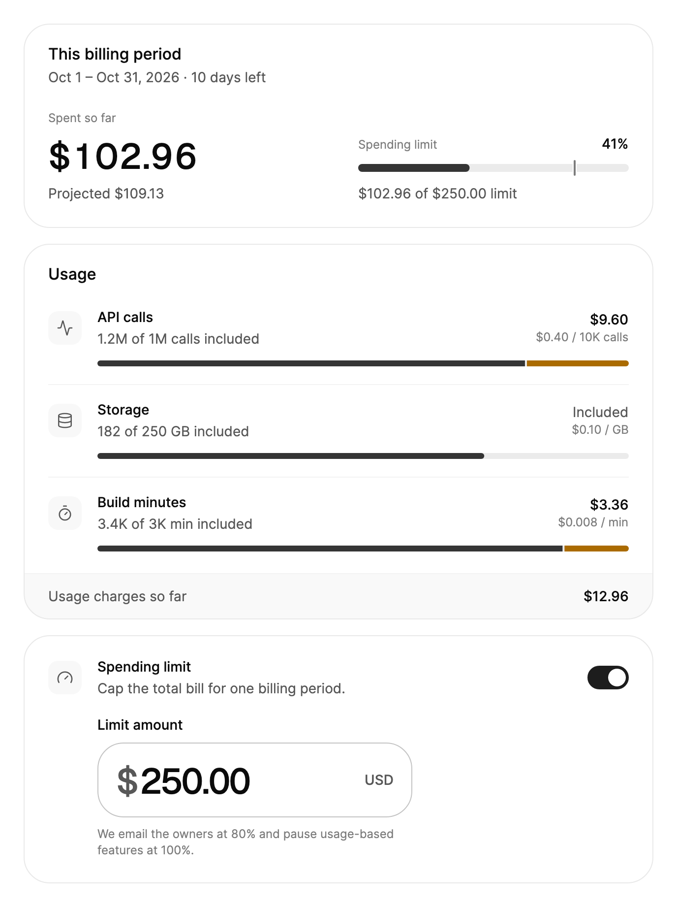

<Demo name="Period" />

## 何时使用

用量计费是在基础费用之上还按消耗量收费的套餐的账单页面。它回答人们在账单寄到之前最想知道的两个问题：这个周期目前花了多少，又会花到多少。它放在账户或账单页面中，位于账单历史上方，也是所有者设置花费上限的地方。

- **按用量计费的 API 套餐**：一个开发者平台，在包含的一百万次之外，每 10,000 次调用收费 $0.40。每个计量项的超额随着产生而显示，所有者在账单到达之前就能看到即将出现的意外支出。
- **存储与构建时长**：一个云产品，对存储按 GB 计费，对超出套餐额度的 CI 构建分钟数计费。每个计量项保留自己的单位，因此 "3,420 min" 与 "182 GB" 并排显示时都能正确读取。
- **团队的花费上限**：所有者把本周期限定为 $250。摘要在达到 80% 时变为"接近上限"，到达上限时变为"已达上限"，并且金额可以在显示的位置直接编辑。
- **每日花费回顾**：一个财务页面，绘制每天的花费金额，这样某一天的峰值可以与平均值对照看出。
- **实时用量**：一个账户页面，页面打开期间会不断收到用量事件。总计、预计总额和条形会随每次变化更新，无需刷新。

## 何时不用

- **没有按量计费的套餐**：套餐、付款方式和账单请用 `BillingOverview`。
- **没有价格的配额**，例如相对于套餐空间或剩余席位已用的存储：用 `UsageMeter` 或 `Progress`，它们显示占上限的比例，但不为超额定价。
- **跨多个周期的用量**：单独使用 `BarChart` 或 `LineChart` 查看趋势。本区块只显示一个周期。
- **历史账单列表**：用 `Table`，它可以对行排序和筛选；本区块保留给进行中的周期。

## 用法

设置周期、基础费用和计量项。每个 `UsageBillingMeter` 说明已用量、套餐包含的额度以及超出部分的价格：`UnitPrice` 为每 `PriceUnit` 个单位付费，因此每 10,000 次调用 `$0.40` 写作 `UnitPrice="0.40" PriceUnit="10000"`。区块把各计量项的费用累加到 `MeteredTotal`，再加上 `BaseFee` 得到 `CurrentTotal`，并根据周期已开始的比例推算 `ProjectedTotal`。直接写在标签里的计量项会进入 `Meters`，即内容属性。

```xml
<arc:UsageBilling PeriodStart="2026-10-01"
                  PeriodEnd="2026-10-31"
                  BaseFee="90"
                  SpendLimit="250"
                  IsSpendLimitEnabled="True">
    <arc:UsageBillingMeter Name="API 调用"
                           Unit="calls"
                           Used="1240000"
                           Included="1000000"
                           UnitPrice="0.40"
                           PriceUnit="10000"
                           Icon="{x:Static arc:ArcIcons.Activity}" />
    <arc:UsageBillingMeter Name="存储" Unit="GB" Used="182" Included="250" UnitPrice="0.10" />
</arc:UsageBilling>
```

`UsageBilling` 派生自 `TemplatedControl`。它的卡片由设置区块的共享部件组成：每张卡片是一个 `SettingsGroup`，上限开关和每个计量项行都是 `SettingsRow`。这让它与周围的设置页面保持一致，同样的主题和动效也随之适用。

`DailySpend` 列出每一天的花费金额，从周期的第一天开始。今天之后的日期不绘制；没有数值时，每日花费卡片会隐藏。传入会引发集合变更通知的列表，例如 `AvaloniaList<double>`，图表就会随之更新。

```csharp
billing.DailySpend = new AvaloniaList<double> { 4.97, 4.82, 2.79, 2.41, 5.74 };
```

### 结构

1. **摘要卡片**：标题来自 `Labels.PeriodTitle`，卡片描述中是周期的日期和剩余天数；当上限接近或已达到时，标题栏的操作区会显示状态徽标。
2. **已花费**：已花费金额，以卡片中最大的字号显示，上方是标签 `SpentSoFar`。每次总额更新时它都会滚动到新值。
3. **预计**：`Projected` 以小字号显示在金额下方，使用次要文字颜色。
4. **上限列**：标签 `SpendingLimit`，中等字重的上限占比，一条 16 px 高的进度条（8 px 轨道，在 `AlertThreshold` 处有一个刻度），以及说明文字 `LimitProgress`。没有上限时显示 `NoLimit` 和一个"设置上限"按钮。
5. **每日花费卡片**：一个 `BarChart`，绘图区高 160 px；`DailySpend` 为 null 或空时隐藏。
6. **用量卡片**：每个计量项一行，包括图标图块、名称、用量行（`MeterUsage`），以及右侧的费用：超额金额及其费率，或"包含在内"。每行下方有一条 6 px 的进度条：包含的部分以强调色填充，超额部分以警告色填充。页脚显示 `UsageTotal` 和计量费用总计。
7. **花费上限卡片**：一个带开关和说明的 `SettingsRow`，下方是 320 px 宽的 `MoneyInput`（Small），缩进 50 px 以与行文字对齐。`LimitNote` 的提示位于其下方。

在摘要中，花费与上限并排显示，中间间隔 40 px。当宽度小于 `NarrowWidth`（默认 600 px）时，上限列移到花费下方，并且向下偏移 24 px。

### 接近与超过上限

上限进度比较 `CurrentTotal` 与 `SpendLimit`。花费超过 `AlertThreshold`（默认 80%，刻度所在的位置）时进度条变为警告色；达到上限时变为危险色。标题旁的徽标显示"接近上限"或"已达上限"，`LimitStatus` 报告相同的状态。你可以用这个状态做自己的逻辑，例如在导航中显示提醒。本示例没有 `DailySpend`，因此每日花费卡片隐藏。

<Demo name="NearLimit" />

### 实时用量

计量项会通知自身的变化，因此区块会随用量进入而更新：已花费金额滚动到新总额，预计总额、计量项的条形、它的费用以及上限进度都随之变化。这里每次点击增加 50,000 次 API 调用，超过包含的一百万次后每次收费 $2.00，同时在今天的条形上加上相同的数量。

<Demo name="Live" />

### 数据结构与性能

用量次数保持为 `double`，金额使用 `decimal`：`Used` 和 `Included` 计的是单位数量，而 `BaseFee`、`UnitPrice` 和 `SpendLimit` 是金额。区块以 `decimal` 进行计算，因此总额精确到分。单价保留所需的小数位，最多四位，因此每分钟 `$0.008` 会按原样显示。

每个计量项都是一个 `INotifyPropertyChanged` 模型。修改 `Used` 会引发计算属性 `Overage` 和 `Cost` 的变化，并更新总额、该计量项的费用及其条形；其他行保持不变。向 `Meters` 添加或移除计量项时，只构建或移除该行，然后重新计算总额。请以人能够读取的速率从用量数据源更新计量项；每秒变化多次的值无法被跟上。

图表取从周期第一天到今天的日期，因此刚开始的周期只会绘制几根条形。

### 花费上限

`IsSpendLimitEnabled` 与 `SpendLimit` 是双向的：最后一张卡片中的开关和金额输入框都会修改它们。`SpendLimitChanged` 在每次变化时报告旧金额、新金额以及上限是否开启。人在输入框中输入时，变化只在输入框失去焦点或按下 Enter 时报告一次。没有上限时，摘要会提供"设置上限"，它会开启上限并把焦点移到金额输入框。

关闭上限会保留金额。编辑器收起，金额仍保存在 `SpendLimit` 中，下次开启开关时直接使用，因此人不必重新输入上个月设置的上限。

```csharp
billing.SpendLimitChanged += async (_, e) =>
{
    await api.SaveSpendingLimitAsync(e.IsEnabled ? e.NewLimit : null);
};
```

### 绑定到视图模型

该区块是一个周期的显示与编辑界面。视图模型拥有周期的值、计量项和保存逻辑，区块绑定到它们。`Meters` 与 `DailySpend` 可以设置，因此视图模型可以直接提供它们。

```csharp
public partial class UsageBillingViewModel : ObservableObject
{
    private readonly IBillingApi _api;

    public UsageBillingViewModel(IBillingApi api) => _api = api;

    [ObservableProperty]
    private string _currency = "USD";

    [ObservableProperty]
    private decimal _baseFee = 90m;

    [ObservableProperty]
    private decimal? _spendLimit = 250m;

    [ObservableProperty]
    private bool _isSpendLimitEnabled = true;

    [ObservableProperty]
    private IList<double>? _dailySpend;

    public ObservableCollection<UsageBillingMeter> Meters { get; } = new();

    public async Task SaveSpendingLimitAsync(decimal? limit) => await _api.SaveSpendingLimitAsync(limit);
}
```

```xml
<arc:UsageBilling Currency="{Binding Currency}"
                  BaseFee="{Binding BaseFee}"
                  Meters="{Binding Meters}"
                  DailySpend="{Binding DailySpend}"
                  SpendLimit="{Binding SpendLimit, Mode=TwoWay}"
                  IsSpendLimitEnabled="{Binding IsSpendLimitEnabled, Mode=TwoWay}" />
```

- `SpendLimit` 和 `IsSpendLimitEnabled` 是双向属性。绑定它们，使视图模型始终持有用户看到的值。
- 从 `SpendLimitChanged` 保存，而不要只依赖绑定。该事件报告旧金额、新金额以及上限是否开启，并且在输入框释放时只为输入的金额报告一次。
- `BaseFee`、`Currency`、`PeriodStart` 和 `PeriodEnd` 是单向输入。它们变化时，区块会重新计算。
- `Clock` 不是样式属性，因此请在代码中设置，而不要通过绑定设置。参见"今天与预计总额"。

### 今天与预计总额

"今天"来自 `Clock`，它是一个 `TimeProvider`（默认为系统时钟）。它决定剩余天数、绘制的天数以及预计总额：`BaseFee + MeteredTotal × 周期天数 ÷ 已开始的天数`。在一个 31 天周期的 10 月 20 日，目前 $12.96 的用量预计为 $20.09，加上基础费用后为 $110.09。预计总额假设用量保持当前的速度，天数比例保持在一天的比例与 1 之间。测试和预览会传入固定的时钟。

```csharp
sealed class FixedClock(DateTimeOffset now) : TimeProvider
{
    public override DateTimeOffset GetUtcNow() => now;
}

billing.Clock = new FixedClock(new DateTimeOffset(2026, 10, 20, 12, 0, 0, TimeSpan.Zero));
```

### 货币与文字

`Currency` 是 ISO 4217 代码。金额在数字前显示 `$`、`€`、`£` 或 `¥`，其他代码则显示在数字之后，例如 `12.96 CHF`。所有内置文字都位于 `Labels` 中；如需翻译，请替换整个对象。`Labels.Culture` 决定日期、金额和计数的格式。

```csharp
billing.Currency = "EUR";
billing.Labels = new UsageBillingLabels
{
    Culture = CultureInfo.GetCultureInfo("nl-NL"),
    PeriodTitle = "Deze factuurperiode",
    SpentSoFar = "Tot nu toe besteed",
    Projected = amount => $"Verwacht {amount}",
};
```

### 示例：开发者平台的十月用量

开发者平台在十月周期中途的账单页面。90 美元的基础费用是固定的。API 调用已超过包含的一百万次，因此需要付费；存储仍在额度之内，不产生费用；构建分钟数也略微超出。所有者把账单上限设为 $250，而上限保持开启。每个金额、条形和预计总额都来自这三个计量项，因此数字彼此一致。



```xml
<arc:UsageBilling Width="640"
                  PeriodStart="2026-10-01"
                  PeriodEnd="2026-10-31"
                  BaseFee="90"
                  SpendLimit="250"
                  IsSpendLimitEnabled="True">
    <arc:UsageBillingMeter Name="API calls"
                           Unit="calls"
                           Used="1240000"
                           Included="1000000"
                           UnitPrice="0.40"
                           PriceUnit="10000"
                           Icon="{x:Static arc:ArcIcons.Activity}" />
    <arc:UsageBillingMeter Name="Storage"
                           Unit="GB"
                           Used="182"
                           Included="250"
                           UnitPrice="0.10"
                           Icon="{x:Static arc:ArcIcons.Database}" />
    <arc:UsageBillingMeter Name="Build minutes"
                           Unit="min"
                           Used="3420"
                           Included="3000"
                           UnitPrice="0.008"
                           Icon="{x:Static arc:ArcIcons.Timer}" />
</arc:UsageBilling>
```

### 文案规范

- **计量项名称**：句子式大小写的名词，说明被计量的是什么，例如 "API calls"、"Storage"、"Build minutes"。单位来自 `Unit`，并沿用套餐自己的说法："calls"、"GB"、"min"。
- **周期标题**：保留"本计费周期"，由描述说明日期。标题中写入月份名称，在周期变化后就会过时。
- **上限文案**："花费上限"命名该设置，描述说明效果（"限制一个计费周期的账单总额。"）。在 `LimitNote` 中说明每个阈值会发生什么，百分比与 `AlertThreshold` 保持一致。
- **金额与计数**：让区块通过 `Culture` 和 `Currency` 进行格式化。不要把金额预先格式化为文字，因为文字值无法跟随区域设置的变化。

| 不要写 | 改为 |
|---|---|
| 账单总额 | 已花费 |
| 上限 | 花费上限 |
| 点击此处设置上限 | 设置上限 |
| 超出 240000 | 超出 240K（由区块格式化） |
| 预估账单 | 预计 $110.09 |

### 最佳实践

**推荐**

- 在预览和测试中设置 `Clock`。剩余天数、绘制的天数和预计总额都取决于今天，固定的时钟能让截图和测试保持稳定。
- 用 `IsSpendLimitEnabled` 关闭上限，而不是清空金额。金额会保留到下次开启开关时使用。
- `Currency` 与 `Labels.Culture` 要一起设置。货币决定符号，区域决定分隔符，因此应为同一地区同时设置两者。
- 应用其他地方的提醒使用 `LimitStatus`。它与徽标显示的是同一状态，因此提醒与卡片永远不会互相矛盾。

**避免**

- 把预计总额当作账单展示。它假设用量保持当前速度，因此要像默认值那样标注为"预计"。
- 只在界面中实施上限。区块只显示状态并引发 `SpendLimitChanged`，它不会停止用量。你的服务必须执行上限，并读取同一个金额。
- 在一个区块中混合多个周期。它显示的是从 `PeriodStart` 到 `PeriodEnd` 的一个周期；第二个周期需要自己的区块或趋势图表。
- 在用量次数到达计量项之前对其取整。超额和费用来自精确的次数，取整可能使次数越过包含的额度。

### 常见问题

**为什么预计总额与我自己的估算不同？** 预计总额等于 `BaseFee` 加上计量费用总计，再乘以按 `Clock` 已开始的周期天数比例。在一个 31 天周期的 10 月 20 日，$12.96 的用量预计为 $20.09 的用量费用，加上基础费用后为 $110.09。先检查 `Clock`。

**为什么没有每日花费卡片？** `DailySpend` 为 null 或空时会隐藏该卡片。卡片也只绘制到今天为止的日期，因此刚开始的周期只会显示很短的图表。

**上限比较的是哪个金额？** `CurrentTotal`，即基础费用加上计量费用总计，而不只是用量费用。在 90 美元基础费用的情况下，$250 的上限还剩 $160 的用量空间才会到达。

**区块会在上限处停止用量吗？** 不会。区块显示 `LimitStatus` 并引发 `SpendLimitChanged`。由你的账单服务执行上限，字段下方的说明描述的正是你所实现的行为。

## API 参考

<!-- api: UsageBilling -->

### UsageBillingMeter

一个可以在 XAML 中编写的普通模型（`INotifyPropertyChanged`）。修改任何值都会引发 `PropertyChanged`，区块随之重新计算。

| 属性 | 类型 | 说明 |
|---|---|---|
| `Name` | `string` | 被计量的内容，例如 "API calls"；即该行的标题。 |
| `Unit` | `string` | 金额之后的单位，例如 "calls"、"GB" 或 "min"。 |
| `Used` | `double` | 本周期目前已用的数量。 |
| `Included` | `double` | 套餐无额外费用包含的数量。为 0 时，该行只显示用量而不显示条形。 |
| `UnitPrice` | `decimal` | 超出包含数量后，每 `PriceUnit` 个单位的价格。 |
| `PriceUnit` | `double` | `UnitPrice` 为多少个单位付费（默认 1）。 |
| `Icon` | `Geometry?` | 显示在该行图块中的 24×24 描边图标。 |
| `Overage` | `double` | *只读。* `max(0, Used − Included)`。 |
| `Cost` | `decimal` | *只读。* `Overage ÷ PriceUnit × UnitPrice`。 |

### UsageBillingLimitChangedEventArgs

| 属性 | 类型 | 说明 |
|---|---|---|
| `OldLimit` | `decimal?` | 变化前的上限金额。 |
| `NewLimit` | `decimal?` | 变化后的上限金额。 |
| `IsEnabled` | `bool` | 变化后上限是否开启。 |

### UsageBillingLimitStatus

| 值 | 含义 |
|---|---|
| `None` | 没有生效的上限：已关闭，或没有正数金额。 |
| `Ok` | 花费低于提醒阈值。 |
| `Near` | 花费已超过提醒阈值，但未达到上限。 |
| `Reached` | 花费已达到或超过上限。 |

### UsageBillingLabels

每个条目都有英文默认值。带参数的条目会接收格式化后的文字。

| 属性 | 默认值 |
|---|---|
| `Culture` | en-US |
| `PeriodTitle` | "This billing period" |
| `DaysLeft` | 天数 ⇒ "11 days left"、"1 day left"、"Last day" |
| `PeriodEnded` | "Period ended" |
| `SpentSoFar` | "Spent so far" |
| `Projected` | 金额 ⇒ "Projected $110.09" |
| `SpendingLimit` | "Spending limit" |
| `LimitProgress` | (当前, 上限) ⇒ "$102.96 of $250.00 limit" |
| `NoLimit` | "No spending limit" |
| `SetLimit` | "Set a limit" |
| `NearLimit` / `LimitReached` | "Near limit" / "Limit reached" |
| `DailySpend` | "Daily spend"（图表的无障碍名称） |
| `DailyAverage` / `DaySpend` | "Average daily spend" / "Spent"（图表在静止时以及读取某一天时的标题） |
| `Day` | "Date"（图表的数据表） |
| `Usage` | "Usage" |
| `MeterUsage` | (已用, 包含, 单位) ⇒ "1.2M of 1M calls included" |
| `MeterUsageOnly` | (已用, 单位) ⇒ "3.4K min"（没有包含额度的计量项） |
| `Overage` | 金额 ⇒ "240K over"（在计量条的无障碍名称中） |
| `Included` | "Included" |
| `Rate` | (价格, 每) ⇒ "$0.40 / 10K calls" |
| `UsageTotal` | "Usage charges so far" |
| `SpendingLimitDescription` | "Cap the total bill for one billing period." |
| `LimitAmount` | "Limit amount" |
| `LimitNote` | 百分比 ⇒ "We email the owners at 80% and pause usage-based features at 100%." |

## 无障碍

- 每张卡片都是一个 `SettingsGroup`。已花费金额与其标签一起朗读，例如"已花费：$102.96"。
- 上限进度是一条进度条，名称类似"花费上限：$102.96 / $250.00 上限"。"接近上限"和"已达上限"徽标是礼貌的实时区域，因此变化会被播报。
- 每个计量条都是一条进度条，名称包含计量项、用量和超额，例如"API calls：1.2M of 1M calls included，超出 240K"。费用与费率一起朗读，例如"$9.60，$0.40 / 10K calls"。
- 开关以设置的标题作为名称，以说明作为帮助文字。金额输入框的标签为"上限金额"，并由其下方的提示描述。
- 区块本身不获得焦点，获得焦点的是其中的控件。Tab 顺序从上到下按卡片排列。
- 上限关闭时，编辑器是收起的。它的输入框仍保留在树中，因此区块会在上限开启之前将其移出 Tab 顺序。

### 键盘

| 按键 | 操作 |
|---|---|
| `Tab` / `Shift+Tab` | 按卡片顺序在上限开关、金额输入框（仅在上限开启时）、"设置上限"按钮和每日花费图表之间移动 |
| 金额输入框中的 `Enter` | 结束编辑并报告新的上限 |
| "设置上限"上的 `Enter` | 开启上限，并把焦点移到金额输入框 |
| 图表上的方向键 | 在日期之间移动；Home 和 End 移到第一天和最后一天 |
| 图表上的 `Page Up` / `Page Down` | 移动一周 |
| 图表上的 `Escape` | 把标题恢复为平均值 |

图表会获得焦点。它的无障碍摘要会说明最高和最低的日期，因此人在逐个浏览日期之前就能听到数值范围。

## 动效

- 已花费金额会逐位滚动到新总额。
- 计量条和上限进度会弹性伸展到新的长度；上限的颜色在越过提醒阈值或上限时交叉淡变。
- 状态徽标在标题旁弹出和收起。
- 上限编辑器在开关变化时以弹簧方式展开和收起高度。
- 图表的条形在首次看到图表时以波浪方式生长，数值变化时平滑变形。
- 减弱动效时只保留颜色淡变：条形和编辑器立即采用新尺寸。关闭动效时所有变化都立即完成。

| 变化 | 完整 | 减弱 | 关闭 |
|---|---|---|---|
| 已花费金额变化 | 数字滚动到新总额 | 立即变化 | 立即完成 |
| 计量条或上限进度改变长度 | 弹性伸展到新长度 | 立即采用新长度 | 立即完成 |
| 上限越过提醒阈值或上限 | 颜色交叉淡变（标准） | 颜色交叉淡变（快速） | 立即完成 |
| 上限编辑器展开或收起 | 高度以弹簧变化 | 立即采用新高度 | 立即完成 |
| 每日花费图表出现或变化 | 条形以波浪生长，然后变形 | 立即变化 | 立即完成 |

## 相关组件

- 其他设置区块：`SettingsPage`、`SettingsCommand`、`SecuritySettings`、`BillingOverview` 和 `CancelFlow`。
- `SettingsGroup` 与 `SettingsRow`，这里每张卡片所用的共享部件（在 `SettingsPage` 页面中说明）。
- 每日花费使用 `BarChart`，已花费金额使用 `AnimatedCounter`，上限使用 `MoneyInput` 与 `Switch`，其状态使用 `Badge`。
- 没有价格的配额使用 `UsageMeter` 和 `Progress`。

| 组件 | 适用场景 |
|---|---|
| `BillingOverview` | 页面需要显示套餐、付款方式和账单，无论是否包含用量 |
| `UsageMeter` / `Progress` | 配额有上限但没有价格，例如席位或存储空间 |
| `BarChart` / `LineChart` | 跨多个周期的趋势比单个周期的总额更重要 |
| `MoneyInput` | 单独输入一个金额，位于花费上限卡片之外 |
| `Table` | 历史账单或用量明细需要排序和筛选 |
| `CancelFlow` | 所有者要结束套餐，并需要填写原因和提供优惠的步骤 |
