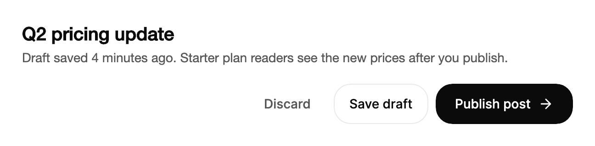

<Demo name="Default" />

## 何时使用

`ActionButton` 是一次异步提交的行动号召，例如保存、发布或发送邀请。它直接在按钮上呈现工作进度：任务运行时，标签切换为进行中的文字，加载图标旋转；成功时，一段文字加上绘制出的勾号确认结果。人们在点击的位置就能获知结果，无需弹出提示，按钮也会自行回到空闲标签。把它放在表单末尾、文档页头或设置卡片中，凡是提交就是那个最重要操作的地方都适用。

- **在内容编辑器中发布文章**：编辑器页头中的“发布文章”按钮在文章发送时显示“发布中”，上线后显示“已发布”，编辑器无需离开页面即可知道更改已生效。
- **在管理控制台中保存设置页**：工作区设置页底部的“保存设置”按钮在请求成功后显示“设置已保存”，表单保持在屏幕上，方便下一次修改。
- **从团队页面发送邀请**：邮件服务接受请求后，“发送邀请”变为“已发送”，2.4 秒后回到“发送邀请”，以便管理员邀请下一位成员。
- **从 Webhook 编辑器发送测试事件**：调用端点时，“发送测试事件”显示“发送中”，端点响应后显示“已送达”。调用失败时按钮回到空闲，编辑器在旁边说明错误。

## 何时不用

- **普通的表单提交，只需加载指示、无需结果文字**：用 `Button` 并设置 `IsLoading`。它在工作运行期间保留标签和宽度，也不需要成功状态。
- **需要用户刻意按住才能执行的破坏性操作**：用 Gestures 中的 `HoldToConfirm`。长按让误删变得困难，而成功文字只会在数据已经消失之后才出现。
- **需要在原位确认的破坏性操作**：用 `ConfirmMorph`，它在任何操作执行之前，就在控件所在的位置提出问题。
- **同一操作的多个备选项**：用 `SplitButton`，例如主按钮为“合并拉取请求”，菜单中有“Squash and merge”和“Rebase and merge”。
- **密集表格中每行重复的行操作**：在行内用小号 `Button` 保留结果。每一行都有动画标签会造成干扰，而且标签的每个字母都是一个动画元素。
- **把值复制到剪贴板**：用 `CopyButton`，它会就地确认复制结果，专为这项工作而设计。

## 用法

```xml
<UserControl xmlns="https://github.com/avaloniaui"
             xmlns:arc="https://github.com/AIDotNet/TKCode.Arc">
    <arc:ActionButton Label="保存" PendingLabel="保存中" SuccessLabel="已保存" />
</UserControl>
```

```csharp
var save = new ActionButton
{
    Label = "保存",
    PendingLabel = "保存中",
    SuccessLabel = "已保存",
    AsyncAction = () => documentService.SaveAsync()
};
```

`ActionButton` 派生自 Avalonia 的 `Button`，而不是 Arc 的 `Button`。它保留按钮的全部功能：`Click`、`Command`、`IsEnabled`、通过 Enter 与 Space 激活、焦点模型以及自动化对等体。它不暴露 `Variant`、`Size` 或 `IsLoading`，因为它只有一种外观和一种高度，而等待状态来自 `AsyncAction`。应设置 `Label` 而不是 `Content`：模板从 `Label`、`PendingLabel` 和 `SuccessLabel` 绘制文字。

### 结构

1. **标签**（`Label`）：空闲文字，采用小号正文字号（`TypeSM`）与中等字重。它由文字变形绘制，因此等待与成功文字会在同一位置替换它。它同时是无障碍名称。
2. **图标位**：标签之后 8 px 处的 17 px 方块。空闲时显示右箭头，操作等待时显示 16 px 的加载图标，成功时显示勾号。
3. **外框**：1 px 边框，控件圆角（`RadiusControl`）。填充色为 Foreground 令牌，文字色为 Background 令牌，因此按钮与页面反色：浅色页面上为深色，深色页面上为浅色。
4. **内边距与高度**：左右各 20 px 内边距，最小高度为中号控件尺寸（44 px）。它只有一种尺寸，不随窗口宽度变化。
5. **焦点环**：2 px 宽的焦点色环，绘制在外框外 2 px 处。仅在键盘焦点时出现。

按钮默认左对齐。位于居中列中时，设置 `HorizontalAlignment`。悬停时外框加上静止阴影。按下时按钮缩放到 97%，若宽度超过 220 px 则缩放到 98.5%，使用灵敏的弹簧动画。等待中的按钮不缩放。禁用时，它淡化到 70% 不透明度，并显示“不允许”光标。

### 标签与重置

`Label` 是空闲文字，也是无障碍名称。`AsyncAction` 运行时显示 `PendingLabel`（默认为 “Saving”），完成后显示 `SuccessLabel`（默认为 “Saved”）。空闲标签使用动词，等待文字使用其现在分词，成功文字使用过去式：“发布文章”“发布中”“已发布”。这样设置的一组标签，在文字变形时宽度变化较小。

`ResetAfter` 设定成功文字停留多久后按钮回到空闲，默认为 2.4 秒（2400 毫秒）。设为零时，成功状态会一直保留，直到调用 `Reset()`。在工具栏中使用默认值，因为结果只需一瞥即可。在人们持续编辑的设置页上设为零，使确认信息不会在他们阅读时消失。

<Demo name="Labels" />

<Demo name="KeepResult" />

```xml
<arc:ActionButton Label="发布文章"
                  PendingLabel="发布中"
                  SuccessLabel="已发布"
                  ResetAfter="00:00:03" />
```

当按钮报告的状态已不再属实时，由你自己重置按钮。`Reset()` 会立即回到空闲状态，并取消待执行的成功重置。它也会使仍在运行的操作失效：当该任务稍后完成时，其结果会被忽略，按钮保持空闲。

### 生命周期

| 时机 | 状态 | 可见文字 | 人们听到的内容 |
|---|---|---|---|
| 按钮就绪 | `Idle` | `Label` 与箭头 | 名称：`Label` |
| 激活后开始 `AsyncAction` | `Pending` | `PendingLabel` 与加载图标 | 等待文字，仅一次，来自状态区域 |
| 任务完成 | `Success` | `SuccessLabel` 与勾号 | 成功文字，仅一次 |
| `ResetAfter` 到时或执行 `Reset()` | `Idle` | `Label` 与箭头 | 无 |
| 任务抛出异常 | `Idle` | `Label`；引发 `ActionFailed` | 按钮本身不发出内容；请在附近显示错误 |
| 成功期间按钮离开可视树 | `Idle` | `Label` | 无 |

状态只通过这些时机发生变化，因此你可以读取 `State`（只读的 `ActionButtonState`），决定屏幕上其他内容应如何变化。

### 失败

`AsyncAction` 抛出异常时，按钮回到空闲状态，并引发 `ActionFailed`。该事件是冒泡的路由事件，其 `ActionButtonFailedEventArgs.Exception` 保存了操作抛出的异常。成功文字不会显示，重置计时器也不会启动。

<Demo name="Failure" />

```csharp
sync.ActionFailed += (_, e) => status.Text = $"已回到空闲：{e.Exception.Message}";
```

请把消息显示在按钮旁边，而不是按钮上。按钮已回到空闲标签，人们可以立即重试，旁边的文字说明出了什么问题。保留用户输入的内容，使重试不必从空表单开始。

### 命令与点击

`Click` 与 `Command` 先于 `AsyncAction` 运行。按钮在仍为空闲时引发 `Click`，然后进入等待状态并启动操作。没有 `AsyncAction` 时，命令或点击被视为立即成功，成功文字立即显示。同时设置两者是有效的：命令同步运行，异步操作在其之后开始，因此命令应只是工作中快速的部分。

`ICommand.Execute` 不返回任何内容，因此命令无法为一项任务保持等待状态。对于异步工作，请使用 `AsyncAction`（见下方的视图模型示例）。

### 禁用

将 `IsEnabled` 设为 `False` 会使按钮变暗到 70% 不透明度，并将其移出 Tab 顺序。`AsyncAction` 等待期间，按钮保持键盘焦点并忽略重复激活，但不会被禁用。当某个操作无法执行时（例如没有可保存的内容），用 `IsEnabled` 阻止它，并在附近说明原因。

<Demo name="Disabled" />

不要通过禁用按钮来表示表单无效。应在人们按下按钮时进行校验，然后把焦点移到第一个需要处理的字段。

### 与视图模型绑定

`ActionButton` 有一个提交操作并报告状态，因此工作由视图模型负责，按钮只显示其进度。下面的视图模型使用 CommunityToolkit.Mvvm。`PublishAsync` 是普通的公共方法，返回 `Task`。

```csharp
public partial class PostEditorViewModel : ObservableValidator
{
    private readonly IPostService _posts;

    public PostEditorViewModel(IPostService posts)
    {
        _posts = posts;
    }

    [ObservableProperty]
    [NotifyDataErrorInfo]
    [Required(ErrorMessage = "请输入文章标题。")]
    private string _title = string.Empty;

    [RelayCommand]
    private void Discard()
    {
        Title = string.Empty;
    }

    public async Task PublishAsync()
    {
        ValidateAllProperties();
        if (HasErrors)
        {
            return;
        }
        await _posts.PublishAsync(Title);
    }
}
```

```xml
<StackPanel Width="420" Spacing="16">
    <arc:Input Label="文章标题" Text="{Binding Title}" />
    <StackPanel Orientation="Horizontal" Spacing="8" HorizontalAlignment="Right">
        <arc:Button Content="放弃" Variant="Ghost" Command="{Binding DiscardCommand}" />
        <arc:ActionButton x:Name="Publish" Label="发布文章" PendingLabel="发布中" SuccessLabel="已发布" />
    </StackPanel>
</StackPanel>
```

```csharp
public partial class PostEditorView : UserControl
{
    public PostEditorView()
    {
        InitializeComponent();
        Publish.AsyncAction = () => ((PostEditorViewModel)DataContext!).PublishAsync();
    }
}
```

绑定是单向的。`Label`、`PendingLabel` 与 `SuccessLabel` 来自视图或本地化资源，`Title` 在输入框上为双向绑定。`ActionButton` 不会写回任何内容：`State` 为只读，其结果由视图模型自身的状态报告。`AsyncAction` 的赋值保留在代码中，因为方法组无法在 XAML 中绑定到 `Func<Task>`。不要把同一项工作同时绑定到 `Command` 与 `AsyncAction`，否则它会运行两次。`Discard` 按钮使用 `Command`，因为它会立即完成。

### 示例：在内容编辑器中发布文章

内容管理系统中的文章编辑器页头。标题是编辑器的标题，页脚放着写作者会用到的三个操作：放弃草稿、保存为草稿、发布。发布是此界面上唯一的主要操作，因此它是唯一的 `ActionButton`。说明文字告诉写作者发布会对读者产生什么影响，这是他们按下之前需要知道的后果。成功文字“已发布”在按下的位置确认更改，按钮几秒后回到“发布文章”，页头因此可以随时准备好进行下一次编辑。



```xml
<StackPanel Width="600" Spacing="20">
    <StackPanel Spacing="6">
        <TextBlock Text="Q2 pricing update"
                   FontSize="20"
                   FontWeight="SemiBold"
                   Foreground="{arc:ArcDesignTokenResource Foreground}" />
        <TextBlock Text="Draft saved 4 minutes ago. Starter plan readers see the new prices after you publish."
                   TextWrapping="Wrap"
                   Foreground="{arc:ArcDesignTokenResource TextSecondary}" />
    </StackPanel>
    <StackPanel Orientation="Horizontal" Spacing="8" HorizontalAlignment="Right">
        <arc:Button Content="Discard" Variant="Ghost" />
        <arc:Button Content="Save draft" Variant="Secondary" />
        <arc:ActionButton Label="Publish post" PendingLabel="Publishing" SuccessLabel="Published" />
    </StackPanel>
</StackPanel>
```

### 内容规范

- **空闲标签**：动词加其对象，句首大写：“发布文章”“保存设置”“发送邀请”。对象告诉人们将会改变什么，而单纯的“提交”做不到。
- **等待文字**：现在分词，不加省略号：“发布中”。加载图标已经表示进度，末尾的“...”只是重复。
- **成功文字**：动作的过去式，一到两个词：“已发布”“设置已保存”。保持简短，使宽度变化较小。
- **范围**：每个按钮只对应一个结果。描述多件事的成功文字（“已保存并发送”）既难让人信任，也难以翻译。

| 不要写 | 改为 |
|---|---|
| 提交 | 发布文章 |
| 保存中... | 保存中 |
| 完成！ | 已发布 |
| 点击保存 | 保存设置 |

### 最佳实践

**推荐**

- 对于必须保持等待状态的任何工作，使用 `AsyncAction`。命令会在异步任务完成前返回，因此按钮会过早显示成功。
- 每个界面只放一个 `ActionButton`，用于最重要的那次提交。两个带动画的结果会争夺注意力，人们将无法分辨结果属于哪一个。
- 在按钮可以运行之前设置好 `Label`、`PendingLabel` 与 `SuccessLabel`。`Label` 的更改只在按钮空闲时显示，因此在等待或显示成功期间，可见文字保持不变，直到按钮回到空闲。
- 在按钮旁边显示失败信息。按钮已回到空闲标签，因此消息应紧挨着失败的字段或表单。

**避免**

- 放在密集表格中，或每行一个按钮的列表中。每个按钮都会对自己的字母做动画，动效变成噪声（见上方表格的指引）。
- 将 `ResetAfter` 设为不足一秒。成功文字在被阅读之前就消失，结果无从得知，礼貌播报也容易被错过。
- 为表示请求正在运行而禁用按钮。等待状态已经让按钮保持焦点并忽略激活，而且会告诉辅助技术该按钮不可用。
- 用于破坏性操作。成功文字是在数据消失之后才出现的；应使用 `HoldToConfirm` 要求刻意按下，或使用 `ConfirmMorph` 在原位确认。

### 常见问题

**为什么我的异步命令在保存完成前就显示“已保存”？** `ICommand.Execute` 不返回任何内容，因此按钮在命令返回的那一刻就视其为已完成。请把工作移到 `AsyncAction` 中，按钮会等待它。

**能否同时使用 `Command` 与 `AsyncAction`？** 可以，但应让每个各司其职。命令先同步运行，然后异步操作开始。两条路径保存同一份数据，会导致保存执行两次。

**如何让成功文字在下一次保存前一直显示？** 将 `ResetAfter` 设为零（`ResetAfter="00:00:00"`）。按钮随后保持 `Success`，直到你调用 `Reset()`，例如当人们再次编辑表单时。

**按钮显示成功时离开了可视树，会发生什么？** 重置计时器停止，按钮立即回到空闲。等待中的操作不会被取消：它继续运行，完成时只有当该次运行仍是当前运行时，按钮才会记录成功。

**为什么设置 `Content` 后标签不变？** 模板从 `Label`、`PendingLabel` 与 `SuccessLabel` 绘制文字。`Content` 继承自 `Button`，但不属于视觉呈现的一部分。

## API 参考

<!-- api: ActionButton -->

此页面使用的附属类型：

| `ActionButtonState` 值 | 含义 |
|---|---|
| `Idle` | 显示 `Label`。激活时运行 `Click`、`Command` 与 `AsyncAction`。 |
| `Pending` | `AsyncAction` 正在运行。显示 `PendingLabel`。忽略激活。 |
| `Success` | 操作已完成。显示 `SuccessLabel`，直到 `ResetAfter` 到时或调用 `Reset()`。 |

| `ActionButtonFailedEventArgs` 成员 | 含义 |
|---|---|
| `Exception` | 操作抛出的异常。引发事件时按钮已回到空闲。 |

## 无障碍

- 无障碍名称始终为 `Label`，因此动画标签的字母不会被逐个朗读。
- 等待期间，按钮向辅助技术报告自身不可用，但保持键盘焦点。
- 一个隐藏的礼貌状态区域会播报等待文字与成功文字，因此无需移动焦点即可听到变化。
- Enter 与 Space 执行操作。等待期间忽略重复激活。
- 按钮不会播报失败。应把错误文字放在屏幕阅读器能够读到的位置，例如实时区域或按钮旁边的文本块中，使人们听到按钮回到空闲的原因。

### 键盘

| 按键 | 操作 |
|---|---|
| `Enter` / `Space` | 执行操作。等待期间忽略。 |
| `Tab` / `Shift+Tab` | 移到下一个或上一个控件。等待中的按钮保留其焦点停留位置，因此焦点不会跳走。 |

## 动效

- 变化的字母从柔和的模糊中升起，保留的字母滑动到新位置。宽度随弹簧过渡。
- 箭头沿操作方向离开，并从左侧回来。操作运行时加载图标旋转，成功时勾号逐笔绘制。
- 减弱动效时，移除按下缩放、宽度弹簧与绘制的勾号。标签切换变为瞬时交叉淡化。关闭动效时，标签立即替换。

| 变化 | 完整 | 减弱 | 关闭 |
|---|---|---|---|
| 标签变为等待或成功 | 变化的字母从柔和模糊中升起，保留的字母滑动，宽度以弹簧过渡 | 瞬时交叉淡化 | 立即完成 |
| 成功勾号 | 在 240 ms 内绘制完成 | 直接出现，不绘制 | 立即完成 |
| 按下 | 以灵敏的弹簧缩放到 97%（宽按钮为 98.5%）；等待时从不缩放 | 无按下缩放 | 无按下缩放 |

## 相关组件

- `Button`：普通操作；需要加载指示而无结果文字时，设置 `IsLoading`。
- `CopyButton`：复制一个值，并以同类的行内确认方式反馈。
- `ConfirmMorph`：破坏性操作，在原位要求确认。
- `HoldToConfirm`：破坏性操作，需要用户刻意按住才能执行。

| 组件 | 适用场景 |
|---|---|
| `Button` | 操作没有结果文字，或在请求运行时显示加载图标 |
| `SplitButton` | 一个默认提交旁边有一组相近的备选操作菜单 |
| `CopyButton` | 操作是复制一个值，确认方式为行内文字 |
| `ConfirmMorph` | 破坏性操作应在运行前在原位提出问题 |
| `HoldToConfirm` | 破坏性操作需要刻意按住，不会被意外触发 |
| `ButtonGroup` | 同一对象上的多个相关操作共享一个表面 |
