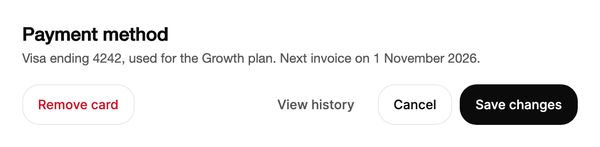

<Demo name="Variants" />

## When to use

`Button` is the default control for a single action on a page, form, dialog or toolbar. It provides the four visual
weights a product needs (primary, secondary, ghost and danger), three heights, a loading state that keeps the label's
width, and a label that can change in place. Most actions in an application are this control, and the other Arc action
controls are specialised cases of the same idea.

- **Saving a customer record in a CRM**: a Save changes primary button at the foot of the contact form, with Cancel as a
  secondary button beside it. One primary action per form tells the person what the next step is.
- **Creating an invoice in a billing console**: Create invoice as the primary action of a dialog footer, with Save as
  draft as its secondary companion. Both use the same medium height so the footer stays aligned.
- **Adding a card in a checkout settings page**: Add card as a primary button, with View history as a ghost button beside
  it that does not compete with it.
- **Exporting a report in an analytics dashboard**: Export report with `IsLoading` while the file is built. The label
  keeps its width, the spinner shows where the label was, and keyboard focus stays on the button.
- **Deleting a project in a settings page**: Delete project as a danger button, so the colour warns before the press.
  Pair it with a confirmation step when the deletion cannot be undone.

## When not to use

- **A submit that must show its result on the button, such as Saved or Sent**: use `ActionButton`, which holds pending
  and success words and returns to idle by itself.
- **Two to five close alternatives for the same action**: use `SplitButton`, with the alternatives in its menu.
- **A destructive action that needs a deliberate press**: use `HoldToConfirm` from Gestures, so one accidental click
  cannot delete the data.
- **A value that stays selected, such as a view mode or a period**: use `SegmentedControl` from Toggles. A button runs an
  action once; it does not remember a choice.
- **Several related actions on the same object, such as Share, Duplicate and Archive**: use `ButtonGroup`, which joins
  them into one surface with dividers instead of a row of separate buttons.

## Usage

```xml
<UserControl xmlns="https://github.com/avaloniaui"
             xmlns:arc="https://github.com/AIDotNet/TKCode.Arc">
    <arc:Button Content="Save changes" Variant="Primary" />
</UserControl>
```

`Button` derives from Avalonia's `Button`, so `Content`, `Click`, `Command`, `CommandParameter`, `IsEnabled`, `IsDefault`
and the Enter and Space activation all work as they do on any button. The Arc layer adds the variant, the size, the
loading state and the Arc frame, focus ring and motion. Because `Content` holds the label, a button can show any content
and not only text, but keep the label short so the width stays predictable.

### Anatomy

1. **Frame**: a 1 px border with the control radius (`RadiusControl`). The fill and the
   border colour come from the variant.
2. **Label** (`Content`): centred text in the small body size (`TypeSM`) and medium weight. A change to the content
   rises in place.
3. **Spinner** (`IsLoading`): a 16 px ring that turns in the centre of the frame while loading. The label stays in its
   slot, faded out, so the width does not change.
4. **Inline padding** by size: 12 px for `Small`, 16 px for `Medium` and 20 px for `Large`, on each side.
5. **Height** by size (`MinHeight`): 36 px for `Small`, 44 px for `Medium` and 50 px for `Large`.
6. **Focus ring**: a 2 px ring in the focus colour, drawn 2 px outside the frame with a
   22 px corner radius. It appears for keyboard focus only.

### Variants

`Variant` sets the visual weight. Use one `Primary` action per surface. The other variants answer the question "how
important is this action compared with the one next to it?"

| Variant | Fill and border | Text | Use it for |
|---|---|---|---|
| `Primary` | Foreground fill | Background colour | The one main action on a surface, such as Save changes or Create invoice |
| `Secondary` | Surface with a border | Foreground colour | The alternative beside the primary, such as Cancel or Save as draft |
| `Ghost` | Transparent, no border | Secondary text, foreground on hover | Low-emphasis actions in cards and toolbars, such as View history |
| `Danger` | Surface with a border | Danger colour | A destructive action, where the colour warns before the press |

```xml
<arc:Button Content="Save changes" Variant="Primary" />
<arc:Button Content="Cancel" Variant="Secondary" />
<arc:Button Content="Learn more" Variant="Ghost" />
<arc:Button Content="Delete project" Variant="Danger" />
```

Each variant has its own states. `Primary` lowers its opacity on hover and press. `Secondary` and `Ghost` fill with the
muted surface on hover and press. On a raised surface (a dialog, drawer, bottom sheet, popover or menu) `Ghost` uses a
stronger fill instead, because the muted surface is nearly the colour of the raised one. `Danger` turns its border to the danger colour on hover and press. Disabled buttons
keep their shape: `Primary` fades to 52 percent opacity, while the outlined variants switch to muted text on a muted
surface. The disabled danger label is tinted toward the surface, so it still reads as a danger action.

Keep a `Danger` button apart from the `Primary` action, with a secondary button or a clear gap between them, so the two
are not mistaken for each other.

### Sizes

`Size` sets the minimum height: `Small` is 36 px, `Medium` is 44 px (the default) and `Large` is 50 px. The size does
not change with the window width, so a row of buttons keeps its rhythm when the window narrows.

<Demo name="Sizes" />

Use one size for each form, dialog or toolbar. `Small` suits tables, toolbars and inline actions, `Medium` is the default
for forms, dialogs and settings, and `Large` fits a single prominent action on a sign-in or empty-state page. Inline
padding follows the size, so the label's margin stays proportional to the height.

### Loading and label morph

Set `IsLoading` to `True` to show the spinner. The label stays in its slot with its width, so the footer of a dialog
does not shift while the request runs. The button keeps keyboard focus, but clicks and key presses are ignored until the
work ends. Changing `Content` swaps the label: the new text rises 4 px out of a soft blur while the old text moves up
3 px and fades, and the width springs to fit the new label.

<Demo name="LoadingMorph" />

```xml
<arc:Button Content="{Binding SaveLabel}"
            IsLoading="{Binding IsSaving}"
            Variant="Primary" />
```

Use `IsLoading` for work that finishes in a few seconds. For a longer job, such as an export of thousands of rows, show
progress in the page (for example a progress indicator or a status line) and keep the button for the request that starts
the job. A spinner that runs for a minute tells the person nothing about how far the work has come.

`LabelSwapMode` and `LabelSpring` change how the label morphs, for a button that should match quieter copy around it.
`LabelSwapMode="Label"` trades labels with a plain crossfade (100 ms out, 160 ms in with a 2 px rise, no blur), and
`LabelSpring="Quick"` lets the width glide to the new label without the slight bounce of the default `Morph` spring.
Both are opt-in; without them every button keeps the blur swap and the morph spring.

```xml
<arc:Button Content="{Binding ActionLabel}" LabelSwapMode="Label" LabelSpring="Quick" />
```

### Icon-only button

An icon-only button has no visible text, so give it an accessible name. A button that is 48 px wide or narrower is treated
as an icon button: it presses deeper, to 96 percent of its size, than a text button.

```xml
<arc:Button Size="Small" Variant="Ghost"
            AutomationProperties.Name="Close">
    <TextBlock Text="×" />
</arc:Button>
```

Give every icon-only button a name that describes its action, such as "Close" or "Remove filter", and a tooltip when the
icon is not self-explanatory. The name is what a screen reader announces, and it is the only way the action is identified
for people who cannot see the glyph.

### Disabled

Set `IsEnabled` to `False`. Outlined variants keep their shape, so an unavailable action still reads as a button. A
disabled button leaves the tab order, as any disabled control does.

<Demo name="Disabled" />

Disable an action only when it cannot apply, and say why nearby, for example "Connect a payment method to publish
invoices" under the button. A disabled button without a reason sends the person looking for the problem.

### Binding to a view model

A button has a command, a label and a busy state. The view model owns the work and the button shows its progress. The
example below uses CommunityToolkit.Mvvm and an app service that saves the draft.

```csharp
public interface IInvoiceService
{
    Task SaveDraftAsync(string invoiceId);
}

public partial class InvoiceViewModel : ObservableObject
{
    private readonly IInvoiceService _invoices;

    public InvoiceViewModel(IInvoiceService invoices)
    {
        _invoices = invoices;
    }

    [ObservableProperty]
    private string _invoiceId = "inv_2026_0412";

    [ObservableProperty]
    private bool _isSaving;

    [ObservableProperty]
    private string _saveLabel = "Save changes";

    [RelayCommand]
    private async Task SaveAsync()
    {
        IsSaving = true;
        try
        {
            await _invoices.SaveDraftAsync(InvoiceId);
            SaveLabel = "Saved";
        }
        finally
        {
            IsSaving = false;
        }
    }
}
```

```xml
<StackPanel Width="420" Spacing="16">
    <arc:Input Label="Invoice number" Text="{Binding InvoiceId}" />
    <arc:Button Content="{Binding SaveLabel}"
                Command="{Binding SaveCommand}"
                IsLoading="{Binding IsSaving}"
                Variant="Primary"
                HorizontalAlignment="Right" />
</StackPanel>
```

Every binding is one way. `Content`, `IsLoading` and `Variant` come from the view model, and the button writes nothing
back. The button raises `Click` and runs `Command`, so `Command` is the place for the work. While `IsLoading` is
`True`, the button ignores activation, so `Command` does not run a second time when the person presses again. Compiled
bindings need `x:DataType` on the view; the examples leave it out for brevity.

### Example: billing settings footer

A payment settings panel in a SaaS billing console. The primary action, Save changes, is the last control on the right,
where the eye lands after reading the form. Cancel sits to its left as the secondary alternative. Remove card is a
danger button on the left, separated from the save pair, so a destructive press is not one slip away from saving. View
history is a ghost button because it navigates rather than changes anything.



```xml
<StackPanel Width="600" Spacing="20">
    <StackPanel Spacing="6">
        <TextBlock Text="Payment method"
                   FontSize="20"
                   FontWeight="SemiBold"
                   Foreground="{arc:ArcDesignTokenResource Foreground}" />
        <TextBlock Text="Visa ending 4242, used for the Growth plan. Next invoice on 1 November 2026."
                   TextWrapping="Wrap"
                   Foreground="{arc:ArcDesignTokenResource TextSecondary}" />
    </StackPanel>
    <Grid ColumnDefinitions="Auto,*,Auto">
        <arc:Button Grid.Column="0" Content="Remove card" Variant="Danger" />
        <StackPanel Grid.Column="2" Orientation="Horizontal" Spacing="8">
            <arc:Button Content="View history" Variant="Ghost" />
            <arc:Button Content="Cancel" Variant="Secondary" />
            <arc:Button Content="Save changes" Variant="Primary" />
        </StackPanel>
    </Grid>
</StackPanel>
```

### Content guidelines

- **Label**: a verb and its object in sentence case: "Save changes", "Create invoice", "Delete project". A bare verb such
  as "Delete" is ambiguous when two items are on the screen.
- **Length**: keep labels to two or three words. A long label pushes the other buttons of a footer off the row.
- **Dismissal**: use "Cancel" for a dialog that discards changes, and "Close" only when nothing was edited.
- **No punctuation**: no trailing period and no exclamation mark. The button is an instruction, not a sentence.
- **No vague confirmations**: "OK" tells the person nothing about what will happen. Name the change.

| Instead of | Write |
|---|---|
| OK | Save changes |
| Submit | Create invoice |
| Delete | Delete project |
| Click here | View invoice |
| Done! | Saved |

### Best practices

**Do**

- Use one `Primary` button per surface. Two filled buttons compete for the same attention, and the person has to read
  both labels to find the next step.
- Put the primary action last, at the end of the row, with the secondary action to its left. People read the row from
  left to right and expect the commit action where the reading ends.
- Use one `Size` for every button in a form, dialog or toolbar. Mixed heights make a footer look broken even when each
  button is correct.
- Give an icon-only button an accessible name, and a tooltip when the icon is not self-explanatory.
- Use `IsLoading` for a request that finishes in seconds. The width is kept, so the layout does not move when the spinner
  appears.

**Avoid**

- Using `Danger` for an action that is not destructive. A red button trains people to ignore the colour, and it no longer
  warns them when it matters.
- Disabling the primary button to hide a validation problem. Validate when the person presses it and point to the first
  problem, so the reason is visible.
- Swapping the label back and forth on a timer. The button ends up in a state the person cannot predict; use `ActionButton`
  when a result word belongs on the button.
- Using `Ghost` for the only action on a surface. Its low contrast is right for a secondary navigation link, but the one
  action a screen needs should be visible at a glance.
- Putting several long labels in one row. The row then wraps or scrolls, and the actions lose their order.

### Common questions

**Why does a loading button keep focus but ignore my clicks?** That is by design. `IsLoading` swallows clicks and key
presses so the request is not repeated, and it keeps focus so the person and assistive technology stay in place. The
button reports itself as busy and unavailable.

**Does `Command` run while the button is loading?** No. The button returns early from its click handling while
`IsLoading` is `True`, so neither `Click` nor `Command` runs.

**Why does my menu anchor button not scale when pressed?** Set `IsPressScaleEnabled` to `False` on a button that opens
a popup or menu. The popup measures the anchor's pressed size, so the anchor answers with colour only. The property
defaults to `True`.

**My button width jumps when the label changes. How do I keep it steady?** The width springs to fit each label. To keep a
fixed width, set `MinWidth` to the width of the longest label you expect, so the button never narrows below it.

**Why does a narrow icon button press deeper than a text button?** Press depth follows the width. At 48 px or narrower the
button presses to 96 percent, and above 220 px it presses to 98.5 percent, so the depth matches the size of the target.

## API reference

<!-- api: Button -->

Companion types used on this page:

| `ButtonVariant` value | Meaning |
|---|---|
| `Primary` | The default. The foreground fill for the main action of a surface. |
| `Secondary` | A surface with a border, for the alternative next to the primary action. |
| `Ghost` | A transparent button for low-emphasis actions. |
| `Danger` | A surface with a danger-coloured label, for destructive actions. |

`Size` uses the `ControlSize` values `Small`, `Medium` (the default) and `Large`.

## Accessibility

- The button has the Button role. An icon-only button needs `AutomationProperties.Name`, because it has no text to name it.
- While `IsLoading` is set, the button stays focusable and reports itself as busy and unavailable.
- Enter and Space activate the button. Clicks and key presses are swallowed while loading.
- Keyboard focus shows a 2 px ring offset by 2 px. Pointer focus draws no ring, so a click does not leave a highlight behind.
- A disabled button is removed from the tab order and reports itself as unavailable. It is dimmed, not hidden, so the
  person still sees that the action exists.

### Keyboard

| Keys | Action |
|---|---|
| `Tab` / `Shift+Tab` | Moves focus to the next or previous button. A disabled button is skipped. |
| `Enter` / `Space` | Activates the button, raising `Click` and running `Command`. Ignored while `IsLoading` is `True`. |
| `Enter` in a text field | Presses the window's default button, the one marked `IsDefault="True"`, when there is one. |

## Motion

- A press scales the content down slightly and a release springs it back. Narrow icon buttons scale a little more.
- Label changes rise in from a soft blur, and the width springs to the new label. The spinner turns continuously while
  loading.
- Reduced motion removes the press scale and the width spring. Labels and the spinner fade with a short crossfade,
  and the spinner stops turning. Off replaces the label and the state at once.

| Change | Full | Reduced | Off |
|---|---|---|---|
| Press | Content scales to 97 percent (96 for icon buttons, 98.5 for wide ones), then springs back | No press scale | No press scale |
| Label changes | The new text rises from a soft blur, the old text fades up, the width springs to fit | Instant crossfade | Immediate |
| Loading starts or ends | The label fades under the spinner, which turns every 0.7 seconds | Crossfade, and the spinner stops turning | Immediate |
| Hover, press, disabled colours | The colours crossfade on a fast curve | Instant | Immediate |

## Related

- `ActionButton` for an asynchronous submit that shows pending and success on the button.
- `SplitButton` for a primary action with a menu of nearby alternatives.
- `ButtonGroup` for several related actions joined into one surface.
- `CopyButton` for copying a value with a confirmation.

| Component | Choose it when |
|---|---|
| `ActionButton` | A submit should show a pending word and a result word on the button |
| `SplitButton` | One default action sits next to two to five close alternatives |
| `ButtonGroup` | Several actions act on the same object and share one surface |
| `ConfirmMorph` | A destructive action should ask for confirmation in place |
| `HoldToConfirm` | A destructive action needs a deliberate press that cannot be triggered by accident |
| `SegmentedControl` | The control shows a choice that stays selected, such as a view mode |
