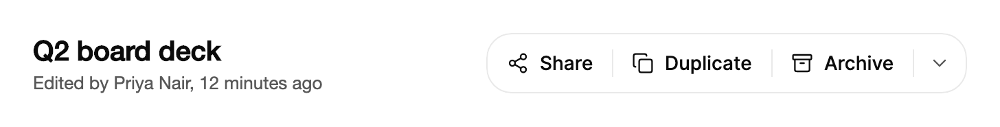

<Demo name="DocumentActions" />

## 何時使用

`ButtonGroup` 把兩到五個作用於同一物件的相關操作合併為一個帶細分隔線的表面。適用於操作彼此相關且作用於同一事物的情境：文件頁首、縮放控制項、格式工具列、訊息討論串。一個高亮會隨指標或鍵盤焦點滑動，讓使用者始終看到目前啟用的是哪一個區段；可選的雪佛龍區段則可以收納較少用的操作，而不會讓這一列變長。

- **檔案檢視器中的文件操作**：在一份簡報或合約的頁首放置「分享」「複製」和「封存」，並用雪佛龍選單收納「釘選」「移動到」和「刪除」。
- **報表或圖表檢視器中的縮放控制項**：「縮小」、一個顯示 100% 並可重設縮放的即時值，以及「放大」。數值位於兩個按鈕之間，使用者在改變縮放的同時就能讀到目前的級別。
- **支援收件匣中的回覆操作**：工單討論串底部的「回覆」「全部回覆」和「轉寄」。三個相關操作放在一起，讀起來就是一個決定。
- **內部知識庫或 CMS 編輯器中的格式工具列**：「粗體」「斜體」和「底線」作為純圖示區段放在文字區塊上方。熟悉的圖示無需文字，工具提示會說明每一項。
- **垂直側邊工具列中的插入區塊**：「圖片」「表格」和「程式碼區塊」在編輯器旁邊縱向堆疊，較少用的區塊放在末尾的選單中。

## 何時不用

- **需要保持選取的選項，例如檢視模式或時間範圍**：使用 Toggles 中的 `SegmentedControl`。按鈕群組中的一個區段只執行一次操作，不會記住它曾被選取。
- **一個主要操作加上幾個相近的替代操作**：使用 `SplitButton`，它讓預設操作保持醒目，並把替代操作放在它的選單中。
- **在檢視或面板之間切換**：使用 Navigation 中的 `Tabs`，它會顯示目前開啟的是哪個面板。
- **很長的操作清單**：清單使用 Menus 中的 `DropdownMenu`，按鈕群組中只保留最常用的少數操作。十個區段的一排會收合或捲動，並失去意義。
- **托盤中獨立的浮動按鈕**：使用 `FloatingButtonGroup`，它會為每個按鈕提供各自柔和的表面。

## 用法

每一個區段都是一個 `ButtonGroupItem`。為按鈕群組設定 `Label`，它就是該群組的無障礙名稱。

```xml
<UserControl xmlns="https://github.com/avaloniaui"
             xmlns:arc="https://github.com/AtomUICommunity/TKCode.Arc">
    <arc:ButtonGroup Label="文件操作">
        <arc:ButtonGroupItem Label="分享" />
        <arc:ButtonGroupItem Label="複製" />
        <arc:ButtonGroupItem Label="封存" />
    </arc:ButtonGroup>
</UserControl>
```

`ButtonGroup` 是一個 `ItemsControl`，因此區段既可以內嵌宣告，也可以由 `ItemsSource` 產生。每個 `ButtonGroupItem` 都衍生自 Avalonia 的 `Button`：`Click`、`Command`、`CommandParameter` 和 `IsEnabled` 在區段上的運作方式與在按鈕上一樣。按鈕群組本身負責表面、高亮、分隔線、雪佛龍選單和列版面配置。

`ItemsSource` 中的一般值會變成以其文字為標籤的區段。這適合固定的一組選項，例如匯出格式：

```xml
<arc:ButtonGroup Label="匯出格式" ItemsSource="{Binding ExportFormats}" />
```

### 結構

1. **外框**：1 px 邊框，圓角為控制項圓角，填滿為表面色。按鈕群組的 `Label` 用於為輔助技術命名，它不會被繪製出來。
2. **區段**：區段高 42 px，寬度至少為 42 px（位於邊框內），內距 14 px。圖示與標籤相距 8 px。`Small` 的按鈕群組使用 34 px 的區段、12 px 的內距和 6 px 的間距。
3. **分隔線**：相鄰區段之間 1 px 的細線，上下各內縮 11 px（`Small` 時為 9 px）。在 `Solid` 按鈕群組中，它們是頁面顏色與前景色的混合。
4. **高亮**：表面淡化色的圓角矩形，位於區段內側 3 px 處，圓角為 14 px。它滑向指標或鍵盤焦點，並在區段被按下時加深。
5. **雪佛龍區段**：寬 38 px、高 42 px，內含 16 px 的雪佛龍圖示。僅在設定了 `Menu` 時出現，選單開啟時會翻轉。`Small` 的按鈕群組使用 30 × 34 px。
6. **狀態區域**：一個隱藏的禮貌區域，用於播報標籤的變化。它沒有可見文字。

### 圖示與純圖示區段

將 `Icon` 設為 24 × 24 的 Lucide 幾何圖形，例如 `ArcIcons.Share2`。圖示以 16 px 繪製在標籤旁邊。`IsIconOnly` 會隱藏標籤，此時標籤會成為工具提示和無障礙名稱，因此純圖示區段仍有清楚的名稱。

```xml
<arc:ButtonGroup Label="縮放" Size="Small">
    <arc:ButtonGroupItem Label="縮小" IsIconOnly="True" />
    <arc:ButtonGroupItem Label="放大" IsIconOnly="True" />
</arc:ButtonGroup>
```

只對人人都認得的圖形使用純圖示區段，例如粗體、放大和復原。對於圖示含義不明確的操作，應保留可見標籤，讓區段說明它的作用。

### 即時值與標籤變化

`Value` 會在標籤位置顯示內容，例如縮放級別。文字值使用等寬數字，因此數值變動時數字不會移動。控制項值按原樣顯示。`Label` 仍是無障礙名稱。

按下之後標籤也可以變化。在 `ReserveLabels` 中列出其他標籤，區段就會保持最寬標籤的寬度，旁邊的內容也不會移動。

<Demo name="LiveValue" />

```csharp
var zoomValue = new ButtonGroupItem { Label = "重設縮放", Value = "100%" };
zoomValue.Click += (_, _) => zoomValue.Value = "100%";

var share = new ButtonGroupItem { Label = "分享", ReserveLabels = ["已複製"] };
share.Click += async (_, _) =>
{
    share.Label = "已複製";
    await Task.Delay(1600);
    share.Label = "分享";
};
```

標籤在按下後一秒內變化時，只會播報一次。回到原標籤的安靜變化不會被播報，因此使用者只會聽到一次「已複製」，不會再聽到「分享」。

### 附加選單

`Menu` 會在這一列的末尾加入一個雪佛龍區段。它接受一個 `MenuSurface`，`MenuLabel` 為雪佛龍命名（預設為「更多操作」）。選單會在雪佛龍下方 6 像素處開啟，與按鈕群組的末端對齊，最小寬度為 208 px。`MenuItemClicked` 會回報所選的列。選單列不會觸發 `ActionInvoked`，因此要在 `MenuItemClicked` 中處理它們。

```xml
<arc:ButtonGroup Label="文件操作" MenuLabel="更多文件操作">
    <arc:ButtonGroupItem Label="分享" />
    <arc:ButtonGroupItem Label="封存" />
    <arc:ButtonGroup.Menu>
        <arc:MenuSurface>
            <arc:MenuEntry Header="釘選" />
            <arc:MenuEntry Header="刪除" IsDestructive="True" HasSeparatorBefore="True" />
        </arc:MenuSurface>
    </arc:ButtonGroup.Menu>
</arc:ButtonGroup>
```

把破壞性操作放在雪佛龍後面的選單中，並用 `HasSeparatorBefore` 與其他操作分開。一排用來刪除東西的區段很容易誤觸；選單只增加一步，卻不會隱藏該操作。

### 變體、方向與事件

`Variant` 預設為 `Outline`，即帶邊框的表面。`Variant="Solid"` 使用主要填滿色來承載頁面的主要操作，最好每個頁面最多使用一次。`Orientation="Vertical"` 將區段縱向堆疊；此時選單會對齊到起始邊。`Size` 為 `Small`（36 px 的群組，34 px 的區段）或 `Medium`（44 px，預設）。`Large` 以 `Medium` 處理。

`ActionInvoked` 在區段自身的點擊處理常式之後執行，它在 `Item` 中回報該區段，在 `Data` 中回報來源物件。對於內嵌區段，`Data` 是區段本身；對於 `ItemsSource`，它是資料物件。

<Demo name="Solid" />

<Demo name="Vertical" />

```csharp
document.ActionInvoked += (_, e) => log.Text = $"操作：{e.Item.Label}";
```

### 標籤收合

當水平排列的一列放不進所給的寬度時，帶圖示的區段會去掉標籤、只保留圖示。標籤會移到工具提示和無障礙名稱中。當寬度再次足以放下完整的一列時，標籤會恢復；按鈕群組會記住觸發收合的寬度，因此不會在兩種狀態之間閃爍。沒有圖示的區段保留標籤。縱向按鈕群組不會收合。

如果收合後這一列仍然放不下，它會以隱藏的捲軸橫向捲動。將 `IsLabelCollapseEnabled` 設為 `False`，即可保留標籤並接受捲動。

<Demo name="CollapsingLabels" />

### 停用

設定 `IsDisabled="True"` 的區段仍可取得焦點，並向外回報自己無法使用，因此鍵盤使用者能找到它，並聽到它無法使用。啟動操作會被吞掉，內容淡化到 40%。在停用的區段上懸停不會顯示高亮。若要整體淡化按鈕群組並移除它的所有停駐點，請將按鈕群組的 `IsEnabled` 設為 `False`。

<Demo name="Disabled" />

### 繫結到檢視模型

按鈕群組有命令，有時還有一個項目清單，因此工作由檢視模型負責，按鈕群組負責顯示。下例使用 CommunityToolkit.Mvvm 以及一個執行文件操作的應用程式服務。

```csharp
public interface IDocumentService
{
    Task OpenShareDialogAsync(string documentId);
    Task DuplicateAsync(string documentId);
    Task ArchiveAsync(string documentId);
}

public partial class DocumentViewModel : ObservableObject
{
    private readonly IDocumentService _documents;

    public DocumentViewModel(IDocumentService documents)
    {
        _documents = documents;
    }

    [ObservableProperty]
    private bool _isArchived;

    [RelayCommand]
    private Task ShareAsync() => _documents.OpenShareDialogAsync("doc_2026_0931");

    [RelayCommand]
    private Task DuplicateAsync() => _documents.DuplicateAsync("doc_2026_0931");

    [RelayCommand]
    private Task ArchiveAsync() => _documents.ArchiveAsync("doc_2026_0931");
}
```

```xml
<arc:ButtonGroup Label="文件操作" MenuLabel="更多文件操作">
    <arc:ButtonGroupItem Label="分享"
                         Icon="{x:Static arc:ArcIcons.Share2}"
                         Command="{Binding ShareCommand}" />
    <arc:ButtonGroupItem Label="複製"
                         Icon="{x:Static arc:ArcIcons.Copy}"
                         Command="{Binding DuplicateCommand}" />
    <arc:ButtonGroupItem Label="封存"
                         Icon="{x:Static arc:ArcIcons.Archive}"
                         Command="{Binding ArchiveCommand}"
                         IsDisabled="{Binding IsArchived}" />
</arc:ButtonGroup>
```

所有繫結都是單向的。`Label`、`Icon`、`Command` 和 `IsDisabled` 來自檢視模型，按鈕群組不會寫回任何值，因為按鈕群組沒有可回報的選取項。`ItemsSource` 同樣使用單向繫結。`ActionInvoked` 和 `MenuItemClicked` 是執行屬於檢視之程式碼的地方，例如記錄日誌或關閉浮出視窗。編譯繫結需要在檢視上設定 `x:DataType`；為求簡潔，範例中省略了它。

### 範例：檔案檢視器中的文件頁首

文件檢視器中一份董事會簡報的頁首。標題與最後編輯的資訊用於識別文件；右側的按鈕群組放著擁有者最常用的三個操作：分享、複製和封存。釘選與刪除放在雪佛龍選單中，使頁首保持簡短，並讓破壞性操作與常用操作之間只隔一步。分享同時有圖示和標籤，因為它是頁面上最常用的操作；按鈕群組與標題區塊置中對齊，讓這些操作看起來是針對這份文件，而不是針對頁面。



```xml
<Grid Width="680" ColumnDefinitions="*,Auto">
    <StackPanel Spacing="4" VerticalAlignment="Center">
        <TextBlock Text="Q2 board deck"
                   FontSize="20"
                   FontWeight="SemiBold"
                   Foreground="{arc:ArcDesignTokenResource Foreground}" />
        <TextBlock Text="Edited by Priya Nair, 12 minutes ago"
                   FontSize="13"
                   Foreground="{arc:ArcDesignTokenResource TextSecondary}" />
    </StackPanel>
    <arc:ButtonGroup Grid.Column="1" Label="Document actions" MenuLabel="More document actions">
        <arc:ButtonGroupItem Label="Share" Icon="{x:Static arc:ArcIcons.Share2}" />
        <arc:ButtonGroupItem Label="Duplicate" Icon="{x:Static arc:ArcIcons.Copy}" />
        <arc:ButtonGroupItem Label="Archive" Icon="{x:Static arc:ArcIcons.Archive}" />
        <arc:ButtonGroup.Menu>
            <arc:MenuSurface>
                <arc:MenuEntry Header="Pin" Icon="{x:Static arc:ArcIcons.Bookmark}" />
                <arc:MenuEntry Header="Delete"
                               Icon="{x:Static arc:ArcIcons.Trash2}"
                               IsDestructive="True"
                               HasSeparatorBefore="True" />
            </arc:MenuSurface>
        </arc:ButtonGroup.Menu>
    </arc:ButtonGroup>
</Grid>
```

### 文案規範

- **區段標籤**：表示操作的簡短動詞或名詞：「分享」「複製」「放大」。最多兩個詞，句首大寫。
- **群組標籤**：一個名詞片語，說明該群組作用的物件或所屬的集合，例如「文件操作」或「縮放」。輔助技術會先讀它，因此它應說明該群組作用於什麼。
- **選單標籤**：說明選單的範圍：「更多文件操作」，而不是「更多」。
- **結果詞**：確認時使用的單一詞，例如「已複製」。它會短暫出現，然後回到原標籤。
- **即時值**：只寫數值及其單位：「100%」，而不是「縮放為 100%」。

| 不要寫 | 改為 |
|---|---|
| 點擊分享 | 分享 |
| 操作 | 文件操作 |
| 更多 | 更多文件操作 |
| 縮放為 100% | 100% |
| 將連結複製到剪貼簿 | 複製連結 |

### 最佳做法

**建議**

- 每個按鈕群組保持兩到五個區段。區段數更多時會收合成圖示或捲動，使用者就無法一眼看到整組操作。
- 為每個按鈕群組設定 `Label`，因為它是無障礙名稱，且不會繪製在螢幕上。
- 為每個純圖示區段設定清楚的 `Label`，因為標籤會成為它的工具提示和無障礙名稱。
- 對標籤會變動的區段使用 `ReserveLabels`，使標籤變化時按鈕群組不會調整大小。
- 把少用的和破壞性的操作移入雪佛龍選單，常用操作保留在這一列中。

**避免**

- 把按鈕群組當作選取控制項使用。被按下的區段不會保持選取，使用者無法分辨哪個檢視是目前的。這種情況應使用 `SegmentedControl`。
- 每個畫面有多個按鈕群組使用 `Solid`。主要填滿色只用於畫面的主要操作；多個實心按鈕群組會彼此爭奪，也會與主要按鈕爭奪。
- 依賴標籤收合來呈現必須顯示文字的版面配置。只要這一列比完整寬度窄，標籤就會收合，因此應為你需要的標籤預留足夠的容器寬度。
- 在一排常用操作旁邊放置破壞性操作。一次誤觸就會刪除資料。
- 在窄欄中放置帶長標籤的縱向按鈕群組。縱向按鈕群組永不收合，因此標籤必須依原樣放進該欄。

### 常見問題

**為什麼我的標籤消失了？** 這一列比它的完整寬度窄，因此帶圖示的區段已收合為圖示。請增加容器寬度、縮短標籤，或將 `IsLabelCollapseEnabled` 設為 `False` 以保留標籤，並讓這一列捲動。沒有圖示的區段永遠不會收合。

**如何在區段上顯示「已複製」這樣的結果，同時不讓這一列移動？** 在點擊處理常式中變更 `Label`，並在 `ReserveLabels` 中列出結果詞。區段會保持最寬標籤的寬度，且變化只會播報一次。

**選單列會觸發 `ActionInvoked` 嗎？** 不會。`ActionInvoked` 只為區段而觸發。請在 `MenuItemClicked` 中處理雪佛龍選單的各列，並用 `MenuEntryClickedEventArgs.Header` 來區分它們。

**區段能開啟連結而不是執行程式碼嗎？** 可以。設定 `NavigateUri`，區段就會透過平台的啟動器開啟該位址，並向輔助技術回報自己是一個超連結。

**如何停用其中一個操作而保留其他操作？** 在該區段上設定 `IsDisabled`。被停用的區段仍可取得焦點並淡化，因此使用者仍能找到它，並了解它無法使用。只有當所有操作都必須停止時，才在按鈕群組上設定 `IsEnabled`。

## API 參考

<!-- api: ButtonGroup -->

本頁還用到的配套型別：

| `ButtonGroupItem` 屬性 | 意義 |
|---|---|
| `Label` | 可見文字和無障礙名稱。區段為純圖示或已收合時，它會成為工具提示。 |
| `Icon` | 24 × 24 的 Lucide 幾何圖形，以 16 px 繪製。 |
| `IsIconOnly` | 隱藏標籤；標籤會成為名稱和工具提示。 |
| `Value` | 在標籤位置顯示的內容，例如縮放級別。 |
| `ReserveLabels` | 區段可以顯示的其他標籤；它會保持最寬標籤的寬度。 |
| `NavigateUri` | 透過平台啟動器開啟該位址，並將區段回報為超連結。 |
| `IsDisabled` | 無法使用但可取得焦點：啟動會被吞掉，內容淡化。 |

## 無障礙

- 按鈕群組具有 Group 角色，並由 `Label` 命名。
- 每個區段都是 Tab 停駐點，包括被停用的區段。方向鍵沿方向在各區段之間移動，並在兩端循環。Home 與 End 移到第一個和最後一個區段。
- Enter 或空白鍵啟動一個區段。在選單區段上，Enter、空白鍵或 ArrowDown 會開啟選單。
- 純圖示區段和已收合的區段以其標籤作為名稱和工具提示，它們的圖示則被隱藏。
- 按下後不久發生變化的標籤只會播報一次。狀態從不只靠顏色來表示。
- 被停用的區段會向外回報自己無法使用，因此使用者會聽到它的存在，但無法使用它。

### 鍵盤

| 按鍵 | 操作 |
|---|---|
| `Tab` / `Shift+Tab` | 將焦點移入或移出按鈕群組。每個區段和雪佛龍都是停駐點。 |
| `Right` / `Left`（縱向按鈕群組中為 `Down` / `Up`） | 移到下一個或上一個區段，在兩端循環。在從右到左的版面配置中會鏡像。 |
| `Home` / `End` | 移到第一個或最後一個區段。 |
| `Enter` / `Space` | 啟動取得焦點的區段。在雪佛龍上則開啟選單。 |
| 雪佛龍上的 `ArrowDown` | 開啟選單，並反白其第一列。 |
| 選單中的 `Up` / `Down` | 在各列之間移動，在兩端循環，並略過被停用的列。 |
| 選單中的 `Escape` | 關閉選單，並將焦點返回到雪佛龍。 |

## 動態效果

- 一個高亮會滑向指標或鍵盤焦點。它經過時，旁邊的分隔線會淡出。
- 被按下的區段會讓內容輕微下沉，然後彈回。按鈕群組的外框及其相鄰的區段不會移動。
- 標籤發生變化的區段會沿彈簧調整大小；若它預留了寬度，則改為交叉淡化。
- 選單從按鈕群組的邊緣展開，雪佛龍在選單開啟時翻轉。
- 減少動態效果會讓高亮直接跳到目標位置，去掉按下下沉和雪佛龍翻轉，並交叉淡化標籤與選單。關閉動態效果則立即進入最終狀態。

| 變化 | 完整 | 減少 | 關閉 |
|---|---|---|---|
| 高亮移向指標或焦點 | 以靈敏的彈簧滑動；從按鈕群組外部出現時淡入 | 直接跳到目標 | 立即完成 |
| 區段被按下 | 內容下沉到 97%（僅圖示時為 90%）後彈回；高亮立即加深 | 無下沉；高亮加深 | 無下沉 |
| 預留寬度的區段標籤變化 | 在固定的框內交叉淡化 | 交叉淡化 | 立即完成 |
| 未預留寬度的區段標籤變化 | 區段寬度沿彈簧適配新標籤 | 交叉淡化 | 立即完成 |
| 選單開啟 | 從按鈕群組的邊緣展開，伴隨短暫位移；雪佛龍翻轉 | 交叉淡化；雪佛龍不翻轉 | 立即完成 |

## 相關元件

- `SegmentedControl`：用於保持選取的選擇。
- `SplitButton`：用於一個預設操作加上一個替代操作選單。
- `FloatingButtonGroup`：用於托盤中各自獨立的柔和按鈕。
- `ExpandingButtonGroup`：用於緊湊的圖示按鈕，標籤在取得焦點時顯示。

| 元件 | 適用情境 |
|---|---|
| `SegmentedControl` | 選擇會保持選取，例如檢視模式 |
| `SplitButton` | 一個預設操作比其附近的替代操作更重要 |
| `Button` | 單一操作獨立地位於表面上 |
| `Tabs` | 各區段在不同的內容面板之間切換 |
| `FloatingButtonGroup` | 操作是各自獨立的浮動按鈕，而不是一個連成一體的表面 |
| `ExpandingButtonGroup` | 緊湊的圖示按鈕應在取得焦點時顯示標籤 |
| `DropdownMenu` | 操作構成一個長清單，無法放進一列 |
