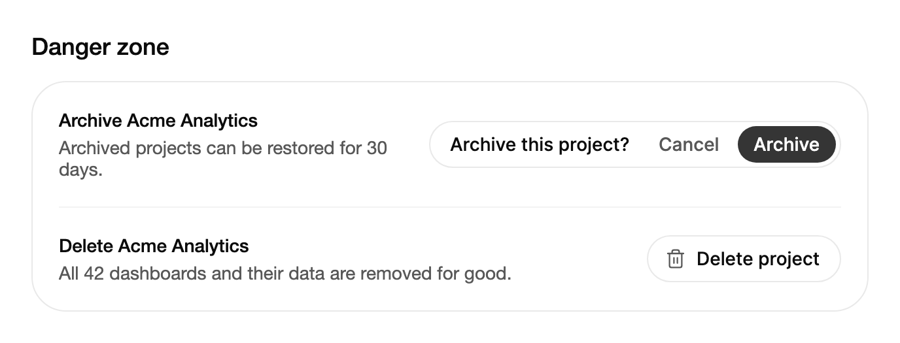

<Demo name="Press" />

## 何時使用

`ConfirmMorph` 是針對破壞性或重要操作的按鈕，它會先在原地詢問。按下後，同一個膠囊形按鈕會變為一句問題，接著在操作執行時變為載入指示器，最後變為結果，並可選擇提供復原。它適用於一個問題就能說明清楚後果的操作，讓使用者無需離開表格、卡片或編輯器即可作答。

- **刪除清單中選取的項目**：在檔案瀏覽器或訂單清單中，工具列詢問「刪除 3 個檔案？」。問題寫明了數量，因此使用者能準確看到將被刪除的內容，而不會被對話方塊打斷選取。
- **移除成員或撤銷存取權限**：團隊頁面上的列操作「移除成員」一按即可作答，結果（「已移除」）在原處確認變更，不會有使用者可能錯過的輕提示。
- **捨棄未儲存的草稿**：編輯器中一個簡短的倒數計時讓使用者有幾秒鐘改變主意，之後才執行捨棄，適合無法復原的操作。
- **帶寬限期的可復原操作**：封存專案或關閉支援工單。伺服器接受變更後的一段時間內，結果會提供復原。
- **可能失敗的伺服器呼叫**：等待畫面顯示工作正在進行；呼叫失敗時則變為帶重試的錯誤畫面，使用者無需重新找到該控制項。

## 何時不用

- **後果需要多行說明或輸入名稱才能確認**，例如刪除帳號或正式環境資料庫：用 `Dialog`，它可以容納詳細說明、受影響內容的清單與文字輸入框。
- **沒有確認問題、安全的非同步提交**：用 `ActionButton`，它會顯示等待與成功狀態，無需先行詢問。
- **絕不能因單擊而觸發的操作**，例如裝置主控台中的恢復原廠設定：用 Gestures 中專為此設計的 `HoldToConfirm`。
- **沒有單一預設操作的命令清單**，例如同一列中的複製、移動、匯出與刪除：用 Menus 中的 `DropdownMenu`。
- **必須阻擋頁面其餘部分的決定**，例如導覽前的未儲存變更：用 `Dialog`。變形不會阻擋其他位置的輸入；在外部按下會以「否」回答問題。

## 用法

將 `Label` 設為靜止時顯示的文字。問題由 `Prompt` 提供；未設定 `Prompt` 時，使用帶問號的 `Label`。

```xml
<UserControl xmlns="https://github.com/avaloniaui"
             xmlns:arc="https://github.com/AIDotNet/TKCode.Arc">
    <arc:ConfirmMorph Label="刪除專案" Prompt="刪除此專案？" />
</UserControl>
```

`ConfirmMorph` 衍生自 Avalonia 的 `TemplatedControl`，而不是 `Button`。它的範本宣告了所有畫面（靜止的膠囊、問題、倒數計時、等待指示器、結果與錯誤），控制項會隨 `State` 的變化在它們之間切換。靜止的膠囊與回答按鈕都是範本中一般的 Avalonia 按鈕，因此它們可以取得焦點，並像其他按鈕一樣回應 Enter 與 Space。控制項本身可以取得焦點，但不是 Tab 停駐點：Tab 在目前顯示畫面的按鈕之間移動。

狀態機有五個值：`Idle`、`Confirming`、`Pending`、`Done` 與 `Error`。`State` 讀寫該值，預設為雙向繫結，因此檢視模型可以觀察流程、啟動流程或強制切換畫面，而無需執行任何操作。

### 結構

1. **靜止的膠囊**（`Label`、`Icon`）：高 36 px 的膠囊，位於抬升表面色上，文字為小號、中等字重。`Icon` 是位於文字之前的選用 16 px 圖示。膠囊左側內距 14 px，右側 16 px。懸停、按下與鍵盤焦點分別疊加 5%、9% 與 6% 的前景色。
2. **問題**（`Prompt`）：問題文字，最寬 256 px，左側內距 12 px，右側 8 px。
3. **取消**（`CancelLabel`）：次要回答，使用次要文字顏色。懸停、按下與焦點時的填滿分別為前景色的 7%、11% 與 8%。
4. **確認**（`ConfirmLabel`、`Tone`）：執行操作的回答。危險色調靜止時使用危險色 13% 的填滿，懸停時為 18%，按下時為 22%，文字為危險色。中性色調使用強調色填滿與強調前景色。
5. **倒數計時**（`CountdownSeconds`、`CountdownLabel`）：隨倒數計時消退的圓環、剩餘秒數，以及它自己的取消按鈕。
6. **等待**（`PendingLabel`、`UndoingLabel`）：`ConfirmAction` 執行時的載入指示器與文字。`UndoAction` 執行時顯示 `UndoingLabel`。
7. **結果**（`DoneLabel`、`UndoLabel`）：自行繪製的勾號與完成文字；設定了 `UndoAction` 時還有復原按鈕。
8. **錯誤**（`ErrorLabel`、`RetryLabel`）：危險色的錯誤文字與重試按鈕。

回答按鈕高 28 px，即膠囊高度減去 8 px，因此每個畫面都能放進膠囊內。每個畫面保持其自然寬度，只有膠囊的寬度在畫面之間變化。

### 操作與復原

問題被回答時執行 `ConfirmAction`。任務未完成期間，等待畫面保持顯示。任務拋出例外時，控制項切換到錯誤畫面，重試會再次執行 `ConfirmAction`。任務完成後，結果畫面顯示 `DoneLabel`。

`UndoAction` 會在結果中加入復原。按下復原會執行它，等待畫面顯示 `UndoingLabel`，完成後控制項回到靜止狀態。沒有設定 `UndoAction` 時，結果中沒有復原按鈕。

<Demo name="ErrorAndRetry" />

```csharp
delete.ConfirmAction = () => documentService.DeleteAsync(selected);
delete.UndoAction = () => documentService.RestoreAsync(selected);
```

上面的範例每隔一次嘗試就會失敗，因此示範中會出現錯誤畫面與重試按鈕。在實際應用程式中，任務應當只為使用者可以重試的失敗（例如網路錯誤）拋出例外。需要使用者自行修正的驗證錯誤，最好直接顯示在頁面中，而不是藏在重試按鈕之後。

### 選擇確認模式

`ConfirmMode` 決定如何回答問題。預設為 `Press`。

| 模式 | 回答方式 | 適用情境 |
|---|---|---|
| `Press`（預設） | 按一次確認按鈕，或在問題的任何位置按 Enter | 問題清楚，且結果可以復原，或操作重複執行的成本很低 |
| `Hold` | 按住確認按鈕直到其填滿完成；`HoldDuration` 設定所需時間（預設為 1 秒） | 輕點很容易誤觸，例如從共用工作區中移除成員 |
| `Countdown` | 確認會啟動 `CountdownSeconds` 倒數計時（預設為 3 秒），取消或 Escape 可以停止它 | 使用者在決定之後可能需要最後的機會，例如剛關閉的草稿要捨棄 |

### Hold 模式

在 `Hold` 模式下，指標在確認按鈕上按下，或確認按鈕取得焦點時按下 Enter 或 Space，會從其前緣開始填滿確認按鈕。填滿完成時執行操作。提前放開會使填滿彈回為空，並播報需要更長的按住時間。確認按鈕的說明文字為 “Press and hold”。

<Demo name="Hold" />

```xml
<arc:ConfirmMorph Label="移除成員"
                  ConfirmLabel="移除"
                  ConfirmMode="Hold"
                  HoldDuration="00:00:01" />
```

### Countdown 模式

在 `Countdown` 模式下，回答確認會啟動倒數計時，而不是執行操作。圓環消退，秒數遞減。倒數計時歸零時執行操作；倒數計時期間按下 Enter 則立即執行。取消、Escape 鍵或在外部按下都會停止倒數計時，操作不會執行。

<Demo name="Countdown" />

```xml
<arc:ConfirmMorph Label="捨棄草稿"
                  ConfirmLabel="捨棄"
                  ConfirmMode="Countdown"
                  CountdownSeconds="3" />
```

`CountdownLabel` 設定秒數之前的文字。未設定時，控制項使用等待文字，後接 “in”。

### 文字與色調

八個文字屬性（`ConfirmLabel`、`CancelLabel`、`PendingLabel`、`DoneLabel`、`ErrorLabel`、`RetryLabel`、`UndoLabel` 與 `UndoingLabel`）分別設定各畫面的文字。它們的預設值為 “Delete”、“Cancel”、“Deleting”、“Deleted”、“Couldn’t finish”、“Retry”、“Undo” 與 “Restoring”，因此即使沒有設定任何文字屬性，控制項仍然像一個刪除操作。請設定操作所改變的每一項文字，因為預設值是英文的刪除用語。

`Tone="Neutral"` 會以強調色為確認回答著色，適用於可以復原的重要操作。預設的 `Danger` 適用於破壞性操作。

<Demo name="NeutralTone" />

### 受控狀態與逾時

`State` 為雙向繫結。從程式碼設定它會將控制項切換到對應畫面，但不會執行操作，因此檢視模型可以還原先前工作階段的結果，或在其自身請求進行期間顯示等待畫面。`StateChanged` 會在每次切換時回報 `OldState` 與 `NewState`；取消問題或倒數計時時會引發 `Cancelled`。

`ConfirmTimeout` 會將未回答的問題恢復為靜止狀態（預設 6 秒），`ResultTimeout` 會移除結果（預設 5 秒）。指標停留在控制項上時，兩個計時器都會暫停；視窗最小化時也是如此，因此使用者在查看控制項時不會被催促。將任一逾時設為零即可關閉它。

```csharp
confirm.StateChanged += (_, e) => log.Text = $"狀態：{e.NewState}";
confirm.Cancelled += (_, _) => log.Text = "已取消";
confirm.State = ConfirmMorphState.Idle;
```

將 `State` 設為 `Pending` 或 `Done` 會直接顯示該畫面，而不執行 `ConfirmAction` 或 `UndoAction`。呼叫 `Ask()` 會像按下靜止按鈕那樣開啟問題，`Cancel()` 則關閉已開啟的問題或倒數計時。除非控制項處於 `Idle` 且已啟用，否則 `Ask()` 不會作用。

### 焦點與關閉

控制項隨變形移動焦點，使鍵盤始終有合理的落點。問題開啟時焦點在確認按鈕上；倒數計時或等待任務執行時焦點在控制項本身上；結果或錯誤出現時焦點在復原或重試按鈕上；控制項回到靜止時，焦點重新回到靜止的膠囊上。

開啟的問題可以透過以下方式關閉：

- 取消，或按 Escape 鍵；
- 在控制項外按下，這會以「否」回答問題（將 `IsOutsidePressCancelEnabled` 設為 `False`，可讓問題在外部按下時保持開啟）；
- `ConfirmTimeout`，即使用者未作答時。

`ResultTimeout` 也會在使用者未對結果採取行動時將其恢復為靜止狀態。

### 停用

`IsEnabled` 為 `False` 時，靜止的膠囊會去掉陰影，`Ask()` 也會忽略該請求。請在附近的列說明中寫明原因。

<Demo name="Disabled" />

### 範例：專案危險區

一個設定頁面，其中包含兩項輕重不同的操作。「封存專案」可以復原，因此使用中性色調，並在下方的標記中保持開啟的問題，以便顯示其狀態。「刪除專案」是永久性的，因此保留危險色調，並以膠囊形態靜止，直到使用者主動操作。每一列都在控制項旁用一句話說明後果，因此問題本身可以保持簡短。



```xml
<StackPanel Width="640" Spacing="16">
    <TextBlock Text="Danger zone"
               FontSize="{arc:ArcDesignTokenResource TypeLG}"
               FontWeight="{arc:ArcDesignTokenResource WeightMedium}"
               Foreground="{arc:ArcDesignTokenResource Foreground}" />
    <Border Background="{arc:ArcDesignTokenResource Surface}"
            BorderBrush="{arc:ArcDesignTokenResource Border}"
            BorderThickness="1"
            CornerRadius="{arc:ArcDesignTokenResource RadiusPanel}"
            Padding="20">
        <StackPanel Spacing="20">
            <Grid ColumnDefinitions="*,Auto">
                <StackPanel Grid.Column="0" Spacing="4" VerticalAlignment="Center">
                    <TextBlock Text="Archive Acme Analytics"
                               FontWeight="{arc:ArcDesignTokenResource WeightMedium}"
                               Foreground="{arc:ArcDesignTokenResource Foreground}" />
                    <TextBlock Text="Archived projects can be restored for 30 days."
                               TextWrapping="Wrap"
                               FontSize="{arc:ArcDesignTokenResource TypeSM}"
                               Foreground="{arc:ArcDesignTokenResource TextSecondary}" />
                </StackPanel>
                <arc:ConfirmMorph Grid.Column="1"
                                  Label="Archive project"
                                  Prompt="Archive this project?"
                                  ConfirmLabel="Archive"
                                  PendingLabel="Archiving"
                                  DoneLabel="Archived"
                                  Tone="Neutral"
                                  State="Confirming"
                                  VerticalAlignment="Center" />
            </Grid>
            <Border Height="1" Background="{arc:ArcDesignTokenResource BorderSubtle}" />
            <Grid ColumnDefinitions="*,Auto">
                <StackPanel Grid.Column="0" Spacing="4" VerticalAlignment="Center">
                    <TextBlock Text="Delete Acme Analytics"
                               FontWeight="{arc:ArcDesignTokenResource WeightMedium}"
                               Foreground="{arc:ArcDesignTokenResource Foreground}" />
                    <TextBlock Text="All 42 dashboards and their data are removed for good."
                               TextWrapping="Wrap"
                               FontSize="{arc:ArcDesignTokenResource TypeSM}"
                               Foreground="{arc:ArcDesignTokenResource TextSecondary}" />
                </StackPanel>
                <arc:ConfirmMorph Grid.Column="1"
                                  Label="Delete project"
                                  Icon="{x:Static arc:ArcIcons.Trash2}"
                                  Prompt="Delete this project?"
                                  VerticalAlignment="Center" />
            </Grid>
        </StackPanel>
    </Border>
</StackPanel>
```

### 繫結到檢視模型

使用 CommunityToolkit.Mvvm 時，檢視模型擁有操作的狀態及其執行的工作。`ConfirmAction` 與 `UndoAction` 是 `Func<Task>` 屬性，因此檢視模型將它們作為該型別的屬性公開並繫結。`State` 為雙向繫結，因此檢視模型也可以移動控制項。

```csharp
public interface IProjectService
{
    Task ArchiveAsync(string projectId);

    Task RestoreAsync(string projectId);

    Task DeleteAsync(string projectId);
}

public partial class ProjectDangerViewModel : ObservableObject
{
    private readonly IProjectService _projects;

    public ProjectDangerViewModel(IProjectService projects)
    {
        _projects = projects;
    }

    [ObservableProperty]
    private ConfirmMorphState _archiveState = ConfirmMorphState.Idle;

    [ObservableProperty]
    private string _projectName = "Acme Analytics";

    public Func<Task> ArchiveAction => () => _projects.ArchiveAsync(ProjectId);

    public Func<Task> UndoArchiveAction => () => _projects.RestoreAsync(ProjectId);

    public Func<Task> DeleteAction => () => _projects.DeleteAsync(ProjectId);

    public string ProjectId { get; } = "prj_2026_0412";
}
```

```xml
<StackPanel Spacing="12">
    <arc:ConfirmMorph Label="封存專案"
                      Prompt="封存此專案？"
                      ConfirmLabel="封存"
                      Tone="Neutral"
                      State="{Binding ArchiveState, Mode=TwoWay}"
                      ConfirmAction="{Binding ArchiveAction}"
                      UndoAction="{Binding UndoArchiveAction}" />
    <arc:ConfirmMorph Label="刪除專案"
                      Icon="{x:Static arc:ArcIcons.Trash2}"
                      ConfirmAction="{Binding DeleteAction}" />
</StackPanel>
```

- `State` 為雙向繫結，它是唯一需要 `Mode=TwoWay` 的屬性（這已是它的預設值）。讀取它可以讓其他控制項保持同步，例如在封存進行時停用該列的其他操作。
- `ConfirmAction` 與 `UndoAction` 為單向繫結：檢視模型提供工作，控制項負責呼叫它。
- 事件 `StateChanged` 適用於記錄日誌，但繫結了 `State` 之後，檢視模型不應需要它。
- 編譯繫結需要在檢視上設定 `x:DataType`（為求簡潔，範例省略了它）。

### 文案規範

- **標籤**：句首大寫的動詞加受詞，例如「刪除專案」「封存專案」。標籤是使用者在決定之前看到的內容，因此必須說明操作會做什麼。
- **問題**：包含數量或名稱並以問號結尾，例如「刪除 3 個檔案？」。寫明對象的問題會告訴使用者他們正在回答什麼。
- **確認文字**：只用動詞，例如「刪除」「封存」「撤銷」。它用與標籤相同的詞回答問題，因此從不出現「是」。
- **完成文字**：動詞的過去式，例如「已刪除」「已封存」。保持簡短，使結果能放進膠囊中。
- **錯誤文字**：說明操作未能完成，而不是用技術術語描述哪裡出錯。下一步由重試按鈕處理。

| 不要寫 | 改為 |
|---|---|
| 是 | 刪除 |
| 確定要刪除此項目嗎？ | 刪除 3 個檔案？ |
| 哎呀，出錯了！ | 未能完成 |
| 完成！ | 已刪除 |
| 復原上一步操作 | 復原 |

### 最佳做法

**建議**

- 在標籤或問題中寫明對象，使問題在情境中即可回答：「刪除 3 個檔案？」無需閱讀頁面的其他部分即可理解。
- 只有可復原的操作才使用 `Tone="Neutral"`。使用者無法收回的操作保留危險色調，使顏色保持其含義。
- 當伺服器能在一段時間內還原物件時，提供 `UndoAction`。結果會保持足夠長的時間，讓使用者在 `ResultTimeout` 將控制項恢復為靜止之前按下復原。
- 設定操作所需的每一個文字屬性。預設值描述的是刪除；若封存操作上顯示通用的 “Deleting” 標籤，就會像是一個錯誤。
- 對於重複執行成本較高的操作使用 `Countdown` 或 `Hold`，其餘使用 `Press`。每個畫面只用一種模式，使各個回答保持一致。

**避免**

- 將控制項用於需要多行說明或輸入名稱的後果。問題畫面只有一行；應把詳細內容放在 `Dialog` 中。
- 過長的問題。問題畫面按一行短文字設計，問題的最大寬度為 256 px；請保持為關於對象的一個問題。
- 為使用者必須閱讀的問題把 `ConfirmTimeout` 設得過短。6 秒足夠一瞥；遠少於此，問題會在被閱讀之前消失。
- 預設關閉 `IsOutsidePressCancelEnabled`。外部按下卻沒有任何反應，會讓人覺得控制項卡住了；除非問題必須在使用者於別處工作時保持開啟，否則請保留預設值。
- 在 `ConfirmAction` 中執行耗時操作卻沒有等待文字。載入指示器與文字是工作正在進行的唯一訊號。

### 常見問題

**為什麼開啟問題的那個 Enter 鍵不能立即作答？** 問題開啟後的前 280 ms 內的按下會被忽略，Enter 的自動重複也會被忽略。這樣可以防止雙擊或按住的按鍵在使用者尚未讀到問題時就作答。

**操作失敗後，控制項會處於損壞狀態嗎？** 不會。拋出例外的 `ConfirmAction` 任務會使控制項切換到 `Error`，顯示 `ErrorLabel` 與重試按鈕。重試會再次執行 `ConfirmAction`，而 Escape 會使控制項回到靜止狀態，且不執行操作。

**如何從鍵盤快速鍵或程式碼開啟問題？** 呼叫 `Ask()`。它的效果與按下靜止的膠囊相同；除非控制項處於 `Idle` 且已啟用，否則該呼叫會被忽略。

**如何知道操作何時完成？** 監看 `State` 是否變為 `Done`，或處理 `StateChanged`。`ConfirmAction` 完成後控制項切換到 `Done`，拋出例外時切換到 `Error`，因此檢視模型在兩種情況下都能重新整理其清單。

## API 參考

<!-- api: ConfirmMorph -->

## 無障礙

- 問題是一個以其提示命名的群組。靜止的按鈕保留其標籤的名稱。
- 焦點隨變形移動：問題開啟時在確認按鈕上，倒數計時或等待工作執行時在控制項本身上，結果或錯誤出現時在復原或重試按鈕上，控制項回到靜止時回到靜止的膠囊上。
- 問題開啟後的前 280 ms 內的按下會被忽略，因此雙擊或按住 Enter 不會意外作答。
- 在 `Hold` 模式下，說明文字為 “Press and hold”。提前放開會播報需要更長的按住時間。
- 提示、等待與結果的文字，以及 “Undo is available”，都會透過狀態區域禮貌地播報。
- Enter 與 Space 會按下目前畫面上的按鈕。Escape 會取消問題或倒數計時，並使結果或錯誤回到靜止狀態。
- 鍵盤焦點以按鈕背景的色調呈現（依色調與狀態為 6% 至 20%），而不是焦點環。

### 鍵盤

| 按鍵 | 操作 |
|---|---|
| `Enter` / `Space`（靜止的膠囊上） | 開啟問題 |
| `Tab` / `Shift+Tab` | 在目前顯示畫面的按鈕之間移動，例如取消與確認 |
| `Enter`（`Press` 模式） | 在問題的任何位置回答「是」，取消按鈕取得焦點時除外 |
| `Enter` / `Space`（確認按鈕上，`Hold` 模式） | 按住時填滿確認按鈕；填滿完成時執行操作 |
| `Enter` / `Space`（確認按鈕上，`Countdown` 模式） | 啟動倒數計時 |
| 倒數計時期間按 `Enter` | 立即執行操作 |
| 取消、復原或重試按鈕上的 `Enter` / `Space` | 按下該按鈕 |
| `Escape` | 取消問題或倒數計時；將結果或錯誤恢復為靜止狀態 |

## 動態效果

- 只有膠囊的寬度會變化。它以彈簧方式展開，收縮則更平順，文字不會縮放。
- 每個新畫面的各個部分按閱讀順序依序清除輕微模糊，舊畫面則原地淡出。
- 結果的勾號會自行繪製。倒數計時圓環消退、數字滾動，等待指示器旋轉。
- 在 `Hold` 模式下，按住確認時，危險色的填滿會從前緣顯露；提前放開則以彈簧彈回。
- 減少動態效果時，取消寬度彈簧與模糊，畫面之間交叉淡化，並放慢指示器旋轉。按住填滿與倒數計時圓環仍會顯示進度。關閉動態效果時，畫面立即切換。

| 變化 | 完整 | 減少 | 關閉 |
|---|---|---|---|
| 問題開啟或關閉 | 膠囊寬度以彈簧展開，收縮更平順 | 沒有寬度彈簧；畫面交叉淡化 | 立即完成 |
| 畫面切換 | 各部分按閱讀順序每隔 35 ms 清除輕微模糊；舊畫面在 120 ms 內淡出 | 交叉淡化 | 立即完成 |
| 結果 | 勾號自行繪製 | 勾號直接出現，不繪製 | 立即完成 |
| 倒數計時 | 圓環消退，秒數滾動 | 圓環仍然消退 | 立即完成 |
| 等待 | 指示器旋轉 | 指示器放慢旋轉 | 立即完成 |
| `Hold` 填滿 | 填滿從前緣顯露，提前放開時彈回 | 填滿仍顯示進度 | 立即完成 |

## 相關元件

- `Dialog`：後果需要更多說明或輸入名稱時使用。
- `ActionButton`：沒有確認問題的非同步提交。
- `HoldToConfirm`：絕不能在單擊時觸發的操作。
- `DropdownMenu`：沒有單一預設操作的命令清單。

| 元件 | 適用情境 |
|---|---|
| `Dialog` | 後果需要多行說明、受影響項目的清單或輸入名稱 |
| `ActionButton` | 操作安全且是非同步的，不應先行詢問 |
| `HoldToConfirm`（Gestures） | 單次按住就是全部互動，且操作絕不能因輕點而觸發 |
| `DropdownMenu`（Menus） | 列或工具列提供多個命令，且其中沒有預設操作 |
| `CopyButton` | 操作將值複製到剪貼簿，並在原處顯示結果 |
| `ButtonGroup` | 多個按鈕組成一個工具列，且它們都不需要自己的詢問 |
