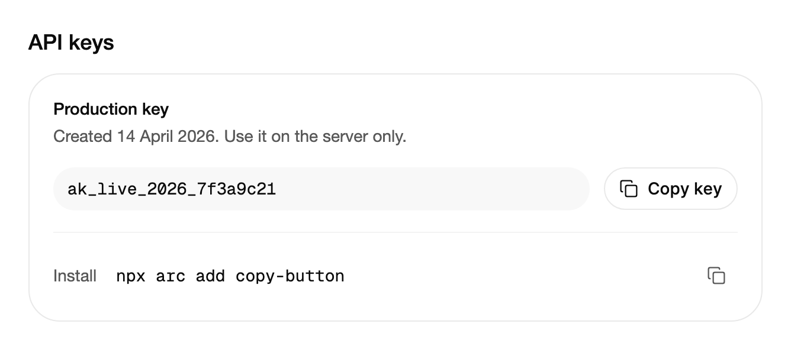

<Demo name="Outline" />

## 何時使用

`CopyButton` 會把一個值複製到剪貼簿，並在原地確認複製結果：圖示變為勾號，標籤變為「已複製」，片刻後按鈕回到靜止狀態。它緊挨著所複製的值，因此使用者不必選取文字、找到正確的字元，也不必離開正在操作的列。它本身是一個 `Button`，可以用鍵盤操作，也能放進工具列以及任何接受按鈕的版面中。

- **只顯示一次的金鑰**：開發者主控台頁面上的 API 金鑰或 Webhook 簽章金鑰。使用者可以把完整的值複製到密碼管理器或設定檔中，旁邊的遮罩文字無需再選取。
- **導覽頁中的安裝指令與程式片段**：文件頁或設定精靈中的 `npx arc add copy-button` 這類指令。`Plain` 變體讓指令保持易讀，同時仍提供複製動作。
- **帳單或報告中的可分享連結**：帳單頁面上的付款連結或唯讀報告 URL，複製後可以貼到寄給客戶的電子郵件中。
- **密集表格中的識別碼**：清單中的訂單編號、工作區 ID 或追蹤編號。只顯示圖示的形式可以為每一列增加一個複製動作，而不會加寬表格。
- **必須精確的值**：連線字串或 SKU。手動輸入，或從換行的文字中選取，都容易出錯。

## 何時不用

- **需要以多種格式複製**，例如複製連結、以 Markdown 複製或複製嵌入程式碼：用 `SplitButton`，讓主要的複製動作仍然只需按一下，其他選項放在它的選單中。
- **完整的程式碼範例**，且自帶複製控制項：用 `CodeBlock`，它的標題列中已經有一個複製控制項。
- **使用者可能需要編輯或完整閱讀的唯讀欄位**：用 `Input` 並設定 `IsReadOnly="True"`，它能讓值保持可選取。當一次按下就應複製整個值時，在該欄位旁邊放一個 `CopyButton`。
- **傳送或執行而非複製的動作**，例如「傳送邀請」或「輪替金鑰」：用 `Button` 或 `ActionButton`，它們的等待與成功狀態能描述工作進度。
- **列動作清單，而複製只是眾多動作之一**：用 Menus 分類中的 `DropdownMenu`，讓複製動作與編輯、重新命名、刪除放在一起，而不是每一列都佔用一個按鈕。

## 用法

把 `Value` 設為要寫入剪貼簿的文字。`Label` 是可見文字，同時也是無障礙名稱。

```xml
<UserControl xmlns="https://github.com/avaloniaui"
             xmlns:arc="https://github.com/AtomUICommunity/TKCode.Arc">
    <arc:CopyButton Value="npx arc add copy-button" />
</UserControl>
```

`CopyButton` 衍生自 Avalonia 的 `Button`。它保留 `Command`、`Click`、`IsEnabled` 及其他按鈕行為，並在點選處理中加入複製：點選時讀取值，並等待剪貼簿寫入完成，因此複製進行期間視窗仍能繼續執行。

### 結構

1. **外框**（`Variant`、`Background`、`BorderBrush`）：1 px 邊框，使用表面顏色與控制項圓角，最小高度為小尺寸控制項的高度（36 px）。懸停時外框變為柔和的表面色，邊框變為更醒目的顏色。
2. **圖示**：16 px 的複製圖形。複製後變為成功色的勾號；失敗後變為危險色的警示圖示。
3. **標籤**（`Label`、`CopiedLabel`、`FailedLabel`）：文字。標籤儲存格會預留三個詞中最寬的寬度，因此文字變化時按鈕寬度保持不變。圖示與標籤之間的間距為 8 px，兩側的內距各為 12 px。
4. **焦點框**：2 px 的焦點色框，繪製在外框外側 4 px 處。只在鍵盤取得焦點時出現。

### 變體與尺寸

`Variant` 決定外框。`Outline`（預設）繪製表面與邊框，讓按鈕看起來像一個動作。`Plain` 會移除外框，使用次要文字顏色，適合一行程式碼、密集表格或說明文字，因為帶外框的按鈕會與內容爭奪注意力。

<Demo name="Plain" />

```xml
<arc:CopyButton Value="https://uiarc.dev" IsIconOnly="True" />
<arc:CopyButton Value="#7C5CFF" Label="複製 HEX 值" Variant="Plain" />
```

每個區域只選一種變體。面板中最重要的複製使用 `Outline`，清單中重複出現的或位於程式碼區塊中的複製使用 `Plain`。

### 純圖示與標籤

`IsIconOnly` 會隱藏標籤，只留下圖示，形成一個 36 px 的方形按鈕。`Label` 仍然為輔助技術提供名稱，因此純圖示的複製需要一個具體的標籤：在有大量列的表格中，「複製訂單編號」能被準確朗讀，而「複製」則含糊不清。純圖示按鈕寬 36 px，可以放進表格欄而不加寬該欄。

### 重設時間與事件

按鈕會在 `ResetAfter` 之後恢復閒置狀態，預設為 1.9 秒。複製成功後會引發 `Copied`，複製失敗時絕不會引發。`State` 回傳 `Idle`、`Copied` 或 `Error`，它是唯讀的：由控制項設定，程式碼讀取。

```csharp
copy.Copied += (_, _) => log.Text = "已複製到剪貼簿。";
copy.ResetAfter = TimeSpan.FromSeconds(3);
```

只有當使用者必須在確認訊息消失前讀完它時，才應延長 `ResetAfter`，例如複製之後還要在另一個頁面上進行下一步。單次複製保留預設值，讓控制項能盡快為下一次複製做好準備。

### 繫結到檢視模型

值通常是檢視模型已經持有的資料，因此把 `Value` 單向繫結，讓點選時複製的是當下的資料。`Failure` 範例展示了值不存在的情況。

<Demo name="Failure" />

```csharp
public partial class DeveloperKeysViewModel : ObservableObject
{
    [ObservableProperty]
    private string? _apiKey = "ak_live_2026_7f3a9c21";

    [ObservableProperty]
    private string? _installCommand = "npx arc add copy-button";
}
```

```xml
<StackPanel Spacing="8">
    <arc:CopyButton Value="{Binding ApiKey}" Label="複製金鑰" />
    <arc:CopyButton Value="{Binding InstallCommand}" Label="複製指令" Variant="Plain" />
</StackPanel>
```

- `Value` 是單向的。控制項從不寫回檢視模型，因此複製動作不會改變它所複製的資料。
- `null` 值會使複製失敗：按鈕顯示失敗狀態，寬度不變。應把 `Value` 繫結到真正可用的資料，而不是一個可能被誤複製的預留值。
- 讓 `Value` 與螢幕上的資料保持一致。像「ak_live_****」這樣的遮罩顯示不應作為繫結值，否則使用者貼上的就是遮罩。

### 範例：開發者 API 金鑰

一個開發者主控台頁面，在同一面板中顯示正式環境金鑰（附複製動作）與安裝指令。金鑰是頁面要複製的最重要的值，因此它使用 `Outline` 變體與完整標籤。指令是次要的值，因此它使用 `Plain` 變體，搭配純圖示複製。兩個值都完整顯示，使用者可以在複製前核對。



```xml
<StackPanel Width="620" Spacing="16">
    <TextBlock Text="API keys"
               FontSize="{arc:ArcDesignTokenResource TypeLG}"
               FontWeight="{arc:ArcDesignTokenResource WeightMedium}"
               Foreground="{arc:ArcDesignTokenResource Foreground}" />
    <Border Background="{arc:ArcDesignTokenResource Surface}"
            BorderBrush="{arc:ArcDesignTokenResource Border}"
            BorderThickness="1"
            CornerRadius="{arc:ArcDesignTokenResource RadiusPanel}"
            Padding="20">
        <StackPanel Spacing="18">
            <StackPanel Spacing="6">
                <TextBlock Text="Production key"
                           FontWeight="{arc:ArcDesignTokenResource WeightMedium}"
                           Foreground="{arc:ArcDesignTokenResource Foreground}" />
                <TextBlock Text="Created 14 April 2026. Use it on the server only."
                           TextWrapping="Wrap"
                           FontSize="{arc:ArcDesignTokenResource TypeSM}"
                           Foreground="{arc:ArcDesignTokenResource TextSecondary}" />
            </StackPanel>
            <Grid ColumnDefinitions="*,Auto">
                <Border Grid.Column="0"
                        Background="{arc:ArcDesignTokenResource SurfaceMuted}"
                        CornerRadius="{arc:ArcDesignTokenResource RadiusControl}"
                        Padding="12,9"
                        VerticalAlignment="Center">
                    <TextBlock Text="ak_live_2026_7f3a9c21"
                               FontFamily="{arc:ArcDesignTokenResource MonoFontFamily}"
                               FontSize="{arc:ArcDesignTokenResource TypeSM}"
                               Foreground="{arc:ArcDesignTokenResource Foreground}" />
                </Border>
                <arc:CopyButton Grid.Column="1"
                                Label="Copy key"
                                Value="ak_live_2026_7f3a9c21"
                                Margin="12,0,0,0"
                                VerticalAlignment="Center" />
            </Grid>
            <Border Height="1" Background="{arc:ArcDesignTokenResource BorderSubtle}" />
            <Grid ColumnDefinitions="Auto,*,Auto">
                <TextBlock Grid.Column="0"
                           Text="Install"
                           Margin="0,0,16,0"
                           VerticalAlignment="Center"
                           FontSize="{arc:ArcDesignTokenResource TypeSM}"
                           Foreground="{arc:ArcDesignTokenResource TextSecondary}" />
                <TextBlock Grid.Column="1"
                           Text="npx arc add copy-button"
                           FontFamily="{arc:ArcDesignTokenResource MonoFontFamily}"
                           FontSize="{arc:ArcDesignTokenResource TypeSM}"
                           VerticalAlignment="Center"
                           Foreground="{arc:ArcDesignTokenResource Foreground}" />
                <arc:CopyButton Grid.Column="2"
                                Label="Copy command"
                                Value="npx arc add copy-button"
                                Variant="Plain"
                                IsIconOnly="True"
                                VerticalAlignment="Center" />
            </Grid>
        </StackPanel>
    </Border>
</StackPanel>
```

金鑰是頁面要複製的唯一值，因此它有完整標籤、表面外框，以及一種等寬字型，使 `0` 與 `O` 等字元易於區分。指令是次要的，因此它的純圖示複製讓該列保持緊湊，同時其無障礙名稱仍能說明它複製的內容。

### 文案規範

- **標籤**：動詞加受詞，句首大寫，例如「複製金鑰」或「複製指令」。為值命名，使按鈕脫離上下文仍有意義，螢幕閱讀器逐一讀取按鈕清單時也能分辨。
- **已複製標籤**：簡短的過去式確認，「已複製」或「金鑰已複製」。已複製狀態只持續片刻，因此這個詞必須一眼就能看懂。
- **失敗標籤**：說明沒有成功的結果，而不是原因。「無法複製」提示使用者再試一次，或手動選取文字。

| 不要寫 | 改為 |
|---|---|
| 點擊複製 | 複製金鑰 |
| 成功！ | 已複製 |
| 錯誤 | 無法複製 |
| 複製到剪貼簿（40 列的表格中） | 複製訂單編號 |

### 最佳做法

**建議**

- 在 `Label` 中寫明值的名稱（「複製金鑰」「複製邀請連結」），因為即使圖示隱藏了文字，標籤也是無障礙名稱。清單中重複出現的通用「複製」讓螢幕閱讀器無法區分各列。
- 複製使用者需要的完整值，而不是遮罩顯示。貼上的遮罩就是一張本可避免的支援工單。
- 在密集列與程式碼中使用 `Plain`，面板中最重要的複製使用 `Outline`。每個面板只保留一個帶外框的複製，主要動作才清楚。
- 單次複製保留預設的 `ResetAfter`，使控制項在使用者繼續操作前回到標籤狀態。

**避免**

- 在資料可能缺失時繫結 `Value` 卻不處理失敗。`null` 值會顯示失敗狀態，使用者需要一個再試一次的理由，而不是一個毫無反應的按鈕。
- 把複製與破壞性動作合併在一個按鈕中，例如「複製並輪替金鑰」。複製是安全的，因此應把輪替放在有確認的獨立控制項中。
- 一列中堆疊多個帶外框的複製按鈕。視覺上它們會被看作同等重要的多個動作；次要的複製改用 `Plain`。
- 依賴 `Copied` 事件來顯示訊息。按鈕已經在原地確認了複製；再顯示一則訊息只是重複同一訊號，還會與頁面爭奪注意力。

### 常見問題

**為什麼設定了 `Value` 按鈕仍顯示失敗狀態？** 當剪貼簿拒絕寫入時，點選會回報失敗，因此失敗狀態並非僅由值造成。顯示失敗標籤，並讓使用者從可選取的欄位中手動複製文字。

**複製失敗時會引發 `Copied` 嗎？** 不會。該事件只在複製成功後引發。用 `State` 讀取上一次點選的結果，包括 `Error`。

**按鈕能複製使用者點選時才產生的值嗎？** 僅靠 `Value` 不行。值是在點選時讀取的，因此要讓它與螢幕上的資料保持同步。長的或遠端取得的值應在頁面顯示按鈕之前產生，再把結果繫結到 `Value`。

**如何在窄螢幕上只顯示圖示？** 在版面變窄時從程式碼設定 `IsIconOnly`，例如在 `SizeChanged` 處理常式中。標籤仍是無障礙名稱，因此要保持它的具體性。

## API 參考

<!-- api: CopyButton -->

## 無障礙

- 無障礙名稱永遠是 `Label`，即使按鈕只顯示圖示。
- 一個隱藏的禮貌狀態區域會朗讀結果，例如「複製金鑰：已複製」或「複製金鑰：無法複製」。
- Enter 與 Space 執行複製。
- 標籤儲存格保留其最寬狀態的寬度，因此按鈕周圍的版面不會移動。
- 鍵盤焦點會顯示焦點框。指標聚焦時不繪製焦點框。
- 停用的按鈕降至一半透明度。

### 鍵盤

| 按鍵 | 操作 |
|---|---|
| `Tab` / `Shift+Tab` | 將焦點移到下一個或上一個可聚焦的控制項，包括複製按鈕 |
| `Enter` 或 `Space` | 複製該值；顯示已複製或失敗狀態，`ResetAfter` 之後回到靜止 |

## 動態效果

- 圖示以柔和的模糊切換，並以緩慢、近乎臨界阻尼的彈簧縮放進入。勾號會自行繪製出來。
- 只有標籤中變化的字母會移動，回到閒置時按相反方向播放。
- 按下時內容輕微縮小，放開時以彈簧彈回。
- 減少動態效果時，圖示與文字使用瞬間交叉淡化，略過描邊繪製與按下縮放。關閉動態效果時立即替換圖示與標籤。

| 變化 | 完整 | 減少 | 關閉 |
|---|---|---|---|
| 已複製或失敗 | 圖示以柔和模糊切換，勾號自行繪製 | 圖示與標籤瞬間交叉淡化；勾號不繪製 | 立即 |
| 標籤變化 | 只有變化的字母移動，閒置時反向回位 | 瞬間交叉淡化 | 立即 |
| 按下 | 內容縮放至 0.97（純圖示時為 0.96），放開時彈回 | 無按下縮放 | 無按下縮放 |
| 懸停 | 外框交叉淡化為柔和的表面色與更醒目的邊框 | 瞬間 | 立即 |

## 相關元件

- `SplitButton`：複製只是多個動作之一時使用，例如「複製頁面」，並提供「複製連結」與「以 Markdown 複製」。
- `ActionButton`：非同步提交，帶有等待與成功狀態。
- `Button`：沒有剪貼簿結果的一般動作。
- `CodeBlock`：已包含複製控制項的程式碼範例。

| 元件 | 適用情境 |
|---|---|
| `SplitButton` | 複製是主要動作，其他選項是同一個值的格式或變體 |
| `CodeBlock` | 被複製的文字是程式碼範例，且已自帶複製控制項 |
| `Input`（`IsReadOnly`） | 值必須保持可選取、可完整閱讀，旁邊有複製動作 |
| `ActionButton` | 動作需要傳送或儲存內容，並需要等待與成功狀態 |
| `DropdownMenu` | 複製是多個列命令之一，適合放在選單中 |
