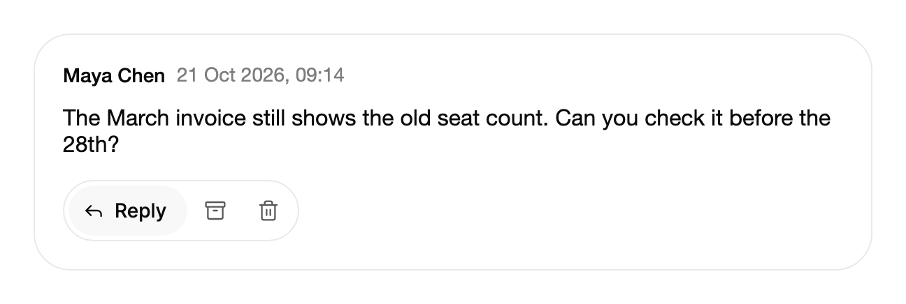

<Demo name="MessageActions" />

## 何时使用

`ExpandingButtonGroup` 把三到六个相关操作放进一个紧凑的胶囊中。始终有一个操作显示文字，指针或键盘所到之处的操作会接管这个文字，相邻的操作让位。它适用于空间紧张、而操作又很常见的界面：人能很快学会图标，只在需要时才看到文字。

- **消息与评论操作**：支持收件箱或团队聊天中，消息下方的回复、归档和删除。当前展开的文字说明了操作，归档确认时会在原位显示“已归档”。
- **文件操作**：文档列表或文件浏览器中，对选中文件的下载、分享和删除，并使用与表格密集行相匹配的 `Small` 尺寸。
- **卡片操作**：仪表板或项目看板上的帖子或任务卡片，例如点赞、评论和发布。其中最可能是下一步的操作在静止时即展开。
- **保存与确认流程**：编辑器工具栏中，保存操作可以在片刻内以“已保存”确认，然后文字回到静止状态，让人知道更改已被存储。

## 何时不用

- **需要保持选中的选择**，例如在列表、看板和日历之间切换视图：用 Toggles 分类中的 `SegmentedControl`，它会显示并保留选择状态。
- **一两个操作且空间充足**：用带文字的 `Button`，因为文字无需被发现。
- **超过约六个操作**：用 Menus 分类中的 `DropdownMenu`，它会以文字列出这些操作。
- **需要始终显示文字的图标操作**，例如新用户必须读懂的共享工具栏：用 `FloatingButtonGroup` 或 `ButtonGroup`，它们的文字始终可见。

## 用法

每个操作都是一个 `ExpandingButtonGroupItem`。组需要一个 `Label`，它就是无障碍名称。

```xml
<UserControl xmlns="https://github.com/avaloniaui"
             xmlns:arc="https://github.com/AtomUICommunity/TKCode.Arc">
    <arc:ExpandingButtonGroup Label="消息操作">
        <arc:ExpandingButtonGroupItem Label="回复" />
        <arc:ExpandingButtonGroupItem Label="发送" DoneLabel="已发送" />
        <arc:ExpandingButtonGroupItem Label="归档" DoneLabel="已归档" />
    </arc:ExpandingButtonGroup>
</UserControl>
```

`ExpandingButtonGroup` 派生自 `ItemsControl`，因此它的项就是 `ExpandingButtonGroupItem` 容器。每个项都派生自 Avalonia 的 `Button`：`Command`、`Click` 和 `IsEnabled` 的行为与按钮一致，而组在此之上增加展开、确认、忙碌状态与键盘模型。

### 结构

1. **胶囊**（`Label` 为其命名）：1 px 边框，使用表面颜色与胶囊圆角，并有 3 px 的内缩。各操作之间相距 2 px。`Label` 是工具栏的名称，不会绘制出来。
2. **收起的操作**：在 Medium 尺寸下为 36 px 的方形（`Small` 下为 28 px），图标为 16 px（`Small` 下为 14 px）。图标距左边缘 10 px（`Small` 下为 7 px）。
3. **展开的文字**：文字在图标之后，间距 7 px（`Small` 下为 5 px），末端有 14 px 的内缩（`Small` 下为 11 px）。展开的操作以柔和的表面色填充，文字使用前景色。
4. **危险色调**（`Tone="Danger"`）：展开时，文字使用危险色，并在表面之上叠加 10% 的危险色底色（深色模式下为 14%）。
5. **确认**（`DoneLabel`）：图标变为对勾，文字变为完成词，并在表面之上叠加 10% 的成功色底色（深色模式下为 14%）。完成词预留的空间与两个词中较长的那个相同。
6. **焦点环**：只在键盘获得焦点时出现的环。
7. **禁用的操作**（`IsDisabled`）：变暗，文字使用次要文字颜色。它仍可获得焦点，也仍会展开，让人看到它会做什么。

### 图标与静止时的操作

在代码或 `x:Static` 中把 `Icon` 设为 16 × 16 的 Lucide 图形。组在静止时只显示一个文字：默认是第一个可用的操作。`DefaultExpandedItem` 可以指定另一个项；当该项被禁用或不在组中时，组会退回到第一个可用的操作。

<Demo name="RestingAction" />

```csharp
reply.Icon = ArcIcons.Reply;
archive.Icon = ArcIcons.Archive;

var comment = new ExpandingButtonGroupItem { Label = "评论", Icon = ArcIcons.MessageCircle };
var card = new ExpandingButtonGroup
{
    Label = "卡片操作",
    DefaultExpandedItem = comment
};
```

静止时的操作应选择最可能是下一步的那个。在一张要求审阅的卡片上，审阅操作静止时就是展开的，因此即使没有指针，卡片的用途也一目了然。

### 确认

`DoneLabel` 是操作之后显示的过去式文字。对于打开内容的操作，请不要设置它。确认会保持 `ConfirmDuration` 指定的时长，默认为 1.4 秒；随后该项收起，除非指针或键盘仍停留在它上面。组会以礼貌方式播报完成词，重复执行的操作会再次播报。

```xml
<arc:ExpandingButtonGroupItem Label="保存" DoneLabel="已保存" />
```

### 异步操作

`AsyncAction` 返回 `Task<bool>`。在任务结束之前，该项处于忙碌状态，图标会在允许的动效级别下脉动，重复触发会被忽略。返回 `false` 或抛出异常都会跳过确认。没有异步操作时，`Click` 和 `Command` 视为成功。

```csharp
var archive = new ExpandingButtonGroupItem
{
    Label = "归档",
    Icon = ArcIcons.Archive,
    DoneLabel = "已归档",
    AsyncAction = async () =>
    {
        await archiveService.ArchiveAsync();
        return true;
    }
};
```

### 尺寸与语气

`Size` 设置整个组的尺寸。`Medium`（默认）使用 36 px 的操作与 16 px 的图标。`Small` 使用 28 px 的操作、14 px 的图标和更小的文字尺寸，适合密集的表格行。`Large` 按 `Medium` 处理。

`Tone="Danger"` 会以危险色显示展开的破坏性操作。禁用的项仍可获得焦点并显示文字，但不会执行。

<Demo name="Small" />

### 事件

`ActionInvoked` 先于该项自身的 `AsyncAction` 触发，并且每个执行的操作都会触发它。`e.Item` 是即将执行的操作。对于内联项，`e.Data` 是项本身；对于 `ItemsSource`，它是数据对象。

```csharp
message.ActionInvoked += (_, e) => log.Text = $"操作：{e.Item.Label}";
```

### 绑定到视图模型

页面上的操作集合通常是固定的，因此在 XAML 中定义这些项，并把它们的命令与异步操作绑定到视图模型。工作由视图模型负责，组只报告状态。

```csharp
public interface ITicketService
{
    Task<bool> ArchiveAsync(string ticketId);

    Task<bool> DeleteAsync(string ticketId);
}

public partial class TicketViewModel : ObservableObject
{
    private readonly ITicketService _tickets;

    public TicketViewModel(ITicketService tickets)
    {
        _tickets = tickets;
    }

    [ObservableProperty]
    private string _ticketId = "tkt_2026_0412";

    public Func<Task<bool>> ArchiveAction => () => _tickets.ArchiveAsync(TicketId);

    public Func<Task<bool>> DeleteAction => () => _tickets.DeleteAsync(TicketId);

    [RelayCommand]
    private void Reply()
    {
        // 为 TicketId 打开回复编辑器。
    }
}
```

```xml
<arc:ExpandingButtonGroup Label="工单操作">
    <arc:ExpandingButtonGroupItem Label="回复"
                                  Icon="{x:Static arc:ArcIcons.Reply}"
                                  Command="{Binding ReplyCommand}" />
    <arc:ExpandingButtonGroupItem Label="归档"
                                  Icon="{x:Static arc:ArcIcons.Archive}"
                                  DoneLabel="已归档"
                                  AsyncAction="{Binding ArchiveAction}" />
    <arc:ExpandingButtonGroupItem Label="删除"
                                  Icon="{x:Static arc:ArcIcons.Trash2}"
                                  DoneLabel="已删除"
                                  Tone="Danger"
                                  AsyncAction="{Binding DeleteAction}" />
</arc:ExpandingButtonGroup>
```

- 这里没有双向绑定。项只需配置一次，而 `ExpandedItem`、`IsExpanded`、`IsDone` 和 `IsBusy` 都是只读属性，用于报告状态，供样式或测试使用。
- `Command` 作为操作执行，并视为成功，因此不会失败的命令无需 `AsyncAction`。
- 需要返回结果的命令应放在 `AsyncAction` 中，因为只有 `Task<bool>` 才决定是否显示确认。

### 指针、触摸与键盘

组会展开人正在操作的那个操作，并跟随当前正在使用的输入方式。

- **鼠标**：文字移动到指针下的操作。指针必须先进入相邻的项 4 px，展开才会移动，因此操作不会在静止的指针下滑过时抢走焦点。指针离开组时，展开会回到已确认的操作、已聚焦的操作或静止的操作。
- **触摸**：没有悬停。第一次点按展开该操作，第二次点按执行它。已展开的操作会立即执行。在组外点按会收起由第一次点按打开的文字。
- **键盘**：焦点会展开获得焦点的操作。整个组只占一个 Tab 停靠点，方向键在各操作之间移动，因此展开始终跟随焦点。

### 布局与宽度

每个操作的高度固定，收起时的宽度为正方形。展开后的宽度为图标、间距与 `Label` 和 `DoneLabel` 中较长者之和。文字区域从一开始就预留了较长的那个词，因此确认时宽度不会变化。组的宽度会随展开的操作变化而增减，相邻的操作会让出空间。

将组放在其起始边，并为最宽的展开状态留出空间。对于五个 Medium 尺寸、文字较短的操作，应预留约 260 到 280 px。如果组位于一个经常重排的大型容器中，应把它放在独立的一行，因为展开位置变化时宽度也会随之变化。

### 示例：支持收件箱中的工单操作

支持人员阅读工单中的一条消息，操作组位于该消息下方。回复因为是最可能的下一步而保持展开。归档在任务完成后以“已归档”确认，删除使用危险色调，因此它展开时的状态明显不同。该组与其所作用的文字左对齐。



```xml
<StackPanel Width="600" Spacing="14">
    <Border Background="{arc:ArcDesignTokenResource Surface}"
            BorderBrush="{arc:ArcDesignTokenResource Border}"
            BorderThickness="1"
            CornerRadius="{arc:ArcDesignTokenResource RadiusPanel}"
            Padding="20">
        <StackPanel Spacing="12">
            <StackPanel Orientation="Horizontal" Spacing="8">
                <TextBlock Text="Maya Chen"
                           FontWeight="{arc:ArcDesignTokenResource WeightMedium}"
                           Foreground="{arc:ArcDesignTokenResource Foreground}" />
                <TextBlock Text="21 Oct 2026, 09:14"
                           FontSize="{arc:ArcDesignTokenResource TypeSM}"
                           Foreground="{arc:ArcDesignTokenResource TextMuted}"
                           VerticalAlignment="Center" />
            </StackPanel>
            <TextBlock Text="The March invoice still shows the old seat count. Can you check it before the 28th?"
                       TextWrapping="Wrap"
                       FontSize="{arc:ArcDesignTokenResource TypeBase}"
                       Foreground="{arc:ArcDesignTokenResource Foreground}" />
            <arc:ExpandingButtonGroup Label="Ticket actions" Margin="0,4,0,0">
                <arc:ExpandingButtonGroupItem Label="Reply"
                                              Icon="{x:Static arc:ArcIcons.Reply}" />
                <arc:ExpandingButtonGroupItem Label="Archive"
                                              Icon="{x:Static arc:ArcIcons.Archive}"
                                              DoneLabel="Archived" />
                <arc:ExpandingButtonGroupItem Label="Delete"
                                              Icon="{x:Static arc:ArcIcons.Trash2}"
                                              DoneLabel="Deleted"
                                              Tone="Danger" />
            </arc:ExpandingButtonGroup>
        </StackPanel>
    </Border>
</StackPanel>
```

消息与发送者已经提供了上下文，因此三个操作只需图标即可。回复的文字可见，是因为它是静止时展开的操作，在指针移动之前就告诉了支持人员这个组能做什么。

### 文案规范

- **标签**：简短的动词，句首大写，例如“回复”“归档”或“保存”。即使收起时，标签仍是无障碍名称，因此必须能独立读懂。
- **完成词**：动词的过去式，一个词，例如“已归档”或“已发送”。它大约显示一秒半，因此必须一眼就能看懂。
- **图标**：选择人们已经能与该操作联系起来的图形，并在整个产品中保持一致。

| 不要写 | 改为 |
|---|---|
| 归档此消息 | 归档 |
| 完成！ | 已归档 |
| 点击发送 | 发送 |
| 标记为已保存 | 已保存 |

### 最佳实践

**推荐**

- 把最可能的下一步操作放在最前面，并让它静止时保持展开，使组在指针移动之前就能说明自己。
- 对破坏性操作使用 `Danger` 色调，使展开状态体现其后果。
- 当工作可能失败时，为每个项设置 `AsyncAction`。返回 `false` 或抛出异常会跳过确认，因此失败的归档绝不会声称成功。
- 保持三到六个操作。少于三个时用按钮更好；超过六个则展开内容难以扫视。

**避免**

- 在组中放置选择类控件。会记住选择的组属于 `SegmentedControl`，把两者混在一起会让展开与选择相互混淆。
- 过长的文字。比图标长得多的文字会在每次展开时加宽组，使这一行的移动超出人的预期。
- 无说明地禁用人最需要的项。被禁用的项仍可获得焦点并展开，但人仍需要在周围的文字中看到原因。
- 只依靠完成词来确认重要的更改。对勾和文字大约持续 1.4 秒，因此重要的结果也应在页面中确认。

### 常见问题

**为什么第一个可用的操作在静止时显示文字？** 这是默认的静止操作。第一个被禁用的项会被跳过，`DefaultExpandedItem` 可以覆盖这个选择。如果该项不在组中，组会退回到第一个可用的操作。

**为什么我的操作执行时没有确认？** 要么它没有 `DoneLabel`，要么它的 `AsyncAction` 返回了 `false`，要么它抛出了异常。只有带 `DoneLabel` 的任务返回 `true` 时才会显示确认。

**能否从代码中执行操作，例如键盘快捷键？** 在组上调用 `ActivateAsync(item)`。它会像按下一样执行该操作；对于被禁用、忙碌或正在确认的项则不做任何处理。

**确认之后组会收起吗？** 会，在 `ConfirmDuration` 之后收起，除非指针或键盘焦点仍在该项上。对同一项的重复操作会再次显示它的完成词。

## API 参考

<!-- api: ExpandingButtonGroup -->

<!-- api: ExpandingButtonGroupItem -->

## 无障碍

- 组的角色为 ToolBar，名称由 `Label` 提供。即使文字处于收起状态，完整的 `Label` 仍是名称。
- 整个组只占一个 Tab 停靠点。左右方向键在各操作之间移动并循环。Home 与 End 分别移到第一个和最后一个操作。
- Enter 与 Space 执行当前聚焦的操作。操作忙碌时，重复触发会被忽略。
- 禁用的操作仍保有键盘焦点，并报告为不可用。
- 完成词会以礼貌方式播报，重复确认时会再次播报。
- 收起的文字对辅助技术隐藏，因此名称只会被读一次，而不是两次。

### 键盘

| 按键 | 操作 |
|---|---|
| `Tab` / `Shift+Tab` | 进入组时落在上次聚焦的操作或静止的操作上；再按一次 Tab 离开该组 |
| `Left` / `Right` | 移到上一个或下一个操作并展开它；到达两端时循环 |
| `Home` / `End` | 移到第一个或最后一个操作 |
| `Enter` / `Space` | 执行当前聚焦的操作；操作忙碌时被忽略 |

## 动效

- 聚焦或悬停的操作以弹簧展开，显示其文字，相邻操作随之让位。
- 文字从图标后方滑出，伴随短暂的淡入与轻微模糊；收起时收回得更快。
- 确认时图标绘制出对勾，文字切换为完成词：新词升起，旧词移出。
- 指针需要先进入相邻的项几个像素，文字才会移动，因此指针静止时组不会跳动。
- 减弱动效时，文字与宽度会以快速淡入同时变化，对勾直接出现而不绘制。关闭动效时进行同样的变化，但没有任何过渡。
- 忙碌的操作会让图标脉动。减弱动效时，图标保持在 60% 不透明度，而不是脉动。

| 变化 | 完整 | 减弱 | 关闭 |
|---|---|---|---|
| 展开 | 宽度在图标与图标加文字之间以弹簧变化；相邻操作让位 | 文字与宽度以快速淡入同时变化 | 立即 |
| 文字 | 带模糊地从图标后方滑出：进入 240 ms（有短暂延迟），退出 120 ms | 快速淡入 | 立即 |
| 确认 | 对勾在 240 ms 内绘制；旧词上移退出，新词同时升起 | 对勾直接出现而不绘制；文字淡入 | 立即 |

## 相关组件

- `FloatingButtonGroup`：独立的柔和按钮，文字始终显示在托盘中。
- `ButtonGroup`：把相关操作拼接在同一个表面上，以分隔线区分。
- `ActionButton`：单个异步提交，按钮上显示等待与成功状态。
- `DropdownMenu`：较长的命令列表。

| 组件 | 适用场景 |
|---|---|
| `SegmentedControl` | 始终有一个选项处于选中状态，例如视图或筛选条件 |
| `Button` | 一两个操作有空间显示文字 |
| `ButtonGroup` | 需要可见文字的相关操作，拼接成一个表面 |
| `FloatingButtonGroup` | 独立的柔和按钮，文字在托盘中始终可见 |
| `ActionButton` | 单个提交需要自己的等待与成功状态 |
| `DropdownMenu` | 命令超过约六个，或命令需要完整文字 |
