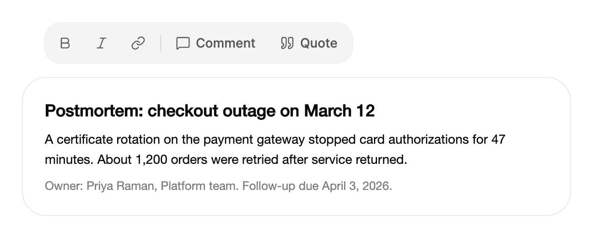

<Demo name="MutedTray" />

## 何时使用

`FloatingButtonGroup` 把浮在其他内容之上的表面所需的操作放进一个小托盘里：画布、文档、图表或地图。它让这些操作靠近所作用的内容，因此页眉可以留给导航，画面的焦点仍停留在表面本身。

- **白板或设计工具中的画布操作**：撤销、重做、分享和演示浮在画板之上。只显示图标并附带快捷键提示，可以让托盘保持窄小，名称则由提示承载。
- **文档上的选区工具栏**：在事故复盘或帮助中心文章中，人选中一段文字后，加粗、斜体和链接会出现在文字上方。托盘读起来像是位于文字之上的一层。
- **图表旁的纵向工具栏**：选择、画笔和橡皮擦在画布边缘纵向排列。提示向右展开，避开绘图区域。
- **分析图表上的缩放控件**：`ItemsSource` 把一组缩放级别（适应、50%、100%）转为按钮，因此列表保存在视图模型中，托盘只负责显示。
- **视图打开期间保持开启的模式**：仪表板编辑器中的演示，或长文档中的专注模式，通过 `IsChecked` 切换，开启时保持淡淡的底色。

## 何时不用

- **需要保持选中的选择，例如文本对齐或视图模式**：用 `SegmentedControl`，它把选中的分段显示为对某个问题的回答。单个开关式模式可以在某个项上使用 `IsChecked`。
- **一行放不下的过多操作**：溢出的操作用 `DropdownMenu`，或把少用的操作移入该表面的菜单。换行或滚动的托盘很难扫读。
- **页眉或表单底部的相关操作组合**：用 `ButtonGroup`，它把按钮连成一个带边框的表面，并用分隔线隔开。
- **卡片或消息上的紧凑图标操作，且标签应在获得焦点时出现**：用 `ExpandingButtonGroup`。
- **单个操作**：用 `Button`。只有一个按钮的托盘只会给它多加一层表面。

## 用法

每个按钮都是一个 `FloatingButtonGroupItem`。为托盘设置 `Label`，它会成为无障碍名称，例如“画板操作”或“文字格式”。

```xml
<UserControl xmlns="https://github.com/avaloniaui"
             xmlns:arc="https://github.com/AIDotNet/TKCode.Arc">
    <arc:FloatingButtonGroup Label="画板操作">
        <arc:FloatingButtonGroupItem Label="撤销" Shortcut="⌘Z" IsIconOnly="True" />
        <arc:FloatingButtonGroupItem Label="重做" Shortcut="⇧⌘Z" IsIconOnly="True" />
        <arc:FloatingButtonGroupSeparator />
        <arc:FloatingButtonGroupItem Label="分享" />
    </arc:FloatingButtonGroup>
</UserControl>
```

`FloatingButtonGroup` 派生自 Avalonia 的 `ItemsControl`，因此 `Items`、`ItemsSource`、`ItemsPanel` 以及无选择的项模型，与任何项控件的用法一致。每个 `FloatingButtonGroupItem` 派生自 Avalonia 的 `Button`：`Click`、`Command`、`CommandParameter`、`IsEnabled` 以及键盘激活的行为都与按钮相同。托盘额外提供高亮、键盘模型、布局（行或列）、尺寸和表面变体。`FloatingButtonGroupSeparator` 是两组按钮之间的细分隔线。

### 结构

1. **托盘**（`FloatingButtonGroup`）：带 1 px 边缘的圆角表面。圆角半径为 18 px，每侧内边距为 4 px。`Size="Small"` 时两者分别缩小为 15 px 和 3 px。
2. **高亮**：按钮后方的一个圆角形状，使用高亮色绘制（前景色的 7%，深色模式下为 9%）。它是唯一在按钮之间移动的元素。圆角半径为 13 px，小尺寸时为 11 px。
3. **项**（`FloatingButtonGroupItem`）：高 36 px 的按钮（小尺寸时为 30 px），两侧各缩进 12 px（小尺寸时为 10 px）。只显示图标的项是同样高度的正方形。圆角半径为 13 px，小尺寸时为 11 px。
4. **图标**（`Icon`）：16 px 的 Lucide 图形，线宽 1.75 px，位于标签前 6 px 处。
5. **标签**（`Label`）：项的文字，使用托盘的次要文字颜色和中等字重。`IsIconOnly` 为 true 时隐藏。
6. **分隔线**（`FloatingButtonGroupSeparator`）：1 px 的线，长 18 px（小尺寸时为 15 px），两侧各留 2 px 间距。在列中它是同样长度的水平线。颜色为前景色的 12%，由主题中的 `RuleBrush` 设置。
7. **快捷键提示**（`Shortcut`）：不绘制在按钮上，而是出现在项的提示中，位于标签之后。

表面有两种变体。`Muted`（默认）是前景色的半透明底色，浅色模式下为 4.5%，深色模式下为 6%，边缘为 3%，在柔和的背景上无需阴影即可辨认。`Floating` 使用浮起表面的颜色、标准边框颜色和浮动阴影，因此它会浮在所覆盖的内容之上。

### 变体与尺寸

根据托盘所在的层级选择变体。位于内容旁边的托盘使用 `Muted`。覆盖在内容之上的托盘（例如选区工具栏）可以使用 `Floating`，以表明它是独立的一层。

```xml
<arc:FloatingButtonGroup Label="选区操作" Variant="Floating">
    <arc:FloatingButtonGroupItem Label="评论" Icon="{x:Static arc:ArcIcons.MessageSquare}" />
</arc:FloatingButtonGroup>
```

`Size` 可取 `Medium`（默认，36 px 按钮）或 `Small`（30 px 按钮）；`Large` 按 `Medium` 处理。在表格工具栏或图表角落等密集区域使用 `Small`；画布上的按钮是主要工具，需要更大的点击区域，应使用 `Medium`。

### 图标与仅图标项

在代码中把 `Icon` 设为 24 × 24 的 Lucide 图形，或在 XAML 中使用 `{x:Static arc:ArcIcons.Name}`。图标以 16 px 绘制。项上的 `IsIconOnly` 会隐藏其标签；在托盘上设置 `IsIconOnly` 会让每个项都只显示图标。项自身的设置优先于托盘的设置，因此单个文字按钮可以留在仅图标的托盘中。只有当每个操作都有人们熟悉的图标时（例如加粗、撤销或链接），才在托盘上设置 `IsIconOnly`。

仅图标的项以及带有 `Shortcut` 的项，会在提示中显示其标签。仅图标的项仍需要 `Label`，因为它是无障碍名称。`IsIconOnly` 对没有 `Icon` 的项不起作用：这样的项保留文字。

<Demo name="IconOnly" />

```csharp
bold.Icon = ArcIcons.Bold;
link.Icon = ArcIcons.Link;
```

### 标签变化与保留宽度

标签可以变化以确认某个操作，例如链接放入剪贴板后，从“分享”变为“已复制”。把 `ReserveLabels` 设为该项可能显示的其他所有标签。这样按钮会保持最宽标签的宽度，文字变化时旁边的按钮不会移动。若没有保留标签，高亮会跟随新的宽度。

```csharp
var share = new FloatingButtonGroupItem { Label = "分享", ReserveLabels = ["已复制"] };
share.Click += async (_, _) =>
{
    share.Label = "已复制";
    await Task.Delay(1600);
    share.Label = "分享";
};
```

确认标签保持在一到两个字以内，并在短暂停顿后恢复原文（示例使用 1.6 秒）。

### 由数据生成项与纵向布局

`ItemsSource` 把普通数据转为按钮。每个项的标签是对象的文本（`ToString()`），除非项容器已经有标签。`Orientation="Vertical"` 把按钮纵向排成一列，此时提示默认向右展开。设置 `TooltipPlacement` 可以为所有项统一展开方向：`Top`、`Bottom`、`Left` 或 `Right`。行默认使用 `Top`。

<Demo name="FromItemsSource" />

<Demo name="Vertical" />

```xml
<arc:FloatingButtonGroup Label="缩放" Size="Small" ItemsSource="{Binding ZoomLevels}" />

<arc:FloatingButtonGroup Label="工具" Orientation="Vertical" IsIconOnly="True">
    <arc:FloatingButtonGroupItem Label="选择" Shortcut="V" />
    <arc:FloatingButtonGroupItem Label="画笔" Shortcut="P" />
</arc:FloatingButtonGroup>
```

纵向托盘通过上下方向键移动，分隔线变为水平线。

### 选中项

`IsChecked` 把一个项变为保持开启的模式：演示、专注、显示网格。选中的项会在按钮后保留淡淡的底色（开启控件的颜色取 12%，深色模式下为 16%），并以“开”或“关”向辅助技术报告其状态。`IsChecked` 设为 `null`（默认）时，它就是没有状态的普通操作。

```xml
<arc:FloatingButtonGroupItem Label="演示"
                             Icon="{x:Static arc:ArcIcons.Monitor}"
                             IsChecked="{Binding IsPresenting, Mode=TwoWay}" />
```

不要用 `IsChecked` 在多个选项之间做选择；这种情况请用 `SegmentedControl`。

### 快捷键提示与提示

`Shortcut` 只是提示，不是绑定。该字符串显示在提示中，`AutomationProperties.HelpText` 将其提供给屏幕阅读器。分组本身从不处理按键。应在窗口或视图上注册该按键，并执行按钮所执行的同一命令，这样即使托盘没有焦点，快捷键也能生效。

```csharp
KeyBindings.Add(new KeyBinding
{
    Gesture = new KeyGesture(Key.Z, KeyModifiers.Control),
    Command = vm.UndoCommand
});
```

除非 `TooltipPlacement` 另有设置，否则提示会在行的上方、列的右侧展开。

### 事件

`ActionInvoked` 在项自身的 `Click` 处理程序及其 `Command` 之后运行。`e.Item` 是被执行的按钮，`e.Data` 是数据源：对于内联项是按钮本身，对于 `ItemsSource` 则是数据对象。订阅它可以在一处处理托盘的所有操作；每个按钮自身的行为仍放在 `Click` 或 `Command` 中。

```csharp
board.ActionInvoked += (_, e) => log.Text = $"操作：{e.Item.Label}";
```

对于 `ItemsSource` 托盘，从 `e.Data` 读取数据对象：

```csharp
zoom.ActionInvoked += (_, e) => viewModel.Zoom = (string)e.Data!;
```

### 绑定到视图模型

画板编辑器把其操作暴露为命令，并把呈现状态保存为属性。托盘直接绑定到它们，高亮、按下状态和键盘模型都保留在控件内部。

```csharp
public partial class BoardViewModel : ObservableObject
{
    private readonly IBoardHistory _history;

    public BoardViewModel(IBoardHistory history)
    {
        _history = history;
        ZoomLevels = new ObservableCollection<string> { "适应", "50%", "100%", "200%" };
    }

    [ObservableProperty]
    private bool _isPresenting;

    [ObservableProperty]
    private string _zoom = "适应";

    public ObservableCollection<string> ZoomLevels { get; }

    [RelayCommand(CanExecute = nameof(CanUndo))]
    private void Undo() => _history.Undo();

    [RelayCommand(CanExecute = nameof(CanRedo))]
    private void Redo() => _history.Redo();

    private bool CanUndo => _history.CanUndo;

    private bool CanRedo => _history.CanRedo;
}
```

```xml
<Grid RowDefinitions="Auto,*">
    <arc:FloatingButtonGroup Grid.Row="0" Label="画板操作" HorizontalAlignment="Center">
        <arc:FloatingButtonGroupItem Label="撤销"
                                     Icon="{x:Static arc:ArcIcons.Undo2}"
                                     IsIconOnly="True"
                                     Shortcut="⌘Z"
                                     Command="{Binding UndoCommand}" />
        <arc:FloatingButtonGroupItem Label="重做"
                                     Icon="{x:Static arc:ArcIcons.Redo2}"
                                     IsIconOnly="True"
                                     Shortcut="⇧⌘Z"
                                     Command="{Binding RedoCommand}" />
        <arc:FloatingButtonGroupSeparator />
        <arc:FloatingButtonGroupItem Label="演示"
                                     Icon="{x:Static arc:ArcIcons.Monitor}"
                                     IsChecked="{Binding IsPresenting, Mode=TwoWay}" />
    </arc:FloatingButtonGroup>
    <arc:FloatingButtonGroup Grid.Row="1" Label="缩放" Size="Small"
                             HorizontalAlignment="Left"
                             ItemsSource="{Binding ZoomLevels}" />
</Grid>
```

- `IsChecked` 是双向的：项把状态写入 `IsPresenting`，视图模型也可以改变它。
- `Command` 驱动操作项。当 `CanExecute` 为 false 时，该项被禁用：它淡化到 50% 不透明度，并退出 Tab 与方向键的路径。
- 缩放托盘是单向的；它的选择通过 `ActionInvoked` 传到视图模型，如上所示。

### 示例：复盘草稿上方的选区工具栏

一个托盘位于事故复盘草稿的一段文字上方。人选中了关于证书轮换的那句话，托盘提供行内格式和评论操作。格式项只显示图标，因为人们能通过图标认出加粗、斜体和链接，每一项的提示中都带有快捷键提示。评论和引用保留文字标签，因为它们的图标不够通用。托盘在文字上左对齐，因此看起来像附着在选区上。



```xml
<StackPanel Width="600" Spacing="14">
    <arc:FloatingButtonGroup Label="Selection actions"
                             HorizontalAlignment="Left"
                             Margin="24,0,0,0">
        <arc:FloatingButtonGroupItem Label="Bold"
                                     Icon="{x:Static arc:ArcIcons.Bold}"
                                     IsIconOnly="True"
                                     Shortcut="⌘B" />
        <arc:FloatingButtonGroupItem Label="Italic"
                                     Icon="{x:Static arc:ArcIcons.Italic}"
                                     IsIconOnly="True"
                                     Shortcut="⌘I" />
        <arc:FloatingButtonGroupItem Label="Link"
                                     Icon="{x:Static arc:ArcIcons.Link}"
                                     IsIconOnly="True"
                                     Shortcut="⌘K" />
        <arc:FloatingButtonGroupSeparator />
        <arc:FloatingButtonGroupItem Label="Comment"
                                     Icon="{x:Static arc:ArcIcons.MessageSquare}" />
        <arc:FloatingButtonGroupItem Label="Quote"
                                     Icon="{x:Static arc:ArcIcons.Quote}" />
    </arc:FloatingButtonGroup>
    <Border Padding="24"
            Background="{arc:ArcDesignTokenResource Surface}"
            BorderBrush="{arc:ArcDesignTokenResource Border}"
            BorderThickness="1"
            CornerRadius="{arc:ArcDesignTokenResource RadiusPanel}">
        <StackPanel Spacing="10">
            <TextBlock Text="Postmortem: checkout outage on March 12"
                       FontSize="18"
                       FontWeight="SemiBold"
                       Foreground="{arc:ArcDesignTokenResource Foreground}" />
            <TextBlock Text="A certificate rotation on the payment gateway stopped card authorizations for 47 minutes. About 1,200 orders were retried after service returned."
                       TextWrapping="Wrap"
                       LineHeight="22"
                       Foreground="{arc:ArcDesignTokenResource Foreground}" />
            <TextBlock Text="Owner: Priya Raman, Platform team. Follow-up due April 3, 2026."
                       FontSize="13"
                       Foreground="{arc:ArcDesignTokenResource TextMuted}" />
        </StackPanel>
    </Border>
</StackPanel>
```

### 文案规范

- **标签**：一到两个字，用人可以执行的动词或名词：“撤销”“分享”“演示”。托盘的 `Label` 是整组的名词，例如“画板操作”或“缩放”。
- **仅图标的标签**：标签就是无障碍名称，因此必须说明完整的操作（“加粗”“插入链接”），而不是描述图标的形状。
- **快捷键提示**：显示平台所用的按键，符号与示例一致（⌘Z、⇧⌘Z）。提示只写按键组合；操作名称已由工具提示承载。
- **确认标签**：一个简短的词（“已复制”），与操作相符。保留的确认标签要短，让按钮宽度保持较小。

| 不要写 | 改为 |
|---|---|
| 点击这里撤销上一次更改 | 撤销 |
| share | 分享 |
| Ctrl + Z | ⌘Z（或应用运行时的平台按键） |
| 已复制到您的剪贴板！ | 已复制 |

### 最佳实践

**推荐**

- 把托盘放在它所作用的内容附近：选区之上、画布旁边，或画板顶部。人们会在工作的地方寻找操作。
- 只在内容之上使用 `Floating`。放在页面背景上的托盘看起来像一个凸起的面板，却没有可以让它浮起的东西。
- 为每个仅图标的项设置 `Label`，有快捷键时也设置 `Shortcut`。标签提供无障碍名称，快捷键则让人逐渐学会键盘操作路径。
- 将命令绑定到项，让禁用状态由视图模型决定。被禁用的项仍保持可见。
- 预先保留确认标签，使相邻的按钮不会移动。

**避免**

- 用托盘承载需要保持选中的选择。一组视图模式的托盘会隐藏当前是哪一个；请用 `SegmentedControl`。
- 在一个托盘中放入超过六到七个操作。超过之后托盘难以扫读，溢出的操作应放入 `DropdownMenu`。
- 只在提示中展示快捷键。分组本身不绑定按键，因此只显示却未注册的快捷键，会教人一个毫无作用的按键。
- 没有理由就在同一行中混用仅图标和带标签的项。宽度不一会让这一行参差不齐；应在托盘上设置 `IsIconOnly` 以保持一致，只在例外情况下使用项级设置。

### 常见问题

**为什么我的仅图标项把标签显示为文字？** 只有项具有 `Icon` 时，`IsIconOnly` 才会生效。没有图标的项始终显示标签，因此请添加图标或去掉 `IsIconOnly`。

**为什么指针移出后，高亮仍留在某个按钮上？** 指针在托盘内时，由它掌控高亮。指针离开后，若有键盘焦点，高亮会回到拥有焦点的按钮；否则逐渐淡出。

**项的 `IsIconOnly` 与托盘的设置，哪个优先？** 当项自身的值不为 `null` 时，以项自身的值为准。

## API 参考

<!-- api: FloatingButtonGroup -->

### 项与事件参数

`FloatingButtonGroupItem` 是托盘中的按钮。它在继承的 `Button` 成员之外增加了这些属性：

| 属性 | 类型 | 含义 |
|---|---|---|
| `Label` | `string` | 可见文字；仅显示图标时作为无障碍名称。 |
| `Icon` | `Geometry?` | 16 px 的 Lucide 图形，例如 `ArcIcons.Undo2`。 |
| `IsIconOnly` | `bool?` | 只显示图标。`null` 跟随托盘的 `IsIconOnly`。 |
| `IsChecked` | `bool?` | 可开启的模式。`null` 为普通操作。 |
| `Shortcut` | `string?` | 显示在提示中的快捷键提示。托盘不绑定按键。 |
| `ReserveLabels` | `IReadOnlyList<string>?` | 该项可能显示的其他标签；按钮保持最宽的宽度。 |

`FloatingButtonGroupActionEventArgs`（`ActionInvoked` 的参数）公开 `Item`（被执行的按钮）和 `Data`（数据源对象）。`FloatingButtonGroupVariant` 有两个值：`Muted` 与 `Floating`。

## 无障碍

- 托盘具有工具栏角色，名称取自 `Label`。它会报告其方向。
- 托盘是 Tab 顺序中的单个停靠点。焦点会回到上一次拥有键盘焦点的按钮。
- 每个项都以其标签命名，包括仅图标的项。快捷键提示作为帮助文字提供。
- 带 `IsChecked` 的项会报告切换状态“开”或“关”。值变化时会播报新的状态。
- 分隔线会作为分隔线被播报，因此即使看不到视觉效果，也能感知分组。
- 禁用的项仍可阅读，方向键会跳过它们。它们保留标签，因此人们仍能得知该操作存在。
- 共享高亮只在指针悬停或键盘焦点时显示，因此不会标记一个人未曾到达的按钮。

### 键盘

托盘在 Tab 顺序中只占一个停靠点。方向键在按钮之间移动高亮。

| 按键 | 操作 |
|---|---|
| `Tab` | 进入托盘，停在上次拥有焦点的按钮上，或第一个可用按钮。下一次 `Tab` 离开托盘。 |
| `Left` / `Right`（行）或 `Up` / `Down`（列） | 移到下一个或上一个可用按钮。两端循环。 |
| `Home` / `End` | 移到第一个或最后一个可用按钮。 |
| `Enter` / `Space` | 执行获得焦点的按钮：先执行其 `Click` 和 `Command`，再执行 `ActionInvoked`。 |

## 动效

- 一个共享高亮滑向指针下方或键盘焦点所在的按钮。当指针越过间隙或分隔线时它保持不动，因此高亮不会在按钮之间闪烁。
- 托盘首次获得目标时，高亮直接落位，并从 94% 放大到 100%。指针离开托盘时，高亮淡出。
- 按下的按钮会加深高亮，高亮随之略微收缩。按钮本身不缩放。
- 标签变化在原位交叉淡化。带有 `ReserveLabels` 的按钮保持宽度；否则高亮跟随新的宽度。
- 减弱动效时，高亮以短暂淡入移动到目标位置，标签交叉淡化且不发生位移。关闭动效时，所有元素立即到达最终位置。

| 变化 | 完整 | 减弱 | 关闭 |
|---|---|---|---|
| 高亮移到另一个按钮 | 高亮在位置和大小上滑动，采用变形弹簧 | 以短暂淡入跳到目标 | 立即完成 |
| 高亮首次出现在目标上 | 以利落的弹簧从 94% 放大到 100% | 立即完成 | 立即完成 |
| 按钮被按下 | 高亮加深，并以利落的弹簧收缩到 96.5% | 立即完成 | 立即完成 |
| 标签变化 | 原位交叉淡化，伴随短暂的向上移动和柔和模糊 | 交叉淡化且不位移 | 立即完成 |

## 相关组件

- `ButtonGroup`：把相关操作连成一个带分隔线的表面。
- `ExpandingButtonGroup`：紧凑图标操作，焦点时展开标签。
- `SegmentedControl`：保持选中的选择。
- `Button`：单个操作。

| 组件 | 适用场景 |
|---|---|
| `ButtonGroup` | 相关操作应放在页眉或表单底部的同一个带边框表面上 |
| `ExpandingButtonGroup` | 卡片或消息上的紧凑图标操作，应在焦点时展示标签 |
| `SegmentedControl` | 选择会保持选中，例如视图模式、对齐方式或时间段 |
| `DropdownMenu` | 操作溢出托盘，可收在一个触发器之后 |
| `SplitButton` | 一个主要操作在菜单中有备选项 |
| `Button` | 只有一个没有状态的操作 |
