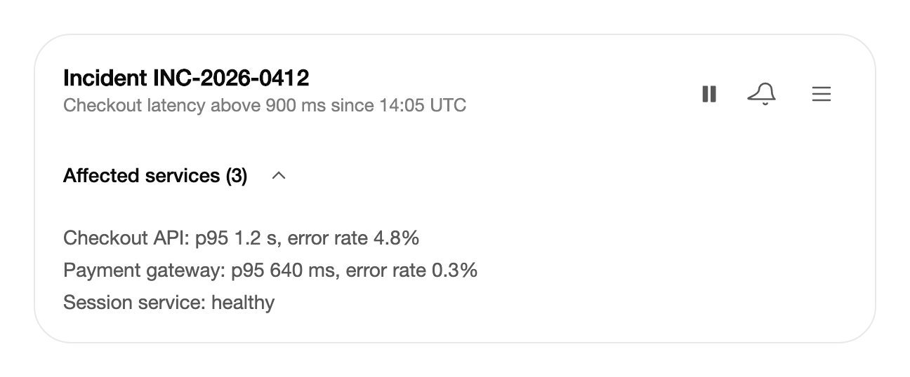

<Demo name="EightPairs" />

## 何时使用

`IconMorph` 绘制产品中用于状态切换的八组图标：菜单变为关闭图标、播放按钮变为暂停、复制图标变为勾选。它位于按钮之内，以人们看到的方式呈现状态变化，因此这一变化读起来是一个操作，而不是两个图标互相替换。它适用于应用中的工具栏、页眉和行，在这些地方人们只看图标。

- **运维仪表板中的实时数据页眉**：播放与暂停控件可在人阅读峰值时冻结指标数据流。图标变形，让人看到数据流已经停止。
- **事故或订单页面中的通知开关**：为跟进单一事故的团队，开启通知时铃铛响一下，关闭时铃铛被划线。
- **设置或账单列表中的展开控件**：展开发票分组或筛选面板时，箭头转动，使该行无需单独标签即可显示其状态。
- **SaaS 应用外壳中的导航切换**：窄窗口中打开侧边导航时，菜单图标变为关闭图标。
- **共享报告上的点赞或收藏**：队友标记某份报告有用时，心形以一次短促的迸发填满。

## 何时不用

- **带确认的复制操作**：用 `CopyButton`，它已经会变形图标并播报结果。
- **带文字的浅色与深色切换**：用 `ThemeSwitcher`，它同时承载文字和状态。
- **从不改变状态的图标**：在按钮中使用 `ArcIcons` 中的普通 Lucide 图标。没有第二个状态的变形没有意义。
- **仅以图标作为控件**：`IconMorph` 是装饰性的，从不获得焦点，因此应放在 `Button` 或其他有名称和状态的控件中。
- **一个图标背后的多个操作菜单**：用带触发器的 `DropdownMenu`。变形只表示某个东西是打开还是关闭。

## 用法

`IconMorph` 绘制八组图标中的一组。`Kind` 选择图标组，`IsActive` 选择第二个状态。把它放进按钮中，并为按钮命名。

```xml
<UserControl xmlns="https://github.com/avaloniaui"
             xmlns:arc="https://github.com/AIDotNet/TKCode.Arc">
    <arc:Button Variant="Ghost" AutomationProperties.Name="打开菜单">
        <arc:IconMorph Kind="Menu" />
    </arc:Button>
</UserControl>
```

`IconMorph` 派生自 Avalonia 的 `Control`。它在 `Render` 中以 24 × 24 的网格绘制图形，因此没有模板，也没有可以重新设置样式的部件。它的 `IsActive` 属性默认是双向的，这使它很适合绑定到视图模型属性。该控件不处理指针或键盘输入：点击与按键会交给承载它的按钮。

### 结构

1. **图形**（`Kind`）：一个绘制的形状，位于 24 单位网格上，在非激活与激活形态之间变形。
2. **线条**（`StrokeThickness`）：网格上默认为 1.75。它随 `IconSize` 缩放，因此图标在 16 px、24 px 和 32 px 时都保持相同的粗细。
3. **尺寸**（`IconSize`）：渲染后的像素尺寸，默认为 24。主题设置了相同的默认值。
4. **颜色**（`Foreground`）：与文字前景色一样从父级继承，因此幽灵按钮会用自己的文字颜色为图标着色。
5. **点赞颜色**（`LikeBrush`）：已点赞的心形的颜色。主题将其设为危险色。
6. **瞬时效果**（Moment）：铃铛的响铃，以及心形的光环与火花。每次图标被开启时，瞬时效果播放一次；在其他状态下没有可见部分。

### 图形种类

`Menu` 变为关闭，`Play` 变为暂停，`Plus` 变为勾选，`Copy` 变为勾选，`Theme` 变为月亮，`Chevron` 转动，`Bell` 开启与关闭通知，`Heart` 表示点赞。每组的激活状态是其名称中的第二项：加号变为勾选，铃铛开启，心形被点赞。

```xml
<arc:IconMorph Kind="Play" />
<arc:IconMorph Kind="Theme" IsActive="True" />
<arc:IconMorph Kind="Heart" IsActive="{Binding IsLiked}" />
```

选择图形组时依据的是状态的含义，而不是图标的外观。`Plus` 变为 `Check` 适合“加入列表”这类操作，其结果是一个已勾选的项目。`Copy` 变为 `Check` 适合复制操作。`Play` 变为 `Pause` 用于人可以开始和停止的数据流或片段，而不用于单向操作。

### 切换状态

将 `IsActive` 绑定到按钮的状态。在点击处理程序中翻转它，并更新按钮的名称以匹配新的含义。

```csharp
var icon = new IconMorph { Kind = IconMorphKind.Play };
var button = new Button { Content = icon, Variant = ButtonVariant.Ghost };
button.Click += (_, _) =>
{
    icon.IsActive = !icon.IsActive;
    AutomationProperties.SetName(button, icon.IsActive ? "暂停" : "播放");
};
```

### 尺寸与线宽

`IconSize` 设置渲染后的像素尺寸，默认为 24。`StrokeThickness` 在 24 单位网格上设置，并随 `IconSize` 缩放，因此默认的 1.75 线宽在任何尺寸下都保持比例。

<Demo name="Sizes" />

```xml
<arc:IconMorph Kind="Menu" IconSize="16" />
<arc:IconMorph Kind="Menu" IconSize="32" StrokeThickness="2" />
```

让图标与按钮相配。16 px 图标适合 36 px 的按钮，24 px 图标适合 44 px，32 px 图标适合 52 px 的大型主按钮。24 px 图标放在 28 px 的按钮中显得拥挤，16 px 图标放在 52 px 的按钮中则显得空泛。

### 箭头方向

对于 `Chevron`，`ChevronPointing` 设置静止时的方向，`ChevronTurn` 设置激活时转动的角度（单位为度）。值为 180 时由下翻转为上，值为 90 时由右转为下。

<Demo name="ChevronAndMoments" />

对向下展开的区域使用 `Down` 加 180 度转动，对向侧边展开的行（例如树节点）使用 `Right` 加 90 度转动。同一列表中的所有箭头保持相同方向，这样展开的行与未展开的行就容易区分。

### MorphGlyph

`MorphGlyph` 是路径变形基元：它可以在任意两段路径数据之间变形。菜单变关闭保留其顶点，关闭变勾选则按弧长重新采样。

<Demo name="MorphGlyph" />

对于八组图标未涵盖的形状，使用 `MorphGlyph`。用 `MorphTo` 提供第二个形状，它会从当前轮廓开始做动画。在代码中需要知道变形何时完成时，使用 `Morph`。

```csharp
var glyph = this.FindControl<MorphGlyph>("StatusGlyph")!;
await glyph.MorphTo("M4 12.5l5 5L20 6.5");
```

### 绑定到视图模型

仪表板视图模型拥有实时状态，页眉只负责显示。`IsActive` 为双向绑定，因此图标既能显示状态，也能改变状态。

```csharp
public partial class LiveMetricsViewModel : ObservableObject
{
    [ObservableProperty]
    [NotifyPropertyChangedFor(nameof(LiveToggleName))]
    private bool _isPaused;

    public string LiveToggleName => IsPaused ? "恢复实时更新" : "暂停实时更新";

    [RelayCommand]
    private void ToggleLive() => IsPaused = !IsPaused;
}
```

```xml
<arc:Button Variant="Ghost"
            Width="36"
            Height="36"
            Padding="0"
            AutomationProperties.Name="{Binding LiveToggleName}"
            Command="{Binding ToggleLiveCommand}">
    <arc:IconMorph Kind="Play" IsActive="{Binding IsPaused}" IconSize="18" />
</arc:Button>
```

- `IsActive` 是双向的。视图模型中的变化会移动图标，图标的变化会写入新状态。只把它绑定到拥有该状态的属性；第二个写入者会使变形来回翻转。
- 按钮的名称来自视图模型，因此屏幕阅读器读到的是下一次按下将执行的操作，而不是图标。
- 命令负责执行变化。图标跟随状态，但自身不执行操作。

### 克制地使用动效

变形是状态变化的反馈，因此凡是人需要看到某物发生了变化的地方，它都有帮助。若同一变化连续重复多次，或图标就是操作的全部信号，它就会分散注意力。

- **有帮助**：改变下一次操作含义的单个切换，例如暂停与恢复，或菜单与关闭。
- **会分散注意力**：列表中为每一项都会触发的铃铛，或信息流中人们连续点赞多条帖子时的心形。迸发效果会在每次按下时播放。瞬时效果只保留给单次、有意的操作。
- **减弱动效**会立即完成每次变形，并跳过铃铛的响铃和心形的迸发。也要在没有动效的情况下测试状态变化：图标和按钮名称仍必须告诉人发生了什么。

### 示例：事故页眉控件

运维控制台中的事故页面显示事故的实时状态，以及三个控件：暂停实时更新、开启或关闭通知，以及展开受影响服务的列表。每个控件都是幽灵按钮，名称与按钮所处的状态相符，图标变形使状态无需标签即可看见。页眉保留一个菜单图标用于较少使用的操作，其名称写成它所打开的操作。



```xml
<StackPanel Width="600" Spacing="12">
    <Border Padding="20"
            Background="{arc:ArcDesignTokenResource Surface}"
            BorderBrush="{arc:ArcDesignTokenResource Border}"
            BorderThickness="1"
            CornerRadius="{arc:ArcDesignTokenResource RadiusPanel}">
        <StackPanel Spacing="14">
            <Grid ColumnDefinitions="*,Auto">
                <StackPanel Spacing="2">
                    <TextBlock Text="Incident INC-2026-0412"
                               FontSize="16"
                               FontWeight="SemiBold"
                               Foreground="{arc:ArcDesignTokenResource Foreground}" />
                    <TextBlock Text="Checkout latency above 900 ms since 14:05 UTC"
                               FontSize="13"
                               Foreground="{arc:ArcDesignTokenResource TextMuted}" />
                </StackPanel>
                <StackPanel Grid.Column="1"
                            Orientation="Horizontal"
                            Spacing="4"
                            VerticalAlignment="Center">
                    <arc:Button Width="36"
                                Height="36"
                                Padding="0"
                                Variant="Ghost"
                                AutomationProperties.Name="Pause live updates">
                        <arc:IconMorph Kind="Play" IsActive="True" IconSize="18" />
                    </arc:Button>
                    <arc:Button Width="36"
                                Height="36"
                                Padding="0"
                                Variant="Ghost"
                                AutomationProperties.Name="Turn notifications off">
                        <arc:IconMorph Kind="Bell" IsActive="True" IconSize="18" />
                    </arc:Button>
                    <arc:Button Width="36"
                                Height="36"
                                Padding="0"
                                Variant="Ghost"
                                AutomationProperties.Name="Open incident actions">
                        <arc:IconMorph Kind="Menu" IconSize="18" />
                    </arc:Button>
                </StackPanel>
            </Grid>
            <StackPanel Orientation="Horizontal" Spacing="8">
                <TextBlock Text="Affected services (3)"
                           FontWeight="Medium"
                           VerticalAlignment="Center"
                           Foreground="{arc:ArcDesignTokenResource Foreground}" />
                <arc:Button Width="28"
                            Height="28"
                            Padding="0"
                            Variant="Ghost"
                            AutomationProperties.Name="Collapse affected services">
                    <arc:IconMorph Kind="Chevron" IsActive="True" IconSize="16" />
                </arc:Button>
            </StackPanel>
            <StackPanel Spacing="6">
                <TextBlock Text="Checkout API: p95 1.2 s, error rate 4.8%"
                           Foreground="{arc:ArcDesignTokenResource TextSecondary}" />
                <TextBlock Text="Payment gateway: p95 640 ms, error rate 0.3%"
                           Foreground="{arc:ArcDesignTokenResource TextSecondary}" />
                <TextBlock Text="Session service: healthy"
                           Foreground="{arc:ArcDesignTokenResource TextSecondary}" />
            </StackPanel>
        </StackPanel>
    </Border>
</StackPanel>
```

### 文案规范

- **按钮名称**：按下后执行的操作，用动词加对象，句子式书写：“暂停实时更新”“关闭通知”“收起受影响的服务”。状态变化时名称随之变化。
- **仅图标的按钮**：名称是屏幕阅读器得到的唯一文字，因此必须完整。不要用图标来命名按钮（“播放图标”）。
- **图标对**：同一操作在整个应用中都使用相同的图标对，这样播放控件总是表示播放。

| 不要写 | 改为 |
|---|---|
| 播放 | 暂停实时更新（运行期间） |
| 菜单 | 打开事故操作 |
| 点击展开 | 展开受影响的服务 |
| 铃铛图标 | 开启通知 |
| 点赞按钮 | 点赞（点赞后改为“取消点赞”） |

### 最佳实践

**推荐**

- 把图标放进按钮中，并由按钮提供名称。图标是装饰性的，只有按钮可以被聚焦和命名。
- 将 `IsActive` 绑定到视图模型所拥有的状态，由命令执行操作。
- 每一行使用一种图标尺寸，并与按钮尺寸相匹配。
- `IsActive` 变化时总是更改按钮的名称，使名称与图标永不相互矛盾。

**避免**

- 把变形用于没有第二个状态的单向操作。永远不会还原的复制操作不需要变形，`CopyButton` 已经会确认它。
- 在人们会连续多次按下的控件上使用心形或铃铛迸发。重复的瞬时效果会变成噪音。
- 同时在图标上设置 `IsActive`，又绑定一个会把它写回的绑定。状态会翻转两次，变形会卡顿。
- 只依赖颜色变化。形状也会变化；保留名称，使状态在没有颜色的情况下也清楚。

### 常见问题

**为什么我的图标颜色不变？** `IconMorph` 与文字一样从父级继承 `Foreground`。在按钮或图标上设置颜色，或使用主题的幽灵按钮颜色。点赞的心形使用 `LikeBrush`，而不是 `Foreground`。

**为什么点击图标没有切换它？** 图标不参与命中测试，因此点击会交给承载它的按钮。应把点击处理程序或命令放在按钮上。

**第二次开启铃铛时还会响吗？** 会。每当 `IsActive` 变为 `True`，响铃就播放一次；关闭时铃铛被划线。

**如何显示八组之外的状态？** 使用带有自己路径数据的 `MorphGlyph`，或使用 `ArcIcons` 中的普通图标并在代码中切换。

## API 参考

<!-- api: IconMorph -->

`IconMorphKind` 列出八组图标，顺序与 `Kind` 的取值一致：`Menu`、`Play`、`Plus`、`Copy`、`Theme`、`Chevron`、`Bell` 与 `Heart`。`IconMorphChevronPointing` 有两个值：`Down`（默认）与 `Right`。

## 无障碍

- 图标对辅助技术隐藏。周围的按钮提供名称。
- 在按钮上显示状态：按下状态用切换，展开状态用展开标记，或改变名称。
- 含义变化时更改名称，例如从“播放”变为“暂停”。
- 图标不获得焦点、不参与命中测试，也不处理按键。周围的按钮负责这些，因此键盘用户通过按钮及其焦点环到达控件。

## 动效

- 线条旋转并滑入就位，轮廓在两种形状之间插值。快速切换会从图标当前所在的位置反向变化。
- 复制图标会折起其背面的纸张并绘制勾选。太阳变为带有月牙缺口的月亮。
- 铃铛开启时响一次，心形每次被点赞时以光环和火花迸发。
- 减弱动效会立即完成每次变形，并跳过响铃与迸发。关闭动效时同样如此。

| 变化 | 完整 | 减弱 | 关闭 |
|---|---|---|---|
| 菜单、播放、加号、主题、箭头 | 从当前位置以可中断的弹簧变形 | 立即完成 | 立即完成 |
| 复制变勾选 | 纸张折起，勾选绘出 | 立即完成 | 立即完成 |
| 铃铛开启 | 响一次，铃舌略微滞后于铃身 | 不响 | 不响 |
| 心形被点赞 | 以光环和火花迸发 | 无迸发 | 无迸发 |

## 相关组件

- `CopyButton`：带自身确认的复制操作。
- `ThemeSwitcher`：带标签的浅色与深色切换。
- `Button`：承载图标变形的名称与状态的控件。
- `ExpandingButtonGroup`：展示标签的图标操作。

| 组件 | 适用场景 |
|---|---|
| `CopyButton` | 操作复制一个值，并应就地确认复制结果 |
| `ThemeSwitcher` | 浅色与深色的选择需要可见的标签 |
| `Button` | 图标需要名称、状态以及按下或焦点的呈现 |
| `ExpandingButtonGroup` | 多个图标操作应在焦点时展示标签 |
| `DropdownMenu` | 一个触发器打开操作列表，而不是显示状态 |
| `ArcIcons` 图形 | 图标从不改变状态 |
