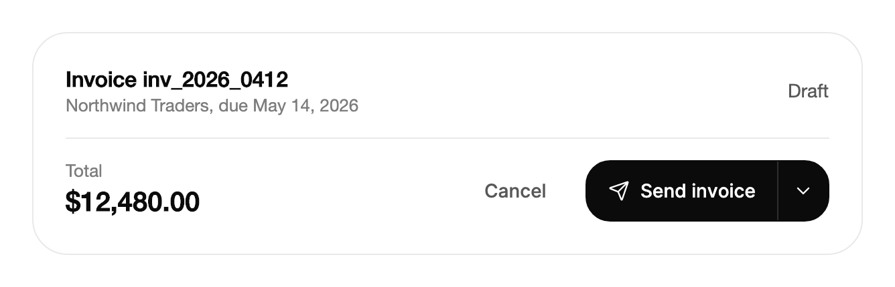

<Demo name="MergeStrategies" />

## 何时使用

`SplitButton` 把一个默认操作与一个箭头连在一起，箭头会打开附近的备选项。它在一个控件中回答两个问题：这里通常会发生什么，以及还能发生什么。常用路径只需一次点击，备选项再多一次点击即可，因此它适合工具栏、页头或页脚中以某一个操作为主的场景。

- **代码审查界面中合并拉取请求**：默认是“使用合并提交合并”。“压缩并合并”和“变基并合并”放在菜单中，“关闭拉取请求”作为分隔线之后的危险行。
- **营收报表中的导出**：“导出为 CSV”是多数财务团队使用的格式，因此作为默认操作。JSON 和 PDF 只需再点一次，无论选哪一个，报表都会保留筛选条件。
- **发票编辑器中的发送**：“发送发票”是默认操作。“发送提醒”“存为草稿”和“作废发票”是备选项，菜单用分隔线把危险操作与其余操作分开。
- **原地显示结果的复制**：“复制页面”会在同一按钮上短暂显示“已复制”，确认信息就出现在用户视线所在之处，无需轻提示。
- **CI 控制台中的部署**：“部署到生产环境”是发布分支的默认操作。“部署到预发布环境”放在菜单中，用于需要先行演练的发布。

## 何时不用

- **选项地位对等、没有默认操作**，例如“通过邮件、Slack 或链接分享”：用 `DropdownMenu`，它只有触发器，没有主区域。
- **只有一个操作、没有可选项**，例如设置表单中的“保存更改”：用 `Button`。
- **针对单行或单张卡片对象的操作**，例如订单上的重命名、归档和删除：用 `ContextMenu`，即该对象的指针与键盘上下文菜单。
- **多个相关操作、没有默认操作，并排显示**：用 `ButtonGroup`。
- **需要保持选中状态的选择**，例如时间段或视图：用 `SegmentedControl` 或 `Select`。分割按钮只执行它的操作，不保存值。

## 用法

```xml
<UserControl xmlns="https://github.com/avaloniaui"
             xmlns:arc="https://github.com/AtomUICommunity/TKCode.Arc">
    <arc:SplitButton Label="合并拉取请求">
        <arc:MenuEntry Header="压缩并合并" />
        <arc:MenuEntry Header="变基并合并" />
        <arc:MenuEntry Header="关闭拉取请求" IsDestructive="True" HasSeparatorBefore="True" />
    </arc:SplitButton>
</UserControl>
```

`SplitButton` 派生自 Avalonia 的 `TemplatedControl`。它的两个区域都是真正的按钮，因此各自可以获得焦点、显示焦点环，并独立响应键盘。菜单与 `DropdownMenu` 使用同一个 `MenuSurface`，因此它的行、高亮与键盘移动和库中的其他部分保持一致。菜单行是 `MenuEntry` 项，可以直接写在 `Items` 中，也可以通过 `ItemsSource` 提供。

### 结构

1. **主区域**：默认操作。显示 `Label`，设置了 `Icon` 时在其前面显示图标。内边距两侧各 16 px（`Secondary` 时为 12 px），最小高度为中等控件高度。
2. **图标**（`Icon`）：16 px 的 Lucide 图标，线宽 1.75，图标与文字之间间隔 8 px。新图标渐入，旧图标缩小消失。
3. **分隔线**：两个区域之间 1 px 的线，在主要变体上为文字颜色的淡色调。
4. **箭头区域**：宽 38 px（`Secondary` 时为 32 px）。16 px 的箭头在菜单打开时转动，按下时从不缩放。
5. **菜单**（`Menu`）：锚定在箭头上的下拉菜单，与箭头末端对齐，并在箭头下方 4 px 处打开。菜单行是 `MenuEntry` 项。带有 `HasSeparatorBefore` 的行会开始新的分组；`IsDestructive` 会把它显示为危险操作的颜色。
6. **焦点环**：2 px 的环，与每个区域相距 2 px，形状与该区域的圆角一致。

主要变体是填充的药丸形，以前景色作为填充色。`Secondary` 变体是描边药丸形：高 36 px，文字 12 px，主区域至少宽 142 px，背景为表面色。

### 选择变体与默认操作

把最常见的操作放在主区域。菜单行按使用频率从高到低排列，使列表读起来像一份排名。把危险行放在最后，并用 `HasSeparatorBefore` 与其他行隔开，这样误点箭头时不会直接触发它。

在页头、对话框页脚或卡片中，当操作就是该屏幕的目标时使用 `Primary`。在密集的工具栏或表头中使用 `Secondary`，避免填充按钮与内容争夺注意力。同一个工具栏中不要混用两种变体：描边药丸与填充药丸会被理解为两个重要程度不同的层级。

### 点击与菜单选择

主区域会触发 `Click` 并执行 `Command`。`Click` 在命令执行之前触发，因此处理程序可以先准备命令所读取的状态。箭头区域打开菜单，选中某一行时该行触发 `ItemClicked`。选中一行后，菜单随即关闭。

```xml
<arc:SplitButton Label="导出为 CSV"
                 Variant="Secondary"
                 Command="{Binding ExportCommand}">
    <arc:MenuEntry Header="导出为 JSON" />
    <arc:MenuEntry Header="导出为 PDF" />
</arc:SplitButton>
```

```csharp
merge.Click += (_, _) => log.Text = "已通过合并提交完成合并。";
merge.ItemClicked += (_, e) => log.Text = $"菜单：{e.Header}";
```

### 来自数据的行

对于来自视图模型的行，使用 `ItemsSource`，并用 `ItemTemplate` 绘制每一行。`MenuEntry` 实例按原样使用。其他项会显示为行标题，因此当某一行需要自己的外观时，请为它提供 `MenuEntry` 或模板。`ItemClicked` 通过 `e.Item` 返回数据项，使处理程序无需进行字符串匹配。

```xml
<arc:SplitButton Label="分享" ItemsSource="{Binding ShareTargets}" />
```

### 图标与原地结果

`Icon` 接收 24 乘 24 的 Lucide 几何图形，在代码中设置。更改 `Label` 与 `Icon` 时，主区域会变形为新的文字，因此结果可以直接显示在按钮本身上：“复制页面”变为“已复制”，对勾图标取代复制图标。相同的字母保持原位，只有变化的字母移动，视线不会丢失这个按钮。

<Demo name="ResultInPlace" />

结果标签只用一个词，并在短暂停顿后恢复原标签。“已发送”或“已保存”这类确认也采用同样的模式；对于需要一段时间的过程则不要使用，那时应显示进度而不是标签。

### 禁用

将 `IsEnabled` 设为 `False` 可同时禁用两个区域。被禁用的分割按钮也会保持菜单关闭，因此在默认操作不可用时，无法选择任何备选项。控件会淡化到约 52% 的不透明度，仍保留在布局中。

<Demo name="Disabled" />

只在操作无法适用时禁用控件，并在附近说明原因。例如，因分支存在失败的检查而禁用的“部署”按钮，配上一行点明失败检查名称的文字会更清楚。

### 次要样式

`Variant="Secondary"` 是紧凑的描边药丸，文字为 12px，主区域宽 142px。在此示例中，选择一种格式会使其成为默认操作。

<Demo name="Secondary" />

次要变体适合工具栏和表头。在此示例中，选中的备选项会成为新的标签。若该选择必须在重启后保留，请将它保存在视图模型中，并在视图加载时据此设置 `Label`。

### 绑定到视图模型

发票编辑器把它的发送操作公开为命令，并在视图模型中保存菜单状态。主操作是一个命令，备选项来自一个集合，打开状态为双向绑定，使视图模型可以在发送后关闭菜单。

```csharp
public partial class InvoiceViewModel : ObservableObject
{
    private readonly IInvoiceService _invoices;

    public InvoiceViewModel(IInvoiceService invoices)
    {
        _invoices = invoices;
        AlternativeSends = new ObservableCollection<SendOption>
        {
            new("发送提醒", SendKind.Reminder),
            new("存为草稿", SendKind.Draft),
            new("作废发票", SendKind.Void)
        };
    }

    [ObservableProperty]
    private bool _isMenuOpen;

    public string InvoiceId { get; } = "inv_2026_0412";

    public ObservableCollection<SendOption> AlternativeSends { get; }

    [RelayCommand]
    private async Task SendInvoiceAsync()
    {
        var result = await _invoices.SendAsync(InvoiceId, SendKind.Invoice);
        IsMenuOpen = false;
    }

    public async Task RunAsync(SendOption option) =>
        await _invoices.SendAsync(InvoiceId, option.Kind);
}

public enum SendKind { Invoice, Reminder, Draft, Void }

public sealed record SendOption(string Label, SendKind Kind);
```

```xml
<arc:SplitButton Label="发送发票"
                 Command="{Binding SendInvoiceCommand}"
                 IsOpen="{Binding IsMenuOpen, Mode=TwoWay}"
                 ItemsSource="{Binding AlternativeSends}"
                 MenuButtonLabel="其他发送方式" />
```

```csharp
invoice.ItemClicked += (_, e) => _ = viewModel.RunAsync((SendOption)e.Item!);
```

- `IsOpen` 为双向绑定。视图模型可以打开或关闭菜单，用户打开菜单时，箭头会把状态写回。
- `Command` 执行默认操作。
- 备选项在 `ItemClicked` 中处理，因为行的数据项是最自然的参数；视图模型负责操作，控件负责菜单。

### 示例：发票页脚

计费控制台中的发票编辑器。页脚左侧显示总额，右侧是发送操作。“发送发票”是默认操作，箭头提供提醒、草稿与作废选项；其中“作废”位于分隔线之下，因为它是唯一的危险行。次要的“取消”按钮是幽灵按钮，因此分割按钮是页脚中唯一的填充控件。



```xml
<StackPanel Width="620" Spacing="16">
    <Border Padding="24"
            Background="{arc:ArcDesignTokenResource Surface}"
            BorderBrush="{arc:ArcDesignTokenResource Border}"
            BorderThickness="1"
            CornerRadius="{arc:ArcDesignTokenResource RadiusPanel}">
        <StackPanel Spacing="16">
            <Grid ColumnDefinitions="*,Auto">
                <StackPanel Spacing="2">
                    <TextBlock Text="Invoice inv_2026_0412"
                               FontSize="16"
                               FontWeight="SemiBold"
                               Foreground="{arc:ArcDesignTokenResource Foreground}" />
                    <TextBlock Text="Northwind Traders, due May 14, 2026"
                               FontSize="13"
                               Foreground="{arc:ArcDesignTokenResource TextMuted}" />
                </StackPanel>
                <TextBlock Grid.Column="1"
                           Text="Draft"
                           VerticalAlignment="Center"
                           Foreground="{arc:ArcDesignTokenResource TextSecondary}" />
            </Grid>
            <Border Height="1" Background="{arc:ArcDesignTokenResource Border}" />
            <Grid ColumnDefinitions="*,Auto,Auto">
                <StackPanel Spacing="2">
                    <TextBlock Text="Total"
                               FontSize="13"
                               Foreground="{arc:ArcDesignTokenResource TextMuted}" />
                    <TextBlock Text="$12,480.00"
                               FontSize="20"
                               FontWeight="SemiBold"
                               Foreground="{arc:ArcDesignTokenResource Foreground}" />
                </StackPanel>
                <arc:Button Grid.Column="1"
                            Content="Cancel"
                            Variant="Ghost"
                            VerticalAlignment="Center"
                            Margin="0,0,12,0" />
                <arc:SplitButton Grid.Column="2"
                                 Label="Send invoice"
                                 Icon="{x:Static arc:ArcIcons.Send}"
                                 VerticalAlignment="Center">
                    <arc:MenuEntry Header="Send reminder" Icon="{x:Static arc:ArcIcons.Bell}" />
                    <arc:MenuEntry Header="Save as draft" Icon="{x:Static arc:ArcIcons.FileText}" />
                    <arc:MenuEntry Header="Void invoice"
                                   Icon="{x:Static arc:ArcIcons.CircleX}"
                                   IsDestructive="True"
                                   HasSeparatorBefore="True" />
                </arc:SplitButton>
            </Grid>
        </StackPanel>
    </Border>
</StackPanel>
```

### 文案规范

- **主标签**：动词加对象，句子式大小写：“合并拉取请求”“导出为 CSV”“发送发票”。它说明默认操作会做什么，让用户在阅读菜单之前就知道点击的结果。
- **菜单行**：与主标签相同的语法和名词。危险行要说明后果：用“作废发票”，而不是“删除”。
- **箭头名称**：默认的 `{Label} more actions` 适用于大多数控件。当标签是“发送”或“导出”之类的通用动词时，请设置 `MenuButtonLabel`，使名称说明菜单提供什么。
- **结果标签**：一个确认操作的词，例如“已复制”或“已发送”，与默认操作使用相同的时态。

| 不要写 | 改为 |
|---|---|
| 点击此处发送 | 发送发票 |
| 导出 | 导出为 CSV |
| 删除发票（在菜单中） | 作废发票 |
| 复制成功！ | 已复制 |
| 更多选项（箭头名称） | 其他发送方式 |

### 最佳实践

**推荐**

- 把大多数人会执行的操作放在主区域。默认操作很少被使用的分割按钮，会让人每次都要打开菜单。
- 把危险行放在最后，位于分隔线之下，这样误点箭头时不会直接触发它。
- 为默认操作绑定 `Command`，并让菜单行只包含能在同一上下文中运行的操作。
- 标签要足够短，使主区域的宽度保持在它所在工具栏的宽度之内。

**避免**

- 在所有选项都地位对等时使用分割按钮。没有默认操作时，主区域暗示了一个用户并未做出的选择；应使用 `DropdownMenu`。
- 为隐藏需要前提条件的操作而禁用控件。禁用的控件无法说明原因；应在附近说明。
- 同一个工具栏中使用多个不同的分割按钮。菜单会互相争抢注意力，用户必须逐个查看每个箭头。
- 为长时间运行的过程更改标签。结果标签用于确认已完成的操作；正在运行的过程需要进度。
- 在同一行中把 `Secondary` 变体与 `Primary` 控件放在一起。两种字重会被理解为两个重要程度不同的层级。

### 常见问题

**如何更改箭头的无障碍名称？** 设置 `MenuButtonLabel`。为 `null`（默认值）时，名称为 `{Label} more actions`。

**在箭头上按 Enter 会怎样？** 它会打开菜单，并高亮第一行。主操作只在主区域上执行。

**代码能打开或关闭菜单吗？** 可以。调用 `Open()` 会打开菜单并把焦点放在菜单面板上，调用 `Open(true)` 则会高亮第一行。`Close()` 关闭菜单，且不把焦点返回。`IsOpen` 是双向的，因此绑定它与调用这些方法效果相同。

**Click 会在 Command 之前执行吗？** 会。先触发 `Click`，然后执行命令。对于命令所依赖的状态使用 `Click`，命令本身只负责实际工作。

**为什么某一行看起来不是危险操作？** 在 `MenuEntry` 上设置 `IsDestructive="True"`。该行会采用危险色，而 `HasSeparatorBefore="True"` 会在其上方添加分隔线。

## API 参考

<!-- api: SplitButton -->

<!-- api: MenuEntry -->

`SplitButtonVariant` 有两个值：`Primary`（填充的默认样式）和 `Secondary`（描边药丸）。`ItemClicked` 的事件参数是 `MenuEntryClickedEventArgs`，它公开 `Entry`（被激活的行）、`Item`（行背后的数据项，内联行则为条目本身）以及 `Header`（行的标题）。

## 无障碍

- 主区域与箭头是两个按钮。主区域由 `Label` 命名。箭头名称为 `{Label} more actions`，除非 `MenuButtonLabel` 设置了其他名称；箭头会报告菜单是否展开。
- 菜单使用 Menu 与 MenuItem 角色。方向键在各行之间移动，并在两端循环。
- `Label` 变化时会以礼貌的方式播报，因此“已复制”之类的结果无需移动焦点即可传达给屏幕阅读器。
- 当标签本身不足以说明箭头提供什么时，设置 `MenuButtonLabel`。“发送发票 more actions”准确但冗长；“其他发送方式”说明了菜单的内容。
- 焦点环跟随每个区域，因此键盘用户能看到哪个区域会执行操作。

### 键盘

| 按键 | 操作 |
|---|---|
| `Tab` / `Shift+Tab` | 在主区域与箭头之间移动，然后移到下一个控件。 |
| 主区域上的 `Enter` / `Space` | 触发 `Click` 并执行 `Command`。 |
| 箭头上的 `Enter` / `Space` | 打开菜单，并高亮其第一行。 |
| 箭头上的 `ArrowDown` | 打开菜单，并高亮其第一行。 |
| 菜单中的 `ArrowDown` / `ArrowUp` | 移到下一行或上一行。跳过禁用的行，并在两端循环。 |
| `Escape` | 关闭菜单，并把焦点返回到箭头。 |

## 动效

- 文字逐字母变化：相同的字母平滑滑动，变化的字母从柔和的模糊中升起。图标交叉淡化，主区域以弹簧过渡到新的宽度。
- 主区域会轻微下压。箭头从不缩放，菜单打开时它会转动。
- 菜单在箭头下方 4px 处打开，各行依次淡入。
- 减弱动效时移除按下效果、宽度弹簧与菜单变换，仅保留短暂的淡入。关闭动效时，菜单与文字变化立即呈现。

| 变化 | 完整 | 减弱 | 关闭 |
|---|---|---|---|
| 标签变化 | 相同字母滑动，变化的字母从柔和模糊中升起，移除的字母上浮并淡出 | 120 ms 内交叉淡化 | 立即替换 |
| 图标变化 | 新图标从较小尺寸、带轻微模糊地渐长，旧图标缩小消失 | 短暂淡入 | 立即 |
| 主区域按下 | 整个药丸轻微下压 | 无按下效果 | 立即 |
| 菜单打开 | 在箭头下方 4 px 处打开，各行依次淡入 | 短暂淡入，无变换 | 立即 |

## 相关组件

- `DropdownMenu`：选项地位对等、没有默认操作的菜单。
- `Button`：没有备选项的单一操作。
- `ButtonGroup`：并排显示的多个相关操作。
- `MenuEntry` 是分割按钮与菜单共用的行类型。

| 组件 | 适用场景 |
|---|---|
| `DropdownMenu` | 所有选项地位对等，且没有默认选项 |
| `Button` | 只有一个操作，没有可选择的内容 |
| `ButtonGroup` | 多个相关操作并排放置，没有默认操作 |
| `FloatingButtonGroup` | 图标操作浮在画布或选中内容之上 |
| `SegmentedControl` | 某个值保持选中，例如时间段或视图 |
