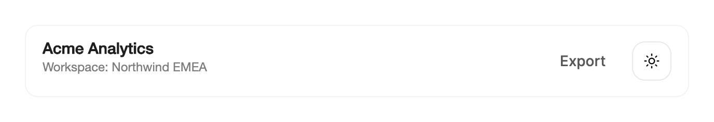

<Demo name="Variants" />

## When to use

A theme switch is a single control in the chrome of a product: a header, a toolbar or the top bar of a desktop tool.
A person flips the whole window between light and dark in one press. `ThemeSwitcher` names the next appearance for
assistive technology, shows the icon of the current one, and plays a page transition whose shape matches the layout.
Use it when the change of appearance should feel deliberate, not abrupt.

- **Switching the console header in an admin product**: a switch sits beside the workspace menu and the notification
  bell in the header of an operations console. The icon-only form keeps the header quiet, and the control stays in the
  same corner on every page.
- **Moving between light and dark during a long analytics session**: a finance team reviews a revenue dashboard late in
  the day and flips the window to dark. The `Rise` variant is the quietest, so the chart colours settle without a
  distracting sweep across the data.
- **Previewing an appearance in a showcase or release page**: a design team demonstrating a new product release uses
  `Eclipse`, whose disc crosses the page, so the audience sees the change happen.
- **Centred top bars in a docs site or a marketing landing page**: a centred layout has no fixed corner for the change
  to start from. `Split` opens from a centre seam and does not depend on where the button sits.
- **Desktop tools that remember the appearance per workspace**: an internal CRM or a developer tool stores the choice
  in its settings and applies it to every window. The handler receives the request, so the app decides what to apply.

## When not to use

- **A theme choice among light, dark and system, or a choice that sits in an account menu**: use `UserMenu`. A menu
  keeps the three choices out of the header when they are not needed every day.
- **A choice that stays visible in a settings page**: use `SegmentedControl` for light, dark and system as named
  options that stay selected, or `RadioCards` when each option needs a description.
- **A plain action that does not change the theme**, such as Export report or Invite member: use `Button`.
- **A single on or off setting**, such as Compact sidebar or Show values on charts: use `Switch`, which reports a
  setting rather than a change of the whole window.
- **Another named choice, such as language, density or accent colour**: use `Select` or `SegmentedControl`.
  `ThemeSwitcher` only changes between light and dark.
- **Two states of an icon that is not the theme**, such as play and pause or menu and close: use `IconMorph`, the
  two-state icon button.

## Usage

```xml
<UserControl xmlns="https://github.com/avaloniaui"
             xmlns:arc="https://github.com/AtomUICommunity/TKCode.Arc">
    <arc:ThemeSwitcher Variant="Reveal" />
</UserControl>
```

`ThemeSwitcher` derives from Avalonia's `TemplatedControl`, and its template contains an Arc `Button` in the secondary
variant at the small size. The press scale, the hover and the focus ring therefore come from the Arc button theme, the
same as on any other Arc button. The switcher adds the appearance logic on top: it tracks the window's theme variant,
swaps the sun and the moon, raises a request before the theme changes, and exposes the button to assistive technology as
a toggle. Without an `Appearance`, it follows the actual theme variant of the window.

### Anatomy

1. **Button frame** (the inner Arc button): a secondary button at the small size, 36 px high. In the text form, hovering
   darkens the border to the strong border color. The icon-only form is a 38 by 38 px square with a 12 px corner radius
   and no padding; its hover removes the shadow, so the square answers with the surface change only.
2. **Icon** (the icon part): the sun for the light appearance and the moon for the dark one. The glyph is 16 px with a
   1.75 px stroke, drawn in an 18 px icon area inside a 20 px square that carries the icon nudge of the variant.
3. **Gap** (`IconTextGap`): 8 px between the icon and the text.
4. **Text** (`Text`): the visible label. It defaults to "Switch theme", takes the button's text colour and
   is hidden when `IsIconOnly` is `True`.

The switcher aligns itself to the left and centres itself vertically, so it sits at the start of a toolbar without
extra layout. Put it in a `StackPanel` or a `DockPanel` and let the parent place it.

### Variants

`Variant` picks the page transition. The same value also sets the direction of the icon nudge in dark mode, so the icon
and the reveal move the same way. The transition plays when the switcher applies a change itself; the variant does not
change the appearance.

| Variant | The new appearance | Choose it when |
|---|---|---|
| `Reveal` (default) | Grows as a circle from the button to the farthest corner of the window | The switch sits in a corner, so the reveal starts where the person pressed |
| `Eclipse` | A disc as wide as the window's diagonal enters from the right and settles over the page | Showcase pages, presentations and release pages where the change itself is the point |
| `Split` | A slim seam at the centre widens to the full window | Centred layouts, where the button position gives no sense of direction |
| `Rise` | Rises from the bottom edge to the top | Dense work screens, where the quietest change suits; it is the choice for an icon-only header |

```xml
<arc:ThemeSwitcher Variant="Eclipse" />
<arc:ThemeSwitcher Variant="Split" />
<arc:ThemeSwitcher Variant="Rise" IsIconOnly="True" />
```

Pick one variant for each product and keep it on every page. A person who learns the reveal from the header should see
the same motion when the switch is used elsewhere. Use `Reveal` when the switch is in a corner and the reveal can start
from it; choose `Split` when the switch is centred, because a reveal from the middle of a centred bar would look
arbitrary.

### Icon only and text

`IsIconOnly` shows a 38 by 38 square button and hides `Text`. Use it in a dense toolbar or a header where the icon is
enough and the surrounding controls are icons too. Use the text form, with `Text="Appearance"` or the default, when the
switch sits among labelled actions or when a person may not read the sun and moon as theme controls.

```xml
<arc:ThemeSwitcher Text="Appearance" Label="Switch appearance" />
```

`Label` sets the accessible name. Without a `Label`, the switcher names the next appearance itself ("Switch to dark
mode" while light, "Switch to light mode" while dark). A fixed `Label` replaces that name in both appearances, so it no
longer says which appearance the next press switches to. Set `Label` only when the name must not change, and keep it
short and specific.

`Text` is never used as the accessible name. The switcher sets the name of its button itself, so the visible text is
for people who see the control, not for the name that assistive technology reads.

### Handling the request

`ThemeChangeRequested` is raised before the theme changes, on every press and on `Toggle()`. Its arguments give the
appearance to switch to (`Next`), the variant (`Variant`), the button that was pressed (`Trigger`) and the centre of that
button in its top level's coordinates (`Origin`), which is the start of a reveal. Set `Handled` to apply the theme
yourself. The switcher then leaves the theme alone, and it also leaves `Appearance` alone: if your handler does not set
it, the icon and the name stay as they were.

<Demo name="HandledByApp" />

```csharp
switcher.ThemeChangeRequested += (_, e) =>
{
    e.Handled = true;
    switcher.Appearance = e.Next;
    ApplyAppearance(e.Next);
};
```

Handle the request when the app owns the appearance, for example when the choice is saved per user, applied to several
windows, or applied after a server call. Handle it on the switcher or on a parent: the event bubbles, so a single handler
on a window can serve every switcher in it. When the handler needs the same page transition as the built-in apply, pass
the trigger, the variant and your apply step to `RunTransitionAsync`:

```csharp
switcher.ThemeChangeRequested += async (_, e) =>
{
    e.Handled = true;
    await ThemeSwitcher.RunTransitionAsync(e.Trigger, e.Variant,
        () => _viewModel.ApplyAsync(e.Next));
};
```

`RunTransitionAsync` snapshots the window, runs your apply step underneath it and reveals the new appearance by the
variant. Under reduced motion, with motion off, or when the trigger has no overlay layer, it runs the apply step and
returns without the transition.

### Controlled appearance

`Appearance` is the appearance shown: the icon, the pressed state and the accessible name. It is a nullable
`ThemeSwitcherAppearance`, with `Light` and `Dark` as its values, and it is a two-way binding by default. Set it from
code to keep the switcher in step with the app. `EffectiveAppearance` returns the appearance in effect, whether it comes
from `Appearance` or from the window.

- When `Appearance` is `null` (the default), the switcher follows the window's actual theme variant and updates when
  that changes.
- When `Appearance` has a value, the switcher shows that value and stops following the window. Set it back to `null` to
  resume following.
- Setting `Appearance` changes the icon and the name, but it does not play the page transition. The transition runs only
  when the switcher applies a change itself, from a press or from `Toggle()`.

```xml
<arc:ThemeSwitcher Appearance="Light" Variant="Rise" />
```

```csharp
switcher.Toggle();
```

`Toggle()` switches to the other appearance as a press would: it raises `ThemeChangeRequested` and, unless the request is
handled, applies the change. Use it for a keyboard shortcut in the app, such as a command in a command palette.

### Binding to a view model

In an MVVM app the view model owns the appearance and the apply step; the switcher only shows the value and reports the
request. The following view model uses CommunityToolkit.Mvvm and an app-side settings store. `ApplyAsync` is the app's
own code that changes the theme of the application.

```csharp
public partial class AppearanceViewModel : ObservableObject
{
    private readonly IAppearanceStore _store;
    private readonly IThemeService _themes;

    [ObservableProperty]
    private ThemeSwitcherAppearance? _appearance;

    public AppearanceViewModel(IAppearanceStore store, IThemeService themes)
    {
        _store = store;
        _themes = themes;
        _appearance = store.Load();
    }

    public async Task ApplyAsync(ThemeSwitcherAppearance next)
    {
        await _themes.ApplyAsync(next == ThemeSwitcherAppearance.Dark);
        Appearance = next;
        await _store.SaveAsync(next);
    }
}
```

```xml
<arc:ThemeSwitcher x:Name="ThemeSwitch"
                   Appearance="{Binding Appearance}"
                   Variant="Rise" />
```

```csharp
public partial class ShellView : UserControl
{
    public ShellView()
    {
        InitializeComponent();
        ThemeSwitch.ThemeChangeRequested += OnThemeChangeRequested;
    }

    private async void OnThemeChangeRequested(object? sender, ThemeSwitcherChangeRequestedEventArgs e)
    {
        e.Handled = true;
        await ThemeSwitcher.RunTransitionAsync(e.Trigger, e.Variant,
            () => _viewModel.ApplyAsync(e.Next));
    }
}
```

- `Appearance` is two-way: the switcher writes its value into the view model when the appearance changes, and the view
  model's value reaches the switcher when the app sets it, for example at startup when the stored choice loads.
- The switcher has no command. The request goes through the event, because the event carries the trigger and the origin
  that the transition needs. Wire it in code-behind, as shown, and let the handler call the view model.
- Compiled bindings need `x:DataType` on the view (the examples here leave it out for brevity).

### Persisting the choice

Load the stored value before the first frame or right after it, and assign it to the view model. The first appearance set
does not animate, and a value that lands during the first frames does not play the icon swap either, so the switcher
starts in the right state without a flash. Save the value in `ApplyAsync` after the theme has changed, so a failed apply
does not store an appearance the window never showed.

### Using motion with restraint

Use the page transition for a change the whole window makes. It shows the person that the theme changed everywhere, which
a fast recolour can miss. Do not use it for a change that happens often: a person who flips the theme several times in a
minute is served better by a quiet `Rise` than by an eclipse each time. The transition captures the whole window at its
render scale, so its cost grows with the window size and the display density. Keep the variant quiet in large windows.

Reduced motion removes the page transition and the icon nudge, and the icon fades in at once. Off switches the theme
without any of these effects.

### Example: analytics console header

A header of an operations console with the product name and the workspace, a ghost button for an export and an
icon-only switch at the end. The switch follows the window's theme because it has no `Appearance`; the header does not
decide the appearance, and the app does. The icon-only `Rise` variant keeps the header quiet, and the export button is a
ghost so it does not compete with the content below. The switch sits at the end of the row, where a person looks for
window-level controls.



```xml
<Border Width="640"
        Padding="16,12"
        CornerRadius="12"
        Background="{arc:ArcDesignTokenResource Surface}"
        BorderBrush="{arc:ArcDesignTokenResource BorderSubtle}"
        BorderThickness="1">
    <DockPanel LastChildFill="False">
        <StackPanel DockPanel.Dock="Left" Spacing="2">
            <TextBlock Text="Acme Analytics"
                       FontSize="15"
                       FontWeight="SemiBold" />
            <TextBlock Text="Workspace: Northwind EMEA"
                       FontSize="12"
                       Foreground="{arc:ArcDesignTokenResource TextMuted}" />
        </StackPanel>
        <StackPanel DockPanel.Dock="Right"
                    Orientation="Horizontal"
                    Spacing="8"
                    VerticalAlignment="Center">
            <arc:Button Content="Export" Variant="Ghost" />
            <arc:ThemeSwitcher Variant="Rise" IsIconOnly="True" />
        </StackPanel>
    </DockPanel>
</Border>
```

### Content guidelines

- **Default name and text**: keep the default text "Switch theme" for a header, and the default accessible name, which
  states the next appearance. Override the text with a short noun, such as "Appearance", when the switch sits in a row of
  labelled settings.
- **Label**: when you set it, name the action and the appearance it switches to: "Switch to dark mode". Leave out words
  such as "toggle" or "button" that the screen reader already announces.
- **Text**: a verb and an object or a noun phrase in sentence case, with no punctuation. Do not write the current state
  in the text, because the icon already shows it.
- **Icon only**: use the icon-only form only where the surrounding controls are icons too. A lone sun and moon among
  labelled buttons is easy to miss.

| Instead of | Write |
|---|---|
| Dark | Switch to dark mode |
| Change look | Switch appearance |
| Theme toggle (click) | Switch theme |
| Night mode for the app | Switch to dark mode |
| Mode | Switch to light mode |

### Best practices

**Do**

- Place the switch in the same spot of the header on every page. A person who finds it once expects it in the same place,
  so the switch stays discoverable.
- Handle `ThemeChangeRequested` when the app saves the choice, applies it to several windows or applies it after a call
  to a server. The handler is the one place that sees the next appearance, the variant and the origin together.
- Keep one variant for the whole product. The motion becomes a signature of the product only when it repeats.
- Leave `Label` unset unless the name must stay fixed. The default name tells a screen reader which appearance the next
  press switches to, and a fixed name does not.

**Avoid**

- `Eclipse` or `Reveal` in a dense dashboard. A full-window sweep competes with the chart redraws the same instant; the
  quieter `Rise` keeps the attention on the data.
- Setting `Appearance` from code to fake a change of theme. Setting it moves the icon and the name only, so the window
  stays in the old appearance. Apply the theme in the handler, then set the value.
- A fixed `Label` such as "Switch appearance" in both states. The name stops telling the person which appearance the next
  press switches to.
- Putting the switch in a menu next to system choices when the header has room. A menu hides the switch, and the
  three-way choice belongs in `UserMenu`.
- Pressing the switch in a loop from code, such as an automated test that flips the theme on every step. Each press
  captures the whole window and runs a transition, so a fast series costs a snapshot each time.

### Common questions

**Why does the icon change but the window stays the same?** Setting `Appearance` moves the icon, the pressed state and
the name only. The theme changes when the switcher applies it or when your handler applies it. If you handle the request,
apply the theme in the handler, as shown in "Handling the request".

**Why does the icon stop following the window when I set `Appearance`?** A value in `Appearance` overrides the window's
theme variant. Set `Appearance` back to `null` to follow the window again.

**Does the transition play when the stored preference loads at startup?** No. Setting `Appearance` never plays the page
transition. The icon swap runs only after the switcher has loaded and settled, so a value set at startup appears without a
swap.

**Does the built-in apply keep my accent and other theme settings?** Yes. The switcher reuses the configuration of the
last theme request it observed, and it toggles only the dark algorithm. Before any request it carries the current Arc
accent preset over, so the accent does not reset when the appearance changes.

**Can I use my own transition for the built-in apply?** Handle the request and call `RunTransitionAsync` with the trigger,
the variant and your apply step, as shown in "Handling the request". The helper runs the transition the variant names and
falls back to a plain apply under reduced motion.

## API reference

<!-- api: ThemeSwitcher -->

**`ThemeSwitcherChangeRequestedEventArgs`** is the argument of `ThemeChangeRequested`.

| Member | Type | Meaning |
|---|---|---|
| `Next` | `ThemeSwitcherAppearance` | The appearance to switch to |
| `Variant` | `ThemeSwitcherVariant` | The page transition the switcher asks for |
| `Trigger` | `Control` | The button that was pressed |
| `Origin` | `Point` | The centre of the trigger in its top level's coordinates, the start of a reveal |
| `Handled` | `bool` | Set to `True` to apply the theme yourself; inherited from `RoutedEventArgs` |

**`ThemeSwitcherVariant`** and **`ThemeSwitcherAppearance`** are the two enums the switcher uses.

| Enum | Members |
|---|---|
| `ThemeSwitcherVariant` | `Reveal` (default), `Eclipse`, `Split`, `Rise` |
| `ThemeSwitcherAppearance` | `Light`, `Dark` |

## Accessibility

- The switcher is a toggle button. It reports the dark appearance as On and the light appearance as Off, and each change
  of the appearance raises a toggle state change for assistive technology.
- Its accessible name names the next appearance ("Switch to dark mode" or "Switch to light mode") unless `Label` is set.
  The name updates when the appearance changes.
- The sun and moon icons are hidden from assistive technology. The name carries the meaning, not the glyph.
- The switcher takes keyboard focus like any Arc button and shows the standard focus ring. Enter and Space switch the
  appearance.
- Reduced motion switches the theme at once, without the page transition or the icon nudge.

### Keyboard

| Keys | Action |
|---|---|
| `Enter` or `Space` | Switch to the other appearance; raises `ThemeChangeRequested` first |

## Motion

- The sun and the moon turn and scale into each other on a shared path, and the old icon leaves quickly. Both icons turn
  the same way, so the swap reads as a single rotation rather than two separate icons.
- In dark mode the icon nudges in the direction of its variant: `Reveal` enlarges it to 108 percent, `Eclipse` moves it
  2 px left, `Split` moves it 1 px right and `Rise` moves it 2 px up.
- The page transition reveals the new appearance by its variant. The window is kept as a snapshot in the overlay layer,
  the new appearance is applied underneath, and the snapshot's clip opens to show it.
- The first appearance set does not animate. The icon swap starts only after the switcher has loaded and settled.

| Change | Full | Reduced | Off |
|---|---|---|---|
| Theme change | The page transition plays for the variant | No transition; the theme switches at once | Immediate |
| Sun and moon swap | The icons turn and scale into each other | The icon fades in at once | Immediate |
| Dark-mode icon nudge | The icon moves by its variant | No nudge | Immediate |

## Related

- `Button` for a plain action with no theme change, and the button the switcher is built on.
- `UserMenu` for a theme choice that includes system and lives in an account menu.
- `SegmentedControl` for a choice among a few named options that stays selected.
- `IconMorph` for a standalone icon that morphs between two states.

| Component | Choose it when |
|---|---|
| `Button` | The action does not change the theme |
| `UserMenu` | The theme choice includes system or lives in an account menu |
| `SegmentedControl` | Light, dark and system are visible named options in a settings page |
| `RadioCards` | Each appearance option needs its own description in a settings page |
| `Switch` | A single on or off setting that does not change the whole window |
| `IconMorph` | A two-state icon that is not the theme |
