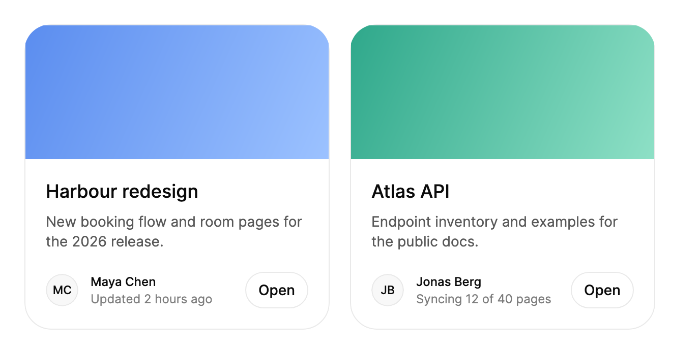

<Demo name="QuickLook" />

## 何時使用

`Card` 是可瀏覽集合的磚塊：專案、房源、貼文或工作區的網格，每一項都有一張視覺圖、一個標題、一位擁有者，以及一個會隨時間變化的狀態。它把這些部分和屬於該項的少量操作組合進一個封閉的表面中，因此網格讀起來是一組等大的單元。卡片也可以開啟快速預覽：卡片會擴展為同一項目的較大檢視，而無需離開頁面。

- **管理後台中的專案與工作區網格**：每個專案一張卡片，附封面圖、擁有者頭像，以及「2 小時前更新」之類的狀態。底部放一個操作，例如「開啟專案」。
- **店家與內部商品目錄中的清單磚塊**：商品照片、名稱、一行簡短文案和末端的按鈕。媒體是每個磚塊的視覺錨點。
- **CRM 或案件管理網格中的紀錄快速預覽**：客戶或工單的卡片開啟後顯示其未決問題與里程碑。網格保持原位，關閉檢視後使用者會回到同一個磚塊。
- **帳單或部署儀表板中磚塊上的即時狀態**：工作執行時，卡片的 `Status` 隨之變化（「正在同步 40 張發票中的 12 張」，然後「剛剛同步」）。新詞會依序升起，並以禮貌的方式朗讀。
- **開發者入口網站或編輯工具中的貼文與發行說明資訊流**：每篇貼文一張卡片，附作者資訊列（`Meta`）和底部操作，無需完整表格的分量。

## 何時不用

- **附上下文說明的單一數字**，例如營收、轉換率或未關閉的事件：使用 `MetricCard`，它包含數值、變化與迷你趨勢圖。
- **在原處展開的內容**，無需對話方塊，例如從標題下方展開的設定群組：使用 `ExpandableCard`。
- **沒有可展開卡片的模態內容**，例如從工具列按鈕開啟的確認或表單：使用 `Dialog`。
- **逐一處理項目**，即使用者逐張接受或拒絕卡片：使用 `CardStack`，它為一疊卡片處理拖曳、鍵盤與復原。
- **需要依欄位比較的大量紀錄**，例如附金額、日期與狀態的發票：使用 `Table`。卡片會隱藏那些讓各列可比較的欄位。
- **網格或清單中還沒有任何內容**：在網格區域顯示 `EmptyState`。空白卡片不是一則訊息。

## 用法

```xml
<UserControl xmlns="https://github.com/avaloniaui"
             xmlns:arc="https://github.com/AtomUICommunity/TKCode.Arc">
    <arc:Card Title="港口改版"
              Description="全新的預訂流程與房間頁面。"
              Width="280" />
</UserControl>
```

`Card` 衍生自 Avalonia 的 `ContentControl`。`Title` 與 `Description` 提供標題和說明列，`Content` 接收其他任何內容，放置在說明與底部之間。每個選用部分都是有型別的屬性，因此附頭像、狀態和操作的卡片無需額外版面配置：卡片會排列底部、隱藏為空的部分，並在整個網格中保持相同的間距。

### 結構

1. **媒體**（`Media`）：頂部的圖片或視覺元素，最小高度 112 px。屬性為空時隱藏。
2. **標題**（`Title`）：18 px、中等字重、1.3 行高，為三級標題。設定 `Details` 後，標題變為開啟快速預覽的按鈕。
3. **說明**（`Description`）：14 px 內文，位於標題下方 8 px。行長上限約為 34 個數字寬度，因此較長的文案會換行為更多行，而不會撐寬卡片。
4. **內容**（`Content`）：說明與底部之間的任意元素，例如標籤清單或進度條。`Content` 為空時隱藏。
5. **底部**：位於內容下方 20 px。當 `Avatar`、`Meta`、`Status` 或 `Action` 有值時出現。
6. **頭像**（`Avatar`）：前端 32 px 寬的插槽，用於放置擁有者的 `Avatar` 控制項，與作者資訊列和操作之間各有 12 px 間距。
7. **作者資訊列**（`Meta` 與 `Status`）：`Meta` 是擁有者的一行 12 px 文字。`Status` 位於其下方，單行顯示，超出邊緣時裁切並以省略號結尾。
8. **操作**（`Action`）：末端的控制項，通常是小按鈕。它保留自己的焦點和點擊目標，不會開啟快速預覽。
9. **表面**：1 px 表面色邊框、26 px 圓角與 20 px 內容內距。靜止時沒有陰影，懸停時出現。

### 組成部分與組合

Arc 的卡片沒有 `Variant` 屬性。它的變體是選用部分的組合，依項目逐一選擇。

| 組合 | 需要設定的部分 | 適用於 |
|---|---|---|
| 純文字 | `Title`、`Description` | 參考型磚塊、連結清單、沒有視覺元素的摘要 |
| 媒體與作者資訊 | `Media`、`Avatar`、`Meta` | 每一項都有圖片和擁有者的網格 |
| 即時 | 在上述基礎上加 `Status` | 頁面開啟期間狀態會變化的項目 |
| 可互動 | 在上述基礎上加 `Details` | 點開後可查看更多內容的項目，例如紀錄或專案摘要 |

僅有標題和說明的純文字卡片在 240 px 寬度下高度不到 80 px，因此純文字卡片網格保持緊湊。除非高度一致，否則不要在同一列混用純文字卡片和媒體卡片：網格儲存格會拉伸卡片，簡短文案下方的空白看起來像版面錯誤。

### 媒體、擁有者與底部

網格中每張卡片的媒體高度應相同，這樣整列的標題才會對齊。`Avatar` 插槽中放 `Small` 尺寸的頭像，它是依 32 px 的插槽設計。`Meta` 是擁有者的名稱，使用一行文字。操作是一個控制項。如果卡片需要第二個操作，請把它放在 `Content` 或 `Details` 中，使底部保持一個末端的點擊目標。

```xml
<arc:Card Title="港口改版"
          Description="全新的預訂流程與房間頁面。"
          Meta="Maya Chen"
          Status="2 小時前更新"
          Width="280">
    <arc:Card.Media>
        <Border Height="132" Background="#5B8DEF" />
    </arc:Card.Media>
    <arc:Card.Avatar>
        <arc:Avatar DisplayName="Maya Chen" Size="Small" />
    </arc:Card.Avatar>
    <arc:Card.Action>
        <arc:Button Content="分享" Variant="Ghost" Size="Small" />
    </arc:Card.Action>
</arc:Card>
```

### 狀態

`Status` 是一行簡短文字，例如「2 小時前更新」。文字變化時，舊行向上移出，新詞依序升起出現，間隔約 40 ms。該行使用快取文字繪製，不會為每個詞建立控制項，因此經常更新的卡片依然輕量。

<Demo name="StatusUpdates" />

```xml
<arc:Card Title="每週摘要"
          Description="每週五彙整各團隊的重點內容。"
          Status="{Binding LastUpdate}"
          Width="300" />
```

狀態應寫成附時間的事實：「正在同步 40 張發票中的 12 張」「已發布到 4 個團隊」「2 小時前更新」。只有狀態真正改變時才修改字串；依計時器重複設定同樣的文字會重播動畫，卻沒有傳達新資訊。把 `Status` 設為 `null` 或空字串會隱藏該行。只有當既有狀態被替換時才播放滾動動畫，因此第一個值會立即出現。

### 快速預覽

設定 `Details` 後，標題變為按鈕，整張卡片也成為觸發器：在卡片上按下、且按下位置不在巢狀控制項上時，會開啟快速預覽。表面、媒體、標題、說明、作者資訊列與操作會飛入同一頁面中較大的檢視，之後詳細內容隨之升起。

<Demo name="Controlled" />

```xml
<arc:Card Title="季度計畫"
          Description="未來三個月的目標、負責人與日期。"
          IsDetailsOpen="{Binding IsPlanOpen, Mode=TwoWay}"
          Width="280">
    <arc:Card.Details>
        <TextBlock Text="由程式碼開啟：IsDetailsOpen 為雙向繫結。" TextWrapping="Wrap" />
    </arc:Card.Details>
</arc:Card>
```

`Details` 保存較大檢視的內容，可以是任意控制項。快速預覽最寬 480 px，視窗在其四周保留 16 px 的邊距。`Details` 只放使用者判斷是否開啟該紀錄所需的內容：摘要、下一步以及一兩個連結。完整的編輯表單應放在 `Dialog` 中或頁面上。

快速預覽會重複卡片的文案和底部（其標題為 22 px，媒體位於頂部，並帶有浮動的關閉按鈕），因此同樣的文字不必寫兩遍。`Details` 中只放額外的內容。

使用 `OpenDetails()` 與 `CloseDetails()` 從程式碼開啟和關閉快速預覽，使用 `DetailsOpenChanged` 得知變化的原因。`IsDetailsOpen` 為雙向繫結，因此繫結可以開啟或關閉它，事件則回報每一次變化。

```csharp
card.DetailsOpenChanged += (_, e) => log.Text = e.IsOpen ? "開啟" : $"已關閉（{e.Reason}）";
card.OpenDetails();
card.CloseDetails();
```

原因為 `Programmatic` 表示由程式碼發起的變化，`CloseButton` 表示關閉按鈕，`Escape` 表示 Escape 鍵，`PressOutside` 表示在快速預覽後方的遮罩上按下。

### 無快速預覽

不設定 `Details` 時，標題只是一般標題，卡片僅在懸停時抬起。標題不取得焦點，在卡片上按下也沒有反應，因此唯一的停留點是卡片內的控制項。此形式適用於僅顯示資訊或附底部操作的卡片。

<Demo name="WithoutQuickLook" />

### 繫結到檢視模型

專案網格為每個項目繫結一張卡片。檢視模型擁有每個項目的狀態，卡片負責顯示。使用 CommunityToolkit.Mvvm 時，`ObservableObject` 持有屬性，`ObservableCollection<T>` 為網格提供資料。

```csharp
public partial class ProjectCardViewModel : ObservableObject
{
    public ProjectCardViewModel(string title, string owner)
    {
        _title = title;
        _owner = owner;
    }

    [ObservableProperty]
    private string _title;

    [ObservableProperty]
    private string _owner;

    [ObservableProperty]
    private string? _status;

    [ObservableProperty]
    private bool _isBriefOpen;

    [ObservableProperty]
    private string? _brief;

    [RelayCommand]
    private async Task ShareAsync()
    {
        await _sharing.ShareAsync(Title);
    }
}

public partial class ProjectsViewModel : ObservableObject
{
    public ObservableCollection<ProjectCardViewModel> Projects { get; } = new();
}
```

```xml
<ItemsControl ItemsSource="{Binding Projects}">
    <ItemsControl.ItemsPanel>
        <ItemsPanelTemplate>
            <WrapPanel ItemSpacing="16" LineSpacing="16" />
        </ItemsPanelTemplate>
    </ItemsControl.ItemsPanel>
    <ItemsControl.ItemTemplate>
        <DataTemplate>
            <arc:Card Title="{Binding Title}"
                      Description="{Binding Brief}"
                      Meta="{Binding Owner}"
                      Status="{Binding Status}"
                      IsDetailsOpen="{Binding IsBriefOpen, Mode=TwoWay}"
                      Width="280"
                      VerticalAlignment="Top">
                <arc:Card.Action>
                    <arc:Button Content="分享" Variant="Ghost" Size="Small"
                                Command="{Binding ShareCommand}" />
                </arc:Card.Action>
                <arc:Card.Details>
                    <TextBlock Text="{Binding Brief}" TextWrapping="Wrap" />
                </arc:Card.Details>
            </arc:Card>
        </DataTemplate>
    </ItemsControl.ItemTemplate>
</ItemsControl>
```

- `Title`、`Description`、`Meta` 與 `Status` 為單向：由檢視模型擁有，卡片不會寫回。
- `IsDetailsOpen` 為雙向：按下或關閉按鈕會把 `False` 寫回，程式碼也可以把它設為 `True` 以開啟快速預覽。只有當檢視模型必須知道使用者已關閉檢視時，才使用 `Mode=TwoWay` 繫結。
- 需要原因的副作用（例如按 `Escape` 後儲存草稿）使用 `DetailsOpenChanged`。狀態本身使用繫結。
- `Action` 是一般按鈕，擁有自己的 `Command`。按下它不會開啟快速預覽。
- 編譯繫結需要在範本與檢視上設定 `x:DataType`。為求簡潔，範例在檢視上省略了它。

### 資料結構與效能

快速預覽在第一次開啟時才建立，因此沒有人開啟的卡片不會為 `Details` 額外付出成本。讓 `Details` 的內容保持輕量：它在第一次開啟時才建構。對於長集合，請把卡片放在支援虛擬化的面板中，使螢幕外的卡片不會被建立。

在卡片或其網格欄上設定寬度。卡片會填滿分配給它的儲存格（最小寬度為 0），因此固定寬度 260 到 300 px 可形成一般網格，`UniformGrid` 在視窗縮放時保持欄等寬。

### 焦點與關閉

設定了 `Details` 的卡片只是一個 Tab 停留點：標題按鈕。在其上按 Enter 或 Space 會開啟快速預覽，焦點移到其中的關閉按鈕。快速預覽開啟時，Tab 與 Shift+Tab 只在其內部循環，因此鍵盤無法到達後面的頁面。Escape、在遮罩上按下以及關閉按鈕都會關閉它，關閉後焦點回到標題。關閉按鈕預設名為「Close quick look」；當文案需要說明關閉的是什麼時，請設定 `CloseButtonName`，例如「關閉專案摘要」。

按下 `Action` 按鈕會執行其命令，不會開啟快速預覽。如果卡片在快速預覽開啟時離開視窗，快速預覽會被移除，`IsDetailsOpen` 變為 `False`。

### 範例：工作區中的專案網格

工作區首頁上的專案清單。每張卡片顯示封面、擁有者和最近更新時間，底部放一個「Open」操作。標題為名詞，說明為一句話，狀態是附時間的事實。兩張卡片寬度相同且頂部對齊，使這一列讀起來像一組。



```xml
<StackPanel Width="640" Orientation="Horizontal" Spacing="20">
    <arc:Card Title="Harbour redesign"
              Description="New booking flow and room pages for the 2026 release."
              Meta="Maya Chen"
              Status="Updated 2 hours ago"
              Width="300"
              VerticalAlignment="Top">
        <arc:Card.Media>
            <Border Height="132">
                <Border.Background>
                    <LinearGradientBrush StartPoint="0%,0%" EndPoint="100%,100%">
                        <GradientStop Color="#5B8DEF" Offset="0" />
                        <GradientStop Color="#9CC2FF" Offset="1" />
                    </LinearGradientBrush>
                </Border.Background>
            </Border>
        </arc:Card.Media>
        <arc:Card.Avatar>
            <arc:Avatar DisplayName="Maya Chen" Size="Small" />
        </arc:Card.Avatar>
        <arc:Card.Action>
            <arc:Button Content="Open" Variant="Secondary" Size="Small" />
        </arc:Card.Action>
    </arc:Card>
    <arc:Card Title="Atlas API"
              Description="Endpoint inventory and examples for the public docs."
              Meta="Jonas Berg"
              Status="Syncing 12 of 40 pages"
              Width="300"
              VerticalAlignment="Top">
        <arc:Card.Media>
            <Border Height="132">
                <Border.Background>
                    <LinearGradientBrush StartPoint="0%,0%" EndPoint="100%,100%">
                        <GradientStop Color="#2FA88B" Offset="0" />
                        <GradientStop Color="#8EE0C6" Offset="1" />
                    </LinearGradientBrush>
                </Border.Background>
            </Border>
        </arc:Card.Media>
        <arc:Card.Avatar>
            <arc:Avatar DisplayName="Jonas Berg" Size="Small" />
        </arc:Card.Avatar>
        <arc:Card.Action>
            <arc:Button Content="Open" Variant="Secondary" Size="Small" />
        </arc:Card.Action>
    </arc:Card>
</StackPanel>
```

### 文案規範

- **標題**：句首大寫的簡短名詞片語，點明項目是什麼：「港口改版」「第三季發票」。標題是卡片的無障礙名稱，因此脫離上下文也必須說得通。
- **說明**：一句話，說明該項目是什麼或包含什麼。它大約在 34 個數字寬度處換行，因此最多保持兩行。不要重複標題。
- **狀態**：附時間的事實，句首大寫：「2 小時前更新」「正在同步 40 張發票中的 12 張」。計數用阿拉伯數字，避免「最近」這類模糊用語。
- **操作**：動詞，卡片本身沒有說明對象時再加上對象：「開啟」「分享報告」。

| 不要寫 | 改為 |
|---|---|
| 點擊此處查看更多 | 開啟專案 |
| 很多事情正在發生 | 正在同步 40 張發票中的 12 張 |
| 最近更新 | 2 小時前更新 |
| 這張卡片顯示的是一個專案 | 港口改版 |

### 最佳做法

**建議**

- 只有當項目的內容多於卡片所能顯示的內容時，才設定 `Details`。重複頁面內容的快速預覽毫無價值。
- 網格中的每張卡片保持相同的寬度和媒體高度，使標題與底部對齊。
- 對頁面開啟期間會變化的狀態使用 `Status`，並在變化之間保持措辭穩定。
- 當快速預覽包含草稿或需要做出決定時，設定 `CloseButtonName`，使關閉控制項說明其結果。

**避免**

- 在 `Details` 中放長表單。快速預覽是有邊界的檢視，供閱讀和一兩個操作使用。
- 底部操作超過一個。底部只有一個末端插槽，第二個操作會與開啟卡片的按下操作爭搶。
- 依計時器把 `Status` 重新設為相同的文字。每次變化都會重播滾動動畫，卻沒有新資訊，只會分散注意力。
- 依賴懸停抬起來表明卡片可點擊。觸控與觸控筆從不會讓卡片抬起，因此標題與 `Details` 的提示必須獨立傳達含義。

### 常見問題

**為什麼按下卡片不會開啟快速預覽？** 只有設定了 `Details` 的卡片才會在按下時開啟，而且只有在按下位置不是巢狀控制項時才會。先檢查 `Details` 是否有值，再檢查按下的位置是否不在 `Action` 上。

**如何從工具列按鈕開啟快速預覽？** 把 `IsDetailsOpen` 繫結到檢視模型的屬性，或在程式碼中呼叫 `OpenDetails()`。`CloseDetails()` 會以原因 `Programmatic` 關閉它。

**為什麼卡片不在 Tab 順序中？** 卡片本身不可取得焦點。設定了 `Details` 時，標題按鈕是 Tab 停留點；沒有設定時，標題只是標題，只有底部操作會取得焦點。

**第一個狀態會有動畫嗎？** 不會。滾動動畫只在既有狀態被新文字替換時播放。設定第一個值或清空狀態都會立即改變該行。

**為什麼觸控時卡片不會抬起？** 抬起效果只回應滑鼠指標。觸控與觸控筆的版面和按下行為相同，只是沒有懸停狀態。

## API 參考

<!-- api: Card -->

## 無障礙

- 卡片是一個由 `Title` 命名的群組。沒有 `Details` 時，標題為三級標題。
- 設定 `Details` 後標題變為按鈕；按 Enter 或空白鍵會開啟快速預覽。
- 快速預覽是以其標題命名的對話方塊，說明作為其說明文字。其關閉按鈕由 `CloseButtonName` 命名，預設為「Close quick look」。
- `Status` 的變化透過禮貌的即時區域朗讀。
- 巢狀操作保留各自的焦點與名稱。僅含圖示的操作請使用 `AutomationProperties.Name` 設定名稱；`Media` 中的圖片請設定替代文字，或將其標記為裝飾性。
- 懸停抬起與媒體縮放僅為視覺效果；去掉它們，卡片的內容和操作不變。

### 鍵盤

| 按鍵 | 操作 |
|---|---|
| `Tab` / `Shift+Tab` | 在標題（需設定 `Details`）、內容中的控制項和底部操作之間移動 |
| 標題上的 `Enter` 或 `Space` | 開啟快速預覽，焦點移入其中 |
| 快速預覽開啟時的 `Tab` / `Shift+Tab` | 只在其中的控制項之間移動；焦點留在快速預覽內 |
| `Escape` | 關閉快速預覽，並將焦點送回標題 |
| 關閉按鈕上的 `Enter` 或 `Space` | 以原因 `CloseButton` 關閉快速預覽 |

沒有 `Details` 的卡片自身不接收焦點；只有其中的巢狀控制項是停留點。

## 動態效果

- 懸停時卡片抬起 2px，邊框與陰影加深。媒體緩慢放大至 1.04（僅限滑鼠）。
- 設定 `Details` 後，表面、媒體、標題與作者資訊列會透過同一彈簧飛入快速預覽，同時頁面在模糊中變暗。關閉時它們飛回卡片。
- 新的 `Status` 會把舊行推走，同時新詞依序升起。
- 減少動態效果時取消抬起、縮放與變形，快速預覽只淡入淡出。關閉動態效果時變化立即生效。

| 變化 | 完整 | 減少 | 關閉 |
|---|---|---|---|
| 卡片懸停 | 抬起 2px，邊框與陰影加深 | 邊框與陰影立即變化，不抬起 | 立即完成 |
| 懸停時的媒體 | 960 ms 內縮放至 1.04，480 ms 內回落 | 無縮放 | 立即完成 |
| 快速預覽開啟或關閉 | 表面、媒體與標題以彈簧飛入（開啟 0.3 s，關閉 0.26 s） | 淡入淡出 | 立即完成 |
| 狀態變化 | 舊行推走，新詞依序升起 | 立即替換 | 立即完成 |
| 快速預覽後方的遮罩 | 在頁面上淡入淡出 | 淡入淡出 | 立即完成 |

## 相關元件

- `MetricCard`：單一數字及其上下文與變化。
- `ExpandableCard`：原地展開、無需對話方塊的內容。
- `Dialog`：沒有卡片可展開的模態內容。
- `CardStack`：逐張處理一疊卡片。
- `EmptyState`：尚無卡片的網格或清單。

| 元件 | 適用情境 |
|---|---|
| `MetricCard` | 內容是一個數字，並附帶其變化與趨勢 |
| `ExpandableCard` | 內容在頁面內原地展開，無需對話方塊 |
| `Dialog` | 檢視是模態的，且沒有可以放大的磚塊 |
| `CardStack` | 使用者需要逐張做決定，並使用拖曳、鍵盤與復原 |
| `Table` | 項目是需要可比較欄位的列 |
| `EmptyState` | 網格或清單還沒有任何項目 |
