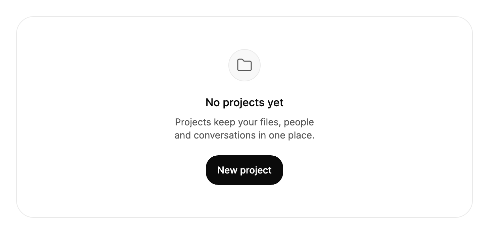

<Demo name="FirstUse" />

## 何時使用

`EmptyState` 用於填補清單、資料夾或結果集尚無內容時所在的位置。它說明該區域為空的原因，並提供一個合理的下一步操作，讓使用者不會停留在一片空白的面板前。它是由圖示、標題、一到兩句說明和選用操作組成的置中區塊，位於它所取代的內容所在的同一個表面之內。

- **清單的首次使用**：管理後台或 SaaS 產品中，「尚無專案」配一個主要的「新增專案」按鈕，顯示在第一個專案出現後專案表格將會出現的位置。
- **搜尋或篩選沒有結果**：訂單、發票或客戶清單中，「找不到 ‘quarterly plan’ 的結果」配「清除搜尋」和「瀏覽全部」操作，讓使用者無需重新輸入即可復原。
- **完成的步驟不再有可列出的內容**：例如每張發票都已付清後的付款頁面，「所有發票均已付清」，說明中提供下一次排定的付款日期，且不提供任何操作。
- **原地變化的狀態**：團隊頁面在第一個邀請被接受之前顯示「尚無成員」，之後在不切換頁面的情況下變為「邀請已寄出」並提供「重新寄送邀請」操作。
- **空的收件匣或動態消息**：開發者工具或 CRM 中，「過去 7 天沒有部署」配一個指向部署歷史的連結，讓空白區域說明它所涵蓋的時間範圍。

## 何時不用

- **資料仍在載入**：用 `Skeleton`，它會保留內容的形狀。請求進行中顯示空狀態，會傳達錯誤的訊息。
- **請求失敗，或已有內容的頁面出現錯誤**：用 `Alert`，放在內容上方，讓已載入的資料保持可見。
- **需要包含媒體、擁有者和底部操作的網格項目**：用 `Card`。空狀態不是一個磁貼，也不應看起來像一個磁貼。
- **確認某項內容已儲存或已變更**：用 `Toast`，它不會取代頁面上的內容。
- **帶有標籤頁的大型多場景插圖**：用 `EmptyStates` 區塊，它是一組現成的場景。當一則訊息只屬於頁面上的某一處時，才使用 `EmptyState`。

## 用法

`Title` 與 `Description` 承載訊息，`Action` 加入行動呼籲。`Label` 為輔助技術命名該區域。預設圖示是資料夾。

```xml
<UserControl xmlns="https://github.com/avaloniaui"
             xmlns:arc="https://github.com/AtomUICommunity/TKCode.Arc">
    <arc:EmptyState Label="專案"
                    Title="尚無專案"
                    Description="專案會將你的檔案、成員與對話集中保存在同一處。">
        <arc:EmptyState.Action>
            <arc:Button Content="新增專案" Variant="Primary" />
        </arc:EmptyState.Action>
    </arc:EmptyState>
</UserControl>
```

`EmptyState` 衍生自 Avalonia 的 `TemplatedControl`。它沒有值、選取項目或項目集合，因此不會引發任何事件。它唯一的互動部分是放在 `Action` 中的按鈕，這些按鈕保留各自的焦點、按下與命令行為。

### 結構

1. **圖示區域**（由 `Icon` 提供內容）：48 px 見方，1 px 邊框使用邊框顏色，背景為淡化的表面色，圓角為面板圓角。圖形為 24 px，以 1.5 的描邊繪製，顏色為次要文字顏色。
2. **標題**（`Title`）：16 px、中等字重、行高 22.4 px（1.4 倍），使用前景色，置中顯示。它是三級標題。位於圖示區域下方 20 px。
3. **描述**（`Description`）：14 px、行高 19.6 px，使用次要文字顏色，置中顯示。位於標題下方 8 px，寬度上限為 288 px（18 rem），因此會換行成較短的行長。
4. **操作**（`Action`）：置中排列的一列，位於描述下方 20 px。在 `Action` 有值之前處於隱藏狀態。
5. **內距**：左右各 20 px。上下內距隨視窗寬度變化：取視窗寬度的 8%，並保持在 32 px 至 48 px 之間。
6. **區域**：整個控制項是一個區域地標，其無障礙名稱為 `Label`。

標題與描述是平衡的：文字換行時，各行會被收窄為長度均勻的行，而不是留下一個很短的末行，因此兩行的描述看起來也是置中的。

### 選擇文案與圖示

圖示與文案說明區域為何為空。先確定狀態，再撰寫文案，並選擇能推動使用者前進的操作。

| 狀態 | 圖示 | 標題 | 操作 |
|---|---|---|---|
| 首次使用，尚未有任何內容 | 預設資料夾，或該功能自己的圖示 | 「尚無專案」 | 主要的建立操作 |
| 搜尋或篩選沒有傳回結果 | `ArcIcons.Search` | 「找不到 ‘quarterly plan’ 的結果」 | 清除篩選，或瀏覽全部 |
| 工作已完成，沒有可處理的事項 | `ArcIcons.Check` | 「所有發票均已付清」 | 無，或指向歷史紀錄的連結 |
| 變化已在原地成功完成 | `ArcIcons.Check` | 「專案已建立」 | 通常沒有；移除原來的操作 |

預設資料夾適合尚無任何項目的清單。搜尋圖示則告訴使用者清單確實存在，只是查詢把它過濾掉了。每種狀態使用一個圖示，不要每次出現都換成不同的圖示裝飾區塊。

### 圖示

`Icon` 可接受一個控制項，或一份 24 × 24 的 Lucide `Geometry`，例如 `ArcIcons` 中的某個圖示。傳入幾何圖形時，它會以 24 px、1.5 描邊繪製，即 Arc 的外觀。需要不同尺寸或組合影像時，傳入控制項。將 `Icon` 設為 `null` 可恢復為預設資料夾。

```xml
<arc:EmptyState Title="沒有結果"
                Description="檢查拼字，或嘗試更廣泛的搜尋詞。"
                Icon="{Binding SearchIcon}" />
```

```csharp
empty.Icon = ArcIcons.Search;
```

圖示變化時，舊圖示會以彈出的方式被新圖示取代。再次設定相同的圖示時保持不動，因此檢視模型可以在每次重新整理時都為 `Icon` 指派值，而不會每次重新整理都產生動畫。

### 操作列

`Action` 可接受一個按鈕，也可接受包含多個按鈕的面板。該列在描述下方置中排列。前進的方向使用一個主要操作。當狀態還需要一個復原操作時，把次要操作放在它旁邊的 `StackPanel` 中，並讓主要按鈕排在前面，使它成為 Tab 順序中的第一個停靠點。

<Demo name="ZeroResults" />

```xml
<arc:EmptyState Icon="{x:Static arc:ArcIcons.Search}"
                Title="找不到 “quarterly plan” 的結果"
                Description="檢查拼字，或嘗試更廣泛的搜尋詞。">
    <arc:EmptyState.Action>
        <StackPanel Orientation="Horizontal" Spacing="12">
            <arc:Button Content="清除搜尋" Variant="Secondary" />
            <arc:Button Content="瀏覽全部" Variant="Ghost" />
        </StackPanel>
    </arc:EmptyState.Action>
</arc:EmptyState>
```

每個按鈕都應包含動詞和對象，例如「清除搜尋」或「新增專案」。只是重複標題（「專案」）的按鈕對使用者沒有任何幫助。

### 由資料驅動

大多數空狀態取決於數量、篩選條件或載入結果。把判斷保留在檢視模型中，讓 `EmptyState` 顯示與之相符的狀態。只有清單為空時才顯示該控制項，因此清單與空狀態不會爭奪同一塊空間。

```csharp
public partial class ProjectsViewModel : ObservableObject
{
    public ObservableCollection<ProjectRow> Projects { get; } = new();

    [ObservableProperty]
    private string _searchText = string.Empty;

    public bool HasProjects => Projects.Count > 0;

    public string EmptyTitle => string.IsNullOrWhiteSpace(SearchText)
        ? "尚無專案"
        : $"找不到 “{SearchText}” 的結果";

    public string EmptyDescription => string.IsNullOrWhiteSpace(SearchText)
        ? "專案會將你的檔案、成員與對話集中保存在同一處。"
        : "檢查拼字，或嘗試更廣泛的搜尋詞。";

    [RelayCommand]
    private void ClearSearch() => SearchText = string.Empty;

    [RelayCommand]
    private async Task CreateProjectAsync()
    {
        await _projects.CreateAsync();
    }
}
```

```xml
<Grid>
    <ItemsControl ItemsSource="{Binding Projects}" IsVisible="{Binding HasProjects}" />
    <arc:EmptyState IsVisible="{Binding !HasProjects}"
                    Label="專案"
                    Title="{Binding EmptyTitle}"
                    Description="{Binding EmptyDescription}">
        <arc:EmptyState.Action>
            <StackPanel Orientation="Horizontal" Spacing="12">
                <arc:Button Content="新增專案" Variant="Primary"
                            Command="{Binding CreateProjectCommand}" />
                <arc:Button Content="清除搜尋" Variant="Ghost"
                            Command="{Binding ClearSearchCommand}" />
            </StackPanel>
        </arc:EmptyState.Action>
    </arc:EmptyState>
</Grid>
```

- `Title`、`Description` 與 `Icon` 是單向的：由檢視模型決定文案與圖示，控制項從不把它們寫回。
- 在檢視模型中計算文案，使每種狀態的措辭集中在一處，並且可以測試。
- 只有在載入回傳零項之後才顯示 `EmptyState`。請求進行期間，應改為在清單位置顯示 `Skeleton`。
- `Action` 接受一個物件，因此如上所示，在操作面板內部繫結按鈕的命令。

### 狀態切換

保持控制項掛載，只修改它的屬性。標題與描述會滾動切換為新文案，高度以彈簧方式調整以符合新內容。將 `Action` 設為 `null` 可移除按鈕。`:has-action` 偽類會跟隨 `Action` 變化，因此樣式可以在沒有按鈕時調整間距。

```csharp
empty.Icon = ArcIcons.Check;
empty.Title = "專案已建立";
empty.Description = "準備好後，邀請團隊成員或開始新增檔案吧。";
empty.Action = null;
```

修改已掛載控制項的屬性，比取代控制項更好：圖示區域與文案保持原位，變化看起來就是同一區域在更新。

### 版面與尺寸

該控制項沒有固定寬度。它會佔滿父層分配給它的空間，並讓內容置中，因此同一個控制項既可用於狹窄的側邊面板，也可用於寬闊的內容區域。它的文案被限制在 288 px 以內，因此在寬頁面上較長的描述仍保持易讀的行長。

將控制項放在內容原本會佔用的空間中。表格區域、清單區域和網格區域都適用，只要外圍表面與內容具有相同的背景和邊框。示範使用的是帶邊框、圓角為 26 px 的表面面板；在你的頁面中使用相同的面板，使空狀態看起來是它的一部分。

標題應保持簡短。它與描述一樣會換行並保持平衡，因此較長的標題不會破壞區塊，但整句的標題更適合放在描述中。

### 範例：工作區中的空專案清單

管理後台中的專案頁面，團隊尚未建立第一個專案。表面與它所取代的清單一致，資料夾圖示說明該區域的內容，標題點明狀態，描述告訴使用者專案能為他們帶來什麼，而唯一的主要操作推動使用者前進。頁面上沒有任何其他元素與按鈕爭奪注意力。



```xml
<Border Width="680"
        CornerRadius="26"
        BorderThickness="1"
        Background="{arc:ArcDesignTokenResource Surface}"
        BorderBrush="{arc:ArcDesignTokenResource Border}">
    <arc:EmptyState Label="Projects"
                    Title="No projects yet"
                    Description="Projects keep your files, people and conversations in one place.">
        <arc:EmptyState.Action>
            <arc:Button Content="New project" Variant="Primary" />
        </arc:EmptyState.Action>
    </arc:EmptyState>
</Border>
```

### 文案規範

- **標題**：用句首大寫的方式簡短說明狀態，不加驚嘆號，例如「尚無專案」「找不到 ‘invoice’ 的結果」「所有發票均已付清」。
- **描述**：一到兩句，說明區域為空的原因以及使用者可以做什麼。有下一步時點明它；沒有時說明清單何時會更新。數字使用阿拉伯數字書寫（「過去 7 天」）。
- **操作**：動詞加對象，例如「新增專案」「清除搜尋」或「瀏覽全部」。使用一個主要操作；次要操作使用幽靈按鈕或次要按鈕。
- **語氣**：平靜、客觀。不要道歉，不要用標點開玩笑或慶祝。

| 不要寫 | 改為 |
|---|---|
| 哎呀，這裡什麼都沒有！ | 尚無專案 |
| 抱歉，我們找不到任何結果。 | 找不到 ‘quarterly plan’ 的結果 |
| 空 | 過去 7 天沒有部署 |
| 送出 | 建立專案 |

### 最佳做法

**建議**

- 在標題或描述的第一句中說明區域為空的原因，讓使用者無需猜測頁面是否壞了。
- 當空狀態來自篩選或搜尋時，提供復原操作，例如「清除搜尋」，這是走出死巷最快的方式。
- 每種狀態保持一個圖示和一個主要操作，使區塊每次出現時都以相同的方式呈現。
- 只有在載入回傳無資料之後才顯示空狀態。請求進行期間使用 `Skeleton`。

**避免**

- 把空狀態用於錯誤。錯誤需要原因和重試，而空狀態沒有放置它們的位置；應在內容上方使用 `Alert`。
- 在操作列中放置兩個同等重要的主要按鈕。使用者將不得不在兩者之間選擇，卻得不到任何指引。
- 每個畫面都使用裝飾性插圖。一個資料夾或搜尋圖形能讓區塊保持安靜，重複的插圖會讓狀態看起來像行銷頁面。
- 搜尋之後仍顯示通用的「尚無專案」。當篩選條件導致結果為空時，應說明這一點，讓使用者知道該修改篩選而不是去建立內容。

### 常見問題

**為什麼預設圖示看起來像資料夾？** 預設圖示是 `ArcIcons.Folder`，以 24 px、1.5 描邊繪製。它適合沒有任何項目的清單這一常見情況。其他狀態請把 `Icon` 設為特定的圖形。

**當狀態不再需要按鈕時，如何移除它？** 將 `Action` 設為 `null`。操作列會被隱藏，`:has-action` 類別也會被移除，因此區塊會收縮回僅剩文案的狀態。

**控制項會接收鍵盤焦點嗎？** 不會。`EmptyState` 不可取得焦點，因此 Tab 會跳過該區塊，並前往 `Action` 中的按鈕（如果有的話）。

**為什麼圖示在每次更新時都不產生動畫？** 圖示區域在控制項首次出現時入場一次，之後保持不動。之後更換圖示時只有新的圖形彈出，再次設定相同的圖示則不做任何事。

**可以修改內距或寬度嗎？** 內距由主題設定：水平 20 px，垂直內距在 32 px 至 48 px 之間，隨視窗寬度變化。可以在控制項或其父層上設定 `Width` 或 `MaxWidth` 來約束區塊；描述已經有自己的 288 px 行長限制。

## API 參考

<!-- api: EmptyState -->

## 無障礙

- 該控制項是一個由 `Label` 命名的區域地標。請為頁面上的每個空狀態設定 `Label`，使螢幕閱讀器能夠播報哪個清單為空。
- 標題是三級標題。描述緊隨其後，位於閱讀順序中；操作按鈕排在最後。
- 圖示不向輔助技術公開，含義由文字承載，因此標題必須在沒有圖示的情況下也能說明狀態。
- `Action` 中的按鈕保留各自的焦點與鍵盤行為。
- `EmptyState` 本身不接收鍵盤焦點。Tab 會越過該區塊，依它們出現的順序移到 `Action` 中的按鈕，按下 Enter 或空白鍵即可觸發獲得焦點的按鈕。

## 動態效果

- 新的標題或描述會帶著柔和的模糊從下方升起，舊文字向上淡出。
- 文字區域以平滑彈簧改變高度，以符合新文案。
- 新的 `Icon` 會彈入；圖示區域首次出現時，從 92% 的縮放淡入並放大。
- 減少動態效果時，文字淡入切換，高度立即變化；圖示區域不做進場動畫。關閉動態效果時，所有變化立即生效。

| 變化 | 完整 | 減少 | 關閉 |
|---|---|---|---|
| 標題或描述變化 | 文字帶著柔和模糊升起，舊文字向上淡出 | 文字淡入 | 立即完成 |
| 文案變化高度 | 以彈簧方式調整至符合新文案 | 立即跳到新高度 | 立即完成 |
| 圖示區域首次出現 | 從 92% 縮放並在 480 ms 內淡入 | 無進場動畫 | 立即完成 |

## 相關元件

- `Skeleton`：內容仍在載入時使用。
- `Alert`：已顯示內容的頁面中出現錯誤或提示時使用。
- `Card`：需要包含媒體、擁有者與操作的網格項目時使用。
- `EmptyStates`（區塊）：需要一組帶標籤頁的現成空狀態場景時使用。

| 元件 | 適用情境 |
|---|---|
| `Skeleton` | 內容正在載入，且其形狀已知 |
| `Alert` | 有內容的頁面中出現問題或需要注意 |
| `Toast` | 結果已確認，且頁面上沒有需要取代的內容 |
| `Card` | 該項目是包含媒體、擁有者與操作的磁貼 |
| `EmptyStates` 區塊 | 需要帶標籤頁、包含多個場景的插圖 |
