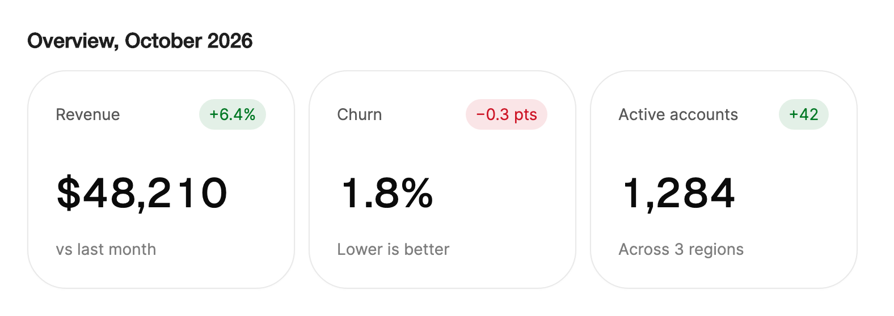

<Demo name="Default" />

## 何時使用

`MetricCard` 是儀表板上回答「我們做得怎麼樣」的磁貼。它包含一個數字、為其命名的標籤、賦予其意義的比較資訊，以及一個選用的變化標籤，位於與其他指標並排的表面中。一排指標卡是大多數營運與商業頁面的頂部：在打開表格或圖表之前，使用者最先讀到的就是它們。

- **SaaS 概覽頁中的 KPI 列**：月度經常性收入、活躍帳號與流失率，各自以「對比上月」作為上下文，並附帶一個顯示變化的標籤。
- **營運主控台中的可用率與服務健康度**：「可用率 99.98%」配「近 30 天」，讓數字與它所涵蓋的期間一起被解讀。
- **訂單或客服儀表板上的即時計數**：未結訂單或工單積壓，隨著新工作到來數字滾動更新，上下文說明時間範圍。
- **開發者工具或 API 入口網站中的延遲與吞吐量**：以毫秒為單位的 p95 數值，與昨天比較，當最近幾個資料點的方向很重要時附帶趨勢線。
- **用量與帳單摘要**：金融科技或帳單區域中的月初至今總額或平均餘額，顯示在它所指的期間旁邊。

## 何時不用

- **趨勢比最新數值更重要**，例如一週的每日註冊量需要以形狀來解讀：用 `Sparkline` 或 `LineChart`，它們能為整個資料序列留出空間。
- **執行文字或標題中的單獨數字**，沒有外框也沒有上下文：用 `AnimatedCounter`。
- **配額或達到上限的進度**，例如 50 個座位已用的數量：用 `UsageMeter`，它會繪製比例。
- **包含媒體、擁有者與操作的卡片**：用 `Card`。指標卡承載的是數字，而不是內容磁貼。
- **需要依屬性比較的大量數值**，例如每個地區與每個方案的收入：用 `SortableDataTable` 或 `DataGrid`，它們的每一列都可以帶有自己的欄位。
- **距離截止日期的時間**，例如續約或試用結束日期：用 `Countdown`，它會自行倒數計時。

## 用法

`Label`、`Value` 與 `Context` 是常用部分。`Change` 為選填；不設定時變化標籤隱藏。

```xml
<UserControl xmlns="https://github.com/avaloniaui"
             xmlns:arc="https://github.com/AIDotNet/TKCode.Arc">
    <arc:MetricCard Label="可用率"
                    Value="99.98"
                    Decimals="2"
                    Suffix="%"
                    Context="近 30 天"
                    Change="+0.02%"
                    Width="280" />
</UserControl>
```

`MetricCard` 衍生自 Avalonia 的 `TemplatedControl`。它是一個展示型控制項：不可取得焦點，沒有按下行為，也不引發任何事件。它的數字是範本中的一個 `AnimatedCounter`，因此滾動的數位、小數位以及前綴和後綴都是計數器的行為，而卡片在其周圍加入標籤、變化標籤和趨勢線。透過程式碼或繫結設定數值後，卡片會就地更新。

### 結構

1. **標籤**（`Label`）：14 px，位於頂列左側，使用次要文字顏色。卡片較窄時以省略號截斷，它也是卡片的無障礙名稱。
2. **變化標籤**（`Change`）：位於頂列右側的膠囊形標籤，左右內距 8 px，上下內距 3 px。它包含變化文字，並且在設定了 `IsChangeGlyphVisible` 時，還包含一個 12 px 的趨勢圖示。`Change` 為空時隱藏。
3. **數值**（`Value`，配合 `Prefix`、`Suffix` 與 `Decimals`）：大號計數器中的數字，底部對齊。`Decimals` 的預設值為 0。`Prefix` 位於數字之前，例如「$」，`Suffix` 位於數字之後，例如「%」或「 ms」。
4. **趨勢線**（`Sparkline`）：與數值位於同一列、底邊對齊的 96 × 36 px 折線。僅在有兩個或更多資料點時顯示。
5. **上下文**（`Context`）：14 px，使用淡化的文字顏色，位於數值列下方 16 px。它說明數字與什麼進行比較：「對比上週」「近 30 天」。
6. **表面**：24 px 內距，1 px 邊框使用表面顏色，表面圓角以及靜態陰影。頂列位於數值列上方 32 px。

### 數值、前綴、後綴與小數位

數字是 `double` 型別，因此一個屬性即可涵蓋整數、百分比和平均值。小數位應根據數字的含義來選擇，而不是根據卡片的寬度：99.98% 的可用率需要兩位小數，訂單數則不需要。

```xml
<arc:MetricCard Label="本月收入"
                Value="48210"
                Prefix="$"
                Decimals="0"
                Context="對比上月"
                Change="+6.4%"
                Width="280" />
```

- 貨幣符號使用 `Prefix`，跟在數字後面的單位使用 `Suffix`。單位要簡短；過長的後綴會把數位擠向左側，使數值列顯得不穩定。
- 依小數變動的百分比使用一位小數（「1.8%」），需要與服務水準目標比較的可用率使用兩位小數（「99.98%」）。
- 當數值本身已經帶有單位時，不要把單位寫進 `Label`。「延遲」加上後綴「 ms」只讀一次；「延遲（ms）」加上後綴「 ms」則會讀兩次。

### 變化標籤

以「+」開頭的 `Change` 表示上升，以「-」或「−」開頭的表示下降。其他文字為中性變化。方向可透過 `ChangeDirection` 讀回，標籤的顏色也由它決定。

| `Change` 文字 | `ChangeDirection` | 標籤外觀 |
|---|---|---|
| 「+12%」 | `Up` | 成功色底、成功色文字 |
| 「−8%」或「-8%」 | `Down` | 危險色底、危險色文字 |
| 「flat」、「0%」或空白文字 | `None` | 帶框線的中性標籤 |

<Demo name="PlainNumber" />

```xml
<arc:MetricCard Label="p95 延遲"
                Value="182"
                Suffix=" ms"
                Context="對比昨天"
                Change="−8%"
                IsChangeGlyphVisible="True"
                Width="280" />
```

正負號要寫在文字中。顏色是第二重提示，正負號是第一重提示，因此分辨不出顏色差異的使用者以及螢幕閱讀器使用者也能看清方向。`IsChangeGlyphVisible` 會為帶符號的標籤加上趨勢箭頭，預設關閉。

標籤顏色表示的是方向，而不是這個方向是否良好。延遲下降是好事，但「−8%」的標籤仍然使用危險色底色。請在 `Context` 中說明含義（「越低越好」），或者當好的方向與正負號不一致時，把變化顯示為不帶顏色的中性數值。將 `Change` 設為 `null` 可隱藏標籤，標籤會淡出。

### 趨勢線

`Sparkline` 接收一組數值，在數字旁繪製一條小趨勢線。趨勢線首次進入視野時自行繪製，資料變化時重新繪製。它至少需要兩個資料點：只有一個值或沒有值時，趨勢線隱藏。趨勢線的顏色取決於變化方向：沒有變化時使用強調色，上升變化使用成功色，下降變化使用危險色。

```xml
<UserControl xmlns="https://github.com/avaloniaui"
             xmlns:x="http://schemas.microsoft.com/winfx/2006/xaml"
             xmlns:arc="https://github.com/AIDotNet/TKCode.Arc"
             xmlns:generic="using:System.Collections.Generic">
    <arc:MetricCard Label="訂單" Value="1204" Context="對比上週" Change="+12%" Width="280">
        <arc:MetricCard.Sparkline>
            <generic:List x:TypeArguments="x:Double">
                <x:Double>820</x:Double>
                <x:Double>910</x:Double>
                <x:Double>1204</x:Double>
            </generic:List>
        </arc:MetricCard.Sparkline>
    </arc:MetricCard>
</UserControl>
```

```csharp
orders.Sparkline = new List<double> { 820, 910, 870, 990, 1040, 1010, 1204 };
```

傳入較短的序列，例如最近 7 天或 30 天的每日數值，使趨勢線能顯示近期變化的形狀。數百個資料點會讓 96 px 的區域變成雜亂的線團；這種情況請使用 `LineChart`。

### 繫結到檢視模型

指標列將每張卡片繫結到儀表板檢視模型上的一個屬性。使用 CommunityToolkit.Mvvm 時，檢視模型引發屬性變更通知，卡片就地更新，數位滾動到新值。

```csharp
public partial class OverviewViewModel : ObservableObject
{
    [ObservableProperty]
    private double _orderCount;

    [ObservableProperty]
    private string? _orderContext;

    [ObservableProperty]
    private string? _orderChange;

    [ObservableProperty]
    private IList<double>? _orderTrend;

    public void ShowOrders(int openCount, int previousCount, IList<double> dailyCounts)
    {
        OrderCount = openCount;
        OrderContext = "對比上週";
        OrderChange = openCount >= previousCount
            ? $"+{openCount - previousCount}"
            : $"−{previousCount - openCount}";
        OrderTrend = dailyCounts;
    }
}
```

```xml
<arc:MetricCard Label="訂單"
                Value="{Binding OrderCount}"
                Context="{Binding OrderContext}"
                Change="{Binding OrderChange}"
                Sparkline="{Binding OrderTrend}"
                Width="280" />
```

- `Value` 使用單向繫結。卡片從不把它寫回。
- 在同一個方法（上面的 `ShowOrders`）中一起更新 `Context`、`Change` 與 `Value`，使卡片始終顯示一致的狀態。
- 編譯繫結需要在檢視上設定 `x:DataType`。範例為求簡潔省略了它。

每次更新時，數字都會滾動到新值，文案則從數字變化的方向滾入，因此每隔幾秒到達一次的更新會讓這一列持續處於動態之中。對於即時資料串流，請以固定間隔更新檢視模型，例如每 30 秒一次。

### 窄視窗

在寬度為 380 px 或更窄的視窗中，卡片使用更緊湊的內距（16 px），頂列位於數值列上方 24 px，變化標籤移到標籤下方，兩者之間留出 12 px 的間距。此規則讀取的是視窗寬度而不是卡片寬度，因此視窗中的所有卡片會一起切換到窄版版面。此行為不需要任何程式碼。

### 範例：月度概覽列

SaaS 管理後台在月初的概覽頁面。三個指標回答人們最先提出的問題：收入進帳多少、留住了多少帳號以及有多少活躍帳號。每張卡片都在上下文中註明其期間，變化標籤在文字中顯示方向。流失率卡片以危險色底顯示下降的變化。流失率下降是好消息，因此它的上下文寫著「越低越好」，這正是變化標籤一節中的規則：顏色跟隨正負號，文字承載含義。



```xml
<StackPanel Width="740" Spacing="16">
    <TextBlock Text="Overview, October 2026" FontSize="18" FontWeight="SemiBold" />
    <WrapPanel ItemSpacing="12" LineSpacing="12">
        <arc:MetricCard Label="Revenue"
                        Value="48210"
                        Prefix="$"
                        Decimals="0"
                        Context="vs last month"
                        Change="+6.4%"
                        Width="236"
                        VerticalAlignment="Top" />
        <arc:MetricCard Label="Churn"
                        Value="1.8"
                        Decimals="1"
                        Suffix="%"
                        Context="Lower is better"
                        Change="−0.3 pts"
                        Width="236"
                        VerticalAlignment="Top" />
        <arc:MetricCard Label="Active accounts"
                        Value="1284"
                        Context="Across 3 regions"
                        Change="+42"
                        Width="236"
                        VerticalAlignment="Top" />
    </WrapPanel>
</StackPanel>
```

### 文案規範

- **標籤**：句首大寫的簡短名詞片語，用來說明度量的名稱，例如「收入」「可用率」「p95 延遲」。它是無障礙名稱，因此即使沒有數值也要能看懂。
- **數值與單位**：單位只寫一次，放在 `Prefix` 或 `Suffix` 中，不要在標籤中重複。數字使用阿拉伯數字書寫。
- **變化**：一個正負號加上帶單位的數字，例如「+6.4%」「−0.3 pts」「+42」。下降的變化使用減號「−」；卡片同時識別「−」和「-」。
- **上下文**：期間或比較對象，置於數字之後，使用小寫：「對比上月」「近 30 天」。當正負號本身無法說明好壞時，寫出什麼是好的：「越低越好」。

| 不要寫 | 改為 |
|---|---|
| 收入（$） | 收入，並將 `Prefix` 設為「$」 |
| 上漲 6 個百分點！ | +6.4% |
| 流失率下降（好） | −0.3 pts，越低越好 |
| 資料來自上月 | 對比上月 |
| 延遲（ms），後綴為「 ms」 | 延遲，後綴為「 ms」 |

### 最佳做法

**建議**

- 在每張卡片的 `Context` 中寫明期間，使數字永遠不會脫離它的時間範圍被解讀。
- 將卡片排成一列並保持相同寬度，使數值對齊，便於視線比較。
- 在 `Context` 中說明好的方向與正負號不一致的變化。
- 對於即時資料，以穩定的間隔更新檢視模型。卡片會在兩次更新之間歸於平靜，視線讀取的是變化本身，而不是動態。

**避免**

- 一列中展示超過四到五張卡片。超過這個數量，數字就不再是使用者最先讀到的內容。
- 同一列的卡片之間小數位數不一致，這會讓整列看起來未完成。
- 當 `Change` 已經承載變化時，又在 `Context` 中寫上它（「+6.4% 對比上月」）。文字會重複，標籤與句子也會重複。
- 過長的 `Value` 文字，例如帶有文字的格式化字串。計數器用於數字；「健康」之類的詞應放在狀態元素中。

### 常見問題

**變化是好的，但標籤顯示危險色。我該如何修正？** 標籤依 `Change` 的正負號著色，而不是依變化是否良好著色。請在 `Context` 中寫明含義（「越低越好」），並保持正負號的真實性。依照設計，顏色跟隨正負號，因此卡片不需要第二個屬性來翻轉它。

**如何在不顯示顏色的情況下表示變化？** 寫不帶正負號的文字（例如「穩定」或「無變化」），這會使方向為 `None`，標籤呈中性。卡片會以框線顯示標籤，不帶底色。

**為什麼數字從零開始？** 卡片第一次捲入視野時，計數器會從零滾動到數值。之後，每次更新都從上一個數值滾動。

**為什麼 `Change` 為空時標籤隱藏？** 空的 `Change` 會移除標籤，使頂列只顯示標籤。標籤會淡出。

**使用者可以編輯數值或打開指標嗎？** 不可以。卡片僅用於展示，不取得焦點，也不引發任何事件。若要打開詳細檢視，請把卡片放在你的頁面所擁有的控制項中，並在那裡處理按下操作。

## API 參考

<!-- api: MetricCard -->

## 無障礙

- 卡片是一個由 `Label` 命名的群組。其說明文字為變化與上下文，例如「+12% 對比上週」；沒有變化時僅為上下文。
- 數字由計數器朗讀。變化標籤是純文字，並以「+」或「−」表明方向，因此方向不依賴顏色。
- 數值變化本身不會被播報。如果需要播報，請在卡片或其外層容器上設定 `AutomationProperties.LiveSetting`。
- 卡片不接收鍵盤焦點。Tab 會跳過它，因此一排指標不會變成一排停靠點。
- 為每張卡片設定一個能獨立成立的 `Label`。螢幕閱讀器首先讀取的就是標籤，因此「可用率」比「指標 1」更好，也比只讀數值更好。

## 動態效果

- 數字在卡片首次捲入視野時從零開始滾動，之後逐步轉向每個新數值。
- 標籤、上下文與變化標籤的文字從數字移動的方向滾入。
- 變化標籤的寬度會透過彈簧適應新文字，標籤以縮放與淡入淡出的方式出現或消失。
- 趨勢線首次顯示時在 0.9 s 內繪製完成，資料變化時交叉淡化。
- 減少動態效果時，數字直接跳到新值，文字淡入；變化標籤與趨勢線的變化不帶動畫。關閉動態效果時，所有變化立即生效。

| 變化 | 完整 | 減少 | 關閉 |
|---|---|---|---|
| 數字變化 | 逐位滾動，變大向上、變小向下 | 直接跳到新值 | 立即完成 |
| 標籤、上下文或變化標籤文字變化 | 從數字移動的方向滾入 | 瞬間淡入 | 立即完成 |
| 標籤出現或消失 | 以快速彈簧從 96% 縮放並淡入淡出 | 無動態效果 | 立即完成 |
| 變化標籤寬度 | 以彈簧適應新文字 | 無動態效果 | 立即完成 |
| 趨勢線首次顯示 | 在 0.9 s 內繪製完成 | 立即顯示 | 立即完成 |
| 趨勢線資料變化 | 交叉淡化 | 無動態效果 | 立即完成 |

## 相關元件

- `AnimatedCounter`：不需要卡片外框的單獨數字。
- `Sparkline`：趨勢比最新數值更重要時使用。
- `Card`：圍繞數字的一組內容與操作。
- `UsageMeter`：用於與上限比較的數值。

| 元件 | 適用情境 |
|---|---|
| `AnimatedCounter` | 數字位於執行文字或標題中，不需要卡片 |
| `Sparkline` | 資料序列的形狀就是要傳達的訊息 |
| `LineChart` | 資料序列需要座標軸、多條線或更長的歷史 |
| `UsageMeter` | 數值是某個上限的一部分，例如已用座位 |
| `Card` | 磁貼在數字旁邊包含媒體、擁有者或操作 |
| `Countdown` | 數字是距離截止日期的剩餘時間 |
| `SortableDataTable` | 數值是需要依屬性排序與比較的列 |
