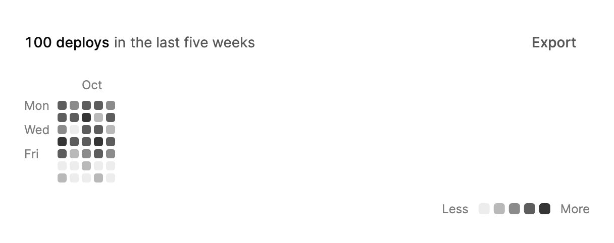

<Demo name="Contributions" />

## When to use

`ActivityHeatmap` shows how a count is spread across days, one square per day, with weeks as columns. It answers
questions about rhythm and continuity: is the team shipping every week, how long was the quiet spell in August, which
weekdays are busy. It fits a dashboard panel or a profile page where the whole period matters more than any one value.

- **Deploy and release frequency in a developer console**: a platform team reviews production deploys per day over the
  last quarter. Streaks and gaps are the story, and a day with no deploys reads as a gap rather than a missing value.
- **Engagement on a SaaS admin dashboard**: active users or completed onboarding steps per day for a workspace, shown
  next to the account's plan so the team sees whether usage grew through the year.
- **Workouts, study time or reading in a consumer app**: a profile page where each day is a square and the streak is
  visible at a glance. The legend explains the five levels without a separate chart.
- **Incident or support volume in an operations tool**: tickets opened per day across a quarter. A busy week stands
  out, and the selected day can open the list of tickets for that date.
- **Activity audit in an internal tool**: sign-ins or approvals per day for a compliance review, where the reviewer
  selects a day and reads its count before opening the detail view.

## When not to use

- **Exact comparison between days or periods**: use `BarChart`, where each bar has a length that can be compared
  precisely.
- **Choosing a date for input**: use `Calendar` for a date that a person picks for a booking, a due date or a report
  range. `ActivityHeatmap` selects a day for inspection, not for data entry.
- **A trend of a value over time**: use `LineChart` when the shape of a continuous value matters, such as revenue or
  latency, and the exact value at each point is important.
- **A compact trend beside a single number**: use `Sparkline`, which is small enough for a table row or a KPI card
  and shows the direction of a value rather than each day.
- **Periods shorter than a few weeks**: with only a handful of days the squares are too few to show a pattern, and a
  `BarChart` with labeled values is easier to read.
- **Several years side by side**: a grid that spans two years becomes twice as wide and scrolls sideways. Use one
  `ActivityHeatmap` per year, or a `BarChart` of yearly totals for the comparison.

## Usage

```xml
<UserControl xmlns="https://github.com/avaloniaui"
             xmlns:arc="https://github.com/AIDotNet/TKCode.Arc">
    <arc:ActivityHeatmap Label="Contributions in 2025"
                         Period="2025"
                         ItemsSource="{Binding Days}" />
</UserControl>
```

`ActivityHeatmap` derives from Avalonia's `Control`, not from an items control. It draws the summary line, the month
and weekday labels, the day grid, the tooltip and the legend itself, so one control holds the whole calendar and no
item templates are needed. Because the grid is a single focusable control with arithmetic hit testing, it handles the
roughly 370 squares of a year without creating a visual per container.

### Anatomy

1. **Summary line**: the total count as an animated number, the unit noun, then "in" and the period. The total is
   set in the body size of 14 px and rolls to a new value when the data changes. `Period` hides the "in" and the
   period when it is empty.
2. **Actions** (`Actions`): any controls, placed at the right end of the summary line. When the summary and the actions
   do not fit side by side, the actions move to their own row under the summary.
3. **Weekday column**: a 30 px column of weekday labels on the left of the grid. It stays in place when a narrow grid
   scrolls sideways.
4. **Month labels**: abbreviated month names above the first week of each month, formatted with `Culture`. A partial
   first month loses its label when the next month starts fewer than three weeks later, so the labels never collide.
5. **Day grid**: one square per calendar day, with weeks as columns. Squares are 3 px apart. Their size follows the
   container width and stays between 9 px and 15 px. Days outside the data range are empty cells.
6. **Tooltip**: one bubble for the whole grid, showing the count and the date of the day under the pointer or the
   keyboard focus.
7. **Legend**: a caption that names the days at the highlighted level, then "Less", five swatches (levels 0 to 4)
   and "More". Hovering or focusing a swatch previews its level on the grid, and clicking it pins the level, which
   highlights the squares at that level. Click it again to clear the pin.

The header, the grid and the legend are separated by 16 px. The five tints are derived from the accent color: level 0
is the foreground mixed at 6.5% into the surface, and levels 1, 2 and 3 are the accent mixed at 26%, 50% and 76% into
that base. Level 4 is the full accent color.

### Years and controls

Replace `ItemsSource`, `Period` and `Label` together when the year changes, so the summary, the grid and the grid's
accessible name agree. `Actions` places controls beside the summary, such as a year switch. The grid recolors in a
sweep instead of redrawing, so a year switch keeps the page calm.

```xml
<arc:ActivityHeatmap Label="Contributions in 2025" Period="2025" ItemsSource="{Binding Days}">
    <arc:ActivityHeatmap.Actions>
        <StackPanel Orientation="Horizontal" Spacing="4">
            <arc:Button Content="2024" Variant="Ghost" Size="Small" Command="{Binding ShowPrevious}" />
            <arc:Button Content="2025" Variant="Ghost" Size="Small" Command="{Binding ShowCurrent}" />
        </StackPanel>
    </arc:ActivityHeatmap.Actions>
</arc:ActivityHeatmap>
```

The grid always spans from the earliest to the latest date in the data. Pass one calendar year for a year view. If the
data holds two years, the grid becomes twice as wide and scrolls sideways, which is rarely what a reader wants, so
split the data by year.

### Units and weeks

`UnitOne` and `UnitOther` set the singular and plural noun for the count. The noun is singular only when the total is
exactly 1, so "1 workout" and "2 workouts" both read correctly. `FirstDayOfWeek` sets the first row of each week
column, which is Sunday by default; choose Monday for a work calendar. `Culture` formats dates and numbers, and its
default is en-US.

<Demo name="CustomUnit" />

```xml
<arc:ActivityHeatmap Label="Workouts, last six months"
                     Period="the last six months"
                     UnitOne="workout"
                     UnitOther="workouts"
                     FirstDayOfWeek="Monday"
                     MaxWidth="520"
                     ItemsSource="{Binding Workouts}" />
```

`MaxWidth` keeps a six-month grid from stretching across a wide page. Squares never grow past 15 px, so a wide
container leaves empty space on the right.

### Thresholds

`Thresholds` holds the upper bounds of levels one to three; only the first three values are used. A count of zero is
level 0 with no tint, a count up to the first bound is level 1, a count up to the second is level 2, a count up to the
third is level 3, and a count above the third bound is level 4.

When `Thresholds` is not set, the control derives the bounds from the busiest day in the range: the first bound is a
quarter of that day's count (rounded up, at least 1), the second is half of it (at least 2), and the third is three
quarters of it (at least 3). A year with one exceptional day of 31 deploys therefore sets the bounds at 8, 16 and 24,
and most ordinary days fall into level 1. Set fixed bounds when the reader compares years or teams, because derived
bounds change with every data set.

```csharp
workouts.Thresholds = [1, 2, 3];
```

Setting `Thresholds` also fixes the legend ranges. `EffectiveThresholds` returns the three bounds in use.

### Selecting a day

`SelectedDate` is the selected day and is two-way. A selection ring glides to the day and fades in where it first
lands. `DateSelected` reports a day chosen with a click, Enter or Space. Its arguments carry the `Date`, the day's
`Count` and its `Level` from 0 (none) to 4 (busiest), so the handler can show a summary or open a detail view without
looking up the data again.

```csharp
heatmap.DateSelected += (_, e) => selected.Text =
    $"Selected {e.Date:MMM d, yyyy}: {e.Count} contributions (level {e.Level})";
```

Setting `SelectedDate` in code moves the ring but does not raise `DateSelected`, because the event reports a choice the
person made. Use the property to restore a selection, for example when the page reopens, and use the event to react to
the choice.

### Binding to a view model

The view model owns the days, the period and the selected date. Use a view model with
CommunityToolkit.Mvvm style properties, and bind the heatmap to them.

```csharp
public sealed record DailyDeploys(DateOnly Date, double Deploys);

public interface IDeployHistory
{
    Task<IReadOnlyList<DailyDeploys>> DailyCountsAsync(int year);
}

public partial class ActivityViewModel : ObservableObject
{
    private readonly IDeployHistory _history;

    public ActivityViewModel(IDeployHistory history) => _history = history;

    [ObservableProperty]
    private ObservableCollection<ActivityDay> _days = [];

    [ObservableProperty]
    private string _periodLabel = "the last year";

    [ObservableProperty]
    private DateOnly? _selectedDate;

    [ObservableProperty]
    private string _selectedSummary = "Select a day to see its deploys.";

    [RelayCommand]
    private async Task ShowYearAsync(string year)
    {
        var counts = await _history.DailyCountsAsync(int.Parse(year));
        Days = new ObservableCollection<ActivityDay>(
            counts.Select(c => new ActivityDay(c.Date, c.Deploys)));
        PeriodLabel = year;
    }

    partial void OnSelectedDateChanged(DateOnly? value)
    {
        SelectedSummary = value is { } date
            ? $"{date:MMM d, yyyy} is selected."
            : "Select a day to see its deploys.";
    }
}
```

```xml
<StackPanel Width="620" Spacing="16">
    <arc:ActivityHeatmap Label="Production deploys"
                         Period="{Binding PeriodLabel}"
                         UnitOne="deploy"
                         UnitOther="deploys"
                         ItemsSource="{Binding Days}"
                         SelectedDate="{Binding SelectedDate, Mode=TwoWay}">
        <arc:ActivityHeatmap.Actions>
            <arc:Button Content="2025" Variant="Ghost" Size="Small"
                        Command="{Binding ShowYearCommand}" CommandParameter="2025" />
        </arc:ActivityHeatmap.Actions>
    </arc:ActivityHeatmap>
    <TextBlock Text="{Binding SelectedSummary}"
               Foreground="{arc:ArcDesignTokenResource TextMuted}" />
</StackPanel>
```

- `ItemsSource` is one-way: the heatmap reads the collection and rebuilds the grid. An `ObservableCollection` is watched,
  so changes to it are reflected at once. Assigning a new collection, as the command does, is the simplest way to
  refresh a whole year.
- `SelectedDate` is two-way. A selection made on the grid updates the view model, and a value set by the view model moves
  the ring without raising `DateSelected`.
- `Period` and `Label` are plain properties; bind them in the same update as `ItemsSource` so the summary and the
  grid's name never describe different data.
- `DateSelected` is an event, not a command. Attach it in code-behind, where the handler can read the `Date`, `Count`
  and `Level` of the event args and copy the values into the view model's own properties.

### Data shape and performance

`ActivityDay` holds a `DateOnly` and a `double` count. The control builds one dense entry per calendar day between the
earliest and latest date, so missing days are zero and do not need rows. Two days with the same date add together, and
negative counts count as zero. A year is about 370 squares, which the grid draws in one pass; a multi-year range
multiplies the columns and scrolls sideways.

When the source is not `ActivityDay`, read each item with `DateSelector` and `CountSelector`, or with
`DateMemberBinding` and `CountMemberBinding`. The member binding reads a `DateOnly`, a `DateTime` or a string in
`yyyy-MM-dd` form. `DateSelector` wins over `DateMemberBinding` when both are set.

```csharp
var heatmap = new ActivityHeatmap
{
    ItemsSource = rows,
    DateSelector = row => DateOnly.ParseExact(((Row)row).Day, "yyyy-MM-dd", CultureInfo.InvariantCulture),
    CountSelector = row => ((Row)row).Deploys
};
```

Set `Culture` when dates or numbers must follow the reader's language. The total uses `#,0.##` in that culture, so a
fractional count keeps up to two decimals and a large total gets the local grouping separator.

Update the data by replacing the collection or by changing items in a collection the heatmap watches. A calendar
summarizes days, so refresh it on a schedule that matches how the data changes, such as once per page load or once per
hour, rather than on every event.

### Example: deploy frequency for a platform team

A platform team's deploy history for the last five weeks, shown on the engineering overview. The label names the
measure and the period, the unit nouns read as "deploys", and the weeks start on Monday, the first day of the
team's working week. The export button sits beside the summary as an action. Weekend days are mostly quiet, so the
weekday rhythm is visible without any extra labels.



```xml
<StackPanel Width="560" Spacing="16">
    <arc:ActivityHeatmap Label="Production deploys, last five weeks"
                         Period="the last five weeks"
                         UnitOne="deploy"
                         UnitOther="deploys"
                         FirstDayOfWeek="Monday">
        <arc:ActivityHeatmap.Items>
            <arc:ActivityDay Date="2026-09-14" Count="4" />
            <arc:ActivityDay Date="2026-09-15" Count="5" />
            <arc:ActivityDay Date="2026-09-16" Count="3" />
            <arc:ActivityDay Date="2026-09-17" Count="6" />
            <arc:ActivityDay Date="2026-09-18" Count="4" />
            <arc:ActivityDay Date="2026-09-19" Count="0" />
            <arc:ActivityDay Date="2026-09-20" Count="1" />
            <arc:ActivityDay Date="2026-09-21" Count="3" />
            <arc:ActivityDay Date="2026-09-22" Count="5" />
            <arc:ActivityDay Date="2026-09-23" Count="0" />
            <arc:ActivityDay Date="2026-09-24" Count="4" />
            <arc:ActivityDay Date="2026-09-25" Count="2" />
            <arc:ActivityDay Date="2026-09-26" Count="0" />
            <arc:ActivityDay Date="2026-09-27" Count="0" />
            <arc:ActivityDay Date="2026-09-28" Count="5" />
            <arc:ActivityDay Date="2026-09-29" Count="6" />
            <arc:ActivityDay Date="2026-09-30" Count="4" />
            <arc:ActivityDay Date="2026-10-01" Count="5" />
            <arc:ActivityDay Date="2026-10-02" Count="3" />
            <arc:ActivityDay Date="2026-10-03" Count="1" />
            <arc:ActivityDay Date="2026-10-04" Count="0" />
            <arc:ActivityDay Date="2026-10-05" Count="4" />
            <arc:ActivityDay Date="2026-10-06" Count="2" />
            <arc:ActivityDay Date="2026-10-07" Count="5" />
            <arc:ActivityDay Date="2026-10-08" Count="6" />
            <arc:ActivityDay Date="2026-10-09" Count="4" />
            <arc:ActivityDay Date="2026-10-10" Count="0" />
            <arc:ActivityDay Date="2026-10-11" Count="1" />
            <arc:ActivityDay Date="2026-10-12" Count="3" />
            <arc:ActivityDay Date="2026-10-13" Count="4" />
            <arc:ActivityDay Date="2026-10-14" Count="2" />
            <arc:ActivityDay Date="2026-10-15" Count="5" />
            <arc:ActivityDay Date="2026-10-16" Count="3" />
            <arc:ActivityDay Date="2026-10-17" Count="0" />
            <arc:ActivityDay Date="2026-10-18" Count="0" />
        </arc:ActivityHeatmap.Items>
        <arc:ActivityHeatmap.Actions>
            <arc:Button Content="Export" Variant="Ghost" Size="Small" />
        </arc:ActivityHeatmap.Actions>
    </arc:ActivityHeatmap>
</StackPanel>
```

### Content guidelines

- **Label**: name the measure and the period in sentence case, such as "Production deploys, last five weeks". The label
  is the grid's accessible name, so it must make sense without the picture.
- **Period**: a short phrase that finishes "contributions in ...": "2025", "the last six months", "Q3 2026". Leave it
  out only when the label already states the period.
- **Units**: set `UnitOne` and `UnitOther` to the nouns people use for the count, such as "deploy" and "deploys" or
  "workout" and "workouts". Avoid generic words such as "items" when the count has a precise meaning.
- **Thresholds**: when you set them, describe them in the caption or a note, such as "Darker squares mean more
  deploys", so a reader knows that the tints are relative to the bounds.
- **Actions**: keep to one or two small buttons with short verbs or years, such as "Export" or "2025".

| Instead of | Write |
|---|---|
| Activity data | Production deploys, last five weeks |
| 2025 | Contributions in 2025 |
| 1 contributions | 1 contribution (the noun follows the total) |
| Heatmap of stuff | Workouts, last six months |
| Click here for details | Select a day to see its deploys |

### Best practices

**Do**

- Set `Label` and `Period` for every heatmap. The label is the only name a screen reader has for the grid, and the
  period completes the summary, so a reader never sees a bare total.
- Pass a whole calendar year, or a fixed range, for each view. A grid that starts on a random date makes two years hard
  to compare.
- Set `Thresholds` when comparing periods or teams. Derived bounds follow the busiest day, so the same count can be
  level 2 in one year and level 1 in another.
- Set `FirstDayOfWeek` to match the audience's calendar, Monday for working weeks and Sunday for personal activity.
- Use `DateSelected` to open the detail for a day. The event carries the date, count and level, so the handler does not
  need to look the day up again.

**Avoid**

- Using the heatmap for exact values. The squares show a tint, not a number, so a reader who needs the exact count must
  select the day or see a table.
- Passing several years in one heatmap. The grid becomes very wide and the reader must scroll sideways to see the
  latest weeks.
- Attaching a good or bad meaning to the tints. The levels only rank how busy a day was, and a single accent hue is
  not a status signal, so explain the meaning in the label or the caption instead.
- Refreshing the data on a timer that is shorter than the data changes. The totals and tints change daily, so frequent
  updates move the page without adding information.
- Placing a heatmap in a narrow column. At 440 px or less the legend caption shows only the count, and once the squares
  reach their 9 px minimum the grid scrolls sideways from the newest week, so give it the full width of its panel.

### Common questions

**Why does the grid start in the middle of a week?** The grid starts at the earliest date in the data and fills the
first week column from `FirstDayOfWeek`. Days before the start in that first column are empty, so the first square
can fall on any row.

**Why are most of my days the same light tint?** The default bounds are quarters of the busiest day. One outlier day
sets high bounds, so most ordinary days land in level 1. Set `Thresholds` to fixed values that match the typical range.

**Why does setting `SelectedDate` not trigger my handler?** `DateSelected` fires only for a choice made with a click,
Enter or Space. Setting the property moves the ring without raising the event, so update your own state in the setter
or in the view model when you need it.

**How do I show which days sit at one level?** The legend does this already. Hover or focus a swatch to preview its
level, and click a swatch to pin it. The caption then counts the days at that level, such as "96 days", followed by the
level's range when the legend is wider than 440 px, and the matching squares stand out.

## API reference

<!-- api: ActivityHeatmap -->

<!-- api: ActivityDay -->

## Accessibility

- `Label` names the grid, such as "Contributions in 2025". The summary completes the name with the total and the period.
- The up and down arrow keys move one day, and the left and right arrow keys move one week. Home and End go to the first
  and last day, and Enter or Space selects the focused day.
- Escape hides the tooltip. A single tooltip glides between the days, and it is not repeated for each square.
- Each day is a named grid cell. The cells are hidden from assistive technology as drawing, and the summary and the grid
  structure carry the information.
- The total is announced in a status region, and the day under the pointer or the focus is announced politely. The
  legend shows a caption with the number of days at the highlighted level, so a level is not identified by its color
  alone.
- The focused day is read as its count, weekday and date, for example "31 contributions, Wednesday, December 31, 2025".
- The summary is the help text of the whole control, so a reader who opens the control's description hears the total
  and the period first.

### Keyboard

The grid takes focus as one tab stop. When it gains focus from the keyboard, the newest day is focused first.

| Keys | Action |
|---|---|
| `Tab` / `Shift+Tab` | Move focus into the grid on the newest day, then to the legend or the next control |
| `Up` / `Down` | Move one day earlier or later |
| `Left` / `Right` | Move one week earlier or later |
| `Home` / `End` | Move to the first or the last day of the range |
| `Enter` / `Space` | Select the focused day and raise `DateSelected` |
| `Escape` | Hide the tooltip |

The legend is a second tab stop. `Left` and `Right` move between the five swatches and preview their level, `Home` and
`End` go to the first and last swatch, `Enter` or `Space` pins a level, and `Escape` clears the preview. Pressing `Enter`
or `Space` on the pinned level again removes the pin. `Escape` clears a preview but keeps a pin.

## Motion

- On first view the cells wave in once, with the total duration capped so that a large grid stays quick.
- A new year or range recolors the grid in a diagonal sweep, with the cells staggered by column.
- The tooltip glides between cells on a snappy spring, and its text rolls to the new day.
- The total counts to its new value on a smooth spring.
- Reduced motion removes the wave, the sweep and the glide, and uses a short fade of 160 ms. Off jumps to the final state.

| Change | Full | Reduced | Off |
|---|---|---|---|
| First view | Cells wave in once, the total duration is capped | Short fade of 160 ms | Immediate |
| New range or year | Diagonal sweep, staggered by column | Short fade of 160 ms | Immediate |
| Tooltip moves to another day | Glides between cells on a snappy spring | Short fade of 160 ms | Immediate |

Keep the sweep for changes of range, such as a year switch. The wave runs once on first view, so a page that reloads
the same year gains nothing from it.

## Related

- `BarChart` for exact comparison between periods.
- `Calendar` for choosing a date.
- `LineChart` for a trend of a value over time.
- `Sparkline` for a compact trend beside a value.

| Component | Choose it when |
|---|---|
| `BarChart` | The reader compares exact values across days, weeks or categories |
| `Calendar` | A person picks a date for input, such as a booking or a due date |
| `LineChart` | A continuous value over time matters more than the rhythm of single days |
| `Sparkline` | A small trend sits beside a number in a table row or a KPI card |
| `DatePicker` | A form field needs a single date, not a view of activity |
