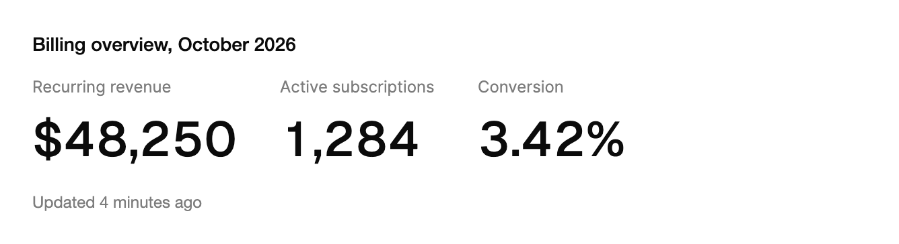

<Demo name="RollingDigits" />

## 何時使用

`AnimatedCounter` 單獨呈現一個數字，字級大到一眼就能讀清，並在數字變動時把各位數字捲動到新值。它的原理類似汽車的里程表：只有發生變動的數位欄會轉動，因此讀者能看出數字有變化，大致變動多少，頁面也不會閃爍，數字也不會突然跳到新的寬度。

- **帳單概覽中的主要總數**：SaaS 管理主控台頂部的月度經常性營收或活躍訂閱數。捲動動畫告訴財務團隊數字已經更新，即使他們沒有看下方的圖表。
- **維運主控台中的即時計數**：頁面開啟期間不斷變動的未解決事件、排隊工作或已登入工作階段。資料到達時設定新值，數位就會從舊值捲動到新值。
- **首次檢視時的計數統計**：在登陸頁或季度報告中，「128,400 個團隊」會在讀者捲動到它時從零開始累加，由 `AnimateOnView` 完成這項效果。
- **金融科技與結帳中的餘額和價格**：付款後變動的錢包餘額，或購物車中的累計金額。固定 `Decimals`，數字在變動時保持寬度，版面就不會跳動。
- **成長儀表板中的比率與百分比**：轉換率或留存率，使用 `Suffix="%"`，並顯示在它所屬的總數旁邊，讓讀者同時看到主要數字與比率。

## 何時不用

- **需要卡片、標籤和變動指示的數字**：用 `MetricCard`，它把這樣的計數器放進帶趨勢的卡片中。
- **變動的是文字而非數字**：用 `TextMorph`，它為詞語和片語做動畫，而不是數位欄。
- **圖表的主要數字**：`BarChart`、`LineChart` 等圖表控制項會自行更新其主要數值，因此在圖表旁另放計數器只會重複同一個數字。
- **表格列中的大量數字**：用 `Table`。每個計數器都為自己的數位欄做動畫，適合少量主要數字，而不適合讓人掃視和排序的一欄數值。
- **由使用者輸入或編輯的值**：用 `NumberField` 或 `MoneyInput`。計數器只負責顯示數字，沒有輸入、解析和驗證。

## 用法

```xml
<UserControl xmlns="https://github.com/avaloniaui"
             xmlns:arc="https://github.com/AIDotNet/TKCode.Arc">
    <arc:AnimatedCounter Label="營收"
                         Prefix="$"
                         Value="{Binding Revenue}" />
</UserControl>
```

`AnimatedCounter` 衍生自 Avalonia 的 `TemplatedControl`。其範本由一個標籤和位於其上的 `RollingDigits` 組成，後者是 Arc 核心中負責數位捲動的基礎件。計數器本身加入標籤、前後綴以及首次檢視時的顯現效果；它的佈景主題會設定數字的字型、字級、字重和前景色，因此你很少需要自行設定這些屬性。由於它使用範本，你可以像對待其他 Arc 控制項一樣，用 `ControlTheme` 重新設計計數器的外觀。

`RollingDigits` 也可以單獨使用，放在你自己的版面裡顯示數字。它的數位滾輪預設按 `Smooth` 彈簧轉動；`WheelSpring` 可選其他 Arc 預設，`WheelMotion` 接受任意彈簧或定時緩動的 `MotionSpec`，例如 `MotionSpec.Spring(SpringSpec.FromVisual(0.28, 0))` 或 `MotionSpec.Tween(TimeSpan.FromMilliseconds(240), easing)`。減少動態效果和關閉動態效果時數位仍立即變化。

`Value` 接收原始數字，而不是格式化後的字串。計數器會用 `Decimals`、`CultureName`、`Prefix` 和 `Suffix` 對它進行格式化，因此同一個值在 en-US 下可顯示為「$48,250」，在 de-DE 下可顯示為「48.250」，而資料本身無需改變。

### 結構

1. **標籤**（`Label`）：位於數字上方的一行文字，使用淡化的文字顏色、超小字級和一般字重。它位於數字上方 8 px。`Label` 為 null 時隱藏；文字變動時會以短暫的模糊切換。
2. **數位**（`Value`）：數字本身，由 `RollingDigits` 繪製，使用展示字型、3XL 字級和中等字重，顏色為前景色。計數器預設靠左對齊。
3. **前綴**（`Prefix`）：數字前的文字，樣式相同，例如貨幣符號。它是捲動文字的一部分，因此會隨數字一起移動，並在寬度變動時保持自己的位置。
4. **後綴**（`Suffix`）：數字後的文字，例如百分號或單位。與前綴一樣，它也是捲動文字的一部分。

計數器本身沒有邊框、背景或內距。把它放在卡片、列或頁首中，由版面提供底色，使它與所在的頁面相契合。

### 小數位與後綴

`Decimals` 固定小數點後的位數（預設為 0）。負值按 0 處理。請將其固定為讀者需要的精確度：轉換率每次更新都顯示兩位小數，因此寬度保持不變，數位原地捲動。

```xml
<arc:AnimatedCounter Label="轉換率" Value="{Binding Conversion}" Decimals="2" Suffix="%" />
```

使用 `Suffix` 表示跟在數字後面的單位或符號，並保持簡短。較長的片語應放在標籤中，那裡可以換行，並且不會隨數位捲動。

### 更新數值

將 `Value` 設為新的總數。只有發生變動的數位欄會轉動，且轉動方向與數字的變動方向一致，因此增加顯示為向上捲動，減少顯示為向下捲動。

```csharp
revenue.Value += random.Next(100, 4000);
rate.Value = Math.Round(rate.Value + random.NextDouble(), 2);
```

讓數值的單位與讀者看到的一致。傳入 48250 以顯示「$48,250」，並讓 `Prefix` 加上貨幣符號，而不要傳入格式化後的字串，因為計數器無法捲動字串。

### 首次進入檢視時顯示

`AnimateOnView` 會在計數器首次有 60% 可見時，讓每個數位從零向上捲動。之後，計數器顯示其數值並照常更新，因此之後變動的數字只會從舊值捲動到新值。

<Demo name="RevealOnView" />

```xml
<arc:AnimatedCounter Label="首次進入檢視時捲動顯示" Value="{Binding Visitors}" AnimateOnView="True" />
```

顯現效果適合用於作為某個區段存在理由的統計，例如登陸頁上的客戶數量。對於讀者每天都會看到的工具列計數器，它毫無價值，因為每次載入頁面都會重複捲動。

### 由資料驅動

計數器只顯示所給的數字，因此資料來源決定數字、重新整理排程和取整方式。檢視模型保存原始值，計數器對其進行單向繫結。

```csharp
public sealed record BillingSummary(double Mrr, double Subscriptions, double Conversion);

public interface IBillingReports
{
    Task<BillingSummary> GetSummaryAsync(DateOnly asOf);
}

public partial class BillingOverviewViewModel : ObservableObject
{
    private readonly IBillingReports _reports;

    public BillingOverviewViewModel(IBillingReports reports) => _reports = reports;

    [ObservableProperty]
    private double _recurringRevenue;

    [ObservableProperty]
    private double _activeSubscriptions;

    [ObservableProperty]
    private double _conversionPercent;

    public async Task RefreshAsync()
    {
        var summary = await _reports.GetSummaryAsync(DateOnly.FromDateTime(DateTime.Today));
        RecurringRevenue = summary.Mrr;
        ActiveSubscriptions = summary.Subscriptions;
        ConversionPercent = Math.Round(summary.Conversion * 100, 2);
    }
}
```

```xml
<StackPanel Orientation="Horizontal" Spacing="32">
    <arc:AnimatedCounter Label="月度經常性營收" Value="{Binding RecurringRevenue}" Prefix="$" />
    <arc:AnimatedCounter Label="活躍訂閱" Value="{Binding ActiveSubscriptions}" />
    <arc:AnimatedCounter Label="轉換率" Value="{Binding ConversionPercent}" Decimals="2" Suffix="%" />
</StackPanel>
```

- 當業務規則需要取整的數字時，在檢視模型中取整，因為計數器只在顯示時取整。讀者看到的就是你的規則產生的確切數字。
- 依資料的節奏安排重新整理，例如每次載入頁面重新整理一次，或對即時計數每 30 秒重新整理一次。一秒變動好幾次的計數器很難閱讀，因此應批次更新。
- 將數字的來源保留在檢視模型中，方便測試讀取，讓計數器只負責顯示。

### 格式與地區設定

`CultureName` 設定分組分隔符號與小數分隔符號所用的文化特性。預設為 `en-US`，因此伺服器端與用戶端的輸出一致，這對出現在匯出報告中的數字很重要。當頁面已在地化時，將其設為讀者的文化特性；固定格式的報告則保留預設值。

```xml
<arc:AnimatedCounter Label="使用者數" Value="{Binding Users}" CultureName="de-DE" />
```

文化特性只改變計數器繪製的分隔符號和數字。前綴與後綴是你提供的文字，因此請為所用的地區書寫貨幣符號，例如為德語讀者在數字後面加上「€」，並檢查符號與數字的順序是否符合該文化的習慣。

### 節制地使用動態效果

當數字因讀者關心的事件而變動時，捲動是很好的訊號：付款到帳、工作階段開始、費率變動。若數字只是因計時器而變動，而沒有任何東西依賴它，捲動就會造成干擾。同一畫面上若有多個計數器同時捲動，眼睛就得在它們之間挑選，因此應只為最重要的那一個做動畫，其餘保持靜態數字。首次顯示的動態效果應每個頁面只出現一次，而不是每次切換標籤都出現。

減少動態效果時，每個新值會立即取代，因此關閉動畫的讀者仍能讀清數字。資訊相同，只是去掉了捲動。

### 範例：帳單概覽的主要數字

2026 年 10 月管理主控台中帳單概覽的頁首。三個數字並排顯示：營收、活躍訂閱和轉換率。營收帶有貨幣前綴，比率保留兩位小數並帶有百分號後綴，每個數字上方都有一個簡短的標籤。計數器就是頁面的主要數字；詳細資訊位於下方的表格中，因此計數器只保留三個。



```xml
<StackPanel Width="620" Spacing="16">
    <TextBlock Text="Billing overview, October 2026"
               FontSize="14"
               FontWeight="Medium"
               Foreground="{arc:ArcDesignTokenResource Foreground}" />
    <StackPanel Orientation="Horizontal" Spacing="32">
        <arc:AnimatedCounter Label="Recurring revenue" Value="48250" Prefix="$" />
        <arc:AnimatedCounter Label="Active subscriptions" Value="1284" />
        <arc:AnimatedCounter Label="Conversion" Value="3.42" Decimals="2" Suffix="%" />
    </StackPanel>
    <TextBlock Text="Updated 4 minutes ago"
               FontSize="12"
               Foreground="{arc:ArcDesignTokenResource TextMuted}" />
</StackPanel>
```

### 文案規範

- **標籤**：用句首大寫的簡短名詞片語說明度量，例如「經常性營收」或「活躍訂閱」。標籤是數字的語境，主要數字計數器上不要省略它。
- **前綴與後綴**：一個符號或簡短單位，如「$」「€」「%」「ms」。較長的單位應放在標籤中。
- **小數位**：由業務規則決定精確度，而不是由原始資料決定。金額通常顯示 0 或 2 位小數，比率通常顯示 1 或 2 位。
- **期間**：在標籤或計數器附近的說明中寫明期間，例如「最近 30 天」或「截至 2026 年 10 月 21 日」，因為計數器只顯示數值，不顯示日期。

| 不要寫 | 改為 |
|---|---|
| 營收數字 | 經常性營收 |
| $ 48250 | $48,250（使用 `Prefix="$"` 並給出格式化後的數值） |
| 轉換 | 轉換率，最近 30 天 |
| 使用者（計數） | 活躍訂閱 |
| 3.4212 % | 3.42%（使用 `Decimals="2"` 和 `Suffix="%"`） |

### 最佳做法

**建議**

- 將 `Decimals` 固定為數字的精確度。每次更新時寬度若發生變動，相鄰內容就會跟著移動，讀者會把它視為版面錯誤。
- 每個主要數字保留一個計數器，把細節放進表格或圖表中。一列放三到四個計數器是讀者能夠掃視的上限。
- 為每個計數器設定 `Label`。標籤是無障礙名稱的第一部分，因此螢幕閱讀器朗讀的是數字是什麼，而不只是數字本身。
- 只為作為區段存在理由的統計設定 `AnimateOnView`；對於每次重新整理都會變動的數值，則不要開啟。

**避免**

- 在 `Value` 中傳入格式化的字串。計數器需要數字才能捲動；「48,250」不是它能做動畫的值，分組會由它自動套用。
- 以比資料變動還快的計時器讓計數器捲動。缺少新事實的持續運動會讓讀者學會忽略這個數字。
- 把計數器放在密集的表格欄或包含許多列的清單中。每個計數器都為自己的數位欄做動畫，大量計數器帶來的成本遠超過讀者從動態效果中獲得的效益。
- 把計數器當作輸入控制項。它沒有鍵盤焦點，讀者也無法變更其值；由人編輯的值應使用輸入控制項。

### 常見問題

**為什麼計數器第一次會從零開始？** 只有 `AnimateOnView` 會從零開始。計數器會先就位，當其首次有 60% 可見時，讓每個數位從零向上捲動。沒有 `AnimateOnView` 時，第一個值會立即出現，之後的變動則從舊值捲動到新值。

**為什麼我捲動回來時 `AnimateOnView` 不會再執行？** 顯現效果對每個計數器只執行一次。第一次之後，計數器停留在它的數值上，因此之後發生的變動只為該變動捲動，而不再重複顯現效果。

**如何讓螢幕閱讀器朗讀這個數字？** 計數器本身不會朗讀它的變動。請在包含計數器的元素上設定 `AutomationProperties.LiveSetting="Polite"`，這樣變動會在目前的語音之後被朗讀。只對因讀者需要知道的事件而變動的數字使用它。

**為什麼數字在我的地區設定下顯示不對？** 計數器使用 `CultureName` 進行格式化，其預設值為 `en-US`。請將它設為讀者所在的文化特性，並自行書寫貨幣符號及其位置，因為前綴和後綴都是純文字。

**能否在計數器內部對數值取整？** 只能用於顯示。`Decimals` 控制計數器顯示多少位數字，它會對顯示的數字取整，但儲存的 `Value` 不會改變。當業務規則需要取整後的數字本身時，請在資料程式碼中取整。

## API 參考

<!-- api: AnimatedCounter -->

## 無障礙

- 計數器不可聚焦，也沒有定義任何鍵盤互動，因此不會回應任何按鍵。
- 完整的格式化文字（包括前綴、分隔符號、小數位和後綴）就是計數器的名稱，因此讀者一次就能聽到整個數字。有 `Label` 時，名稱會讀作「標籤：數值」。
- 捲動的數位對輔助技術隱藏。計數器本身不朗讀其變動。若要朗讀，請在外層元素上設定 `AutomationProperties.LiveSetting="Polite"`。
- 標籤是數字上方可見的文字，因此每位讀者都能看到數字的可見語境，而不只是那些聽到名稱的人。

## 動態效果

- 每個數位欄都朝整個數字的變動方向轉動，並在 9 與 0 之間循環。
- 當數位的數量發生變動時，新增的數位欄和分隔符號會滑入或滑出，寬度平滑地調整以適應。相鄰內容會隨之輕微移動。
- 使用 `AnimateOnView` 時，計數器有 60% 可見後開始捲動，各數位以輕微的錯落依序啟動。
- 減少動態效果時，新值立即取代，不進行捲動。關閉動態效果則直接跳到最終狀態。

| 變化 | 完整 | 減少 | 關閉 |
|---|---|---|---|
| `Value` 變動 | 數位欄朝變動方向轉動 | 新數位立即出現 | 立即完成 |
| 數位數量變動 | 新數位欄和分隔符號滑入，寬度平滑調整 | 立即完成 | 立即完成 |
| 使用 `AnimateOnView` 的首次顯示 | 數位從零向上捲動，有輕微錯落 | 直接顯示最終值 | 立即完成 |

## 相關元件

- `MetricCard` 用於在卡片中呈現數字，並附帶其標籤與變動。
- `Sparkline` 用於呈現數字及其趨勢。
- `BarChart` 與 `LineChart` 會自行更新其主要數值，因此不需要這個計數器。
- `TextMorph` 用於變動的是文字而非數字的情境。

| 元件 | 適用情境 |
|---|---|
| `MetricCard` | 數字需要卡片、標題和變動指示 |
| `Sparkline` | 數字旁邊需要一個精簡的趨勢 |
| `TextMorph` | 變動的內容是詞語或片語，而不是數字 |
| `NumberField` / `MoneyInput` | 由使用者輸入或編輯數字 |
| `Table` | 大量數字以列的形式呈現，供人掃視和排序 |
