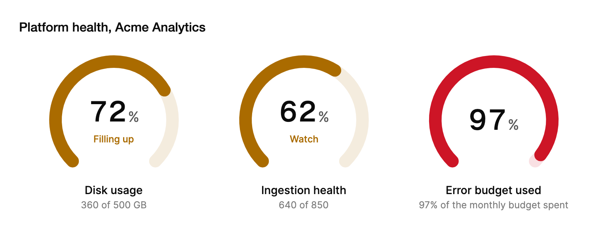

<Demo name="Thresholds" />

## 何时使用

`Gauge` 只回答一个问题：这个读数位于读者已知范围中的什么位置？它绘制一个 270 度的圆环，圆环中央显示百分比，可选地从命名区间显示状态名称，圆环下方是说明文字。它适合放在概览卡片中，紧邻它所概括的数字，使读者一眼就能看到读数、状态和刻度。

- **管理控制台中的磁盘用量**：工作区所有者看到数据库卷占用了 500 GB 中的 72%，状态为“即将占满”。明细行“360 / 500 GB”给出绝对数量，圆环则给出比例。
- **风控或反欺诈仪表板中的健康评分**：在 300 到 850 的刻度上，信用评分为 640。`Minimum` 与 `Maximum` 将真实范围映射到圆环上，读者无需把评分换算成百分比。
- **可靠性页面中的错误预算**：SRE 团队看到当月错误预算已用掉 97%。危险色调与标签使状态在读者细看数字之前就一目了然。
- **账单页面中的配额或容量卡片**：工作区显示其席位的使用比例。它适用于单次读数；若客户在一段时间内消耗的是有上限的方案，则更适合 `UsageMeter`。

## 何时不用

- **正在运行或即将完成的任务进度**：用 `Progress`，它描述的是步骤与完成情况，而不是对照刻度的读数。
- **用户在一段时间内消耗、有上限的方案或配额**：用 `UsageMeter`，它显示已用量相对于方案及其续订的情况。
- **随时间变化的数值**：用 `LineChart` 或 `Sparkline`。圆环只展示一个时刻，因此用一系列仪表盘画出的趋势会掩盖其走向。
- **整体的各个组成部分，而不是对照范围的单一数值**：用 `DonutChart`，它展示几个部分如何共同构成一个总量。
- **带有相对上一周期变化与趋势的单个数值**：用 `MetricCard`，它把变化与对比放在数字旁边。

## 用法

`Value` 为读数。`Minimum` 与 `Maximum` 设定范围，默认为 0 到 100。`Detail` 会在读数下方增加一行说明，例如以绝对单位表示的数量。

```xml
<UserControl xmlns="https://github.com/avaloniaui"
             xmlns:arc="https://github.com/AtomUICommunity/TKCode.Arc">
    <arc:Gauge Label="磁盘用量"
               Value="72"
               Detail="360 / 500 GB">
        <arc:Gauge.Thresholds>
            <arc:GaugeThreshold From="0" Tone="Success" Label="健康" />
            <arc:GaugeThreshold From="60" Tone="Warning" Label="即将占满" />
            <arc:GaugeThreshold From="85" Tone="Danger" Label="严重" />
        </arc:Gauge.Thresholds>
    </arc:Gauge>
</UserControl>
```

`Gauge` 派生自 Avalonia 的 `Control` 并自行绘制，因此它没有可供重新设置样式的模板部件，也没有需要放置的子控件。它是只读显示：不获得焦点，也不定义任何按键。其外观来自它的主题，尺寸则随容器变化。

### 结构

1. **圆环**：一条 270 度的轨道，顶部是数值弧线。在 100 × 90 的视图框中描边为 9 px，因此会随圆环一起缩放。圆环从左下角开始，顺时针延伸，半径位于视图框中心附近。
2. **表盘**：圆环所在方框最宽 176 px（`DialMaxWidth`），高度为宽度的 0.9 倍。容器较窄时它会缩小；仪表盘永远不会超过 176 px。
3. **数字**：百分比，使用展示字体、3XL 字号，`%` 的字号为其一半。其值为 `Percent`，即将读数四舍五入为范围的整百分比。
4. **状态行**（`Thresholds`）：数值所在区间的名称，使用超小号的中等字重文字，颜色为该区间的色调，位于圆环内、数字下方，相隔 4 px。没有阈值时隐藏。其方框至少宽 100 px，使文字不会挤动数字。
5. **标签**（`Label`）：圆环下方的说明文字，使用小号的中等字重，位于表盘下方 10 px（`CaptionGap`）处。它同时也是无障碍名称。
6. **明细**（`Detail`）：位于标签下方的超小号常规文字，使用弱化颜色。为空时隐藏。

圆环颜色随色调而定：`Accent` 使用强调色，状态文字使用强调色的加强色；`Success`、`Warning` 与 `Danger` 使用各自的令牌。当数值位于某个区间时，该区间的色调会替代 `Tone` 作为圆环颜色。

### 选择阈值

阈值从 `From` 开始，一直持续到下一个区间开始。数值所达到的最高区间决定颜色并命名状态。区间在变化时会按 `From` 排序，因此标记中的顺序无关紧要，但按升序书写可使标记更易读。

选择能说明读者应该做什么的区间，而不是装饰性的刻度。通常三个区间就足够：一个正常状态、一个警告状态，以及一个需要采取行动的状态。对衡量同一指标的每个卡片都使用相同的 `From` 值和标签，这样某个页面上的“严重”磁盘与另一个页面上的“严重”磁盘含义相同。标签保持一到两个词，因为状态行位于圆环内、数字下方。

```csharp
disk.Thresholds.Add(new GaugeThreshold(0, GaugeTone.Success, "健康"));
disk.Thresholds.Add(new GaugeThreshold(60, GaugeTone.Warning, "即将占满"));
disk.Thresholds.Add(new GaugeThreshold(85, GaugeTone.Danger, "严重"));
```

区间使用仪表盘的数值单位，而不是范围的百分比。对于 300 到 850 的评分，`From="670"` 的区间指的是评分 670，而不是 670%。没有阈值时，圆环只使用 `Tone`，读者得不到状态名称，因此只要状态很重要，就添加区间。

### 绑定到视图模型

仪表盘显示数值，但不会把数值写回。`Value`、`Minimum`、`Maximum`、`Label` 与 `Detail` 为单向绑定，因此由视图模型掌握读数，仪表盘反映每一次变化。使用 CommunityToolkit.Mvvm 时：

```csharp
public partial class StorageViewModel : ObservableObject
{
    [ObservableProperty]
    private double _usedGigabytes;

    [ObservableProperty]
    private double _capacityGigabytes = 500;

    [ObservableProperty]
    private double _usedPercent;

    partial void OnUsedGigabytesChanged(double value)
    {
        UsedPercent = Math.Round(value / CapacityGigabytes * 100);
        DetailText = $"{value:0} / {CapacityGigabytes:0} GB";
    }

    [ObservableProperty]
    private string _detailText = string.Empty;
}
```

```xml
<arc:Gauge Label="磁盘用量"
           Value="{Binding UsedPercent}"
           Detail="{Binding DetailText}">
    <arc:Gauge.Thresholds>
        <arc:GaugeThreshold From="0" Tone="Success" Label="健康" />
        <arc:GaugeThreshold From="60" Tone="Warning" Label="即将占满" />
        <arc:GaugeThreshold From="85" Tone="Danger" Label="严重" />
    </arc:Gauge.Thresholds>
</arc:Gauge>
```

- 在视图模型中同时更新 `Value` 与 `Detail`，使屏幕上的数字与其明细永远不会不一致。上面的页面由同一次变化推导出两者。
- 区间是一个列表，而不是绑定目标。在标记中或启动时通过代码一次设定，只有在策略变化时才修改 `From` 值。
- 超出 `Minimum` 与 `Maximum` 范围的值会在屏幕上被限制在范围内。请在数据层校验读数，因为仪表盘会显示被限制后的值而不报错。

### 自定义范围

`Minimum` 与 `Maximum` 可将任意范围映射到圆环上。数字按该范围的百分比显示，因此在 300 到 850 的刻度上，评分 575 显示为 50%。当读者以真实单位思考时，使用真实范围，并在明细行中写明范围，使数字有参照。

<Demo name="CustomRange" />

### 没有阈值时的色调

没有阈值时，圆环使用 `Tone`：`Accent`、`Success`、`Warning` 或 `Danger`。对于状态始终属于同一类的读数，例如总是好消息的可用率，使用固定色调；当状态随数值变化时，则使用阈值。

<Demo name="Tones" />

### 示例：管理控制台中的存储与健康卡片

Acme Analytics 工作区所有者打开管理控制台，在一行中看到三个读数：分析数据库的磁盘用量、数据摄取管线的健康评分，以及当月错误预算已用掉的比例。每张卡片都有一个标签说明衡量的内容，以及一行显示绝对数量的明细。前两张卡片还会根据各自的区间命名状态。健康评分映射了 300 到 850 的真实范围，因此圆环显示该范围的 62%，明细行则保留评分本身 640。错误预算没有区间：它的色调固定为危险色，因为它已经越过团队约定要采取行动的界线。

该示例宽 720 px，因此三张卡片在默认圆环尺寸下并排放置。



```xml
<StackPanel Width="720" Spacing="20">
    <TextBlock Text="Platform health, Acme Analytics"
               FontSize="16"
               FontWeight="Medium"
               Foreground="{arc:ArcDesignTokenResource Foreground}" />
    <Grid ColumnDefinitions="*,*,*">
        <arc:Gauge Grid.Column="0"
                   Label="Disk usage"
                   Value="72"
                   Detail="360 of 500 GB">
            <arc:Gauge.Thresholds>
                <arc:GaugeThreshold From="0" Tone="Success" Label="Healthy" />
                <arc:GaugeThreshold From="60" Tone="Warning" Label="Filling up" />
                <arc:GaugeThreshold From="85" Tone="Danger" Label="Critical" />
            </arc:Gauge.Thresholds>
        </arc:Gauge>
        <arc:Gauge Grid.Column="1"
                   Label="Ingestion health"
                   Value="640"
                   Minimum="300"
                   Maximum="850"
                   Detail="640 of 850">
            <arc:Gauge.Thresholds>
                <arc:GaugeThreshold From="300" Tone="Danger" Label="Degraded" />
                <arc:GaugeThreshold From="600" Tone="Warning" Label="Watch" />
                <arc:GaugeThreshold From="720" Tone="Success" Label="Healthy" />
            </arc:Gauge.Thresholds>
        </arc:Gauge>
        <arc:Gauge Grid.Column="2"
                   Label="Error budget used"
                   Value="97"
                   Tone="Danger"
                   Detail="97% of the monthly budget spent" />
    </Grid>
</StackPanel>
```

### 文案规范

标签说明衡量的内容，明细说明数量。读者应当无需周围的页面也能读懂卡片：“磁盘用量”配上“360 / 500 GB”就说明了它是什么，而“存储”则完全不能说明状态。

| 不要写 | 改为 |
|---|---|
| 存储 | 磁盘用量 |
| 360/500 | 360 / 500 GB |
| 评分：640 | 健康评分 |
| 快要没有空间了 | 即将占满 |
| 很糟糕，立即处理 | 严重 |

区间标签是一到两个词的状态名称，采用句子式大小写，例如“健康”“即将占满”“观察”和“严重”。区间标签中不要使用感叹号或完整句子，因为标签会与数字一同播报，并与数字共享一行短文字。建议的操作应放在周围的页面中，而不是放在仪表盘里。

### 最佳实践

**推荐**

- 将 `Minimum` 与 `Maximum` 设为衡量指标的真实范围，并在 `Detail` 中显示绝对数量，使读者能够判断百分比。
- 只要状态对读者重要，就用 `Thresholds` 命名状态。状态名称与数字一同被读出，因此颜色从来不是唯一的提示。
- 对同一衡量指标，在每个显示它的页面上都使用相同的区间与标签。
- 从同一数据来源一次性更新 `Value` 与 `Detail`，使数字与其说明永远不会不一致。
- 将仪表盘放在等宽列的一行中，使读数便于一眼比较。

**避免**

- 为随时间变化、或需要读者以趋势观察的数值使用仪表盘。应改用 `LineChart` 或 `Sparkline`。
- 将仪表盘作为读者必须据此行动的数字的唯一展示。仪表盘是概括；精确数值应保留在明细或页面的表格中。
- 区间过多且标签几乎相同。读者很难一眼分辨“观察”与“关注”，因此最多使用三到四个区间。
- 对人们习惯视为百分比的读数使用自定义范围。这样圆环显示的是读者不会使用的数字。
- `From` 值单位错误的阈值，例如在 300 到 850 的刻度上使用百分比。区间将永远无法匹配读数。

### 常见问题

**为什么状态名称在数值变化片刻之后才改变？** 圆环与数字沿弹簧运动，而区间由屏幕上的数字决定。数字跨越区间边界时状态才切换，因此名称与数字始终一致。在减弱或关闭动效时，变化是立即的。

**仪表盘对超出范围的值如何显示？** 圆环与数字都会将数值限制在 `Minimum` 与 `Maximum` 之间。`Percent` 属性同样受限制，因此在 0 到 100 的仪表盘上，值 1000 显示为 100%。

**能在代码中读取状态吗？** 可以。`CurrentThreshold` 返回数值所属的区间；若没有区间或数值低于第一个区间，则返回 null。`Percent` 给出圆环所显示的整百分比。

**仪表盘支持键盘访问吗？** 仪表盘不获得焦点，也不定义任何按键，因此它作为页面的一部分被读取。它的值以只读进度条的形式公开，并带有范围；其帮助文本为带状态的百分比，例如“72%，即将占满”。

**只设置 `Tone` 时为什么没有状态？** `Tone` 只设置圆环颜色。状态行与状态名称来自 `Thresholds`，因此至少要添加一个区间才能显示名称。

## API 参考

<!-- api: Gauge -->

<!-- api: GaugeThreshold -->

### 配套类型：GaugeTone

| 成员 | 圆环与状态颜色 |
|---|---|
| `Accent` | 强调色；状态文字使用加强的强调色（默认值） |
| `Success` | 成功色 |
| `Warning` | 警告色 |
| `Danger` | 危险色 |

## 无障碍

- `Label` 为仪表盘命名，数值以只读范围的形式公开，并包含最小值与最大值。
- 帮助文本为数值加当前区间标签，例如“72%，即将占满”，因此状态与数字一同被读出。没有阈值时，仅为百分比。
- 仪表盘是礼貌级别的实时区域：新的读数会被播报，焦点不会移动。
- 状态由阈值标签以文字说明。颜色从来不是状态的唯一标志。
- 圆环与带动画的读数对辅助技术隐藏；屏幕阅读器获得的是名称、范围与帮助文本。

### 键盘

仪表盘不获得焦点，也不定义任何按键。请按页面正常的阅读顺序阅读它，或使用屏幕阅读器的审阅命令。

## 动效

- 仪表盘进入视图一半时，圆环沿无过冲的平滑弹簧一次性填充到其数值。
- 新数值会将圆环移动到新的长度，同时百分比数字同步计数到新的数字。
- 数字跨越阈值时，颜色与区间标签在该时刻切换，随计数变化。
- 减弱动效时，圆环与数字立即到达目标值。关闭动效与减弱动效的表现相同。

| 变化 | 完整 | 减弱 | 关闭 |
|---|---|---|---|
| 首次进入视图（进入一半时） | 圆环沿平滑弹簧一次性填充到数值，无过冲 | 圆环与数字立即到达数值 | 圆环与数字立即到达数值 |
| 新 `Value` | 圆环弹簧式移动到新长度，数字计数 | 立即变化 | 立即变化 |
| 数字跨越区间 | 颜色与状态名称随计数切换 | 立即切换 | 立即切换 |
| `Tone` 变化 | 圆环颜色交叉淡化 | 立即变化 | 立即变化 |

## 相关组件

- `Progress`：任务的完成进度。
- `UsageMeter`：用户在一个计费周期内消耗的配额。
- `DonutChart`：整体的各个组成部分，而不是对照范围的单一数值。
- `MetricCard`：带有变化与趋势的单个数值。

| 组件 | 适用场景 |
|---|---|
| `Progress` | 任务正在运行或即将完成，读者在等待 |
| `UsageMeter` | 方案或配额在一个计费周期内被消耗 |
| `DonutChart` | 多个部分组成一个总量 |
| `Sparkline` / `LineChart` | 数值随时间的变化才是重点 |
| `MetricCard` | 一个数字需要在旁边显示其变化与趋势 |
