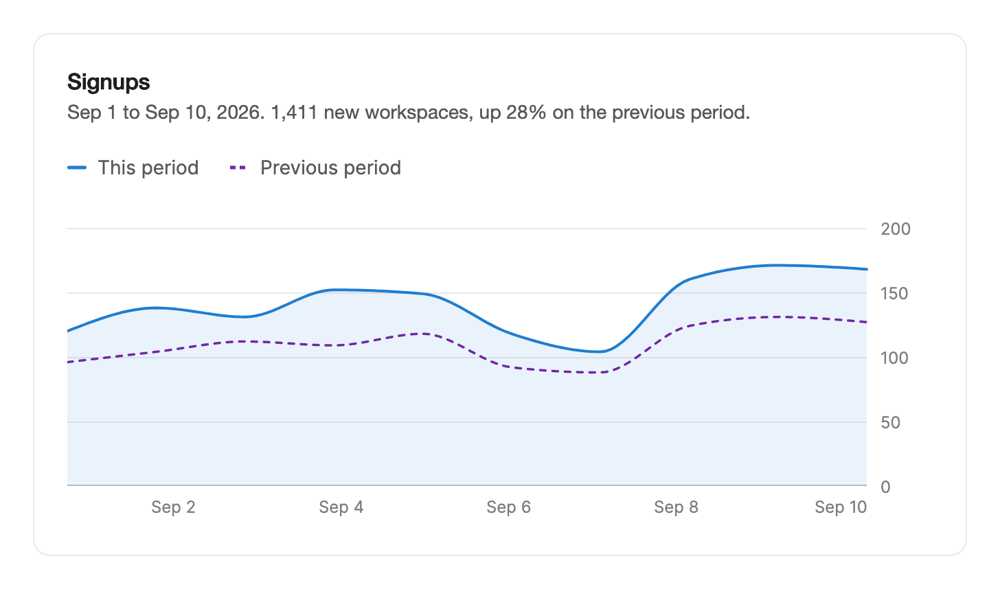

<Demo name="Ranges" />

## 何時使用

`LineChart` 呈現一到三個隨時間變化的指標，讓讀者在任意時間點進行比較。它是分析頁面的主要趨勢圖：位於一排 KPI 指標卡下方，並跟隨範圍選擇器（7 天、30 天和 90 天）。每個系列都是一條穩定的線，因此切換範圍時是改變同一組線條的形狀，而不是換成一張新圖。

- **分析概覽中選定範圍內的註冊數或營收**。7 天、30 天和 90 天範圍共用同一組系列，因此使用者切換範圍時，線條會從目前形狀變形過渡。
- **帳單或成長儀表板中的本期與上一期比較**。虛線的第二個系列顯示本月高於還是低於上月，無需第二張圖表。
- **故障頁面中隨時間變化的延遲或錯誤率**。使用 `Unit="ms"` 與 `Curve="Linear"` 的單一系列，能讓尖峰保持真實高度，提示則顯示帶單位的精確數值。
- **金融科技營運主控台中每天的退款或付款失敗數**。`EmptyLabel` 說明冷清的範圍，`IsLoading` 則在擷取下一個範圍時保留畫面上的上一次形狀。
- **配額頁面中的用量與目標比較**。虛線的目標線與實際用量並排顯示，圖例讓讀者可以隱藏其中任一條。

## 何時不用

- **與單一數字並排的精簡趨勢**，例如 KPI 指標卡或表格儲存格：用 `Sparkline`，它沒有座標軸、圖例或提示。
- **星期、地區或方案等離散類別**：用 `BarChart`。長條用於比較彼此獨立的數值；折線則暗示兩個資料點之間的空間有意義。
- **部分與整體的關係**，例如按方案劃分的營收占比：用 `DonutChart`。當各部分是等值單位的計數時，用 `WaffleChart`。
- **超過四個左右的指標**：調色盤只有四種系列顏色，其餘指標只能使用彼此難以區分的中性色階。當各層相加等於總量時，用 `Streamgraph`。
- **需要縮放的長時間歷史**：用 `BrushChart`，它將詳細檢視與可框選的概覽配對。
- **一年內的每日活動**，例如日曆網格中每天的登入數：用 `ActivityHeatmap`。

## 用法

每個 `ChartSeries` 都有穩定的 `Key`，因此資料變動時線條仍保有其身分。設定 `Label` 可為輔助技術命名圖表。

```xml
<UserControl xmlns="https://github.com/avaloniaui"
             xmlns:arc="https://github.com/AIDotNet/TKCode.Arc">
    <arc:LineChart Label="註冊數" CategoryLabel="日期" ItemsSource="{Binding Days}">
        <arc:LineChart.Series>
            <arc:ChartSeries Key="current" Name="本期" Values="{Binding Current}" />
            <arc:ChartSeries Key="previous" Name="上一期" Values="{Binding Previous}" IsDashed="True" />
        </arc:LineChart.Series>
    </arc:LineChart>
</UserControl>
```

`LineChart` 衍生自 `ChartBase`，而 `ChartBase` 衍生自 Avalonia 的 `TemplatedControl`。範本在繪圖區上方放置圖例，繪圖區自行繪製每條線、面積、格線、標籤和提示。過渡動畫無法作用於該繪圖內部的座標，因此圖表的動態效果由程式碼驅動。

### 結構

1. **圖例**（`ShowLegend`）：每個系列一個切換膠囊，帶顏色色塊，位於繪圖區上方 16 px。它向邊界延伸 8 px，使懸停膠囊與繪圖區邊緣對齊。
2. **繪圖區**（`PlotHeight`）：預設高 220 px，寬度與容器相同。最上方的刻度位於頂部下方 12 px。
3. **格線**（`ShowGrid`）：位於數值刻度處的水平線，使用框線顏色；底線為 1 px，使用較強的框線顏色。
4. **線條**：2 px、圓頭描邊，使用系列顏色。虛線系列細 0.25 px，使它在相鄰的實線旁看起來不會更粗。
5. **面積填色**：線條下方 9% 的淡色。預設只有第一個系列有面積（`HasArea` 可改變此行為）。
6. **數值軸**（`ShowYAxis`）：右側 48 px 的槽位中顯示刻度標籤，預設使用精簡格式（1.2K、2.4K）。
7. **日期軸**（`ShowXAxis`）：繪圖區下方一列 26 px。標籤之間保持間距以免重疊；`XAxisFormatter` 可回傳 null 來去掉某個標籤。
8. **十字準線與資料點**：作用點處的垂直線，以及每條可見線上 4 px 的圓點，外框為表面顏色。
9. **提示**：日期，然後每條可見系列一列，顯示其數值與單位。提示位於十字準線側邊 14 px 處，並會在即將超出繪圖區前翻轉。

### 範圍切換

範圍變更時，應同時替換資料列與系列數值，使每個系列在新範圍中都有與資料列一一對應的值。接著每條線都會從畫面上的形狀變形到新形狀，數值軸也會以彈簧效果過渡到新範圍。

```csharp
void ShowRange(SignupDay[] rows)
{
    chart.ItemsSource = rows.Select(r => r.Date).ToArray();
    chart.Series[0].Values = rows.Select(r => (double)r.Current).ToArray();
    chart.Series[1].Values = rows.Select(r => (double)r.Previous).ToArray();
}
```

頂部的示例對 7、30 和 90 天展示同樣的兩個系列。座標軸會依畫面上的範圍重新縮放，而線條保持其鍵不變。

### 單一系列與單位

`ChartPoint` 項目的清單不需要額外的系列。`Unit` 顯示在提示中，`Curve` 可將預設的平滑曲線切換為直線段。`Smooth` 絕不會超出資料範圍；當讀者可能把兩天之間的曲線當作真實數值時，請使用 `Linear`。

<Demo name="SingleSeries" />

```xml
<arc:LineChart Label="p95 延遲" Unit="ms" Curve="Linear" PlotHeight="180" ItemsSource="{Binding Latency}" />
```

### 圖例與隱藏系列

存在多個系列時，圖例會為每個系列顯示一個切換開關。`ShowLegend` 可強制顯示或隱藏圖例，`HiddenSeries` 保存被隱藏的鍵。

```xml
<arc:LineChart Label="註冊數"
               ItemsSource="{Binding Days}"
               ShowLegend="True"
               HiddenSeries="{Binding HiddenKeys}" />
```

隱藏某個系列時，它會淡出並壓平到基準線，數值軸則依剩餘的系列重新縮放。`HiddenSeries` 是雙向的：圖例切換會把新清單寫回並引發 `HiddenSeriesChanged`；程式碼中的變更則會顯示或隱藏對應的線。所有系列都被隱藏時，繪圖區會顯示「選擇要顯示的系列」。

### 載入與空白狀態

`IsLoading` 會讓線條變暗，並在沒有資料點時顯示骨架畫面。`EmptyLabel` 用於說明空白的範圍。

<Demo name="Empty" />

```xml
<arc:LineChart Label="退款" EmptyLabel="此範圍內沒有退款" IsLoading="{Binding IsBusy}" />
```

預設的空白狀態文字是「此範圍內沒有資料」。請寫明原因，讓讀者知道是圖表有問題還是這段期間確實冷清。`IsLoading` 為 true 且沒有資料點時，顯示骨架畫面；有資料點時，目前形狀保持在畫面上並輕微呼吸，表示新資料正在到來。

### 讀取數值

十字準線移動時以及放開時，都會觸發 `ActiveIndexChanged`。可用它在標題中顯示數值。

```csharp
chart.ActiveIndexChanged += (_, e) => readout.Text = e.Index is null
    ? "將滑鼠懸停或使用方向鍵讀取數值。"
    : $"{e.Label}: {string.Join(", ", e.Values.Select(v => $"{v.Name} {v.Value:N0}"))}";
```

`ActiveIndex` 保存同一個資料點，並且是雙向的，因此程式碼可以把讀數指向某一天，例如某次故障發生的那一天。`Values` 只列出可見的系列，因此隱藏的系列永遠不會出現在讀數中。

### 繫結到檢視模型

使用 CommunityToolkit.Mvvm 時，檢視模型負責資料列、範圍與隱藏的系列。每次切換範圍時，檢視模型都會替換整個陣列，圖表則從先前的資料列變形到新的資料列。

```csharp
public sealed record SignupDay(string Date, int Current, int Previous);

public interface ISignupService
{
    Task<SignupDay[]> GetDailyAsync(int days);
}

public partial class SignupsViewModel : ObservableObject
{
    private readonly ISignupService _signups;

    public SignupsViewModel(ISignupService signups) => _signups = signups;

    [ObservableProperty]
    private SignupDay[] _days = [];

    [ObservableProperty]
    private IReadOnlyList<string> _hiddenKeys = [];

    [ObservableProperty]
    private int? _activeIndex;

    [ObservableProperty]
    private bool _isBusy;

    [RelayCommand]
    private async Task LoadRangeAsync(int days)
    {
        IsBusy = true;
        try
        {
            // 一個新陣列就是一次資料變更：圖表接收一次資料列，並把線條變形到新資料。
            Days = await _signups.GetDailyAsync(days);
        }
        finally
        {
            IsBusy = false;
        }
    }
}
```

```xml
<arc:LineChart Label="註冊數"
               CategoryLabel="日期"
               Height="260"
               ItemsSource="{Binding Days}"
               XBinding="{Binding Date}"
               HiddenSeries="{Binding HiddenKeys, Mode=TwoWay}"
               ActiveIndex="{Binding ActiveIndex, Mode=TwoWay}"
               IsLoading="{Binding IsBusy}">
    <arc:LineChart.Series>
        <arc:ChartSeries Key="current" Name="本期" ValueBinding="{Binding Current}" />
        <arc:ChartSeries Key="previous"
                         Name="上一期"
                         IsDashed="True"
                         ValueBinding="{Binding Previous}" />
    </arc:LineChart.Series>
</arc:LineChart>
```

- `XBinding` 從每筆記錄中讀取類別。沒有它時，圖表會讀取項目本身，這對 `string` 與 `DateTime` 項目有效，但對記錄不適用。
- `HiddenSeries` 與 `ActiveIndex` 是雙向的，因為圖例與十字準線會寫入它們。`ItemsSource`、`IsLoading` 以及數值繫結都是單向的。
- 為求簡潔，示例使用一般的 `Binding`。在使用編譯繫結的應用程式中，需要在檢視上設定 `x:DataType`，並為每個繫結設定 `DataType`。

### 資料結構與效能

`ItemsSource` 每個資料點一項，最早的在前。每個系列都從同一索引讀取數值，因此所有系列每列都需要一個值，且順序一致。缺少的值按零計算，因此沒有資料的那一天會被畫成下降到零。請為範圍內的每一天提供真實數值。

用 `ValueFormat` 格式化數字，它是依 en-US 慣例讀取的 .NET 格式字串：計數用 `N0`，金額用 `C0`，百分比用 `0.0'%'`。預設會為千位數分組，並最多顯示一位小數，因此 2400 顯示為「2,400」。如果貨幣取決於讀者的地區設定，請設定 `ValueFormatter`。提示中的日期預設為「Tue, Sep 15」，座標軸上為「Sep 15」；如需其他標籤，請設定 `XLabelFormatter` 或 `XAxisFormatter`。

### 數值軸

數值軸從零開始；當資料跌到零以下時，則從資料的最小值開始，並結束於最大值之上的下一個刻度。當業務問題需要時，可以改變這項設定：

- `YMinimum` 與 `YMaximum` 固定任一端。對於百分比，兩端都固定（0 到 100），使座標軸不會在切換範圍時跳動。
- `TickFormatter` 只格式化刻度標籤，例如在程式碼中寫 `chart.TickFormatter = v => $"{v:0}%";`。
- 當數值已在卡片其他位置顯示（例如上方的 KPI 指標卡）時，`ShowYAxis="False"` 可去掉槽位。
- 距零較遠的 `YMinimum` 會讓微小的變化看起來很大。只在零不是有意義的基準線時使用，例如分數，並在卡片中說明這一點。

```xml
<arc:LineChart Label="結帳轉換率"
               YMinimum="0"
               YMaximum="100"
               ValueFormat="0.0'%'" />
```

### 範例：帶虛線比較的註冊概覽

Acme Analytics 的成長儀表板顯示最近十天的註冊數，並與上個月同樣的十天進行比較。本期為實線，比較為虛線，圖例讓讀者可以隱藏比較線。標題說明期間、總數與變化幅度，因此即使不懸停提示，也能讀懂重點。



```xml
<Border xmlns="https://github.com/avaloniaui"
        xmlns:x="http://schemas.microsoft.com/winfx/2006/xaml"
        xmlns:arc="https://github.com/AIDotNet/TKCode.Arc"
        xmlns:collections="clr-namespace:Avalonia.Collections;assembly=Avalonia.Base"
        xmlns:sys="clr-namespace:System;assembly=System.Runtime"
        Width="680"
        Padding="24"
        CornerRadius="12"
        Background="{arc:ArcDesignTokenResource Surface}"
        BorderBrush="{arc:ArcDesignTokenResource Border}"
        BorderThickness="1">
    <StackPanel Spacing="16">
        <StackPanel Spacing="4">
            <TextBlock Text="Signups" FontSize="16" FontWeight="SemiBold" />
            <TextBlock Text="Sep 1 to Sep 10, 2026. 1,411 new workspaces, up 28% on the previous period."
                       TextWrapping="Wrap"
                       Foreground="{arc:ArcDesignTokenResource TextSecondary}" />
        </StackPanel>
        <arc:LineChart Label="Signups"
                       CategoryLabel="Date"
                       PlotHeight="200">
            <arc:LineChart.ItemsSource>
                <collections:AvaloniaList x:TypeArguments="sys:String">
                    <sys:String>Sep 1</sys:String>
                    <sys:String>Sep 2</sys:String>
                    <sys:String>Sep 3</sys:String>
                    <sys:String>Sep 4</sys:String>
                    <sys:String>Sep 5</sys:String>
                    <sys:String>Sep 6</sys:String>
                    <sys:String>Sep 7</sys:String>
                    <sys:String>Sep 8</sys:String>
                    <sys:String>Sep 9</sys:String>
                    <sys:String>Sep 10</sys:String>
                </collections:AvaloniaList>
            </arc:LineChart.ItemsSource>
            <arc:LineChart.Series>
                <arc:ChartSeries Key="current" Name="This period">
                    <arc:ChartSeries.Values>
                        <collections:AvaloniaList x:TypeArguments="sys:Double">
                            <sys:Double>120</sys:Double>
                            <sys:Double>138</sys:Double>
                            <sys:Double>131</sys:Double>
                            <sys:Double>152</sys:Double>
                            <sys:Double>149</sys:Double>
                            <sys:Double>118</sys:Double>
                            <sys:Double>104</sys:Double>
                            <sys:Double>160</sys:Double>
                            <sys:Double>171</sys:Double>
                            <sys:Double>168</sys:Double>
                        </collections:AvaloniaList>
                    </arc:ChartSeries.Values>
                </arc:ChartSeries>
                <arc:ChartSeries Key="previous" Name="Previous period" IsDashed="True">
                    <arc:ChartSeries.Values>
                        <collections:AvaloniaList x:TypeArguments="sys:Double">
                            <sys:Double>96</sys:Double>
                            <sys:Double>104</sys:Double>
                            <sys:Double>112</sys:Double>
                            <sys:Double>109</sys:Double>
                            <sys:Double>118</sys:Double>
                            <sys:Double>92</sys:Double>
                            <sys:Double>88</sys:Double>
                            <sys:Double>124</sys:Double>
                            <sys:Double>131</sys:Double>
                            <sys:Double>127</sys:Double>
                        </collections:AvaloniaList>
                    </arc:ChartSeries.Values>
                </arc:ChartSeries>
            </arc:LineChart.Series>
        </arc:LineChart>
    </StackPanel>
</Border>
```

### 文案規範

- **標籤**：度量指標；如果座標軸上沒有單位，則附上單位：「註冊數」「p95 延遲（ms）」。標籤會為輔助技術與資料表命名圖表，因此必須能獨立理解。
- **系列名稱**：描述期間或比較關係的簡短名詞片語：「本期」「上一期」「目標」。
- **空白狀態文字**：說明範圍為空的原因，並指明範圍：「此範圍內沒有退款」。
- **卡片標題與說明**：用文字寫出總數或變化，數字使用阿拉伯數字，例如「1,411 個新工作區」。

| 不要寫 | 改為 |
|---|---|
| 資料 | 每日註冊數 |
| 上一期 | 上一期 |
| 無資料 | 此範圍內沒有退款 |
| 系列 1 | 本期 |
| 營收圖表 | 營收，2026 年 9 月 1 日至 9 月 10 日 |

### 最佳做法

**建議**

- 每個指標使用一個系列，並以其所代表的期間或含義命名。圖例與提示都會重複名稱，因此它必須脫離卡片標題也能讀懂。
- 將 `CategoryLabel` 設為座標軸的單位（「日期」「週」）。資料表將其作為第一欄，因此螢幕閱讀器使用者會先聽到座標軸的名稱。
- 範圍變更時，同時替換整個 `ItemsSource` 與系列數值，使線條在兩個一致的狀態之間變形。
- 延遲與計數使用 `Linear`；當形狀比精確資料點更重要時，趨勢圖使用預設的 `Smooth`。

**避免**

- 對從零開始的指標（例如註冊數或營收）設定非零的 `YMinimum`。被截斷的座標軸會讓 5% 的變化看起來像崩跌。
- 超過三到四個系列。再多時顏色難以分辨，提示也會變成一長串清單。
- 每秒重新整理資料。線條、座標軸與提示同時移動，會掩蓋你想展示的變化。
- 用零作為沒有資料那一天的占位。缺少的值按零計算，因此線條會下跌，並被讀成真實的下降。
- 對以整數單位計數的資料（例如退款）使用 `Smooth`。兩天之間的曲線暗示了從未發生過的數值。

### 常見問題

**為什麼數值軸從零開始？** 預設基準線為零；當資料跌到零以下時，則為資料的最小值。設定 `YMinimum` 可以改變它，請依數值軸一節所述有意識地使用。

**為什麼我的圖表沒有圖例？** 只有一個系列時，圖例預設隱藏。設定 `ShowLegend="True"` 可顯示它，或加入第二個系列，圖例就會自動出現。

**為什麼只有第一條線有填色？** `HasArea` 預設為 null，因此只有第一個系列會有面積。在另一個系列上設定 `HasArea="True"` 可為其也加上填色，設定 `HasArea="False"` 則可去掉填色。

## API 參考

<!-- api: LineChart -->

## 無障礙

- `Label` 為圖表命名。繪圖區會在隱藏的摘要中公開日期範圍與每個系列的最新數值，隱藏的資料表則列出每個資料點。
- 繪圖區是可聚焦的滑桿。方向鍵每次移動一個資料點，PageUp 與 PageDown 大約移動範圍的六分之一，Home 與 End 分別移到第一個與最後一個資料點，Escape 釋放十字準線。
- 作用中資料點的讀數會說明日期以及每個可見系列的數值與單位，例如「週五，9 月 4 日：本期 240 位使用者，上一期 160 位使用者」。鍵盤聚焦時，讀數從最新的資料點開始。
- 圖例項目是切換按鈕。每個系列既以名稱識別，也以線型識別，而不只依靠顏色。
- 載入狀態會以「正在載入」禮貌地播報。線條與提示對輔助技術隱藏，以避免重複朗讀。

### 鍵盤

| 按鍵 | 操作 |
|---|---|
| `Tab` / `Shift+Tab` | 在圖例開關與繪圖區之間移動。用鍵盤進入繪圖區時會選取最新的資料點 |
| `Left` / `Down` | 移到上一個資料點。處於靜止狀態時，第一次按下會落在最新的資料點上 |
| `Right` / `Up` | 移到下一個資料點。處於靜止狀態時，第一次按下會落在最新的資料點上 |
| `PageUp` / `PageDown` | 移動約六分之一的資料點；靜止狀態下按 PageUp 會落在最新的資料點上 |
| `Home` / `End` | 移到第一個或最後一個資料點 |
| `Escape` | 釋放十字準線並隱藏提示 |
| `Enter` / `Space`（在圖例開關上） | 顯示或隱藏該系列 |

離開繪圖區會釋放十字準線。滑鼠懸停在繪圖區上時讀取最近的資料點。觸控在按下並拖曳時讀取，手指抬起時釋放。

## 動態效果

- 首次顯示時，線條從左到右繪出，面積隨線條一同顯現。
- 新範圍會在共用的 x 位置上重新取樣線條，並從目前形狀變形過渡。格線隨數值軸滑動。
- 十字準線在資料點之間滑動，提示由其自身的彈簧跟隨，並在邊緣處翻轉。
- 載入中的線條會脈動，直到資料到達。圖表離開可視範圍時脈動暫停。
- 減少動態效果時，略過繪製、變形與滑動過程，並停止載入脈動。關閉動態效果時直接到達最終狀態。

| 變化 | 完整 | 減少 | 關閉 |
|---|---|---|---|
| 首次顯示 | 線條在約 840 ms 內從左側繪出，面積隨之顯現 | 線條淡入，不做繪製過程 | 立即完成 |
| 新範圍 | 線條從目前形狀變形；數值軸以彈簧效果過渡，格線滑動 | 立即完成 | 立即完成 |
| 十字準線移動 | 以彈簧效果在資料點之間滑動 | 直接跳到資料點 | 直接跳到資料點 |
| 載入中 | 線條呼吸式變暗 | 脈動停止 | 脈動停止 |

## 相關元件

- `Sparkline`：與數值並排的精簡趨勢。
- `BarChart`：在離散的日、週或月之間比較單一指標。
- `BrushChart`：需要縮放的高密度時間序列。
- `Streamgraph`：需要將多個系列當作堆疊層來閱讀時。

| 元件 | 適用情境 |
|---|---|
| `Sparkline` | 趨勢與單一數字並排，沒有座標軸或圖例 |
| `BarChart` | 類別是離散的日、週或月，且每個數值彼此獨立 |
| `DonutChart` | 資料是一個整體的幾個部分 |
| `BrushChart` | 歷史較長，讀者需要縮放到某一時段 |
| `Streamgraph` | 多個層應被當作堆疊總量的各部分來閱讀 |
| `ActivityHeatmap` | 資料是按天的網格，例如全年的活動 |
