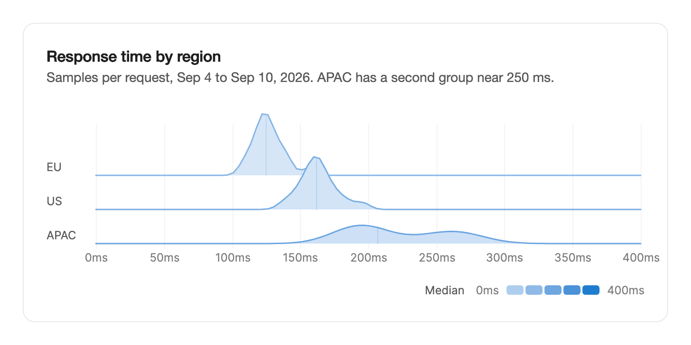

<Demo name="DistributionsByMonth" />

## 何時使用

`Ridgeline` 並排比較幾組分布的形狀。每組是一條山脊：一條平滑的密度曲線，繪製在上一列之上，因此讀者能看到單一平均值會掩蓋的離散程度、偏斜以及第二個峰。它適用於營運或分析頁面，其問題在於各組的分布有何不同，而不只是平均值有何不同。

- **依地區劃分的回應時間**，用於狀態或可觀測性頁面。三條山脊顯示亞太地區在 250 ms 附近有一組較慢的回應，只看中位數會把它掩蓋。
- **依月份劃分的每日最高氣溫**，用於天氣或能源需求儀表板。山脊顯示季節性的偏移，以及冬季的離散程度是否變大。
- **依客群劃分的訂單金額**，用於電商檢討。具有雙峰的客群（小額單品與大宗訂單）會呈現為兩條山脊的形狀，而不是誤導性的平均值。
- **依團隊劃分的解決時長**，用於客服或 CRM 報表。每個團隊的那一列都能看出慢工單的長尾。
- **依承運商劃分的配送時長**，用於物流主控台，此時準時率比平均值更重要。

## 何時不用

- **每組只有一個彙總數值**，例如依地區的平均營收：用 `BarChart`，它能精確比較數值。
- **每組觀測值很少**：由少量數值畫出的曲線只是猜測。當某組少於約 20 個數值時，用彙總數值的表格，或用 `BarChart` 顯示彙總數字。
- **單一數值隨時間的變化**：用 `LineChart`，其橫軸為時間。
- **精確比較少量數值**：用 `BarChart` 或表格。山脊呈現的是形狀，而不是精確的差值。
- **部分與整體的關係**，例如依來源劃分的流量占比：用 `DonutChart`。
- **依天和小時的密度**，例如依星期與小時的活動：用 `ActivityHeatmap`，它以計數顯示每個儲存格。

## 用法

```xml
<UserControl xmlns="https://github.com/avaloniaui"
             xmlns:arc="https://github.com/AIDotNet/TKCode.Arc">
    <arc:Ridgeline Label="蘇黎世每日最高氣溫"
                   Unit="°C"
                   DomainMinimum="-5"
                   DomainMaximum="35"
                   ItemsSource="{Binding Months}" />
</UserControl>
```

每個 `RidgelineSeries` 是一組資料：一個 `Id`、一個 `Label` 與它的原始 `Values`。圖表會為每組計算密度，並依系列順序由上到下繪製山脊。`Ridgeline` 衍生自 Avalonia 的 `Control`，而不是範本化的圖表，因此整個方塊都接收指標，山脊、標籤與刻度都由控制項自身繪製。只有在存在可供讀取的觀測值時，它才會取得鍵盤焦點。

### 結構

1. **列標籤**（`RidgelineSeries.Label`）：繪製在左側槽位中，寬 52 px（圖表窄於 420 px 時為 36 px），位於每列基準線之上。放不下的標籤會被縮短。
2. **山脊**：每組一條填色曲線，在所有組共用的定義域上取 96 個取樣點。開啟 `IsTinted` 時，每條山脊依其中位數著色；關閉時則使用第一個系列的顏色。
3. **列與重疊**：預設每列高 30 px（`RowHeight`）。最高的山脊會向上方的列延伸 2.4 個列高（`Overlap`），因此頂部的山脊不會被裁切。
4. **數值軸**：最後一列下方 28 px 的區域，刻度標籤間隔約 72 px，並使用 `Unit` 格式化。
5. **中位數色階**（`IsTinted`）：座標軸下方靠右對齊的「中位數」標籤、最低與最高值，以及五個顏色色塊。
6. **被抬起的山脊**：繪製在其他山脊之上的一份副本，抬高 6 px，中間一半加上陰影，並以一條短線標示中位數。
7. **提示**：系列標籤、中位數、中間一半的範圍與取值區間；讀數游標移動後還會顯示小於或等於該讀數的數值所占的比例。提示寬度至少為 170 px，並且始終位於圖表之內。

### 資料集

替換 `ItemsSource` 即可切換資料集。每條曲線都會從目前形狀變形到新形狀，而山脊的順序保持不變。

```csharp
// 將每個資料集保存為陣列，然後指派給使用者選取的那一個。
chart.ItemsSource = selectedDataset == "zurich" ? zurichMonths : lisbonMonths;
```

山脊依 `Id` 進行配對，因此在兩個資料集中具有相同 id 的組會變形為其新形狀。新出現的組會單獨佔一列。

### 項目與數值格式

如果分組在程式碼中建立，請透過 `Items` 加入；若用於檢視模型，則繫結 `ItemsSource`。`ValueFormatter` 設定座標軸刻度、中位數色階、摘要與提示的格式。

<Demo name="Untinted" />

### 重疊與平滑度

`Overlap` 設定山脊向上一列延伸的程度，以列高的倍數表示。`RowHeight` 設定一列的高度。`Bandwidth` 以數值的單位設定平滑程度：較大的值得到更平滑、更概括的形狀，較小的值則保留資料中更多的起伏。預設情況下，每組使用 Silverman 經驗法則，它依該組自身的離散程度與數量選取頻寬。

```xml
<arc:Ridgeline Label="延遲" Overlap="2.4" RowHeight="30" Bandwidth="4" ItemsSource="{Binding Regions}" />
```

### 色調與定義域

`IsTinted` 依每條山脊的中位數上色，顏色從淺色漸層到第一個系列的顏色，並在座標軸下方顯示中位數色階。當各組應被視為同一族，或顏色會暗示一種與圖表重點無關的排名時，請將其關閉。`DomainMinimum` 與 `DomainMaximum` 固定數值軸，使其不會隨資料集變更而移動。保持它們未設定（NaN），座標軸會涵蓋資料，並為平滑留出餘裕，刻度取整為易讀的步長。

```xml
<arc:Ridgeline Label="延遲" IsTinted="False" DomainMinimum="0" DomainMaximum="300" ItemsSource="{Binding Regions}" />
```

### 讀取山脊

`ActiveId` 是被抬起的山脊，且為雙向繫結。`ActiveIdChanged` 回報每次變更，被抬起的系列位於 `Series` 中。

```csharp
chart.ActiveIdChanged += (_, e) => readout.Text = e.Series is null
    ? string.Empty
    : $"{e.Series.Label}: {e.Series.Values.Count} 個觀測值";
```

提示與無障礙文字包含中位數、中間一半與取值區間。如果頁面需要自己的數字，可在處理常式中依 `Series` 計算，例如延遲面板的第 95 百分位數。

### 繫結到檢視模型

使用 CommunityToolkit.Mvvm 時，檢視模型負責分組與選取的組。每個組都是一個 `RidgelineSeries`，切換資料集時檢視模型替換整個陣列。圖表把被抬起的組保存在 `ActiveId` 中。

```csharp
public partial class LatencyViewModel : ObservableObject
{
    [ObservableProperty]
    private RidgelineSeries[] _regions = [];

    [ObservableProperty]
    private string? _activeRegion;

    public void Load(IReadOnlyDictionary<string, double[]> samplesByRegion)
    {
        Regions = samplesByRegion
            .Select(pair => new RidgelineSeries(pair.Key, pair.Key, pair.Value))
            .ToArray();
    }
}
```

```xml
<arc:Ridgeline Label="各地區回應時間"
               Unit="ms"
               ItemsSource="{Binding Regions}"
               ActiveId="{Binding ActiveRegion, Mode=TwoWay}" />
```

- `ActiveId` 是雙向的：山脊被抬起時圖表會寫入它，檢視模型也可以從程式碼中抬起某條山脊。
- 不是 `RidgelineSeries` 的項目，在設定 `KeySelector`、`LabelSelector` 與 `ValuesSelector`，或對應的成員繫結（`KeyMemberBinding`、`LabelMemberBinding` 與 `ValuesMemberBinding`）時同樣可用。兩者都設定時以選擇器為準。
- 編譯繫結需要在檢視上設定 `x:DataType`；示例為求簡潔使用一般的 `Binding`。

### 資料結構與效能

傳入原始觀測值，而不是直方圖。非有限值（NaN 與無限大）會被忽略。如果兩個系列共用同一個 `Id`，則繪製第一個，後面的會被捨棄，因此請確保同一資料集內的 id 唯一。

密度在每次資料變更時為每組計算一次，計算在共用定義域上進行，動畫只對取樣後的曲線進行插值。組數維持在約二十組以內，每組觀測值至少二十個，使每條曲線都具有真實的形狀。高度共用同一刻度：所有組中最高的峰會升到重疊高度。觀測值較多的組看起來並不更高。又高又窄的山脊表示其數值集中。

使用 `ValueFormatter` 或 `Unit` 格式化數值。預設格式會為千位分組，最多保留一位小數，並使用真正的減號，然後附加 `Unit`，因此 -3 °C 顯示為「−3°C」。

### 範例：依地區劃分的回應時間

Acme Analytics 的營運頁面展示了一週內三個地區回應時間的差異。只看中位數，會讓人以為亞太地區只比美洲慢一點。山脊則顯示，在 250 ms 附近有一組較慢的回應，這正是值班工程師需要看到的部分。依中位數著色的山脊與中位數色階說明了排名順序；固定的定義域使頁面切換到其他週時座標軸保持不動。



```xml
<Border xmlns="https://github.com/avaloniaui"
        xmlns:x="http://schemas.microsoft.com/winfx/2006/xaml"
        xmlns:arc="https://github.com/AIDotNet/TKCode.Arc"
        xmlns:collections="clr-namespace:Avalonia.Collections;assembly=Avalonia.Base"
        xmlns:sys="clr-namespace:System;assembly=System.Runtime"
        Width="680"
        Padding="24"
        CornerRadius="12"
        Background="{arc:ArcDesignTokenResource Surface}"
        BorderBrush="{arc:ArcDesignTokenResource Border}"
        BorderThickness="1">
    <StackPanel Spacing="16">
        <StackPanel Spacing="4">
            <TextBlock Text="Response time by region" FontSize="16" FontWeight="SemiBold" />
            <TextBlock Text="Samples per request, Sep 4 to Sep 10, 2026. APAC has a second group near 250 ms."
                       TextWrapping="Wrap"
                       Foreground="{arc:ArcDesignTokenResource TextSecondary}" />
        </StackPanel>
        <arc:Ridgeline Label="Response time by region"
                       Unit="ms"
                       RowHeight="36"
                       Overlap="1.8"
                       DomainMinimum="0"
                       DomainMaximum="400">
            <arc:Ridgeline.Items>
                <arc:RidgelineSeries Id="eu" Label="EU">
                    <arc:RidgelineSeries.Values>
                        <collections:AvaloniaList x:TypeArguments="sys:Double">
                            <sys:Double>108</sys:Double>
                            <sys:Double>112</sys:Double>
                            <sys:Double>115</sys:Double>
                            <sys:Double>118</sys:Double>
                            <sys:Double>119</sys:Double>
                            <sys:Double>121</sys:Double>
                            <sys:Double>122</sys:Double>
                            <sys:Double>123</sys:Double>
                            <sys:Double>124</sys:Double>
                            <sys:Double>125</sys:Double>
                            <sys:Double>126</sys:Double>
                            <sys:Double>128</sys:Double>
                            <sys:Double>129</sys:Double>
                            <sys:Double>131</sys:Double>
                            <sys:Double>133</sys:Double>
                            <sys:Double>136</sys:Double>
                            <sys:Double>139</sys:Double>
                            <sys:Double>142</sys:Double>
                            <sys:Double>156</sys:Double>
                        </collections:AvaloniaList>
                    </arc:RidgelineSeries.Values>
                </arc:RidgelineSeries>
                <arc:RidgelineSeries Id="us" Label="US">
                    <arc:RidgelineSeries.Values>
                        <collections:AvaloniaList x:TypeArguments="sys:Double">
                            <sys:Double>138</sys:Double>
                            <sys:Double>145</sys:Double>
                            <sys:Double>149</sys:Double>
                            <sys:Double>152</sys:Double>
                            <sys:Double>155</sys:Double>
                            <sys:Double>156</sys:Double>
                            <sys:Double>158</sys:Double>
                            <sys:Double>160</sys:Double>
                            <sys:Double>161</sys:Double>
                            <sys:Double>162</sys:Double>
                            <sys:Double>163</sys:Double>
                            <sys:Double>165</sys:Double>
                            <sys:Double>166</sys:Double>
                            <sys:Double>168</sys:Double>
                            <sys:Double>171</sys:Double>
                            <sys:Double>174</sys:Double>
                            <sys:Double>178</sys:Double>
                            <sys:Double>185</sys:Double>
                            <sys:Double>196</sys:Double>
                        </collections:AvaloniaList>
                    </arc:RidgelineSeries.Values>
                </arc:RidgelineSeries>
                <arc:RidgelineSeries Id="ap" Label="APAC">
                    <arc:RidgelineSeries.Values>
                        <collections:AvaloniaList x:TypeArguments="sys:Double">
                            <sys:Double>178</sys:Double>
                            <sys:Double>182</sys:Double>
                            <sys:Double>186</sys:Double>
                            <sys:Double>189</sys:Double>
                            <sys:Double>192</sys:Double>
                            <sys:Double>195</sys:Double>
                            <sys:Double>197</sys:Double>
                            <sys:Double>201</sys:Double>
                            <sys:Double>204</sys:Double>
                            <sys:Double>207</sys:Double>
                            <sys:Double>212</sys:Double>
                            <sys:Double>236</sys:Double>
                            <sys:Double>248</sys:Double>
                            <sys:Double>255</sys:Double>
                            <sys:Double>259</sys:Double>
                            <sys:Double>262</sys:Double>
                            <sys:Double>268</sys:Double>
                            <sys:Double>274</sys:Double>
                            <sys:Double>281</sys:Double>
                        </collections:AvaloniaList>
                    </arc:RidgelineSeries.Values>
                </arc:RidgelineSeries>
            </arc:Ridgeline.Items>
        </arc:Ridgeline>
    </StackPanel>
</Border>
```

說明文字寫明了期間與結論，因此不懸停也能讀懂卡片。定義域固定為 0 到 400 ms，頁面展示的每一週都相同。山脊依中位數著色，因此座標軸下方的中位數色階解釋了顏色。截圖中沒有抬起任何山脊：只有懸停或使用鍵盤時才會抬起。

### 文案規範

- **圖表標籤**：度量指標與範圍：「依地區劃分的回應時間」「蘇黎世每日最高氣溫」。標籤為輔助技術與摘要命名圖表。
- **列標籤**：組的簡短名稱，例如「EU」「APAC」或「1 月」。槽位大約能容納 40 px 的文字，較長的名稱會以省略號截斷。
- **單位**：緊跟數字、中間沒有空格的符號，例如「°C」或「ms」。刻度與提示使用相同的單位。
- **卡片說明**：用文字寫出結論，數字使用阿拉伯數字，例如「亞太地區在 250 ms 附近有第二組資料。」

| 不要寫 | 改為 |
|---|---|
| 分布 | 9 月 4 日至 9 月 10 日各地區的回應時間 |
| 第 1 組 | 歐洲 |
| 數值 | 每次請求的取樣數 |
| 亞洲有問題 | 亞太地區在 250 ms 附近有第二組資料 |

### 最佳做法

**建議**

- 在讀者會切換資料集的頁面上，保持固定的 `DomainMinimum` 與 `DomainMaximum`，使座標軸不會在讀者眼前移動。
- 讓每組至少有約二十個觀測值，使每條山脊都有真實的形狀；組樣本較少時需明確說明。
- 將組數維持在約二十組以內，並依有意義的順序排列，例如依中位數或依地區，使這一疊山脊能被讀作比較。
- 當中位數排名很重要時使用 `IsTinted`；各組地位相同時關閉它。

**避免**

- 將預先分箱的直方圖作為觀測值傳入。密度是從原始數值計算的，分箱後的計數會產生失真的曲線。
- 把山脊的高度讀作計數。高度反映的是共用刻度上的集中程度，而不是數值的數量。
- 用山脊圖呈現每組的單一平均值。只有一個數字時，長條圖或表格更清楚。
- 同一資料集中出現重複的 id。同 id 的第二組會被捨棄，因此它的資料會從圖表中缺失。

### 常見問題

**為什麼某條山脊看起來太波浪或太平？** 預設頻寬來自該組的 Silverman 規則。對於小樣本組，它可能過於粗糙或過於平滑。用數值單位設定 `Bandwidth`，即可讓所有組共用同一種平滑度，並對照原始數值檢查結果。

**為什麼無法用 Tab 切換到圖表？** 只有存在觀測值時，圖表才會取得焦點。空白圖表會顯示其 `EmptyLabel`（預設為「尚無資料。」），並在資料到達之前被 Tab 跳過。

**為什麼最高的山脊在各組之間高度相同？** 所有組共用一個刻度，所有組中最高的峰會升到重疊高度。山脊的高度與其密度的集中程度相稱，因此只應在同一圖表內比較高度。

## API 參考

<!-- api: Ridgeline -->

<!-- api: RidgelineSeries -->

## 無障礙

- `Label` 為圖表命名。摘要會列出每一組。繪圖區是可聚焦的群組。
- 上、下方向鍵抬起前一條或後一條山脊。左、右方向鍵以一個座標軸刻度步長移動讀數游標。Home 與 End 分別抬起第一條與最後一條山脊，Escape 放下山脊並清除讀數。
- 觸控按下會抬起手指所在的山脊，並讀取該處的數值。
- 禮貌的即時區域會播報被抬起山脊的中位數、中間一半的範圍、取值區間與數量。
- 隱藏的資料表列出每組的中位數、四分位數、極值與數量。每一列都有文字標籤，因此不只能透過顏色讀取中位數。

### 鍵盤

| 按鍵 | 操作 |
|---|---|
| `Tab` / `Shift+Tab` | 移入或移出圖表。沒有觀測值時會跳過該圖表 |
| `Up` | 抬起前一條山脊。處於靜止狀態時，抬起第一條山脊 |
| `Down` | 抬起後一條山脊。處於靜止狀態時，抬起第一條山脊 |
| `Left` / `Right` | 沿數值方向將讀數游標移動一個座標軸刻度步長。處於靜止狀態時，抬起第一條山脊 |
| `Home` / `End` | 抬起第一條或最後一條山脊 |
| `Escape` | 放下被抬起的山脊並清除讀數 |

## 動態效果

- 資料集或定義域變更時，每條曲線都會在共用網格上重新取樣，並對每個點進行插值。山脊以相同的平滑彈簧膨脹、滑動並分裂。
- 首次顯示時，山脊從頂部開始逐列滾入。
- 被抬起的山脊會以副本的形式繪製在最上層。它上升 6 px，中間一半會加上陰影，並標示中位數。提示跟隨指標移動，並保持在圖表之內。
- 減少動態效果時直接繪製最終狀態。關閉動態效果的表現與減少動態效果相同。

| 變化 | 完整 | 減少 | 關閉 |
|---|---|---|---|
| 資料集或定義域變化 | 每條曲線以 0.7 s 的彈簧變形；山脊膨脹、滑動並分裂 | 直接繪製最終狀態 | 與減少動態效果相同 |
| 首次顯示 | 山脊從頂部開始逐列滾入 | 直接繪製最終狀態 | 與減少動態效果相同 |

## 相關元件

- `BarChart`：每組只有一個彙總數值時使用。
- `LineChart`：單一數值如何隨時間變化。
- `Streamgraph`：多個層的總量如何隨時間變化。
- `BrushChart`：單一的高密度時間序列。

| 元件 | 適用情境 |
|---|---|
| `BarChart` | 每組有一個可精確比較的彙總數值 |
| `LineChart` | 橫軸為時間，讀者需要追蹤某個數值隨時間的變化 |
| `Streamgraph` | 多個層應被讀作隨時間變化的堆疊總量的各部分 |
| `BrushChart` | 一條高密度時間序列需要縮放並選取範圍 |
| `DonutChart` | 資料是一個整體的幾個部分 |
| `ActivityHeatmap` | 資料是依天或依小時的計數網格 |
