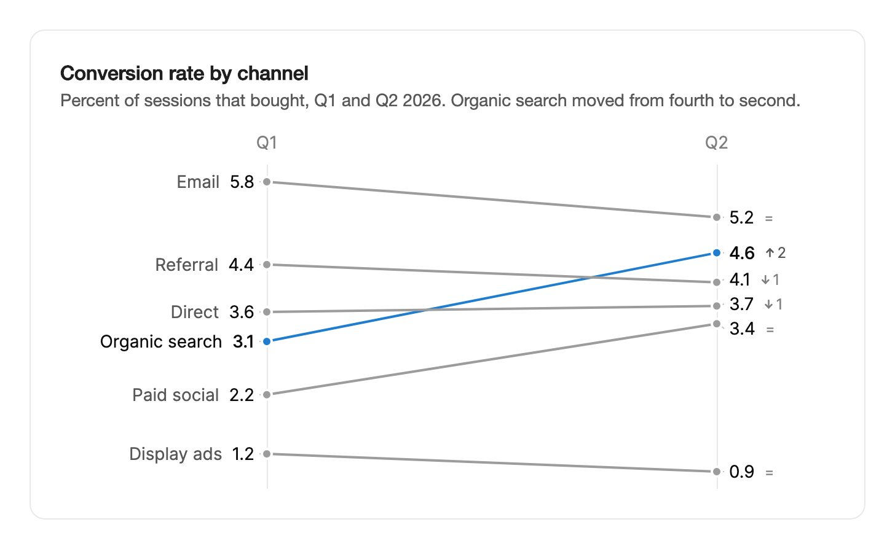

<Demo name="BeforeAndAfter" />

## 何时使用

`SlopeChart` 比较一小组项在两个时间点的情况。每一项是一条线，从第一个时期的数值连到第二个时期的数值，所有数值共用同一条数值轴，因此读者一眼就能看出谁上升了、谁下降了，以及排序如何变化。它适合问题为“这两个日期之间发生了什么变化”的复盘页面，例如季度业务回顾或同期群对比。

- **增长复盘中按获客渠道看的转化率，Q1 对比 Q2**：从第四升到第二的自然搜索无需表格即可看出，每个数值旁的排名变化也用文字说明了这一点。
- **SaaS 董事会材料中两个同期群按套餐看的留存率**：六个套餐放在两个坐标轴上，可以看出哪些套餐有所提升，哪些有所下滑。
- **销售复盘中按地区看的今年与去年收入**：斜率体现增长，交叉的线条显示哪些地区超过了其他地区。
- **运营报告中流程调整前后各支持团队的满意度评分**：图表能显示这次调整惠及了所有团队，还是只惠及部分团队。
- **竞争分析中几家供应商两个季度的市场份额**：排序与规模同样重要。

## 何时不用

- **三个或更多时间点**，例如一年中的月度数值：用 `LineChart`，它保留时间轴。
- **只需要每项的最新数值，没有对比**：用 `BarChart`。
- **整体中的各部分，而不是两个时间点之间的变化**：用 `DonutChart`。
- **超过约十项**：标签会在两个坐标轴上互相挤压。较长的列表请用 `BarChart`，并按第二个数值排序。
- **每组有许多观测值的分布**，例如各地区的响应时间：用 `Ridgeline`。

## 用法

每个 `SlopeItem` 是一条线，包含 `Key`、`Label`、`Start` 数值和 `End` 数值。`StartLabel` 与 `EndLabel` 用于命名两个时间点，默认值为 "Before" 和 "After"。

```xml
<UserControl xmlns="https://github.com/avaloniaui"
             xmlns:arc="https://github.com/AIDotNet/TKCode.Arc">
    <arc:SlopeChart Label="各渠道转化率"
                    StartLabel="Q1"
                    EndLabel="Q2"
                    HighlightKey="search"
                    ItemsSource="{Binding Channels}" />
</UserControl>
```

`SlopeChart` 派生自 Avalonia 的 `Control`，自行绘制，因此线条、标签与排名变化是同一幅绘图，数据变化时会平滑移动。整个控件区域都能接收指针，图表作为一个整体可以获得焦点。

### 结构

1. **列标题**（`StartLabel`、`EndLabel`）：每个数值轴上方各有一个标题，并以该轴为中心对齐。
2. **数值轴**：两条 1 px 的竖线，颜色为边框色。两列共用同一个数值刻度，因此线条越陡，变化越大。
3. **线条**：2 px、端点为圆形的中性色线条。由 `HighlightKey` 指定的项使用第一个系列颜色；当某一项获得焦点时，其余项淡出。
4. **圆点**：两端各有一个 4 px 的圆点，描边使用表面色，使其在线条上清晰可辨。
5. **起点标签**：名称在前、数值在后，右对齐，位于起点轴左侧 10 px。
6. **终点标签**：数值位于终点轴右侧 10 px；开启 `IsRankVisible` 时，其后还有排名变化：带位次数的箭头，排名没有变化时显示 "="。
7. **引导线**：从每个标签到其圆点的细线。为避免碰撞而被推开的标签，仍通过这些引导线与圆点相连。
8. **提示**：名称、两个数值、变化量以及排名文字，例如 "上升 1 位至第 1 名"。提示至少 168 px 宽。

未设置 `PlotHeight` 时，绘图高度为每项 44 px，且至少 200 px。宽度小于 440 px 时，标签列会变窄，名称也会被缩短；完整名称保留在提示和数据表中。

### 数据集

替换 `ItemsSource` 即可切换数据集。每条线、每个圆点和每个标签都会滑动到新的位置。在同一步骤中更改 `Label`，使文字与数据保持一致。

```csharp
conversion.Click += (_, _) =>
{
    chart.Label = "各渠道转化率";
    chart.ItemsSource = Conversion;
};
```

只要 `Key` 相同，项在数据集之间切换时会保留各自的线条，因此线条是变形过渡，而不是被替换。请使用能标识实体的键，例如渠道 ID，而不是会随列表重新排序而变化的行号。

### 数值与变化的格式

`ValueFormatter` 格式化两端的数值。`ChangeFormatter` 格式化排名旁的变化量，它接收变化量与对应的项。

```csharp
chart.ValueFormatter = v => $"{v:0.0}%";
chart.ChangeFormatter = (change, _) => $"{(change >= 0 ? "+" : "−")}{Math.Abs(change):0.0} 个百分点";
```

默认情况下，数值按最多一位小数分组显示，变化量带正负号，并使用真正的减号，例如 "+2" 或 "−2"。请在图表上一次性设置格式化器，使每一项的显示方式保持一致。

### 高亮与排名

`HighlightKey` 以第一个系列颜色绘制一项，其余项保持中性色。`IsRankVisible` 用于开启或关闭排名变化。

```xml
<arc:SlopeChart Label="收盘价"
                StartLabel="2023"
                EndLabel="2024"
                IsRankVisible="False"
                MaxWidth="420"
                ItemsSource="{Binding Values}" />
```

当顺序与问题无关，或排名只会重复斜率已经表达的信息时，请关闭排名。

### 读取项

`ActiveKey` 是指针或键盘所在的项，且为双向绑定。`ActiveKeyChanged` 会报告每一次变化，项通过 `Item` 提供。

```csharp
chart.ActiveKeyChanged += (_, e) => reading.Text = e.Item is { } item
    ? $"{item.Label}: {item.Start} → {item.End}"
    : "没有聚焦的项";
```

### 绑定到视图模型

使用 CommunityToolkit.Mvvm 时，视图模型同时持有项列表与当前聚焦项的键。每一行是一个 record，图表通过成员绑定读取其字段，因此行不必是 `SlopeItem` 对象。

```csharp
public sealed record ChannelRate(string Key, string Name, double Q1, double Q2);

public partial class ChannelsViewModel : ObservableObject
{
    [ObservableProperty]
    private ChannelRate[] _channels = [];

    [ObservableProperty]
    private string? _activeChannel;
}
```

```xml
<arc:SlopeChart Label="各渠道转化率"
                StartLabel="Q1"
                EndLabel="Q2"
                ItemsSource="{Binding Channels}"
                KeyMemberBinding="{Binding Key}"
                LabelMemberBinding="{Binding Name}"
                StartMemberBinding="{Binding Q1}"
                EndMemberBinding="{Binding Q2}"
                ActiveKey="{Binding ActiveChannel, Mode=TwoWay}" />
```

- `ActiveKey` 为双向绑定：图表写入当前聚焦项的键，视图模型也可以在代码中让某一项获得焦点。
- 同时设置时，选择器（`KeySelector`、`LabelSelector`、`StartSelector`、`EndSelector`）优先于成员绑定，当某个值需要计算时这很有用。
- 为简洁起见，示例使用普通的 `Binding`。编译绑定需要在视图上设置 `x:DataType`。

### 数据结构与标签冲突

每一项都需要稳定的 `Key`、`Label` 以及两个数值。两列共用一条数值轴，因此线条的斜率直接比较两个时间点。每一项都必须有两个数值，因为每个数值都会被绘制在其对应的位置上。

当两个标签在同一列中会重叠时，它们会按标签间距（20 px）彼此分开，并通过引导线与各自的圆点保持连接。相互接触的标签构成一组，并围绕其成员希望停留的位置排布。下面的示例在第一列中有四个相近的数值；标签会分散开，而不是堆叠在一起，因此名称依然清晰可读。

<Demo name="LabelCollisions" />

### 示例：增长复盘中的渠道转化

某增长复盘为 Acme Analytics 比较了六个获客渠道在第一季度与第二季度的转化率。图表突出显示了自然搜索这一团队投入过的渠道，使读者的视线有一个明确的焦点。邮件渠道在两个季度中都保持领先，这一点无需标签即可从斜率中看出。图注直接说明了结论，因此卡片无需悬停即可读懂。



```xml
<Border xmlns="https://github.com/avaloniaui"
        xmlns:x="http://schemas.microsoft.com/winfx/2006/xaml"
        xmlns:arc="https://github.com/AIDotNet/TKCode.Arc"
        Width="680"
        Padding="24"
        CornerRadius="12"
        Background="{arc:ArcDesignTokenResource Surface}"
        BorderBrush="{arc:ArcDesignTokenResource Border}"
        BorderThickness="1">
    <StackPanel Spacing="16">
        <StackPanel Spacing="4">
            <TextBlock Text="Conversion rate by channel" FontSize="16" FontWeight="SemiBold" />
            <TextBlock Text="Percent of sessions that bought, Q1 and Q2 2026. Organic search moved from fourth to second."
                       TextWrapping="Wrap"
                       Foreground="{arc:ArcDesignTokenResource TextSecondary}" />
        </StackPanel>
        <arc:SlopeChart Label="Conversion rate by channel"
                        StartLabel="Q1"
                        EndLabel="Q2"
                        HighlightKey="search">
            <arc:SlopeChart.Items>
                <arc:SlopeItem Key="search" Label="Organic search" Start="3.1" End="4.6" />
                <arc:SlopeItem Key="email" Label="Email" Start="5.8" End="5.2" />
                <arc:SlopeItem Key="paid" Label="Paid social" Start="2.2" End="3.4" />
                <arc:SlopeItem Key="referral" Label="Referral" Start="4.4" End="4.1" />
                <arc:SlopeItem Key="direct" Label="Direct" Start="3.6" End="3.7" />
                <arc:SlopeItem Key="display" Label="Display ads" Start="1.2" End="0.9" />
            </arc:SlopeChart.Items>
        </arc:SlopeChart>
    </StackPanel>
</Border>
```

高亮的线条就是故事的主线，每个数值旁的排名变化说明了哪些渠道上升或下降。Email 和 Referral 略有下滑，Display ads 在两个季度中都是最低值。截图中的数值为普通数字，因此单位由图注说明；在应用中，请设置 `ValueFormatter` 来加上百分号。

### 文案规范

- **图表标签**：指标及其范围，例如“各渠道转化率”。标签为辅助技术和摘要命名该图表。
- **列标题**：两个时间点的真实名称，例如 "Q1" 与 "Q2" 或 "2025" 与 "2026"。只有当两个时间点是事件（例如一次上线）时，才使用 "Before" 和 "After"。
- **项标签**：实体名称，采用句子式大小写，且足够短，能与其数值并排显示，例如 "Organic search"、"Paid social"。较长的名称保留在提示和数据表中。
- **变化量**：连同正负号和单位一起书写，例如 "+1.5 pts"，使读者无需依赖坐标轴。

| 不要写 | 改为 |
|---|---|
| Before / After | Q1 / Q2 |
| Conversion | Conversion rate by channel, Q1 and Q2 |
| +1.5 | +1.5 pts |
| SEO | Organic search |

### 最佳实践

**推荐**

- 两个时间点使用同一单位。两个不同度量之间的斜率并不构成比较，而读者从图中无法察觉这一点。
- 将列表控制在约三到十项，使每列的两组标签都保持可读。
- 用 `HighlightKey` 突出故事所讲的那一项。其余线条保持中性色，高亮才有意义。
- 为每一项设置能标识实体的稳定 `Key`。数据集变化时，同一条线会变形过渡，而不是被替换。

**避免**

- 将两个以上的时间点绘制为斜率。第三个点会让线条看起来像一种并不存在的趋势；这时请用 `LineChart`。
- 同时高亮多个项。当每条线都使用第一个系列颜色时，该颜色就失去了含义。
- 当读者需要比较幅度时隐藏变化量。这种情况下请保留变化量或排名的显示。
- 在不同步骤中更改 `Label` 与数据。这样标题会在一段时间内描述上一个数据集。

### 常见问题

**为什么列标题显示的是 "Before" 和 "After"？** 这是 `StartLabel` 与 `EndLabel` 的默认值。请将它们设为真实的时间点，例如 "Q1" 与 "Q2"。

**为什么键盘和摘要列出的项顺序与我的数据不同？** 键盘与摘要按结束数值从高到低排列，而绘图保持你的数据顺序。当两者的顺序需要一致时，请按结束数值对数据排序。

**所有数值相同的数据集会怎样显示？** 当所有数值相同时，数值轴两侧各延伸一个单位，因此线条位于绘图区的中间。

**聚焦的项从数据中移除后，读数会怎样？** 当其项不再存在于 `ItemsSource` 中时，`ActiveKey` 会被清空为 null，读数也就不再描述一个已经不存在的项。

## API 参考

<!-- api: SlopeChart -->

<!-- api: SlopeItem -->

## 无障碍

- `Label` 为图表命名。图表是带有角色描述与按键说明的可聚焦分组。
- Tab 键将焦点移到图表上，并先读取结束数值最高的项。下键和右键移到下一项，上键和左键移到上一项，顺序依据结束数值。
- Home 与 End 分别移到第一项与最后一项，Escape 清除读数。触摸按下并拖动会读取最近的线条。
- 礼貌的实时区域会播报两个数值、变化量与排名变化，例如 "Search, Q1 3, Q2 5, +2, up 1 to rank 1"。隐藏的数据表按结束数值的顺序列出各项。
- 排名变化使用带数字的箭头符号，因此不只依靠颜色表示。线条与标签对辅助技术隐藏。

### 键盘

| 按键 | 操作 |
|---|---|
| `Tab` | 聚焦图表；首先读取结束数值最高的项 |
| `Down` / `Right` | 按结束数值顺序移到下一项 |
| `Up` / `Left` | 按结束数值顺序移到上一项 |
| `Home` / `End` | 移到第一项（结束数值最高）或最后一项 |
| `Escape` | 清除读数 |

在静止状态下，任意方向键都会先移到第一项。鼠标读取离指针最近的线条，并在离开图表时清除读数。

## 动效

- 首次显示时，每条线从起点绘制到终点，并以短暂的错落时差进行。圆点与标签随线条落定而出现。
- 切换数据集时，线条、圆点、标签与引导线在共享的变形弹簧上移动。排名数字会朝变化的方向滚动。
- 获得焦点的项移到最前，其余项淡出。提示滑动到其所在线条的中点。
- 减弱动效时，所有线条一次绘制完成，变化时也一次移动。关闭动效时直接到达最终状态。

| 变化 | 完整 | 减弱 | 关闭 |
|---|---|---|---|
| 首次显示 | 线条从起点绘制到终点，并以短暂的错落时差进行；圆点与标签随线条落定 | 所有线条立即绘制完成 | 最终状态 |
| 数据集变化 | 线条、圆点、标签与引导线在共享弹簧上移动；排名数字滚动 | 立即移动 | 最终状态 |

## 相关组件

- `LineChart`：三个或更多时间点，且时间轴重要时。
- `BarChart`：单一时间点上，每项一个数值。
- `Ridgeline`：各组的分布如何随时间变化。

| 组件 | 适用场景 |
|---|---|
| `LineChart` | 有三个或更多时间点，且时间轴很重要 |
| `BarChart` | 每项在单一时间点只有一个数值，或列表超过约十项 |
| `Ridgeline` | 每组是许多观测值的分布，而不是一个数值 |
| `DonutChart` | 数据是整体的各部分，而不是两个时间点之间的变化 |
| `Sparkline` | 一个紧凑的趋势与单个数字并排显示 |
