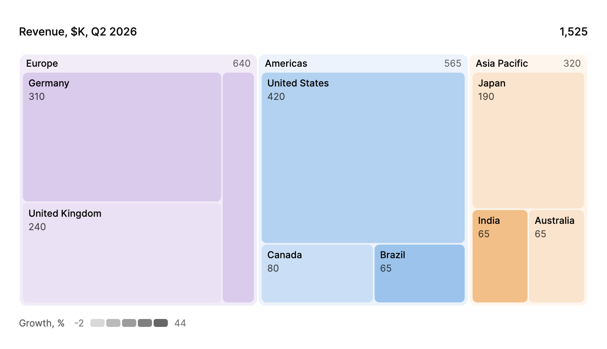

<Demo name="RevenueByRegion" />

## 何時使用

`Treemap` 以巢狀矩形呈現階層資料。每個色塊的大小是它佔整體的份額，第二個指標還可以加深顏色，因此一個檢視就能回答「錢（或負載、席次）集中在哪裡，其中哪些部分正在成長？」。它適用於葉節點很多的樹：如果每個葉節點都畫一根長條，長條會多到無法閱讀；讀者也無須離開目前畫面，就能下鑽到某個分支再返回。

- **財務檢討中依地區、國家與方案劃分的營收**：色塊大小表示各市場的規模，顏色深淺表示其成長率。讀者不必查看百分比表，就能看出美洲承擔了大部分營收，印度成長最快。
- **管理主控台中依資料夾劃分的儲存用量**：磁碟用量檢視中每個資料夾是一個色塊，點擊較大的資料夾即可下鑽到其子資料夾。麵包屑顯示回到磁碟區的路徑。
- **帳單檢視中依客戶區隔劃分的席次與授權用量**：同一棵樹改為呈現席次而非營收。讀者切換指標後，色塊會在原處改變大小，兩個檢視講的是同一個故事。
- **可靠性報告中依服務與元件劃分的事件**：色塊大小取事件數量，顏色深淺取相較上一季的變化，並可從平台下鑽到觸發最多告警的服務。
- **雲端成本檢討中依團隊與成本中心劃分的支出**：點擊團隊色塊即可展開其帳號，麵包屑始終保留通往總計的路徑，讀者在查看明細時不會失去脈絡。

## 何時不用

- **數值彼此接近、需要精確比較**：人對矩形面積的判斷不如對長條長度精確。數值共用同一基線時，用 `BarChart`。
- **只有少數幾個部分構成整體，角度就足以說明問題**：四到五段的構成用環圈圖會更清楚。用 `DonutChart`。
- **隨時間的變化**：樹狀圖只呈現某一時刻。趨勢用 `LineChart`，隨時間變化的構成用 `Streamgraph`。
- **一般的導覽步驟清單**：返回上一層的路徑本身就是麵包屑，不是圖表。頁面需要時用 `Breadcrumb`。
- **讀者需要逐項閱讀的階層，例如包含數千個項目的檔案樹**：瀏覽用 `TreeView`，查看精確數值用 `DataGrid`。樹狀圖會隱藏小色塊，放不下時其標籤也會消失。

## 用法

```xml
<UserControl xmlns="https://github.com/avaloniaui"
             xmlns:arc="https://github.com/AIDotNet/TKCode.Arc">
    <arc:Treemap Label="營收"
                 ColorLabel="成長率"
                 ItemsSource="{Binding Regions}"
                 KeyMemberBinding="{Binding Code}"
                 LabelMemberBinding="{Binding Name}"
                 ValueMemberBinding="{Binding Revenue}"
                 ColorValueMemberBinding="{Binding Growth}"
                 ChildrenMemberBinding="{Binding Countries}" />
</UserControl>
```

`Treemap` 衍生自 Avalonia 的 `Control`。它的資料來自以下三種來源之一，優先順序依次為：`Root`（`TreemapNode` 樹）、`ItemsSource`（你自己的物件，透過選擇器或成員繫結讀取）、`Items`（內嵌的 `TreemapNode` 物件，適用於一小組固定的葉節點）。色塊的大小取自 `Value`，深淺取自 `ColorValue`。分支本身沒有數值，其大小是子節點之和。`Label` 為圖表命名；設定 `Root` 時，根節點自身的標籤就是麵包屑的第一層。

### 結構

1. **麵包屑**：從根節點到目前檢視中節點的路徑。每一層高 32 units，最後一層為目前層級。檢視變化時，麵包屑從左側滑入。
2. **色塊區域**（`StageRadius`，12 units）：容納色塊的矩形區域。色塊會被裁剪到其圓角之內。
3. **色塊**：方形化配置。相鄰色塊之間保留 2 unit 的間距。帶有子節點的分支會預留 22 unit 的標題區顯示名稱，其子節點在標題區下方、以 3 unit 的內距排列。
4. **色塊標籤**：每個色塊的名稱，依該色塊自身的大小排版。只有標籤能放入色塊時才會顯示，因此小色塊不顯示標籤，其名稱會出現在工具提示中。
5. **色階**（設定 `ColorLabel` 時顯示）：著色指標的名稱，以及從最低值到最高值的色階。麵包屑、色塊與色階之間的間距為 12 units。
6. **工具提示**：色塊的父層路徑、色塊名稱及其格式化後的數值，以及它佔父層的比例，例如「佔歐洲的 75%」。

### 選擇樹的來源

| 來源 | 適用情境 |
|---|---|
| 使用 `TreemapNode` 的 `Root` | 樹在程式碼中建立，或由服務傳回巢狀模型後轉換一次 |
| 使用選擇器或成員繫結的 `ItemsSource` | 領域物件本身已構成樹，且不希望複製一份 |
| XAML 中的 `Items` | 一小組固定的葉節點，例如示範中的資料夾或靜態報表 |

使用 `ItemsSource` 時，`KeySelector`（或 `KeyMemberBinding`）必須為每個項目傳回唯一的 id，因為正是這個 id 在資料變化時保持色塊的身分。`ChildrenSelector`（或 `ChildrenMemberBinding`）傳回分支的巢狀項目，葉節點則傳回空值。

### 節點樹

資料在程式碼中建立時，將 `Root` 設為由 `TreemapNode` 物件組成的樹。節點接受 `Id`、`Label`、可選的葉節點 `Value`、可選的著色 `ColorValue` 以及 `Children`。樹中每個 `Id` 都必須唯一：保留相同 `Id` 的色塊在資料變化時會過渡到新的大小。

```csharp
var root = new TreemapNode("all", "全部地區", children:
[
    new TreemapNode("amer", "美洲", children:
    [
        new TreemapNode("us", "美國", 420, 18),
        new TreemapNode("ca", "加拿大", 80, 12)
    ]),
    new TreemapNode("emea", "歐洲", children:
    [
        new TreemapNode("de", "德國", 190, 7),
        new TreemapNode("uk", "英國", 150, -2)
    ])
]);

chart.Label = "營收";
chart.Root = root;
```

分支的 `ColorValue` 是其子節點依大小加權的平均值，因此即使分支本身沒有顏色，也會顯示它所代表地區的成長情況。從 `ItemsSource` 讀取的節點，`TreemapNode.Source` 會傳回原始資料項目。

未設定 `ColorLabel` 時，每個色塊都以同一深度繪製。若只需要一組扁平的頂層葉節點，使用 `Items`：

<Demo name="OneLevel" />

```csharp
chart.Items.Add(new TreemapNode("video", "影片", 112));
chart.Items.Add(new TreemapNode("photos", "相片", 48));
chart.Items.Add(new TreemapNode("docs", "文件", 12));
```

### 著色與顏色

`ColorLabel` 啟用第二個指標。每個頂層分支依序取前四個系列色相之一；位於其中的每個色塊則依 `ColorValue` 在幾個步階之間由淺到深加深。第五個及之後的分支保持中性色，而不會重用色相，因此若色相有意義，請將頂層分支保持在四個或以內。沒有 `ColorValue` 的色塊取中性色；負值與正值使用同一色階，因此正在縮小的地區會顯示為色階的淺色一端。

`ColorDomainMinimum` 與 `ColorDomainMaximum` 固定著色範圍的兩端。預設值為 `NaN`，表示最小與最大的葉節點值。當同一畫面上的兩個樹狀圖需要共用一個色階，或希望色階在資料變化時保持不變（例如成長率範圍為負 10% 到正 40%）時，請將它們固定。

### 格式化

`ValueFormatter` 用於格式化大小，`ColorFormatter` 用於格式化著色指標。預設的大小格式會為數字分組，並最多顯示一位小數。兩個格式化器都用於工具提示、色階以及無障礙朗讀，因此它們必須與你在 `Label` 和 `ColorLabel` 中寫的標籤一致。

```xml
<arc:Treemap Label="席次"
             ColorLabel="成長率"
             ValueFormatter="{Binding FormatSeats}"
             ColorFormatter="{Binding FormatGrowth}"
             ColorDomainMinimum="-10"
             ColorDomainMaximum="40" />
```

### 切換指標

同時修改 `Label`、`ValueFormatter` 與 `Root`。`Id` 相同的色塊會保有其身分，因此它們會在原處改變大小與顏色，而不是被取代。總計數值會捲動到新值，麵包屑中的路徑在其 id 仍然存在時保持不變。

```csharp
void ShowSeats()
{
    chart.Label = "席次";
    chart.ValueFormatter = v => $"{v:#,0}";
    chart.Root = seatsRoot;
}
```

### 焦點與縮放

點擊色塊會將檢視縮放到包含它的頂層分支：該分支填滿檢視，其同層色塊移出，其子節點在其中展開。`FocusedNodeId` 保存目前檢視中節點的 id，`null` 表示根節點；此屬性是雙向的，因此檢視模型可以在重新整理後保留下鑽狀態。在程式碼中設定它會縮放到對應節點，這也是以指定分支開啟檢視的方式。

`FocusedNodeChanged` 會回報檢視的每一次變化，包括透過麵包屑或鍵盤縮小層級。其 `Node` 是目前檢視中的節點。其 `Id` 是該節點的 id，因此檢視位於根節點時它是根節點的 id（例如 `all`），而 `FocusedNodeId` 對根節點為 `null`。

```xml
<arc:Treemap Label="營收" Root="{Binding Tree}" FocusedNodeId="{Binding FocusedId, Mode=TwoWay}" />
```

```csharp
chart.FocusedNodeChanged += (_, e) => status.Text = $"目前檢視：{e.Node?.Label}";
```

### 繫結到檢視模型

在 MVVM 應用程式中，檢視模型擁有樹、指標與下鑽狀態。使用 CommunityToolkit.Mvvm 時，檢視模型是一個 `ObservableObject`，指標切換是一條同時取代標籤、格式化器與樹的命令。

```csharp
public interface IRegionData
{
    TreemapNode BuildRevenueTree();

    TreemapNode BuildSeatsTree();
}

public partial class RevenueMapViewModel : ObservableObject
{
    private readonly TreemapNode _revenue;
    private readonly TreemapNode _seats;

    public RevenueMapViewModel(IRegionData data)
    {
        _revenue = data.BuildRevenueTree();
        _seats = data.BuildSeatsTree();
        Tree = _revenue;
    }

    [ObservableProperty]
    private TreemapNode? _tree;

    [ObservableProperty]
    private string? _focusedId;

    [ObservableProperty]
    private string _measureLabel = "營收";

    [RelayCommand]
    private void ShowRevenue()
    {
        MeasureLabel = "營收";
        Tree = _revenue;
    }

    [RelayCommand]
    private void ShowSeats()
    {
        MeasureLabel = "席次";
        Tree = _seats;
    }
}
```

```xml
<arc:Treemap Label="{Binding MeasureLabel}"
             ColorLabel="成長率"
             Root="{Binding Tree}"
             FocusedNodeId="{Binding FocusedId, Mode=TwoWay}" />
```

需要繫結的屬性是 `Root`、`FocusedNodeId` 與 `PlotHeight`。`FocusedNodeId` 是雙向的：讀者的下鑽狀態會回流到檢視模型，檢視模型可以儲存或還原它。`Label` 是單向的；格式化器屬於程式碼，應在檢視的程式碼後置檔中設定，或在與之作用的樹相鄰的檢視模型格式化服務中設定。

### 資料結構與效能

每個色塊的大小由其下方的葉節點計算而來，配置會針對每個焦點節點重新計算一次，而不是每一個影格都計算。Arc 的建議是單一檢視上放幾百個節點；超過這個數量時，使用 `FocusedNodeId` 下鑽，並每次只顯示一個層級。

- **葉節點**：葉節點的 `Value` 必須大於零才會佔據空間。沒有值或值為零的葉節點不佔空間，因此在傳入資料之前應檢查是否有空白項目。
- **深度**：每個分支都會增加標題區與內距，因此深層的樹會讓葉節點的空間變少。當色塊必須顯示標籤時，將樹控制在兩到三層。
- **Id**：在重新整理之間保持 id 穩定。新的 id 代表新的色塊，重複使用的 id 則代表同一個色塊，它會移動到新的大小。
- **更新頻率**：每分鐘重新整理一次看起來就是更新。若樹在每個計時週期都變化，色塊會持續移動，讀者將無法追蹤單一色塊。
- **格式化**：大小與顏色由 `ValueFormatter` 與 `ColorFormatter` 格式化。每個畫面都使用相同的貨幣與百分比慣例，使共用的檢視顯示一致的數字格式。

### 範例：財務檢討中依地區劃分的營收

財務主管在季度檢討開始時，用一張圖看出營收集中在哪裡，以及各地區成長的速度。地區是頂層，因此每個地區取四種系列色相之一，地區內的國家就是它的色塊。色塊大小是以千美元計的營收，顏色深淺是相較去年同一季的成長率，因此德國大而平緩，印度較小但顏色深得多。讀者下鑽到歐洲查看其國家，再用麵包屑返回。因為場景是靜態的，這裡的數值是字面值；即時檢視則如上所示繫結 `Root` 或 `ItemsSource`。



```xml
<StackPanel Width="720" Spacing="12">
    <arc:Treemap Label="Revenue, $K, Q2 2026"
                 ColorLabel="Growth, %"
                 PlotHeight="320">
        <arc:Treemap.Items>
            <arc:TreemapNode Id="amer" Label="Americas">
                <arc:TreemapNode Id="us" Label="United States" Value="420" ColorValue="18" />
                <arc:TreemapNode Id="ca" Label="Canada" Value="80" ColorValue="12" />
                <arc:TreemapNode Id="br" Label="Brazil" Value="65" ColorValue="31" />
            </arc:TreemapNode>
            <arc:TreemapNode Id="emea" Label="Europe">
                <arc:TreemapNode Id="de" Label="Germany" Value="310" ColorValue="7" />
                <arc:TreemapNode Id="uk" Label="United Kingdom" Value="240" ColorValue="-2" />
                <arc:TreemapNode Id="fr" Label="France" Value="90" ColorValue="5" />
            </arc:TreemapNode>
            <arc:TreemapNode Id="apac" Label="Asia Pacific">
                <arc:TreemapNode Id="jp" Label="Japan" Value="190" ColorValue="14" />
                <arc:TreemapNode Id="in" Label="India" Value="65" ColorValue="44" />
                <arc:TreemapNode Id="au" Label="Australia" Value="65" ColorValue="4" />
            </arc:TreemapNode>
        </arc:Treemap.Items>
    </arc:Treemap>
</StackPanel>
```

標籤中寫明了單位，因為預設的數字格式只顯示數字。成長率為負 2 時，英國色塊會落在色階的淺色一端，這就是在不使用紅色的情況下表示市場萎縮的方式。

### 文案規範

以指標而非檢視來為整體命名，例如「營收，$K，2026 年第二季」。把單位寫進標籤或格式化器，因為在一個有三個指標的畫面上，單獨的「420」沒有任何意義。色塊名稱要夠短，能放進你預期需要顯示標籤的最小色塊。

| 不要寫 | 改為 |
|---|---|
| `Label="Chart"` | `Label="Revenue, $K, Q2 2026"` |
| `ColorLabel="g"` | `ColorLabel="Growth, %"` |
| 圖表為「營收」時，根節點標籤為 `Label="All regions"` | 圖表標籤為 `Label="Revenue"`，根節點命名為「全部地區」 |
| `Label="United Kingdom (UK)"` | `Label="United Kingdom"` |
| `Label="Seats (number)"` | `Label="Seats"` |
| 以代碼命名的色塊，例如 `uk-ent` | 為方案或區隔取一個易讀的名稱 |

### 最佳做法

**建議**

- 在 `Label` 中寫明指標及其單位；當單純的數字含義模糊時，用 `ValueFormatter` 格式化大小。螢幕閱讀器首先朗讀的就是標籤。
- 為每個節點設定穩定的 `Id`。id 決定資料變化時色塊是過渡還是被取代。
- 當色相承載含義時，將頂層分支保持在四個或以內，因為第五個及之後的分支是中性色。
- 當兩個樹狀圖需要共用一個色階時，設定 `ColorDomainMinimum` 與 `ColorDomainMaximum`，使同一種顏色在兩張圖中代表相同的成長率。
- 當下鑽狀態在重新整理後必須保留時，將 `FocusedNodeId` 設為雙向繫結，讓讀者不會失去他們正在查看的分支。

**避免**

- 大量需要標籤的小葉節點。色塊太小時不顯示標籤，讀者只能透過工具提示閱讀。
- 五到六層的深樹。每一層都要佔用標題區與內距，葉節點會變成細條。
- 對沒有方向的指標使用顏色深淺，例如人數。對沒有好壞之分的值使用色階，容易造成錯誤的解讀。
- 每次重新整理都用新 id 重建的樹。色塊會被取代而非過渡，下鑽狀態也會遺失。
- 只用顏色深淺來區分地區。色相、標籤與朗讀內容才承載身分資訊。

### 常見問題

**為什麼某個色塊沒有標籤？** 只有標籤能放入色塊時才會顯示。把圖表放大、提高 `PlotHeight`，或下鑽到該分支使色塊變大即可。色塊的名稱與數值仍在其工具提示中，並且色塊取得焦點時也會朗讀。

**為什麼同一地區的色塊顏色相同？** 色相以頂層分支為單位：地區內的每個色塊都採用該地區的色相。其內部的深淺取決於每個色塊自身的 `ColorValue`，整張圖使用同一個色階。

**如何讓樹狀圖開啟時就縮放到某個分支？** 將 `FocusedNodeId` 設為該分支的 id，例如 `FocusedNodeId="emea"`。`null` 顯示根節點。

**為什麼 `FocusedNodeChanged` 回報的是根節點的 id，而不是 `null`？** 該事件回報的是目前檢視中的節點，因此根節點回報的是它自己的 id，例如 `all`。`FocusedNodeId` 對根節點為 `null`，所以應與節點的 `Id` 比較，而不要判斷事件中的 `Id` 是否為 `null`。

**分支可以有數值嗎？** 不可以。分支的大小是其子節點之和，其顏色深淺是子節點 `ColorValue` 依大小加權的平均值。應把數值放在葉節點上。

## API 參考

<!-- api: Treemap -->


<!-- api: TreemapNode -->

## 無障礙

- `Label` 為圖表命名。色塊區域會播報圖表名稱、目前檢視中的節點，以及可用的按鍵，例如「營收，全部地區。方向鍵在色塊之間移動，Enter 放大，Escape 縮小。」取得焦點的色塊會朗讀其路徑、數值及佔父層的比例，例如「歐洲，德國，15，佔歐洲的 75%」。
- 色塊區域是禮貌的即時區域。縮放變化以及取得焦點的色塊的朗讀內容會被播報，但焦點不會移動。
- 麵包屑是導覽地標，其最後一項標示目前層級。
- 一個隱藏的資料表列出每個節點，因此即使看不到色塊，也能讀取整個階層結構。
- 色塊的顏色深淺從來不是唯一的資訊來源。朗讀內容包含著色指標的數值，色階也會標明該指標的名稱。
- 只有標籤能放入色塊時才會顯示標籤。對於放不下標籤的色塊，取得焦點時仍可透過色塊區域的朗讀內容讀取，滑鼠指向時也可透過工具提示讀取。

### 鍵盤

色塊區域是一個 Tab 停駐點。方向鍵在目前檢視節點的頂層色塊之間移動；麵包屑是第二個 Tab 停駐點，用於查看路徑。

| 按鍵 | 操作 |
|---|---|
| `Tab` / `Shift+Tab` | 在色塊區域與麵包屑之間移動焦點 |
| `Arrow` 方向鍵 | 移到該方向上最近的頂層色塊 |
| `Home` / `End` | 移到第一個或最後一個頂層色塊 |
| `Enter` / `Space` | 放大到取得焦點的分支，並聚焦其第一個子節點 |
| `Escape` / `Backspace` | 縮小一層，並聚焦剛離開的節點 |
| 在麵包屑中：`Left` / `Right` | 在各層麵包屑之間移動 |
| 在麵包屑中：`Home` / `End` | 移到根層麵包屑或目前層級 |
| 在麵包屑中：`Enter` / `Space` | 縮小到取得焦點的麵包屑所對應的層級 |

在葉節點上按 Enter 不會有任何作用，因為葉節點沒有可開啟的子節點。在根節點上按 Escape 會清除取得焦點的色塊。

## 動態效果

- 放大時，所選色塊透過一次仿射移動填滿檢視：其同層色塊飛出，其子節點在其中展開。縮小時沿相同路徑反向進行。
- 更改指標時，每個色塊在原處移動到新的大小與顏色，總計數值捲動到新值。
- 縮放過程中，標籤保持其大小。只有標籤能放入色塊時才會顯示。
- 工具提示以靈敏的彈簧跟隨指標移動，並且始終停留在色塊區域之內。
- 減少動態效果時，色塊立即定位到最終位置。關閉動態效果的表現與減少動態效果相同。

| 變化 | 完整 | 減少 | 關閉 |
|---|---|---|---|
| 放大或縮小 | 一次仿射移動，平滑彈簧約 0.62 s；同層色塊飛出，子節點展開 | 色塊直接跳到最終位置 | 立即完成 |
| 指標或資料變化 | 每個色塊以平滑彈簧在原處移動並改變顏色；總計數值捲動 | 色塊直接跳到最終位置 | 立即完成 |
| 麵包屑變化 | 各層麵包屑滑動到新位置 | 立即完成 | 立即完成 |
| 工具提示 | 以靈敏的彈簧跟隨指標 | 立即完成 | 立即完成 |

## 相關元件

- `BarChart`：數值彼此接近時的精確比較。
- `DonutChart`：少數幾個部分構成整體的情境。
- `Breadcrumb`：不屬於圖表的導覽路徑。

| 元件 | 適用情境 |
|---|---|
| `BarChart` | 數值彼此接近，讀者必須精確比較 |
| `DonutChart` | 只有少數幾個部分構成整體，佔比就是要傳達的資訊 |
| `LineChart` | 問題是某個總量隨時間如何變化 |
| `Streamgraph` | 各部分的構成隨時間變化，流動過程就是故事 |
| `Breadcrumb` | 在沒有樹狀圖的頁面上需要導覽路徑 |
| `DataGrid` | 讀者需要每個節點及其精確數值，並可排序與篩選 |
