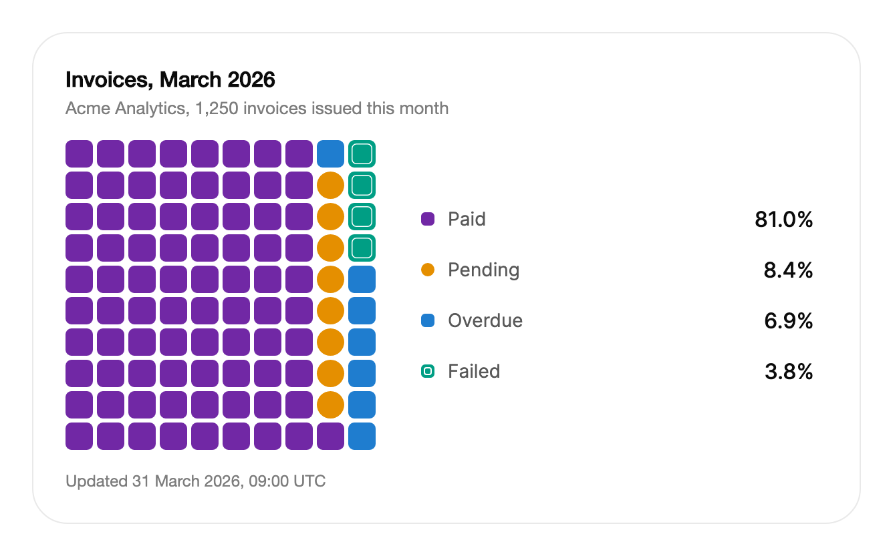

<Demo name="EnergyMix" />

## 何時使用

華夫圖把整體顯示為可以逐一數清的單位網格，讓讀者一眼看出 100 個方格中每個分組各佔多少。它適用於摘要卡片或儀表板磁貼，關心的問題是「這佔多少份額」，並且即使份額很小也必須清楚可見。預設情況下每個方格代表百分之一，網格下方或旁邊的圖例給出精確數字。

- **帳單摘要中的發票狀態**：在 Acme Analytics 帳號頁面中，本月發票中已付款、待處理、逾期和失敗各佔的份額。讀者數方格比比較圓餅圖的扇形更快。
- **營運儀表板中的支援工單組成**：未處理工單依優先順序或管道劃分的佔比。小份額（例如 4% 的緊急工單）仍會顯示為一個可見的方塊，而不是一條細縫。
- **報表中的能源或預算組成**：依來源劃分的發電量佔比，或依成本中心劃分的部門預算佔比，並與上一年的同一圖表並排顯示。保持分組不變的方格原位不動，因此兩組資料之間的變化會被讀成移動。
- **管理主控台中的配額與席位使用**：某個工作區的 500 個席位中已用 412 個。5 乘 20 的網格讓每個方格代表一個席位，當單位是席位、授權或點數時，它比百分比更有用。
- **產品調查中的問卷答案**：某個問題的「是、否、不確定」劃分，份額保留一位小數。每個答案都是一個可讀的分組，網格不需要座標軸。

## 何時不用

- **隨時間變化的佔比**：趨勢用 `LineChart`，多個佔比同時變化時用 `Streamgraph`。華夫圖只展示某一時刻，因此沒有地方容納一系列日期。
- **類別很多且必須精確比較**：用 `BarChart`。超過約六個類別後，較小分組的方格會少到難以比較，而且顏色和形狀開始重複。
- **需要下鑽的巢狀整體中的某一部分**：用 `Treemap`，它能呈現巢狀關係，並讓讀者從分組進入其組成部分。
- **一個佔比且中間顯示總數**：用 `DonutChart`，它把總數放在圓環中心，在狹窄的空間中也很清楚。
- **單一任務的完成度或配額與上限的對比**：任務用 `Progress`，附方案上限的配額用 `UsageMeter`。兩者都只提供一個值和一個清楚的上限，這是方格網格無法同樣直接呈現的。

## 用法

```xml
<UserControl xmlns="https://github.com/avaloniaui"
             xmlns:arc="https://github.com/AIDotNet/TKCode.Arc">
    <arc:WaffleChart Label="發電量"
                     Unit="TWh"
                     ItemsSource="{Binding Mix}" />
</UserControl>
```

`WaffleChart` 衍生自 Avalonia 的 `Control`，由它自己繪製方格，包含一個可聚焦的網格以及每個類別一列的圖例。它不是項目控制項：類別來自 `ItemsSource` 或 `Items`，由圖表負責繪製。你可以像對待其他控制項一樣設定尺寸與版面配置，圖表自帶鍵盤模型與無障礙摘要。

類別來自 `ItemsSource` 或內嵌的 `Items` 集合。設定了 `ItemsSource` 時，`Items` 會被忽略。

```csharp
var neutral = new WaffleChart { Label = "瀏覽器佔比", AccentKey = WaffleChart.NoAccent };
neutral.Items.Add(new WaffleCategory("chrome", "Chrome", 65.4));
neutral.Items.Add(new WaffleCategory("safari", "Safari", 18.6));
neutral.Items.Add(new WaffleCategory("other", "其他", 16.0));
```

圖表本身不繪製標題。請在它上方的 `TextBlock` 中放置標題，並把同樣的文字傳給 `Label`，後者是輔助技術朗讀的名稱。

### 結構

1. **網格**（`Rows` 乘 `Columns`）：方格。每個方格代表整體的一個單位，預設的 10 乘 10 使每個方格對應一個百分點。10 乘 10 時網格為正方形，方格之間相隔 3 px，最寬 300 px。
2. **圖例**（`IsLegendVisible`）：每個類別一列，包含 10 px 的色塊、類別名稱與佔比。佔比使用中等字重和主要文字顏色，名稱使用次要文字顏色。每列至少 36 px 高，列與列之間相隔 2 px。
3. **圖例位置**：圖表寬 420 px 或以上時，圖例位於網格旁邊，網格最寬 232 px，兩者間距 24 px。較窄時圖例位於網格下方，網格置中，圖例最寬 320 px，與網格之間相隔 24 px。
4. **游標**：指標或鍵盤讀數所在的方格。它有 2 px 的表面色間隙，以及 55% 不透明度、1.5 px 的前景色描邊環。
5. **工具提示**：一張卡片，第一行是色塊、類別名稱與佔比，第二行是格式化後的數值（帶 `Unit`），使用淡化文字顏色。它顯示在方格上方；上方沒有空間時顯示在下方。
6. **空狀態文字**（`EmptyLabel`）：沒有資料時，在網格的位置置中顯示淡化文字。空圖表高 160 px。

方格的形狀在顏色之外還承載了第二個通道。強調類別是圓角半徑為 22% 的方形方格。中性類別依序循環使用方形、圓形和帶細內圈的方形，因此色調相近的兩個類別在螢幕上以及灰階下仍然可以區分。

### 選擇網格

網格容納 `Rows` 乘 `Columns` 個方格，每個類別都依其數值的比例取得整數個方格。請選擇讓每個方格都有可數意義的尺寸。

| 單位 | 網格 | 原因 |
|---|---|---|
| 整體的百分比 | 10 乘 10（預設） | 一個方格代表一個百分點，讀者無需協助即可數清。 |
| 方案中的席位或授權 | 5 乘 20 或 10 乘 50 | 一個方格代表一個席位或一個配額單位。網格保持寬而矮。 |
| 保留一位小數的問卷答案 | 10 乘 10，並設定 `Decimals="1"` | 方格仍代表百分比，精確數字由圖例給出。 |

方格依最大餘數法分配。分配結果總是加總為網格的總格數，因此三個類別的值都為 1 時，會得到 34、33 和 33 個方格。數值之和不必為 100：圖表會依總數計算每個佔比。負值依零計。

### 強調色與顏色

`AccentKey` 指定使用第一個資料系列顏色的類別。未設定時，第一個類別即為強調類別。接下來的三個類別依序使用次要系列的顏色，之後的類別使用中性色調。

<Demo name="Neutral" />

```xml
<arc:WaffleChart Label="配額使用情況" Rows="5" Columns="20" AccentKey="used" ItemsSource="{Binding Quota}" />
```

將 `AccentKey` 設為你希望突顯的類別，例如逾期的發票或失敗的付款。擁有自己 `Color` 的類別會保持該顏色，與其排位無關。執行階段修改 `AccentKey` 會原地重新上色：方格不會移動，而是以與資料變化相同的錯落節奏改變顏色。

`WaffleChart.NoAccent` 取消強調色。前三個類別仍依序使用次要系列的顏色，只有第四個及之後的類別使用中性色調。當各類別是地位對等的項目時使用它，例如上面的瀏覽器佔比範例，並預期前三個類別會有顏色。

調色盤共有八種可區分的色調：強調色、三種次要系列的顏色和四個中性色階。超過八個類別後色調會重複，形狀每三個中性類別循環一次。在達到這一點之前，請把小類別合併為一個「其他」。

### 資料集

替換 `ItemsSource` 即可切換資料集。保留所在分組的方格原位不動，其餘方格飛到各自的新區塊。類別由其 `Key` 識別，因此請在各資料集之間保持鍵穩定：2015 年的 "coal" 與 2023 年的 "coal" 是同一批方格，而 "Coal (2015)" 則是一個新分組。

```csharp
energy.ItemsSource = Mix2015;
```

將 `ItemsSource` 設為新集合會讓圖表重建一次。若集合會發出變更通知，例如 `ObservableCollection<T>`，那麼在它被掛接期間，每次新增、移除或取代都會更新圖表。

### 選取器與非類別資料

當資料來源不是 `WaffleCategory` 時，設定 `KeySelector` 與 `ValueSelector`。`LabelSelector` 讀取每個項目的標籤，`Decimals` 設定佔比顯示的小數位數。

<Demo name="Selectors" />

```xml
<arc:WaffleChart Label="問卷答案"
                 KeyMemberBinding="{Binding Name}"
                 ValueMemberBinding="{Binding Votes}"
                 ItemsSource="{Binding Answers}" />
```

選取器優先於對應的成員繫結，成員繫結又優先於 `WaffleCategory` 項目的屬性。項目沒有標籤時，標籤即為其鍵。項目沒有鍵時，控制項使用項目的 `ToString()`，因此請為每個項目提供鍵。

### 釘選類別

釘選的類別會保持其方格醒目標示，並讓其他類別變暗。點選圖例列可釘選該類別，再點一次則釋放。`ActiveKey` 保存被釘選的鍵，預設為雙向繫結，因此檢視模型既可以讀取釘選狀態，也可以透過程式碼設定它。

```csharp
energy.ActiveKeyChanged += (_, e) => pinned.Text = $"已釘選：{e.Category?.Label ?? "無"}";
```

釘選某個類別後，懸停或聚焦到另一個類別會改為顯示那個類別；釋放釘選後，醒目標示會回到被釘選的類別。

### 空狀態

沒有類別，或總數為零時，網格會以 `EmptyLabel` 取代方格。空狀態下網格不可聚焦，圖例也會隱藏。

<Demo name="Empty" />

### 繫結到檢視模型

帶有項目和釘選鍵的圖表屬於檢視模型的職責。檢視模型擁有類別和釘選狀態，圖表負責呈現它們。最關鍵的是 `ItemsSource` 與 `ActiveKey` 兩個繫結：`ActiveKey` 預設為雙向繫結，因此點選圖例列會把鍵寫回檢視模型，檢視模型也可以透過設定它從程式碼中釘選某個類別。

```csharp
public sealed partial class InvoiceSummaryViewModel : ObservableObject
{
    [ObservableProperty]
    private IReadOnlyList<WaffleCategory> _statuses = [];

    [ObservableProperty]
    private string? _pinnedStatusKey;

    [RelayCommand]
    private void PinOverdue() => PinnedStatusKey = "overdue";
}
```

```xml
<arc:WaffleChart Label="發票狀態，2026 年 3 月"
                 Unit="張發票"
                 ItemsSource="{Binding Statuses}"
                 ActiveKey="{Binding PinnedStatusKey}" />
```

資料變化時請整體替換 `Statuses` 清單，而不是逐項編輯。集合的每次變化都會重建圖表，因此逐項變化的清單每個項目都要付出一次重建的代價。只有當清單需要原地編輯，並且每次編輯都應立即顯示時，才使用 `ObservableCollection<T>`。

### 資料結構與效能

每個項目都會成為一個 `WaffleCategory`，包含 `Key`、`Label`、`Value` 以及選用的 `Color`。每次變化都會重新讀取項目、配置方格並移動網格，因此開銷隨方格數（預設 100）和類別數增長。圖表是一個控制項、一個繪製表面，而不是每個方格一個控制項。請依讀者能跟上的節奏重新整理資料，例如儀表板上每分鐘一次；如果某個值每秒變化多次，請先將其平滑後再交給圖表。

佔比由數值的總和計算，因此請傳入原始計數或金額，而不是已經取整的百分比。請確保來源資料中的值為有限的非負數：`NaN` 或無限大會破壞總和，負值則依零計。

### 範例：帳號頁面上的帳單摘要

Acme Analytics 帳號頁面上的一張帳單摘要卡片，展示 2026 年 3 月開立的發票狀態。逾期分組是強調色，因為它是財務團隊需要處理的那一組。卡片較寬，因此圖例放在網格旁邊。標題是圖表上方的 `TextBlock`，圖表的 `Label` 則為輔助技術重複該標題。佔比保留一位小數，使 6.9% 的逾期佔比與 8.4% 的待處理佔比可以區分。

檢視模型以不可變清單保存各狀態。每個新月份都會取代整個清單，因此圖表只重建一次，方格飛到各自的新分組。

```csharp
public sealed record InvoiceStatusCount(string Key, string Label, double Count);

public interface IInvoiceService
{
    Task<InvoiceStatusCount[]> CountByStatusAsync(DateOnly month);
}

public sealed partial class InvoiceSummaryViewModel : ObservableObject
{
    private readonly IInvoiceService _invoices;

    public InvoiceSummaryViewModel(IInvoiceService invoices) => _invoices = invoices;

    [ObservableProperty]
    private IReadOnlyList<WaffleCategory> _statuses = [];

    [ObservableProperty]
    private string? _pinnedStatusKey;

    [RelayCommand]
    private async Task LoadAsync(DateOnly month)
    {
        var counts = await _invoices.CountByStatusAsync(month);
        Statuses = counts.Select(c => new WaffleCategory(c.Key, c.Label, c.Count)).ToList();
    }
}
```



```xml
<Border Width="620"
        Padding="24"
        Background="{arc:ArcDesignTokenResource Surface}"
        BorderBrush="{arc:ArcDesignTokenResource Border}"
        BorderThickness="1"
        CornerRadius="{arc:ArcDesignTokenResource RadiusPanel}">
    <StackPanel Spacing="16">
        <StackPanel Spacing="4">
            <TextBlock Text="Invoices, March 2026"
                       FontSize="16"
                       FontWeight="SemiBold"
                       Foreground="{arc:ArcDesignTokenResource Foreground}" />
            <TextBlock Text="Acme Analytics, 1,250 invoices issued this month"
                       FontSize="13"
                       Foreground="{arc:ArcDesignTokenResource TextMuted}" />
        </StackPanel>
        <arc:WaffleChart Label="Invoice status, March 2026"
                         Unit="invoices"
                         Decimals="1"
                         AccentKey="overdue">
            <arc:WaffleChart.Items>
                <arc:WaffleCategory Key="paid" Label="Paid" Value="1012" />
                <arc:WaffleCategory Key="pending" Label="Pending" Value="105" />
                <arc:WaffleCategory Key="overdue" Label="Overdue" Value="86" />
                <arc:WaffleCategory Key="failed" Label="Failed" Value="47" />
            </arc:WaffleChart.Items>
        </arc:WaffleChart>
        <TextBlock Text="Updated 31 March 2026, 09:00 UTC"
                   FontSize="12"
                   Foreground="{arc:ArcDesignTokenResource TextMuted}" />
    </StackPanel>
</Border>
```

### 文案規範

標籤與單位會被朗讀，也會顯示在工具提示中，因此請像撰寫同一資料的表格那樣書寫。

| 不要寫 | 改為 |
|---|---|
| `No data`（帳單卡片上的預設空狀態文字） | `No invoices in this period` |
| `Chrome Browser Application Version 124` | `Chrome`（螢幕上會縮短過長的名稱，完整名稱保留在工具提示中） |
| `Category A`、`Group 2` | 真實的類別：`Paid`、`Overdue`、`Wind and solar` |
| 單位寫作 TWH 或 twh | TWh，依來源資料的寫法書寫單位 |
| 只用 Chart 之類的泛稱作為標籤 | `Invoice status, March 2026`，說明整體是什麼 |
| 每個圖表都用 `Decimals="2"` | `Decimals="0"`，只有兩個佔比四捨五入後相同時才用一位小數 |

類別名稱使用標題式大小寫，圖表的 `Label` 使用句子式大小寫。類別名稱要簡短：圖例會縮短放不下的名稱，而被縮短的名稱較難與工具提示對應。

### 最佳做法

**建議**

- 類別數保持在六個或以內。超過八個後色調會重複，讀者無法僅憑顏色或形狀區分各分組。
- 在各資料集之間使用穩定的 `Key` 值，使方格原位不動，讓兩組資料之間的變化讀成移動。
- 把 `AccentKey` 設為讀者應當採取行動的那一個類別。單一強調色為視線提供了一個起點。
- 在 `TextBlock` 中為圖表加上標題，並在 `Label` 中使用相同的文字，讓看得見的使用者和輔助技術使用者看到同一個問題。
- 當原始值需要特定文化或 `Unit` 無法表達的單位時，傳入 `ValueFormatter`。原因是：預設的數值文字使用 en-US 的千位分隔符。

**避免**

- 用圖表做類別之間的精確比較。華夫圖能很好地讀出佔比，但長條圖更擅長讀出兩組之間的差異，而且方格會把每個佔比四捨五入到最近的一個方格。
- 負值，圖表會將其依零計。淨額（例如抵銷一筆付款的退款）在進入圖表之前需要有自己的值。
- 在即時儀表板上於執行階段修改 `Rows` 或 `Columns`。方格數量會變化，因此每個方格都被一次性重新指派，資料變化的動態效果也就失去了。
- 沒有標題的圖表。圖表只繪製網格和圖例，讀者無法得知這些方格在數什麼。
- 在沒有其他元素顯示數字時隱藏圖例（`IsLegendVisible="False"`）。方格顯示的是整體的形狀，只有圖例給出每個類別的名稱與佔比。

### 常見問題

**我設定了 `Items`，圖表卻顯示 "No data"。** `ItemsSource` 優先。設定了 `ItemsSource` 時，內嵌的 `Items` 集合會被忽略，因此請只設定 `ItemsSource`，或只對 `Items` 新增，不要兩者都用。

**一個類別的方格為什麼比我預期的少一格？** 方格依最大餘數法分配。每個類別先取得其佔比的整數個方格，然後剩餘的方格分給小數部分最大的類別。三個相等的類別會得到 34、33 和 33 個方格，因為第一個類別拿到了剩餘的那一格。

**如何讓某個類別無論位置如何都保持顏色？** 為該類別設定它自己的 `Color`，或把 `AccentKey` 設為它的鍵。擁有 `Color` 的類別會保留該顏色；強調色無論出現在資料的哪個位置，都取第一個系列的顏色。

**如何在程式碼中讀取被釘選的類別？** 處理 `ActiveKeyChanged`，讀取 `e.Key` 或 `e.Category`，釋放釘選時它們為 null。或者像上面的範例那樣，將 `ActiveKey` 雙向繫結到檢視模型的屬性。

**為什麼我的德語應用程式中，佔比用點號作為小數點？** 控制項依 en-US 規則格式化佔比，預設的數值文字也是如此。請設定 `ValueFormatter`，用你自己的文化格式化原始值。圖表沒有用於佔比的格式化器，因此當你需要在地化的佔比時，請讀取 `Categories` 與 `CellCounts`，並在圖表旁邊顯示你自己的文字。

## API 參考

<!-- api: WaffleChart -->

<!-- api: WaffleCategory -->

| 成員 | 類型 | 說明 |
|---|---|---|
| `Key` | `string?` | 被釘選的類別鍵；釋放釘選時為 null |
| `Category` | `WaffleCategory?` | 被釘選的類別；釋放釘選時為 null |

## 無障礙

- `Label` 為圖表命名。網格是一個可聚焦的群組，帶有角色描述和按鍵說明。
- Tab 鍵先將焦點移到網格，然後依序移到每個圖例列。每個圖例列都是帶文字名稱的切換按鈕。
- 在網格中，方向鍵每次將讀數移動一個方格。PageUp 與 PageDown 跳到上一個或下一個類別的第一個方格，Home 與 End 分別跳到第一個與最後一個已填滿的方格。Escape 清除讀數。
- 在圖例列上按 Enter 或空白鍵，可釘選或釋放其類別。
- 禮貌型即時區域會朗讀讀數下方的類別、佔比與數值。一個隱藏的資料表列出每個類別的數值、佔比與方格數量。
- 方格對輔助技術隱藏。螢幕上會縮短較長的圖例名稱，但完整名稱保留在工具提示、即時區域與資料表中。

### 鍵盤

| 按鍵 | 操作 |
|---|---|
| `Tab` / `Shift+Tab` | 移入網格，讀數從第一個方格開始，然後移到每個圖例列。空圖表會被略過 |
| 方向鍵 | 將讀數上、下、左或右移動一個方格；讀數在網格邊緣處停止 |
| `PageDown` / `PageUp` | 跳到下一個或上一個類別的第一個方格。在類別中間時，`PageUp` 會跳到該類別的第一個方格 |
| `Home` / `End` | 跳到第一個方格，或最後一個已填滿的方格 |
| `Escape` | 清除讀數 |
| `Enter` / `Space`（圖例列） | 釘選該類別；若已釘選則釋放 |

讀數會播報類別名稱、佔比與數值，例如 "煤炭，35%，35 TWh"。

## 動態效果

- 方格盡量保留原位。其餘方格以錯落的波浪形飛到新區塊，飛行中的方格會略微縮小並改變顏色。
- 圖例佔比以臨界阻尼彈簧平順計數到新值。
- 首次顯示時，方格從左下角依序出現。
- 減少動態效果時，方格與佔比立即定位到位，並取消縮小、出現與錯落的效果。關閉動態效果的表現與減少動態效果相同。

| 變化 | 完整 | 減少 | 關閉 |
|---|---|---|---|
| 資料集取代 | 保持類別不變的方格原位不動；其餘方格以錯落的波浪飛入，縮小到 62% 的比例並改變顏色 | 立即就位 | 立即就位 |
| 圖例佔比 | 以平滑彈簧滾動到新值 | 立即設定 | 立即設定 |
| 首次顯示 | 方格從左下角逐欄出現，從 40% 放大，並帶有錯落的淡入 | 立即顯示 | 立即顯示 |
| 被釘選或聚焦的類別 | 其他類別在標準時長內淡化到 26% 不透明度 | 立即變化 | 立即變化 |
| 強調色變化 | 方格以與資料變化相同的錯落節奏改變顏色 | 立即變化 | 立即變化 |

## 相關元件

- `DonutChart`：單一環形中的佔比，中心顯示總數。
- `BarChart`：類別之間的精確比較。
- `Progress`：單一任務的完成進度；`UsageMeter`：配額相對上限的用量。
- `Treemap`：類別呈巢狀結構且需要下鑽時使用。

| 元件 | 適用情境 |
|---|---|
| `DonutChart` | 一個佔比，中心顯示總數，空間較窄 |
| `BarChart` | 讀者必須精確比較類別的大小 |
| `LineChart` / `Streamgraph` | 佔比隨時間變化 |
| `Treemap` | 類別呈巢狀結構且需要下鑽 |
| `Progress` / `UsageMeter` | 一個任務的完成度，或一個配額相對其上限 |
