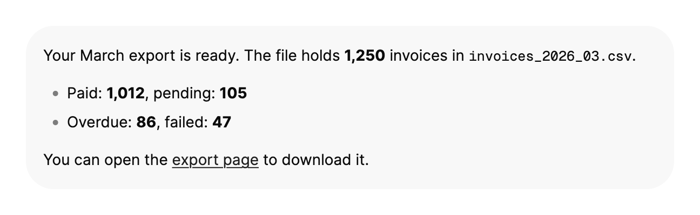

<Demo name="Document" />

## 何时使用

`Markdown` 渲染作者以 Markdown 编写的文本：标题、列表、表格、引用、链接和围栏代码。它用于产品展示那些自己不手工排版的格式化文字，例如发布说明、帮助文章或模型的回答。控件接收 Markdown 源码，解析后以 Arc 的字体、颜色和间距绘制，因此面板、聊天气泡或文档视图中的文字与应用其余部分保持一致。

- **发布说明与应用内帮助**：Acme Analytics 中的“新功能”面板，展示内容团队以 Markdown 文件撰写的说明。标题、列表和链接在每个版本中外观一致，无需为每个版本单独手工排版。
- **支持聊天中的助手回复**：逐个词元到达的回答。每个数据块调用 `Append`，结束时调用 `Complete`，回复末尾的文字淡入，而前面的段落保持不动。
- **带代码示例的开发者文档**：API 指南中的围栏代码块，C#、TypeScript、JSON 或 shell 代码使用 Arc 调色板中的语法颜色。超过 12 行的长代码块会折叠，因此一个示例不会把页面其余部分挤开。
- **来源不可控的富文本**：工单正文、CMS 字段或导入的笔记。标题、表格和链接与产品保持一致，链接默认在系统浏览器中打开，除非应用接管。
- **字号较小的消息气泡**：支持对话中 14 px 的回复，行高和块间距随字号变化，使气泡保持紧凑。

## 何时不用

- **带复制按钮的单个代码示例**：用 `CodeBlock`，它是一个带有自己标题栏和操作的代码块。`Markdown` 用于混合了段落、列表和代码的文档。
- **需要自身滚动的长文档**：将控件包裹在 `ScrollViewer` 中。文档随内容增长，自身没有滚动条。对于很长的对话，请使用 StreamMark 库的对话记录视图。
- **原位编辑 Markdown 源码**：用 `Textarea`，它保存原始文本、自动换行，并允许用户编辑。`Markdown` 只显示渲染结果。
- **发票等结构化记录**：用“表格”分组中的 `SortableDataTable`，它会排序，并在行变化时保持列对齐。Markdown 表格是只读的，没有排序功能。
- **数学公式、图表或其他嵌入式格式**：`Markdown` 渲染文字、代码和表格。需要时，请把 StreamMark 的数学或图表插件加入你自己的 `MarkdownServices`，而不是在文字中粘贴图片。

## 用法

静态文本通过 `Text` 设置。文档随内容增长，内部没有滚动。

```xml
<UserControl xmlns="https://github.com/avaloniaui"
             xmlns:arc="https://github.com/AIDotNet/TKCode.Arc">
    <arc:Markdown Text="## 发布说明&#10;&#10;Arc **0.4** 新增 `Markdown`。" />
</UserControl>
```

`Markdown` 派生自 Avalonia 的 `TemplatedControl`。它的模板是包裹 StreamMark `MarkdownView` 的外框，解析与布局由该视图完成。Arc 通过该视图的 `Md.*` 资源提供颜色、字体和圆角，因此文档会跟随主题范围、明暗模式和强调色。由于文档是一个视图而不是文本块，它可以像任何文档一样选中、复制和换行，并随内容增长。

### 结构

1. **外框**：透明的 `Border`。主题不为它设置边框和内边距，文档占满容器的全部宽度（`HorizontalAlignment` 为 `Stretch`）。
2. **正文**：16 px 的正文字体，行高 26 px（字号乘以 1.65）。文字按容器给出的宽度换行。
3. **块**：段落、列表、引用、代码和表格之间相隔 12 px（`BlockSpacing`）。
4. **标题与列表标记**：标题使用前景色，由文档视图决定其大小。列表标记使用弱化文字颜色，使列表项文字保持最醒目。
5. **链接**：强调色并带下划线。默认在系统浏览器中打开。
6. **行内代码**：等宽字体，背景为弱化的表面色。
7. **围栏代码**：表面色背景，边框为边框色，使用等宽字体和 Arc 语法调色板。超过 12 行的代码块会折叠，并提供显示全部行的控件。代码块提供复制，不提供下载。
8. **引用**：被引用文字旁边有一条强边框色的竖线。
9. **表格**：边框为边框色，表头行为弱化表面色，单元格文字使用正文字体。
10. **标记与选区**：被标记的文字位于警告色的淡化底色上，选中的文字位于强调色的淡化底色上。

### 绑定文档

将 `Text` 绑定到视图模型属性。设置它会替换仍在显示的回复，`null` 或空字符串会显示空文档。

```xml
<arc:Markdown Text="{Binding ReleaseNotes}" FontSize="14" BlockSpacing="10" />
```

`FontSize`、`FontFamily`、`LineHeight` 和 `BlockSpacing` 是仅有的排版参数。请将 `LineHeight` 保持默认值（NaN），使行高跟随字号。只有设计需要精确值时才设置它。

### 绑定到视图模型

视图模型拥有 Markdown 源码，对于回复还拥有流。使用 CommunityToolkit.Mvvm 时，文本是一个 `ObservableProperty`，流是另一个。

```csharp
public sealed partial class ReleaseNotesViewModel : ObservableObject
{
    [ObservableProperty]
    private string? _releaseNotes;

    [ObservableProperty]
    private MarkdownStream? _reply;
}
```

```xml
<arc:Markdown Text="{Binding ReleaseNotes}" />
<arc:Markdown Stream="{Binding Reply}" />
```

请让两个绑定都保持单向。控件自身在 `Append` 开始一个回复时会把 `Text` 设为 `null` 并替换流；若使用双向绑定，这些值就会写回视图模型。`IsStreaming` 为只读，报告控件上流的状态。

### 流式回复

每个数据块到达时调用 `Append`，回复结束时调用 `Complete`。文字会按节奏显示，新词在文档末尾淡入。`IsStreaming` 在节奏化的待显示内容全部呈现之前保持为 `true`，因此状态行可以显示“正在输出”，直到回复完全显示在屏幕上，而不是直到最后一个数据块到达。

<Demo name="StreamedReply" />

```csharp
markdown.Append(chunk);   // 词元到达时调用，在 UI 线程上执行
markdown.Complete();      // 回复结束时调用
```

三个属性调整追加文字的显示方式。`RevealFadeDuration` 设定每批新文字在完整动效下的淡入时长（为 null 时使用 Arc 的标准时长）；`RevealFadeInReducedMotion` 可在减少动效下关闭淡入，适合持续增长的回复；`IsPaced` 设为 false 时，每次追加的内容会作为一批立即显示，适用于宿主已自行控制节奏的情况，例如按固定时钟逐个整词放出。

`Complete` 之后再调用 `Append` 会开始新的回复，并替换当前显示的内容：此后 `Text` 读取为 `null`。你自己创建的流可以改为设置到 `Stream` 上，例如由工作线程通过 `MarkdownStream.Push` 写入、并以 `Complete` 结束的流。控件在 UI 线程上应用快照，因此工作线程只推送文字，从不触碰控件。

### 聊天尺寸

消息气泡可使用较小的 `FontSize`。`LineHeight` 默认为字号乘以 1.65，因此 14 px 的回复行高为 23 px，代码字号也随之变化。

<Demo name="ChatSize" />

### 链接

绝对路径的 `http`、`https` 和 `mailto` 链接会通过系统启动器打开。处理 `LinkClicked` 即可接管，并将事件标记为已处理以阻止默认行为。设置 `OpensLinks="False"` 可关闭默认行为。被链接策略标记为需要确认的链接不会由默认处理程序打开，因此请在你自己的处理程序中确认。指向文档内部的锚点会自行滚动到目标位置，且不会触发 `LinkClicked`。

```csharp
markdown.LinkClicked += (_, e) =>
{
    e.Handled = true;
    OpenInsideApp(e.Url);
};
```

### 宿主集成

在文档周围自建界面（大纲侧栏、查找栏、复制按钮）的宿主使用公开接口，不必遍历模板。大纲按阅读顺序列出每个标题及其跳转位置；`Find` 高亮所有匹配并返回数量；`FindNext` / `FindPrevious` 移动当前匹配；选区方法复制读者选中的内容。

<Demo name="Outline" />

```csharp
markdown.DocumentReady += (_, _) =>
{
    foreach (var item in markdown.GetOutline())
    {
        AddOutlineRow(item.Level, item.Text, () => markdown.ScrollToPoint(item.Target));
    }
};

var count = markdown.Find(query);      // 高亮所有匹配
markdown.FindNext();                   // 当前匹配移动并滚动到它
```

| 成员 | 用途 |
|---|---|
| `GetOutline()` | 按阅读顺序返回标题：级别、文字、id 与目标位置 |
| `ScrollToPoint`、`ScrollToBlock`、`ScrollToAnchor` | 跳到大纲项、区块或标题锚点 |
| `Find`、`FindNext`、`FindPrevious`、`FindAt`、`ClearSearch` | 查找栏，`MatchCount` 与 `CurrentMatchIndex` 用于显示进度 |
| `SelectAll`、`GetSelectedText`、`GetSelectedMarkdown`、`CopySelectionAsync` | 复制操作，`HasSelection` 用于按钮的可用状态 |
| `IsDocumentReady`、`DocumentReady` | 判断大纲、匹配与跳转位置何时最终确定 |

解析在工作线程上进行，因此时序也是契约的一部分。模板尚未应用时没有视图：大纲为空、跳转方法返回 `false`、`Find` 返回 0、选区为空。设置新的 `Text` 或 `Stream` 后，`IsDocumentReady` 会在快照解析并应用之前保持 `false`，之后 `DocumentReady` 运行一次。查找条件会被保留，因此文档在查找期间变化时会重新执行查找。重新套用模板会创建新视图：文档交给新视图，`DocumentReady` 再次运行，查找也重新执行，但选区不会保留。宿主在加载后恢复滚动位置时，请等待 `DocumentReady` 事件，不要用计时器。

### 代码高亮

`MarkdownHighlightPlugin` 使用 `CodeBlock` 同样使用的 TextMate 语法为围栏代码着色，并以 Arc 语法调色板中适用于明暗模式的颜色绘制每种角色。注释为斜体。没有语法的语言保持为纯文本，因此未知的标签不会导致文档失败。该插件是默认服务的一部分。把语言名称传给它的构造函数，可以在第一个代码块请求之前在后台预加载这些语法。

```csharp
markdown.Services = new MarkdownServices
{
    Plugins = [new MarkdownHighlightPlugin("cs", "ts")],
};
```

若某个视图要求代码不带颜色显示，请不要把该插件放入 `Plugins`，此时代码块就是等宽字体的纯文本。

### 服务与优先级

StreamMark 服务决定文档如何解析以及代码块如何表现。控件按以下顺序选取服务：自身的 `Services` 属性，然后是祖先通过 `MarkdownServices.SetServices` 设置的服务，最后是 `Markdown.DefaultServices`。在窗口或页面上设置服务，可以让视图中的每个文档使用相同的插件。插件可以改变 Markdown 方言，因此修改服务会重新解析静态文本。

`Markdown.DefaultServices` 使用 `MarkdownHighlightPlugin` 高亮代码，复制代码但不提供下载，并把长代码块折叠为 12 行。

### 示例：支持聊天中的助手回复

一个支持助手在聊天气泡中回答 Acme Analytics 的客户。回复使用一个简短列表和一个指向导出页面的链接，并设为 14 px，以与对话中的其余文字保持一致。气泡有弱化的表面色和 16 px 的内边距。这里的回复是静态的，因此截图展示的是已稳定的文字，也就是流式回复在 `IsStreaming` 变为 `false` 后所达到的状态。



```xml
<Border Width="600"
        Padding="16"
        Background="{arc:ArcDesignTokenResource SurfaceMuted}"
        CornerRadius="{arc:ArcDesignTokenResource RadiusPanel}">
    <arc:Markdown FontSize="14"
                  Text="Your March export is ready. The file holds **1,250** invoices in `invoices_2026_03.csv`.&#10;&#10;- Paid: **1,012**, pending: **105**&#10;- Overdue: **86**, failed: **47**&#10;&#10;You can open the [export page](https://uiarc.dev) to download it." />
</Border>
```

### 文案规范

渲染出的文字会被当作文档阅读，因此请像写文档那样书写：简短的标题、完整的句子，以及能说明去向的链接文字。

| 不要写 | 改为 |
|---|---|
| 把 `Here's the thing!` 用作标题 | `Changes in version 0.4` |
| 把 `Click here` 用作链接 | `Read the migration guide` |
| 把 `Loading...` 用作占位回复 | 让回复保持为空，并用 `IsStreaming` 显示状态 |
| 八列的表格 | 两到三列，其余内容放在表格下方的列表中 |
| 聊天回复中间一段 60 行的代码示例 | 关键的三行代码，以及指向完整示例的链接 |
| 句子中间的裸 URL | 以页面名称作为文字的链接 |

标题使用句子式大小写，并保持简短，便于一眼扫读。代码示例要便于读者复制：写完整的语句，并在围栏中标明语言（`cs`、`ts`、`json`、`xml`、`sh`），以便高亮器为其上色。

### 最佳实践

**推荐**

- 将 `FontSize` 设为与周围文字一致，而不是使用默认值，使面板中的文档与气泡中的回复不会并排显示两种字号。
- 把 `IsStreaming` 显示为状态，并在它为 `true` 时禁用发送按钮，使用户不会在第一条回复结束前发送第二个问题。
- 为应用保留一个 `MarkdownServices`，并设置在窗口上，使每个文档的代码高亮方式一致。
- 将长文档放入 `ScrollViewer`，使滚动和滚动条来自同一个容器。
- 当链接必须在应用内打开或需要确认时，处理 `LinkClicked`，使决定权留在你的代码中。

**避免**

- 在同一个控件上同时设置 `Text` 和 `Stream`。最后设置的值生效，另一个会被清除或忽略。
- 逐个字符追加。每个数据块都会被解析并按节奏显示，因此应推送几个词一组的数据块，就像模型的词元流那样。
- 在多字号的布局中使用固定的 `LineHeight`。固定值不随字号变化，因此 14 px 的回复和 16 px 的文档会逐渐错位。
- 依赖 `Markdown` 来呈现需要排序或筛选的表格。Markdown 表格没有排序，也没有选择功能。
- 在没有 `LinkClicked` 处理程序的情况下显示来源不可信的 Markdown。绝对链接默认会在系统浏览器中打开，因此请先在你自己的处理程序中检查 URL。

### 常见问题

**为什么流式回复结束后 `Text` 读取为 `null`？** `Append` 会开始一个流，并把 `Text` 设为 `null`，因为回复会取代静态文本。再次设置 `Text` 即可显示静态文本，同时也会结束流。

**为什么我的文档不能滚动？** `Markdown` 随内容增长，没有内部滚动条。将它包裹在 `ScrollViewer` 中，由它滚动整个文档。

**如何知道回复已完整显示？** 读取 `IsStreaming`，或监听 `PropertyChanged` 中它的变化。在 `Complete` 之后，待显示内容全部呈现时它变为 `false`，这可能在最后一个数据块到达之后片刻才发生。

**为什么长代码块会被折叠？** 默认服务会把代码块折叠为 12 行，并显示一个展开控件，这样长示例就不会把聊天回复中的其余内容挤出视野。若要更改上限，请在 `MarkdownServices` 中设置你自己的 `CodeBlocks` 选项。

**为什么点击链接时没有打开？** 默认只打开绝对路径的 `http`、`https` 和 `mailto` 链接。相对链接、自定义协议或需要确认的链接，会交由你的 `LinkClicked` 处理程序决定。

## API 参考

<!-- api: Markdown -->

| 成员 | 类型 | 说明 |
|---|---|---|
| `Name` | `string` | 插件名称，即 `arc-highlight` |
| `Highlighter` | `ISyntaxHighlighter` | 该插件注册的高亮器，由所有文档共享 |

`MarkdownHighlightPlugin` 的构造函数接收需要预热的语言名称，例如 `"cs"` 和 `"ts"`。

## 无障碍

- 文字可以选中并复制。链接带有下划线，并使用强调色，因此不会只靠颜色区分。
- 代码块使用与 `CodeBlock` 相同的调色板。颜色用于辅助源文字，从不取代源文字：每个词元都保留其字符，因此代码在屏幕阅读器或纯文本复制中读起来一样。
- 在流式回复仍未结束时，使用 `IsStreaming` 显示状态。在 `IsStreaming` 变为 `false` 之前一直显示“正在输出”的状态行，会告诉用户回复何时完成。

### 键盘

- `Markdown` 自身不接收键盘焦点，也不添加任何按键绑定。选择与复制来自文档视图。

## 动效

- 流式回复中的新文字在 240 ms 内淡入。节奏控制会把文字分散开来，使其不会成批到达。
- 减弱动效时，淡入缩短为 160 ms，且只使用不透明度变化。关闭动效时，新文字立即显示，没有淡入。
- 节奏控制在所有动效级别下都生效。它控制文字何时出现，而不是一段动画。

| 变化 | 完整 | 减弱 | 关闭 |
|---|---|---|---|
| 流式回复中的新文字 | 在文档末尾淡入，240 ms | 仅以不透明度淡入，160 ms | 立即显示 |
| 流式回复的节奏 | 应用 | 应用 | 应用 |

## 相关组件

- `CodeBlock`：单独展示一个代码示例。
- `Textarea`：用户需要编辑多行文字时使用。

| 组件 | 适用场景 |
|---|---|
| `CodeBlock` | 一个带有自己复制操作的代码示例 |
| `Textarea` | 用户编辑多行文字，且原始源码才是重点 |
| `SortableDataTable` | 记录必须排序，例如发票表格 |
