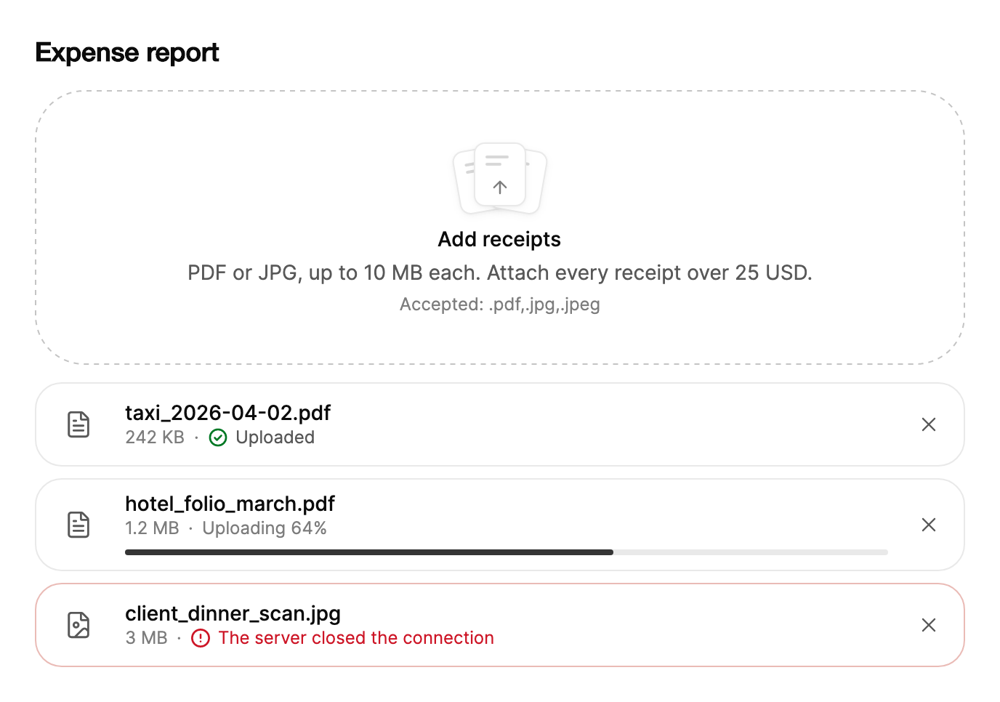

<Demo name="Upload" />

## 何時使用

`FileDropzone` 是表單或頁面收集檔案時的附件目標區。它把拖放目標、系統檔案選擇器、剪貼簿貼上，以及顯示每個檔案上傳狀態的清單組合在一起，讓使用者無需離開頁面，就能看到哪些檔案已被接受、哪些仍在上傳、哪些失敗了。它應放在檔案所屬的欄位下方，例如卡片或設定區塊之內。

- **帳務或報帳頁面中的發票與收據附件**：財務人員拖入一批 PDF 收據，看到每個檔案的大小，並移除重複掃描的那一份。`MaxFiles` 與 `MaxFileSize` 會把限制顯示在目標區旁邊，因此沒有人需要等到上傳失敗後才發現它們。
- **支援工單中的截圖與記錄檔**：支援人員複製截圖，並在指標位於目標區上方時按下 Ctrl+V，圖片就會作為一列加入，並附上縮圖。貼上無需額外按鈕。
- **CRM 或管理主控台中的批次資料匯入**：單一 CSV 檔案，`AllowMultiple` 設為 `False`，`Accept=".csv"`。新檔案會取代舊檔案，因此不會有匯入使用的是哪個檔案的疑問。
- **金融開戶流程中的身分證件**：固定大小以內的圖片與 PDF，上傳透過 `UploadHandler` 交給應用程式自己的安全端點完成。被拒絕的上傳會在其列中顯示失敗原因。
- **開發者工具中的發佈資產**：應用程式執行自己的上傳佇列，並透過 `ReportProgress`、`CompleteUpload` 與 `FailUpload` 為每一列回報進度，因此清單反映的正是應用程式既有的佇列。

## 何時不用

- **只需要系統檔案對話方塊，不需要檔案清單**：從自己的 `Button` 呼叫 `BrowseAsync`，或使用一般的 `Button` 在應用程式內開啟選擇器。沒有清單的投放區會多出使用者並不需要的區域。
- **頁面為空，拖放是唯一操作**：使用 `EmptyState`，以更醒目的行動呼籲搭配標題與簡短說明，例如新工作區中的第一次匯入。
- **從一組已知值中選取一個**：用 `Select` 或 `RadioGroup`。檔案是帶有上傳生命週期的值，不要把投放區當作固定選項的選擇器。
- **繪製簽名而不是附加檔案**：用 `SignaturePad`，它在應用程式內產生以筆劃為基礎的圖像，不會從磁碟讀取檔案。
- **撰寫包含圖片與格式的內文**：用 `RichTextEditor`，它把文字與格式保存在同一份文件中。投放區只是在文件旁邊列出檔案。

## 用法

```xml
<UserControl xmlns="https://github.com/avaloniaui"
             xmlns:arc="https://github.com/AIDotNet/TKCode.Arc">
    <arc:FileDropzone Label="新增檔案"
                      Description="將檔案拖放到此處，或從裝置中選擇"
                      Accept=".pdf,image/*"
                      MaxFiles="6" />
</UserControl>
```

`FileDropzone` 衍生自 `TemplatedControl`，而不是 `Button`。整個目標區都是點擊區域：其內部按鈕會開啟系統檔案選擇器，因此在目標區任何位置點擊、按 Enter 或空白鍵都會開啟它。列、錯誤列與拖放回饋都屬於同一個範本，因此控制項在每種狀態下都只保留一個標籤、一段說明與一份清單。拖放、貼上與選擇器都匯入同一條驗證路徑，這表示同一套規則（`Accept`、`MaxFiles`、`MaxFileSize`、`AllowMultiple`）適用於檔案抵達的每一種方式。

### 結構

1. **目標區表面**：繪製的區域，帶有表面背景、虛線邊緣與圓角。它使用表面圓角（預設尺寸下為 34 px），緊湊模式下收合為面板圓角（26 px）。懸停與按下目標區時，背景變為淡化的表面色。
2. **紙張圖示**：三張疊放的紙與一個箭頭。懸停時紙張抬起 3 px；檔案拖到目標區上方時，虛線邊緣會閉合為帶強調色的實線邊緣。
3. **標籤**（`Label`）：目標區的標題，使用前景色。檔案懸停在目標區上方時，它改為顯示拖放文案：若設定了 `DropLabel` 則顯示它；否則，設定了上傳處理常式時顯示「放開即可上傳」，多個檔案顯示「放開即可新增檔案」，單一檔案顯示「放開即可新增檔案」。
4. **說明**（`Description`）：標籤下方的一行，說明該做什麼。
5. **附註**（`Note`）：說明下方的一行小字。預設列出可接受的類型（「接受：.pdf,image/*」）或數量限制（「最多 6 個檔案」）。緊湊模式下隱藏。
6. **錯誤列**（`ErrorMessage`，唯讀）：目標區下方帶有危險色提示圖示的一行。檔案被拒絕時出現，直到下一次成功加入或移除才消失。
7. **檔案清單**：目標區下方的列（預設 `ListPlacement="Below"`），或位於其邊緣之內（`Inside`），兩側內距為 12 px。列依加入的順序排列。
8. **列**：縮圖（解碼後的 80 px 預覽，圓角 10 px）或類型圖示、檔名、大小、狀態、4 px 高的進度條、30 px 高的重試按鈕，以及 32 px 見方的移除按鈕。每列高度至少 58 px。列寬小於 440 px 時，重試按鈕只顯示圖示；小於 300 px 時隱藏類型圖示。

### 選擇接受的類型與限制

`Accept` 與 HTML 檔案輸入框的方式相同，接受以逗號分隔的副檔名（「.pdf」）與 MIME 模式（「image/*」「application/pdf」）。副檔名符合檔名的結尾；帶 `/*` 的模式符合 MIME 類型的前綴；其他值必須與 MIME 類型完全相等。系統選擇器的篩選條件也由同一份清單產生。將 `Accept` 留空即接受所有檔案。

請依據業務規則設定限制，而不是使用預設值：

- `MaxFiles`（預設 5）限制清單的數量。超過上限的一批檔案會加入可以容納的部分，並拒絕其餘檔案。
- `MaxFileSize`（以位元組為單位，預設不限制）會使超過該大小的任何檔案在其列中失敗。該檔案會列出失敗原因，沒有重試按鈕，也絕不會上傳。請移除它，改為加入較小的檔案。
- `AllowMultiple`（預設 `True`）允許多個檔案。設為 `False` 時，新檔案會取代目前的檔案，並取消被取代檔案的上傳。

<Demo name="Images" />

Images 示例只接受圖片，每個最大 2 MB（`MaxFileSize="2097152"`），最多三個檔案。說明以使用者需要的文字陳述限制：格式與大小。

### 列狀態

每個 `FileDropzoneItem` 都有一個來自 `FileDropzoneStatus` 列舉的 `Status`，它決定該列顯示什麼。

| 狀態 | 含義 | 列中顯示的內容 |
|---|---|---|
| `None` | 一般選取項，沒有上傳 | 檔案、其大小，沒有進度條 |
| `Uploading` | 正在上傳；`Progress` 從 0 變化到 100 | 進度條與百分比 |
| `Uploaded` | 上傳完成；`Progress` 為 100 | 列上的勾號標記 |
| `Failed` | 上傳或檢查失敗；`Error` 保存原因 | 失敗原因、紅色邊緣，以及允許時的重試按鈕 |

`FileDropzoneItem` 為每個屬性引發 `PropertyChanged`，因此應用程式可以直接設定 `Status`、`Progress` 與 `Error`。投放區上的方法同樣如此，並且還會把變化通知輔助技術，因此在應用程式驅動列時優先使用這些方法。

### 單一檔案

將 `AllowMultiple` 設為 `False` 後，投放區只保存一個檔案。新檔案會取代目前的檔案，取消舊檔案的上傳，並引發 `FilesChanged`。

<Demo name="SingleFile" />

適用於合約或匯入等情境，此時第二個檔案屬於誤操作。此時拖放文案使用單數（「放開即可新增檔案」）。

### 上傳處理常式

設定 `UploadHandler` 可上傳每個已加入的檔案。處理常式接收該列、一個回報 0 到 100 的 `IProgress<double>`，以及一個 `CancellationToken`：

- 隨著位元組送出回報進度。進度條不會倒退，因此從零開始的重試不會讓使用者覺得被重設；0 到 100 之外的值會被限制在該範圍內。
- 正常傳回即完成該列。擲出例外則使其失敗：例外訊息成為該列的原因；訊息為空時顯示「上傳失敗」。
- 觀察該權杖。移除仍在上傳的列會取消其權杖，被取消的上傳既不會完成，也不會使該列失敗。

```csharp
zone.UploadHandler = async (item, progress, token) =>
{
    await UploadToServerAsync(item.File!, progress, token);
};

zone.FilesChanged += (_, e) =>
{
    // e.Files 保存使用者新增且仍列在清單中的檔案。
};
```

只有設定了 `UploadHandler`，且列處於 `Failed` 狀態、`IsRetryable` 為 `True` 時，才會提供重試。按下它會為該列重新啟動處理常式。在檔案加入之後以及移除之後，都會引發 `FilesChanged`；其 `Files` 清單保存的是使用者的檔案，而不是應用程式建立的列。

### 由應用程式驅動的列

沒有上傳處理常式時，由應用程式驅動每一列。呼叫 `ReportProgress`、`CompleteUpload` 與 `FailUpload`，或直接設定該項目的 `Status` 與 `Progress`。移除可作用於任何一列，而 `Retry` 只能透過處理常式重新啟動上傳，因此由應用程式驅動的失敗沒有重試按鈕。應用程式自己重新啟動失敗的上傳，並在同一列上回報進度。

<Demo name="AppDriven" />

```csharp
zone.ReportProgress(item, 40);
zone.CompleteUpload(item);
zone.FailUpload(item, "伺服器已中斷連線", retryable: true);
```

`FailUpload` 會把空原因視為「上傳失敗」。當失敗無法透過再次傳送同一檔案解決時，例如伺服器因格式而拒收的檔案，請傳入 `retryable: false`。此類列只顯示原因與移除按鈕。

### 目標區內的列

`ListPlacement="Inside"` 會把列顯示在目標區的邊緣之內，兩側內距為 12 px，底部為 12 px。當投放區就是整個面板時使用它，例如帶有自身標題的上傳卡片。設定 `CompactAt` 後，一旦列出的列數達到該值，提示會收合為一條細列：圖示與附註隱藏，圓角收緊，內距縮小。檔案拖到已收合的目標區上方時，圖示會重新出現，因此目標區仍會引導使用者拖放。

<Demo name="ListInside" />

### 拒絕與限制

被拒絕的檔案永遠不會出現在清單中，目標區會在錯誤列中顯示原因。同一批次中被接受的檔案仍會加入。

| 規則 | 檢查時機 | 使用者看到的內容 |
|---|---|---|
| 類型不在 `Accept` 中 | 加入檔案時 | 單一檔案顯示「<name> 不是可接受的檔案類型。」，多個檔案顯示「部分檔案未加入，因為其類型不被接受。」；目標區晃動 |
| 檔案數量超過 `MaxFiles` | 加入檔案時 | 「最多只能加入 6 個檔案。」（上限為 1 時顯示「1 個檔案」）；目標區晃動 |
| 大於 `MaxFileSize` | 加入檔案時 | 該列失敗並顯示「檔案超過 2 MB」，沒有重試按鈕；檔案不會上傳 |
| 同一檔案加入兩次 | 加入檔案時 | 與清單中已有的某個檔名、大小與修改時間都相同的檔案會被靜默略過 |
| 上傳失敗 | 上傳進行中或結束後 | 該列顯示處理常式或 `FailUpload` 給出的原因；允許時顯示重試 |

大小使用 `FileDropzoneItem.FormatSize` 格式化：位元組、整 KB，或在 10 MB 以下保留一位小數的 MB。

### 繫結到檢視模型

投放區是一個清單編輯器：應用程式擁有檔案及其上傳，控制項負責顯示它們。`UploadHandler` 是委派而不是命令，因此請在程式碼後置檔案中設定它，並把上傳邏輯保留在檢視模型中。`Items` 是唯讀的集合屬性，不可繫結，因此檢視模型需要自行保存所需的狀態，並回應 `FilesChanged`。

```csharp
public partial class ExpenseReportViewModel : ObservableObject
{
    private readonly IReceiptStore _receipts;

    [ObservableProperty]
    [NotifyCanExecuteChangedFor(nameof(SubmitCommand))]
    private int _receiptCount;

    [ObservableProperty]
    private string? _submitError;

    public ExpenseReportViewModel(IReceiptStore receipts) => _receipts = receipts;

    public Task UploadReceiptAsync(FileDropzoneItem item, IProgress<double> progress, CancellationToken token) =>
        _receipts.UploadAsync(item.File!, progress, token);

    public void OnReceiptsChanged(int count) => ReceiptCount = count;

    private bool CanSubmit() => ReceiptCount > 0;

    [RelayCommand(CanExecute = nameof(CanSubmit))]
    private async Task SubmitAsync()
    {
        SubmitError = await _receipts.SubmitAsync() ? null : "無法送出報告，請再試一次。";
    }
}
```

```csharp
// 承載投放區的檢視之程式碼後置檔案。
public partial class ExpenseReportView : UserControl
{
    public ExpenseReportView()
    {
        InitializeComponent();
    }

    protected override void OnDataContextChanged(EventArgs e)
    {
        base.OnDataContextChanged(e);
        if (DataContext is ExpenseReportViewModel vm)
        {
            Receipts.UploadHandler = vm.UploadReceiptAsync;
            Receipts.FilesChanged += (_, args) => vm.OnReceiptsChanged(args.Files.Count);
        }
    }
}
```

```xml
<StackPanel Spacing="16">
    <arc:FileDropzone x:Name="Receipts"
                      Label="新增收據"
                      Accept=".pdf,.jpg,.jpeg"
                      MaxFiles="8" />
    <arc:Button Content="送出費用報告"
                Command="{Binding SubmitCommand}"
                IsDefault="True" />
    <TextBlock Text="{Binding SubmitError}" />
</StackPanel>
```

- `UploadHandler`、`Accept`、`MaxFiles` 與 `MaxFileSize` 都是單向設定：檢視模型只需設定一次，控制項不會把它們寫回。
- `Label`、`Description`、`Note` 與 `DropLabel` 是單向的：當文案取決於工作流程時（例如「請加入已簽署的合約」），將它們繫結到檢視模型中的字串。
- 需要監聽的事件是 `FilesChanged` 與 `FilesRejected`；`IsDragOver` 與 `ErrorMessage` 是唯讀的。
- 送出命令從 `FilesChanged` 讀取 `ReceiptCount`。失敗的上傳會保留在清單中，因此如果應用程式只需要已完成的收據，應在送出前檢查 `Items` 中每一項的 `Status`。

### 範例：核准頁面中的費用收據

財務人員為費用報告附上收據。標籤指明對象，說明寫明最重要的規則（格式與大小），附註顯示檔案類型，清單則同時展示收據可能處於的三種狀態：已上傳、仍在上傳、已失敗。失敗的列沒有重試按鈕，因為此情境沒有上傳處理常式；在執行中的頁面裡，處理常式會提供重試。



```xml
<StackPanel Width="640" Spacing="16">
    <TextBlock Text="Expense report"
               FontSize="18"
               FontWeight="SemiBold"
               Foreground="{arc:ArcDesignTokenResource Foreground}" />
    <arc:FileDropzone Label="Add receipts"
                      Description="PDF or JPG, up to 10 MB each. Attach every receipt over 25 USD."
                      Accept=".pdf,.jpg,.jpeg"
                      MaxFiles="8"
                      MaxFileSize="10485760">
        <arc:FileDropzone.Items>
            <arc:FileDropzoneItem>
                <x:Arguments>
                    <x:String>taxi_2026-04-02.pdf</x:String>
                    <x:Int64>248000</x:Int64>
                    <arc:FileDropzoneStatus>Uploaded</arc:FileDropzoneStatus>
                </x:Arguments>
            </arc:FileDropzoneItem>
            <arc:FileDropzoneItem Progress="64">
                <x:Arguments>
                    <x:String>hotel_folio_march.pdf</x:String>
                    <x:Int64>1258291</x:Int64>
                    <arc:FileDropzoneStatus>Uploading</arc:FileDropzoneStatus>
                </x:Arguments>
            </arc:FileDropzoneItem>
            <arc:FileDropzoneItem Error="The server closed the connection">
                <x:Arguments>
                    <x:String>client_dinner_scan.jpg</x:String>
                    <x:Int64>3145728</x:Int64>
                    <arc:FileDropzoneStatus>Failed</arc:FileDropzoneStatus>
                </x:Arguments>
            </arc:FileDropzoneItem>
        </arc:FileDropzone.Items>
    </arc:FileDropzone>
</StackPanel>
```

### 文案規範

- **標籤**：用使用者期望的複數名詞為對象命名，例如「新增收據」「附加合約」「新增圖片」。目標區用動詞「新增」，避免使用「上傳」，因為它描述的是使用者看不到的網路步驟。
- **說明**：寫明使用者必須滿足的限制：格式與大小。在關鍵處說明後果，例如「附上所有超過 25 美元的收據」。
- **附註**：除非規則需要一句話說明，否則保留預設值。在說明中依使用者的說法寫出可接受的類型（「PDF 或 JPG」），在附註中寫出副檔名。
- **列的原因**：說明發生了什麼以及該怎麼做，使用使用者能理解的文字，而不是原始的伺服器訊息。

| 不要寫 | 改為 |
|---|---|
| 上傳檔案 | 新增收據 |
| 無效檔案 | 請使用 PDF 或 JPG 檔案。 |
| 最多 8 | 最多 8 個檔案 |
| 檔案過大 | 檔案大小超過 10 MB |
| 出錯了 | 上傳失敗。請移除該檔案後重新加入。 |

### 最佳做法

**建議**

- 在使用者拖放任何東西之前，就在說明與附註中把限制顯示在目標區旁邊。拖放之後再被拒絕是可以復原的，但規則本應已經可見。
- 每個投放區只保留一個上傳處理常式，並讓它為每一列回報進度。停留在 0 的列看起來像是卡住了，即使上傳實際上正在進行。
- 向 `FailUpload` 傳入真實原因，或擲出使用者能夠處理的訊息。原因是該列能提供的唯一協助。
- 對於會取代先前文件的情境，將 `AllowMultiple` 設為 `False`，使清單中永遠不會有同一欄位的兩份合約。
- 送出前檢查每一列的 `Status`，確保失敗的檔案在表單送出前已被修正。

**避免**

- 把投放區作為附加檔案的唯一方式。鍵盤使用者可以透過 Enter 與空白鍵操作，但目標區旁邊的可見按鈕能協助期望按鈕的人，也讓螢幕閱讀器使用者找到該操作。
- 設定了 `MaxFileSize`，卻沒有在說明中寫明。因大小而失敗、又沒有任何提示的檔案，會被誤認為是程式錯誤。
- 把檔案原始的例外文字顯示為原因。堆疊追蹤與狀態碼對使用者沒有幫助；應為使用者撰寫訊息，並記錄詳細資訊。
- 在使用者必須逐一檢查每個檔案的審閱步驟中使用 `CompactAt`。緊湊模式適用於擁擠的面板。
- 只依賴貼上。貼上只在指標位於目標區上方或焦點位於其中時有效，因此使用者必須知道該在哪裡貼上。

### 常見問題

**為什麼我的檔案被略過了，卻沒有任何訊息？** 與清單中已有檔案的檔名、大小與修改時間都相同的檔案屬於重複項目，會被略過且不報錯。因類型或數量限制而被拒絕的檔案，總會在錯誤列上產生訊息，並引發 `FilesRejected` 事件。

**例如使用者要重新開始，如何移除所有檔案？** 走訪 `Items` 的副本，並對每一列呼叫 `Remove`：`foreach (var item in zone.Items.ToList()) zone.Remove(item);`。移除正在上傳的列會取消其上傳，並且每個使用者檔案都會引發一次 `FilesChanged`。

**投放區會自行上傳檔案嗎？** 不會。只有設定了 `UploadHandler` 才會上傳；沒有處理常式時，它只列出檔案，由應用程式呼叫 `ReportProgress`、`CompleteUpload` 與 `FailUpload` 來完成上傳。

**拖放檔案經過目標區時，能否修改標籤？** 可以。設定 `DropLabel` 為懸停時應顯示的文案，例如「放開即可加入已簽署的合約」。為空時，預設的拖放文案取決於是否設定了上傳處理常式，以及 `AllowMultiple`。

**為什麼失敗的列沒有重試按鈕？** 只有設定了 `UploadHandler`、列處於 `Failed` 且 `IsRetryable` 為 `True` 時才會出現重試。檔案過大會被標記為不可重試，而由應用程式驅動的失敗沒有可呼叫的處理常式。

## API 參考

<!-- api: FileDropzone -->

<!-- api: FileDropzoneItem -->

## 無障礙

- 目標區是一個按鈕，其名稱由 `Label` 提供。它的說明文字合併了說明與附註，因此螢幕閱讀器會讀出目標區接受什麼類型的檔案，以及可以加入多少個。
- 清單是一個有名稱的群組（「檔案」）。清單為空時對輔助技術隱藏，加入第一列時出現。
- 每一列的進度條公開一個 0 到 100 的範圍。重試與移除按鈕的無障礙名稱中包含檔名，因此在一串相同的按鈕中，「移除 hotel_folio_march.pdf」可以區分開來。
- 加入、上傳、完成、失敗與移除檔案時，會以禮貌方式朗讀。拒絕則以斷言方式朗讀，因為使用者必須採取行動。
- 螢幕上的長檔名與失敗原因會縮短為一行；完整文字位於該列的工具提示及其無障礙名稱中。
- 移除一列時焦點保留在控制項上：移到相鄰列的移除按鈕；若已無列，則移到目標區。

### 鍵盤

| 按鍵 | 操作 |
|---|---|
| `Tab` / `Shift+Tab` | 先移過目標區，再依序經過各列的重試與移除按鈕 |
| 目標區上的 `Enter` / `Space` | 開啟系統檔案選擇器，並依 `Accept` 篩選 |
| 清單中的 `Up` / `Down` | 將焦點移到相鄰列的同一操作（重試或移除）上 |
| 列上的 `Delete` / `Backspace` | 移除目前聚焦的列；焦點移到相鄰列 |
| `Ctrl+V`（macOS 上為 `Cmd+V`） | 在指標位於目標區上方或焦點位於其中時，加入剪貼簿中的檔案（例如截圖）；文字方塊取得焦點時忽略 |

## 動態效果

- 把檔案拖到目標區上方時，紙張圖示抬起，虛線邊緣閉合為帶強調色的實線邊緣，並開始緩慢的呼吸脈衝（每 2.2 秒在 1 到 1.012 之間縮放）。拖曳結束後脈衝立即停止。
- 列從上方滑入，並帶有輕微模糊，依序進入；被移除的列會在約 0.3 秒內收合。
- 進度條以平滑的彈簧跟隨其目標值，已完成的列會繪製勾號標記；失敗的列或被拒絕的一批檔案會晃動一次，約 0.42 秒。
- 減少動態效果時，高度與抬起的變化改為短暫淡入淡出，進度變化立即生效；脈衝與晃動均不執行。

| 變化 | 完整 | 減少 | 關閉 |
|---|---|---|---|
| 檔案拖到目標區上方 | 紙張抬起，虛線邊緣閉合，目標區呼吸 | 邊緣與色調立即變化；無脈衝 | 立即完成 |
| 加入一列 | 列滑入，從輕微模糊中放大出現，錯落進入 | 短暫淡入 | 立即完成 |
| 移除一列 | 高度在約 0.3 秒內收合 | 短暫淡出 | 立即完成 |
| 上傳進度變化 | 進度條以平滑彈簧跟隨該值 | 立即完成 | 立即完成 |
| 一列失敗，或一批被拒絕 | 目標區或列晃動一次 | 不晃動；僅顏色變化 | 立即完成 |

## 相關元件

- `EmptyState`：頁面為空、拖放是主要行動呼籲時使用。
- `Button`：用於開啟選擇器的可見操作，或清單旁邊的送出操作。
- `Input` 與 `Textarea`：用於非檔案類的值。
- `SignaturePad`：用於手繪簽名而非附加檔案的情境。
- `RichTextEditor`：用於同時包含文字與圖片的文件內文。

| 元件 | 適用情境 |
|---|---|
| `EmptyState` | 空白頁面需要一個更醒目、帶標題的行動呼籲 |
| `Button` | 只需要系統選擇器，不需要檔案清單 |
| `Select` / `RadioGroup` | 使用者從一組已知值中選取一個 |
| `SignaturePad` | 簽名是在應用程式內繪製的，而不是從磁碟讀取 |
| `RichTextEditor` | 內容是同一份文件中的文字與圖片 |
| `Input` / `Textarea` | 值是字串，而不是檔案 |
