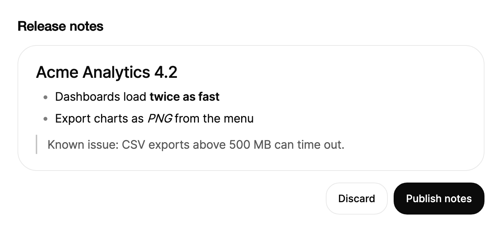

<Demo name="Shortcuts" />

## When to use

`RichTextEditor` is the writing surface for content that needs light formatting: bold and italic text, headings,
lists, quotes and code blocks. It holds the document, the floating toolbar and the block menu, so a form needs no
extra layout around it. The content leaves the editor as clean HTML or Markdown, which the app stores and reads
back later.

- **Release notes and changelog drafts in a developer tool**: an engineer types `## ` for a heading and `- ` for a
  list, and the editor saves Markdown that the release pipeline publishes unchanged.
- **Comments and replies in a project tracker or a CRM note**: short notes with bold text, lists and quotes. The
  HTML output is safe to render because the editor keeps only its own tags.
- **Knowledge base or help center articles**: an author writes an article in the admin console and saves HTML that
  the public site renders, with headings and code blocks for steps and commands.
- **Incident write-ups and postmortems**: headings, quotes for customer-facing wording and code blocks for log lines,
  set `IsReadOnly` once the report is published so the text can be read and copied but not changed.
- **Announcements in a billing or account console**: a short message with a link to the invoice page, written by a
  finance or support user who needs formatting but not layout.

## When not to use

- **Plain multi-line text with no formatting**: use `Textarea`, which wraps and resizes without a toolbar or blocks.
- **Mentions of people or tags inside a text field**: use `MentionInput`, which suggests and stores the mentions.
- **A single line that is renamed in place on a page**: use `InlineEdit`, which looks like text until it is edited.
- **Source code or a read-only code listing**: use `CodeBlock`, which shows the code with its own copy action.
- **Images, tables or underlined text**: the editor supports none of them (it has no image, table or underline
  block). Use `FileDropzone` to attach images beside the text, or a document editor for layout-heavy content.

## Usage

Set `Markdown` for the initial content. `Markdown` and `Html` are both two-way: assigning either one reloads the
editor, and both follow every edit.

```xml
<UserControl xmlns="https://github.com/avaloniaui"
             xmlns:arc="https://github.com/AtomUICommunity/TKCode.Arc">
    <arc:RichTextEditor Markdown="## Notes&#10;&#10;Type **Markdown** as you go, or `/` for blocks." />
</UserControl>
```

`RichTextEditor` derives from `TemplatedControl`, not from `TextBox`. It is a block editor: the document is a list of
blocks (paragraphs, headings, list items, quotes, code blocks and dividers), and each block lays out its own text
with its marks. That gives the editor its own undo history, its own clipboard rules and its own output, so the text
is not stored as a raw string that the control edits in place. It is not a `TextBox`, so it has no caret index or
`MaxLength`; read the text with `GetText()` and use the members listed in the API reference.

### Anatomy

1. **Writing surface**: the editable document, with a minimum height of 128 px. It draws the text, the list markers,
   the quote bar, the code background and the selection, and it places the caret.
2. **Placeholder** (`Placeholder`, default "Start writing"): shown in the muted text color while the document is
   empty.
3. **Block hint** (`BlockHint`, default "Type / for blocks"): shown on the empty line that holds the caret.
4. **Floating toolbar**: appears above a selection, with 32 px square buttons on a 16 px corner radius. It has the
   inline marks (bold, italic, strikethrough, inline code), a link button and the block types. Its link field
   replaces the buttons in place when a link is edited.
5. **Link field**: a one-line field in the toolbar that takes a URL for the selection or the link at the caret.
6. **Block menu**: the list that opens at a `/` and filters as you type. Its rows are 34 px high on a 12 px radius, in
   a panel with an 18 px radius.
7. **Live region**: a hidden element that announces results such as "Formatted" or "Link added" to assistive
   technology.

### Block types and marks

The document is built from blocks of one `RichTextBlockType` and inline marks from `RichTextMark`. The toolbar and
the block menu use these values with `ToggleMark`, `SetBlockType` and the `Formats` report.

| Type | Written as | Notes |
|---|---|---|
| `Paragraph` | Plain text | The default block |
| `Heading1`, `Heading2`, `Heading3` | `# `, `## `, `### ` | Imported h4 to h6 become `Heading3` |
| `BulletedList`, `NumberedList` | `- `, `1. ` | Nest with Tab; a level holds the same list kind |
| `Quote` | `> ` | A block quote with a bar at its start |
| `CodeBlock` | Three backticks | Holds plain text only; lines do not wrap |
| `Divider` | `---` | A horizontal rule; `SetBlockType` inserts one in place of an empty block |

| Mark | Written as | Notes |
|---|---|---|
| `Bold` | `**text**` | |
| `Italic` | `_text_` or `*text*` | |
| `Strikethrough` | `~~text~~` | |
| `Code` | `` `text` `` | Kept within one block |

Links are not a mark in this list: `SetLink` and the link field attach an address to the selected text.

### Markdown shortcuts and the supported subset

The editor converts Markdown as the person types. A shortcut runs as soon as the typed text completes it, so the
person sees the result without a preview. Shortcuts do not run inside a code block.

| Type | Result |
|---|---|
| `# `, `## `, `### ` at the start of a line | Heading 1, 2 or 3 |
| `- `, `* `, `+ ` | Bulleted list item |
| `1. `, `1) ` | Numbered list item |
| `> ` | Quote |
| `---` | Divider |
| Three backticks | Code block |
| `**text**`, `_text_`, `~~text~~`, `` `text` `` | Bold, italic, strikethrough, inline code |

The editor writes and reads a fixed subset: paragraphs, three heading levels, nested bulleted and numbered lists,
quotes, code blocks, dividers, and the four inline marks and links. Pasted HTML is sanitized to this subset, so
unknown tags and styles disappear while their text is kept. Use the subset as the content contract for the feature:
a document that needs anything else must be stored elsewhere.

### Placeholder and block hint

`Placeholder` shows in an empty editor and says what the field is for. `BlockHint` shows on the empty line where the
caret sits and tells the person how to add structure.

<Demo name="Placeholder" />

Set both when the field is a comment or a note, so the empty state explains the next step. Keep the placeholder
short: it disappears as soon as text is typed, and the hint disappears with it.

### Read only

With `IsReadOnly` set, editing, the toolbar and the shortcuts are off. The text can still be selected and copied,
and assistive technology reads it.

<Demo name="ReadOnly" />

Use read-only mode for a published article, a postmortem or a signed note that people must be able to quote. Show
an edit action outside the editor that switches `IsReadOnly` back to `False`, so the change is deliberate.

### Content formats

Store the content in the format the consumer reads:

| Format | Read it with | Use it for |
|---|---|---|
| Markdown (`Markdown`, `GetMarkdown()`) | Your Markdown renderer or the editor | Editable text in a pipeline, diffs and version history |
| HTML (`Html`, `GetHtml()`) | A browser or a web view | Pages that render the content directly |
| Plain text (`GetText()`) | Search and previews | One line per block, without marks |

Both `Html` and `Markdown` are sanitized when they are loaded. `SetHtml` and `SetMarkdown` load the text as one undo
step, and assigning the `Html` or `Markdown` property reloads the document only when the value differs from the one
the editor last wrote, so a two-way binding does not reset the caret while the person types.

### Importing existing Markdown

The editor stores a fixed subset, so opening a file written elsewhere can change it. `RichTextEditorMarkdown.Analyze`
reports every construct the editor cannot store, with the line, the column and a reason, without converting anything.
`TrySetMarkdown` imports only a source that loses nothing and leaves the editor untouched when it refuses, so a host can
keep the original file, warn, or open a source editor first.

<Demo name="ImportCheck" />

```csharp
if (!editor.TrySetMarkdown(fileText, out var report))
{
    Warn($"{report.Issues.Count} constructs would be lost; the file is unchanged.");
    foreach (var issue in report.Issues.Where(i => i.Severity == RichTextImportSeverity.Lossy))
    {
        Warn($"Line {issue.Line}, column {issue.Column}: {issue.Reason}");
    }
}
```

| Reported as a loss | Why |
|---|---|
| Heading level 4 to 6 | The editor has three heading levels; they become Heading 3 |
| A code fence's info string | The editor does not store a code block's language |
| A tilde fence | The editor reads only backtick fences |
| A table | The editor has no table block; the cells become one paragraph |
| A setext heading | The editor reads only `#` headings |
| Indented code | The editor reads only fenced code |
| A list starting above 1 | The editor numbers lists from 1 |
| A hard line break, block HTML, an image, a reference link, a footnote, a backslash escape | The editor keeps the source as text |

Markers written another way are reported as `RichTextImportSeverity.Normalized` and do not block the import: `*` and
`+` bullets, `1)` numbering, `__bold__`, `*italic*` and `***` dividers are written back as `-`, `1.`, `**`, `_` and
`---`. Everything in the supported subset produces no issue at all. The permissive path is unchanged: `Markdown`,
`SetMarkdown` and a pasted Markdown-looking text still convert as before, and only callers that opt in to
`TrySetMarkdown` get the gate.

### Reading the content

`ContentChanged` runs after every edit, undo, redo and load. Its `Value` is a `RichTextValue`, and the HTML, Markdown
and text are computed when they are first read. `GetHtml()`, `GetMarkdown()` and `GetText()` read the content at any
time and are always synchronous.

| Member of `RichTextValue` | Type | Meaning |
|---|---|---|
| `Html` | `string` | The content as clean HTML |
| `Markdown` | `string` | The content as Markdown |
| `Text` | `string` | Plain text, one line per block |
| `IsEmpty` | `bool` | True when the document has no text |

<Demo name="MarkdownAndHtml" />

```csharp
editor.ContentChanged += (_, e) =>
{
    draft.Markdown = e.Value.Markdown;
    canPost = !e.Value.IsEmpty;
};

var html = editor.GetHtml();
```

### Your own toolbar

`Formats` (a `RichTextFormats` record) reports the marks, the link and the block type at the caret. `CanUndo` and
`CanRedo` report the history. Use them to set the state of your own buttons, and call `ToggleMark`, `SetBlockType`,
`SetLink` and `EditLink` to act on the selection.

Bind `UndoCommand` and `RedoCommand` to buttons, or call `Undo()` and `Redo()` directly. The toolbar buttons should
not take focus, so the editor keeps the caret; the demo sets `Focusable="False"` on each button for that reason.

<Demo name="OwnToolbar" />

### Binding to a view model

In an MVVM app the view model owns the document. Bind `Markdown` two-way, read `IsEmpty` from `ContentChanged`, and
use the undo and redo commands from the view.

```csharp
public partial class ReleaseNoteViewModel : ObservableObject
{
    private readonly IReleaseNotes _notes;

    [ObservableProperty]
    private string? _bodyMarkdown;

    [ObservableProperty]
    [NotifyCanExecuteChangedFor(nameof(PublishCommand))]
    private bool _hasContent;

    public ReleaseNoteViewModel(IReleaseNotes notes) => _notes = notes;

    [RelayCommand(CanExecute = nameof(CanPublish))]
    private async Task PublishAsync()
    {
        await _notes.PublishAsync(BodyMarkdown ?? string.Empty);
    }

    private bool CanPublish() => HasContent;
}
```

```xml
<StackPanel Spacing="16">
    <arc:RichTextEditor x:Name="Editor"
                        Markdown="{Binding BodyMarkdown, Mode=TwoWay}"
                        Placeholder="Describe the release" />
    <arc:Button Content="Publish notes"
                Command="{Binding PublishCommand}"
                IsDefault="True" />
</StackPanel>
```

```csharp
// Code behind: the editor reports emptiness through ContentChanged; vm is the view's ReleaseNoteViewModel.
Editor.ContentChanged += (_, args) => vm.HasContent = !args.Value.IsEmpty;
```

- `Markdown` (and `Html`) is two-way: the view model receives every edit, and the editor reloads when the view model
  sets a different value. For a long document the value follows the typing after a short pause (see the performance
  section), so read `GetMarkdown()` in the publish command rather than trusting a cached copy.
- `Placeholder` and `BlockHint` are one-way; `IsReadOnly` is one-way and typically follows a published state.
- `UndoCommand` and `RedoCommand` are commands for your own toolbar. `CanUndo` and `CanRedo` are read-only and raise
  change notifications.
- `ContentChanged` is the event to listen to for emptiness, counts or autosave. Use `Value` inside the handler; the
  HTML and Markdown are computed the first time they are read.

### Undo and history

The editor keeps its own history of up to 300 steps, separate from the platform's undo. Typing within one second
merges into one step; a space or a change of input type starts a new one, and each command (a mark, a block type, a
link) is one step. `SetHtml`, `SetMarkdown` and `Clear` are one step each, so a load can be undone. Setting the
`Markdown` or `Html` property while the editor starts up does not enter the history.

### Long documents and performance

The editor redraws only the blocks that changed, and it draws only the part of the document in and near the
viewport. The HTML and Markdown values are written after every edit while the document has up to 400 blocks. Longer
documents write them once the person pauses for about 250 milliseconds, or when the editor loses focus or is
removed. In a 5,000-block document the serialization waits for the pause, so typing stays cheap.

`GetHtml()`, `GetMarkdown()` and `GetText()` always serialize the current document, so call them when you save and
not on every keystroke.

### Example: release notes draft

A release manager writes the notes for a version of a developer tool. The placeholder tells the author what goes
here, the body already has a heading, a list, a bold phrase and a quote for the known issue, and the publish button
sits beneath it at the default size. The text in the editor is the same Markdown the release pipeline stores.



```xml
<StackPanel Width="640" Spacing="16">
    <TextBlock Text="Release notes"
               FontSize="18"
               FontWeight="SemiBold"
               Foreground="{arc:ArcDesignTokenResource Foreground}" />
    <Border Padding="24,20"
            CornerRadius="26"
            BorderThickness="1"
            Background="{arc:ArcDesignTokenResource Surface}"
            BorderBrush="{arc:ArcDesignTokenResource Border}">
        <arc:RichTextEditor Markdown="## Acme Analytics 4.2&#10;&#10;- Dashboards load **twice as fast**&#10;- Export charts as _PNG_ from the menu&#10;&#10;> Known issue: CSV exports above 500 MB can time out." />
    </Border>
    <StackPanel Orientation="Horizontal" Spacing="8" HorizontalAlignment="Right">
        <arc:Button Content="Discard" Variant="Secondary" />
        <arc:Button Content="Publish notes" />
    </StackPanel>
</StackPanel>
```

### Content guidelines

- **Placeholder**: name the content the field holds and what to write: "Describe the release", not "Enter text".
- **Block hint**: name the one gesture that matters, such as "Type / for blocks". Do not list every shortcut.
- **Buttons**: use a verb and an object in sentence case: "Publish notes", "Save draft". Avoid "Submit" for a note
  that is published, because the person expects the text to go live.
- **Link text**: write the words the person reads, and keep the URL in the link field, not in the sentence.
- **Headings**: keep them short and in sentence case, and use `Heading2` for a section inside a document with a
  title outside the editor.

| Instead of | Write |
|---|---|
| Enter text here | Describe the release |
| Click here | Read the migration guide |
| Submit | Publish notes |
| Type /// for blocks | Type / for blocks |

### Best practices

**Do**

- Set `Placeholder` and `BlockHint` for every empty field, so the first line explains the editor.
- Save `Markdown` when the content is edited again, and `Html` when another page only renders it. The two are equal
  for the supported subset, so pick one as the source of truth.
- Read the content with `GetMarkdown()` or `GetHtml()` in the save command. A handler on `ContentChanged` is right for
  emptiness and counts, not for every write.
- Switch to `IsReadOnly` for a published document, and offer an explicit edit action that turns it back on.
- Keep the toolbar buttons out of the tab order when they act on the selection, as the own-toolbar demo does, so the
  caret stays in the text.

**Avoid**

- Storing HTML from another editor and expecting its styling to survive. The loader keeps only the editor's subset,
  so unknown tags and inline styles are dropped and the layout changes.
- Using the editor for images, tables or underlined text. The editor cannot store them, so the content loses them on
  the next save.
- Reading `GetHtml()` on every keystroke in a long document. Serialization on each key costs more than the edit.
- Replacing the document you are editing by assigning `Markdown` on each change. Use `SetMarkdown()` or `Clear()`,
  which are one undo step each, so the person can undo a replacement.
- Expecting screen reader users to navigate the text by character, word or line. Assistive technology reads the
  whole document as one value, so offer `GetText()` output for review when the text is long.

### Common questions

**Why does Ctrl+U (Cmd+U on macOS) do nothing?** Underline is not part of the editor's subset. The key is swallowed,
so the text does not change, and the Markdown output has no underline syntax either.

**How do I add or change a link from code?** Call `SetLink(url)` to link the selection, or the link at the caret.
Pass `null` or an empty string to remove the link. `EditLink()` opens the same link field the toolbar uses, for the
selection or the link at the caret. Ctrl+K (Cmd+K on macOS) does the same from the keyboard.

**Why did my bound `Html` not reload when I set the same HTML again?** The editor reloads only when the value differs
from the one it last wrote. A two-way binding that echoes the editor's own output therefore does not move the caret.
To force a reload with identical content, call `SetHtml` or `SetMarkdown` instead.

**Why does a shortcut not convert text inside a code block?** Code blocks hold plain text only. Shortcuts such as
`# ` and `**` are off there, and Tab inserts two spaces instead of changing the list level.

**How do I start a new line inside a list item or a quote?** Press Shift+Enter for a line break in the same block.
Press Enter on an empty list item or quote to leave the list, and press Enter twice at the end of a code block to
leave it.

## API reference

<!-- api: RichTextEditor -->

## Accessibility

- The writing surface is a multi-line editable text control named "Editor" by default. Set
  `AutomationProperties.Name` to name it for your form, such as "Release notes body".
- Keyboard (Cmd on macOS): `Ctrl+B`, `Ctrl+I`, `Ctrl+Shift+X` and `Ctrl+E` apply marks, and `Ctrl+K` edits a link. `Ctrl+Z` and
  `Ctrl+Shift+Z` undo and redo. `Alt+F10` moves focus into the floating toolbar, and `Escape` returns it to the text.
- Editing results such as "Formatted", "Link added", "Link removed", "Undone", "Redone" and "Numbered list added" are
  announced politely, so they do not interrupt speech.
- The floating toolbar is a toolbar, and its format buttons are toggle buttons that report their state. Their
  tooltips show the keyboard shortcut.
- The block menu is a list. Moving through it announces the current item.
- Limitation: the editor does not expose character, word or line navigation to screen readers. They read the whole
  text as one value.

### Keyboard

| Keys | Action |
|---|---|
| `Ctrl+B`, `Ctrl+I` | Toggle bold, italic |
| `Ctrl+Shift+X` | Toggle strikethrough |
| `Ctrl+E` | Toggle inline code, within one block |
| `Ctrl+K` | Open the link field for the selection or the link at the caret; `Enter` applies it, `Escape` closes it |
| `Ctrl+Z`, `Ctrl+Shift+Z` (or `Ctrl+Y`) | Undo, redo |
| `Ctrl+A` | Select all |
| `Enter` | New block; leaves an empty list item or quote; twice at the end of a code block leaves the code |
| `Shift+Enter` | Line break inside the block |
| `Tab`, `Shift+Tab` | Indent or outdent a list item; in a code block, `Tab` inserts two spaces |
| `Backspace` at the start of a block | Turns a heading, quote, code block or list item into a paragraph, or outdents it; after a divider, deletes the divider |
| `/` at the start of a line or after a space | Opens the block menu; typing filters it, `Up` and `Down` move, `Enter` or `Tab` choose, `Escape` closes |
| `Alt+F10` | Moves focus into the floating toolbar; `Left` and `Right` move between its buttons, `Escape` returns to the text |

Ctrl is Command on macOS and Control on other platforms. Word movement follows the platform's text navigation
(Option on macOS, Control elsewhere). `Ctrl+U` is swallowed because underline is not supported.

## Motion

- The floating toolbar glides to follow the selection with a small bounce. When it changes between the format buttons
  and the link field, its size morphs, and the two faces slide past each other in opposite directions.
- The block menu opens from the `/` position. Its highlight glides between rows, and its height changes on a smooth
  spring when the filter changes the list.
- Reduced motion moves and resizes the toolbar in one step and cross-fades its two faces. The block menu only fades
  in and out, without scaling or moving.

| Change | Full | Reduced | Off |
|---|---|---|---|
| The toolbar follows a new selection | Glides to the new position with a small bounce | Jumps to the position | Immediate |
| The toolbar changes to or from the link field | Size morphs, faces slide past each other | Instant position and size; faces cross-fade | Immediate |
| The block menu opens | Pops out from the `/` position | Fades in | Immediate |
| The block menu's highlight moves | Glides between rows | Moves in one step | Immediate |
| The menu's list changes while filtering | Height changes on a smooth spring | Immediate | Immediate |

## Related

- `Textarea` for plain text without formatting.
- `MentionInput` for text that mentions people or tags.
- `CodeBlock` for displaying code rather than writing it.
- `FileDropzone` for images and files that accompany the text.

| Component | Choose it when |
|---|---|
| `Textarea` | The text is plain and runs over several lines, with no bold, lists or blocks |
| `MentionInput` | The text mentions people, and the mention must be suggested and stored |
| `InlineEdit` | A single title or name is renamed where it is shown |
| `CodeBlock` | The code is displayed, copied or read, not written |
| `FileDropzone` | Images or files accompany the text and must be uploaded |
| `Input` | The value is one line in a form, such as a subject or a title |
