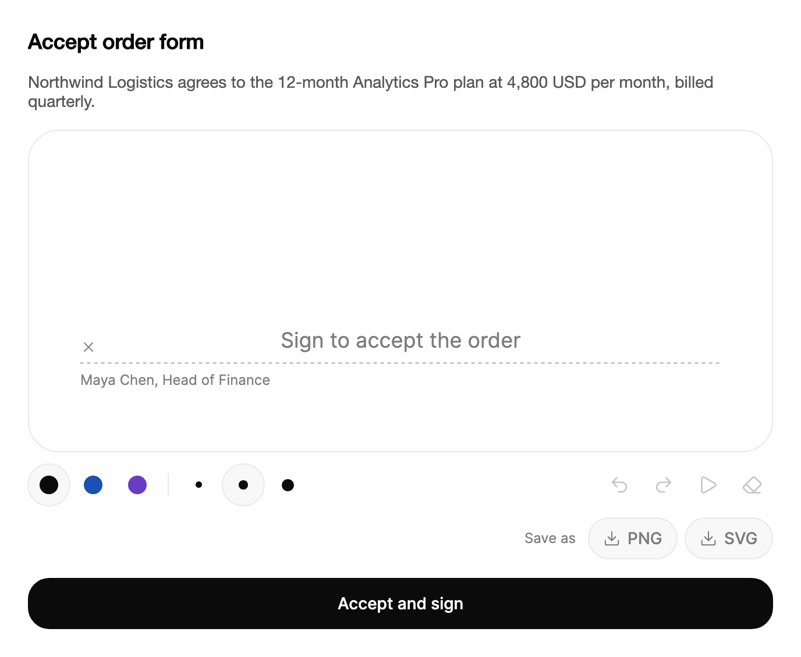

<Demo name="Sign" />

## When to use

`SignaturePad` captures a hand-drawn signature for a document that a person must sign in the app. It draws the ink
on a pad with its own toolbar (color, nib, undo, redo, replay, clear and export), keeps the strokes so the signature
can be reviewed and corrected, and exports the result as an image or a vector file that the record keeps.

- **Order forms and contracts in a sales or billing console**: a customer signs the order form on a tablet at the
  end of a call. The ink is exported as a PNG and filed with the signer's name, which the form stores separately.
- **Delivery confirmations in a logistics app**: a driver signs for a parcel on a handheld screen. The signature is
  saved as a PNG on the shipment record, and a fine nib keeps the ink legible on a small pad.
- **Consent forms in a clinic or patient intake app**: a patient signs a treatment consent. An SVG export stays sharp
  when the form is printed at any size.
- **Acknowledgments in a fintech onboarding flow**: a customer signs a disclosure, and the strokes are stored with the
  account so the same signature can be shown again with `Reset`.
- **Field service sign-off**: a technician signs the work order and corrects a stroke with undo before the record is
  closed.

## When not to use

- **A typed name is enough**: use `Input`, which holds the name as text and needs no drawing.
- **A deliberate confirmation with no signature to keep**: use `HoldToConfirm`, which requires a press and hold and
  records only the decision.
- **A signed file that already exists**: use `FileDropzone` to attach the file, such as a PDF returned by a signing
  service.
- **A yes or no acceptance of terms**: use `Checkbox` with the terms linked nearby. A drawn signature adds a step that
  the terms do not need.
- **A long note or a document body**: use `RichTextEditor`, which edits text and does not capture a signature.

## Usage

```xml
<UserControl xmlns="https://github.com/avaloniaui"
             xmlns:arc="https://github.com/AIDotNet/TKCode.Arc">
    <arc:SignaturePad Signer="Ada Lovelace"
                      Hint="Sign here" />
</UserControl>
```

`SignaturePad` derives from `TemplatedControl` and draws its ink itself, so it is not a text box and has no caret or
text. The ink lives in pad units, a 600 by 260 coordinate space, and the pad scales that space to its width. The
strokes are plain data (`InkStroke` records with their points, color, nib and start time), which is why the same
signature can be exported, stored and replayed without a bitmap of the screen.

### Anatomy

1. **Pad**: the drawing canvas. It keeps a 600 to 260 aspect ratio at every width, so a pad 560 px wide
   is about 243 px high. It has rounded corners on the panel radius and a 1.5 px dashed baseline that runs from 7%
   to 93% of the width at 72% of the height. An X marks the signing line.
2. **Hint** (`Hint`, default "Sign here"): the large hint text on the baseline, shown until the first stroke. It fades
   out when drawing starts and returns after a clear.
3. **Signer** (`Signer`): the name printed under the baseline, in the extra-small text size. It is drawn on the pad
   only; the exports contain the ink, so store the name with the record.
4. **Ink**: the strokes. The black ink follows the foreground color, and the blue and violet inks are theme values
   that change with light and dark mode. Exports use fixed print colors, so a PNG is the same in either theme.
5. **Color group**: three 36 px options (`Black`, `Blue`, `Violet`) in a single-choice group.
6. **Nib group**: three 36 px options (`Fine`, `Medium`, `Bold`). The toolbar splits into two groups aligned at each end and wraps when it is narrow.
7. **Actions**: undo, redo and replay as 36 px pill icon buttons (replay swaps its icon to stop while it runs), then
   the export buttons (PNG and SVG) under a "Save as" label, and the clear button. After a successful export the export button shows "Saved"
   for a short time.
8. **Status**: a live region that announces each change, such as "Undone" or "Signature cleared. Undo
   brings it back."

### Ink color and nib

`InkColor` (default `Black`) and `InkWidth` (default `Medium`) set the defaults for new strokes. Each stroke keeps the
color and nib it was drawn with, so changing the choice later does not repaint earlier strokes.

<Demo name="InkAndNib" />

Use black for a signature that will be printed or filed as a contract. A blue or violet ink helps a second signer
or a witness stand apart on the same page. Use `Fine` for a small pad on a handheld, `Medium` for most forms, and
`Bold` for a kiosk where a finger draws on a large screen. The nib sets the width in pad units (3.4, 5.6 and 8.4),
so a bold stroke stays proportional on a small pad.

Pen pressure sets the width of the ink when the device reports it. A mouse or a finger has no pressure, so the pad
simulates it from the speed of the stroke: a fast stroke is thin and a slow one is full.

### Reading the strokes

`StrokesChanged` runs after every stroke and after undo, redo, clear and reset. `Strokes` is read-only and holds the
strokes in pad units. `IsEmpty` is true before the first stroke and after a clear, and `CanUndo` and `CanRedo`
report the history.

```csharp
pad.StrokesChanged += (_, e) =>
{
    saveButton.IsEnabled = e.Strokes.Count > 0;
};
```

Each `InkStroke` has an `Id`, a list of `InkPoint` values (`X`, `Y`, `Pressure` from 0 to 1 or -1 for no pressure,
and `Time` in milliseconds from the stroke's start), a `Color`, a `Width` and `At`, the time the stroke began.

### Export

`ExportPng` and `ExportSvg` return the ink cropped to its bounds. `ExportPng` takes an optional `scale` (default 3)
that multiplies the pad's resolution, and `ExportBitmap` returns the same picture as a `RenderTargetBitmap` for a
preview. `SaveAsync` opens the system save dialog with `FileName` (default "signature") as the suggested name. It
returns `false` when the person cancels, when there are no strokes, or when the write fails.

<Demo name="UseTheSignature" />

```csharp
var png = pad.ExportPng();
var svg = pad.ExportSvg();

var saved = await pad.SaveAsync(SignatureFileKind.Png);
```

`ExportSvg` returns an empty string when there are no strokes, so check `IsEmpty` before you store an export. Use
`SignatureFileKind.Svg` for print and `SignatureFileKind.Png` for an email or a PDF page.

### Storing and restoring a signature

`Reset` replaces the strokes without the wipe animation and clears the undo history, so a signature loaded from
storage is not treated as an edit. Pass the strokes you stored earlier to show them again, or call it with no argument
to start over.

```csharp
// Store: the strokes are plain records, so any serializer works. Use your app's options, and a source-generated
// context when the app is trimmed or published as AOT.
var json = JsonSerializer.Serialize(pad.Strokes);

// Restore: the pad shows the saved ink with an empty history.
pad.Reset(JsonSerializer.Deserialize<List<InkStroke>>(json));
```

The stored strokes keep their pad units, so a signature saved from a 560 px pad shows correctly on a 400 px pad.

### Binding to a view model

The signature is a value that the view model stores, and the pad only captures it. Read the strokes with
`StrokesChanged`, because `Strokes` is read-only and cannot be bound back. `Signer`, `Hint`, `InkColor` and `InkWidth`
are one-way settings; the view model sets them, and the pad does not write them back.

```csharp
public partial class SignOffViewModel : ObservableObject
{
    private readonly ISignatureStore _store;

    [ObservableProperty]
    private string _signerName = string.Empty;

    [ObservableProperty]
    [NotifyCanExecuteChangedFor(nameof(SubmitCommand))]
    private bool _hasSignature;

    public IReadOnlyList<InkStroke> Strokes { get; private set; } = Array.Empty<InkStroke>();

    public SignOffViewModel(ISignatureStore store) => _store = store;

    public void OnStrokesChanged(IReadOnlyList<InkStroke> strokes)
    {
        Strokes = strokes;
        HasSignature = strokes.Count > 0;
    }

    [RelayCommand(CanExecute = nameof(HasSignature))]
    private async Task SubmitAsync()
    {
        await _store.SaveAsync(SignerName, Strokes);
    }
}
```

```xml
<StackPanel Spacing="16">
    <arc:Input Label="Printed name" Text="{Binding SignerName, Mode=TwoWay}" />
    <arc:SignaturePad x:Name="Pad"
                      Signer="{Binding SignerName}"
                      Hint="Sign to accept the order" />
    <arc:Button Content="Accept and sign"
                Command="{Binding SubmitCommand}"
                IsDefault="True" />
</StackPanel>
```

```csharp
// Code behind: the view connects the pad's events to the view model.
Pad.StrokesChanged += (_, args) => vm.OnStrokesChanged(args.Strokes);
```

- `Signer` is one-way: the printed name follows the name field as the person types. Changing the name does not clear
  the strokes.
- `StrokesChanged` is the event to listen to; `IsEmpty`, `CanUndo` and `CanRedo` are read-only and update the
  view's state.
- The pad has no command for submit. Use the view model's command and the pad's `IsEmpty` or the `HasSignature`
  flag for the enabled state.

### Validation

A signature is checked when the person submits, and the pad's hint stays visible while it is empty.

| Rule | When to check | Where it shows |
|---|---|---|
| A signature exists | On submit | The form's own message; the pad's hint stays visible while it is empty |
| The printed name is filled in | On submit, or on leaving the name field | The name field's error row, from the form's own rule |
| A stored signature is shown again | When the record opens | `Reset` with the stored strokes, which adds no undo step |

These rules belong to the form, not to the pad, so the messages use the form's own components. Keep the submit
button enabled while the form is open, and show the empty-signature message after a press. Disabling it until the
pad has ink gives the person no reason for the state.

### Example: order form acceptance

A customer signs an order form at the end of a sales call. The title and the one-sentence summary say what is being
accepted, the pad's hint repeats the action in plain words, and the signer name is printed under the line so the
customer can see whose signature the line is for. The pad has no strokes in this scene because it is shown before
the customer signs.



```xml
<StackPanel Width="640" Spacing="16">
    <TextBlock Text="Accept order form"
               FontSize="18"
               FontWeight="SemiBold"
               Foreground="{arc:ArcDesignTokenResource Foreground}" />
    <TextBlock Text="Northwind Logistics agrees to the 12-month Analytics Pro plan at 4,800 USD per month, billed quarterly."
               TextWrapping="Wrap"
               Foreground="{arc:ArcDesignTokenResource TextSecondary}" />
    <arc:SignaturePad Signer="Maya Chen, Head of Finance"
                      Hint="Sign to accept the order" />
    <arc:Button Content="Accept and sign" />
</StackPanel>
```

### Content guidelines

- **Hint**: state the action in plain words, such as "Sign to accept the order". Avoid "Signature here" because the
  person does not know what the signature accepts.
- **Signer**: print the legal name and the role, such as "Maya Chen, Head of Finance", and store the same text with
  the record, since the exported ink does not contain it.
- **Submit button**: use a verb and an object: "Accept and sign", "Sign agreement". Avoid "Done", which does not say
  what is being committed.
- **Status messages**: say what changed and what can be done next, such as "Signature cleared. Undo brings it back."

| Instead of | Write |
|---|---|
| Signature | Sign to accept the order |
| Sign here!! | Sign here |
| Done | Accept and sign |
| Error: no signature | Add your signature before you submit. |

### Best practices

**Do**

- Set `Signer` to the legal name for every signature, so the person sees who signs, and store that name with the
  strokes.
- Store `Strokes` with the record and reload them with `Reset`, rather than storing only a picture of the pad.
- Use `ExportSvg` for documents that are printed at several sizes, and `ExportPng` for email and screens.
- Keep the undo history for the person who is signing, and show the pad at a width where the baseline is visible.
- Check `IsEmpty` on submit, and keep the form data while the person corrects the signature.

**Avoid**

- Saving an empty export. `SaveAsync` returns false with no strokes, and an empty SVG is not a signature.
- Relying on the color for meaning. The blue and violet inks are a visual choice, and a printed record needs the name.
- Making the signature optional without a reason in the form. Say whether it is required, and why.
- Replacing the strokes with `Reset` while the person is still drawing. Reset clears the history and the ink at once.
- Showing the pad in a narrow column. The baseline and the toolbar groups wrap, and a narrow pad is hard to sign.

### Common questions

**Why does Delete clear the pad, and can the person get it back?** Delete and Backspace clear the pad with the wipe
animation. The clear is one undo step, so `Ctrl+Z` (`Cmd+Z` on macOS) brings the strokes back.

**Why is my exported PNG empty?** `ExportPng` crops to the ink, and with no strokes there is nothing to export. Check
`IsEmpty`, or use the `SaveAsync` result, which is false when the pad is empty.

**Does changing the ink color repaint the existing strokes?** No. Each stroke keeps the color and nib it was drawn
with. `InkColor` and `InkWidth` only set the choice for new strokes.

**How does pressure work with a mouse or touch?** A pen reports pressure, which sets the width directly. A mouse or
a finger reports none, and the pad derives the width from speed.

**How do I show the signature again, for example as a replay?** Call `Replay()` to redraw the strokes at their
original pace, which takes about 3.2 seconds, and `StopReplay()` (or Escape) to stop it. Use `Reset(strokes)` to show
stored strokes without replaying them.

## API reference

<!-- api: SignaturePad -->

## Accessibility

- The pad is a focusable image named "Signature pad". Its accessible name includes the number of strokes, and its
  description reads "Signature pad. Empty. Draw with a pointer, pen, or finger." when it has no ink.
- The keyboard shortcuts are in the pad's help text, so a screen reader announces them when the pad gets focus.
- Ink color and nib are single-choice groups. Only the selected option is in the tab order, and the arrow keys move
  between options.
- Toolbar buttons have a name and a tooltip. Strokes, undo, redo, clear, replay and export results are announced
  politely, so the person hears each change without losing focus.

### Keyboard

| Keys | Action |
|---|---|
| `Ctrl+Z` (`Cmd+Z` on macOS) | Undo the last change while the pad has focus |
| `Ctrl+Shift+Z` (`Cmd+Shift+Z` on macOS), or `Ctrl+Y` | Redo |
| `Delete` or `Backspace` | Clear the pad with the wipe; the clear can be undone |
| `Escape` | Stop a replay in progress |
| `Left` / `Right` (or `Up` / `Down`) in the color or nib group | Move to the previous or next option and choose it |
| `Tab` / `Shift+Tab` | Move between the pad, the groups and the toolbar buttons |

## Motion

- Clear sweeps a wiper across the pad and wipes the ink away with it, over about half a second.
- Replay redraws each stroke at its original pace, with a dot at the pen tip. The pauses between strokes are capped,
  and the whole replay fits in about 3.2 seconds.
- The hint fades in while it rises, and the color and nib highlight slides to the chosen option.
- Reduced motion removes the wipe and the blur and uses short fades.

| Change | Full | Reduced | Off |
|---|---|---|---|
| Clear | A wiper sweeps across and wipes the ink in about 0.56 seconds | The ink clears at once | Immediate |
| Replay | Strokes redraw at their original pace in about 3.2 seconds | Strokes redraw at their pace | Replay ends at once |
| Hint appears or leaves | Fades in and rises; blurs out when drawing starts | Short fade of about 120 ms | Immediate |
| Color or nib choice changes | The highlight glides to the chosen option | The highlight jumps to the option | Immediate |
| Replay and stop icons | Icon scales and swaps | Icon swaps | Immediate |

## Related

- `Input` for a typed name next to or instead of a drawn signature.
- `HoldToConfirm` for a deliberate confirmation that does not need a signature.
- `FileDropzone` for attaching files such as an already signed document.

| Component | Choose it when |
|---|---|
| `Input` | The name is typed and no drawn signature is needed |
| `HoldToConfirm` | A press-and-hold decision is the record, with no signature kept |
| `Checkbox` | The person accepts terms with a yes or no choice |
| `FileDropzone` | A signed file from another service must be attached |
| `RichTextEditor` | The content is text the person writes, not a signature |
