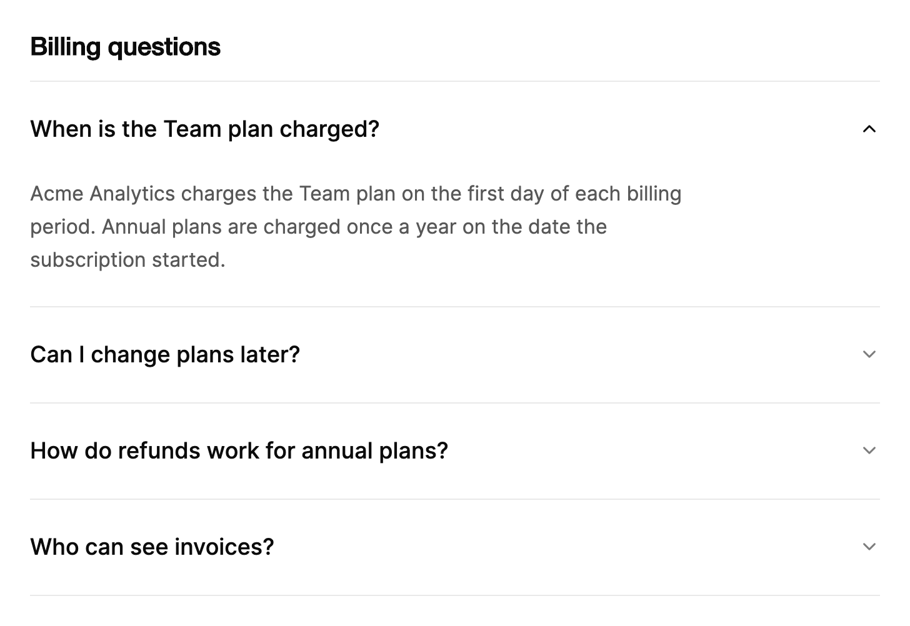

<Demo name="Default" />

## 何时使用

`Accordion` 是一列问题行，每一行的答案都在原位展开。它适合读者通过标题扫读、只在需要的地方阅读的内容：一个答案展开时其他答案保持收起，页面长度不变，读者也不会失去原来的位置。

- **帮助中心与账单常见问题**：为 SaaS 产品回答“之后可以更改套餐吗？”或“退款如何计算？”的页面。同一时间只展开一个答案，读者无需离开页面即可比较各个问题。
- **带分组说明的设置页**：管理后台中的“数据保留”或“单点登录”等设置区块，每个标题背后都隐藏着某项选择的后果。控件保持可见，手风琴负责承载原因说明。
- **结账与订单确认**：“收货地址”“支付方式”和“税务信息”作为收起的行出现，客户只需展开想要核对的那一项，再下单。
- **开发者文档侧边栏**：与 API 参考并排的“速率限制”“分页”和“Webhook 重试”列表，每个答案是几段简短文字加一个代码示例。

## 何时不用

- **单独一个展开区域**，例如定价卡片上的“显示套餐详情”面板：用 `ExpandableCard`，它会保持卡片标题可见，并且可以横向展开。
- **同一数据的并列视图**，例如某个账号的“概览”“用量”和“发票”：用 `Tabs`，它一次只显示一个面板，并把选项呈现为标签列表。
- **只需要“阅读更多”链接的短段文字**，例如商品描述或评价：用 `ExpandableText`，它会把文字截断为指定的行数。
- **必须按顺序完成的步骤**，例如设置向导：用 `Stepper`，它会显示进度和当前步骤。
- **供人比较或排序的记录行**，例如按天统计的账单或用量：用 `Table`，它的各列在各行之间保持对齐。

## 用法

```xml
<UserControl xmlns="https://github.com/avaloniaui"
             xmlns:arc="https://github.com/AIDotNet/TKCode.Arc">
    <arc:Accordion>
        <arc:AccordionItem Header="免费版包含哪些内容？">
            无限项目、三位协作者，以及一周的版本历史。
        </arc:AccordionItem>
        <arc:AccordionItem Header="之后可以更改套餐吗？">
            可以。套餐变更立即生效，差价会按比例计入下一期账单。
        </arc:AccordionItem>
    </arc:Accordion>
</UserControl>
```

每一行都是一个 `AccordionItem`。`Accordion` 派生自 Avalonia 的 `ItemsControl`，因此各行也可以来自 `Items` 或 `ItemsSource`；`AccordionItem` 派生自 `HeaderedContentControl`，`Header` 是问题，`Content` 是答案。Arc 额外提供的是展开行的状态（`ExpandedIndex`、`IsExpanded`）、单选或多选模式、尺寸，以及问题之间的键盘操作方式。点击已展开的行会将其收起，展开另一行时，当前展开的行会自动收起。

### 结构

1. **列表分隔线**：第一行上方一条 1 px 的边框颜色线。每一行在其下方绘制自己的 1 px 分隔线，因此列表的顶部以及各行之间都有分隔线。
2. **问题**（`Header`）：整行是一个按钮。在 Medium 尺寸下至少 50 px 高，上下内边距 8 px，使用小号字号（`TypeSM`）、中等字重。在 Large 尺寸下至少 76 px 高，上下内边距 20 px，使用大号字号（`TypeLG`）。
3. **箭头**：17 px 的向下箭头。在 Medium 中位于问题之后 20 px，在 Large 中位于问题之后 32 px。行收起时为弱化文字颜色；行展开或指针悬停在行上时变为前景色；行展开时旋转 180 度。
4. **答案**（`Content`）：次要文字颜色，Medium 下使用小号字号、1.4 的行高。Medium 答案右侧保留 32 px、下方保留 20 px。Large 答案使用基础字号、1.65 的行高，右侧保留 48 px、下方保留 24 px，并在约 62 个字符（约 595 px）处换行。
5. **行分隔线**：每一行下方 1 px 的边框颜色线。
6. **焦点环**：2 px 的焦点颜色环，水平方向在行外 4 px、垂直方向在行外 2 px，圆角 10 px。仅在键盘焦点时出现。

悬停只会改变问题文字（变为次要文字颜色）和箭头颜色，尺寸不变。

### 尺寸

`Size` 设置手风琴中所有行的尺寸。`Medium`（默认）适合密集管理布局中的设置面板与帮助抽屉；`Large` 适合页面级的常见问题，此时问题是页面的标题，答案以正文字号阅读。

```xml
<arc:Accordion Size="Large">
    <arc:AccordionItem Header="可以随时取消吗？">
        月付套餐会保持有效，直到当前计费周期结束。
    </arc:AccordionItem>
</arc:Accordion>
```

同一个列表只用一种尺寸。窄侧边栏中的 Large 列表会把答案挤成很长的一列，此时应改用 Medium。尺寸同样作用于之后新增的行，因为手风琴会为它准备的每一行设置尺寸。

<Demo name="Large" />

### 数据驱动的行

设置 `ItemsSource`，问题使用 `ItemTemplate`，答案使用 `ContentTemplate`。`ExpandedIndex = -1` 让所有行从收起状态开始，这是常见问题页的常用做法：读者提问之前，不应有任何答案处于展开状态。

```xml
<arc:Accordion Size="Large"
               ExpandedIndex="-1"
               ItemsSource="{Binding Questions}">
    <arc:Accordion.ItemTemplate>
        <DataTemplate>
            <TextBlock Text="{Binding Question}" TextWrapping="Wrap" />
        </DataTemplate>
    </arc:Accordion.ItemTemplate>
    <arc:Accordion.ContentTemplate>
        <DataTemplate>
            <TextBlock Text="{Binding Answer}" TextWrapping="Wrap" />
        </DataTemplate>
    </arc:Accordion.ContentTemplate>
</arc:Accordion>
```

每个数据项都应包含相同的两个字段：一个问题和一个答案。两个模板会应用到每一行，无论展开还是收起，因此要保持模板轻量；关于如何按需加载较重的内容，请见“数据结构与性能”一节。

### 单行与多行展开

`ExpandMode` 决定可以同时展开几行。`Single` 是 Arc 的默认值：同一时间只有一行展开，展开另一行会收起当前行；已展开的行也可以被收起，使所有行都处于收起状态。当读者需要在多个答案中选择一个来阅读时使用它，例如常见问题。

`Multiple` 让各行独立地展开和收起。当读者需要并排比较两个答案（例如两个套餐的限额），或者各行是某个类似表单页面中相互独立的区块时，使用它。

<Demo name="Multiple" />

在 `Multiple` 模式下，`ExpandedIndex` 仍然存在。它保存最后一次展开的行；该行收起时，它会移到第一个仍然展开的行上，若没有任何行展开则为 `-1`。

要让多行默认展开，请在每个 `AccordionItem` 上设置 `IsExpanded="True"`。写成展开状态的项优先于 `ExpandedIndex` 的默认值，因此两个设置不会相互冲突。

### 通过代码展开某一行

`ExpandedIndex` 与 `IsExpanded` 都是双向的。可以将它们绑定到视图模型属性，也可以在代码中设置。`Toggle(int)` 会打开或收起指定索引处的行，`CollapseAll()` 会收起所有行，适合在搜索或切换页面之后用来重置。

```csharp
accordion.ExpandedIndex = 2;
item.IsExpanded = false;

accordion.Toggle(0);
accordion.CollapseAll();
```

### 绑定到视图模型

FAQ 通常来自服务端，而展开的行属于页面状态。使用 CommunityToolkit.Mvvm 时，视图模型同时持有问题列表和展开索引，手风琴同时绑定这两者。

```csharp
public interface IBillingApi
{
    Task<string[]> GetInvoiceRulesAsync(string question);
}

public sealed partial class FaqEntry : ObservableObject
{
    public FaqEntry(string question, string answer)
    {
        Question = question;
        Answer = answer;
    }

    public string Question { get; }

    public string Answer { get; }

    /// <summary>首次展开该行时加载的明细行。</summary>
    [ObservableProperty]
    private string[]? _details;
}

public partial class BillingHelpViewModel : ObservableObject
{
    private readonly IBillingApi _billing;

    public BillingHelpViewModel(IBillingApi billing) => _billing = billing;

    [ObservableProperty]
    private int _openIndex = -1;

    [ObservableProperty]
    private ObservableCollection<FaqEntry> _entries = new()
    {
        new("我之后可以更改套餐吗？", "可以。套餐变更立即生效，差价会按比例计入下一期账单。"),
        new("退款如何运作？", "年付套餐可在 30 天内退款。月付套餐会保持有效，直到当前计费周期结束。")
    };

    [RelayCommand]
    private void CollapseAll() => OpenIndex = -1;

    /// <summary>首次展开某行时，加载该答案的明细行。</summary>
    public async Task LoadDetailsAsync(FaqEntry entry)
    {
        if (entry.Details is null)
        {
            entry.Details = await _billing.GetInvoiceRulesAsync(entry.Question);
        }
    }
}
```

```xml
<StackPanel Width="640" Spacing="12">
    <Button Content="全部收起" Command="{Binding CollapseAllCommand}" HorizontalAlignment="Right" />
    <arc:Accordion Size="Large"
                   ExpandedIndex="{Binding OpenIndex, Mode=TwoWay}"
                   ItemsSource="{Binding Entries}">
        <arc:Accordion.ItemTemplate>
            <DataTemplate>
                <TextBlock Text="{Binding Question}" TextWrapping="Wrap" />
            </DataTemplate>
        </arc:Accordion.ItemTemplate>
        <arc:Accordion.ContentTemplate>
            <DataTemplate>
                <TextBlock Text="{Binding Answer}" TextWrapping="Wrap" />
            </DataTemplate>
        </arc:Accordion.ContentTemplate>
    </arc:Accordion>
</StackPanel>
```

`ExpandedIndex` 是需要绑定的双向属性：读者的点击会把索引写回 `OpenIndex`，而 `OpenIndex` 的变化会展开或收起对应的行。`ExpandMode` 与 `Size` 应使用单向绑定，因为它们在页面中只设置一次。需要在每次展开时作出响应（例如记录读者读了哪个答案）的视图模型，可以在 `AccordionItem` 上使用 `ExpandedChanged`；该事件会冒泡，因此手风琴上的一个处理程序就能收到每一行的事件。

### 数据结构与性能

每一行都是一个带有自身答案的 `AccordionItem` 容器，答案在该行收起时仍保持挂载。这样第二次点击才能在展开过程中途反向，代价是收起行的开销等同于其内容的开销。答案应只包含文字和简单控件。当答案需要数据（例如一个小表格的行）时，应在行展开时由视图模型加载，而不是为每一行预先加载：

```csharp
// 在视图的初始化中：手风琴上的一个处理程序接收每一行的事件。
accordion.AddHandler(AccordionItem.ExpandedChangedEvent, OnRowExpandedChanged);

private void OnRowExpandedChanged(object? sender, RoutedEventArgs e)
{
    if (e.Source is AccordionItem { IsExpanded: true, DataContext: FaqEntry entry })
    {
        _ = _billingHelp.LoadDetailsAsync(entry);
    }
}
```

几十行的 FAQ 对这个控件来说是正常负载。长列表应按标题分组，或在视图模型中先过滤再交给手风琴，因为每一行都是一个容器，需要与列表中的其他项一起测量和排列。

### 示例：账单帮助中心

SaaS 管理后台账单页面中的一个帮助面板。它默认展开第一个答案，因为大多数人进入时最先关心的就是第一个问题。问题都是客户会输入的完整句子，答案写明了日期和金额；列表使用 Large 尺寸，因为它是页面的主要内容。宽度 680 让答案保持舒适的行长。



```xml
<StackPanel Width="680" Spacing="16">
    <TextBlock Text="Billing questions"
               FontSize="20"
               FontWeight="SemiBold"
               Foreground="{arc:ArcDesignTokenResource Foreground}" />
    <arc:Accordion Size="Large" ExpandedIndex="0">
        <arc:AccordionItem Header="When is the Team plan charged?">
            Acme Analytics charges the Team plan on the first day of each billing period. Annual plans are
            charged once a year on the date the subscription started.
        </arc:AccordionItem>
        <arc:AccordionItem Header="Can I change plans later?">
            Yes. Upgrades apply at once, and the unused part of your current plan is credited on the next invoice.
        </arc:AccordionItem>
        <arc:AccordionItem Header="How do refunds work for annual plans?">
            Annual plans can be refunded within 30 days of the charge. Contact billing with the invoice ID,
            such as inv_2026_0412.
        </arc:AccordionItem>
        <arc:AccordionItem Header="Who can see invoices?">
            Owners and billing admins can open and download every invoice. Members see only the plan name.
        </arc:AccordionItem>
    </arc:Accordion>
</StackPanel>
```

### 文案规范

- **问题**：句子式大小写的完整问句，以问号结尾，写法与客户会提出的问题一致。问题应点明主题，让读者不必展开就能扫读列表。
- **答案**：第一句直接给出答案，之后是细节。用数字写明日期、金额和限额（“30 天”“每个席位 $24”）。答案保持在一到两段简短文字；更长的内容应放到链接的页面中。
- **设置列表中的标题**：点明设置项的名词短语，后果写在答案里。
- **长度**：问题应能在所选尺寸下放在一行内。较长的问题读起来像需要扫读的句子，在 Large 尺寸下会换行。

| 不要写 | 改为 |
|---|---|
| 信息 | 年付套餐如何退款 |
| 点击阅读 | 我之后可以更改套餐吗？ |
| 随时都可以，您可以这样做。 | 可以。套餐变更立即生效。 |
| 账单 | 谁可以查看发票？ |
| 更多内容请阅读文档。 | 所有者和账单管理员可以下载每一张发票。 |

### 最佳实践

**推荐**

- 把最有用的问题放在最前面，并且当页面只讲一个主题时默认展开它（`ExpandedIndex="0"`），让读者不用点击就能看到真正的答案。
- 长的常见问题列表从 `ExpandedIndex="-1"` 开始，让页面打开时就是一份可扫读的问题列表。
- 每个问题只对应一个答案，避免一行里藏着读者可能错过的第二个主题。
- 只有当读者需要比较答案时才使用 `Multiple`。两行同时展开便于比较，五行同时展开就会开始争夺屏幕空间。

**避免**

- 把必需的步骤（例如法律条款，或需要处理的错误）藏在问题后面。读者可能永远不会展开它，因此必需的文字应直接显示在页面上。
- 同一个列表中混用 `Medium` 与 `Large` 的行。两种尺寸的高度和字号不同，列表会显得不一致。
- 在答案中放置表单。收起的行中，字段在展开前无法操作，而收起的答案中出现的校验消息很容易被错过。应把表单放在页面上。
- 页面打开时就为每一行加载大量内容。应在行展开时再加载，如“数据结构与性能”中所示。
- 把手风琴当作页面之间的导航。各行只在原位切换；若需要独立的视图，请使用 `Tabs` 或导航列表。

### 常见问题

**如何让两行默认展开？** 在每个应当展开的 `AccordionItem` 上设置 `IsExpanded="True"`。写成展开状态的项优先于 `ExpandedIndex` 的默认值，因此这些行不需要 `ExpandedIndex`。如果希望读者能同时保持两行展开，请使用 `Multiple`。

**为什么点击已展开的行会将其收起？** 已展开的行会在它自己的问题上收起，以便读者把所有行都收起。此时 `ExpandedIndex` 变为 `-1`。如果要让某一行始终保持展开，可以在视图模型中，当索引变为 `-1` 时把 `OpenIndex` 设回原来的索引；或者接受收起，作为设计的一部分。

**如何知道读者展开了哪个答案？** 在手风琴上订阅 `AccordionItem.ExpandedChangedEvent`（它会从每一行冒泡），并把 `e.Source` 当作 `AccordionItem` 读取。当行来自 `ItemsSource` 时，它的 `DataContext` 就是数据项。

**答案里可以放按钮或链接吗？** 可以。`Content` 接受任何控件。收起的答案处于惰性状态，在它所在的行展开之前，无法被点击或获得焦点。

## API 参考

<!-- api: Accordion -->

<!-- api: AccordionItem -->

### 枚举值

`AccordionExpandMode` 设置可以展开的行数。

| 值 | 含义 |
|---|---|
| `Single` | 同一时间只有一行；展开另一行会收起它，已展开的行也可以被收起（Arc 默认值） |
| `Multiple` | 各行独立地展开和收起 |

`AccordionSize` 设置行的尺寸。

| 值 | 含义 |
|---|---|
| `Medium` | 问题使用小号字号，行高 50 px（默认值） |
| `Large` | 页面级常见问题的行：问题使用大号字号，行高 76 px，答案为正文字号 |

## 无障碍

- 每一行的触发器都是一个按钮，遵循展开与收起模式，因此辅助技术会播报该行是展开还是收起，状态变化时也会同步播报。
- 每个问题都是三级标题，屏幕阅读器用户可以按标题在各个问题之间跳转。
- 标题为字符串时，每一行的无障碍名称取自其 `Header`。
- 每个答案都由其问题标注。收起的答案会离开无障碍树，不参与命中测试，也不会获得键盘焦点。
- 焦点位于答案内部、而该行收起时，焦点会回到问题上，因此焦点永远不会消失在隐藏的面板里。
- 减弱动效时，展开与收起的状态立即呈现，播报的内容和可获得焦点的元素都不变。

### 键盘

问题是一个按钮，因此标准按钮按键同样适用；手风琴额外提供问题之间的移动。

| 按键 | 操作 |
|---|---|
| `Enter` / `Space` | 展开或收起当前焦点所在的行 |
| `Down Arrow` / `Up Arrow` | 把焦点移到下一个或上一个问题；从最后一个问题循环到第一个，反之亦然 |
| `Home` / `End` | 把焦点移到第一个或最后一个问题 |
| `Tab` / `Shift+Tab` | 在问题和已展开答案中的控件之间移动；收起的答案不接受焦点 |

方向键与 `Home` / `End` 只移动焦点，从不展开或收起行。禁用的行会被方向键跳过。

## 动效

- 行高以不过冲的平滑弹簧展开。动画进行中再次点击，行会从当前高度掉头，而不是从任一端开始。
- 展开时，答案会从 2 px 的模糊中下沉 6 px 落到位。收起时，答案快速淡出，面板随之收起。
- 行展开时，箭头以灵敏的弹簧旋转 180 度。
- 减弱与关闭动效时，直接一步到达相同的终态。

| 变化 | 完整 | 减弱 | 关闭 |
|---|---|---|---|
| 行展开 | 高度以弹簧展开，答案以标准补间淡入 | 直接以展开状态显示 | 立即完成 |
| 行收起 | 面板收起的同时，答案快速淡出 | 直接收起 | 立即完成 |
| 答案就位 | 从 2 px 的模糊中下沉 6 px 落到位 | 立即完成 | 立即完成 |
| 箭头旋转 | 以灵敏的弹簧旋转 180 度 | 立即完成 | 立即完成 |
| 悬停与焦点 | 问题与箭头颜色渐变 | 立即完成 | 立即完成 |

## 相关组件

- `ExpandableCard`：用于单个展开区域，使密集的卡片展开。
- `ExpandableText`：用于将一段长文字截断为几行。
- `Tabs`：用于在同一内容的不同视图之间切换。

| 组件 | 适用场景 |
|---|---|
| `ExpandableCard` | 单张摘要卡片隐藏的详情会在原位展开，并可横向增长 |
| `ExpandableText` | 一段文字截断为几行，并带有“阅读更多”切换 |
| `Tabs` | 读者在同一内容的并列视图之间切换 |
| `Stepper` | 读者按有序步骤操作，并能看到当前位置 |
| `Card` | 内容无需展开，应始终保持可见 |
| `Table` | 行是供人比较或排序的记录 |
