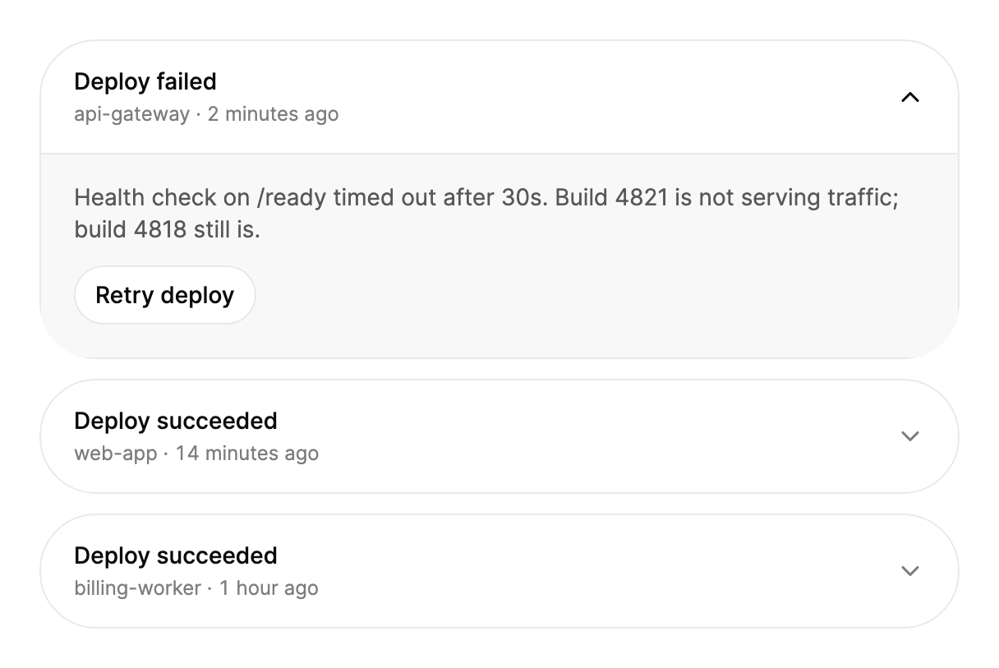

<Demo name="Default" />

## 何时使用

`ExpandableCard` 是一张摘要卡片，其标题会在下方打开一个详情面板。卡片始终保留标题和一行摘要，因此一列卡片仍便于扫读，而详情只在需要的人面前原位出现。卡片还可以横向展开，为宽幅详情（例如一条日志或一条状态时间线）提供空间，而无需离开列表。

- **开发者控制台中的部署历史**：每次发布是一张卡片，标题中显示构建、时间与结果。部署失败时卡片展开，显示失败的健康检查；部署成功则保持收起。
- **客户账户中的订单与配送状态**：标题为“订单 #4821”，其下是“已发货，周四送达”。详情列出商品、承运商与运单号；状态变化时，摘要随之更新。
- **账单中的套餐与订阅摘要**：套餐卡片显示价格与计费周期，展开后列出包含的席位、限额与发票记录。
- **事件与告警队列**：一排告警，标题中写明服务与时间，详情中包含错误信息和最近几行日志。

## 何时不用

- **多个互斥的文字区块**，例如 FAQ 中的问题：用 `Accordion`，它同一时间只保持一个答案展开，并把各行排成单一列表。
- **没有可展示内容的卡片**：用 `Card`。标题没有任何作用的卡片，就是一个没有用途的控件。
- **在同一位置浏览多张卡片**，例如产品或项目卡片组：用 `CardStack`，它在卡片之间切换，而不是原位展开每一张。
- **编辑记录**：用 `Drawer` 或 `Dialog`。卡片中的表单会与卡片标题及周围布局争抢空间，也没有放置校验消息的位置。
- **只需要“阅读更多”切换的长段落**：用 `ExpandableText`，它会把文字截断为设定的行数。

## 用法

```xml
<UserControl xmlns="https://github.com/avaloniaui"
             xmlns:arc="https://github.com/AIDotNet/TKCode.Arc">
    <arc:ExpandableCard Header="Pro 套餐"
                        Description="每月 ¥24 · 按年付费"
                        CollapsedWidth="420">
        <StackPanel Spacing="8">
            <TextBlock Text="无限项目与协作者。" />
            <TextBlock Text="一整年的版本历史。" />
            <TextBlock Text="优先支持，四小时内响应。" />
        </StackPanel>
    </arc:ExpandableCard>
</UserControl>
```

`ExpandableCard` 派生自 Avalonia 的 `HeaderedContentControl`，因此 `Header` 与 `Content` 的用法与任何带标题的内容控件相同。卡片额外提供摘要行（`Description`）、覆盖整个标题的触发器、箭头、详情面板，以及收起与展开两种尺寸之间的过渡变形。`Header` 是卡片标题，`Description` 是其下方的摘要行，`Content` 存放详情。

未设置宽度时，卡片填满其容器。

### 结构

1. **卡片表面**：表面颜色，1 px 的边框颜色描边，表面圆角与静止阴影。表面会裁剪其内容，因此标题的悬停填充会跟随卡片的圆角。
2. **标题触发器**：整个标题是一个按钮，至少 64 px 高，左右各 20 px 内边距，上下各 16 px。悬停与按下时，背景变为弱化的表面颜色。
3. **标题**（`Header`）：小号字号、中等字重，使用前景色。字符串类型的标题同时成为卡片的无障碍名称。
4. **摘要行**（`Description`）：特小号字号，弱化文字颜色，位于标题下方 4 px。当 `Description` 为 null 或空时，该行隐藏，标题收缩为只剩标题。
5. **箭头**：18 px 的向下箭头，位于文案之后 20 px，卡片收起时为弱化文字颜色。卡片展开或指针悬停在标题上时变为前景色，卡片打开时旋转 180 度。
6. **详情面板**（`Content`）：弱化的表面颜色，上方有 1 px 的分隔线。左右内边距 20 px，上方 16 px，下方 20 px。文字使用次要文字颜色、小号字号，行高 1.4。收起的面板高度恰好为 0 像素，因为分隔线是内嵌线，而不是面板自身的边框。
7. **焦点环**：标题周围 2 px 的焦点颜色环，仅在键盘焦点时显示。

### 宽度：CollapsedWidth 与 ExpandedWidth

`CollapsedWidth` 限制收起卡片的宽度（像素），卡片在其容器中居中。不设置时，收起的卡片填满容器。`ExpandedWidth` 限制卡片展开时的宽度，使卡片可以横向增长。未设置 `ExpandedWidth` 时，展开的卡片使用 `CollapsedWidth`。若未设置 `CollapsedWidth` 而设置了 `ExpandedWidth`，则收起的卡片填满容器，展开的卡片以 `ExpandedWidth` 为上限。

<Demo name="GrowingSideways" />

宽度与高度在同一个弹簧上一同变化，因此会横向增长的卡片，其详情应当在较宽的尺寸下也便于阅读。详情在展开宽度下始终保持布局，因此卡片移动时文字不会重新排版。

### 默认展开

`IsExpanded` 是双向的。设为 `True` 即可默认展开，也可以绑定到视图模型属性。当卡片存在的理由就是其详情时，默认展开是正确的选择，例如一次需要在列表中其他内容之前先处理的部署失败。

<Demo name="OpenByDefault" />

### 更新摘要

在代码中或通过绑定修改 `Description`。只有发生变化的词会滚入，其余部分保持不动，因此状态变化读起来是“变化”，而不是“重绘”。

```csharp
order.Description = "派送中 · 今天送达";
```

让摘要保持同一种格式，例如“状态 · 时间”或“商品 · 金额”。如果每次更新的格式都不同，所有词都会滚动，比只有行中某一部分变化更难读。

### 事件

`ExpandedChanged` 是一个会冒泡的路由事件。它在卡片展开或收起之后触发，因此处理程序看到的是新的 `IsExpanded` 值。

```csharp
card.ExpandedChanged += (_, _) =>
{
    logger.Info($"套餐详情已展开：{card.IsExpanded}");
};
```

### 绑定到视图模型

部署卡片通常属于一个视图模型，由它持有摘要以及卡片是否展开。使用 CommunityToolkit.Mvvm 时，视图模型通过属性通知卡片，而卡片则通过双向的 `IsExpanded` 绑定把读者的点击反馈回去。

```csharp
public partial class DeploymentViewModel : ObservableObject
{
    [ObservableProperty]
    private bool _isDetailsOpen;

    [ObservableProperty]
    private string _summary = "api-gateway · 2 分钟前";

    [RelayCommand]
    private void Retry() => Summary = "api-gateway · 正在重试";
}
```

```xml
<arc:ExpandableCard Header="部署失败"
                    Description="{Binding Summary}"
                    IsExpanded="{Binding IsDetailsOpen, Mode=TwoWay}">
    <StackPanel Spacing="12">
        <TextBlock Text="对 /ready 的健康检查在 30 秒后超时。" TextWrapping="Wrap" />
        <arc:Button Content="重试部署"
                    Variant="Secondary"
                    Size="Small"
                    Command="{Binding RetryCommand}"
                    HorizontalAlignment="Left" />
    </StackPanel>
</arc:ExpandableCard>
```

`Description` 应使用单向绑定，因为卡片只负责显示它。`IsExpanded` 应使用双向绑定，使得通过键盘、Escape 或读者点击收起卡片时，视图模型也随之更新。不要因为 `Description` 变化而从视图模型写入 `IsDetailsOpen`，因为卡片的展开状态由读者选择。

### 列表与堆栈中的布局

在垂直列表或 `StackPanel` 中，卡片取得面板分配给它的宽度，因此一列卡片无需在卡片自身设置宽度即可对齐。在水平堆栈中，可用宽度没有上限，因此由上限决定宽度：请为这些卡片设置 `CollapsedWidth` 与 `ExpandedWidth`，否则卡片会根据内容决定自身尺寸。容器尺寸变化会立即生效且没有动画，因此窗口缩放永远不会触发动效。

### 示例：部署历史

开发者控制台中的部署历史。列表显示三个服务的最近三次发布。第一张卡片是展开的，因为它的部署失败了，需要优先阅读健康检查的输出。每个标题都写明服务与时间，使列表的顺序与团队处理问题的顺序一致。宽度为 560，足以让详情文字在一到两行内显示。



```xml
<StackPanel Width="560" Spacing="12">
    <arc:ExpandableCard Header="Deploy failed"
                        Description="api-gateway · 2 minutes ago"
                        IsExpanded="True">
        <StackPanel Spacing="12">
            <TextBlock Text="Health check on /ready timed out after 30s. Build 4821 is not serving traffic; build 4818 still is."
                       FontSize="14"
                       TextWrapping="Wrap"
                       Foreground="{arc:ArcDesignTokenResource TextSecondary}" />
            <arc:Button Content="Retry deploy"
                        Variant="Secondary"
                        Size="Small"
                        HorizontalAlignment="Left" />
        </StackPanel>
    </arc:ExpandableCard>
    <arc:ExpandableCard Header="Deploy succeeded"
                        Description="web-app · 14 minutes ago">
        <TextBlock Text="Build 4820 deployed to 6 regions in 4 minutes."
                   FontSize="14"
                   TextWrapping="Wrap"
                   Foreground="{arc:ArcDesignTokenResource TextSecondary}" />
    </arc:ExpandableCard>
    <arc:ExpandableCard Header="Deploy succeeded"
                        Description="billing-worker · 1 hour ago">
        <TextBlock Text="Build 4812 deployed to 2 regions in 3 minutes."
                   FontSize="14"
                   TextWrapping="Wrap"
                   Foreground="{arc:ArcDesignTokenResource TextSecondary}" />
    </arc:ExpandableCard>
</StackPanel>
```

### 文案规范

- **标题**：句子式大小写的名词或结果，例如“Pro 套餐”“订单 #4821”或“部署失败”。保持在一行内；其余信息交给摘要。
- **摘要**：一行事实，格式固定，以中点分隔：“api-gateway · 2 分钟前”“每月 ¥24 · 按年付费”。列表按时间或状态排序时，把时间或状态放在最前面。
- **详情**：读者需要据此行动的信息，用完整的句子表达。详情面板应包含状态的原因与下一步，而不是重复标题。
- **操作**：详情中按钮使用动词加宾语，例如“重试部署”或“下载发票”。

| 不要写 | 改为 |
|---|---|
| 点击查看更多 | 套餐详情 |
| 状态：失败！！！ | 部署失败 |
| 更多 | 重试部署 |
| 详情 | /ready 的健康检查在 30 秒后超时 |
| 订单信息 | 订单 #4821 · 已发货，周四送达 |

### 最佳实践

**推荐**

- 让标题和摘要足够简短，使一列卡片一眼就能扫读。未展开任何内容时，读者读到的就是标题。
- 只有当卡片的详情需要优先于列表中其他内容处理时（例如失败），才默认展开它。
- 详情保持在一到两段简短文字加一个操作。过长的详情面板会把列表其余部分推向页面下方，而这正是卡片想要避免的。
- 列表中的每张卡片都设置 `Description`，要么全都不设。有摘要行与无摘要行的卡片混在一起，标题的高度会跳动。

**避免**

- 在详情中放置表单。收起面板中的校验消息与 Tab 顺序都难以触及；表单应放在 `Drawer` 或 `Dialog` 中。
- 每次更新都改变摘要的格式。词只在变化时滚动，新的格式会让整行都滚动，读起来就是噪音。
- 列表中只有一张卡片设置了 `CollapsedWidth`，其他卡片不设置。卡片宽度会不一致，列看起来参差不齐。
- 把卡片当作所有人都需要的某项详情的唯一入口。从不展开它的读者会错过，因此必要的信息应保留在页面上。
- 依赖动画来说明变化。卡片在静止时就是正确的，减弱动效时会立即显示相同的终态。

### 常见问题

**如何隐藏摘要行？** 将 `Description` 设为 `null` 或空字符串。摘要行会收起，标题栏只剩标题。

**为什么按 Escape 不能关闭卡片？** 只有在卡片展开、并且其内部没有控件已经处理该按键时，Escape 才会关闭卡片。详情中使用 Escape 的文本框或对话框会保留该按键。

**页面显示之前能否在代码中展开卡片？** 可以。在卡片加载前设置 `IsExpanded`，会立即显示终态，因此第一帧就是正确的。卡片加载之后，`IsExpanded` 的变化才会产生动画。

**为什么窗口缩放时卡片不做动画？** 容器尺寸变化会立即生效。变形动画用于读者的操作（展开、收起以及摘要更新），而不用于布局变化，因此窗口缩放永远不会触发动效。

**如何在卡片外部知道它的状态？** 读取 `IsExpanded`，或处理 `ExpandedChanged`。处理程序在变化之后运行，因此 `IsExpanded` 已经是新值。

## API 参考

<!-- api: ExpandableCard -->

## 无障碍

- 标题是一个按钮，遵循展开与收起模式，因此辅助技术会播报卡片是展开还是收起，卡片状态变化时也会同步播报。
- 标题为字符串时，卡片的无障碍名称即为其 `Header`。`Description` 作为标题按钮的帮助文字公开，因此它在名称之后朗读。
- 摘要行也以文字元素的形式公开完整内容，因此屏幕阅读器读的是整行，而不只是滚入的那几个词。
- 卡片收起时，详情处于惰性状态：其中的控件无法获得焦点，也不接收指针输入。
- 焦点位于展开卡片的任何位置时，Escape 都会收起卡片，并把焦点返回到标题，因此焦点不会停留在已经收起的面板中。

### 键盘

标题是一个按钮，因此标准按钮按键同样适用。卡片额外提供 Escape 收起。

| 按键 | 操作 |
|---|---|
| `Tab` / `Shift+Tab` | 移到标题；仅在卡片展开时才能进入详情 |
| `Enter` / `Space` | 从标题展开或收起卡片 |
| `Escape` | 焦点位于卡片内且没有控件处理该按键时，收起展开的卡片，然后把焦点移到标题 |

## 动效

- 展开是一个整体动作：宽度与高度以不过冲的平滑弹簧一同增长，箭头随之转动。卡片通过改变真实尺寸而不是缩放来变化，因此文字与圆角都不会被拉伸。
- 卡片为详情腾出空间之后，详情才淡入。收起时，详情先淡出，卡片随后收缩。
- 动画进行中再次点击，会从当前尺寸与速度反向运动。在约 450 ms 内、紧随另一次变化之后发生的收起，会跳过卡片收缩前的停顿。
- 在摘要行中，变化的词从下方带着柔和模糊升起。它们所替换的旧词向上飘离并淡出。未变化的词保持不动。
- 减弱动效时直接应用终态，摘要文字无动画地替换。

| 变化 | 完整 | 减弱 | 关闭 |
|---|---|---|---|
| 卡片展开 | 宽度与高度以平滑弹簧一同增长；箭头转动 | 直接展开 | 立即完成 |
| 详情出现 | 卡片腾出空间后淡入，延迟 120 ms | 直接显示 | 立即完成 |
| 卡片收起 | 详情在 100 ms 内淡出；卡片在 60 ms 停顿后收缩 | 直接收起 | 立即完成 |
| 摘要变化 | 变化的词升起，旧词飘离并淡出 | 直接替换 | 立即完成 |
| 标题悬停与按下 | 背景渐变为弱化的表面颜色 | 立即完成 | 立即完成 |

## 相关组件

- `Accordion`：用于由互斥区块组成的列表。
- `Card`：用于没有可展开详情的卡片。
- `ExpandableText`：用于在原位展开的长段落。

| 组件 | 适用场景 |
|---|---|
| `Accordion` | 多个文字区块作为一个列表，每次展开一个 |
| `Card` | 卡片没有需要展示的详情，因此内容始终可见 |
| `CardStack` | 读者在卡片之间切换，而不是逐一展开 |
| `ExpandableText` | 一段长文字显示几行，并带有“阅读更多”切换 |
| `MetricCard` | 单个数字及其趋势就是卡片的全部意义 |
